# 【实战复盘】一个人做 AI 培训师，如何从 0 粉，靠借势把个人经验成功变现？

260126 副业 SC 精华

公众号懒人搜索，懒人专属群独享

懒人微信：lazyhelper1

各位生财的圈友大家好，我是小圆，刚进生财一个月的新人

很多人觉得通过分享经验/知识变现很难，要学自媒体、要攒粉丝、要成为某个领域的大佬。但在我看来，如果你有某种经历或爱好比普通人略懂一点，其实你已经具备了经验变现的入场券。而且执行起来真的没有想象中难。我从一个“AI 新手”到线下手把手教学 1000+ 学员，从 0 成本同城沙龙讲到客单价上万的企业内训，全程落地执行，基本自己一个人完成。

本篇分享我会拆解一套“个人能力变现”的 SOP。全文约 4000 字，包含从 0 到 1 的所有执行细节、所用的工具、策略等等，适合想了解知识变现、线下活动、企业培训、线上推广物料制作的小伙伴。

## 核心成绩单

- 起步：0 粉丝、0 成本，20 天跑通第一场线下培训共学营。
- 交付：累计线下教学 1000+ 人，学员好评率 98% 以上。
- 进阶：成功切入 B 端，受邀为广东政府单位、电视台、高校、创业孵化基地、交通行业多家公司提供 AI 培训。
- 收益：从单场几百元到每小时课酬千元，实现“半天赚到一个月的工资”。

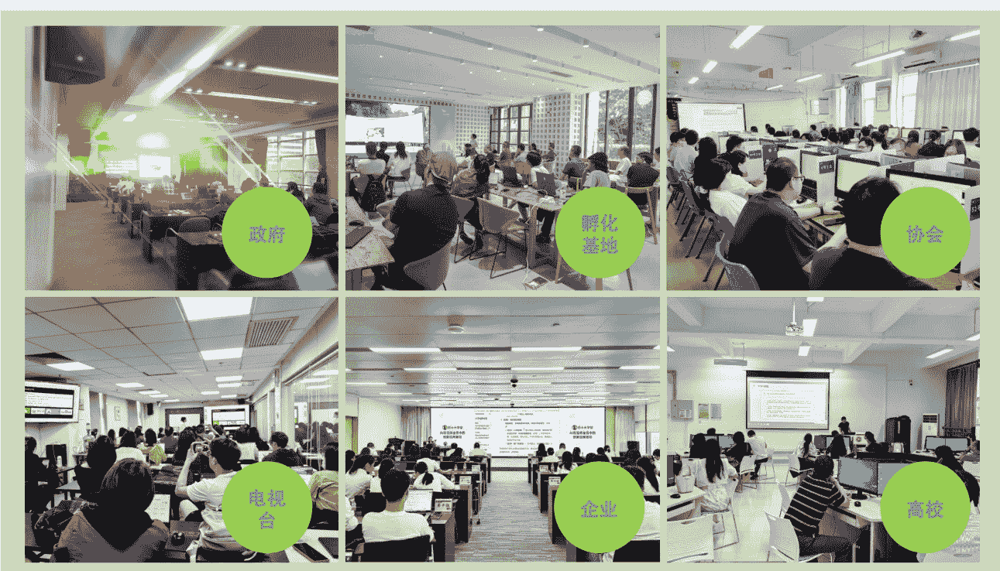

## 培训内容：从 99 元到万元企培

简单给大家拆解下我的变现路径，其实就是“C 端练兵，B 端放大”：

- To C (夜校/训练营模式)：主打职场刚需。99-199 元的夜校讲办公提效 (文稿、PPT、Excel)；798 元的训练营办公 + 副业 (在办公的基础上加上副业项目、小红书爆款、智能体工作流等)。这部分主要是为了积累案例和口碑。
- To B (定制化内训)：我会根据客户 (如交通企业) 的日常工作，定制新闻稿撰写、PPT、宣传视频的 AI 提效实操跟练培训方案。这是后期的核心业务，客单价高，备课轻松

其实我讲的内容不是特别深，但是 AI 还存在信息差，很多人真的不会用，特别是在周边二三线城市的企业职工。所以还有很多机会可以做的。

## 一、萌芽期：别等成了高手再出发，你只需要比小白好一点

很多人卡在第一步：“我不是大佬，我凭什么教别人？”

我最早在广告公司，只是比别人早用了几个月 GPT。2024 年元旦，一场我们组织的全女 Web3 线下活动，AI 老师临时缺席，我自告奋勇顶上，手把手教会了 30 个姐妹开始用 AI。比如用 gpt 写文案，用 mj 做自己的头像，这类基础的内容。

那时候我发现：

只要你能找到你想沟通的人群，并解决他们的问题，哪怕这个问题在很多人看来很粗糙，

你就可以赚到钱，赚钱的本质就是找到需求，解决需求。

我在抖音上刷到一个女生，只是分享她战痘的经验，就产生了很多客户。她不是什么皮肤科医生，只是一个“过来人”，一样可以取得大家的信任。所以第一步，先克服内心的障碍，用一场分享先初步尝试起来。

## 二、执行期：0 成本线下活动招生的“借势”SOP(喂饭级细节)

我是真心觉得做小红书抖音招募反馈太慢了，要学习的东西好多啊，我很可能会中途放弃，启动不起来。

我需要快速的正反馈！所以直接放弃这个路径了，换了条路。

我的核心执行方法只有 1 个字：借。

### 借渠道：

#### a、同城活动公众号合作（0 成本起步）

找同城活动类的公众号，他们有流量，你有内容，一拍即合。

- 分成策略：我直接给 30%（一般是 15%-30%）。

- 沟通话术模板：

> “你好主理人，我是 AI 讲师小圆。我有一套线下 AI 共学营课程，专门针对职场小白。我看您的粉丝画像非常匹配，希望能合作一场线下沙龙。您负责招募，我负责全流程交付，学费您直接拿 30% 分成，您看可以吗？”

#### b、补充方法：后期低成本“暴力”群发 (适合建立信心)

如果你愿意花个几十、一百块的，想快速得到反馈，可以试试这个“大力出奇迹”的招募法，这个是我做到很后期，我组了一些沙龙，还有测试一些项目 MVP 的方法。对于刚启动的人来说，比起在社交平台发帖等消息，我觉得更容易建立早期的信心，让你不会一开始就很受挫。

- 买群/加群：直接找类似“群脉联盟”这种平台，几十块钱就能买到 100 个同城群。记住，一定要选同城，精准度才够。

- 闲鱼代发 (人型群发机)：如果你不想自己动手，直接去闲鱼搜“代发”。这种方式主打一个“快”，适合客单价低、门槛低的引流活动。

- 避坑指南：这种群的质量参差不齐，不太适合高客单价的客户。还有如果你怕封号，淘宝上有那种“无限微信号”的工具，虽然生命周期短，但作为“敢死队”去冲锋完全够用，避免自己的账号被封。

- 这个方式还适用于其他场景：比如卖虚拟资料、招募兼职、招募代发素人、测试小 MVP。非常好用。

### 群脉联盟网站

https://www.qmlm2022.com

群脉注册是需要邀请码的，可以填我的：STGS35。也可以去百度搜一个。

### 闲鱼代发参考价格

大量群发这个玩法我还有碰到一个打兼职粉的人，一天可以加到 1000 多人。

### To C 销转策略：找拥有大量潜在客户的人直接合作

如果你是做同城就跟做同城活动公众号的合作，如果你是做社区，那你可以去跟做社区团购的人合作，甚至你可以去跟实体店合作，比如说你掌握了 AI 写真的能力，那是不是可以去跟大量旅拍店合作？

一般来说，一个基础有几千人的社群，如果你的服务是贴合的，一次宣传最差都可以筛出几个用户的。我之前做一场培训，一个活跃社群最高一场可以给我招到 40 个人。

同时多合作几个社群就行。再通过比如两人同行有多少折扣的方式，形成自裂变。

### 借工具：AI 辅助 20 分钟快速搞定推文 + 海报

- 推文文案：用 DeepSeek 快速写推文

技巧：投喂你觉得写得好的对标推文，让它深度学习，投喂可以解决 80% 的写作问题！

#### ① 提示词：

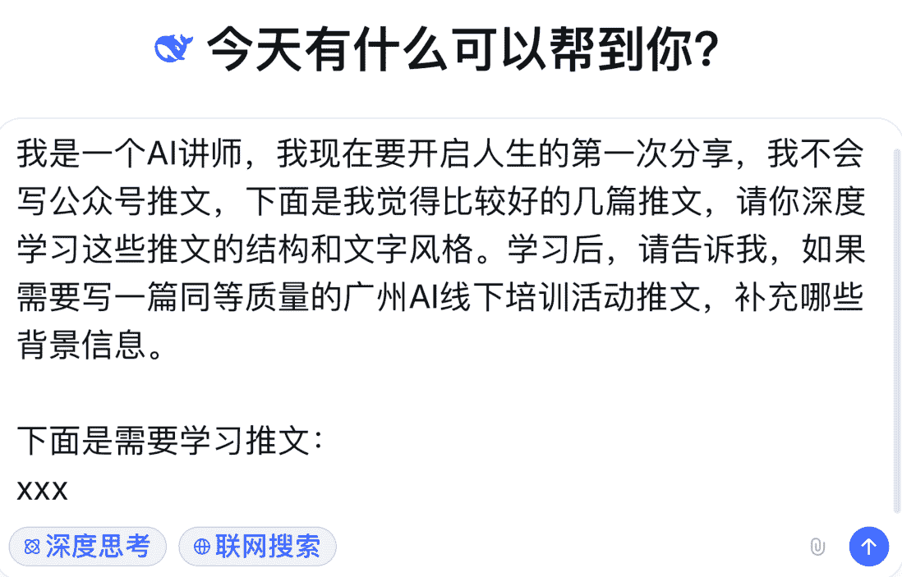

#### ② 提示词：

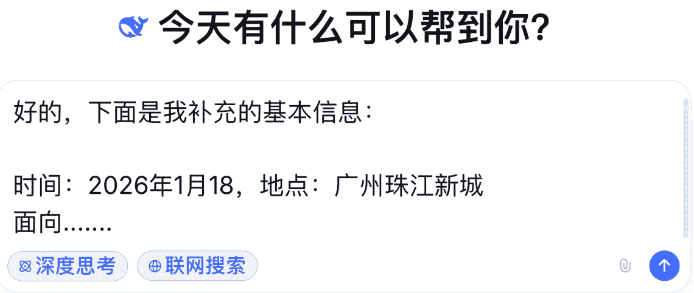

#### ③ 提示词：

这段提示词是精华！可以帮助大家把之前的训练过程固定下来，相当于做了一个小型的智能体。后续沿用可以省很多力气。

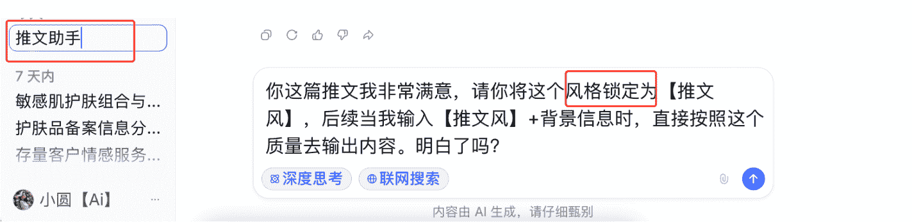

- 海报：用 roboneo 直出海报，而且海报还可以拆分修改！！！目前市面上很多 AI 生图工具都有两个短板。

1. 不支持大量内文
2. 不支持拆分修改，需要大量抽卡

但是！roboneo 这个工具完美解决这两个问题，哪怕有很多详细的内文，文字也不会出现乱码，而且支持像 ps 一样拆分修改图层。改字、改元素。真的是做活动海报的利器！！！以前我就没这个条件，你们也是赶上好时候了。

工具网址：https://www.roboneo.com/

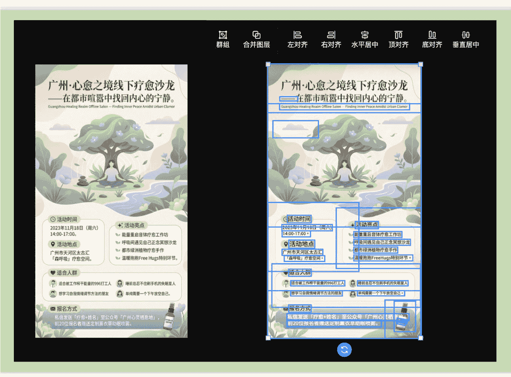

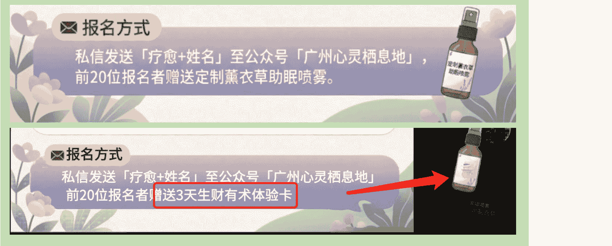

有一个小细节要注意⚠️，roboneo 里面直接生成的图片是不支持拆分图层的，你要先下载下来，然后再重新添加进去。同样的，你们在外部软件生成的图片，也支持在这里进行拆分处理哦！

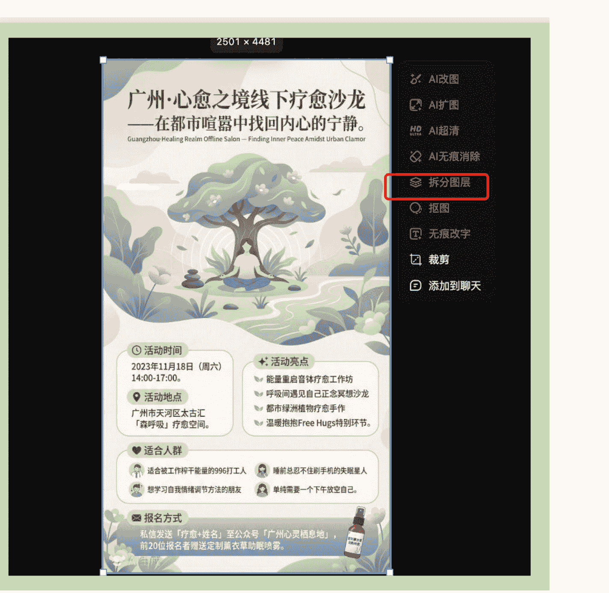

- 公众号排版：用【96AI 排版】，Word 图文同时导进去一键成型。大部分公众号主理人是不会帮你做排版的，那用这个工具就超级方便了，它是支持图片跟文案同时导入的，所以只需要现在 word 里面简单插入图片，3 分钟不到就可以排版好一个公众号推文。模版也是随便换，而且赠送很多免费次数。

工具网址：https://bj.96weixin.com

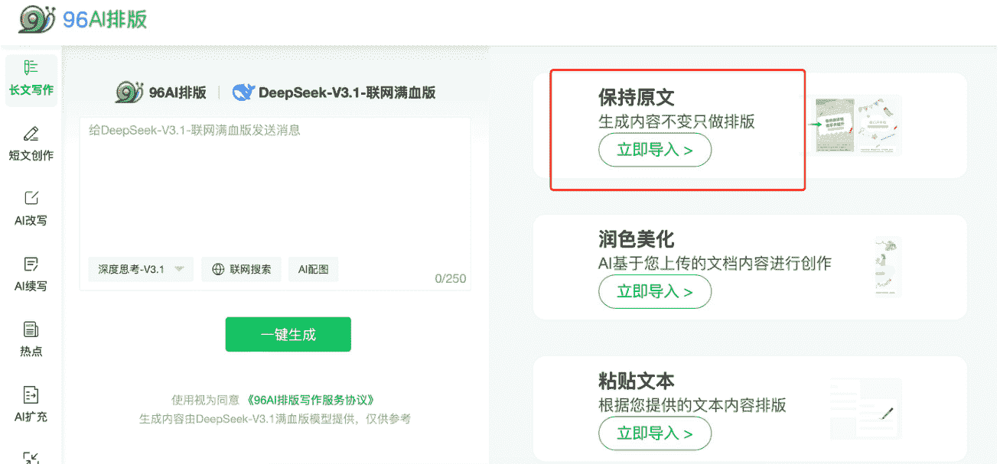

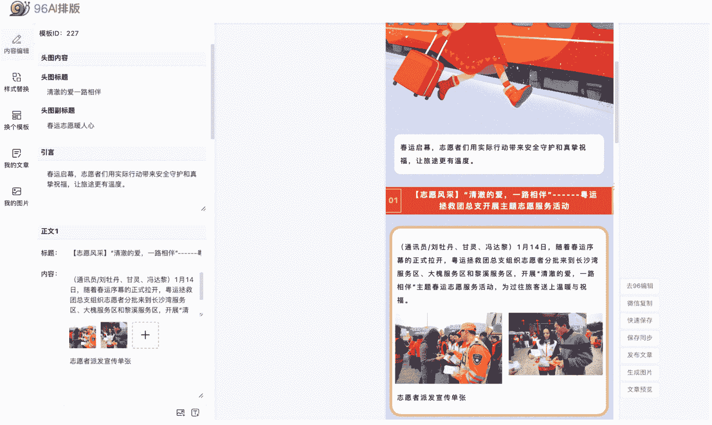

- 课程设计：用 Deepseek 出一个大纲，就可以开始招募了

我之前看的一本书叫【单干】，里面有个❗“纸盒模型”理论真的对我帮助很大，简单来说就是不要追求完美，先做出一个粗糙的“纸盒”丢给市场。如果有人愿意为你的纸盒买单，你再把它精修成“金盒子”。

### 借场地：咖啡馆/空间合作

小红书搜“免费场地”，很多咖啡馆需要人流。或者直接找帮你推广的同城活动公众号推荐场地，他们多得很。

- 合作逻辑：不给场租，按人头给咖啡钱（比如 20 元/人），直接算在门票里。或者就直接跟他们说要场地免费，因为人过来了就会消费，咖啡馆也是很支持的。

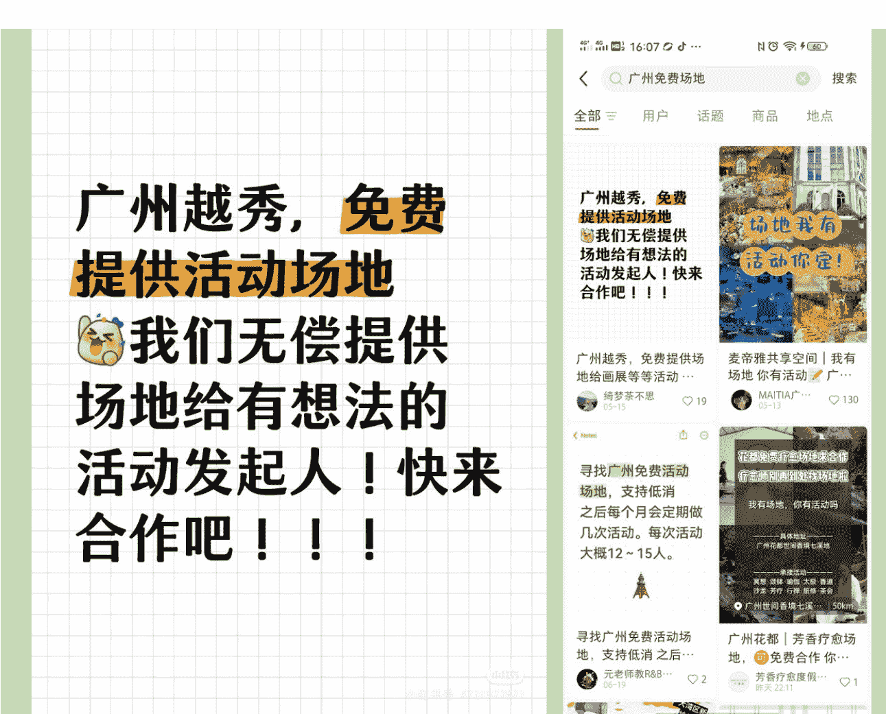

## 三、爆发期：从 C 端沙龙到高客单 B 端企培

做 C 端很辛苦，但它是最好的“练兵场”。因为从一开始面对 15 人我会手忙脚乱，到后面一个人面对 100 个学员都游刃有余，而且我最开始的 B 端客户也是来自 C 端的转介绍。

只有做 B 端了，钱才赚得比较轻松。那 B 端客户是怎么稳定的呢？

转机就是我受邀去【公共交通协会】开展一项 AI 培训。培训的对象是广东省内的交通部门和企业的职员。一场培训我一次性接触了很多家交通企业，从这场开始，基本每一场都会产生转介绍，从协会讲到公交巴士讲到高速，基本几个月，把广州周边的几个城市都跑了一遍。

这个时候我的课酬每小时是上千元，一场就可以相当于很多人一个月的工资了。

### 销转策略：

- 扎进细分行业，先通过协会渠道去多次触达，再做好交付，形成转介绍

我一场协会的分享差不多会产生 3 个企业客户，一场同行业企业的分享会产生 1 个新客户。

核心还是认准行业，做细做深，做好交付。

### 【方法论】速通 B 端的 2 个野路子：

1. 行业协会切入：主动联系行业协会 (如交通协会、餐饮协会), 提出做一场“公益分享”。协会背书 + 精准人群，一场讲完，台下全是潜在的 B 端客户。(当然你也可以要求付费合作，因为我是转介绍的，所以都是付费合作)
2. 闲鱼“人型 HR”: 在闲鱼找兼职人员，帮你搜集特定行业的企业联系方式，再找 人去主动邀约。一般公众号后台，就有联系方式。

我还有个朋友是跨境公司的，前期做了一两场 to C 的沙龙分享后，跟一个做陪跑的社群合作，直接做客单价上万的陪跑。如果你不想做 B 端，这个路径也可以。

## 四、压轴干货：如何做一个“让人听得懂”的分享者？

我几乎所有 B 端客户都是转介绍过来的，很多学员跟我反映说他们其他也听过很多 AI 课，但是很多听了想睡觉，但是我的不会，我复盘后总结了几个原则，可能对大家有帮助。

### 原则 1: 一定要说别人能听懂的大白话 (可用 AI 验证)。

之前在广告公司做文案，我觉得最有价值的认知就是，广告语是说出来的，不是写出来的。

你一定要把复杂的东西说得通俗易懂。

我有系统的训练，所以很得心应手，那大家如果并不擅长，可以用 AI 去帮助你验证。

- 方法：开始分享前自己录音讲一遍，然后把文稿或者/音频发给任意大模型。用以下提示词检验

我是一个 xxx 老师，我要大家做一场分享，这是我的讲稿，请你现在作为一个完全小白，且学历不高的普通人，帮我观察按照这个讲稿讲，内容是否通俗易懂，有没有费解的地方。同时你再作为一个挑刺的人，指出我这个分享中，逻辑结构不通顺，会让听众产生困惑的地方。下面是我的讲稿 +【讲稿】

### 原则 2: 必须与参加的人“有关系”

没有人想听跟自己无关的东西!!!人就是听到跟自己有关系的东西才会活跃才会兴奋。

我以前参加一场沙龙活动，要求给在场的人都准备一张明信片，一个一直很安静的小伙伴，做了一个我们全场都超级惊喜的事情，他在明信片上把我们的朋友圈封面 打印出来，贴上去，然后用我们的标签语去做祝福。

这种就是“与我有关”的力量。没有人不喜欢被看到

对应这个原则，我的做法：

1. 所有演示材料尽量提前跟大家搜集自己日常工作的材料，这样学习内容即学即用，跟他们息息相关
2. 会设计一些“情绪高潮”，比如把其中某个同事的照片拿来做数字人“舞蹈视频”，每次课上演示，都是全场爆笑，因为嵌入很多这种小细节，所以大家会觉得这个课很有价值也很有趣。

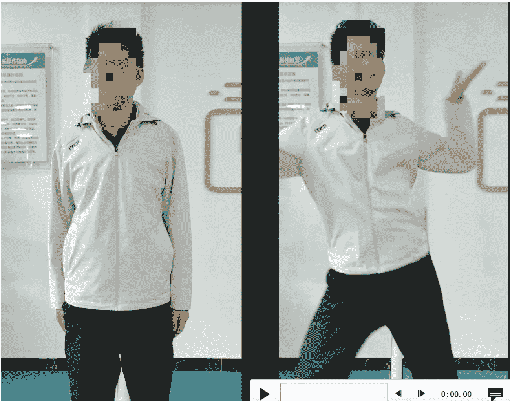

### 原则 3：必须真正能解决参加的人的“问题”

除非另外要求，不然我都是教实操跟练的，很多人在学 AI 方面，真的就是卡死在一些操作的小问题上。

我觉得跟练效果是最好的，是真正可以解决大家问题，虽然我知道这个很难批量复制，很难扩大。

但我认为，它是正确但是辛苦的笨方法。前期如果你什么都没有，那要有决心做一些别人不愿意做的事情的。

但意外的是，这条路径让我避开了线上卖课这种超级卷的竞争，才可以顺利做起来。

## 📝 结语：任何想做的事情，72 小时内必须启动

加入生财不到一个月，我发现这里最不缺的就是项目，最缺的是“执行力”。

一旦冲劲消退了，可能永远就不会再执行了，72 小时已经消耗得差不多了，如果可以 24 小时内执行更好，先做出一个粗糙的纸盒出来！再慢慢完美成一个金盒子！

这是我第一次发言，因为听说要申请进深圳联合办公，要有多发言多做贡献。

所以赶紧来发帖啦！

如果反馈比较好的话

我后面再更新一些 AI 实操内容或者旅居搞钱的经历哒～

## 最后，安利小懒的付费群：

懒人专属群（介绍）

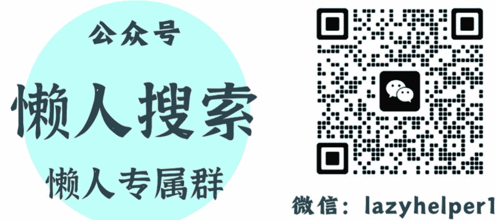

🧩 这里是你对抗信息过载的护城河。

已稳定运行 7 年，累计拆解、研读 3000+ 个互联网商业实战案例与行业前沿内参和时政/宏观文章。

我们不搬运垃圾，只做高价值信息的筛选器与放大镜。

### 懒人专属群更新记录：

https://hk57gvlx7u.feishu.cn/docx/H0kRdZbSboIBR0xkaXtcuVE0nTg

【免责声明】本资料归档于社群内部知识库，仅供成员课题研究与学术交流，请在查阅后 24 小时内删除。