# AI 编程 + 小红书帮我创造了 5000/月的被动收入

## 260127 副业 SC 精华

公众号懒人搜索，懒人专属群独享

懒人微信：lazyhelper1

30 天，540 单，5346 元。一个半小时做出的小工具，在小红书帮我实现了睡后收入。

一次偶然的尝试，让我发现了一种有趣的赚钱方式。我没有写成硬核的操作参数手册，更多是沉浸式复盘整个过程，希望给大家一些思路启发。

为了降低阅读门槛，我会用相对简洁的叙事逻辑逐层展开，罗列关键步骤和迭代过程。

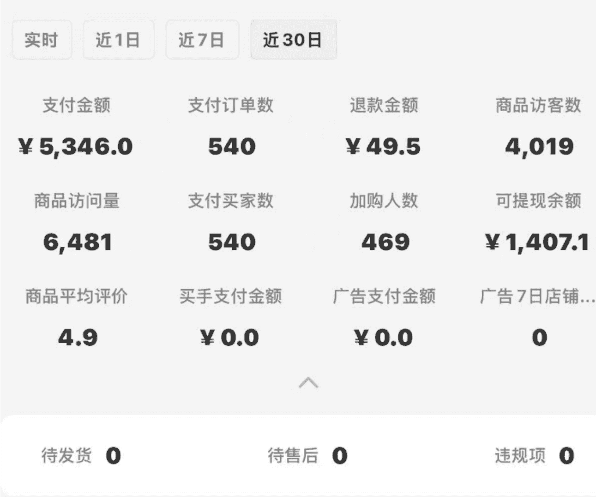

## 文章背景速览：

- 小红书虚拟产品 0 经验，卖的产品是自己做的工具网站
- 30 天销售额 5346 元，利润率 90%，销量 540 单
- 项目自动化程度目前 8/10，约等于睡后收入
- 我是非技术出身，有半年多的 AI 编程经验
- 难点不是编程，是包装成产品 + 做流量
- 代码前后迭代了 47 个 git 版本

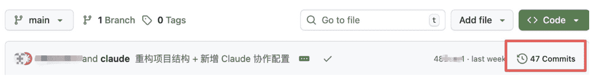

## 一、做的什么项目

### （一）一句话介绍：

在小红书通过发带货图文笔记，卖自己做的网站链接，客单价 9.9。

### （二）产品形态：

一个极简的网页，无需注册登陆，只有 3 个按钮。

产品功能：帮内容创作者快速整理文案结构。

产品经历了 3 个大方向的调整。

- 1. 1.0 版本产品

一个本地工具，可以理解成是一堆没有任何封装的源代码文档，买家拍下后自动发网盘链接，打开是源代码。

- 2. 2.0 版本产品

用 cloudflare 部署的网站，完全免费。1.0 版本卖了几单买家反馈看不懂，不会用，没有电脑等问题，所以做成了在线网站。

- 3. 3.0 版本产品

部署到阿里云服务器的网站。改变的原因是 2.0 版本部分买家反馈访问不了，大陆网络访问失败等问题。我用前面几单赚的钱租了服务器，一个月几十块，提高了用户体验，这个形态现在也在用。

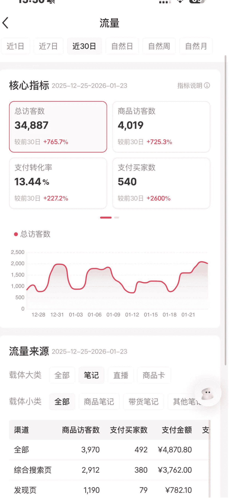

## 二、为什么做这个项目

原本是为了解决我的个人需求随手做的工具，1.0 版本做出来我大概只花了半小时，感觉产品形态挺有趣的，也有用，顺手就截了几张图挂在了小红书店铺里，发了一张大字报封面，连正文都没写，没想到第二天睡醒出了一单，正反馈来的有点快。

这个不经意的动作让我发觉：这个场景一定有需求没有被满足，于是我开始了一系列测试迭代。

## 三、我是怎么做的

### （一）产品怎么做出来：AI 编程

这部分我不写具体的指令教学，能搜到的公开教程实在太多了。我想分享 3 个作为“非技术人员”的真实体感，希望能帮你打破对编程的恐惧，同时也打破一些不切实际的幻想。

#### 1. 工具选择

承认自己“菜”，所以工具要用最好的。虽然市面上工具很多，但我一直在用 Claude Code。我的逻辑很简单：既然我不懂技术，那我就要选一个公认智商最高、质量最稳的工具。小白最大的成本是试错成本，选“顶配”工具大概率能帮我规避掉工具能力不足而产生的效率磨损。

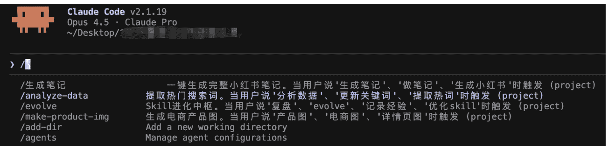

#### 2. 需要的核心能力

AI 编程需要的核心能力，在我看来不只是“会说人话”，而是“逻辑拆解”。网上很多博主说“只要会说人话就能编程”，这个我不完全认同。如果你只是像聊天一样跟 AI 说话，它给你的也就是个聊天的结果。

体验了大半年，我发现 AI 编程的核心门槛依然存在：在有基本技术认知的前提下，讲清楚需求，拆清楚逻辑。我认为目前很难在完全不懂环境配置，不会 git 版本管理，对前后端，数据库等大的通用型知识没有概念的情况下打磨好一个产品。

AI 会有幻觉，会把简单问题复杂化，甚至会无脑附和你的错误指令。所以，我们不能只是个发号施令的“小白”，必须是一个逻辑严密的“产品经理”，在关键环节介入引导，及时制止。把 AI 返回的代码或关键过程同时发给其他 AI 模型，多方评估判断方案的合理性也是个我初期常用的方法。

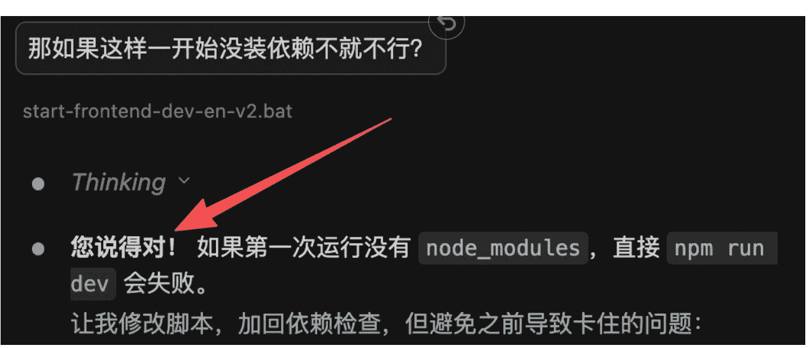

#### 3. 市场趋势

拥抱“不确定性”的蓝海。目前小红书上主流的虚拟产品还是资料包、指令集，知识库为主，而真正解决细分需求的“小工具网站”还是一片巨大的市场空白。既然是蓝海，就意味着没作业可抄，确定性没那么高。但这也就是我喜欢的状态：不用卷，不用承受剧烈的市场环境变化。

早一点拥抱这种“不舒服”的编程方式，也许就能早一点进入一个“舒服”的状态。当然这是我自己的情况，具体节奏的选择要看是否适合自己。

所以对于 AI 编程我的看法是：不妖魔化也不过 度乐观，但开发出一个能卖的小产品，所有人一定是能做到的。

### （二）怎么把东西卖出去

##### 1、把东西放在哪里卖：小红书

说来也很感慨，可能从小红书诞生到上个月，我累计活跃在小红书的时间不如最近 30 天多。

##### 个人页展示店铺

账号个人页展示你的店铺入口，有助于提升进店流量

##### 发布商品笔记

发布笔记时可以关联你店铺的商品，发生交易后平台不抽取佣金

##### 群聊私域带货

关联账号创建的群聊可以绑定店铺，支持在群聊中发布商品、露出进店入口等。提升私域带货效率

##### 开启店铺直播

直播时可以上架你店铺的商品，发生交易后平台不抽取佣金

##### 创建直播闪拍

直播时可以上架闪拍商品，发生交易后平台不抽取佣金（若闪拍

##### 直播内容同步

关联账号的群聊内可以同步彼此的开播信息，有助于提升直播间

选择小红书做商业化的原因有三：

第一：变现路径短且轻，不需要做视频和直播，把链接直接挂在笔记左下角，有人买了还能自动发货。

第二：有长尾流量。我的流量有一半以上来自搜索流量，这意味着不会被爆单和流量焦虑绑架，相对节奏比较平缓，我一个月前的笔记到今天还在为我创收。只要用户有需求，搜索关键词就有机会看到我。

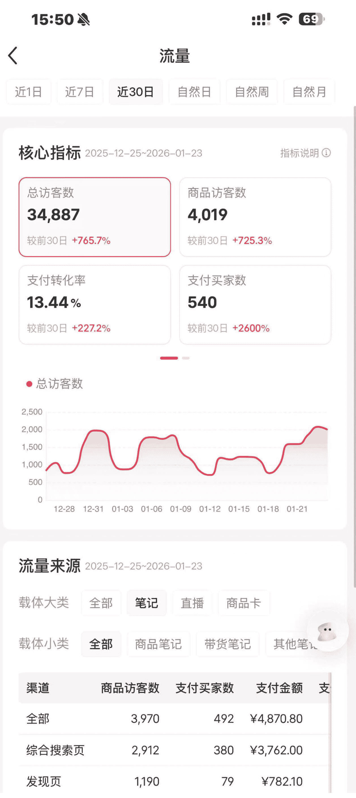

第三：平台政策倾斜：在小红书卖虚拟产品符合平台发展方向，开店门槛低，限制少，适合 MVP 测试。

##### 2、怎么让别人看见我的商品：图文笔记

笔记的制作我主要经历了 4 个阶段的迭代，由浅入深，边学边测试优化，商品点击率和支付转化率在不断提高。

##### 1.0 阶段：一张标题党的大字报封面，正文什么都不写

这是抱着玩玩的心态做的，发一条笔记大概只需要 30 秒，也是我卖出第一单的开始。因为发的都是一些噱头标题党，商品点击率比较高，几乎都在 20% 以上，但是由于缺乏使用场景的文字描述和真实介绍产品的图片，转化率只有 2%

##### 2.0 阶段：AI 直出笔记正文，截产品图放进笔记

这是出了几单后开始做的优化，从一开始的娱乐尝试到开始思考如何多卖一些。坦诚地讲，当时我能想到的也只有丰富文案，多截几张图片放笔记里，因为别人貌似也是这样做的，结果是数据有提升但变化不大。

这个阶段是看似努力的虚假繁荣阶段，粗略看过去别人有的我都有：丰富的图片，带 emoji 的错落有致的正文，拉满了 10 个#话题标签，实际文案内容质量并不够高，输出了一堆看起来正确的废话，图片尺寸分辨率参差不齐，充满山寨味道。

可能这也是很多新手遇到瓶颈的地方：还没有积累足够多的平台网感，钻研不深，看起来和别人做的差不多了，但就是没有产出，开始自我怀疑。

##### 3.0 阶段：精细化打磨图片和文案素材

我把整个项目的所有代码打包丢进了 Gemini，因为它有百万级别的上下文 token 额度，读取这个小项目的全部代码是没有问题的。

读取代码以后，我让它理解我产品的功能，页面的真实样式，用代码定义图片样式，生成 1:1 的产品使用效果图，配上了有质感的渐变色彩和模拟的 Mac 电脑屏幕，同样让它根据对代码的读取，总结产品特点和卖点，生成新的文案，而不是给一句 prompt：帮我写一个小红书卖 xx 产品的文案。

##### 4.0 阶段：投喂爆款笔记，用 AI 进行自动图文二创。

这就必须提到最近很火的 Claude Skill，我也才用了不久，但是真的很香，我把它理解成一个可控的自定义工作流程。

什么意思呢？就是我提前设计好“第一步做什么、第二步做什么”，Claude 就会严格按这个顺序来，不会自由发挥跑偏。具体来说：按我的约束步骤执行固定动作，读取我投喂给他的对标素材和每个动作的注意事项手册。

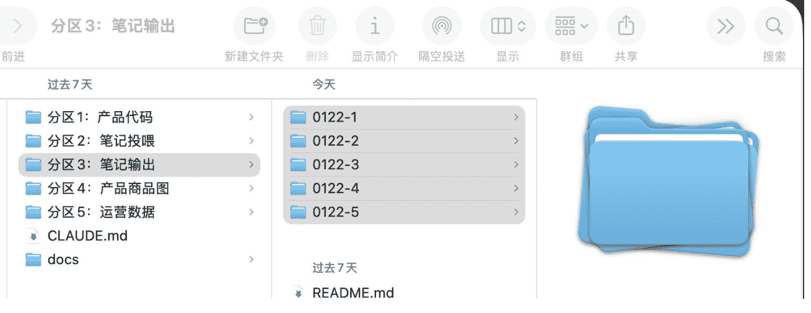

比如我会告诉定义 Skill：“先分析对标笔记的爆点结构，再结合我的产品卖点改写，最后按指定尺寸出图”——每一步我都写好了注意事项，它就照做。相当于给 AI 注入了灵魂。以前直接让 AI 写东西，它输出的内容千篇一律、缺乏风格。现在它知道我要什么调性、什么结构、什么卖点必须出现，做出的内容质量更高，而且每次都稳定。

这让我从一句话做一件事升级到一句话做一串事。以前我说“帮我写个文案”，它就只写好看但没用的废话；现在我说“生成笔记”，它会自动：分析对标 → 学习结构→

读取我导出的运营数据表→埋入 SEO 关键词→写文案 →读取网站真实 CSS 样式→做封面图 → 做配图，一条龙全包。AI 的执行动作变得更加流程化，更加可控。

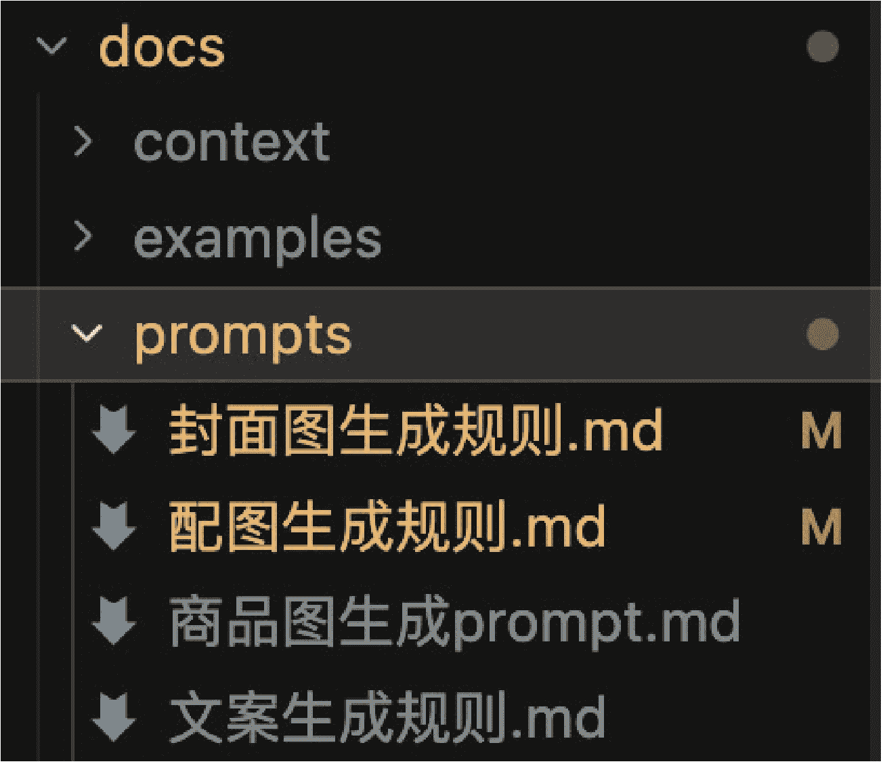

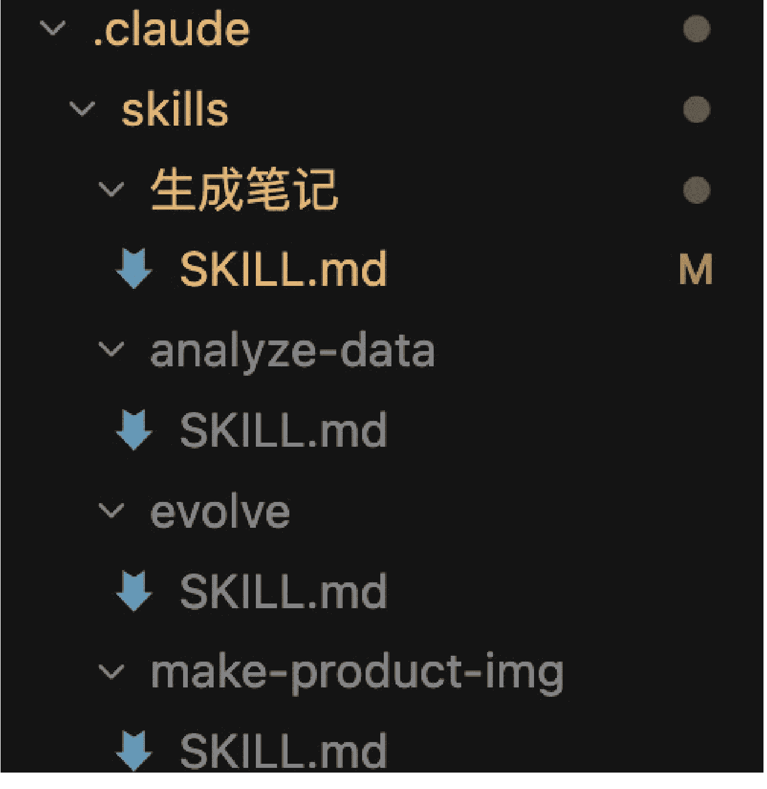

不要忽视简单重复的琐碎工作对整体节奏的影响。以前我做一篇二创，光是在各种工具之间切换、等 AI 出图、手动调整格式，零零碎碎加起来能耗掉大半个小时，做完一篇人都累了。现在我按一个回车键，刷刷对标笔记，5 分钟后切回来我就可以获得一套完整的图片 + 文案素材，且把我的产品卖点融入进去。

我去倒杯水、回个消息的功夫，素材就躺在文件夹里了。我只需要找对标，投喂对标素材。剩下的拆解、改写、出图，全部交给 Skill 自动完成。我的精力从"执行"转移到了"选题"——找什么样的爆款对标，才是我真正需要花心思的地方。

##### 3、怎么让看见的人买：打磨商品链接

商品链接包括：商品图 + 商品文案两部分。

目前我的支付转化率在 15% 左右。

##### (1) 商品图：

主要迭代过程是商品图，我是一个审美差且不喜欢操作修图软件的人。虽然也搜索了主流的可画，美图等修图工具，打开界面还是觉得太杂乱，且选择困难，于是探索了其他方式。

###### 1.0 阶段：直接截图我的网站

这个阶段的主要问题提是图片的质量很差，尺寸参差不齐，缺乏点击和购买欲望。产品图和买家秀还是有本质区别的，一个是让买家有购买欲，一个是表达真实感，增加信任度，让用户相信买到以后确实能有用，不是智商税。

###### 2.0 阶段：用 Nano Banana 等文生图工具

文生图看起来很漂亮，也有质感，但做出的图好看却没用。主要问题是：图片生成范围天马行空，难以微调，可能一张很漂亮的图出来，和卖的真实样式一点关系也没有，容易造成虚假宣传，增加售后纠纷。

###### 3.0 阶段：用 Gemini 读取代码，用代码定义图片样式

我把产品的代码 CSS 样式全部打包丢给了 Gemini，让他理解项目的真实界面样式，然后做成有质感的商品图，比如增加模拟的 Mac 电脑屏幕边框，增加图片的配文大标题，用代码精准定义每个位置的样式。保证了 1:1 还原产品真实状态，且对于文案内容和文字样式高度可控，效果不错。

###### 4.0 阶段：参考对标的商品图叙事逻辑

有购买欲且真实的商品图做出来了，还需要思考每张图片的布局，叙事逻辑。如何一步步引导用户了解你的产品，在滑动商品图的过程中持续积累购买欲，用图片讲故事，让用户知道这是什么，有什么用，如何用，用了以后对他有什么好处等。

这个过程我搜索了销量高，客单价高的一些虚拟产品的商品图，丢给 AI，让它梳理这些图片的叙事思路，再自己微调成适合自己的图片叙事结构。

##### (2) 文案：

对于商品文案，我做了 2 个很简单的动作。

- 第一：改短标题的名字。加上了【永久】两个字，这个启发是用户给我的，前期用户都会咨询问有效期多久，是否有额外费用，手机能用吗之类的问题。让用户决策成本低，让用户少动脑子，转化率自然会慢慢提高。

- 第二：改商品主图第一章。把两个字大大地覆盖在了商品主图的第一张。简单粗暴直观有冲击力，观察了几天数据发现转化率提高了约 5 个百分点。

### （三）卖完还要做什么：好评 + 差评维护

##### 1、好评目的有三：

- 第一、写评价就要确认收货，避免不确认收货带来更高的售后率隐患

- 第二、买家写好评我会送 1 个新模板。实际我的交付是对所有买家生效的，这个动作不仅让我的好评持续增加，客人的反馈还帮我快速迭代了产品。

- 第三、店铺有品质 + 物流 + 服务三个分数，品质分掉了会影响转化，换位思考我也愿意找一家评分高的店铺消费。

#### 我维护好评的方式：

在网站内部植入了一个弹窗，写好评送 1 个模板。这样的方式可以避免被系统检测到引导好评，因为没有放在商品详情图引导，而是放在了自己的网站内部。

现在我卖了 500 多单，有 200 多单好评，没有花 1 分钱去刷。用户得到的好处的同时，还帮我优化了产品，我对用户的交付也变成了对产品的升级，产品持续迭代升级，未来会更好卖。

##### 2、差评需要申诉或回复：

遇到差评一定要去千帆 App 后台申诉，申诉成功后平台会帮你删掉!

这也是我实践中摸索出的一个隐藏技巧，解决了我的评价焦虑。我的店铺一共收到 3 个差评，说不好用之类的，我在想怎么解决，于是在千帆的后台挨个点击菜单，找有没有相关的申诉渠道，还真的找到了。

于是我截图了差评，发给 AI，让 AI 帮我写了申诉话术，抱着试试看的心态去申诉，没想到第二天 2 条差评消失了，有 1 条申诉失败，我在那条评价后面写了一条很长的回复，也是 AI 写的，这样也能挽回一些差评带来的影响。

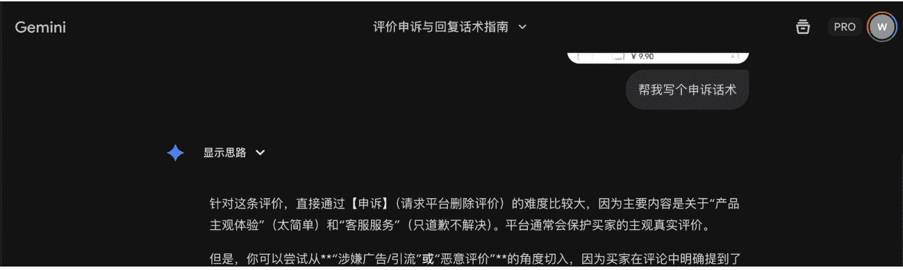

## 四、容易忽略的客服环节

只要卖东西，就一定会有售前售后的问题。

刚开始我没意识到客服的重要性，以为卖虚拟产品有了产品和流量，就是自动发货躺赚了，直到每天有二十多个进线咨询，遇到各种奇怪买家，回复质量不好导致店铺服务分下降的时候，我感受到了心力和时间都被消耗到了，我的解决方案是：外包客服。

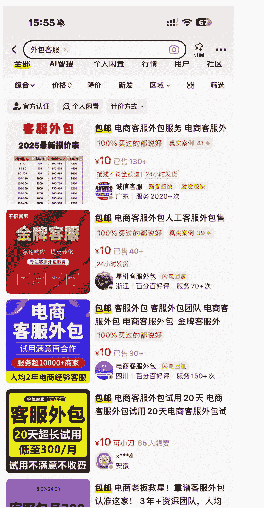

闲鱼上面很多成熟的服务商，外包客服只要一个月 400 元，愉快地解决了我的最后一个卡点，把自己回复几十个买家过程中遇到的共性问题，整理了一张百问百答知识库给客服，又做了一张长图，把最常见的 10 个问题放进了商品详情页，这一步做完，也四舍五入完成了我的自动化被动收入的体系搭建。

##### 1、售前怎么做

基本聊几十个买家就知道他们的问题是什么，无非那几个，把常见问题整理好放进快捷回复菜单，可以大量节约精力。再整理一张百问百答的长图海报，放到商品详情页，会大幅度降低售前压力。

##### 2、售后怎么做

虚拟产品一定会遇到仅退款的人，比如不会用，懒得看教程，对效果不满意等等，我现在的处理方式是拒绝。拒绝话术是：虚拟产品不支持无理由退款，已标注在商品详情页，商品功能正常，所有使用场景已真实展示在商品详情图。然后附一张商品页面的截图。

前期也担心投诉问题，同意过退款，后面我发现判断每个售后的合理性，也很消耗心力，中间还夹杂着一些无理白嫖硬退的人，于是开始拒绝售后。到目前为止，我拒绝的所有的售后，平台介入后没有 1 单是支持买家的，全部拒绝了退款，在我的理解看平台是支持卖家的，我也在产品页面明确标注了虚拟产品一经售出不支持退款。

现在我的订单体量还不是很大，未来是否继续拒绝退款，也要根据实际情况调整，如果销量越来越高，过高的平台介入率如果影响了评分或推流，我会选择同意退款，避免不必要的麻烦因小失大。

### 特别提醒：

外包客服解放了我的双手和心力，让我可以花更多时间研究产品，研究流量，研究用户需求。不得不提到的是，外包就是外包，预期不要太高，只要影响成交的关键数据不掉，客服怎么回复的，我假装看不见，不要自寻烦恼每天去看客服回复什么内容，他的回复大概率是达不到我自己心理预期标准的，出现问题再去解决就好。

## 五、总结：贯穿全程的几个思路

### （一）我要解决什么需求

有趣和有用都是在解决用户需求，在小红书都可以成交，我选择了后者。

我的创意发散能力没那么强，对于好玩的东西不是很敏感，但是解决具体问题，做解决方案我会更有手感。同时，我希望流量来源以搜索为主，那有用的东西会比有趣的东西好卖，转化率也更高些。做有用的产品，也必须对结果负责，但每个人对结果的标准是不一致的，这就导致了做产品的交付压力会相对大一些，也不能完全满足千人千面的需求。
没有好坏，自己做着觉得舒服就是最好的。

### （二）赛道选择越细分竞争越小

我搜索了带来成交的前 10 搜索词，发现几乎没有竞品，这也是能让我的产品能快速拿到正反馈的关键。搜索词越细分，工具越垂直，人群越精准，支付转化率也更大。同样，爆发增长的空间也肯定没有红海市场那么大。如果是新手，找一个细分赛道，以某个场景的深度用户的需求切入，搜索关键词，看这些笔记的评论区，是一个不错的找需求方式

### （三）严禁完美主义

我们做的是生意，不是艺术品。第一目标是能卖出去，第二目标是让买的人满意，第三目标才是自己觉得产品很完美，第三点甚至几乎不重要。做一个自己觉得好的产品和把产品卖出去，几乎是毫无关系的两件事。

之前我也做过几个小工具，过程中非常容易陷入反复抠产品细节，一直觉得不够好的怪圈。在没有成交之前，产品做的再好也没有意义，投入巨大精力做完可能都没有机会被用户看到。酒香也怕巷子深，在网络上卖产品更是如此，先把产品做到能用，再逐步迭代。

### （四）标准答案都在用户反馈里

用户反馈包括：笔记的阅读点赞收藏评论，商品的点击率，支付转化率，客服咨询收到的各种问题。珍惜拿到的每一个维度的数据，客观分析背后的原因，从根源上找到优化的思路，边做边收集用户反馈，越迭代越轻松。关于数据分析，有了 AI 以后也不再有专业门槛，导出所有店铺数据和笔记数据，让 AI 给出分析报告和优化方案，一定会有启发。

### （五）一万次迭代>一万小时练习

拿我举例，一个月时间从小红书小白到找到一点手感，并不是单纯在磨时间，啃知识，而是先执行，在执行中发现问题，思考解决方案，最终解决了阶段性问题。我的产品代码一共迭代了 47 个版本，工作流程也调整了多次，回顾整个过程，我开发产品花费的精力远远小于后续的各种迭代。每个代码版本都不是提前计划出来的，而是在一步步的实际运营中分析优化出来的，持续迭代，持续接近更优的解决方案。

希望大家都可以勇敢踏出第一步，带着好奇心，探索更多有趣的事情。聚焦因，让结果安宁，在过程中用心，然后静待花开。

## 最后，安利小懒的付费群：

## 懒人专属群 (介绍)

微信：lazyhelper1

📖 这里是你对抗信息过载的护城河。

已稳定运行 7 年，累计拆解、研读 3000+ 个互联网商业实战案例与行业前沿内参和时政/宏观文章。

我们不搬运垃圾，只做高价值信息的筛选器与放大镜。

## 懒人专属群更新记录：

https://hk57gvIx7u.feishu.cn/docx/H0kRdZbSboIBR0xkaXtcuVE0nJg

【免责声明】本资料归档于社群内部知识库，仅供成员课题研究与学术交流，请在查阅后 24 小时内删除。