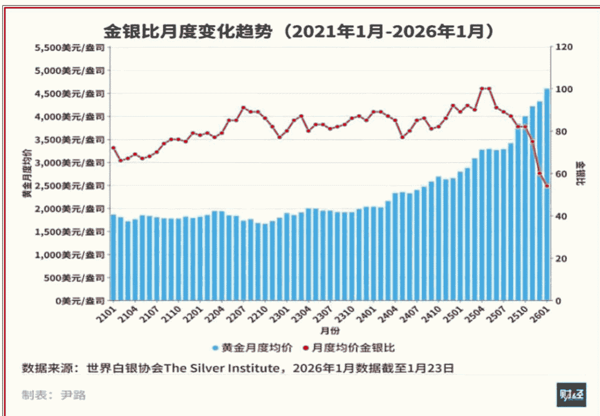

# 016 | 银价涨得比金价快，要不要转而投资白银？

2026 年 1 月 28 日

整理：公众号懒人搜索，懒人专属群精选

懒人微信：lazyhelper

完整《投资参考》和后续更新见群分享

机会靠洞察，取舍凭理性。这里是《投资参考》,我是何刚。

进入 2026 年以来，黄金和白银价格持续上涨，不断刷新历史纪录，成为全球投资市场最耀眼的大类资产。很多同学对此非常关心，既想参与投资，又担心风险。所以今天我们就来说说，最近黄金和白银的历史性上涨，以及这背后的推手。

1 月 23 日，国际黄金价格冲上 5000 美元/盎司，创下了新的历史纪录；国际白银现货价格也站上 100 美元/盎司，最高接近 110 美元/盎司，创下近 46 年来的新纪录。

截至 1 月 26 日，黄金价格最高涨到 5111 美元/盎司，2026 年不到一个月上涨 17% 以上，白银价格的年内涨幅超过 44%。而在 2025 年，黄金价格涨幅接近 65%,白银价格涨幅则接近 150%,很多投资者因此收益丰厚。

那么，为什么黄金和白银的涨势大致相同，但白银价格涨幅更大？这对相关投资布局又有什么启示呢？结合公开信息和研究分析，我们重点讨论两个问题：1.白银价格为什么涨得比黄金快？2.要不要把黄金投资换为白银？

先看第一个问题：

## 1.白银价格为什么涨得比黄金快？

黄金和白银作为贵金属，都曾经是铸造法定货币的主要材料。在很多国家的历史上，白银在官方货币制度中的地位，甚至超过黄金。比如在中国，1949 年新中国成立之前，银元还是最主要的法定金属货币之一。

到了今天，金银在很多国家都不再是法定货币。但它们作为贵金属，仍然具有货币属性，它们价格的涨跌对全球市场仍然影响巨大。

综合各方面的分析，最近两年来，推动白银和黄金价格上涨的核心原因是一样的：在美元进入降息周期后，持有美元的收益降低了，市场就把钱挪到黄金白银这些保值资产上，需求大于供给，黄金和白银的价格自然上涨。

虽然核心原因一样，但黄金和白银的具体需求来源又有差异，我们可以从三个维度来进行对比：一是工业需求，二是投资需求，三是储备需求。其中差异最大的是工业和储备需求。我们一个一个来看。

先看第一点，工业需求差异。无论是具体的工业需求用量，还是工业需求占总需求的比重，白银都明显比黄金更高。可以说，白银更有工业价值。根据《财经》引用的权威数据，工业需求已经成为目前白银需求的核心。2015 年，工业需求占比大约 40%,到 2025 年已经占比超过 61%。背后原因很简单：光伏、新能源汽车、AI 这些领域发展很快，硬件设备的产量飙升，对白银的刚性需求也就跟着不断上升。

比如，2025 年全球光伏产业消耗的白银高达 7560 吨，占当年全球白银工业总需求的 55% 左右。其中的一种高能光伏电池，消耗的白银数量尤其大。再比如新能源汽车，每辆车零部件所使用的白银数量，大约是燃油车的 2 到 4 倍。同时，在快速发展的人工智能产业里，AI 算力和存储等服务器需要的白银数量，比 IT 时代的传统服务器也要高 30% 以上。

相比之下，黄金每年的总需求里，工业用量大约占 10% 左右。因此，无论是过去还是现在，都没有出现因为工业需求太多而导致黄金供不应求的情况。而全球白银这五年一直供不应求，多数投资研究机构认为背后原因有两个：一是生产增长跟不上，二是工业需求涨得太快。尤其是第二点，非常关键。据统计，目前白银供应的年度缺口超过 1.1 亿盎司，供需失衡非常严重，这被认为是本轮白银价格加速上涨的主要原因。

从历史对比看，这次上涨和过去几次不太一样。过去白银价格快速上涨，主要是投资和投机推动的。而这次的核心驱动力是工业需求。

从图片我们看到，1980 年 1 月，美国石油大亨亨特兄弟利用高杠杆投机白银，把价格推了上去。2011 年 4 月，在量化宽松货币政策驱动下，投机资金将白银价格再次推向 50 美元/盎司。到了 2020 年新冠疫情期间，白银价格暴跌，随后货币宽松，白银价格又强劲反弹。

客观地看，这几次白银价格暴涨时，白银的工业需求量并没有明显增长。直到 2025 年，光伏与 AI 硬件才引爆白银的工业需求。

我们接着看第二点，投资需求差异。白银和黄金价格都具有周期性，一旦进入看多做多阶段，都涨势惊人。但投资市场对于交易体量更小的白银，投资需求更大，投机也更活跃。结果就是，白银价格的波动和涨幅，往往比黄金更大。

从全球交易量来看，白银市场确实小很多。白银的现货和期货交易规模，只有黄金的 10% 左右。就算最近白银价格涨上来了，交易规模也只相当于黄金的 15% 左右。这一方面表明黄金交易体量确实大得惊人，另一方面也表明，白银交易更容易在市场资金推动下大涨大跌。

历史也能验证这一点。当黄金从低迷进入新一轮周期，在黄金价格上涨初期，白银价格并不一定紧紧跟随。但是当金价从低点上涨超过 50% 后，白银价格会加速上涨，短期翻倍。比如 2025 年，黄金价格的涨幅只相当于白银价格涨幅的 40% 左右。

而从投资市场来看，当黄金价格持续走高后，投资黄金所需要的资金就更多，而且金价容易在过度投机炒作后大幅下跌。这时候，白银就成了替代选项。因为单价便宜，更容易吸引大量投资和投机资金涌入。

尤其是当下，白银的工业需求快速上升，但生产供给跟不上。这时候投资市场做多白银，就更容易把交易体量明显更小的白银的价格推高。而对于机构和个人投资者来说，白银有个独特优势：它既是贵金属，能保值；又有工业属性，需求是刚性的。这两点叠加，投资市场看多做多的理由更充分了。所以交易会更活跃，涨幅也就更大。

最后看第三点，储备需求差异。目前各国央行的贵金属储备以黄金为主，但白银也开始成为部分国家的官方储备。包括中国在内的部分国家，基于工业发展的需要，已经在限制白银出口。这种战略储备的需求，也在推高白银价格。

根据世界黄金协会的统计，截至 2025 年三季度末，全球主要经济体的官方黄金储备，总价值大约 3.69 万亿美元。这占全球主要经济体官方总储备的 28.9% 左右，创下了 2000 年以来的新高。

再看中国。截至 2025 年 12 月末，中国央行的黄金储备，占中国官方总储备的比重大约是 8.5%,远低于全球央行的水平。因此外界预测，中国央行还会继续增加黄金储备。

为什么全球主要经济体都在增加黄金储备呢？一方面，全球地缘冲突不断增加，黄金作为避险资产的价值凸显；另一方面，随着美元弱势和美元指数下跌，各主要经济体的中央银行，不得不适度减持美元资产，同时增加黄金储备，让官方储备更加多元化。

相比之下，长期以来白银并不是多数国家央行的官方储备资产。直到最近两年，随着黄金价格不断上涨，白银的货币属性也跟着回归。

目前已经有超过 10 个主要经济体，开始增加白银储备了，比如俄罗斯，已经宣布将白银纳入官方外汇储备。再比如印度，将白银与黄金并列作为官方重要的储备资产。中国作为生产制造大国，已经把白银列为战略资源，严格限制出口贸易。

从趋势上看，这些国家都在基于不同目的加大白银储备，这也成为本轮白银价格加速上涨的重要推动力。

因此综合来看，白银比黄金涨得快，是三股力量叠加的结果——工业需求在快速增长，投资需求更容易被撬动，储备需求正在回归。基于这个认知，我们接着讨论第二个问题：

## 2.要不要把黄金投资换为白银？

从前面的分析来看，黄金和白银价格最近两年的涨幅都不小，因此短期内都存在下跌调整的可能。如果盲目追高或加大投资，很容易在高位被套。

从趋势上看，只要白银的工业需求和储备需求持续增加，再加上全球主要经济体还在货币宽松阶段，白银价格短期内大幅下跌的可能性不大。如果你已经持有白银或白银股，不必着急兑现全部投资收益，至少可以留一部分再看看。

有一个指标可以帮你判断白银价格是不是偏高，叫“金银比”，也就是每盎司黄金价格和白银价格的比值关系。

根据历史经验，金银比通常在 60 倍到 80 倍之间。一旦它跌破 60 倍，有经验的投资者就会卖出白银、买入黄金。而截至 2026 年 1 月 23 日，金银比已经跌破 50 倍，按照历史经验，这个时候投资者往往会选择卖出白银、落袋为安。但本轮白银价格上涨，不只是短期投机资金在主导，背后还有工业需求支撑。所以投资者并没有急着大规模抛售。

这或许表明，白银的金融属性正在让位于商品属性。只要接下来白银的工业需求继续上升，白银的战略价值会更大，白银价格就继续看涨。如果再加上投资市场继续看多做多，以及央行或国家储备持续增多，白银价格就很难大跌。

不过，白银产业在资本市场上的投资标的的，远不如黄金丰富。黄金产业链很成熟，上市公司也多，在 A 股和港股都有不少明星公司，比如紫金矿业、赤峰黄金、菜百股份、老铺黄金。

而在 A 股，以白银为主业的上市公司很少，主要就是湖南白银等几家。湖南白银的股价表现很有意思：2025 年股价上涨 104%,涨幅比不上白银价格；但 2026 年以来不到一个月，它的股价涨幅超过 160%,是同期白银价格涨幅的 4 倍左右。

从实际业绩上看，湖南白银并不出色。2025 年前三季度营收增长大约 60%,但净利润只同比增长了 28.44%。它的毛利率只有 6% 左右，净利润率不超过 2%。说到底，湖南白银就是赶上了白银价格上涨的大风口，而不是靠盈利支撑股价。

所以，如果你之前没买白银，现在价格已经涨上来了，最好还是以观望为主，或者只用小额资金去尝试投资。

比如国投白银 LOF 这只聚焦白银的开放式基金。它 2025 年净值增长 156%,跟白银价格的年度涨幅差不多；2026 年以来不到 1 个月，这只基金的涨幅已接近 86%,差不多是同期银价涨幅的 2 倍左右。它的投资风格，你有兴趣可以深入分析。

如果非要我在黄金和白银之间做一个选择，我会认为规模更大的黄金交易比白银交易更稳妥。但白银 2026 年以来出色的价格上涨，也让包括我在内的很多人重新认识了贵金属市场。

与放大镜。

## 懒人专属群更新记录:

https://hk57gvlx7u.feishu.cn/docx/H0kRdZbSbolBR0xkaXtcuVE0nTg

【免责声明】本资料归档于社群内部知识库，仅供成员课题研究与学术交流，请在查阅后 24 小时内删除。