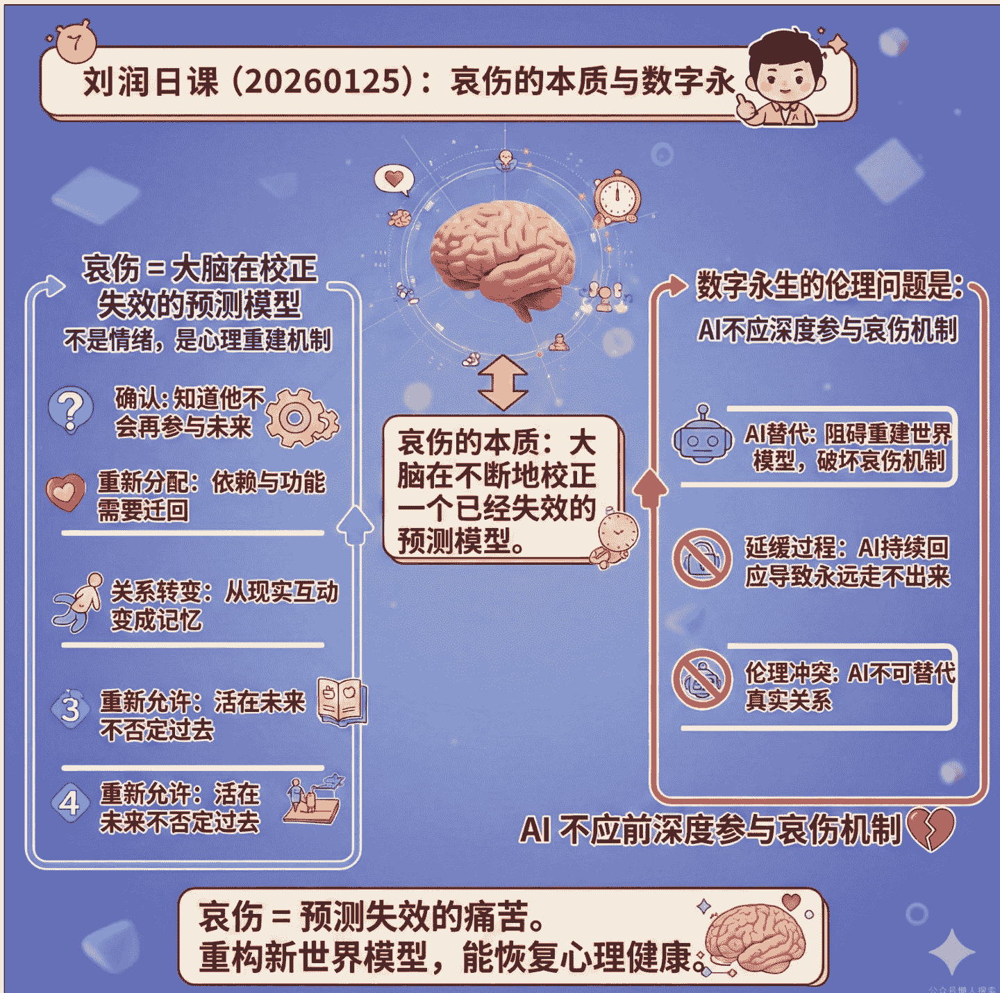
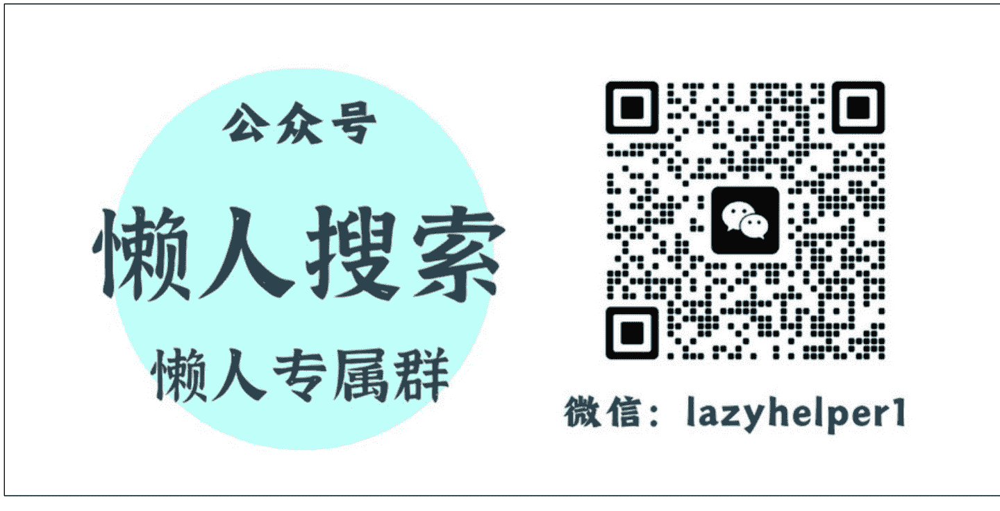

# 哀伤的本质

260128 刘润

整理：公众号懒人搜索，懒人专属群精选

懒人微信:lazyhelper1

今天的日课，我还是在深圳，在酒店里，等明天参加完一个活动后回上海。所以今天就在酒店一直研究一些材料和案例。

在研究到一个叫“数字永生”的案例时，越深入就发现有很多伦理问题，很多人反对这个事情。有人认为，不应该让逝去的亲人与在世的人进行这种沟通，这样不好，存在伦理问题。一开始我不太理解这是什么伦理问题，觉得这不是能让活着的人得到更多安慰吗？后来我深入研究，发现自己之前确实有些浅薄，这里面有很深的道理，是我以前完全没有触及到的盲区。今天的研究让我对这方面的知识有了全新的认识。

这其实是关于哀伤的本质。哀伤的本质到底是什么？很多心理学家都研究过这个问题。但坦白说，作为一个理工科学生，我很难被心理学家的观点说服，我更容易被神经生物学家或者物理学家的解释说服。当我看到一个关于哀伤的、超越心理学、更加接近神经生物学或物理学的解释时，我觉得才更接近我认为的本质。

而哀伤的机制，我觉得终于找到了一个更加接近本质的解释。哀伤并不是因为曾经爱过所以悲痛，这种解释太心理学了。

哀伤的本质是什么呢？哀伤的本质其实是：大脑在不断地校正一个已经失效的预测模型。这话听上去跟哀伤有什么关系？特别玄乎。我再重复一遍：哀伤的本质是大脑在不断地校正一个已经失效的预测模型。

这什么意思呢？首先要纠正一个误解：哀伤其实不是一种情绪，哀伤是一套心理的重建机制。很多人认为哀伤就是悲伤、难过、想哭，这是不对的。其实，哀伤更接近于：一个你已经高度内化、已经与之融为一体的人，突然从现实中消失之后，大脑（从神经生物学角度）必须重建世界模型的一整套机制。

关键词是“世界模型”。这个世界模型被打断了。什么意思？什么叫世界模型被打断了？就是我们每个人，无意识地在内心其实都在运行一个世界模型。这个世界模型是一套预测系统，就是你一发现什么事，内心就自然会产生“下面应该发生什么”的预测。你对这个世界的理解是通过预测的方式发生的。

例如：我今天回家，会有一个人等着我。（这是一个预测）我遇到一件事，可以跟那个人说。（这也是你觉得未来会发生的事）遇到某些关键的节点，我们在一起，他会一直陪着我。（这是一个预测）其实这些都不叫情绪，它是一个预测结构。

所以，亲密关系其实就是把另一个人嵌入到自己的预测系统里去了。一旦这个人去世了，会发生什么呢？这不仅仅是“我很难过”这么简单，而是大脑其实还在不断地发出“他会回应”这样的预测。但是现实中，这一次他没有反应，没有反馈了，你就会产生一种认知错误信号。

现在你明白那句话了：哀伤的本质是大脑在不断地校正一个已经失效的预测模型。例如，我认为回家打开门后，他应该正坐在沙发上看电视，但没有了。很多电影情节里都有这样的场景。本质就是预测失效了，然后人的心理机制就会对这种预测失效产生一个非常难过的阶段。这个阶段通常分为四个部分，你需要认真走出来，否则人会一直难受。这种难受其实是一种心理重建机制。

这个机制通常分为四个步骤：

- 第一步是确认。一开始觉得“他应该在那儿，不对吧？“。例如，有的人发现亲人再也回不来了，会不断到码头去等，或者摇晃着对方说“你醒醒，不要装了”。这个过程就是确认，确认这个人真的不再参与未来现实中的因果链。这是非常痛苦的。但这也是最基础的一步。其实不仅是“我知道他死了“，而是”我打电话他不会接了“这个预测模型失效了，我出事儿了他也不会再出现来帮我了，这个世界不会因为他而改变了。这是一个非常痛苦的过程。这种痛苦迫使你的心理去改变这种反应，就是反复验证。例如，会不断地翻看聊天记录、再打一次电话，心想”说不定还活着呢”。这不是一种理性或不理性的行为，而是大脑在这种不断的预测失效中，试图做一个校准：

> “看来那件事儿真的不会发生了。
“这个步骤不能被打破。一旦被打破，就再也不可能进入第二个步骤。那第二个步骤是什么呢？就是说，如果你让一个逝去的亲人能够不断地跟你“对话”，那么你就没有那种“他在现实中再也不存在”的确认性。只要这种确认性没有在内心发生，就进入不了第二步。

- 第二步叫做“重新分配”，分配什么呢？分配情感与功能的依赖。所以还是那句话，从心理学上看，很多人认为失去的是感情，但真正的失去是一种情感与功能的依赖。什么意思呢？比如说：我不开心的时候，谁来安慰我？（这是一种依赖）我遇到一些难题的时候，我应该去问谁？过去我们很多事是要依赖别人的。所以这种依赖，我以后不知道找谁了。我这个事儿做不了决定了，脑海中一片空白。这一片空白是因为曾经有一个人在你心中承担了一部分的功能。在这个过程中，要重新分配这种依赖。哀伤的第二个步骤，就是把这些曾经在另外一个人身上的功能，慢慢迁回到自己的身上，或者迁回到其他今天还活着的真实的关系身上。你看，哀伤的步骤其实有非常神经生物学的一些步骤。

预计他会这么想”，但是我再也不需要他自己说出来了。所以这个过程，就是把关系从现实关系变成记忆关系。这时候你基本上就所谓的“走出来了“。

- 第四步是什么呢？第四步叫做重新允许，允许自己继续活在未来里面。这是第四步，也是很多人卡住的地方。因为你有可能觉得，他走了，我自己还能活得好吗？我要是活得好，感觉就像背叛他了。我自己计划未来，感觉好像就否定了过去。所以最后一个非常重要的步骤是，要开始相信继续活下去这件事，不等于否定过去的关系。这在心理上叫做“再授权”。

好，刚才我说了四个步骤。这四个步骤完成，一个人才能真的走出这个悲伤。所谓走出悲伤，其实就是自己内心的世界模型重构的过程，重构一个“他不存在”的那个世界模型。

理解了这件事之后，你就知道为什么数字人不能深度地参与到“离开的人”的悲伤环境里面去。虽然活着的人很需要，但是你不能让他深度参与。因为他一旦深度参与，你就连第一步都走不出来。这个所谓的数字人，他如果一旦说错了话，一旦你意识到他并不是真的存在，你会不断地悲伤，永远走不出那个悲伤。

所以，为什么做数字人、数字永生这件事有一些伦理问题？因为哀伤这个情绪，它不是应该被数字永生给优化掉的那种情绪。不是因为有了数字永生之后哀伤就不存在了，哀伤是他必须走完的一个重构的过程。AI 和数字永生不应该让这个过程不发生，它不发生感觉好像是在了。但是，它只是延缓了事情的发生，它甚至是有害的，用 AI 来替代。这种重建世界模型，其实就是让 AI 永远地回应你，AI 不断地安慰你，AI 不断地陪伴你。AI 能主动出现，它会直接破坏哀伤机制本身，这个哀伤的底层机制就会导致人永远走不出来。

我觉得这是挺有意思的，这真的是所谓的伦理问题，真的是挺重要的一个问题。所以，帮助一个人从原有的世界运作模型中尽快走出来，有的时候真的比让他永远走不出来要重要得多。

今天真的是重新补了一堂课，到底什么叫哀伤？哀伤就是你过去那个世界模型，因为有一个人的存在，它不断发生的成功预测，今天已经不再发生了。而你今天必须要从那个模型里，重构一个“他不存在”的世界。这个模型必须要重构出来，才不会出现预测失效的痛苦。哀伤的本质，就是预测失效的痛苦。这个人走出来的越快，就越能重获心理健康。

这是我今天学到的，一个关于哀伤的知识，也是我今天的日课。你关于这个哀伤有些什么样的体验和看法吗？

最后，安利小懒的付费群：

懒人专属群（介绍）

📖 这里是你对抗信息过载的护城河。
已稳定运行 7 年，累计拆解、研读 3000+ 个互联网商业实战案例与行业前沿内参和时政/宏观文章。

# 我们不搬运垃圾，只做高价值信息的筛选器与放大镜。

# 懒人专属群更新记录:

https://hk57gvlx7u.feishu.cn/docx/H0kRdZbSboIBROxkaXtcuVEOnTg

【免责声明】本资料归档于社群内部知识库，仅供成员课题研究与学术交流，请在查阅后 24 小时内删除。