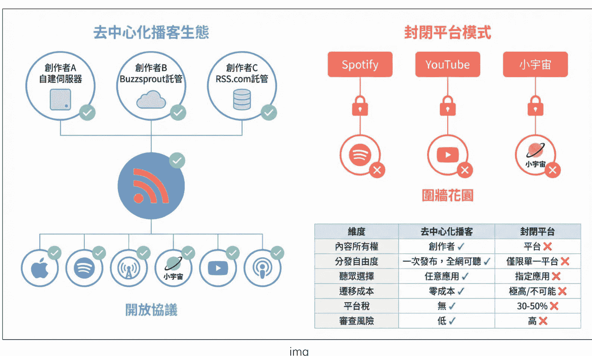

## 播客≠podcast

# 260128 新闻实验室

整理：公众号懒人搜索，懒人专属群精选
懒人微信：lazyhelper1

Podcast 不应该是一种平台媒体。

上周五，我在港大的一场关于播客的活动上做了一些分享。我提出的一个核心观点是：今天我们在简体中文语境下说的“播客”，其实已经不是经典意义上的“podcast”。

本期新闻实验室会员通讯，我详细展开这则论述。

### 2000 年：从 RSS 到 Podcast

关于 podcast 的初创史，有若干不同的说法。但有一些人肯定是绕不开的，其中两个就是 Dave Winer 和 Adam Curry。

Dave Winer 出生于 1955 年，是一位自称“媒体黑客”（media hacker）的技术理想主义者。早在 1980 年代，他就通过开发 ThinkTank 等大纲处理软件（Outliners）在软件界确立了自己的地位，并因将公司出售给赛门铁克而积累了第一桶金。但他并没有止步于商业成功，而是将目光投向了刚刚兴起的互联网出版。

作为 UserLand Software 的创始人，他不仅是博客技术的先驱，更是 RSS 的核心开发者之一。RSS 在本质上是一种让网站自动向用户推送更新内容的格式。它就像是一份数字报纸的投递协议：只要你订阅了某个网站的 RSS 源，一旦该网站有新内容发布，你的阅读器就会自动收到通知，而无需你反复刷新网页。更重要的是，RSS 是一种彻底开放的技术标准，它不属于任何一家科技巨头（比如 Google 或 Apple），也不受算法干预。这意味着任何人都可以自由地发布内容，任何人也可以自由地开发阅读工具来获取内容，没有任何中间商可以垄断或切断这种连接。实际上，Dave Winer 一直致力于构建开放、民主的信息系统，他反对将互联网变成封闭的商业领地，这种对开放网络的执念贯穿了他职业生涯的始终。

而 Adam Curry 则来自一个看上去完全不同的世界——他是前 MTV 的当红 VJ。不过，他和 Dave Winer 有着共同的语言，因为他不仅拥有敏锐的媒体嗅觉，更是一个对互联网技术充满狂热的极客。2000 年 10 月，这两个背景迥异的人在纽约一家豪华酒店的房间里相遇了。

Curry 向 Winer 兜售他的“最后一公里”理论：当时的网速非常有限，不妨利用用户家中宽带在夜间闲置的时段，自动下载巨大的音频文件，从而解决当时在线收听必须忍受漫长缓冲的痛点。尽管 Winer 当时并没有完全听懂 Curry 那手舞足蹈的描述，甚至觉得这个想法有点莫名其妙，但他还是被 Curry 的热情所打动，决定在技术上试一试。

Winer 回到电脑前，对 RSS 代码进行了修改，增加了一个至关重要的功能——“附件”（enclosure）。这个小小的改动允许 RSS 源在传输文字的同时，也能携带多媒体文件的地址（只是网址，不是文件本身）。2001 年 1 月 20 日，就在小布什宣誓就职美国总统的同一天，温纳发布了世界上第一个 podcast 源。这个源里只有一首死之华乐队（Grateful Dead）的歌曲《US Blues》。虽然当时几乎没人收听，甚至连温纳自己都觉得这只是个不起眼的实验，但这颗由媒体黑客和音乐明星共同埋下的种子，却在日后长成了改变全球音频生态的参天大树。

### 2005 年：乔布斯的选择

Podcast 真正进入大众视野是在 2005 年。当时，乔布斯在苹果全球开发者大会上宣布：iTunes 4.9 将支持 podcast。苹果的入局让播客瞬间触达了数百万用户，而其中极其关键的一点是，苹果在当时选择尊重了播客的去中心化架构。

与 iTunes 音乐商店直接销售和存储音乐文件不同，iTunes 的播客板块本质上只是一个订阅工具。它并不托管音频文件，也不拥有这些内容。当用户在 iTunes 上点击订阅时，苹果的软件只是充当了一个中介，帮助用户的设备直接抓取创作者托管在其他服务器上的 RSS 源。这种设计意味着，没有任何单一平台能够垄断内容的发布权，而苹果也不在其中做过多的干预。

这种开放架构造就了 Podcast 的独特生态。在这个生态系统中，无论是像 NPR 这样的公共广播巨头，还是独自一人在卧室录音的业余爱好者，都站在同一起跑线上。只要有一个 RSS 链接，任何人都可以向全世界广播。这种模式也保护了用户的隐私，因为传统的 RSS 下载模式并不需要进行用户注册账户，也不支持侵入式的数据追踪。Podcast 因此成为了互联网上少有的

一片未被平台和算法殖民的净土，一个真正由创作者和听众直接产生联系的民主空间。

下面这张对比图是我用 AI 做的，大致总结了开放生态和封闭生态的主要区别：

2005 年，乔布斯的选择是保留了左边的生态，没有让走右边的封闭平台模式。

有意思的是，乔布斯和 Dave Winer 一样，也是出生于 1955 年。他们是同龄人，想必也都受到了同样的思潮影响。乔布斯在他著名的 2005 年斯坦福大学毕业演讲上说，他受《全球概览》影响很深。这本被乔布斯誉为“那一代人的圣经”的刊物，反映的是 1960 年代反主流文化的精神内核，即反对由上至下的控制，强调个人赋权、工具民主化以及信息自由流动。这些都深深地烙印在了那一代技术先驱的基因里（《From Counterculture to Cyberculture》一书对此做了详细的阐述）。

我找到了 2005 年那场让 podcast 进入主流的发布会的片段。在其中一段里面，乔布斯念着手上的小卡片说，现在全世界有 8000 档 podcast 了。然后，他即兴发挥了一句：很有意思，没有 FCC（联邦通讯委员会）的监管了，因为 podcast 并不需要使用电波频率。（美国设立 FCC 监管广播，因为大气中的电波频率是有限的，如果没有监管机构的话会乱成一锅粥。）

在另一个片段里面，乔布斯现场演示了如何使用 iTunes 订阅 Adam Curry（还记得这个名字吗？上一部分刚介绍过他!）的 podcast。他随机打开了第 180 集节目，Adam Curry 在节目开头说道：

> is happening here. Radio is springing free of the regulated gatekeepers who've managed what you can hear since radio was invented...

（一些重要的事情正在发生，广播正从它诞生以来就存在的监管者、把关人手中获得自由......）

可以看到，乔布斯和 Adam Curry 的发言里都透露出这样的理念：广播是受监管的，这样并不理想，而当广播从电波移到了互联网上，它就不再受到 FCC 这样的机构监管了，这样的自由度棒极了。

所以，从这个角度也可以理解乔布斯为什么选择了开放的模式：他保留了

podcast 与生俱来的“反对把关人”的自由天性。

### 播客在中国：走上了平台化的老路

从 2020 年开始，就有人提出所谓“中国播客元年”的说法，后来 2021 年、2022 年这样的说法还在流传。一开始，我对这种说法颇不以为然——中国人开始做 podcast 的时间点远早于 2020 年，“元年”的说法是要把之前那么多丰富多彩的实践一笔勾销吗？

不过后来我觉得，说 2020 年是“播客元年”确实有道理。更准确说，那是“中国特色的平台化播客生态”的元年。在 2020 年之前，做 podcast 的中国人和外国人一样，并非遵循平台逻辑，而是用 RSS 和音频托管网站；而在 2020 年小宇宙上线之后，播客就逐渐成为了一种平台化的媒介形态。当然，喜马拉雅等也对这种平台化有很大的贡献。

今天，在一个中文播客听众的理解当中，小宇宙应该是属于微博、微信公众号、抖音、B 站、小红书一个序列的——短文字之于微博，长文字之于微信公众号，短视频之于抖音，中长视频之于 B 站，图文之于小红书，就如同音频节目之于小宇宙。

也就是说，小宇宙是封闭生态里的平台，而不是开放生态里的泛用型客户端。

小宇宙刚刚举行的 2025 年播客大赏，很像微博大 V 之夜，或任何一个平台举行的创作者颁奖活动。章泽天入驻小宇宙，也很像任何一个明星入驻微博或小红书。

创作者和小宇宙的关系，也越来越像任何一个平台上的博主和平台之间的关系。创作者越来越依赖平台才能被看见，而即便被看见、获得了粉丝，那也只是在单一平台上的粉丝，而不是直接订阅了 RSS 的 podcast 听众。这也就意味着，如果小宇宙将你的平台下架，你将与上面的听众失联。而在开放的生态中，如果一个泛用性客户端拒绝播放某个节目，人们可以轻易换成另一个客户端去收听。

这和 21 世纪初的那批 podcast 先驱做出的选择截然相反。所以我认为，今天简中世界里谈论的“播客”，已经和经典意义上的“podcast”不是一回事。

当然，小宇宙选择走上平台这条路，是多方因素共同导致的结果：既有商业模式的选择，也有监管的压力，还有 Spotify 和 YouTube 这两个国际平台对全球 podcast 生态的影响和改变。

平台虽然封闭，但也有自己的强项：可以提供更好的用户体验（让大家觉得“更好用”），容易迅速捧红个别创作者。但是，我个人认为，这些强项并不足以弥补平台化带来的弊端，那就是我们又回到了有把关人的老路上。

这很可惜。Podcast 本来是有别于平台逻辑的存在，它本来是一种无人垄断、无人插在创作者和受众之间的、去中心化的媒介形态。可是现在在中国，它在很大程度上却要依托于中心化的平台。

在这样的情况下，我们有没有可能重新选择自由、开放和去中心化？我当然是悲观的。但这并不妨碍我提出这些建议——

- 作为听众，我们应该意识到 podcast 不应该是一种平台媒体，意识到“便利”和“用户体验”的代价，尽量使用支持 RSS 的泛用型客户端（如 Castro/Pocket Casts/Overcast/...）。
- 作为创作者，应该坚持使用 RSS 分发，并且在节目里面鼓励听众使用泛用型客户端收听，就像李如一做的那样。
- 作为开发者，应该构建支持开放标准的工具，贡献到开源项目，让开放生态里的泛用性客户端也可以很好用。

这期 newsletter，也可以被视为试图“make podcast open again”的尝试的一部分。港大那场活动有个副标题，叫“让熟悉的事情变得陌生”。

我想，以上内容可能会让你对本来觉得熟悉的播客有了一些新的，甚至是陌生的认识。那么，我的目的就达到了——万事依赖平台，已经成了中国人的下意识习惯，我们不如停下来，想一想其他的可能性吧。

最后，安利小懒的付费群：

懒人专属群（介绍）

📚 这里是你对抗信息过载的护城河。

已稳定运行 7 年，累计拆解、研读 3000+ 个互联网商业实战案例与行业前沿内参和时政/宏观文章。

我们不搬运垃圾，只做高价值信息的筛选器与放大镜。

懒人专属群更新记录：

https://hk57gv1x7u.feishu.cn/docx/H0kRdZbSbolBR0xkaXtcuVE0nJg

【免责声明】本资料归档于社群内部知识库，仅供成员课题研究与学术交流，请在查阅后 24 小时内删除。