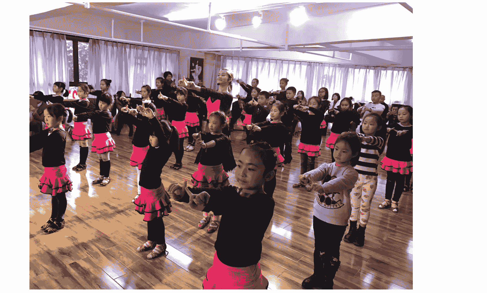
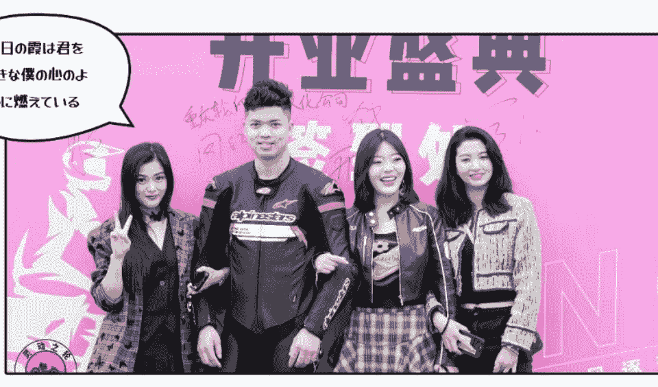
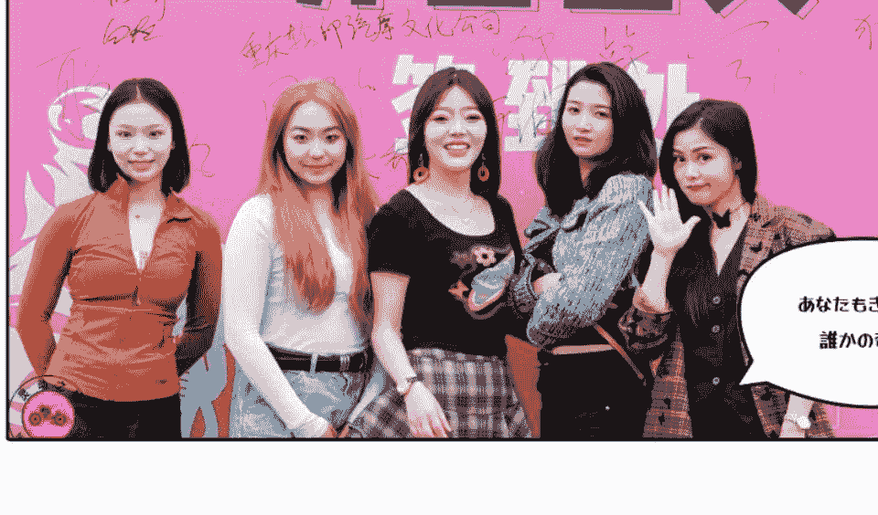
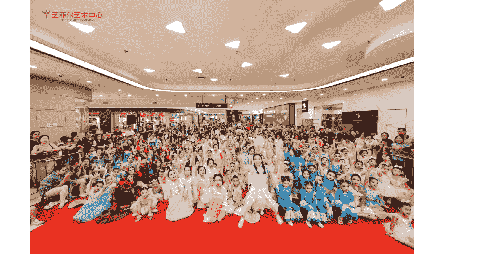
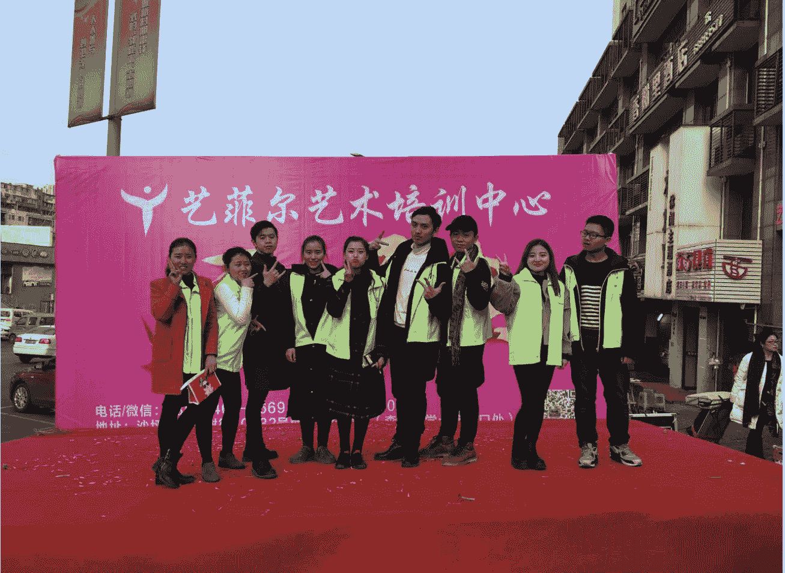
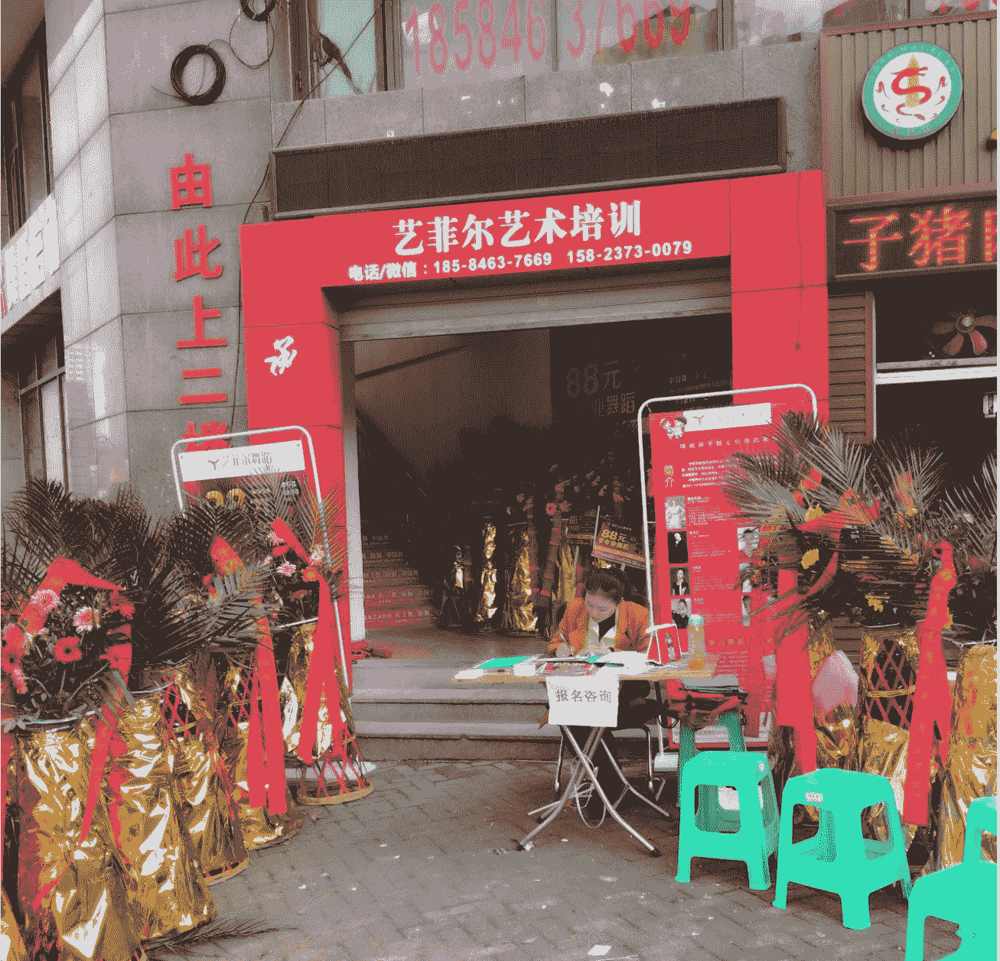
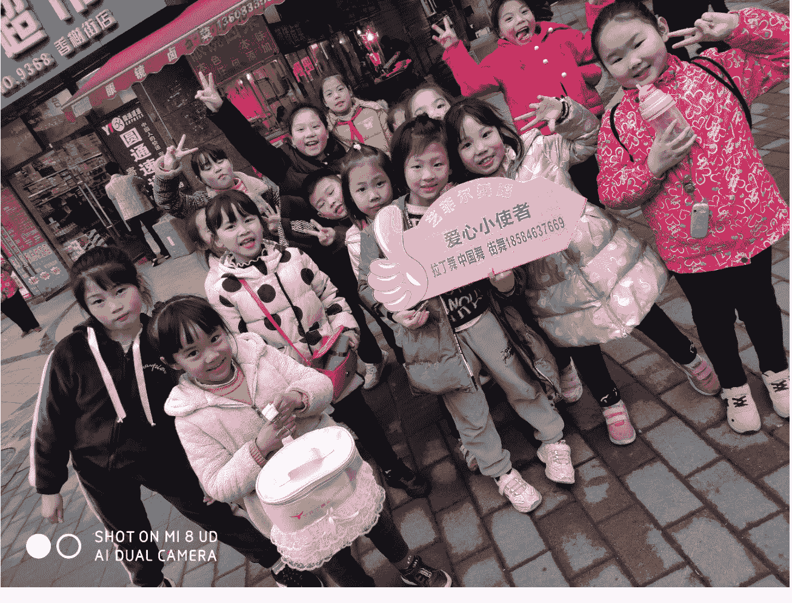
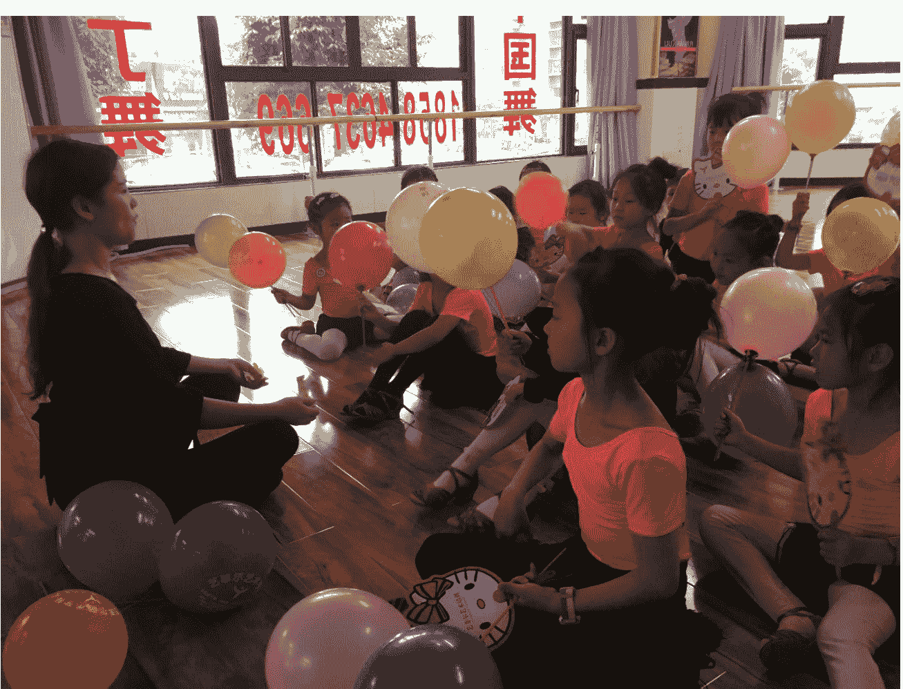
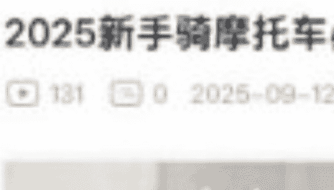
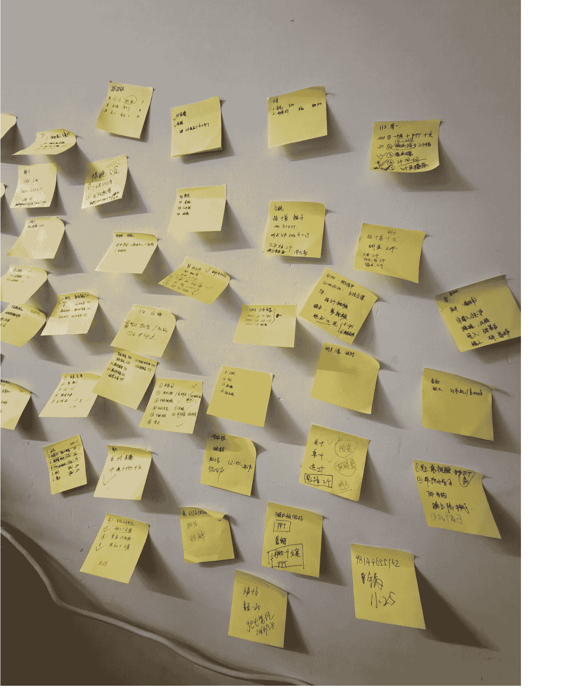

# 线下创业 8 年到抖音 CPS30 天 100 万 GMV 的复盘

260129 副业 SC 精华

公众号懒人搜索，懒人专属群分享

公众号懒人搜索，懒人专属群独享

懒人微信：lazyhelper1

## 一、入局生财的契机——从线下碰壁到线上破局

刚接到鱼丸潇墨的分享邀请时，我当场就愣住了，心里咯噔一下——受宠若惊是真的，但更多的是打怵！生财藏龙卧虎，全是手握干货的大佬，我一个连 PPT 都得从头学的舞蹈生，哪敢在这儿班门弄斧啊？

思来想去，总觉得自己这点经历拿不出手，不知道该说啥，更怕说出来的东西没价值。朋友的迷茫戳中我了——“零基础，啥都不会，想做线上，不敢做”

我不就是从那个“啥也不会、满心迷茫”的阶段过来的吗？说不定我的这些笨办法、能给和我一样的普通人一点底气。

### 自我介绍

我是来自偏远湘西的土家族姑娘，24 岁那年揣着 8 万启动资金，满怀一腔热血告别家乡小镇，只身奔赴一线城市创办舞蹈培训学校，恰逢线下教培风口期，凭借一股拼劲，哪怕疫情期间，也收获了 3 年 500 多万的营收，做到了 300 平，3 间教室，单科目，445 人的成绩。

由于对自己的认识不够，错把风口的红利，当成了自己的能力！觉得自己创业天赋拉满，三年疫情守业成功后，主业稳了，就瞎折腾——凭着喜欢骑摩托车，开了机车俱乐部；又跟风搞老年大学，结果亏进去十几万，直接把我拉回现实！

线下生意越来越难做，我揣着一脑门子迷茫扎进生财，想从线上找条新出路。一个连 PPT、表格都不会做，剪辑只会一键生成的舞蹈生，硬是靠着听话照做，在 B 站好物等航海打磨基本功后，冲抖音 CPS，30 天拿下 100 万 GMV!

这趟折腾下来才算明白：选对赛道、跟对方法，比瞎努力靠谱一万倍！

我的路径，或许能给正在寻找突破口的你，一个特别务实的参考。

> 今日の君は君を
> 好きな僕の心のよ
> うに燃えている

> 自分の生活に忠実である

> あなたもきっと、
> 誰かの奇跡

### 艺菲尔艺术中心

YIFEIER ART TRAINING

### 银龄新势力！乐学正当时！

#### 风桐银龄艺术之家

| 项目 | 详情 |
| :--- | :--- |
| 朋友关注 | 1 个 |
| 原创内容 | 2 条 |
| 状态 | ✓ 已关注 |

**置顶：跳舞的哥哥姐姐们**
“免费体验课”等您领取

私信预约，名额有限

| 数据 |
| :--- |
| 24 |

**置顶：黔江的姐姐们**
跳舞来这里

网友：听说这里的老师从基本动作开始，手把手教学 太有耐心啦!

| 数据 |
| :--- |
| 48 |

**置顶：黔江舞蹈爱好者的福利**
免费公益体验课

立即咨询，限时领取中...

| 数据 |
| :--- |
| 51 |

黔江中老年俱乐部
寻找爱舞蹈的哥哥姐姐们

评论区留言“舞蹈”
领取“免费体验课”

| 数据 |
| :--- |
| 5 |

黔江中老年俱乐部
“免费体验课”等您领取

评论区留言“舞蹈”
立即预约

| 数据 |
| :--- |
| 7 |

黔江爱好交谊舞的福利
快来领取“免费体验课”

留言“交谊舞”领取
名额有限

| 数据 |
| :--- |
| 4 |

黔江爱跳舞的 60、70 后
留言您喜欢的舞蹈科目

送您“免费体验课程”
名额有限

| 数据 |
| :--- |
| 14 |

黔江风桐银龄俱乐部
“免费公益体验课”等您领取

零基础可学
名额有限，私信领取

| 数据 |
| :--- |
| 9 |

黔江中老年文娱俱乐部
开放免费公益体验课

名额有限，私信预约
零基础可学

| 数据 |
| :--- |
| 18 |

黔江爱生活、爱舞蹈的朋友
快来领取“免费体验课”

名额有限，私信预约

| 数据 |
| :--- |
| 10 |

黔江舞蹈爱好者的福利
免费公益体验课

私信咨询，限时领取中...

| 数据 |
| :--- |
| 23 |

### 抖音 CPS 排行榜

| 排名 | 账号名称 | GMV |
| :--- | :--- | :--- |
| 1 | 小明 (西斯廷…) | 478.10W |
| 2 | 星空海绵 | 252.55W |
| 3 | L | 237.75W |
| 4 | **星辰** | 207.45W |
| 5 | **小寒酱~(西斯廷 4 号员…)** | 134.21W |
| 6 | **月亮** | 52.59W |
| 7 | **菜菜在家** | 51.91W |
| 8 | **聆儿** | 43.80W |
| 9 | **小源** | 40.10W |
| 10 | **张凡成** | 39.35W |

公众号懒人搜索，懒人专属群分享

中国移动 8:34

### 数据看板 - 万单宝 CPS 推广平台

wandanbao.com
万单宝 | 聆儿

+ 今天
+ 昨天
+ 7 天
+ 30 天
+ 上个月
+ 自定义

**推广位**
全部推广位

**平台**
全部平台

**有效订单金额**
¥1055100.47

**数据趋势**
按筛选区间展示

| 指标 | 数值 |
| :--- | :--- |
| 有效佣金 | 400 |
| 有效销售额 | 200000 |

6/26

## 二、舞蹈学校创业：我的线下“三步法”

### 第一步：精准模仿——借势而起，而非凭空创造

**核心定义**：敏锐识别并跟随已验证的市场趋势与成熟模式，在红利期入场。

#### 我的关键历程：

1.  **洞察“模仿对象”**: 在实习期间敏锐地发现了当时少儿艺术培训的市场缺口和增长趋势。开始刻意观察并记录，实习学校的每个部门，和每个环节的运行逻辑，做调研，拍照和刻意训练自己的教学及管理能力。
2.  **完成“内核转化”**: 将通用的“教培模式”与自身的核心技能 (舞蹈) 相结合，确定了我细分赛道，只做舞蹈，没有盲目去选择做你综合类的学校。
3.  **抓住机会，敢想，敢做**: 用 8 万资金启动，精准押注了线下教培的风口窗口期。这不是盲目创业，而是在正确的时间进入了正确的赛道。(不靠任何的营销技巧，第一学期招生，招到 227 人，第二学期带着两位老师，一共 3 个人，3 天时间招了 100 多新生，转化率 80%)

### 第二步：极限执行 (把事做成) —— 亲力亲为，用行动密度夯实基础

**核心定义**: 在模式正确的初期，创始人以最大程度的亲身投入，确保每一个环节都被高质量地执行到位。(既是清洁工也是老师也是校长更是招生的地推)

#### 关键历程：

-   4. **“听话照做”于市场**：0-1 的阶段都是亲力亲为，我们的核心产品的本质就是优质的教学与服务，在我看来最基本的商业逻辑——教学质量是生命线。因此我亲自上阵教学，确保核心产品（课程）的口碑。
-   5. **执行没有折扣**：从教学、招生到运营，作为创始人是最大的执行者。这种“全能投入”在从 0 到 1 阶段，构建了最扎实、最抗风险的经营基底。
-   6. **用勤奋换增长**：初期的成功，很大程度上源于作为创始人的时间与精力的极限投入，是启动阶段无法替代的“执行杠杆”。（经常派单派到凌晨，出月子 40 天不到马上投入工作...）

### 第三步：系统迭代（优化模型） —— 从凭力气赚钱到凭系统赚钱

**核心定义**：在业务跑通后，有意识地将个人能力与经验，沉淀为可复制、可优化的运营体系。

#### 关键历程：

-   7. **数据化反馈**: 引进教务管理系统，通过学员增长、口碑传播、满班率等最直观的“经营数据”, 验证了教学方法和课程设置的有效性。
-   8. **优化“系统组件”**: 逐渐迭代教学内容，更新课程体系、招生流程、学员服务。例如，从单一课程到开设不同舞种、不同级别的班级，这就是产品线的迭代。
-   9. **构建 SOP**: 将成功的招生经验、教学流程、和教务工作慢慢固化下来，即使是最初级的流程，也能更高效地管理增长的学员规模，为稳定的营收提供了系统支撑。

目前我的学校是那个片区唯一一家由教委颁发的教学许可证的培训学校，能够做到稳中有序的自动化运营，基本属于托管状态。

赚钱的逻辑是相通的，真正需要升级的是认知与战场。

## 三、生财航海修炼基本功——你走的每一步都算数

### 所参与的航海以及技能 + 认知的收获

刚进航海那会儿整天刷帖子越刷越迷茫，同时也很疑惑——几乎所有的帖子都赚到了钱，真的假的？高频出现的一段文字——躬身入局，把手弄脏。于是我决定多参加航海，干中学。

### AI 赋能视频号广告分成

我的第一个航海是视频号广告分成，保姆级的航海手册，以及强大专业的生财团队（认真负责的教练及领队和鱼丸，志愿者们）深深的震撼了我，因为我在创业期间，报过很多营销课程，踩过很多坑，起初我以为生财是打鸡血似的传销模式，然而在这里“干货”只是标配，全体成员都是绝对的无私分享与帮助，没有零散的知识点，而是高浓度，可立即执行的解决方案。

视频号广告分成是作者发优质视频，引评论，攒热度，靠评论区商家广告的曝光量赚取收益，这次的航海对我来说是次超棒的打底——初步培养了网感，大致的了解了线上赚钱的基本逻辑，并且学会了 AI 制作视频的整套方法。

### 微信问一问

微信问一问是 mini 航海，是作者发优质图文 + 文字，延续优质内容影评论赚广告曝光收益的逻辑，有了之前的基础，这一次我很快就拿到了成绩，还凭借文字配图的形式，练强了编辑，抓重点，和归纳总结的基本功，网感也更稳了。

### B 站好物

紧接着我又报名了深海圈的 B 站好物航海，这段经历直接帮我打下了线上变现的坚实基础，也让我的综合能力实现了质的飞跃。

在这里，我像运营一家“一人公司”一样，从 0 开始啃下了线上变现的全流程。教练不是甩给你一堆资料就完事，而是手把手带着你走，每一个环节、每一个卡点都会耐心拆解。更幸运的是，身边有一群亦师亦友的队友，大家都是憋着一股劲想搞成事的人，凝聚力强得不像话——你卡壳了有人主动分享经验，你出成绩了有人真心为你喝彩，那种无私的鼓励和帮扶，真的太戳人心了。

刚进来的时候，我完全是两眼一抹黑的懵圈状态，光是第一条视频就磨了整整半个月，剪辑、写文案、选品，ppt，每一步都磕磕绊绊。在这里我第一次接触做 ppt，哪怕有模板的情况下，一页 ppt 花了我一天时间，但就是在这样的打磨里，跟着教练的节奏一步步走，慢慢从半个月一条视频，到后来一周就能产出一条合格内容，看着自己一点点变强，那种踏实的成就感，是任何成绩都比不了的。

生财的机制也特别暖心，会不定期请优秀学员来做分享，让我们能不断吸收别人的干货，少走弯路。这段经历不仅帮我夯实了线上基本功，更让我攒足了底气，为后来冲刺抖音 CPS 埋下了伏笔。

特别感谢一路带着我往前走的家蒙教练，感谢那些曾经赋能的伙伴们——源神、星空大佬、星野大佬、十方大佬、忧郁的神 Lynn、清泉、乔久伴、周老师、陈石宇，艾兮……还有太多太多默默给予帮助的伙伴。能在这个有拼劲、有温度的圈子里，是我最大的幸运，这里的每一份善意与鼓励，都成为我前行路上最坚实的底气。

### 家蒙老师

构图，声音，画面，都不错

有 broll 穿插，遮住自己的脸，不错不错

PPT 做的也 ok

你形象挺好的，说话也自然，做 b 站能成

去干预下数据，别的没有什么建议

不断干预
不断选品，不断做内容，低成本，持续做

大方向没问题

你是有进步的，吹风机那个，语速慢，光线暗
头盔的时候，进步很大，速度快了，光线也好看了

最好，能做一个单品系列

### 家蒙老师🌹🌹

终于出单了，18 号出的单，这几天我忙着工作和做视频，一直没去看数据

看到的这一刻，第一个想到的就是你，太感谢了，谢谢对我的帮助和指导🌹感谢你开了这门课程

太不容易了，熬了半个月的夜，从来没做过 PPT，全部都是从头学，好害怕跟不上大家的步伐，一直都在赶😤

你的每一场直播 我都会做笔记，你每一次在群里的发言 我都会截图，专门保存下来，很多东西我听起来非常困难，坐出来有点搞笑我连吃饭上厕所都觉得很浪费时间，没有别人聪明 一定要比别人付出更多的时间才行，我的学习能力不强 只能靠自己死记硬背努力地模仿，听话照做，虽然只有 8 块钱的收益 但是我依旧很开心

很激动，这会儿家里一个人都没有 我坐在电脑前好想哭🤭谢谢你，好感激能有这个缘分成为你的学员🌹

公众号懒人搜索，懒人专属群分享

### 家蒙老师

2025 年 9 月 22 日 上午 8:11

啊啊啊啊啊啊啊啊啊啊啊啊啊啊

太好了

2025 年 9 月 22 日 上午 8:11

你这么酷，做 b 站肯定成

撬开了新世界的一扇大门，的，一条缝 哈哈

恭喜恭喜

### 【深海圈】B 站好物交流群 (433)

是这样，我都参加过十多个航海了，这个群氛围最好

> 确实，也参加了不少航海了，咱们这个群是氛围最...

这个群好！

我也参加了不少航海，咱们这个群不是我收益最多的 但是是我受益最多的 受益到我很想好好做出成绩 也能跟大佬们一样给大家分享经验 这样才对得起大家的无私分享

那这个群应该是做对了什么事，是最符合生财的价值观吗？

### 【深海圈】B 站好物交流群 (433)

+1

咱这个群得一直在啊，15 次航海了，就喜欢这个群

申请一下给这个深海圈开个联合办公室，也不是不可能

确实，也参加了不少航海了，咱们这个群是氛围最好的，就光在这个群里待着学习大佬们的分享就值回深海圈的门票了

## 四、30 天抖音 CPS 跑通 100 万 GMV——我的关键三步

抖音 CPS，简单说，就是你在抖音上发布带货视频，用户通过你的链接下单，你赚取佣金，不需要自己囤货，发货，处理售后，本质是用"内容找流量，用流量换佣金"

### 第一步：精准模仿 (抄作业) —— 站在已验证的路径上

**关键细节**:

-   10. **解构而非观看**: 找到 2-3 个对标案例，拆解其视频结构 (开头钩子、产品展示、转化指令)、文案公式、发布时间、评论区互动等。(把每次的关键点记录下来，一步步模仿)
-   11. **像素级复刻**: 初期不修改核心框架，只更换图，表情包、场景等。目的是验证流程，而非发挥创意。(初级，甚至文案都用 GET 比价提取出来，只改主谓宾)
-   12. **内核转化**: 在抄作业过程中理解其“为什么有效”，并将其转化为自己能驾驭的表达方式。(开始思考)

**价值点**: 这是缩短摸索期、避免方向性错误的最高效方式，将别人的成果直接转化为你的起点。

### 第二步：极限执行 (执行力) —— 用行动密度击穿认知壁垒

**关键细节**:

-   13. **“听话照做”是战略**: 每一步都遵照航海手册的步骤和教练的指令完成，尤其在 0-1 阶段，这是规避个人经验局限、借力系统智慧的理性选择。(严格按照教练直播教的方法执行但是每个方法都会尝试如：曼波怎么做，真人怎么做等)
-   14. **设立绝对底线**: 例如“必须日更 3 条”, 或“每天投入 3 小时绝不妥协”。执行力是克服数据冷淡期、迎来爆点的唯一燃料。
-   15. **为反馈而行动**: 每一次执行，核心目的不仅是“做完”，更是为了获取真实的播放、转化数据，为第三步提供“迭代燃料”。(尝试所有方法行不通马上换)

**价值点**: 对于我来说，从“知道”到“做到”的鸿沟，只能用不计较短期得失的坚决行动来填补。这是普通人最可控的破局点。

### 第三步：系统迭代 (迭代) —— 打造你不断进化的“赚钱系统”

**关键细节**:

-   16. **建立反馈循环**: 监控视频发布后的核心数据 (如完播率、点击率), 将“数据差”视为明确的“系统优化指令”。（扬长避短）
-   17. **吸收认知补丁**: 积极参与教练直播、复盘、认真做好笔记，将其中针对共性问题的解决方案，像“打补丁”一样更新到你的操作方法中。(认真记录直播和看精华帖过程中醍醐灌顶的点，结合自身马上改进)
-   18. **迭代的是“系统”**: 优化的不是单个视频的成败，而是整个环节，从“做一个好视频”升级到“建一条好流水线”。(更新文案的框架、剪辑的预设等)

**价值点**: 确保你的方法不过时、能放大。让你从依赖运气，进化到依靠可重复、可优化的系统能力持续产出结果。

### 7.26 微信问一问

回答 500 字，真诚，简洁，实用，图文并茂，个人特色

### 7.28 AI 赋能 IP

健身/社群跑道人

+   1.完成向内涵索，向问自答
+   2.完成优势测试
+   3.以上没喂给 AI

动作，育儿，自律，自我提升，身体素质，健身，练车，车，稳，统筹，自律

跟 AI 对话 向内涵索法

向内涵索 MBTI 盖洛普

ESTP 型 - 企业家型人格

盲点：控制莽撞，劲头，考虑行为的后果

有效使用：关注细节，辅助功能是思维

感觉 - 思维 - 情感 - 直觉

+   1.很难长时间独处
+   2.不重视计划 准备
+   3.疏远别人
+   4.无法看到一切坏的机会
+   5.没耐心
+   6.难作决定
+   7.易冲动

### ① 船员分享

自己的词藻力不够，思考力不够

创新（提到 2 次）

数据 < 埋搜索词

搜索词 ← 拼音 DSO

评论区 / 私信

爆文 做同样 → 创新（换产品/换场景）

1. 起
2. 问（让别人挑问题）

不断调整哪一秒，精细化

90% 的答案都在网上能找到

持续更新 / 内容为主

### 四：小寒酱

+   1. 一条爆
+   2. 起..模仿 / 2 个号都降价，复盘，起号
+   3. 数据。(第几个发，说短，通过什么搜
+   4. 自己做功课，真实力

17 号直播

+   ①保持更新 2-3 天
+   ②做内容

一、最后一天 复盘 (红包)

* 抖音的爆点 钩子 + 叠加
* 陪 + 创新
* 推荐流
* 密令有奖 口令没有
* 抖音有确定性

二、小明 (真人) 录/拿着/双机位/5 个号

* 观察 洞察力

三、IP/导流飞 (图文)

* 一次爆款 / 干货 同步的分享 什么时间领
* 数据分析 : 用户搜什么就做什么 / 干货
* 小红书
* 不要同质化 / 要创新 像平台发

## 五、个人感悟

比方法更珍贵的，是那个“场”。在生财，在每一次航海中，我收获的远不止技能。那种与一群“说干就干”的人并肩作战、无私共进的凝聚力，那种被优秀队友和教练托举着穿越迷茫的安全感，是任何课程都无法标价的财富。一个人可以走得快，一群人才能让你走得稳、走得远。

只要方向正确、执行坚决，我们每个人，都会拥有远超自己想象的可能。

感恩所有人相遇与帮扶，2026 年大家一起生财有术！

最后，安利小懒的付费群：

### 懒人专属群 (介绍)

🕖这里是你对抗信息过载的护城河。

已稳定运行 7 年，累计拆解、研读 3000+ 个互联网商业实战案例与行业前沿内参和时政/宏观文章。

我们不搬运垃圾，只做高价值信息的筛选器与放大镜。

## 懒人专属群更新记录：

https://hk57gvlx7u.feishu.cn/docx/H0kRdZbSbolBROxkaXtcuVEOnTg

【免责声明】本资料归档于社群内部知识库，仅供成员课题研究与学术交流，请在查阅后 24 小时内删除。