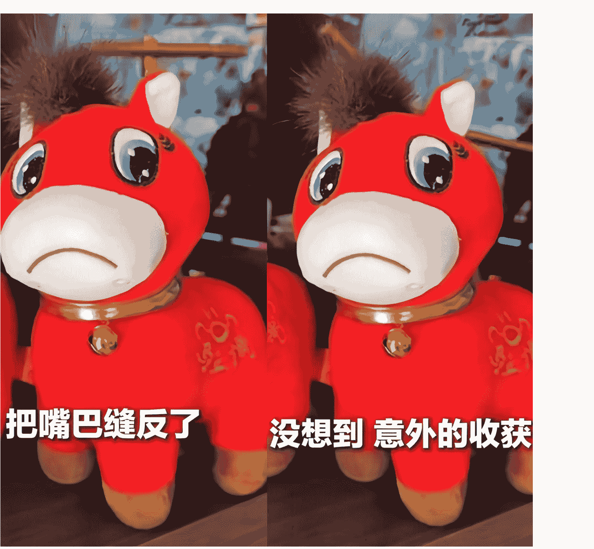

# 马年年货，怎一个“躺”字了得？

2026 年 1 月 30 日

整理：公众号懒人搜索，懒人专属群精选

懒人微信：lazyhelper1

距离春节还有两周，按照往年惯例，这个周末将正式进入多数人的年货筹备期。因此今天，我们就聊聊马年的年货趋势。

注意，了解年货趋势，不仅是因为我们自己要买。根据零售咨询专家黄碧云老师的观察，每一年的年货，也是照见全年消费趋势的一面镜子。比如，2024 年的春节前，北上广深的猫砂销量暴涨到平时的 3 倍。后来整个宠物经济的涨势，也贯穿了整个 2024 年。

而且相比往年，今年还有个特殊之处，是马年。不像去年的蛇年，关于马这个生肖的寓意，几乎就很难找到不好的。你看，关于马的成语，马到成功、龙马精神、一马当先、万马奔腾、快马加鞭等等，大多数都是好的寓意。这也就意味着，马年的年货，发挥空间极大，你怎么演绎都有道理。

基于这些前提，我们就看看今年的马年年货，有哪些新趋势。前段时间，黄碧云老师专门走访了义乌、郑州、扬州的毛绒商贸城，还有景德镇、长沙、郑州的批发市场，带回了很多一手观察。

其中有这么几个有趣的趋势。

## 第一个趋势：“躺”风格的流行

第一，是“躺”风格的流行。没错，马作为最有力量感的生肖之一，对应的年货却出现了“躺”的风格。什么叫“躺”？不是真的躺平不干了，而是允许自己慢下来，允许自己弱一点，允许自己不那么完美。

比如，今年开年最火的年货之一，是一个叫“哭哭马”的毛绒玩偶。哭哭马是网友起的名字，据说这本来就是一款普通的毛绒玩具马，但因为生产线失误，把马嘴缝倒了，导致嘴角下垂，看起来像哭了一样。没成想，这款玩偶的照片被传到网上后，突然火了。据说在它走红的 48 小时里，淘宝搜索量超过了 10 万次。

图片注释：图源：央视网

你看，这也许就是“躺”的表现之一，不是一脸正能量的笑，而是允许自己有点委屈。

再比如，今年义乌、郑州、扬州毛绒商贸城，但凡卖得好的马玩偶，大都“有点胖”。你看，在我们的印象里，马就得是肌肉线条明显、力量感十足。但现在，这样写实的马，在平台上反而不好卖，“胖马”反而更吃香。不光商贸城，就连景德镇青花瓷上的马，也变胖了。

根据厂家的说法，这主要是因为，圆润就能降低马的攻击性，增加亲和力，还能弱化“牛马”的隐喻感，胖点会显得更有福气，更走运。

你看，这或许也是“躺”的另一种表现，不要肌肉线条，不要力量感，允许自己胖一点、松弛一点。

好，这是今年马年年货的第一个趋势。

## 第二个趋势：“幼稚经济”在年货里的崛起

第二个趋势是，“幼稚经济”在年货里的崛起。

什么是“幼稚经济”？就是成年人买东西，出现了“孩童化”的倾向。

黄碧云老师在走访百荣市场时发现，有些玩具批发店里，已有半数摊位专门陈列面向成年人的玩具，除了毛绒，还有各类的盲盒及拼插 DIY 玩具。这些玩具不是买给孩子的，而是成年人买给自己玩的。

比如，小孩喜欢玩过家家，而现在很多成年人买年货，也出现了这个“过家家”的画风。比如，买玩具装饰自己的车子，就像小孩装饰自己的过家家乐园。今年年初，带绑带和磁吸功能的马年毛绒玩具，销量比往年增长了近两倍，这些玩具最主要的场景之一，就是摆在车里。不光是汽车，很多年轻妈妈会买老头乐三轮车接送孩子，这些车里也经常布置毛绒玩具。

这里稍微插一句，除了“车载玩具”，新能源车的移动电源，过去一个月的销量也在涨。这主要是因为，新能源车越来越多，而很多人会在春节期间自驾出游。

再比如，今年宠物年货的涨势也很明显，而且分类比往年更细。比如，宠物年货礼盒，里面包括宠物小零食，宠物空间的装饰品对联，等等。再比如，宠物服饰，包括围脖、脖圈、围巾等等。最火的品类之一，是宠物年夜饭。比如，针对养犬家庭的零食大礼包，把市面上最受欢迎的鳕鱼冻干、牛肋骨结合在一起。

你看，给自己买玩具、给车子买装饰、给宠物买年货，本质上都是同一件事，满足自己那些带点孩子气的喜好。这是“幼稚经济”在年货里的体现。

## 第三个趋势：包邮区向西大幅扩展

第三个趋势，包邮区向西大幅扩展。

今年电商圈最受关注的事件之一，就是电商物流“西进”。简单说，以往甘肃、青海、宁夏、内蒙古、新疆、西藏，经常被列为非包邮区。而在 2026 年 1 月开始的年货采购期，这 6 个省区全部实现了包邮。

这在很大程度上，带动了大件年货的销量。比如，根据天猫的数据，新疆地区的电脑椅、电脑桌、茶几等商品的成交量，同比增长了 500% 以上。新疆大件家装商品的交易额，同比增长 98%，订单量增长超 100%，下单用户数增长近 80%。

原来这些地区不能包邮，主要是因为路途遥远，且收货地址地广人稀，导致单件运费有时比商品本身还贵。而现在，情况正在发生变化。对于平台上的电商而言，他们正在迎来一大波新的订单。原来介意邮费不买的人，现在会买。原来买一次的人，现在可能会买好几次。

为什么这些地区能实现包邮？背后主要有这么几个因素。

- 首先是集运，用大白话说就是“拼单发快递”。把寄往新疆同一个城市的快递，先全部集中到西安这样的中转仓，等集单量达到一辆大卡车的容量时，再直接运往新疆。这样平摊到每单的运费就大大降低了。
- 其次，是干线运输的开通，比如“乌鲁木齐—西安”快递电商班列，在很大程度上缩短了运输周期，以前从江浙沪发到新疆，需要一周以上，而现在控制在了 5 到 7 天之间。
- 最后，是本地仓的建设，新疆目前已设立了 8000 多处村级寄递物流综合服务站，助推“最后一公里”的配送。

这几个措施环环相扣，最终让西部包邮成为可能。

要知道，相对于一线城市谈消费降级，西部很多地方的消费反而是在向上升级的，因此对大件家电类的商品来说，西部反而是一个新的增量市场。一线降级，西部升级，消费正在分化。

而现在，正好临近春节，很多大件年货，比如电视、冰箱、洗衣机之类，这些商品的销量，也许会因为西部包邮，出现明显的增长。

## 传统年货的新花样

好，前面我们说了，今年年货的三个新的变量。分别是，“躺”风格的流行，“幼稚经济”的崛起，以及西部包邮区的开通。这些趋势有的跟消费者有关，也有的是针对商家的动向。最后，回到个人，假如你面对五花八门的年货，不知道具体该买点什么。那么，黄碧云老师有个建议，你完全可以看看以往常见的传统年货，比如水果、酒类、日用品等等。你会发现，这些传统年货也出现了很多新花样。

比如，水果。你看，水果仍然是国人送礼的首选之一。但今年你会发现，往年流行的车厘子，热度在降温。要知道，咱们中国可一直是智利车厘子最大的出口接收国之一。但今年，黄碧云老师在走访郑州万邦和长沙红星市场时发现，车厘子的价格相较于去年出现了大幅跳水。现在好一点的车厘子一斤都不到 30 元，送礼也就失去了“贵重”的感觉。

车厘子让位，反而给了其他新品种水果出头的机会。比如，你会发现，现在的苹果和过去明显不一样了。通过品种嫁接等技术，现在的苹果品种已十分丰富，远不止红富士，还有秦脆、瑞雪、王林等品种，口感也提升了好几个级别，而且每斤价格都在 10 元以上，作为礼品也比较体面。

再比如，柑橘类水果也出了新花样。比如，融安蜜桔，它解决了金桔皮苦涩的问题，裹上一层金色锡箔纸，就成了礼盒装，乍一看很有“费列罗”的感觉。

再比如，买纸巾。这里说的纸巾，是指含有乳酸、湿度高且柔软度很高的绵柔型纸巾。黄碧云老师采访了福建泉州一家专业绵柔纸巾生产商，他们工厂有一款 6 层厚的绵柔纸巾，价格比普通纸巾贵 2 倍以上。而且因为包装比较高端，很多人买来送礼，比如送给怀孕的朋友。

再比如，买酒。有的厂商推出了鸡尾酒盲盒，也就是，把礼盒设计成 6 个连着的盲盒，每个盒子上不仅有名人插画，还设计了与产品相配套的破冰小游戏。相当于你买的不光是酒，还有一整套聚会时的互动设计方案。据说这个产品在年轻人里很受欢迎。

再比如，就连厨房里最常见的碗，今年也出现了新的增量。你看，冬天是吃火锅的高峰期，而很多火锅油比较大，吃完的碗就比较难刷。因此，有的厂家就推出了带有陶瓷滤油层的碗。据说这款碗自上市以来，销量就一路走高。

说到这，我们快速浏览了 2026 马年的几个年货趋势。你看，过去我们总说，所有产品都值得用某某逻辑重做一遍，比如用老龄化重做一遍，用情绪价值重做一遍，等等。那么，具体怎么做，也许年货是一个很关键的观察趋势的窗口。

最后，安利小懒的付费群：

懒人专属群（介绍）

公众号
懒人搜索
懒人专属群

微信：lazyhelper1

📖 这里是你对抗信息过载的护城河。

已稳定运行 7 年，累计拆解、研读 3000+ 个互联网商业实战案例与行业前沿内参和时政/宏观文章。

我们不搬运垃圾，只做高价值信息的筛选器与放大镜。

懒人专属群更新记录：

https://hk57gvlx7u.feishu.cn/docx/H0kRdZbSboIBR0xkaXtcuVE0nTg

【免责声明】本资料归档于社群内部知识库，仅供成员课题研究与学术交流，请在查阅后 24 小时内删除。