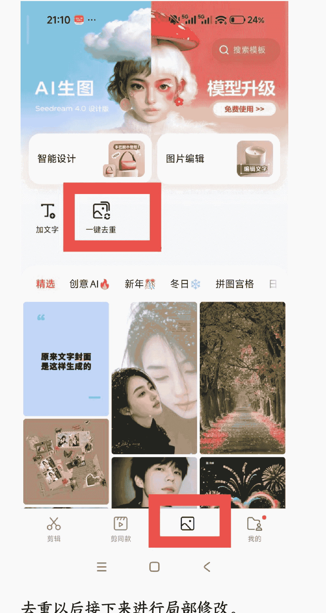
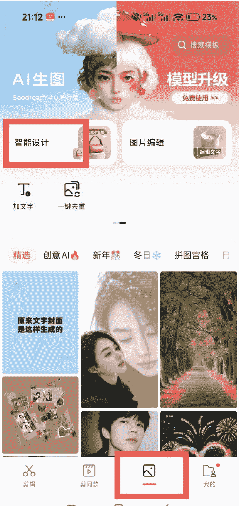
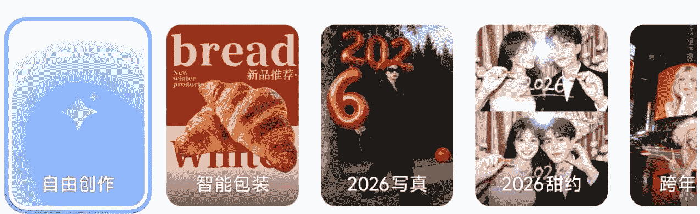
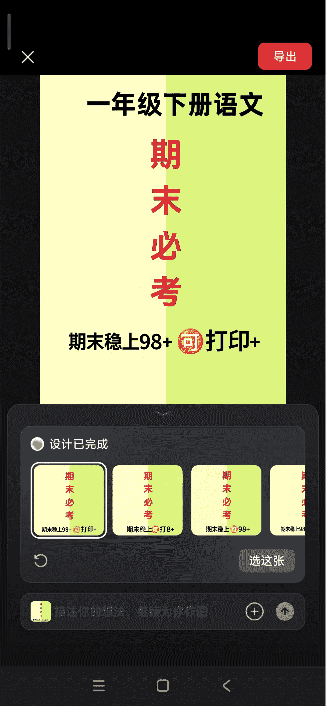
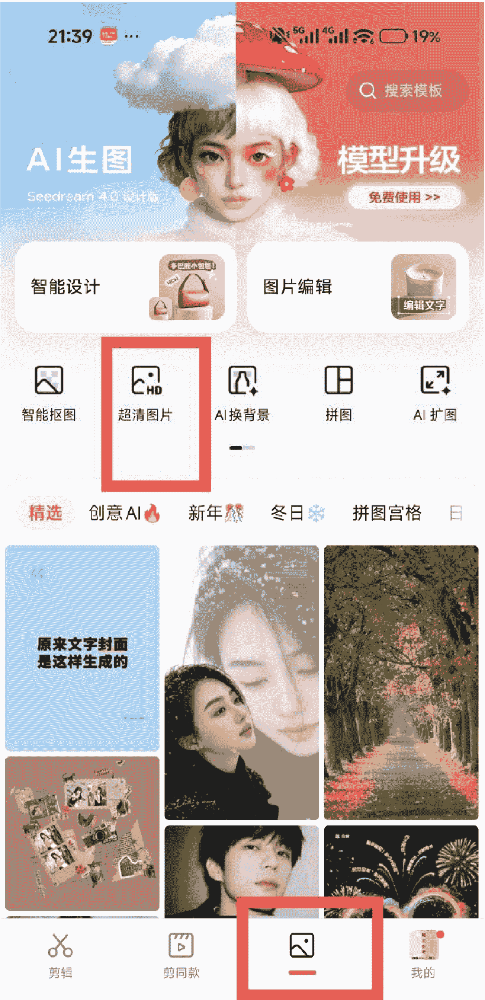
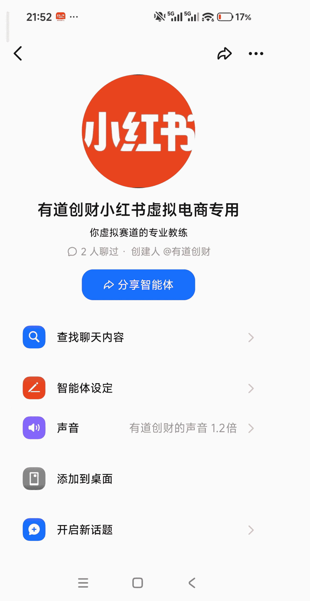
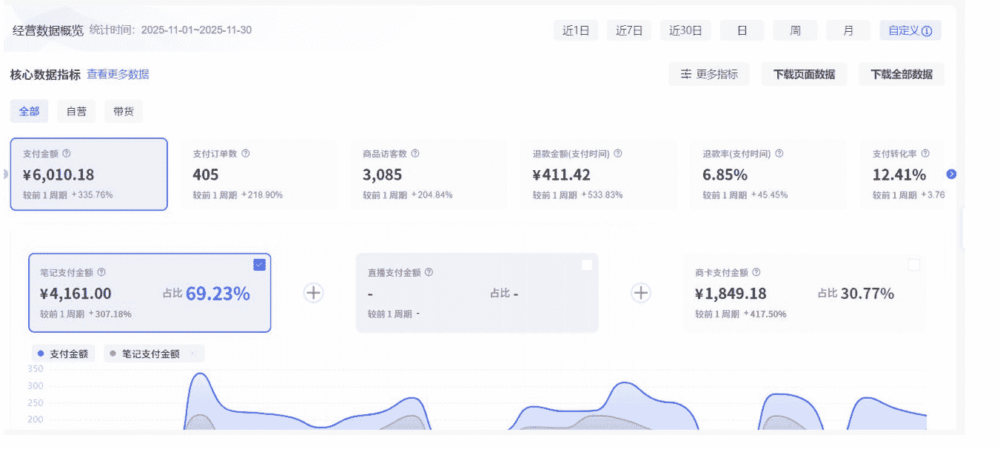

公众号懒人搜索，懒人专属群分享

# 小红书虚拟第二个月单店突破 6000 的复盘总结！

260130 副业 SC 精华

公众号懒人搜索，懒人专属群独享

懒人微信：lazyhelper1


我叫喻清，19 年之前做实体，19 年以后转型互联网，从最开始自己做项目到后来做项目培训，6 年时间一直在做的事就是发现项目，自营且带培训。

一直坚持的理念就是注重长期价值，因为这个理念，所以收获了一群还不错的学员好友，也靠着这个理念筛选项目做，在 24 年一年实现了互联网上的第一个 200 万。

这是我第二次加入生财，几年前加入过一次，可能水平还有限，没有看懂生财的本质价值，今年第二次加入，感觉生财已经越来越强，不仅仅是一个发现优质项目的地方，还是结交一群优质创业伙伴的地方。

之前我一直不注重分享，但是现在觉得也许只有走出来，才能结识更多优质的伙伴，所以以后尝试多在生财分享，希望大家都越来越好。

我是 7 月份开始操作闲鱼虚拟电商的，操作了两个多月，最好的时候是 8 月底，赶上开学季，单人 4 个号单日出产破 500，开学季结束以后收益逐渐回归两三百正常，后来老是出现违规下架，导致账号权重变低，收益受到了很大限制，正好在这个时候我在公众号上看到小红书虚拟这个赛道，我认为闲鱼和小红书除了平台不一样，玩法应该大体差不多，所以决定测试小红书虚拟。

一开始做小红书虚拟的时候，我还没有续费生财，也是看一个公众号分享小红书不错，付费 1900 多学习了一下。因为我自己也是做项目培训，所以对于付费一点不排斥，付完费以后老师给我发了一份飞书手册，然后就是拉群答疑（感觉这个老师不太会交付，至少从我自己做培训的角度，我对这个老师的交付打 50 分哈哈）。

后来是看生财公众号分享好多关于小红书虚拟的内容，所以才二次续费了生财，去看生财的一些知识手册，看完以后觉得，当初应该直接付费生财学习，省去 1900 多付费哈哈！

## 一、最小 mvp 测试项目可行性

### 1. 新人测试项目

一开始也不确定小红书到底好不好做，我自己也多多少少做过自媒体，从以往在自媒体平台发内容的角度上，我认为小红书是最难的平台，因为同样的内容发到抖音快手视频号都比小红书的效果好，因为有这个既定印象，所以担心做小红书虚拟做不起来，为了不花比较大的代价，当时我没有让我已经在做闲鱼的团队成员直接做小红书，反而让我们运营公众号的一个运营，帮我测试一下这个项目，大家可能会觉得我有点可笑了，其实还好。

因为当时我们的公众号运营人员刚好在调整工作内容，所以我就想着让她作为小红书新人测试一下项目，如果能测试成功，正好可以把她的工作内容调整过来，因此这个新人运营就一边写公众号，一边进行小红书测试。给老师付完费以后，拉了群，就让她有问题在群里问，将近 10 天的时间我没怎么过问过。

### 2. 我自用的新人试测项目方法

（以下我的方式不一定适用所有人，但是我自己用的挺有效，所以大家看看，能借鉴更好。）

我测试项目，一般都是安排专人测试，因为我坚信专注测试效率胜过我自己有一搭没一搭的测试，因此我宁可花钱发工资招人测试项目，也不会自己测项目，当然这也和我们团队内部的运营方式有关。

一般在找人测试项目的时候，前期我都不怎么抓项目，我们团队有一条文化是：

谁做项目，项目的第一负责人就是谁。

所以这就是我前期做项目不怎么管的原因。

我的思路就是眼睛盯紧手放开，虽然我自己没有执行，但是我会把大量的资料给到他，帮他找老师，找手册，找方法，让他去学习，自己研究，自己成长。

所以十天时间，我没有严格规定过我们的运营人员要发多少条笔记，按照他的学习节奏和逻辑来，后来我得知她是每天发一条笔记，一个商品。

就在 10 天时间里面竟然陆续有了一单两单的开单，这给了我很大的信心，我在想每天输出一篇笔记一个商品的情况下，就能正常开单，假如全职操作按理说问题不大。

### 3. 开始进行全职测试

看到陆续开单以后，我私下和给我们教学的这个老师进行大量的沟通。虽然之前做闲鱼的时候也是靠搜索流量，但是通过沟通以后我发现小红书的搜索流量，才是所有平台做的最好的。

一开始我对关键词布局其实没有概念，但是我懂一个点，这个点我之前在做销售的时候大量测试过。

销售是有成功率的，如果排除掉销售技巧，单纯碰运气的话，100 个人会碰到一个成交，如果不行那就 1000 个人，如果还不行那就 10000 个，总之总有成功率。

所以当我清楚小红书的搜索流量做的很好时，

从概率的角度，我觉得提高产量很重要，假如一篇笔记能有 3 个容易被搜索的关键词，那发 100 篇笔记就会有 300 个，1000 篇笔记就有 3000 个，那 3000 个被搜索的词和 3 个被搜索的词相比，3000 个词的概率更大，这就是我用到的笨办法。

有了这个想法以后，我就让这个运营全职操作了，每天上商品 10 个，每个商品对应 2 条笔记，相当于一天上品 10 个，发笔记 20 条，对应 4 个小红书账号，这个时间是 25 年 10 月 8 号。

果不其然当提高产量以后，没过几天，账号收益就突破了，开始稳定开单。因为 4 个账号同时操作，但是我发现其中有一个账号笔记收益比较高，其余账号收益低，有的还没有开单。

因为如此，我觉得账号不能平均主义，应该强调主次，所以调整了运营思路，出单比较多的这个红书号只发开单的笔记，出单比较少的账号测试新的产品笔记。

于是形成了一个精铺账号，3 个粗铺账号的格局。

接下来三个账号测品，但凡这三个账号有开单的品，从第二天开始，本身开单的粗铺的品会持续更新新笔记，精铺店都会上这个品的笔记，这样精铺笔记账号的权重越来越好，因为精铺账号的权重高，出单效果好，所以也带动了店铺的权重。这里大家一定要明白的一个点，就是商品笔记的推流机制和普通笔记的推流机制完全不一样。商品笔记会因为转化带来持续推流，不是单纯考验互动数，也就是说如果没有互动，转化比较高，因为转化会推动这篇笔记，因为笔记被推出去了，所以看到的人更多，转化也更高，此时良性循环就形成了。

我之所以这么说，是因为大概 20 天左右的时间，我的店铺收益单日即将破 200，但是我回望开单的产品和笔记时，我发现 100 多的销售额里面，占比比较重的，往往是固定 2 个商品对应的三四条笔记。


我在做闲鱼虚拟时，客单价太低，如果要做到单日 170 左右的收益大概需要开单 40 多单，因为我们自己做闲鱼的平均客单价就是 3 块多，但是从上面图中大家都可以看到，在小红书上，同样的收益只需要开 12 单，同样的人力投入时间，显然投入到小红书的人效要比闲鱼人效高很多，所以我理解了小红书人群的概念。

另外做闲鱼期间，一天大几十单，咨询又多，回信又多，运营也累，收益一般。但是小红书，消息少，咨询少，收益还高，运营也轻松。所以我验证了在小红书确实是精准人群成交和高质量人群的结论。

因为在此之前我们都是粗放式运营，没怎么研究过封面，没怎么研究过标题，就是靠量。当看到当日收益这么快做到这么高，我觉得我们要摒弃粗放，进入精细化。

## 二、精细化运营研究平台

### 1. 先研究底层逻辑

当看到这个收益以后，我坚信了小红书可以做，我也认为积累性很强。为了继续深入研究搜索流量，我还特意买了一本《长尾理论》的书研究了一下。

其实长尾理论把搜索电商的原理讲的很清楚，这里我就不在多说，如果大家有兴趣自己买一下看看，看完以后不仅对小红书虚拟这个赛道有信心，你会对任何一个小红书的赛道都有信心，因为你会明白爆款产品和利基产品都有市场，只要足够细化深耕，都很容易做出来。

### 2. 研究商品笔记三要素

#### 1. 封面：

我之所以采用同一个产品发布 2 篇笔记的原因是，学习的时候我对两种形式封面最感兴趣，一类是大字报，一类是实拍或者截图。所以我就想研究一下这两种形式，到底哪一种更好用，结论是两种都挺好用。

先说第一种大字报，这是小红书上比较爆的类型，为了利用好爆款的特性，所以我们在做封面时，会先把小红书爆款大字报封面保存下来，然后进行局部修改，尽量保证布局，背景，风格都不变，只把上面的文字改为和我们相关的就行。

操作步骤是，先把目标封面保存，然后打开剪映底部的图片设计，滑倒最右端，进行一键去重。去重工作是为了获取更多流量。

去重以后接下来进行局部修改。

还是进入剪映图片设计，点击智能设计。



将目标图放在参考图位置。



# Hi, 你想设计什么？


输入修改指令（大家不知道怎么输入指令可以直接用我图中的方式）

# Hi，你想设计什么？



将图中的“预习必备”改为“期末必考”，将“共 15 页”改为“期末稳上 98+”，并保持其他所有元素不发生任何变化。


直接让进行下一步，这时候剪映就根据我们要求重新修改图片。



导出这张图片就可以直接使用。

为什么一定要用别人爆过的封面进行二次修改，因为要相信数据，被数据跑过的封面经过验证，所以更容易成功。前期对于新人来说，不建议直接做封面原创。

再说第二种实拍或者截图。

以下面两个图为例：

# 六上译林英语易错提优每日一练 DAY1 U1(首字母填空)

+   1. 【易错】The cartoon was so funny. It made everyone l_________.
2. The hat is m_________. When you wear it, nobody can see you.
3. The world is so big and we have to learn a lot to know about it. We should "Stay hungry, stay f_________.
4. It's Ann's t_________ to clean the classroom. She's on duty (值日) today.
5. A little boy walked t_________ the street in his new clothes.
6. Look at the Scottish man. He's w_________ a kilt.
7. 【易错】My mother often t_________ me some stories when I was young.
8. -What is your brother doing?-He is thinking h_________ to crack the code (破解密码).
9. Liu Tao's uncle was sick last weekend He wanted to v_________ his uncle in the hospital.
10. 【易错】The...
11. The show...
12. 【易错】The boy p...
13. Polly is a c_________ parrot. It can talk with people.
14. Look at Emma's new white...
15. 【易错】There w...

# 译林版六上英语 每日一练 错题提优 期末复习必备🔥

+   1. The l_________.
2. -Who is n_________?-Mike...
3. 【易错】There w_________.
4. 【易错】You are very quiet, Sam. What are you t_________?
5. -Why are y...
6. -Don't be l...
7. You don't...
8. 【易错】Long long ago, there w_________ many fish in the river.
9. Grandpa has three g_________ -Mike, Helen and Tim.
10. A lot of people are p_________ at the funny monkey in the zoo.
11. Be q_________, Mike! It's late.
12. Old John l_________ in the house with his grandson one year ago.
13. We like our Chinese teacher very much, because he often t_________ us fairy tales in class.
14. Each boy s_________ one sentence. Tim starts first.
15. People always wear cool c_________ in summer.

Long long a____, there was a boy. He was a shepherd (牧羊人). One day, he w____ to play a trick. "Wolf! Wolf!" he s____ loudly. People ran to help the boy. But when they got there, there was no wolf. The boy l____ at them. "I fool you!"he said. The next day, the b... shouted again but still there was no wolf. People w... very angry.

# 一年级上册 写字表

+   - 识字 2 一二三上
- 3 口耳目手
- 4 天地人大
- 识字 5 云雨虫山水
- 6 力男土木心
- 语文园地六 工厂门卫
- 9 九
- 10 十
- 语文园地四 去年
- 阅读 3 竹马牙用几
- 4 四小鸟是天
- 语文园地五 女开关先
- 语文园地八 牛羊果白

# 一年级期末考试 三轮复习法 轻松考上 98+

第一张图属于截图资料封面，第二张属于拍照资料封面（其实第二张是用 ai 做的拍照背景图大家忽略就好）。

思路和方法同上面爆款大字报的一致，如果你选到别人的这个品比较爆，尽量封面不要换，即使是拍照或者截图（前提是不侵权不违规）。

步骤是先保存图片，然后去重，然后二次编辑。

这里的二次编辑很重要，我要重点强调。

大家要明白，一篇笔记有两个标题，第一个标题是给算法看的，也就是我们发布笔记的正常标题，第二个标题是给用户看的，也就是我们的封面标题。

所以截图以后，要进行图片编辑，就是在图片上配文字。

文字要求及目的，就是让客户更有兴趣下单，如果你不知道写什么，可以沿着这个思路：

你为什么人群，解决什么问题，达到什么效果

比如上图中的每日一练，就可以在封面上打上

六年级学生

易错题避坑提分

做完稳过期末!

文字颜色要选择和原封面对比鲜明的颜色，且搭配起来让整个封面变得好看，因为封面好看色彩搭配也很重要。文字字体不要浮夸，好看中规中矩就行。因为运营就是做好细节。

这个操作剪映的图片设计里面可以完成，美图也可以完成，建议用美图，因为美图的文字模板比较多，选择范围广。

如果你封面保存下来以后变得不清晰了，建议也要进行一下高清处理，这个操作剪映就可以完成。

也是图片设计里面，有超清图片功能，可以直接图片变清晰。



以上无论是去重，还是智能编辑图片，还是配文字，还是图片高清，目前在剪映都属于免费功能，不需要开会员就可以完成。

#### 2. 标题

关于标题也说 3 点：

- 1. 标题字数控制在 17 个字以内，大于 17 个字会出现折叠。

- 2. 标题结构：
  新人建议直接用 ai 分析爆款标题结构，直接仿写。
  方法是先将目标标题丢给豆包，让豆包分析这个标题的结构。

# 1 年级一课一练期末考试必备

帮我分析以上小红书标题结构，并告诉我这个标题能爆的原因

这个标题“1 年级一课一练期末考试必备”是典型的“精准定位 + 强需求匹配”结构，符合小红书虚拟资料赛道的爆款逻辑，能爆的核心原因在于“精准踩中用户痛点 + 信息传递高效”，具体拆解如下：

# 一、标题结构拆解（3 要素黄金组合）

# 1. 精准定位层：“1 年级”

- 直接锁定最细分的用户群体（一年级学生家长/老师），排除非目标人群，让系统精准推流给有需求的人。

- 小红书用户搜索习惯中，“年级 + 学科”是高频组合（如“一年级数学”“三年级语文”），自带搜索流量。

然后结合自己的商品仿写标题

我现在是做 5 年级数学知识点汇总的，请根据以上结构帮我仿写几个标题，要求在 17 个字以内

- 1. 五年级数学知识点｜期末复习必备
2. 5 年级数学汇总｜升学衔接必看
3. 五年级数学知识点｜同步教材考点
4. 5 年级数学汇总｜寒假预习必备
5. 五年级数学考点｜期末冲刺必背
6. 5 年级数学知识点｜查漏补缺清单

每个标题都包含“五年级数学”（精准定位）、“知识点汇总”（产品属性，用“汇总”“考点”替代，保持简洁）、“期末/寒假/衔接”（场景驱动），符合 17 字内要求，适配搜索流量和家长对“针对性、即时用”的需求。

我因为自己搭了小红书智能体，并且每天把自己的智能体进行大量经验和我们运营的思路的喂养，所以我在给指令的时候没有明确身份，但是大家如果要用 ai 进行仿写时，提示词一定要写的好，明确身份以后让输出。有兴趣的圈友可以直接找我安排我们自己针对这个项目训练的智能体用。



#### 3. 标题关键词布局

前面有讲过，小红书标题是给算法看得，标题当中把你想被搜索的词放进去才有被算法识别到的可能性。

我的思路是：既包含核心词又包含热点选题。

举例前段时间是期末考试的热点时间，所以热点必然要包含期末，而一份资料是什么资料，这就是核心词，比如一年级错题分析就是核心词，期末就是热点词，结合到一起就是：

一年级错题分析 108 道期末考试必刷!

#### 4. 笔记内容

关于笔记内容，也得讲三点：

- 1. 笔记结构

新人我还是建议直接让 ai 分析目标笔记的内容结构，分析完以后直接仿写，这个过程不做过多介绍，相信生财里面的人都对使用 ai 比较熟悉了。

而这里我要强调的是，内容一定要结合你的人设进行输出。很多人不理解，做小红书什么是细分什么是垂直，其实我感觉小红书的细分并不是说针对某个科目，比如你做六年级就只做六年级。

细分是指找到你针对的人群，只要你的内容始终是围绕某个人群的，那你的内容就比较垂直。

所以要搞清楚你是谁，针对那一部分人群提供这个资料，你就要用你是谁的身份进行内容输出。比如你是学长学姐，还是你是爸爸妈妈，亦或是你是老师，你的人设会天然的过得同样人群的信任，有很多家长买资料就是去同样是家长的店铺里面，所以内容仿写好以后，最好让 ai 用你的身份口吻去改写一下，这一步很重要。

当然大家也可以根据你的身份，让 AI 帮你确定你身份做这个赛道适合的笔记类型，我们自己喂养的智能体做出来的效果就很贴切。

你是一个孩子妈妈，在小红书做虚拟资料电商，适合哪几种类型的笔记创作

作为“宝妈 + 虚拟资料电商”的双重身份，在小红书创作笔记时，核心要抓住“妈妈懂妈妈”的信任背书，同时突出资料的“实用性 + 适配性”。这 5 类笔记类型最适合，既能强化人设，又能高效带转化：

- 1. 「痛点共鸣 + 资料解决」类笔记（必做！转化最高）

核心逻辑：先吐槽家长们的共同焦虑，再顺势推出自己整理的资料作为解决方案。

举例：

- 标题：“五年级娃计算总错？这份错题分类表救了我”
- 正文：先讲“陪娃写作业，发现他小数除法总漏小数点，天天订正还错，急得睡不着”，再展示资料里 3 类计算错题模板（含易错点标注）”，最后说“整理了 3 天，

### 2.「资料开箱 + 实测效果」类笔记 (强化资料价值)

核心逻辑：像“拆快递”一样展示资料细节，搭配孩子的使用反馈，突出“好用、有效”。

举例：

- 标题：“娃用了 2 周的数学公式表，期末提了 15 分”
- 正文：拍资料实拍图（如彩色分类的公式表、带例题的应用页），说“之前娃背公式总混，我把课本所有公式按‘图形/计算’分类，每页加了 1 道例题，他现在看表就能套题，上周小测计算题全对”，最后引导“需要的宝妈直接拍，打印出来贴书桌超方便”。
优势：用“可视化细节 + 真实效果”打消“资料没用”的顾虑，适合推中高客单资料包。

### 3.「陪学日常 + 资料植入」类笔记 (弱化广告感，强人设)

核心逻辑：分享自己陪娃学习的日常片段，自然带出正在用的资料，像“朋友聊天”一样种草。

举例：

- 标题：“寒假陪娃预习，这套表让他主动学 1 小时”
- 正文：拍娃坐在书桌前用资料的背影，配文“以前喊他预习就磨蹭，这周用了我整理的‘五年级下册数学预习清单’（每天 3 个小任务，带勾选项），他自己勾完任务还问‘明天学什么’，老母亲终于能歇会了”，配图放资料里的“每日任务打卡页”。
优势：通过“生活场景”让资料显得“接地气、易执行”，同时强化“用心妈妈”人设，粉丝粘性高。

### 4.「避坑指南 + 资料对比」类笔记 (建立专业度)

### 2.笔记关键词布局

想要做好搜索流量，除了标题之外，另外需要布局关键词的重要位置就是笔记内容，所以进行 SEO 关键词优化很重要。

但是在进行优化之前你的先知道商品笔记的关键词优化逻辑和原理是什么？搞懂以后按照这个逻辑进行优化。

# 有道创财小红书虚拟...

15:42

我想给我的商品笔记进行关键词 SEO 优化，请问小红书的优化逻辑是什么？

小红书商品笔记的关键词 SEO 优化逻辑，核心是“让笔记精准匹配用户搜索需求，同时符合平台推荐算法偏好”，最终目的是提升搜索曝光 + 推荐流量，直接带动商品转化。结合虚拟资料赛道（尤其是 K12/考证考公）的特性，拆解成 3 大核心逻辑和落地步骤：

#### 一、底层逻辑：搜索流量≠推荐流量，但可相互撬动

- 搜索流量：用户主动搜关键词（如“五年级数学期末复习”）时，笔记能被检索到，核心靠“关键词精准度 + 笔记权重”。
- 推荐流量：平台根据用户标签（如“宝妈”“考公党”）和笔记内容标签，主动推送，核心靠“关键词与内容匹配度 + 用户互动数据”。

优化完以后，在真正进行发布之前，还需要做最后的发前诊断，确保没有违规词违禁词。可以给一个指令让按照小红书社区规范进行筛查，如果有内容有违规词违禁词，一定要修改。

这里的关键点其实是关键词 SEO 优化，所以很多人是不去了解原理逻辑，凭自己感觉去做优化，这个就太不客观了，在 AI 时代，大家绝不能仅用 AI 帮自己做搜索，还要学会用 AI 帮自己做决策。

### 3.话题引用布局

你是不是从来不太关注小红书话题？

如果你不关注话题不会用话题，那你就丧失了一部分话题流量。甚至我们自己有时侯选品都是利用话题热度去选的，所以话题的布局在我看来也是关键词热点布局的重要步骤。

思路还是一样，你想要布局话题，你得知道话题布局原则是什么？

针对我的笔记内容，我该如何去布局响应的话题

在小红书布局话题 (Hashtag)，核心是“精准覆盖用户搜索习惯 + 强化内容标签”，让话题既带流量，又帮平台精准推流。结合你的虚拟资料 (比如 K12/考证考公) 笔记内容，按“三层话题布局法”操作，直接套用即可:

#### 一、核心话题 (1-2 个，精准定位产品 + 需求)

必须包含“用户身份/学段 + 核心需求 + 产品类型”，让看到的人一眼知道“这是给我的”。

- K12 类举例:
笔记内容是“五年级数学期末复习资料”→核心话题#五年级数学#期末复习资料
笔记内容是“幼小衔接拼音练习表”→核心话题#幼小衔接#拼音练习

- 考证考公类举例:
笔记内容是“教资面试结构化真题”→核心

### 小红书话题布局原则

当你把标题，封面还有内容全部按照以上要求制作好以后，你就可以直接发布了，这个时候相比于一般人来说，你已经把细节做的很好了。如果大家感觉整个流程特别复杂繁琐，可以直接做一个工作流，但是因为我也不太会做，所以我就把整个操作做了一大套提示词，然后把这一大套提示词编辑成一个，让 AI 按照步骤一步一步给我完成操作，感觉也挺方便。

## 11 月整个月我们的店铺销售额刚好突破 6000



但是 10 月份我们第一个店铺已经完成了单日 200+ 的结果，所以 11 月份，我又让我们一个做闲鱼的运营，正式转到小红书上，相当于 11 月又起了一个店铺。到现在位置，这个店铺也突破了月度 5000+。

因为时间比较紧张，这次我就先给大家分享到这里，后续我准备分享我对投流的认识和关键词卡位的一些思路及技巧，因为 12 月份我们又同步起了 2 个店铺，这方面的内容也很重要，如果大家有需要想学习，评论区给我个反馈，我再去整理。

## 最后，安利小懒的付费群:

### 懒人专属群 (介绍)


这里是你对抗信息过载的护城河。

已稳定运行 7 年，累计拆解、研读
3000+ 个互联网商业实战案例与行业前沿
内参和时政/宏观文章。

我们不搬运垃圾，只做高价值信息的筛选
器与放大镜。

### 懒人专属群更新记录:

```
https://hk57gvIx7u.feishu.cn/docx/H0kRdZbSbolBR0xkaXtcuVE0nTg
```

【免责声明】本资料归档于社群内部知识库，仅供成员课题研究与学术交流，请在查阅后 24 小时内删除。