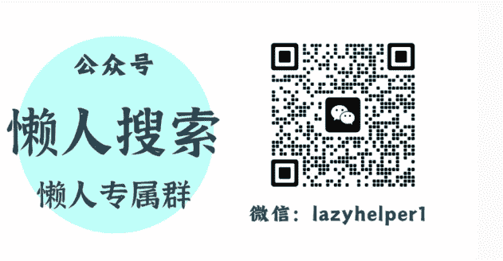

# 218 | 2026 腾讯年会，马化腾如何聊 AI

260202

整理：公众号懒人搜索，懒人专属群精选

懒人微信：lazyhelper1

欢迎打开《蔡钰·商业参考 4》，我是蔡钰。

你听说了吗？腾讯的 AI 产品元宝要在春节期间派送 10 亿元现金红包，还要推出一个叫“元宝派”的 AI 社交功能。

这个动作，你听着可能有点耳熟。11 年前的 2015 年春节，腾讯就是靠着微信红包，让微信支付功能后发先至地追上了支付宝。元宝现在这个架势，明显是想复制 10 年前的微信支付的成功配方。

但这回不太一样。

过去一年，腾讯在 AI 领域的探索，都肉眼可见地落后于字节和阿里。字节的豆包，日活已经过亿；阿里的千问，在全球开源模型里稳定前三。

光靠撒红包，元宝能追上吗？10 年前的招数，今天还灵吗？我们可能要等到马年春节之后才能看到答案。

不过，元宝发红包的消息宣布之后的第二天，1 月 26 日，腾讯就开了 2026 年会。董事局主席马化腾、总裁刘炽平的发言，都高度聚焦在 AI 上，信息量相当大。透露了不少腾讯当下对 AI 的整个思考和布局轮廓。

我来帮你重点梳理一下，马化腾关于 AI 都说了些什么。

## 慢了 9 个月到 1 年

马化腾发言一开场，就主动承认了一件事：腾讯在 AI 上，慢了。

他说，2021 年，各行各业还在招人扩张，但 2022 年一下子就有进入寒冬的感觉。因此，腾讯在 2022 年提出的方针是聚焦主业、降本增效、减脂增肌。

为什么要追溯到四五年前呢？这是为了解释，腾讯为什么在 AI 上投入缓慢。马化腾说，每个平台的基因和体质不一样，穿越周期的节奏也不一样。

等腾讯结束了为期三年的调整周期，到 2025 年，在 AI 上的投入才恢复增长。一直到 2024 年底，腾讯的 AI 产品——元宝和混元大模型，也才从研究部门转到产业部门，当作一门生意来做。

马化腾承认，腾讯的这整个动作，其实是慢了。腾讯自己的混元大模型和元宝高开低走，外部的字节豆包、阿里千问快速领先。腾讯比这两大对手慢了多少呢？马化腾的判断是，“慢了 9 个月到 1 年”。

## 三个底气

那还追得上吗？

马化腾倒是表露了信心。他给出了三个理由：

- **第一，血厚。**
  他说，ChatGPT 和 DeepSeek 改变了 AI 发展的进程，但每个企业穿越周期的节奏不一样。过往业务的长青，保证了腾讯在 AI 上可以长期投入。
  说白了就是：腾讯不差钱，可以慢慢磨。

- **第二，补足火力的思想已经调整过来了。**
  他说，腾讯 AI 进展慢的核心原因，可能在于基础设施不足。基础设施是什么？我理解就是算力、算法的沉淀。
  所以，2025 年，腾讯已经针对问题重构了 AI 研发团队，还引入了来自 OpenAI 的研究员姚顺雨。接下来会继续给钱、给人、给资源，把短板补上。

- **第三，产品力仍然是核心竞争力。**
  马化腾说，腾讯的风格就是稳扎稳打。AI 战略的核心是产品的长期竞争力和用户体验。要把混元大模型和 AI 产品以一体化的方式来考虑，未来采用交叉、派驻和 Co-design(共同设计) 的逻辑进行产品和组织设计。

这段话稍微有点绕。翻译一下就是：在各家 AI 普遍头疼 PMF，也就是产品 - 市场契合度的今天，腾讯的产品能力和用户体验捕捉能力，是有差异化优势的。

你发现没有，马化腾这三个理由，其实都在强调一件事：腾讯不着急。

## 点评豆包和千问

说完自己，马化腾还点名评价了字节前段时间推出的豆包手机，和阿里的千问。

关于豆包手机，马化腾说，腾讯一贯旗帜鲜明地反对用黑产外挂的方式，把用户的手机和电脑屏幕录屏传到云端，因为这是“极其不安全”“不负责任的”。

你看，这是把豆包手机跟“黑产外挂”划上了等号。这种对别家产品不留情面的批评，在马化腾口中出现，非常非常罕见。

对于千问，马化腾倒是更为欣赏。他说：“阿里结合自己的特点，内部生态的联动，我觉得值得赞赏。AI 产品结合自己的特点，发挥自己的优势是很好的。”

——他所说的阿里内部生态联动，我们解释一下，指的是，阿里今天把内部所有业务接口都开放给了千问，用户通过千问，就能下单淘宝闪购，或者定制一趟飞猪旅程。

不过，话锋一转，马化腾补充说，阿里这么做千问，也有弊端。弊端在哪里呢？在于用户不一定喜欢全家桶，而且阿里生态内，也不是所有的服务都是业界最好的。

——这话是什么意思呢？这是从产品角度提出的判断：千问的功能太多，对用户不一定是好事；千问只提供阿里的电商、阿里的闪购、阿里的旅行业务，对用户也不一定是好事。

我不知道你咋想，我自己看到马化腾对豆包和千问的点评，还是挺感慨的。马化腾真的是他这一辈科技大佬里，始终“产品经理”属性最强的一位。

## 社交 AI 和去中心化

那么，腾讯自己的 AI 产品要怎么做才对味呢？马化腾提到的两个腾讯产品，正好能回答这个问题。

一个是腾讯元宝。前面我们说了，元宝要在春节派发 10 亿元现金红包，来吸引民众参与一种名叫“元宝派”的社交玩法。

元宝派是怎么个玩法？简单来说，就是组织线上派对，让 AI 在派对里干活儿。

比如，拉好友一起看电影、听音乐，在派对里@元宝，让它接话、回答问题；再比如，创建健身或阅读等打卡活动，让元宝给选手们当监督员。

马化腾解释说，这种玩法是从腾讯会议的群聊功能中获得的启发，把 AI 助手用到了线上社群里。

你看，这很明显回归到了腾讯最擅长的社交属性里。它想要推动的是，互联网用户从使用“单机 AI"向体验“社交 AI"的习惯迁移，把 AI 战局引入自己擅长的赛道。

既然如此，为什么不直接放到腾讯社交属性最强的微信里做呢？其实，过去几个月你可能已经发现了，你在微信公众号、视频号的留言区里，已经可以@元宝，让它总结文章内容、回答读者提问、或者点评某人的留言。

不过，要系统回答这个问题，还得回扣到马化腾前面强调过的那句话了：腾讯的风格就是稳扎稳打。

微信，就是马化腾提到的第二个内部产品。他在这次的年会上再次强调，“微信是腾讯的中流砥柱”，公司对该业务板块寄予厚望。

既然是中流砥柱，那当然就要稳。所以，他认为，微信慢一点推出智能助手的服务也没有问题，因为腾讯需要仔细思考其中的逻辑。

前面我们提到，马化腾的判断是，阿里千问给出的 AI 全家桶，对用户来说反而可能是“弊端”。那么顺着这个逻辑，微信的智能生态会继续坚持去中心化，以兼顾用户需求和隐私安全的方式来思考和规划。

所以马化腾说，“我们不会控制所有的入口，任何创业者都可以自己在微信的智能生态产生自己的入口，然后去推广这个专有入口，这是没有问题的。我们只提供底层连接，这样比较科学合理，生态伙伴也比较放心和可以接受，因此是比较可持续的。”

这段话有点绕。打个比方的话，相当于，腾讯更想当一个大型商圈的物业管理者。它提供微信账号系统、微信支付、云服务、小程序这些基础设施，就像商圈的水电和道路。鼓励所有人在里面经营自己的朋友圈、小程序、公众号、微信小店，自己团结自己的小社群。但它不会逼着商户统一采购、统一收银、统一会员卡、统一上架商品。每个商户可以自己决定怎么做生意。

这就跟天猫、拼多多的“中心化”与“全家桶”形成了区别。

## 总结

以上，是马化腾在腾讯 2026 年内部年会上的讲话里，关于 AI 的一些重点内容。

听到这里，你大概能感觉到，他的这番讲话与其说是“承认落后”，不如说是在宣告一种不同的战争逻辑。

腾讯承认在技术起步上慢了，但某种程度上却仍然把“慢”的近义词“稳”当作战略定力来秉持。

马化腾显然不打算跟对手单纯地卷 AI 模型的参数和性能，而是试图唤醒腾讯最擅长的产品经理思维。当他批评豆包“侵犯隐私”、吐槽千问“体验臃肿”时，其实是在赌一件事：在 AI 时代，用户依然会为安全感和克制买单。

而同时，腾讯对“元宝派”的构想，你注意到没有，也是把 AI 助理的角色，从当前行业意义的“对象”降级到了第三方配角，来为真人与真人的社交提供内容和行为润滑。

这种分寸的拿捏，不愧是社交巨头腾讯啊！

那就让我们看看，元宝红包和元宝派会在即将到来的春节当中表现如何吧。

对了，既然都说到这儿了，腾讯生态里还有一个好玩的事情，推荐你过年期间也不妨了解和参与一下。这个玩法叫作“推客”。这种玩法，很可能在 2026 年加速腾讯电商的布局和增长。

怎么回事呢？

下一讲，我们借着 2026 年的微信公开课来解释。

## 最后，安利小懒的付费群：

**懒人专属群（介绍）**

📔这里是你对抗信息过载的护城河。已稳定运行 7 年，累计拆解、研读 3000+ 个互联网商业实战案例与行业前沿内参和时政/宏观文章。

我们不搬运垃圾，只做高价值信息的筛选器与放大镜。

**懒人专属群更新记录：**

https://hk57gvIx7u.feishu.cn/docx/H0kRdZbSbolBR0xkaXtcuVEOnTg

【免责声明】本资料归档于社群内部知识库，仅供成员课题研究与学术交流，请在查阅后 24 小时内删除。