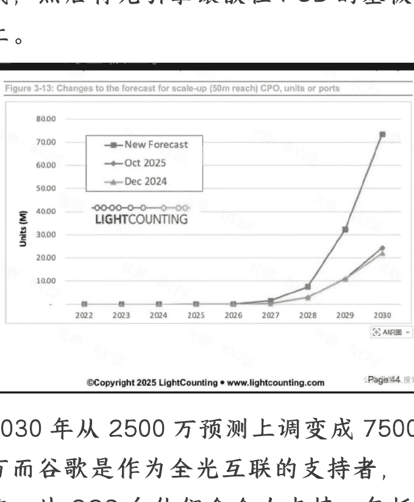
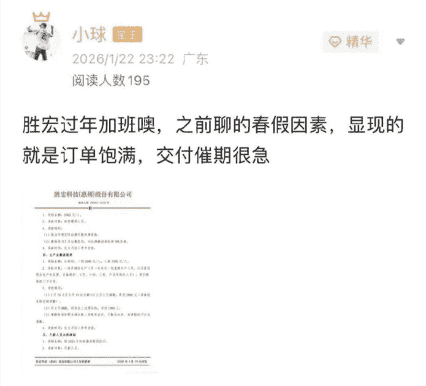

# 2 月机会逻辑 + 如何布局

公众号懒人搜索，懒人专属群分享

260201 击球区小能手付费

整理：公众号懒人搜索，懒人专属群精选

懒人微信：lazyhelper

进入 2 月份，叠加春节假期，如何做到找到核心 + 布局年后 26 年的具体思路，看完相信你的脉络就会非常清晰，视野和格局都能展开：

全文共：约 7300 字。

正文开启：

现在这个阶段，其实好的逻辑一定是涨起来的了，基本上都是被发现的了，也是前期一直追踪的部分，包括 AI 向，商业航天，半导体向，好的东西就一个字：不便宜，所以追高一定要按照自己能接受的节奏来，或者按照趋势，逢均线位置布局，这个就看个人选择了。

所以进入 2 月份，因为叠加春节假期，一定要注意的就是节前效应，这一个部分更多的是要去关注市场成交量，其实从降温的慢牛节奏来看啊，市场的成交量虽然下降了，但是结构性的行情依然在，无论是最近很火热的商业航天，有色，AI 应用，都属于这一块，因为成交量上来然后带动资金不断的板块轮动，本质就是资金不够，无法撑起来全面的进攻。

还有一个风险点就是北美部分这个政府停摆危机会落在我们假期前后，这个长达接近 10 日的交易真空期，节前可能会有资金观望处理。

所以这里面有很多活跃资金（我称之为风险偏好资金），风偏资金在市场好的时候，愿意去给未来有发展机会的企业更多估值 + 愿意往更纵深的年份去给远期估值，反之亦然，情绪和成交量下降的时候就拥抱近期确定性即可。

而市场成交量活跃的时候，这些板块都是可以一起进攻，就是量增价涨，大家都能吃到蛋糕，可是当成交量不够，就会出现板块之间互相吸血，其实就是那一派的资金，他们在不断的切换板块，所以有进就有出，所以就能看到之前 AI 硬软互相吸血，包括商业航天和有色都在不断的互相吸血，只要市场维持在 3 万亿 + 的水平（当然越多越好，越多能支持更多的板块上行，但是只要维持在这个水平，有活跃度，结构性行情一定是在的）。

在中美双边都是放水刺激经济的大背景下，从有色这轮也能看出来，市场是宽松的，所以这一轮背景其实就是放水牛。

所以就是看哪个板块更核心，那个板块核心里面更具有弹性 (边际增量 + 市场二阶导)。板块与板块之间 pk，然后板块之内的核心继续 pk，龙头获得溢价，其实就是这么简单而已。

然后进阶版就是，如何在企业成长的中途，找到更好的二阶导弹性预期差，举个例子：像光模块按照 1000 万只出来的预期，业绩好是没用的，只是反映了之前的预期兑现。真正支持有弹性的是加单或者涨价上修到 2000 万只这种的预期，才能有新的预期差支持新预期的上涨。(其他板块同理) 所以不要纠结为什么业绩很好，增速也很好，但是就被兑现了呢？业绩一定只是过往的成绩单，真正支持未来趋势的，是未来的预期增量，所以找到未来的边际增量弹性，才是关键。

26 年布局总体有四大的方向是最希望获得边际增量的:

- AI 方向
- 商业航天方向
- 半导体方向
- 有色方向

其实再往下推演就是抓住一个顶层的逻辑就是，这四块其实都有一个共通点，就是都是中美双边共同博弈的一个点，也是发展的一个关键点，所以需要市场资金 + 实业发展的共振。

金属其实金，铜这些大逻辑就是放水 + 国内收储，作为一个货币放水之后，定价权的一个锚定，最近波动很大，因为也是出现了情绪逼空然后出现反身性，其实最简单的一点，短期波动大，但是拉长去看，金属一定是可以走涨价逻辑的，这个是宏观看法。

有兄弟问起来贵金属怎么去看，首先本人是看景气度的产业逻辑的，金属属于强周期的行业，有很多比我厉害的师傅，在这里我就不班门弄斧了。

这轮还是受益于双边放水共振，所以整个市场都会是放水慢牛，这个是从大逻辑去判断，金属作为价值蓄水池 + 战略资源储备 (稳定货币) 是有长期逻辑的，但本人对于周期波动的研究，在这一块的行业专家资源实在是不够丰富，所以我还是去我比较熟悉的，具有高弹性的景气度行业去深耕。

然后是商业航天，最近这一块一波情绪上来了，之前写的几个核心，都在前面的文里面，其实我总结一个点，国内就是火箭 (cjgf, blt, fwkj 等等的) 卫星就是 (stcc, zlkj 等等的), spaceX 链就是 (mwgf, xwtx 等等的) 这一些代表，市场都已经很清晰了，我之前也都给过了这些公司，记得回去看。

商业航天有没有二波，一定是有的，但是只有核心才有，真正能出业绩的这些。

商业航天的预期差就是就在 spaceX 的 IPO 估值+spaceX 带动宇宙算力 + 星链的计划同时带动我们作为追赶者进行的加速阶段。

所以可以大致拆分时间线，26 年大概率就是可回收落地成功的元年，这里要关注可回收成功的时间表，在这一块落地之前，火箭部分会是情绪 + 价值量的主要关注点，包括发射平台的建立或者相关的一些火箭零部件，这里都会在回收落地前后迎来属于他们的二波高光。

而可回收落地之后，这里就是会迎来航班化发射常态化 + 卫星上天的降本化运营，只有当可回收落地之后，卫星的数量和价值量都能够往远期按照 spaceX 的规划去拍计算器。因为如果只是目前，可回收没落地之前，单批次发射上天的频率和性价比都是比较贵且没有经济性的，所以当可回收落地之后，卫星向的企业会把接力棒从火箭向企业拿过来，到时才是真正能往 2030 年估值去拍，而且随时可以看我们发射的申报计划，我觉得 spaceX 敢报 100 万颗，我们 20 万颗也很有机会持续上调。

而 spaceX 链的，就盯着 spaceX 的 IPO 计划时间表，和 spaceX 动向关于审厂或者上修发射计划等，最简单的就是看他发推的节奏或者采访，马斯克可是很能给资本市场画饼的，直接转一个 spaceX 上修 100 万颗市场的看法，是很不错的：

### 26 年 1 月 31 日，SpaceX 向 FCC 提交计划部署高达 100 万颗 AI 卫星的重磅申请，准备布局全球首个 # 太空数据中心，计算星将分布在 500km,1000km,2000km 等 3 个轨道层，为全球数十亿用户提供大规模 AI 推理及数据中心应用服务。

## 文件核心内容总结：

SpaceX 申请新增 1,218,720 颗卫星的频谱与轨道资源许可，具体分布如下：

| 轨道层 | 高度 | 卫星数量 | 用途 | 单星算力 | 时延 |
| :--- | :--- | :--- | :--- | :--- | :--- |
| 1 | 500km VLEO 轨 | 约 80 万颗 | 边缘计算与实时推理 | 1000 TFLOPS | <20 毫秒 |
| 2 | 1000km LEO 轨 | 约 30 万颗 | 区域计算与模型训练 | 5000 TFLOPS | 50-80 毫秒 |
| 3 | 2000km MEO 轨 | 约 11.8 万颗 | 云端计算与数据存储 | 20000 TFLOPS | 150-200 毫秒 |

## 卫星技术特征与平台简介:

将基于星链 V3mini 平台改造，重量约 850 公斤【较 V2mini 多出来的 100 多公斤主要用于装载抗辐射 AI 芯片、液冷散热系统与高能效电源】搭载自研 #Dojo-2 太空版芯片【采用 7nm 制程，单芯片算力 400TOPS，每星部署 12-24 颗芯片】。

搭配 #TensorCore 扩展单元 [支持 INT4/INT8/FPI6 混合精度推理，能效比 45TOPS/W] 采用新 # 在轨激光链路【10Gbps 激光终端，每秒 TB 级交换速率，搭配新太空计算骨干网】

## 具体发射计划:

使用星舰 V3 单次发射可部署 120-150 颗卫星，文件显示，SpaceX 请求 FCC 给予 9 年部署窗口期，前 3 年部署 10%，第 6 年部署 50%，第 9 年完成 100%【由于太空算力难度过高，需要有较长验证期】

## 点评:

- 重构全球算力基建格局，突破地面算力地理、能耗、时延限制，打造天地一体化全域算力网络。
- 加速 AI 与商业航天深度融合，催生太空算力新赛道，成商业航天核心发展方向。
- 形成强倒逼效应，推动传统数据中心运营商、科技巨头加速太空算力战略布局与技术研发。
- 加剧低中轨轨道资源争夺，提升太空垃圾与轨道碰撞风险，对频谱资源规范利用提出更高要求。
- 倒逼全球完善太空治理规则，推动轨道、频谱、太空垃圾治理领域的国际协作与制度建设。

关注太空光伏、卫星释放卫星热传感器、火箭等新领域布局。

太空算力星间交互必须通过激光通信，可以类比成地面的光模块，真空就是光纤。罗博其实也供了 spaceX 和空客的激光器校准（类似于光模块耦合），目前一颗星四个激光器，后面几倍通胀，所以如果以后这个太空星间通信需求起来的话，这个低轨卫星对于设备的需求量也是能起来的。

接下来就是 AI 部分了，我要把半导体领域和 AI 一起写，因为总的来说，半导体领域的设备扩产 + 涨价逻辑是基于 AI 需求拉动的全行业繁荣（在历年来如此保守的情况下，台积电依然如此激进）。所以半导体领域的设备是受益于扩张浪潮的，个人觉得半导体设备叠加存储设备会很优，而且芯片设计也会因为封测成本涨价趋势，大行业不断的繁荣，这是需求导向的涨价，可以贯穿 26 全年。

首先个人依旧看好 AI 需求延伸每个方向，这里需求确定性很足，业绩确定性也很高。

主要的就是光互联部分，这里的锐度依然很高，从大的 中际、天孚、新易盛 三家，光模块领域非常的有优势，中际、新易盛两家的预告也是大大的超预期，接下来这一块就是看物料的节奏 + 产品释放的节奏，光模块的需求基本上无需担心了，主要还是物料的问题。所以 26 年这一块，无论是光模块设备 + 光器件物料 + 最后的光模块产品，都是会有一个量释放出来的。光模块市场总体的量在 26-27 年会接近到一亿只（800G+1.6T），但是个人认为需求可以到达没问题，但是交付有难度，因为整体都在扩产，有可能 26 年的需求会顺延到 27 年交付，关注订单不重要，交付水平才是关键，需求一定是很好的了。

像中际大哥交流出来的内容，订单能见度看到 26Q4，部分客户开始下 27 年订单。物料虽然没法完全匹配需求，但已经好很多了。隔离器等感受不到缺货，光芯片略缺一些。公司专门强调，物料紧张不会影响公司收入，预计收入会保持较好增长。

像小的光模块弹性企业，个人比较看好联特这种受到谷歌支持的企业，谷歌也是想把供应链从英伟达分离出来，培养自己的小天孚。

26 年就一定是硅光之年了，而且像 CPO 这些也作为元年，同样的 NPO 也会作为光入柜内作为新的产品出现。26 年有大客户定制研发的需求，27 年会看到大量光进柜内。这个时间表和行业节奏是比较清晰的了。CPO 就是光电共封装了，大家都很熟悉了。NPO 则是 NPO 要贴装在 PCB 单板上，对占板面积的要求极高更加精细化带动带宽密度，光电芯片用更高的技术来完成，然后将光引擎镶嵌在 PCB 的基板上。

2030 年从 2500 万预测上调变成 7500 万而谷歌是作为全光互联的支持者，这一块 OCS 向他们会全力支持，包括光纤的需求，最近光纤一直在涨价，扩产需要 18 个月的时间，需求太好了，像光纤 A2 这一款产品，已经涨到 80+ 的价格了，同比来看，已经涨价超过一倍了，还有很多散光纤的价格都在不断上行，所以这一块长飞等等的 光纤厂是一个长逻辑，长芯同理（脉络就是长芯盛的共同体 + 谷歌的进展）。

26 年的重点也一定会是 CPO，作为 0-1 的元年，边际增量是很看得见的，市场也是选择了一直关注的 罗博 作为核心，罗天炬光四小龙，而且透露一点，英伟达不止把目光放在 CPO 了，目前已经在预研究 OIO 了，OIO 对于 CPO 带来的增量更是夸张，所以下周英伟达也有这个硅光子学 CPO 应用在 AI 智能超级工厂里面的运用介绍，风来了，而且天孚作为英伟达的合作伙伴，预研发 OIO 是很合理的，英伟达一直很激进，和台积电的微环方案就能看出来，目标一定不止是 CPO，而且 罗博 的 OIO 设备其实已经完成量产出货了，所以其实产业进度一直在，只要 罗博 的产能释放出来，那就是源源不断的订单。OIO 这部分的预研发也是跟随 CPO 预研发的小伙伴梯队一样，mellanox 和天孚 + 罗博 组成帮助英伟达新研发的铁三角组合。罗博 的 H 应该是在 4-6 月份会敲定，2 季度这个时间，基石基本上已经确定好了。

所以光互联部分个人觉得还是作为 AI 硬件里面弹性和锐度比较好的部分，业绩确定性（光模块产业链的整体细分）+ 边际增量 0-1（CPO 或者 NPO）+ 谷歌映射 (OCS+ 光纤涨价长逻辑)。

至于 PCB 板块，其实最关键的还是龙头大哥胜宏还没起来，所以显得小弟都没啥表现的机会，整体板块走势并不流畅。

胜宏其实很努力了，但是产能扩张 + 爬坡和产品验证导入 + 放量还是需要一个时间去完成对吧，这个节奏是必须要遵守的。

其实也能看到像大族这种设备厂家已经放量的业绩了，作为和胜宏深度绑定的设备，胜宏的指引对应的就是未来的业绩会出来。最近胜宏和上游的物料厂签订了接近全年的保供锁定协议，而且最近仍在导入更多新的物料，所以节奏而已，胜宏老板也明示了，q2-q3 会是逐渐释放出业绩来的，到时就会情绪很多，而且胜宏春节也加班，可见这个产品交付依然是比较急的，但是出业绩还是循序 q2-q3 这个阶段，急不来，他有他的节奏。像胜宏，其实也一直在和英伟达研发新产品，包括和谷歌 hdi 也是验证导入中，26 年的确定性还是比较足的。

相关的 PCB 企业都是如此，遵循设备 - 材料-PCB 产品的思路去递进。

最后就是存储这个部分的内容，存储一定是超级周期。

之前存储是作为消费电子的周期属性，严格被消费电子价格天花板压制需求，所以之前海外几大厂对存储扩张是很不积极的，因为如果扩张的快，需求跟不上，释放的产能都是拍灰，而且设备还要折旧。所以头部他们都是很默契的共同体，把握好这个三年不开张，开张吃三年的存储大行情。

目前的现状就是，头部已经习惯了保守扩产节奏（台积电同理）目前 AI 拉动的需求因为 token 消耗越来越快，就算激进扩产也跟不上存储的新增需求，所以很多人还是按消费电子成本导向去看存储周期，但是我已经在去年已经指出，存储的大行情一定是 3 年起步的，因为 AI 客户对价格不敏感 + 锁定货源，消费电子根本无货可拿。对于头部厂家供应来说就是，涨价 + 出货量同时出现增长的戴维斯双击。如果看存储还用周期思维看，就是看不明白存储。

至于为什么我们国内的存储没有海外的，其实很简单的一个道理就是，海外的美光海力士闪迪等等的是作为 AI 向的 HBM 存储，这一块需求和毛利都很好，所以他们都转去生产这一块。国外的存储都是 ai 数据中心 ai 应用 token 产生的爆炸需求的 hbm, ddr5 和 nandflash 而我们目前国内，最正宗的是长鑫长存，但是因为还没上市，所以市场上的是矮个子挑将军的存储，例如模组这些，其实更看好原厂属性的类似兆易，普冉，澜起，君正这些，但是这些因为也只是利基型的，消费电子类型，并不是因为需求起来而涨价，而是因为海外原厂（有晶圆），所以被动挤压生产线所以带来的产品涨价。

所以其实更正宗的是长鑫长存，最好还是选海外的，但是如果没办法的也只能选目前市面上更具有原厂性质的，其实就是这个思路。

AI 硬件延伸出去的还有 AI 用电等等的这些细分需求，之前写的杰瑞，振华，应流等等的燃气轮机需求是很确定的，这一块关注的就是飞轮（和而）低喘振走的，这一次大注的机是海外的 Bloom 的动态，SOFC 燃气轮机这一块是挺确定到 2030 的了，这个缺电带动下的产业趋势是挺确定的了。

AI 硬件之后就是 AI 软件了，个人还是觉得，模型即应用。要在应用上赚到钱，首先这个应用的用户要非常有粘性。这些其实就是大模型厂家的能力圈，类似 阿里，字节，腾讯，他们的实力不是一般应用公司能去媲美的。

像海外的部分就是一直在交易这种逻辑，就是大模型通吃掉应用公司，每看到一个新的大模型有更多的功能，相关向的应用公司就是砍估值。

所以我是一直的看法，当题材去看待，别当远期成长的逻辑去看，应用的追踪难度很大且没有想象中那么高深的护城河，护城河在大厂里面，流量池 + 用户粘性 + 算力规模。

那么像 AI 应用迅速爆发，引来的就是用户的蜂拥而至，叠加的就是基础算力规模的迅速上升，从而带来的就是基础算力规模设施的指引持续上修预期，所以 AI 硬软其实就是一个螺旋上升的关系。

最近 cpu 涨价和 agent 很火，Agent 解决了如何问才能问出你想要的答案这一个环节，这部分其实 Gemini 就做的特别好，基本都能达到一句话就能实现 70% 左右理解你的需求，明确将 agent 作为核心方向，赋予了模型原生调用工具、理解多模态环境并做出决策的能力，所以一念即达的能力就特别突出，相比于其他模型。现在大家对于 CPU 的涨价预期还是存在分歧，其实关键变量是规模化，如果 CPU 不需要跟着算力需求同步扩容，那利好就仅限于现有产能溢价，空间有限，只有规模化需求起来，那么 CPU 就不可能跳过。

那么作为今年的 AI 国产应用元年，我是认可的，也能看到那几家今年春节就开始宣发规模了，今年一定是国产大比拼的元年，其实这一块国内 AIdc 建设一定会加速，毕竟 25 年因为某些事情耽搁了，今年会补齐而且会不断上调 capex，因为落后有点多了，国内大模型和国际顶尖差距 0.5-1 年，今年有望缩小，但算力投入差距至少两年，这意味着，今年国内 CSP 的算力开支会迎来爆发式增长这而且 字节 内部也是反映了一个事情，就是卡和算力确实不够用，包括豆包和火山引擎，确实是需要更多的算力，而且是源源不断的算力，现在算力从几家反应来看是真正的有缺口的，个人是比较看好芯原股份的，作为国内 asic 和 IP 供给的绝对龙头，今年也是一个逐渐收获的元年了，之前投入了很多研发去搞一站式定制芯片，今年越来越多大厂开始找上芯原一起来合作了，包括 腾讯，字节，阿里。

# 重视 ASIC 赛道扩容&份额提升双击，确认新与 TX 落地加速卡、DPU，项目参与度高于 ZT，达到 turnkey 级别。确认 AliPPU(平头哥) 大量上线三星，项目参与度略低于 ZT，利润可看 200-300 美金/颗。确认 MX 回片且测试 OK，年内后续量产进展需要跟踪。确认 ZT 存在晶圆加单，为总体需求量级加单，后续还需跟踪具体流片回片进展。BD 昆仑芯项目仍待观察。ASIC 角色会伴随国产算力市场壮大而长期存在，初期的项目经验和核心 IP 积累就是护城河。

芯原作为这个国产算力的铲子，其实是作为国内 AIDC 放量的综合上游，属于通吃，而且随着端侧和应用的繁荣，包括 AI 眼镜等等的 AI 分支，都会受益到这一块来，所以我比较认可芯原未来的成长空间。

最后其实就是一个彩蛋，有一个默默无闻，其实进展得很快的板块，就是无人驾驶的落地，这一块同样作为马斯克商业版图里面的一环，FSD 大概率会 2026 年落地于北美和欧洲。作为自动驾驶，国内 L3 的落地，其实你把这一块当成 AI 应用最快落地的部分是合理的，我个人认为这一个自动驾驶作为 AI 物理应用 + 智能驾驶端侧落地，付费闭环是合理的，大概今年也是元年，这一块关注度目前不高。相关密集度出现就是 FSD 在欧美的推广落地。

我们的 L3 规则制定标准，以后一定是智能化落地的比赛。一月中旬，多地扩大了 L3 测试试点范围，包括上海新增开放的自动驾驶测试路段。此外，吉利已获得杭州九千多平方公里的 L3 测试牌照，这标志着 L3 商业化运营和使用场景的进一步拓宽。

L3 级别自动驾驶的核心变化在于从驾驶员主导转变为智驾系统主导，这是一个行业层面的重大推进，且影响范围扩展至 C 端市场，因为之前的智能驾驶主要面向 B 端应用，而 L3 级别自动驾驶具有更大的行业空间。目前 L3 级别的推进不断超预期，不仅参与测试的车企数量增加，测试区域也从局部城市扩展到全国多地，并且有车企拿到了包含城区、县级以下区域以及主干道、支路在内的全域测试牌照。预计到今年下半年或 2027 年上半年，C 端消费者可能会看到带有 L3 功能的新车型销售。

这一块，我认为是会在 2026 年成为第五个具有预期差的板块，就看 FSD 和 L3 落地时间的催化了。作为自动驾驶的元年，这一块也是有足够的边际增量的。所以这一块，是有预期差的，相关的内容和学习，也希望大家在星球里面多多学习这些自动驾驶的内容和资料，我认为是绝对有新的预期差会出现的，作为未来的储备。

# 公众号懒人搜索、懒人专属群分享

## 最后，安利小懒的付费群:

## 懒人专属群（介绍）

> 📖 这里是你对抗信息过载的护城河。

- 已稳定运行 7 年，累计拆解、研读 3000+ 个互联网商业实战案例与行业前沿内参和时政/宏观文章。
- 我们不搬运垃圾，只做高价值信息的筛选器与放大镜。

## 懒人专属群更新记录：

https://hk57gvlx7u.feishu.cn/docx/H0kRdZbSboIBR0xkaXtcuVE0nTg

【免责声明】本资料归档于社群内部知识库，仅供成员课题研究与学术交流，请在查阅后 24 小时内删除。