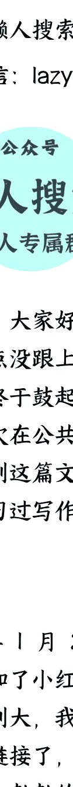
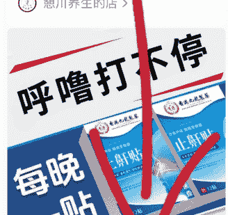
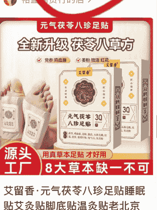
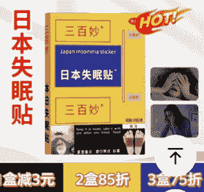

公众号懒人搜索，懒人专属群分享

# 上不了“班”，就开个“店”: 我如何在小红书电商里找回生命力并跑通变现的

## 260202 副业 SC 精华

公众号懒人搜索，懒人专属群独享

懒人微信: lazyhelper1



圈友们，大家好，我叫 Lydia，抱歉，来晚了，差点没跟上大部队的脚步……终于，终于，终于鼓起勇气主动输出了，这也是我第一次在公共平台输出，如果写的不好希望看到这篇文章的圈友能够包容，没有系统学习过写作，全是真情实感的流露……

2024 年 1 月 24 号我下定决心走出来去上海参加了小红书大会，这次大会对我的冲击特别大，我已经很久很久很久没有和人产生链接了，大会现场每一个笑意盈盈、野心勃勃的脸现在都还在我脑子里面打转转。我接收到的是积极的、向上的和充满生命力的信号，回看大会现场的照片时，我第一次从第三视角看到了自己的神态，是压抑的、低沉的……猛然发现我已经迷失自己很久了，曾经我也是那个充满朝气，乐观积极、笑意盈盈的人，为什么这两年会变得如此死气沉沉，如此悲观？

我想改变，我想自救，所以，我鼓起勇气写了这篇复盘贴，希望踏出改变的第一步!

## 一场大会，一次惊醒，一份勇气

我是一个脆皮，从小体质很差，健康运似乎也不是那么好。生过很多病，小时候还受过一次外伤，动过 3 次手术。终于，上大学开始身体慢慢变好，抵抗力似乎也还可以，也就顺顺利利的毕业来到上海工作。总共两段职场工作经历，2019-2021 在中国平安做保险理赔服务，专门针对交通事故的人员受伤伤情理赔金额评定；2021-2024 年初在国内排名前十的培训公司做企业管理培训咨询服务，协助管理学研究得比较深入的老师们去甲方企业开展管理学培训。

转折发生在 2021 年 7 月 9 日，那是一个周五的晚上，因为第二天朋友要来家里玩，所以，提前打扫下卫生，我当时站在一个凳子上整理衣柜里的东西，突然不认识面前的字，再醒来的时候我已经在地上，隔壁邻居在门口守着我，我老公带着救护人员突然朝我面前冲过来，其他事情一律不知道......这次之后做了很多检查，医生也没有下定论。

后来在 2021 年 9 月 10 号，那是一个阴天的下午，我去客户现场布置培训教室后出来在马路上打车，突然不认识对面银行招牌上的字，再次醒来我已经倒在路边，发现自己手和脚都磨破皮流了很多血，我身后那家银行的工作人员守着我，然后，救护车立马来把我拉走了……这次之后，医生确认了病情：癫痫 (终于！终于！终于我敢说岀这两个字，这份勇气来自于这次小红书大会每一位可爱的圈友，还有郭安润老师在群里发的一段话：学会放下和接受，和自己和解，然后找到合适的机会，就能走出来。我觉得今年做的最正确的决定就是来参加这次的航海大会!!)

从此以后，我开始吃上了抗癫痫的药，这几年一直小发作，很少大发作，病情控制还算稳定。但是，我其实一直活在随时失去意识的恐惧里，每发作一次我就越来越悲观、我害怕我变成傻子、我害怕亲戚朋友的歧视、我更害怕别人的怜悯……变得越来越封闭自己，而且，药物对我情绪的影响也特别大。

时间来到了 2022 年 6 月，上海某新冠疫情解封后的第一周，那是一个周日的下午，我在家玩手机，玩着玩着突然左眼视线模糊，可视物距离不超过 10cm，然后，又开始了一轮又一轮的挂号、检查，症状是视网膜半脱落了，病因却没有找到，后续靠我的免疫系统自救恢复了。这个事情让我

## 我的故事与转折

我很后怕，我差点只有一个眼睛可以看到光明了。

紧接着 2023-2024 年这两年陆陆续续身上出现了其他不太好的反应，全身各处关节发炎，肋骨软骨炎、膝关节炎、手指关节炎、肠胃炎、扁桃体炎、鼻炎，频繁感冒等等......这些一连串的反应加重了我悲观的情绪，似乎已经抑郁了，出现了很多次轻生的念头，只是我没有意识到。(其实，这些一连串的身体反应，也有专家推测是新冠病毒攻击神经系统、免疫系统导致的，不知道有没有和我类似经历的圈友)。

身体不堪重负的我在 2024 年年初选择了辞职，在家好好养身体，休息期间想找点事情做，正好我老公刷到了生财有术的直播，就给我报名了，那是 2024 年 3 月底。加入生财后我连新手必看的内容都没有看完就遇到了航海，然后我结合自身的实际情况：不想直播、不想露脸，选择了小红书店铺的航海。航海开始后的第一场教练直播是刀姐，我被刀姐在直播里满满的正能量深深吸引，添加了刀姐的微信。后续跟着航海跑通了全流程，但是，自己一个人研究效率特别特别低下，我需要一个老师及时的给到指导，然后，在 4 月份我主动报名了刀姐的小红书店铺陪跑训练营，跟着助教安排的节奏学习完课程开始

实操，终于在 6 月下旬拿到了结果，爆单一个品给我带来了 10 万 + 的利润。当时，我单纯的以为这是一个互联网平台的副业项目，也根本没想过要长期在自媒体领域深耕。

2024 年 7 月我从上海回到了成都装修新房，又遇到了妈妈患上皮肤癌需要照顾，表哥拉着我“创业”等，就没有再做小红书了。但是，毕竟在上海比较正规的公司待过，实在受不了成都的工作环境、员工氛围、老板素质、通勤时长等，年底我选择了离职。也是在 2025 年年初确定重新开始做小红书店铺。

天有不测风云，2025 年年初出了点小意外导致轻微脑震荡，因为就医延误 + 后续休息不到位，留下了后遗症：神经性偏头痛、神经性耳鸣、睡眠障碍。

就这样一整年我每天都已被头痛、耳鸣、失眠困扰，大医院、小医院都看，西药、中药都吃。

也就是在这一年，我的抑郁情绪加重了，总是会在病情反复的时候出现轻生的念头，特别悲观，看不到活着的希望。（好在我老公一直在我身边陪着我，让我觉得还有活着的理由。他是在 2025 年 3 月份辞职，特地回成都照顾我）。

也就是在这一年，我变得越来越封闭自己，不愿意出门，不愿意和人交流，不想参加线下活动，甚至差点没有续费生财。

不过，在我身体条件允许的情况下，2025 年我一直在坚持断断续续地做小红书实物电商，陆陆续续小爆了几个品，加起来利润有 20 万 +。这次来小红书大会对我冲击特别大，被身边一个个圈友的生命力感染了，我在回来的飞机上忍着头痛、反胃一直在哭，泪水就如决堤的潮水般涌出来，实在忍不住啊，似乎压抑几年的情绪终于得到了释放。

我决定把压抑已久的情绪表达出来、把之前做店铺的经验总结出来，还有这次在大会现场的收获梳理一下，分享出来，希望对部分圈友有帮助吧。

## ✔我的小红书实物店铺实操经验

### 一、思考清楚自己的优劣势：

- 1-我的身体情况，不能过度耗费心力、体力，所以，追爆款、追热度、批量混剪、怼笔记量的模式在短暂尝试过后果断放弃。
- 2-从小不爱关注女孩子化妆、打扮、变美这些方面，所以，审美能力不够，需要选款式、选颜值类的产品果断放弃。
- 3-拍摄能力几乎无，所以，对拍摄环境布置、灯光、氛围等要求比较高的产品果断放弃。
- 4-因为一直封闭自己的原因，不爱出门，所以，需要去户外拍摄的产品果断放弃。

基于上述几点思考 + 小红书平台的推流逻辑（搜索流居多），选择了只需要在家就能拍摄、对拍摄要求不高的强需求类的产品。

### 二、选品

#### 1、从需求出发：

因为小红书的推流逻辑，搜索流居多，每天都有大批人在小红书上搜索自己感兴趣的问题，那么，我要做的就是给到他们感兴趣的问题的解决方案。就像人头痛医头，脚痛医脚那样，只要有问题就会有答案。

比如在小红书上搜索失眠，会有一堆的产品在商品推荐页，每个商品各种名称，安眠、睡眠、安神、防蚊、维生素、褪黑素等等关键词，再继续把这些关键词一个一个搜索，会看到更多的推荐商品，沿着这个思路看下去会选到合适的品。

失眠

搜索

全部 商品 图片 地点 群 问一问

退货包运费 500+ 人加购
Thorne·睡镁人粉 60 勺 美容觉
养皮肤改善睡眠双甘氨酸镁轻
¥438 已售 2821
Thorne 悦恩海外旗舰店 >

限时立减 92 500+ 人加购
新春市集 biocyte·法国褪黑素软
糖 PLUS 安瓶睡眠片褪黑素助
券后¥126 已售 2759
Biocyte 碧维斯海外旗舰店 >

好困好累！但睡不着
100mg 黄金含量 GABA+5 大草本配方
Deep Sleep
舒适睡眠之旅
1 瓶预估到手价
¥479/瓶 6 瓶调理装 缓解中重度失眠
限时立减 200 退货包运费
新春市集 MKULE·mkule 睡眠胶
囊氨基丁酸调节睡眠美国 60 粒
180 天低价¥938 已售 2419
Mkule 海外旗舰店 >

萧景™
精油晚安贴
Comfortable sleep
GOO
限时立减 25 元 退货包运费
晚安贴睡眠贴植物精油晚安贴
券后¥14.9 已售 2350
红帽百货的 >

草本舒眠膏
香港大药房
沉香
有一种幸福叫
想睡就睡
规格:10ml
草本萃取 全家适用
芳香
静享舒眠
温和舒适
草本萃取

仁和
贴越黑 越要用 茯苓八草方
茯苓 五指毛桃 党参 鸡血藤 姜粉 独活 红花
官方
正品
仁和茯苓足贴只用真草本
用真草本足贴 才好用 8 大草本缺一不可
退货包运费 2000+ 人加购

公众号懒人搜索，懒人专属群分享

睡眠贴

搜索

全部 用户 商品 图片 地点 群 问一问

退货包运费 100+ 人加购 领健元·养心助眠保健贴 ¥396 已售 190 憩川养生的店

退货包运费 6000+ 人加购 睡眠密码·静电敷贴学生考试贴 改善缓解失眠助眠初高中备考 180 天低价¥314 已售 8389 睡眠密码旗舰店



纯中草药浓缩强效快速 好睡眠 疏肝解郁 入睡困难 烦躁焦虑 多梦易醒 理气安神贴 药店 草本萃取无激素无副作用 同款 ¥59 外用安全，轻松入睡

限时立减 8.82 退货包运费 新春市集 香港大药房有限公司· 香港大药房止鼾贴官方旗舰店 券后¥47.98 已售 9 裕盛商贸行的店

限时立减 28.2 退货包运费 济克康·理气安神贴·睡眠贴、胸闷·疏肝解郁、失眠穴 90 天低价¥159.8 已售 327 济克康 济克康医疗器械专卖店





每满 200 减 30 退货包运费 OTHER·失眠贴睡眠贴助睡眠 不着浅睡贴草本萃取安睡男女 券后¥108 已售 165

9/27

#### 我判断这个产品我能做的标准:

- 1-爆款：(该产品在小红书爆过、我们在小红书卖该产品的成功概率才会更高); 该品至少在小红书上有点赞超过 100 条的挂车笔记、销量大于 1000;
- 2-近期优先: 爆款笔记时间越近越好、说明近期该产品正好有热度（优先级：24 小时 > 3 天 > 7 天 > 15 天 > 30 天）; 如果该产品近 30 天都没有点赞超过 100+ 的笔记，就暂时不考虑了; 辅助判断: 24 小时加购/总销量比例越接近 1:1 越好，说明是近期刚爆起来的;
- 3-低粉优先：粉丝量越低，代表账号权重越低，我们越容易模仿。粉丝量 100>500>1000>2000>5000;
- 4-1688 有货源、能够支持一件代发;
- 5-拍摄环境很简单，居家就能拍摄; 拍摄要求不高，直接怼着产品拍就好，后期也不需要怎么修图。

#### 2、关注异常值:

因为一直测试的都是同一类型、同一需求痛点的产品，会用一个小号关注一些同行，突然有一天看到同行上了一个新品，我立马去小红书搜索，发现有热度的笔记几乎都是 1 周内的，24 小时加购的商家也才 2-3 家，算是非常好入局的时候。我立马把对标账号的爆款笔记和素材扒下来二创后发布，出单后立马下单实物拍摄产品，一周的时间就爆起来了。(只是很可惜，这个产品的笔记一直在被同行投诉，最后没有大爆)。

#### 3、持续学习：

我记得 2025 年 6 月份的时候，生财有一期航海是小红书电商蓝海实拍，当时的教练在直播里提到一个思路：要做就做能争第一的产品，并且演示了搜索一个产品后怎么看这个品是蓝海品:

- 24 小时加购>100(证明有热度);
- 竞品商家 1-2 家 (证明竞争小);
- 爆款笔记时间越近越好 (证明热度是近期的);
- 该品第一条笔记发布到第一条爆款笔记发布的时间间隔 (大概能对比判断自己做这个品至少需要多久能爆);
- 日更笔记数量 (判断自己跟这个品是否废力、因为我们日更笔记数量至少需要对标账号的 1.5 倍、如果是需要怼量的产品我就会果断放弃)。

我按照这个思路找到一个只有一家竞品的蓝海品，而且，对标账号一天才发 2-3 条笔记，对我来说跟品就很轻松。我迅速跟品、也是一周时间就爆了。（也很可惜，正在爆单的时候被同行举报下架，后续多次尝试重新上架失败，还被平台警告了）

#### 4、善用工具：

就像生财有术这样，刀姐的电商训练营也有自己的知识星球，助教们会不定期更新看到的比较有潜力的类目或者商品，偶尔我会打开看看，然后关注到有一个品连续

两年都有助教分享，我就尝试布局，也是顺利爆单了。

我相信很多圈友都是经常看生财的，也有很多圈友通过生财分享的内容起飞的，生财对我们来说也是一个工具，既然花了钱那就要把这个工具好好利用。我在这方面也是很自惭形秽的，因为，我对生财的利用率不到万分之一，加入生财后偶尔参加下航海，参加航海期间也只看教练直播，平时也不会打开生财浏览内容，这次参加小红书大会后，发现自己错过了 1 个亿！！！

很多小红书大会的圈友都以为我是新人，好心的教我怎么用生财，我也分享出来，给其他新人一个参考:

- 多看中标、超级标、超级术这些内容，保持对赚钱的敏感度;
- 多看航海手册，玩法的精华都在里面;
- 多参加线下活动 (这两年我处于比较封闭自己的阶段，这次之后我会勇敢的跨出来，只要成都有线下活动我都会尽量参加，或者是自己也会主动组局和圈友多交流，我想多出来走走对我的病情恢复肯定是有帮助的。)
- 擅用搜索功能，搜索自己关注领域的内容。

### 三、测品

测品之前我会找到做该品的所有的对标账号，把他主页的笔记全部扒下来，整理汇总到一个表格，然后分析对标账号前 5-20 条左右笔记的共同点，汇总成自己的测品思路：

**封面：** 大概有这几种：痛点照片、痛点解决之后的照片、变化明显的对比图、使用产品呈现出的强效果图；

**中间图：** 一般就是产品的包装照、实物照、开盖照、成分表照、正在使用时的照片；

**标题：** 第一轮直接复制对标账号数据表现比较好的标题、第二轮开始用 AI 协助仿写；等到有自己的爆款笔记出来，继续用 AI 仿写；

**正文：** 第一轮直接复制对标账号数据表现比较好的正文、第二轮开始用 AI 协助仿写；等到有自己的爆款笔记出来，继续用 AI 仿写；

**关键词：** 通过小红书千帆 - 推广 - 搜索广告 - 搜索关键词 - 输入自己感兴趣的产品的关键词 - 下载表格取月搜索指数>2 万的关键词以及对标账号布局的关键词，排列组合成 5-6 组词，每组包含 20 个左右的关键词，发布笔记的时候依次布局。

**评论语：** 第一种方式是借鉴同行的关联评论语；第二种方式是结合自己对产品痛点和使用场景的理解，包括对 AI 的问询，总结出该产品的使用场景，放到评论语里面，协助二次宣传。

#### **测品节奏：**

一个品我连续测两周，没有连续出单或者是没有持续出现新增点赞/收藏的单条笔记，就会考虑放弃。

我分析了一下有的品没有爆单的原因可能有以下方面：

- 1-放弃太早：有的品测 1 周没有看到比较好的数据反馈就容易放弃，后面回过头来看很多后面入局的账号都爆了，所以，后面我会强制要求自己一个品连续发满 2 周的笔记才能考虑放弃；
- 2-入局时间太晚：有时候选到的品已经大爆了，看到同行数据跑得特别好自己也想要试一下，最后，做起来也是比较困难的，后面我基本上选品都不做大爆的品了；
- 3-选品不符合账号属性：如果账号已经爆过某个类目或者某种功能属性的产品，可能账号已经被打上一定的标签了，建议继续在该类目下或者是该功能需求延生下选品，会更容易继续爆；
- 4-平台具有随机性：有时候确实选到了合适的产品，也测试到位了，但是，就是不爆，这种情况只能选择接受，继续看下一个品就好了。

因为我身体的原因，属于做一阵休息一阵的情况，而且，没法支撑去做矩阵，所以，我是一个企业号托三个子账号，企业号负责产品上架，子账号负责发笔记，状态好的情况下一个号一天最多能发 10 条

笔记左右，状态不好的情况下要嘛停更要嘛某个数据表现更好的账号先更新。这一点不值得大家借鉴，大家可以根据自己的实际情况把持续测品的节奏保持起来。

#### **时间安排:**

我一般上午 9:00-11:00 处理：发货 + 物流 + 售后 + 评价管理 + 和供应商结算费用 + 数据分析 + 布局评论区;

下午 2:00/3:00-6:00 处理：批量拍摄/二创素材/编辑笔记/发布笔记/选品;

偶尔晚上 8:00-9:00：选品。

### 四、数据优化

#### 1、用好评论区

笔记小眼睛 24 小时内破 200 或者是单条笔记一直在持续出单，我会在该笔记的评论区做互动类的布局。

1-我喜欢用的第一种评论区布局的方法：送各种福利、不管是试用名额体验也好、还是发暗语也好，目的都是增加用户的互动，帮忙增加笔记热度。如果是送试用名额，抽中的用户过来私聊的时候，提前说清楚愿意协助发五星好评 + 晒图 + 配文才给到试用，用户为了拿到免费的东西，基本上都是愿意配合的。

2-我喜欢用的第二种评论区布局的方法：蹲反馈，也是利用用户的从众心理，只要找个小号留言我已经买了，等我反馈效果

等，就会有用户来蹲蹲，又帮助增加了笔记热度；过一阵子再用蹲蹲的号去晒图或者是晒使用后的感受等，同时踢一踢蹲蹲的用户，还可以协助转化。

3-第三种：搬运同行的高赞评论，在找对标的时候，就把同行评论区高赞的评论搜集起来，等到自己笔记起来数据的时候复用。

#### 2、及时处理差评

我会经常看看评价管理，如果遇到差评直接通过小额打款 - 商品补偿 - 输入金额打款给到用户，然后把到账截图直接申诉评价，基本上不到半天系统就自动删除差评了。

申诉话术如下：

客户在收到货后并没有联系过客服提，没有过任何的沟通，直接给的我们差评，我们愿意配合处理我们承诺的售后服务，也无理由支持退货。目前已经给顾客全额打款 (无需退货)，希望官方能重新审核删评，谢谢!

我听到有人抱怨过，联系买家删差评多困难或者买家多么得寸进尺之类的话，我从来没有联系过买家删差评，一个是我自己精力不足，一个是还会影响我的情绪，所以，直接选择简单粗暴的方式高效解决问题，也花不了几个钱。

### 五、供应商对接&客服处理

- 1、编辑好固定话术对接供应商的时候直接发过去，让供应商回复，节省反复沟通时间：
  - 1-我是小红书店铺商家，聚焦什么品类，之前取得过哪些结果；（目的是让商家重视你）。
  - 2-是否支持一件代发？发哪些快递公司？
  - 3-每天几点打单？打单截止时间是几点？
  - 4-是否支持绑定店管家、聚水潭或者是其他什么软件？
  - 5-绑定发货系统后是否支持小红书面单？（个人觉得只要是无痕的就可以）。
  - 6-是否多仓发货（有的供应商发货地点是多个仓库，但是，我们店铺只能设置一个发货地址，就会有被平台检测出无货源封店的风险，所以，要提前问清楚）。
  - 7-产品的发货地址和退货地址分别是？（后续我们需要设置到自己的店铺）。
- 2、编辑好固定话术设置到 AI、买家咨询 AI 自动回复，AI 回复不了的再介入人工：

常见问题：发什么快递？发货后修改地址？如何使用？/使用步骤？颜色/款式怎么选？其他个性化问题等。这个就需要在实操中不断积累，定期更新问答库。

### 六、避坑

#### 1、不要轻易更换供应商

这是我前段时间刚踩的坑，也就是来参加小红书大会前，有一个新品笔记热度一下子上来了，因为对之前的供应商稍微有一点点不满意 (产品有色差 + 对方比较强势), 在没有做好新供应商调研之前更换了供应商，没想到几天之后退货率蹭蹭往上涨，账号直接限流，导致这个品最终销量不佳。

供应商考察可以借鉴上面和供应商对接需要确认的问题点、和供应商沟通过程中也判断下供应商的响应速度、配合程度，另外除非货源特别特别难找的时候，基本上 1688 上非牛头标志的供应商都不在我的考虑范围内。最后，记得提前拿样品！提前拿样品！！提前拿样品！！

也算是吸取了教训，以后对前供应商不满意的时候，要有意识提前下单看新供应商实际的货品情况。除非稳定的靠谱的供应商，就像刀姐团队提供的货源，从来没出过问题。

#### 2、拉黑同行！拉黑同行！拉黑同行！！

之前因为小红书上出了搜同款的功能，基本上分分钟就能看到那些同行在卖什么品，哪些同行在写什么笔记。所以，我就忽视了拉黑同行这个事情，当时觉得，就算拉黑了搜同款也能搜到我，没想到同行恶意这么高，反反复复举报，搞得一个品销量上不去，一个品被下架，真的是血泪教训。

## 在小红书大会现场的收获

### 一、知识的收获

#### 1、比高：ip 营销专家

- 选对赛道、天花板足够高：迁移到我之前做实物电商上的反思，同样的能力选不同的品拿到的结果是不一样的；
- 流量打法模板：定身份 - 拉流量 - 讲困扰 - 求帮助 - 做种草：意外发现自己已经有时候在用类似的模板，我之前的店铺产品都是针对的同一类人，然后提出这类人遇到问题的共同点、困扰、烦恼等，最后，给到种草的解决方案；
- SOP 化：这一点适合带团队的老板，把所有动作变成标准说明书，员工上岗快速上手、快速胜任、把个人能力变成公司能力。

#### 2、花爷：素人矩阵专家

- 素人也可以做 ip、ip 类型为这几类：活人感 ip、人设感 ip(活人感 ip+ 有记忆点)、价值感 ip(人设感 ip+ 对用户有用)、专业感 ip(价值感 ip+ 专业背书)、顶流 ip(专业感 ip+ 实力超群)；
- 素人做 ip 做到有价值感这一个层面就已经足够了；
- 具体玩法：大号品牌授权、提供保障，素人号提供流量和信任。(把原本一个号需要做的事情，拆成 N 个号做)；
- 品牌授权 + 素人种草 (用素人号安利明星直播间推荐的产品，目的是吃明星直播间流出来还未转化的流量)。

#### 3、郭安润：红海赛道找蓝海专家

- 渠道侧翼：创造新的可触达市场；
- 产品侧翼：创造新的细分品类；
- 流量侧翼：获取新的精准流量；

郭老师的内容目前对我来说太高深了，就算看得懂也不知道怎么分享出来，如果感兴趣的圈友可以去平台搜索下其他圈友的分享。

#### 4、蔡汶川：摄影圈知识付费专家

- “吐槽点”理论：找到用户的痛点，用一句话引发用户的共鸣，吸引用户讨论；
- “高效引流术”：圈人 (引发讨论)-打标签 (系统打上精准用户标签)-收割 (修改爆款帖子为产品推荐贴)；
- “交付即营销”：把服务过程变成广告本身，而非专门去拍产品、拍内容；
- 高效引流笔记：有效选题 (讨论题、用户关心的问题、交付即营销、故事经历)+爆款标题 (预埋关键词、平台通用爆款、拆解同行)+爆款封面 (大字报、对比图、密集信息、拆解对标)+爆款正文 (干货类、种草类、人设故事类）+ 导流钩子（用户匹配度、稀缺有价值、成本可控、痛点爽点卖点）。

#### 5、富贵：小红书线索获客专家

- 找准用户群体：找准人群，才能精准抓住人群的痛点、输出的内容才能更加锋利。（这一点引发了我的思考，我之前也是从需求出发去找人身上的痛点然后售卖产品的，但是，从来没有意识对人群做归纳，也没有深层次思考过对应人群的画像、兴趣、生活方式、决策因子等）
- 文案的三层级理论：讲参数 - 讲体验 - 讲情绪，让用户的脑海中有画面、有向往（这一点我得到的启发很大，之前我的种草文案基本上停留在讲体验层面，这次之后我会有意识的去挖掘使用产品后，买家可能会在哪些场景下获得满足感、然后，用文字把相应的情绪描述出来）；

#### 6、申铭：直播电商操盘专家

- 垂直小店模式：从一个高频真实场景出发、长期服务同一类人、围绕场景逐步扩展需求、发布内容、产生交易、长期复购；
- 注意：一定要清楚在为谁服务、发生在什么场景、解决的是什么问题；
- 品类垂直（不卖所有东西，只卖一类东西），人群垂直（不服务所有人，只服务一类人), 模式垂直 (不追求一次暴发，只追求长期复利)；
- 具体玩法：选品 (选场景)-笔记 (精准引流)-直播 (打造高转化率的信任场)-粉丝群 (沉淀高价值用户，提升 LTV)；
- 后续进阶：扩充场景 + 提升复购 + 推出自有品牌/从爆款驱动到店即 ip(店铺成赛道专家)。

#### 7、V 小刀：普通人做到小红书电商多类目头部专家

- 虚拟资料优势：平台扶持 + 低门槛+AI 赋能；
- 思路：定赛道 (赛道、选品)-定产品 (AI 赋能)-定策略 (账号策略)；
- 如果想做超级个体，找个性化、高客单更有壁垒的赛道；
- 如果想发展团队，找标准化、横向复制更容易的赛道；
- 如果做内容驱动型产品：追爆款 (推荐流)、单账号同一个痛点连发打爆；
- 如果做产品驱动型产品：追需求 (搜索流)、多账号测品占搜索词；
- AI 赋能创作降低门槛：图片能力、文本能力、编程能力；
- 玩法：选品 - 拆内容、拆模板 - 识别内容爆点、AI 重构内容-AI 生图、生文排版批量生成 - 修改后发出测试。

### 二、人的收获

这次来线下大会，其实我链接到的人不算多，很多时候见到人都不敢打招呼。。。回来之后肠子都悔青了，感觉自己又错过一个亿！！！不过，还是在我有限的能力范围内链接到一些优秀又可爱的圈友：

- 刀姐：以前一直在线上被刀姐的真诚、直率、强大的内核、向上的生命力所感染，这次线下见到刀姐，简直是粉丝见明星的具象化现场，刀姐暖心的给我写了 TO 签，真的很开心很开心，我想以后不开心的时候我真的会想到刀姐、会想到刀姐给我的鼓励！
- 绿子：拼房拼到的神仙室友，同在成都、类似的人生阶段、类似的 i 人属性，类似的体质，甚至类似的 2026 年规划。也是她反复在鼓励我回来写复盘贴，告诉我：越分享越幸运！
- 叁斤：同 AI 人，同独处型、同选品思路，非常契合的价值观！叁斤老师是我这次航海大会非常意外的收获！慷慨大方的分享做小红书虚拟产品项目的思路，受益匪浅！后续组完线下交流局，下一阶段的重点任务就是把叁斤老师在生财输出的关于虚拟产品项目相关的内容看完。
- 戴巍：在茶话会环节和戴老师短暂的聊过几句，受戴老师“利他”观点的启发，已经在 1 月 31 号在成都发起了一场线下分享局，分享这次小红书大会的收获。
- 源源：同成都的圈友、AI 代写业务做得很好、永远笑呵呵的、非常乐观，分享给我的逐字稿对我的帮助也很大。
- 刘同学：咱们热心的志愿者，特地去帮我抽奖，抽到了王梦珂老师著的书籍《爆款 - 小红书从起号到表现》，过年期间有书看了。
- 勤学：一位表达欲爆棚的伙伴，特地好心的教我后续如何使用生财。

还有一些没有来得及深入交流的圈友：浩然、武一、小辉、千木、一只仙、小茗、Zoe、薇薇，他们每一个人都有自己独特的优势和方法论，希望未来有更多的机会可以深入交流。

最后，还要感谢两位特别的朋友，圈友 iuena 和汐然，她们俩我在 2024 年就认识了，后面我们一直在保持联系，iuena 像个小太阳经常分享给我她和其他圈友的故事，也是她促使我续费了生财、来了这次线下大会，真的很感谢她一直在我身边传递正能量。

汐然是 2025 年 3 月裸辞之后到杭州联合办公，经常会分享她在杭州学到的新东西，包括她付费得到的一些知识或信息、我们有时候有问题也会请教她。特别佩服她裸辞去陌生城市的勇气、也很欣赏她的利他心 (向她学习)。

## ✔写在最后

我想对部分圈友说:

生财有术真的是一个很好很好的平台，里面 有各种互联网项目的高手，海量的赚钱 信息，希望新圈友们利用好这个平台，对 自己有信心，多花精力去研究自己感兴趣 的项目，多点耐心，多试几次，总会找到 适合自己的。

我想对生财官方说:

希望生财有术这个平台能够一直存在，它 帮助了很多想要赚钱的普通人，特别是像 我这样无法去企业上班的特殊人群，也能 够通过互联网项目养活自己，无形中承担 了很大的社会责任。希望未来有一天，如 果有机会，我也可以帮到更多的人。

我想对自己说:

一切决策逻辑遵从自己的“第一性原 理”: 健康第一、其他次要;

为了爱你和你爱的家人，好好活着，照顾 好自己，等待医学的进步，尽可能去感受 世界的精彩;

借用刀姐的话：流水不争先，争的是滔滔 不绝；来得及，没问题，你可以!

2026 年开始我打算和老公一起转型主做 小红书虚拟产品的项目，他刚加入生财不 久，目前已经跑通 ai 网站出海项目。如果有正在做/准备做小红书虚拟产品项目、ai 网站出海项目或者需要各种 ai 提效小工具的圈友，欢迎一起交流，互相赋能!!

最后，安利小懒的付费群:

懒人专属群 (介绍)


> 📑 这里是你对抗信息过载的护城河。

已稳定运行 7 年，累计拆解、研读 3000+ 个互联网商业实战案例与行业前沿内参和时政/宏观文章。

我们不搬运垃圾，只做高价值信息的筛选器与放大镜。

懒人专属群更新记录:

```
https://hk57gvix7u.feishu.cn/docx/H0kRdZbSbolBR0xkaXtcuVE0nJg
```

【免责声明】本资料归档于社群内部知识库，仅供成员课题研究与学术交流，请在查阅后 24 小时内删除。