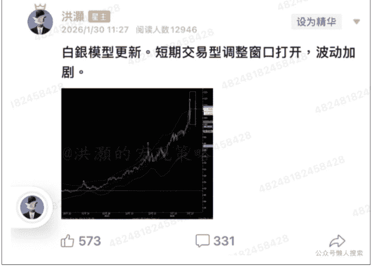
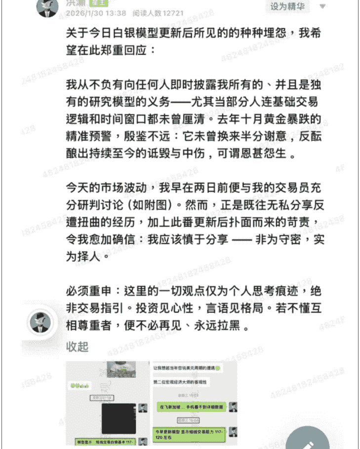

# 捕捉黄金白银的黑天鹅—继续坚定看多金银的长期投资价值

260202 洪灝付费文

整理：公众号懒人搜索，懒人专属群精选

懒人微信：lazyhelper1

## 前言

继续长期看好金银的投资价值：史诗级震荡无法动摇金银的五千年人类信用的根基。

金融市场的史册向来蜿蜒曲折，然而在 2026 年 1 月 30 日星期五，却以一道断崖式轨迹劈入历史的纪元。这次黄金白银史诗级巨震的陡峭凌厉之态，令绝大多数量化模型瞠目结舌。我们见证的是一场足以载入史册的“贵金属屠戮”：一场骤然而至的残酷的价格修正，将一月初那种近乎癫狂的抛物线式狂欢 (parabolic move) 拦腰断。

黄金，本周稍早还在 5,600 美元关口流连顾盼，却在单日交易中狂泻近 12%；白银更上演了统计意义上的“不可能事件”(statistically impossible event)，自当日的峰值崩塌逾 30%，其幅度之巨，已超越常规金融理论的解释范畴。然而，即便如此，黄金白银依然是今年以来表现得最好的资产类别：黄金上涨了 13% 到 4,900，接近我们反复讨论的公允价值 5,000（+/-300）；而白银上涨了 15%，年化收益率达到 400%+。

这绝非寻常所谓“行情不济之日”，而是对于那个开始忽略价格飙升、杠杆不断增加所带来的交易型风险的市场的一记棒喝。从统计数据的角度来透视：白银此番单天超过 30% 的波动构成了一次 14-15 个标准差事件。在风险管理的话语体系里，14σ 的波动深植于概率分布的“肥尾”之中，其极端程度，依照经典的高斯模型推演，应是数十亿年方能一遇的奇观，也就是现实世界里完全不可能发生的事件，毕竟地球的年龄才四十五亿年。即便是黄金在周五的巨震，也是一次 10σ 方差的事件。这样的事件发生的概率，大约为 500,000 年一次。这次贵金属板块的巨震，是自 1980 年那场声名狼藉的“亨特兄弟爆仓事件”以来，白银最惨烈的单日收盘跌幅；对黄金而言，亦是 1983 年恐慌时期之后最触目惊心的百分比坠落。

当然，在商品的世界里，价格回报的分布并不严格地根据高斯模型分布，而贵金属的回报分布 (return distribution) 更是充满了“肥尾”，极小概率事件实际发生的概率远比高斯模型的预测要大得多。这也就是为什么，在过去四十多年里出现了上述所讨论的四次“肥尾”事件，尽管周五的巨震当列四十多年极端历史事件之最。

如欲真正领会此次事件的规模，我们必须回溯贵金属的价格历史。1980 年 3 月的“白银星期四”（“Silver Thursday”），银价在四日内跌去约 50%，但那是一场因单一家族 (the Hunt's Family) 无力追加保证金而引发的一次泰坦尼克式的强平，整个市场都可以看到这个家族早已无力追加保证金，但是也无可奈何、爱莫能助，只能看着它默默地沉没；2013 年 4 月的“纸黄金崩裂”，金价单日下挫 9%，主因是机构叙事主轴从“通胀恐惧”中忽然转向。然而这次，2026 年 1 月 30 日星期五的史诗级巨震，其截然不同之处在于那由算法驱动的、电光石火般的瞬时速度。短短数小时内被抹去的财富总量，估计高达 3 至 4 万亿美元，达到了前所未有的规模。

这是一个技术指标终于与冷酷现实迎头相撞的日子：白银的相对强弱指数（RSI）曾持续在接近 100 的水平示警了技术性的“超买”状态，而那刻也终是迎来了均值回归的终极审判。

我们在这次史诗级巨震的之前和当天，已经在我们的一月十九日专属阅读文章《洪灏：美联储换届如何影响金银的历史性行情》中，预警了这次事件即将到来。在这次史诗级巨震的十天前，我们如是写道：

> “下任美联储主席的提名进程现已收窄为两种截然不同经济命运之间，一种二元抉择。凯文·沃什 Walsh 的胜率在近期特朗普总统倾向其担任主席的信号释放后飙升至 60%。沃什代表着是一种‘独立鹰派’的观点。其理念核心是‘健全货币’理论，坚信通胀是美联储的选择，而非供应链的意外。他也是市场‘两害相权取其轻’的选择，这位候选人既为政府提供了改革派的面孔，又保有足够的制度血统，以防止美联储货币政策‘独立性溢价’彻底崩塌。”

不同情景对金融市场的影响深远，对于大宗商品板块尤为如此。黄金、白银等贵金属以及工业金属，不仅应该被视为现代工业原材料，更应作为衡量法币信用与市场稳定性的标尺。如果沃什的独立性货币政策情景得以实现，随着市场对于美联储“更长期地维持高利率环境”及控制通胀预期的承诺进行定价，那么美元短期很可能走强。

这对金、银和贵金属而言构成一种悖论：强势美元通常压制贵金属，但也必将引发当代货币信用危机深层制度的担忧；这种对于货币信用的担忧也将为金、银和贵金属构筑长期的、由“美元纸币信任缺失”来定义的底部。黄金目前接近每盎司 4,600 美元的历史高位，也很可能因美债收益率上升而出现技术性回调，但其作为对冲“主权风险”的终极避险角色依然稳固。白银此前已飙升至 90 美元上方，短期波动性将会更大：白银短期将面临利率高于预期的压力，但因被列入“关键矿产”清单，且与传统债券相关性脱钩而应该在调整后最终获得支撑。

从我一月十九日发文到周五，黄金飙升了 1000 美元，白银从 90 飙升到了 120。在周五的史诗级巨震发生的前几天，我们的模型观察到了金银的隐含波动性随着金银价格的抛物线式的飙升而上升。这个现象是史无前例的。这意味着，市场在价格飙升的时候依然在用期权加杠杆，完全违背了交易的铁律，在波动性上升的时候绝对不能顺势加杠杆。这种交易的疯狂、杠杆的累加是很难用正常的价格波动来消化的。在周五的史诗级巨震发生的当天，我们也在星球上预警了即将到来的调整和波动性的飙升。在周五早上 11:27am，当时上海白银均价在 3 万左右，我写道:

在一些读者表示“看不懂图表”之后，我在周五中午 13:38pm 在星球上进一步发文解释了这个提示的意义，并明确地给出了这次历史性行情的短期阻力位置。当时上海白银的均价依然还在 3 万以上:

## 为什么依然坚定看多黄金白银的长期投资价值

那么，在这次史无前例的贵金属板块下跌之后，我们为什么依然坚定的看多黄金白银的长期投资价值？

黄金白银的这次历史性巨震，并非源于市场对“硬资产”内在价值的信仰突然崩塌，而更多的是由市场交易的流动性陷阱与“保证金上调”那冰冷无情的机械规则的执行所驱动。至周五开盘时，做多黄金与白银已成为全球最拥挤的交易。交易性基金，尤其是对冲基金与趋势跟踪商品交易顾问（CTA），已将杠杆累积高企近乎无以为继的临界。

当第一波抛售潮拍岸而来之时，它触发了一个下行的漩涡：初始的价格下跌触发了层层止损单。由于之前 CME 把保证金要求规则改为价格的百分比制度，此番价格的下跌继而引发了巨量保证金追缴通知。那些过度使用杠杆的交易者，被迫出售他们尚能变现的资产，正是如黄金白银这样的盈利头寸，去填补他们必须补足的保证金窟窿。这就造成了短期交易的流动性缺失。在此真空中，价格并非滑落，而是瞬移遁形。黄金不得不在几小时之内跌去数百美元，只为寻得一个尚且有效的买方 bid。于此境地，市场不再是衡量价值的天平，而瞬间沦为计量绝望的投票器。

周五当日，对流动性（美元）的渴求，以压倒性优势战胜了对价值储藏 (黄金) 的长期欲望。当所有参与者同时试图夺路而逃，挤过同一扇狭窄之门时，价格在获取现金的迫切需求面前，已沦为次要。这便是杠杆化市场中流动性陷阱的精髓：资产或许仍有价值，但参与者已陷入流动性枯竭的困境。然而，倘若一项资产的价格因交易流动性枯竭而受到压制，那么它的价值无疑已被低估。

我坚持认为，此次暴跌与国际市场 2020 年 3 月的“现金挤提”事件更为神似，而与 1980 年或 2013 年的结构性熊市相去甚远。在 1980 年和 2011 年，驱动金属上涨的宏观叙事已实质性终结：当时，通胀正被驯服，或对于通胀系统性恐惧随着利率上扬而消退。然而在 2020 年，黄金在一周内下跌 12%，仅仅是因为在全球恐慌中，它是最后一批可供抛售的流动性资产。

今天，那些根本性的驱动力量，地缘政治动荡、即将到达 40 万亿美元的美国债务、以及正在变迁的全球秩序，可以说比历史上任何时候都更为强大。纽约纸面价格与上海实物价格之间出现了巨大的分歧，便是最确凿的明证。上海银价持续地在 5-10 美元的溢价与 COMEX 银价而交易。即便是周五 COMEX 白银“崩盘”至 85 美元，上海市场的实物溢价依然坚挺，尽管部分原因归于交易时段差异。上海白银收盘时稳稳站在每盎司 100 美元上方。因此，如此极端的市场波动证明了，上海才是全球银价的终极定价者。不仅仅是因为上海的流动性更为充足，更是从基本面的角度来看，白银是中国工业系统的核心金属之一，对于中国未来新能源的战略有着举足轻重的地位。

这场历史性巨震在北京时间凌晨 1:30 上海结束交易之后开始上演 V 型反弹，彼时交易最活跃的大型白银 ETF 之一 SLV 重新计算了其资产净值。在其 75 美元的低谷，SLV 白银价格相对于其 85 美元的资产净值存在 20% 的折价。由此可见，白银的市场价格是被严重低估的。与 2013 年不同，东方的“聪明钱”其实并未大幅抛售；这些东方的聪明钱应该继续保持其对于黄金白银贵金属的绝对定价权。

导致这种突然格局转变 (paradigm shift) 的一个重要催化剂，是我们在上文讨论过的，凯文·沃什被提名为美联储下一任主席。整个一月，市场都在大肆炒作“美元货币贬值交易”，臆测一位更顺从、更鸽派的领导层将容许美元走软。沃什是知名的健全货币 monetary pragmatist(货币实用主义者)，似乎以捍卫美联储货币政策独立性而著称。市场对于他的提名认为是预示着实际收益率很可能回归，以及美联储的资产负债表或将收缩的信号。沃什长期批评全球金融危机后美联储资产持有量的膨胀，并曾暗示支持重启量化紧缩（QT）。市场认为他的任命表明，美联储不会沦为财政部的“印钞机”。因此，市场的膝跳反应便是买入美元，抛售“反美元”如黄金白银的交易。“沃什因素”成了市场慌慌张张、匆匆忙忙去杠杆的催化剂，迫使市场对美元的长期走势进行急速的、但很可能是错误的重新定价。

其实，沃什的公开的政策倾向是以更高的实际利率换取更小的美联储的资产负债表规模。表面上看，这种政策很可能比之前鲍威尔的政策更加审慎。而从根本上，沃什的这个公开的政策倾向是以大部分美国民众的生计来换回极少数美国上层社会的财富效应。这是因为基准利率影响通胀，从而影响到美国的民生。这在中期选举之年就意味着对于特朗普的票仓的利好。毕竟，社会调查显示，美国民众现在最敏感的话题之一，就是通胀。由于财富被控制在极少数美国上层阶层的手里，因此美联储资产负债表规模的缩小，只会通过财富效应影响到美国有投票权的一小部分人。

但实际上，沃什的这些政策倾向是否和特朗普集团的根本利益还未得知。我们更相信沃什也是特朗普的不情之选：特朗普需要一个表面上中立以维护美联储的信用、同时又可以通过国会投票并获得市场认可的“自己人”。当年特朗普提名鲍威尔的时候，沃什就曾是一个第二候选人。特朗普现在肯定为了自己当年没有选一个“自己人”而懊悔。沃什的岳父是美国著名的大亨、亿万富翁，也是与特朗普集团的一位亲近的幕僚。至于沃什公开的政策倾向是否最终可以和特朗普一致，现在市场尚未盖棺定论，但我们持怀疑态度。尽管如此，在沃什提名之后，美债收益率曲线开始整体上移，显示了市场选择相信沃什的公开政策倾向。这就是我之前在一月十九日的报告里提前讨论了的，美债收益率上升，美元短期回光返照，压制黄金白银贵金属的强势。

然而，全球各国央行前所未有的重构央行储备的行为，为这个市场构筑了坚实的底部。世界黄金协会报告称，2025 年全球黄金年度总需求首次突破 5,000 吨大关，仅各国央行就为其储备增添了惊人的 863 吨。中国保持着张弛有度的购金节奏，截至 2025 年 12 月已经连续 14 个月增持黄金。以波兰和哈萨克斯坦为首的 emerging markets(新兴市场)，更是加倍践行了这项“反美元”保险政策。这些国家机构并非追逐日间波动的交易者；他们是对于价格不太敏感的战略性买家。当西方的散户投资者在周五惊慌失措时，这些市场中真正的“强手”很可能将此次下跌视为天赐良机。例如，波兰国家银行已明确表示，出于国家安全考虑，打算将其黄金储备增加至 700 吨。这种央行需求为市场提供了一份在 1980 年或 2013 年都不存在的“隐性央行看跌期权”。

纵览全局，尽管周五的历史性巨震带来切肤之痛，其尘埃落定还需时日，但我对于黄金白银贵金属大宗商品的长期展望依然坚定不移地看多。一场 15 个标准差的崩跌，往往是去杠杆化周期的终章，在为更持续、更稳健的长期升势中涤荡浮尘、清退“弱手”。那些结构性的驱动力量，超过 38 万亿美元的美国债台高筑，以及全球开始从美元计价资产重新分散投资的趋势，并未发生丝毫改变。

我们正在见证的，是一场长周期牛市之中剧烈却健康的修正。当尘埃落定、短期保证金追缴通知悉数清算完毕，我们反复讨论过的西方国家债务危机的基本数理法则，将再次宣示其对纸面市场 paper market 短期波动的主导权，上海将继续宣誓其对于黄金白银贵金属的绝对定价权。那些能够洞察波动之下实物市场 physical market 的人们将会发现，黄金与白银的故事，不过刚刚翻开序章。“沃什式清洗”是对过剩流动性的一次必要净化 purge，而长期价格运行的最小阻力路径，依然指向上方。这片被恐慌暂时遮蔽的天空，终将在价值重估的曙光中，重现其固有的辉煌。

## 懒人专属群（介绍）

最后，安利小懒的付费群：

📌 这里是你对抗信息过载的护城河。

已稳定运行 7 年，累计拆解、研读 3000+ 个互联网商业实战案例与行业前沿内参和时政/宏观文章。

我们不搬运垃圾，只做高价值信息的筛选器与放大镜。

懒人专属群更新记录：

https://hk57gvlx7u.feishu.cn/docx/H0kRdZbSboIBR0xkaXtcuVE0nTg

【免责声明】本资料归档于社群内部知识库，仅供成员课题研究与学术交流，请在查阅后 24 小时内删除。