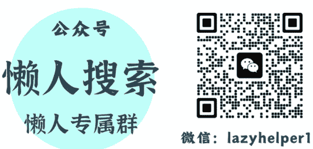

# 代码基础：通过 AI 编程，上架一个微信小程序，手把手教你备案上架一个自己的微信小程序

## 260203 副业 SC 精华

公众号懒人搜索，懒人专属群独享

懒人微信：lazyhelper1

![图片]

这篇稿子从 12 月 26 号就承诺给小武的，一直拖到现在才动笔，十分惭愧。

刚好看到 SCBI 悬赏，有小程序这个项目，鱼丸三七也找到我，问我愿不愿意参加 SCBI 的悬赏活动。确定和给小武的稿子不冲突之后，知道如果再不写出来，我写的就可能没啥价值了。因为看到有大佬准备动手去写了。估计到时候没我什么事情了。

其实看到 SCBI 悬赏有这个项目，我非常开心，因为这也算提前感知到了小程序的机会。其实跟着小排老师学 AI 编程，一直探索的都是海外赚钱，但是对海外推广一直没有摸到边，想着小程序是微信的儿子，也觉得小程序其实比 APP 友好很多，不需要下载，不需要占用手机多大内存，却可以帮助用户解决问题，且我几乎每天都会使用到小程序。而且小程序如果做好了，有了一定的用户基础，基本上属于被动收益了，这个也是我想做小程序的原因。

当然因为我是 0 代码基础，AI 编程也才学会没多久，自己做的小程序没有什么大结果。

目前做了三个小程序，一个是记账小程序，一个是测试小程序，另外一个是日常工具小程序。

## 一些个人的小程序推广方法

刚昨天我找到了一个推广方法，正好和我之前做的项目可以重叠上了，而且这个推广方法，我准备一直执行下去。

![图片]

昨天，我只是在我发布内容的公众号文章里面，加入了我自己目前在做的这个记账小程序，就有了 10 个新用户了。是不是感觉数据不正常，是因为这个之前不是记账的小程序，之前做的是影视资源，但是容易违规，后面才转过来做记账的，我也没有怎么推广，所以用户基本没有。就我自己有用。

就昨天放在公众号推广了一下，就新增了 10 个用户，这真的太棒了，而且公众号插入小程序，好像改了，我记得之前好像需要跟某一个小程序绑定，这个公众号才可以进行推广的。也是昨天才发现的，现在是任何公众号，可以无限制的推广任何小程序了。

![图片]

没有自己公众号的小伙伴，可以算一下成本，找一些比较小众还不是很大，收费不多，但是用户画像和你现在小程序比较类似的公众号去做付费投放。

霍兰德测试小程序我想拿出来讲一下。因为这个小程序没有任何推广，靠自然流量拿到了 676 个用户。当然收益还不太好。

## 累计用户数

**676**

开始做这个小程序，是因为我本身刚开始学习 AI 编程，没有什么经验，我只能从最简单的功能入手，我那个时候就发现其实心理测试不错，MBTI 测试很火，我是想做这个的，但是备案一直卡住，不能用英文去备案。

我那个时候也不知道转换一下脑子，其实可以从简介放关键词，不要纠结小程序名字里的关键词，当然名字包含的话，搜索流量权重会大一些。

搜索心理测试关键词的时候，我发现霍兰德职业兴趣测试，这个关键词很大，且关键词比较长，虽然我完全不知道这是什么东西，但是还是让 AI 帮我去做了一个这样的测试工具上线了。完全没管，过了一段时间之后，发现竟然被动过了 500 粉。关键词这个是非常不错的推广方式了，一定要好好利用起来。

- 霍兰德
- 霍兰德职业兴趣测试
- 霍兰德职业兴趣六种类型
- 霍兰德职业测试
- 霍兰德职业兴趣测试是什么
- 霍兰德职业倾向测试
- 霍兰德职业兴趣
- 霍兰德代码
- 霍兰德测评
- 霍兰德测评小程序
- 霍兰德职业兴趣测试小程序
- 霍兰德职业兴趣测评
- 霍兰德测试免费
- 霍兰德职业

还有一个方法，是我听一个老师的直播分享得来的，有一个微信投流的方法，是可以指定某个群里面的人，看到你的推广内容的。当下听到这个推广方法的时候，我就很想做个产品去试试。因为这样，人群就太精准了，用那个老师的说法就是，你需要的只是祈祷你的竞争对手，多养一些鱼，你就用这个方法从他们的鱼塘里面去钓鱼就好了。并且这个方法也是可以无限去复制的，且阳光安全，微信平台鼓励你这么做。

微信小程序这个项目最吸引我的地方还是在于有积累，之前做过太多没有积累的项目了。

电商女装，卖出过不少，最后落得一屋子库存，外贸其实也做过，那时候卖内存卡，卖了几万张，可惜产品被侵权下架了。视频号视频爆了直播，最好的时候日入过万，但是直播也真的太累了，感觉不适合我。

公众号也到过月入几万，不过后来就没有这个收益了。看似日入几千过万，但是风口过了之后，又得重新去找项目，这种感觉确实不好受。

微信小程序我觉得唯一难点就是跑第一个小程序上线，首先很多人会觉得这件事很麻烦，很难。当然备案是比较麻烦的事情，居住证如果没有的话，要等半年之后，资料需要准备齐全，电话审核可能都会劝退一些人，I 人抗拒接电话。

但是如果自己真正去跑了一遍之后，你会发现，就是非常简单的提交需要的而已。就是需要一些时间而已。真的一点都不难。反而其实真的很简单。我感觉做任何事情，最难的就是开始去做。只要开始了，都不难。

小程序能做的实在太多了，数不胜数。之前有个圈友分享的做老年人小程序，我也很想做，好像每个月收益非常香稳定几万收益。西昂大佬晒了很多收益截图，也是每天被动收益很香的，他透露做的就是 AI 编程小白也能做的工具类小程序。

还有在 B 站看到编程新人做了一个做考研政治答疑助手，竟然变现了 140 万，而且他都没有怎么做推广，都是圈子里面的用户，自传播的。所以小程序的赚钱能力，也是非常强大的。

今年我就想跑通小程序被动赚钱。这样就能把我解放出来，做更多我喜欢的探索和学习了，我觉得我最大的不公平优势就是好奇心，因为好奇心我可以对我自己感兴趣喜欢的项目，很快的跑通整个做的过程。

但是我最大的缺点也是好奇心，总是在做这个项目的时候，看到另外好玩的项目可能就会被吸引过去了。但是小程序这个，只要多几个被动赚钱的小程序，我就可以去学更多我想学的东西了。比如 AI 歌曲，这个实在诱惑我很久了……

现在我把上架微信小程序的流程，分享给想要做微信小程序的圈友，希望对点击进来看这篇内容的你有启发。

## 1. 下载微信开发者工具

https://developers.weixin.qq.com/miniprogram/dev/devtools/log.html#nightly-2.01.2601282

选择你电脑对应的版本下载就可以了，应该你点击进来，显示的就是你电脑对应的系统和版本了。

![图片]

下载好了之后，是这样的。

![图片]

## 2. 创建小程序项目

双击打开微信开发者工具

![图片]

点击

![图片]

可以先选择 测试号 不使用云服务 基础模板 点击创建

![图片]

## 3. 用 AI 编程工具打开这个项目

我用的是 Trae，其他的 AI 编程工具都是一样的，打开这个文件夹，用这个来做这个小程序就行。

![图片]

目前 Trae 回馈用户，免费到 2.14，所以基本上很多人使用，就这个模型感觉使用的比较流畅，最近都用的这个模型写的。

Gemini 3 Flash

![图片]

应该 2.15 之后，免费用户就使用的不多了，到时候买个 3 美元的首月会员，很多模型就都可以用了。

![图片]

最开始我也用的 Cursor，但是后来它对中国用户经常性封号，我就彻底不用了。也会用 VSCode 里面的 Claude Code 使用智谱的 4.7 模型驱动去写一些代码。现在模型能力都很强了，用来写小程序，完全都没有问题。

Trae 付费我一般用 GPT-5.2 使用的人多，我会使用 Gemini 3 Pro，Trae 还有一个国内版，里面模型都是免费用的。很香。Kimi K2.5 也有，不过现在使用的人太多了。

国内我会使用 GLM-4.7 和 Minimax M2.1，所以现在 AI 编程成本是可以很低的。特别是在很简单的小程序。哪个模型我感觉都可以写出来。

![图片]

这样的小程序，基本上几次对话就可以写出来了。

![图片]

## 4. 个体可以去闲鱼买一个小程序认证服务，只要 20 元，且备案流程更快

搜小程序认证，个体户只要 20 元，且我发现走这个备案更快。

> 请把小程序要使用的名称 + 邮箱号码发我一下，我来帮亲提交小程序认证/-F

稍等

1

霍兰德职业兴趣测试倾向测试

@1705.com

可以吗

## 5. 个人，可以去注册一个小程序

https://mp.weixin.qq.com/

![图片]

![图片]

输入邮箱，点击激活邮箱，会收到一个验证码。

然后输入密码，勾选同意 然后点击 注册

![图片]

选择 其他，下面选择个人

![图片]

### 用户信息登记

微信公众平台致力于打造真实、合法、有效的互联网平台，为了更好的保障你和广大微信用户的合法权益，请你认真填写以下登记信息。为表述方便，本服务中，“用户”也称为“开发者”或“你”。

用户信息登记审核通过后：

+ 1. 你可以依法享有本微信公众号账号所产生的权利和收益;
2. 你将对本微信公众号的所有行为承担全部责任;
3. 你的注册信息将在法律允许的范围内向微信用户展示;
4. 人民法院、检察院、公安机关等有权机关可向腾讯依法调取你的注册信息等。

请确认你的微信公众号主体类型属于政府、媒体、企业、其他组织、个人，并按照对应的类别进行信息登记。

点击查看小程序注册流程。

小程序类目 游戏 ⑦ 其他

注册国家/地区 中国大陆

主体类型 如何选择主体类型?

| 个人 | 企业 | 政府 | 媒体 | 其他组织 |
| :--- | :--- | :--- | :--- | :--- |
| 个人类型包括：由自然人注册和运营的公众账号。 |
| 账号能力：个人类型暂不支持微信认证、微信支付及高级接口能力。 |

然后输入自己的姓名，身份证，手机，验证码，然后用身份证微信扫描一下二维码

### 主体信息登记

身份证姓名 陶 信息审核成功后身份证姓名不可修改;如果名字包含分隔符“·”，请勿省略。

身份证号码 42112 请输入您的身份证号码。一个身份证号码只能注册 5 个小程序。

管理员手机号码 15521 发送验证码 请输入您的手机号码，一个手机号码只能注册 5 个小程序。

短信验证码 921 无法接收验证码？请输入手机短信收到的 6 位验证码

管理员身份验证 身份验证成功 陶 将作为小程序的管理员。

继续

### 提示

请确认以下提交的主体信息

主体名称：陶

主体类型：个人

该主体一经提交，将成为你使用微信公众平台各项服务与功能的唯一法律主体与缔约主体。腾讯将在法律允许的范围内向微信用户展示你的注册信息，你需对填写资料的真实性、合法性、准确性和有效性承担责任，否则腾讯有权拒绝或终止提供服务。

确定
取消

![图片]

提示

信息提交成功。

你可以前往微信公众平台使用相关功能。

前往小程序

然后就按照你的小程序去填写信息就好

![图片]

## 6. 填写小程序信息

小程序的名字和简介，比较重要，可以问 AI 怎么写，把你想要做的小程序和关键词给到 AI，让 AI 帮你写一个小程序名字和简介。

填写小程序信息

![图片]

这是我给 DeepSeek 的提示词。

![图片]

会出现重复的情况，让 AI 多给你几个再试试。

![图片]

## 7. 小程序类目选择

### 添加类目

![图片]

测试选择 工具 信息查询 就行，你们的按照自己的小程序类型去选择即可。

![图片]

### 立刻就会显示 通过

![图片]

## 8. 备案

这个就是小程序我觉得唯一比较难的地方了，感觉也是挡住了很多人的地方了。备案。

![图片]

点击去备案

![图片]

选择你所在的地区，上传身份证正反面

![图片]

然后填写相关的信息，主体信息，小程序信息，上传材料

公众号懒人搜索，懒人专属群分享

+ ① 填写主体信息
② 填写小程序信息
③ 上传材料

### 主体信息

主体名称

通讯地址

广东省 > 广州市 > 番禺区

XX 小区 XX 号楼 XX 室

> 温馨提示：通讯地址需要精确到具体房间号，省、市、区无需重复填写。若所填写地址无门牌号且已是最详细地址，请在下方“备注”位置说明情况，如“通讯地址已是最详细地址”。若未填写最详细通讯地址，将无法通过备案审核。

居住/暂住证明

大小不超过 2M，图片需清晰可辨认。查看示例

![图片]

备注 (选填)

请填写主体信息备注

### 主体负责人信息

手机号

请填写手机号码

获取验证码

> 温馨提示：需填写本人使用的有效手机号码，且没有给其他人使用过进行备案的;并在备案申请期间，注意需由本人接听平台、管局的核实电话，当收到由工信部发送的核验短信通知时，需在 24 小时内登录所在省市的管局网站完成短信核验。若联系方式存在多人重复使用、未及时完成短信核验，将无法通过备案审核。

验证码

请填写验证码

应急手机号

邮箱地址

请填写联系人邮箱地址

> 温馨提示：需填写负责人本人使用的邮箱地址，且没有给其他人使用过进行备案的。

上一步
下一步

资料上传成功之后，会有腾讯小程序的人，先给你打电话询问小程序相关的信息，如实回答就行。基本上就是核实一下信息，还有名字和内容能不能做之类的。

然后腾讯的人会把你的资料上传到管局进行备案申请。这个时间不确定，我记得好像是 3 到 5 天左右时间，你会收到一个管局审核会短信，基本上短信核验之后，在等几天就可以过审了。

## 9. 管局过了之后，再去微信付费认证

不然先申请这个的话，可能管局那边过不了。

![图片]

其实就是让你交钱，个人认证费是 30 元，个体在这里认证是 300 元，在闲鱼找服务商是 20 元。而且我感觉找服务商，备案审核的时间快很多。

![图片]

## 10. 全部搞定之后，就是提交小程序上线了

点击左下角的小程序，点击账号设置，

![图片]

下拉到账号信息这里，复制这里的 appid

![图片]

把这里的测试 appid 换成你已备案的刚才复制的 appid

![图片]

原本这里是灰色的，切换之后，

![图片]

这里的上传就可以点击了

![图片]

点击上传 然后修改了什么可以备注一下，
这里方便你自己看

![图片]

点击 上传 会显示代码上传成功

![图片]

### 接着来到你的小程序后台，点击提交审核

![图片]

### 勾选 点击下一步

![图片]

### 点击 继续提交

![图片]

### 这里你写刚才写的就行，方便你自己知道修复了什么

![图片]

### 这里选择 常规审核，然后提交审核即可

![图片]

### 这里的审核通常很快，当天就会告诉你通不通过。

### 如果通过了，微信会有一个审核通过的通知。

![图片]

### 然后你去后台，

![图片]

### 这里的审核中也会变成已通过，然后再点 击 提交发布

![图片]

### 全量发布 点击 提交

![图片]

### 扫码 点击发布

![图片]

这样就大功告成了！等几分钟就可以从微信里，访问你的小程序了。

日常自己再使用一下，看看哪里有没有问题，UI 需要不需要改。有没有需要添加的功能，然后想办法去推广就好了。

## 其他补充

可能比较多人卡住的地方在于居住证，其实满足条件去【粤居码】小程序申领还是比较简单的。其他地方，可以小红书搜索一下居住证办理，应该都会有攻略。

## 广州居住证办理

两种方式任你选

### ✓ 办理材料

- 1、居民身份证
- 2、居住证相片回执
- 3、根据申领事由分别提供合法稳定就业，合法稳定居所，连续就读等证明材料原件
  （若是代办，则需提供委托人、代办人的身份证原件）

### ✓ 办理条件（满足其中一项即可）

- 1、在广东省办理居住登记半年以上
- 2、近一年内缴纳社保满半年
- 3、在广东全日制学校取得学籍并就读半年以上

### ✓ 办理方式

方式一：
线上【粤居码】申领

方式二：
线下窗口办理

## 12. 最后想对生财圈友和自己说的话

其实跑了一遍流程之后，就感觉没有难的地方了，每个人可以做 5 个个人小程序，如果有个体的话，每个个体也可以做 5 个小程序，一个人可以拥有多个个体户，公司可以 50 个小程序。所以基本上，如果小程序找到可以复制的赚钱方法，批量不难。

写这篇内容我发现并不会很难，但是我总是害怕不写，那这个内容，就永远写不出来。写完之后，除了有兑现自己对小武承诺的解脱感，也发现自己甚至一直在拖延做小程序这件事。深层次去挖掘，我好像在害怕成功是怎么回事？

我突然想起我看过的一篇内容，讲得是和父母之间的关系，我们的父母可能在小时候总是在责骂自己，你怎么这么没有出息，这么点事情都做不好，你怎么这么差劲。这些可能是他们无意说出来的话，却埋藏在我们内心的最深处，现在总是在我们即将成功的时候，跳出来。

我们应该做得是奋力一搏，破除心里的魔对吧，但是内心还有一个声音，好像也在悄悄的告诉你，如果你这么做了，会不会就违背了你爸爸妈妈说的话，你这样说明你父母说的是对的，你成功了好像在背叛他们。

你就成为了那个乖乖的维护着父母所有坏话的孩子。但是这个坑，只能你自己去爬出来，这个心里的洞只能你自己去填满它。没有人可以帮你。别被任何人伤害，哪怕他们是你的父母。

最后送给看到这里的圈友一句话，这句话也在不断的激励着我。请你务必一而再，再而三，三而不竭，千次万次，毫不犹豫的，救自己于这世间水火，当下每一个想要努力的瞬间，都可能是未来的你在向你求救。

我一直觉得这个世界是虚拟的，你能看到这个文字内容也绝不是偶然。相信你的直觉。她比你更加知道你要什么。跟随你的直觉，那里有你想要的一切。

用心去倾听你自己。只要你才有属于你的答案。你所看到的一切，都是为了让你成为你自己。

不要成为别人期待的雄鹰，做回你自己，因为你是擅长奔跑的猎豹。以前的你，为了学会飞，放弃了奔跑。你没有翅膀，也长不出来，为什么不试着，自由自在放肆的去奔跑。尽情的去成为你自己吧。

最后，安利小懒的付费群：

### 懒人专属群（介绍）

## 这里是你对抗信息过载的护城河。

已稳定运行 7 年，累计拆解、研读 3000+ 个互联网商业实战案例与行业前沿内参和时政/宏观文章。

我们不搬运垃圾，只做高价值信息的筛选器与放大镜。

懒人专属群更新记录：
https://hk57gvix7u.feishu.cn/docx/H0kRdZbSbolBR0xkaXtcuVE0nTg

【免责声明】本资料归档于社群内部知识库，仅供成员课题研究与学术交流，请在查阅后 24 小时内删除。