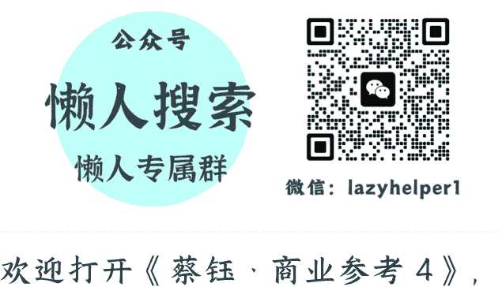

# 220 | 2026 微信公开课：微信电商雏形初现 (下)

260204

整理：公众号懒人搜索，懒人专属群精选

懒人微信：lazyhelper1

欢迎打开《蔡钰·商业参考 4》，我是蔡钰。

上一讲里，我们提到了微信电商的几个有趣动作：商品卡、摇优惠，以及“小店、订单与卡包”。可以说，这三个功能都是服务于“连接”的基础设施。

基础设施，只是支撑连接的。推动连接，还需要另外的力量。那么谁来连接呢？

这一讲，我们要提到的另外几个关键词，恰好能回答这个问题，也能透露微信的电商哲学。

## 推客

第一个，推客。

这次微信公开课上，微信说，2025 年，推客对微信小店的交易额贡献率超过了 20%；2026 年，这个人群的数量预计会突破 2000 万。而微信对他们也相当欢迎，微信的优选联盟还特意宣布，2026 年 3 月底之前，对推客们免收 10% 的技术服务费。新手推客的这个优惠甚至能享受到 6 月底。

你看，这相当于是微信在用真金白银大规模催生推客人群。

推客到底是什么人？简单来说，就是社交分销，借助自己的社交关系，推荐商品、带货赚佣金。

这是人人都能在微信里做的一种兼职。有点像你在聊天时给朋友推荐了一家餐厅，餐厅老板事后给你发了个红包。在以前，这可能也就是你跟老板私下里的事。但从一年前开始，微信官方进场鼓励这种操作了。

当时的微信公开课就把“推客”纳入微信小店战略，由官方来制定标准、统一授权管理。啥意思？刘秋香不认识王富贵，但有微信作保，秋香的小店就可以授权王富贵帮自己带货。

这事儿对刘秋香来说，是获得了王富贵的社交流量；对王富贵来说呢？相当于不用开店、不用进货、不用有客服运营，就能做自己的小生意。

这个生意怎么做呢？比方说，刚放寒假，牛斯克跟王富贵聊起不知如何安置孩子，王富贵可能就随手发过来一张冬令营的商品卡，问牛斯克：要不要让你家孩子跟我家孩子一起去看火箭发射呀？

此情此景，牛斯克会觉得对方在套路自己吗？可能有一点点，但更大概率他会觉得，富贵给他提供了一个他正需要的解决方案。那张夹杂在信息流里的冬令营商品卡，跟推销无关，更像是日常交际内容的一部分。

这能实现什么效果？增加了对需求的敏感度和回应的灵活性。跟你朝夕相处了五年八年的同学朋友，当然应该比品牌和主播们更懂你。腾讯的社交电商模型，其实就是 B2C2C 模型，商家到推客，再到消费者。

微信预计，2026 年底全中国将有 2000 万推客，那也就相当于，到时候每 70 个人里，就有一个人在做微信推客。

## 点赞买

下一个功能，点赞买。

“点赞买”，也是微信小店在 2025 年推出的一个功能。

简单来说，它就是拼多多“砍一刀”的变体。微信小店裡一桶 12.9 元的怡宝纯净水，你要是邀请三个朋友帮你点赞，你和朋友就都能用 5.3 折的价格买到这桶水。在点赞触发折扣这个动作上，逻辑跟拼多多“砍一刀”相同。

但“点赞买”比“砍一刀”又多了一层逻辑：

微信不是拥有整个社交生态吗？所以，你的朋友点赞之后，他的朋友也能看到他点赞过的商品。等于在朋友之间共享了一份“值得买清单”。这就把同样一件商品，带进了“砍一刀”覆盖不到的更大社交圈。

微信公开课上提到一个案例，说做纸巾的维达集团，靠着“点赞买”这个功能吸引来的新顾客，贡献了店铺在“小店与卡包”入口 90% 的交易额，而且吸引来的新顾客里，有大量是 18-25 岁的年轻人。

你看，“点赞买”和拼多多的“砍一刀”，虽然都是把个人的交易决策给社会化，但“砍一刀”只是利用社交关系降价，主抓的用户动机是价格敏感；而微信的点赞买虽然也降价，但更强调“你的朋友也在看或买”。

效果会有什么不一样？

举个最简单的例子：

隔壁部门的负责人见识广、能力强，你平时对他挺佩服，但也挺畏惧。他虽然在你的微信好友列表里，但你买东西绝对不会请他帮你砍一刀。不过，如果你在微信里看见他点赞了一口你没听说过的“竹炭锅”，你在好奇之余，可能也会悄悄下一单。而同时，你买的东西，说不定他也在默默跟风。

你看，这利用了社交证明心理，把关系链当中高品位者的审美和趣味，转化成了对商品的背书，扩大了交易的可能性，也是一种 B2C2C。

## 公众号的推荐体系

好，接下来两个有趣的动作，我们要跳出电商，去看你熟悉的视频号、公众号。

2026 年这场微信公开课上，微信团队还放出了两个有意思的信号。

第一个信号是，微信的视频号，今年开始放宽对视频号带货的流量限制，不但允许你在视频里挂单个商品的商品卡，还可以挂一串商品卡清单了。

这意味着，在微信看来，视频号成长到可以协同电商业务、带货赚钱的阶段了。视频号可以带自家的货，也可以挂别家的商品卡，也就是 B2C 和 B2B2C 都可能发生。

不过，微信的视频号，是几个头部短视频平台里唯一一个不展示账号粉丝数量的。你看，很另类。视频号团队还专门强调说，视频号的粉丝数量多少不重要，粉丝追更率更重要。

而且，2026 年，官方要侧重鼓励创作者们制作 10 分钟以上的长视频。为什么？因为长视频更容易跟粉丝建立深度关系。

你看，把这个观点放在关系维度里看，你会发现，即便“视频号”这种账号类型，在微信生态里有更强烈的商业色彩，微信也把它尽量当作真人账号来对待，更在意它跟自己的用户有多熟。

第二个信号是，微信的公众号，号称“推荐体系已经基本成型”。

这是什么意思？我们手机里的微信公众号，难道不是主要靠我们订阅来阅读吗？

还真不是了。简单来说，你能在公众号里看见什么，已经不完全取决于你订阅了什么。当前的微信，基于三种逻辑给你推送内容：

一种仍然是你的订阅；一种是你好友赞过或转发过的文章，也就相当于用朋友的品味，帮你筛了一遍内容；第三种是算法推荐，也就是像抖音那样，根据你平时爱看的内容，给你推荐可能对你胃口的账号和文章。

上面说到这三类内容，会被微信的算法混杂在一起，按照系统觉得你最爱看的顺序，推送给你。

你看，这个变动，也是把关系链当中熟人的品味和趣味，变成了对“阅读”的背书，也是在深挖你的社区关系的价值。这也是内容的 B2C2C。

## 社交电商，还是熟人电商？

现在，我想请你回头看看推客和点赞买这两种交易模型。

推客，是借助熟人关系链路当中的互动推动成交，它更适合发生在对话框里。而点赞买，则是一种“无交互成交”，王富贵的品味被抽象成了一个点赞，他的任何好友只要看见这个点赞，不需要有社交互动，也可能成交。

所以啊，与其说这是社交电商，不如说是熟人电商。推客交易信任的是熟人的人品，“点赞买”信任的是熟人的品味。

快手早年提过信任电商、抖音早年喊过温度电商，指向的都是人品信任。但后来，辛巴、小杨哥、东北雨姐们先后证明，直播间里的信任太容易泡沫化了。

小红书后来推章小蕙、董洁带货，指向的是品味信任。很成功，但也有它的苦恼：品味型人才难得，不好规模化。

而微信的熟人电商模型，有点集抖音、快手、小红书之小成的意思：先调用熟人交情来解决人品信任，再调用熟人审美来解决品味信任，然后再借助马化腾说的“去中心化”，把无数份微小的信任给集成起来。

这种信任，不需要真正发生在社交互动里，你也不需要对方有多了解，只要熟悉对方在社会系统里的角色和身份。

举个例子：你要是微信里有本省的登山协会会长，不一定会随时找他聊天。但他要是点赞了什么徒步鞋，只怕你如果需要，也会买来穿穿看。

## 总结

好，现在我们回头看看这两讲聊到的，2026 年微信公开课里提到的几个特别动作：

商品卡、摇优惠、小店、订单与卡包，这些是社交场与交易场之间的连接器；

推客、点赞买、公众号的新推荐机制，这些是把人的交情、审美和趣味变成了关系链中的交易催化剂。

同时，微信还在视频号里，刻意引导创作者们去深耕关系，跟用户熟起来。

这些动作看似独立，战略逻辑却是统一的：都是去推动“关系”的价值化，让过程更丝滑。

## 这事可行吗？

可行，但也更危险。怎样让交易无所不在的同时，尽可能不损耗熟人之间的信任？这题如果答不好，是会动摇腾讯基本盘的。这可能也是为什么马化腾说，这件事需要用 5 年甚至更长时间来慢慢做的原因。

从这个角度，我们似乎也能理解腾讯在 AI 领域的“慢”。毕竟，AI 是取代真人的，而微信是受益于真人关系链的。它必须在两者之间做一个高难度的平衡。

所以啊，2026 年，微信这场基于熟人关系的商业基础设施重构，邀请你留意了。微信可能会在电商领域走出一条完全不同的路。

再见。

最后，安利小懒的付费群：

## 懒人专属群（介绍）

📌这里是你对抗信息过载的护城河。

已稳定运行 7 年，累计拆解、研读 3000+ 个互联网商业实战案例与行业前沿内参和时政/宏观文章。

我们不搬运垃圾，只做高价值信息的筛选器与放大镜。

- 懒人专属群更新记录：
  https://hk57gv1x7u.feishu.cn/docx/H0kRdZbSbolBR0xkaXtcuVE0nTg

【免责声明】本资料归档于社群内部知识库，仅供成员课题研究与学术交流，请在查阅后 24 小时内删除。