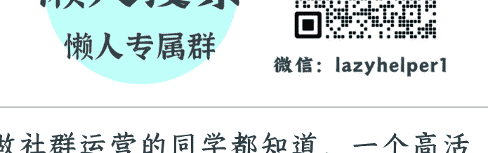
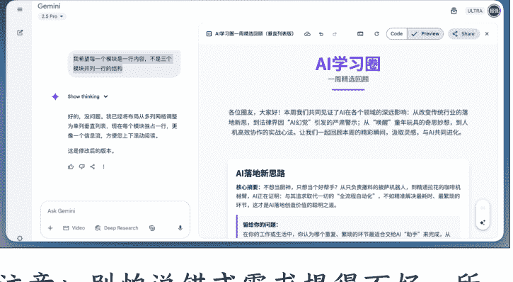
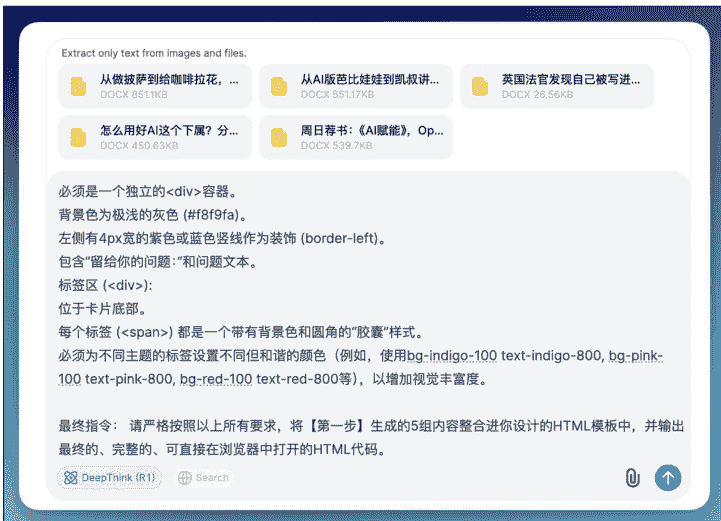
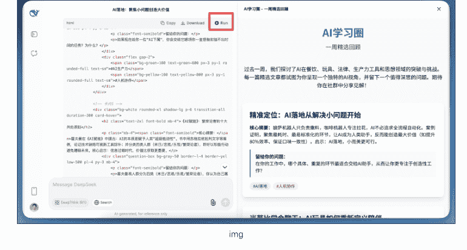
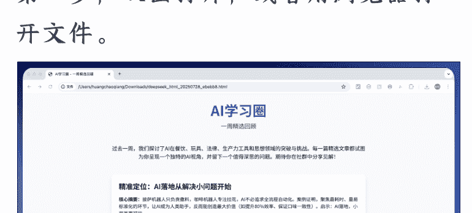
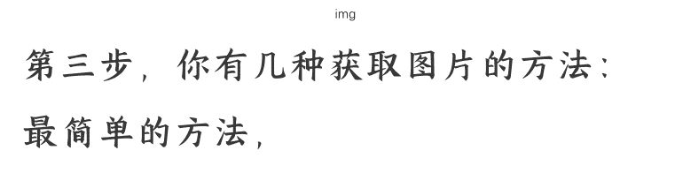
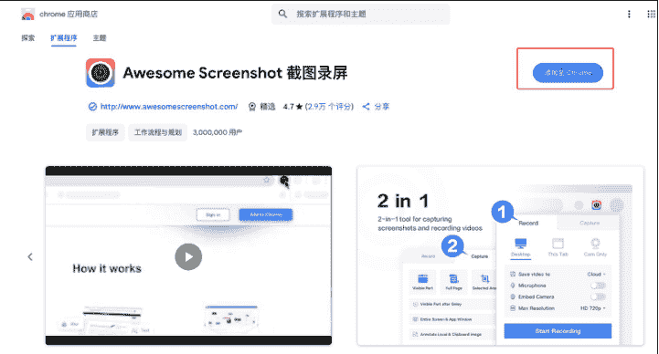
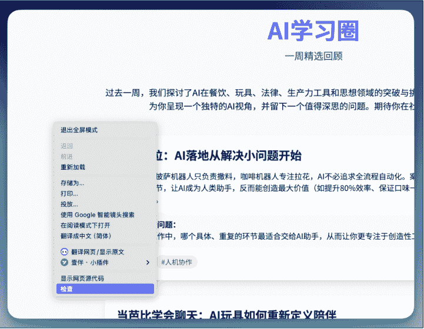
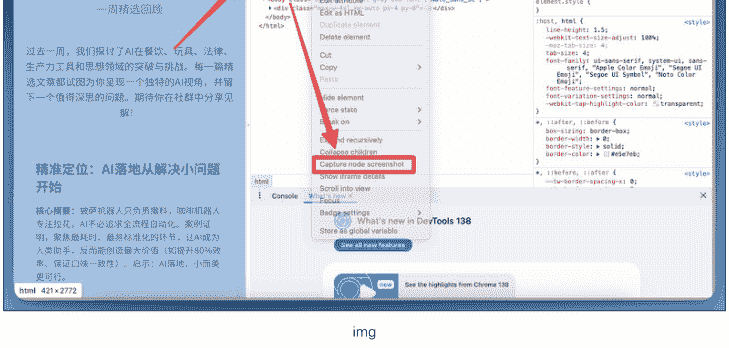

# 如何用 Gemini 又快又好做社群资讯周报？

260204

整理：公众号懒人搜索，懒人专属群精选

懒人微信:lazyhelper1

做社群运营的同学都知道，一个高活跃度的社群，离不开持续的高价值内容投喂。需要不断地从互联网中，为用户筛选出最值得一读的资讯和文章。

但精选之后，会面临着一个现实的难题:

直接甩链接？价值感最低，很快被淹没。附上一段纯文字的推荐语？很难抓住用户的眼球，无法体现你投入的精选心血。想做得再好一点？还需要对每篇文章进行深度加工：提炼核心摘要、设计互动问题、再用工具做出漂亮的排版……这套流程下来，一份周报耗时半天，根本无法持续。

你发现了吗？运营价值，恰恰卡在了呈现这最后一公里上。

所以这一讲，我将为你提供一套工作流，让你能将精选出来的外部好内容，轻松加工成一份专业、精美的内容产品。

我们将通过一个降维打击的思路来实现它：

- 第一步：先让最顶级的 AI(Gemini) 扮演你的“金牌制作人”，将你挑选的文章，加工成一份包含“吸睛摘要 + 引导性提问 + 精美布局”的完美 HTML 内容范本。
- 第二步：让这位制作人交出它的 SOP 手册，一份详尽、可复制的提示词指令。
- 第三步：你就可以拿着这份 SOP，交给任何一个免费 AI 去批量执行。

当然如果你不想要从零开始调试 AI，你也可以直接将我的提示词复制带走，用 DeepSeek 之类的工具直接生成周报。

## 工具准备

- 工具：Gemini 2.5 Pro
- 介绍：免费，推理能力强，前端审美能力好，能生成结构化的 HTML 内容，并且能够推理出对应的提示词。
- 优势：稳定性更强、降低沟通成本，能稳定输出结果。
- 网址：https://gemini.google.com/
- 备注：需要特殊的网络条件

## 任务思路拆解

- 1.Gemini 做完美示范：先生成一份符合效果要求的 HTML 网页周报。
- 2.提示词萃取：让 Gemini 总结操作的详细步骤，形成一份专业级的提示词。
- 3.用国产模型降低制作成本：逆向工程思路，帮你用更低的成本，更高效地完成工作。

## Gemini 做完美示范

### 第一步：明确你的最终目标

- 1.登录 Gemini: 使用 Google 账号，访问 https://gemini.google.com/。(目前可免费使用强大的 Gemini 2.5 Pro 模型)

- 2.提交初始需求：上传你需要总结的文档，然后输入一个相对模糊但直指目标的指令。

提示词:

请你基于我上传的文件内容，给出一份清晰的周报，引导社群用户能够很好地回顾内容，用 HTML 格式输出最终的结果。

通常，第一版结果并不完美，信息虽然是全的，但缺乏设计感和吸引力。这很正常，不要着急，我们一起来调试。

### 第二步：迭代优化

提出内容结构要求：希望内容更有深度，更能激发讨论。

提示词模板

很好，现在请优化一下。每一篇文章的总结，我希望由三个部分组成：

- 1.核心摘要：要能吸引用户阅读下去。
- 2.留给你的问题：基于文章内容，设计一个开放式问题，鼓励会员思考或讨论。避免简单的“是/否”问题。
- 3.主题标签：提取 2-3 个关键词作为标签，并为不同标签设定不同颜色。

提出排版布局要求：并列结构在手机上不好看，我们要求单列卡片式布局。

## 提示词模板：

我希望每一个模块是一行内容，不是三个模块并列一行的结构。请调整布局。

注意：别怕说错或需求提得不好，所有操作都是可逆的。你可以随时编辑之前的提示词，或者干脆新开一个对话，要把 AI 当成一个有无限耐心的助理。

经过这两轮优化，你大概率会得到一个设计精美、布局合理的 HTML 周报。到这一步，完美样品已经完成。

### 提示词萃取

直接让国产模型一步到位做出上面的效果，它可能会犯晕。但如果我们给它一份超详细的说明书，它就能完美执行。现在，我们就让 Gemini 自己写这份说明书。

## 提示词模板：

这个版本很不错，现在我需要你把提示词提取出来，这样我可以让其他模型使用这套提示词，同样生成一样的 HTML 网页。

你会得到下面的提示词：

## 周报生成指令集 这是一套用于创建高质量 HTML 周报的指令，请按顺序执行。

第一步：内容提炼与结构化 角色：你是一位专业的社群内容编辑，擅长从长篇文章中提炼核心观点，并用引人入胜的方式进行二次创作，以激发社群成员的思考和讨论。 任务：请基于我提供的 5 份文档，为每一份文档生成以下结构化内容：文章标题 (Title)：为该主题起一个简洁、引人注目的标题（例如：“当芭比娃娃学会聊天”）。核心摘要 (Summary)：撰写一段约 100 字的摘要。这段摘要必须能精准概括文章的核心观点和最有趣的亮点，目的是迅速抓住读者注意力，让他们产生继续了解的兴趣。引导性问题 (Question)：根据文章内容，设计一个深刻的、开放式的思考题。这个问题应该能够激发读者的深入思考或讨论，避免简单的“是/否”或事实查询类问题。主题标签 (Tags)：提取 2-3 个核心关键词作为标签。 输出格式要求： 请将每一份文档处理后的结果，以清晰的结构化列表形式输出，以便于后续步骤直接使用。示例（以其中一篇文章为例）：

- - 「主题：」AI 落地新思路」
- - 「Title:」 AI 落地新思路
- - 「Summary:」 不想当厨神，只想当个好帮手？从只负责撒料的披萨机器人，到精通拉花的咖啡机械臂，AI 正在证明：与其追求取代一切的“全流程自动化”，不如精准解决最耗时、最繁琐的环节，这才是 AI 落地创造价值的聪明之道。
- - 「Question:」 在你的工作或生活中，你认为哪个重复、繁琐的环节最适合交给 AI“助手”来完成，从而解放你的精力去创造更高价值？
- - 「Tags:」 #人机协作，#垂直领域（请对所有 5 篇文章执行以上操作）

第二步：生成 HTML 代码 角色：你是一位精通 HTML 和 Tailwind CSS 的前端开发专家，追求简洁、现代且用户友好的设计风格。任务：请根据【第一步】中生成的 5 组结构化内容，创建一个完整的、独立的 HTML 文件。具体技术和设计要求如下：

文档结构：使用标准 HTML5 结构 (html, head, body)。在 head 中设置 UTF-8 编码和响应式布局的 viewport。引入最新版的 Tailwind CSS 库。引入“Noto Sans SC”中文字体。整体布局与风格：页面背景色为浅灰色 (bg-gray-50), 文字为深灰色 (text-gray-800)。所有内容居中显示，最大宽度为 max-w-4xl。

头部 (Header): 包含一个大标题"AI 学习圈”和一个副标题“一周精选回顾”。大标题使用紫蓝色渐变文字效果 (gradient-text)。

引言 (Introduction): 在头部下方，提供一段欢迎和概述性的文字。

内容区 (Main Content): 使用 Flexbox 垂直布局 (flex flex-col), 卡片之间有固定的间距 (gap-8)。

页脚 (Footer): 包含版权信息和一句收尾语。

卡片 (Card) 设计 (针对每一组内容): 每个主题内容都用一个白色的卡片 (bg-white) 来承载，卡片有圆角 (rounded-xl) 和阴影 (shadow-lg), 鼠标悬浮时有轻微上移和阴影加深的效果 (card-hover)。

标题 (Title): 放在卡片顶部，字体加粗，字号较大。

核心摘要 (Summary): 摘要前用标签明确标出“核心摘要:"。

问题区 (.question-box): 必须是一个独立的容器。背景色为极浅的灰色 (#f8f9fa)。左侧有 4px 宽的紫色或蓝色竖线作为装饰 (border-left)。包含“留给你的问题:"和问题文本。

标签区 (Tags): 位于卡片底部。每个标签 (Tag) 都是一个带有背景色和圆角的“胶囊”样式。必须为不同主题的标签设置不同但和谐的颜色 (例如，使用 bg-indigo-100 text-indigo-800, bg-pink-100 text-pink-800, bg-red-100 text-red-800 等)，以增加视觉丰富度。

最终指令：请严格按照以上所有要求，将【第一步】生成的 5 组内容整合进你设计的 HTML 模板中，并输出最终的、完整的、可直接在浏览器中打开的 HTML 代码。

### 降本增效，用豆包平替

现在，我们拿着这份提示词，打开任何一个 AI 工具，将提示词和原始文件一起提交，就能见证奇迹。

步骤:

打开豆包或 DeepSeek 将上一步生成的【周报生成指令集】完整粘贴到输入框。把最初的源文件也一并上传。点击生成，即可预览结果。

注意，要把深度思考 (R1) 选上，海外版选择 DeepThink(R1)。

代码输出完成之后，点击 HTML 代码区右上角的 Run 按钮，会在右侧展开生成结果的预览，怎么样是不是效果还不错。

### 下载成图片

第一步，我们首先在代码区，点击 Download 下载文件。

第二步，双击打开，或者用浏览器打开文件。

第三步，你有几种获取图片的方法：

最简单的方法，是下载谷歌浏览器的免费插件 Awesome Screen Recorder & Screenshot。它提供了长图截取和编辑功能。

Chrome 应用商店链接:

https://chromewebstore.google.com/detail/awesome-screen-recorder-s/nlipoenfbbikpbjfkpfillcgkoblgpmj?hl=en-US&utm_source=ext_sidebar

第二种，是使用 Chrome 自带能力，在网页上鼠标右键选择检查。

第四步，在弹出的控制台里，在 Elements 下面，鼠标移到第一行代码上，右键弹出弹层，点击 Capture node screenshot，就完成了截图。浏览器会自己下载。

### 避坑指南

**难点 I：生成结果不如预期，摘要不准确，问题过于简单。**

这通常是原料处理环节的问题。回到你的提示词中，找到【第一步：内容提炼】，对 Summary 或 Question 的要求进行升级。

原文：撰写一段约 100 字的摘要。

优化后：撰写一段约 100 字的摘要，必须用一个引人好奇的悬念开头，并引用原文中最有冲击力的一句话来结尾。

这套流程的真正价值在于可迁移性，修改提示词中的【第一步：内容提炼】，你就可以把任务从周报迁移到小红书文案中：

**周报版提示词**

角色：社群内容编辑
任务：核心摘要 + 引导性问题 + 标签
格式：结构化文本

**小红书版提示词**

角色 (替换)：资深小红书爆款文案写手...
任务 (替换)：爆款标题 + 口语化正文 + Emoji + 热门标签...
格式 (替换)：可直接复制到小红书 App 的格式...

核心思路不变，只需替换 [角色]、[任务] 和 [输出格式] 的定义，就能驾驭任何创意工作。

### 作业

你可以选择其中一个完成:

- 1.角色切换体验

请以“小红书爆款文案写手”的身份，围绕本周社群热点，撰写一则 100 字以内的爆款周报标题和正文，要求口语化、带 Emoji，并配上 3 个热门标签。

- 2.提示词优化挑战

请根据本课所学，尝试优化一个适合你自己的用于生成社群周报的提示词，并简要说明你的优化思路，字数控制在 100 字以内。

公众号懒人搜索，懒人专属群分享

### 最后，安利小懒的付费群:

懒人专属群 (介绍)

🗂这里是你对抗信息过载的护城河。

已稳定运行 7 年，累计拆解、研读 3000+ 个互联网商业实战案例与行业前沿内参和时政/宏观文章。

我们不搬运垃圾，只做高价值信息的筛选器与放大镜。

### 懒人专属群更新记录:

https://hk57gvlx7u.feishu.cn/docx/H0kRdZbSbolBR0xkaXtcuVE0nTg

【免责声明】本资料归档于社群内部知识库，仅供成员课题研究与学术交流，请在查阅后 24 小时内删除。