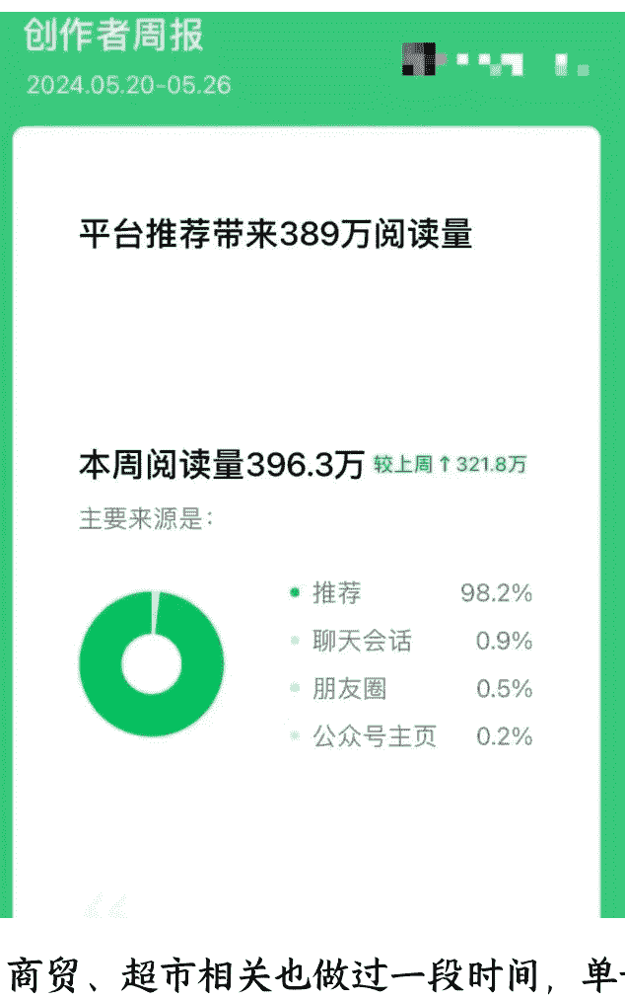
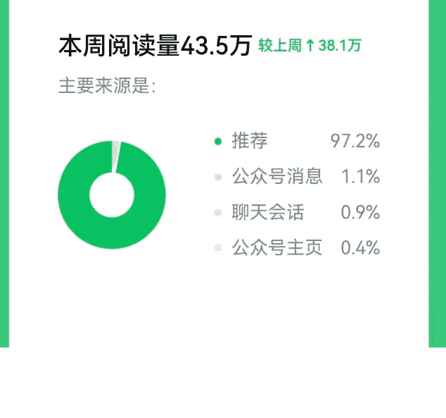

# 老年赛道频出 10 万+,退休老年人群 + 私域、电商，长期打法

## 260204 副业 SC 精华

公众号懒人搜索，懒人专属群独享

懒人微信：lazyhelper1

大家好，我是辰风。

做自媒体第 6 年了，这几年没换什么项目，就是一直写。

这两年我主要盯着民生、养老、社会热点这一块，一年下来差不多一百来万字。老年赛道其实一直都挺感兴趣，之前因为没有找到这种老年人说话的口吻和感觉，所以一直在尝试去写，也作废了几个账号。

今天想跟你聊的——老年退休赛道。

怎么把这个方向写 10 万 +，以及——为什么这个赛道有机会。

分享一下我真实的做号感受。

说句实在的，我不是一开始就奔着老年赛道来的。

之前也测过不少方向。最早开始我就是在生财风向标受到启发，写了历史方向。

之后又做了职场方向，尝到了甜头。

在“四人帮”被押解离开北京的第一天，谁第一个从天水站出来向中央汇报？

邓小平的地位是无可动摇的？

被子叠成豆腐块？毛主席评战斗作风，只打了 27 遍仗

1967 年，张治中都被打倒了，您老怎么还稳坐钓鱼台？

从舞伴到妻子，与毛主席相伴，25 岁成为最年轻上将

1966 年刘少奇被罢官，曾向毛主席求情：让我去死吧

主席怒摔茶杯，为何独独对聂荣臻如此宽容？

1966 年 9 月，中央定撤换刘少奇，叶剑英为何反对？

唯一一位没被林彪打倒的元帅，当他做了这个决定，就注定了结局

1981 年，邓小平拒绝出任国家主席，叶剑英提出一个建议

房地产、民生领域，我们跑得其实不错，然后出了百万爆款。

https://scys.com/articleDetail/xq_topic/8855211814815442

2024/5/25 13:06 已删除

又一个恒大!3 产集团破产清算!

156 万 未开启 979 2,676 566 119

2024/5/25 13:06 已删除

坏消息传来，更难熬的一年

101 万 未开启 2,055 8,613 1,023 346

2024/5/25 13:06 已删除

3000 万光棍有救了？脱单指日可待!

575,490 未开启 917 982 532 368

商贸、超市相关也做过一段时间，单号一个月也能有几千块的收益。养老金在某个周期拉团队做了，投产比不行，停掉了。随便放个图，之前写过了，经验复盘：

https://scys.com/articleDetail/xq_topic/5125841811214284

这些方向不能说不好，甚至从数据上看也都说得过去，但真正做久了，会有一种很明显、却很少被人说出来的感受：难受，尤其是民生和社会议题那一块，选题看起来很宏大，情绪也很容易被调动，但越写心里越慌，好像一直在消耗，却很少得到真正的反馈。

后来我开始认真测试老年赛道，这不是一拍脑袋的决定，而是实打实花了挺长时间去做研究，去看老年人更喜欢什么样的表达方式，会反复关心哪些问题，什么样的内容他们愿意从头看到尾，甚至愿意主动转发给别人。

在这个过程中我发现了一个很明显的变化——老年赛道的整体氛围是偏积极、偏温和的，你写的可能同样是养老、退休、医保、生活安排这些现实问题，但收到的反馈却往往是感谢、分享，甚至补充自己的经历，那种感觉和之前完全不一样，不是你把情绪丢给别人，而是你写完之后，有情绪慢慢流回来。

从收益上看也很直观，同样是万阅读，老年相关内容的收益大概在 50 到 80，甚至更高的区间，这不是靠吓人，也不是靠标题党，而是由人群属性本身决定的。

更重要的是，这条路写起来其实是轻松的，我说的轻松，不是对内容没有要求，恰恰相反，老年和退休相关的内容，对真实性和准确性的要求反而更高，你写错一句话，可能就会误导别人一步，但它的好处在于，你不用天天绷着神经抢热点，不用刻意制造情绪和冲突，也不用靠夸张标题博点击，你更多做的事情，只是把复杂的事，用人听得懂的话，讲清楚。

以前做号总是习惯一个人闭门造车，常常因为信息闭塞而迷失方向，后来在生财有术与群友的高频交流中才猛然发现，很多关键的信息差和赛道红利，其实都是在一次次观点的碰撞中浮现出来的。

这段时间，我从一个普通的学习者进阶为垂直小号的内测船长和教练，在这个一边自己下场拿结果、一边把踩过的坑摊开来带着大家跑的过程中，我不仅完成了对自己实战经验的深度复盘，更在生财航海的机制下完成了认知的迭代。

这让我更加确信：与其在错误的道路上狂奔，不如先在对的圈子里找准方向，毕竟在长周期的复利面前，选对赛道并长期坚持，远比偶尔的一篇爆款更有价值。

生财不贩卖情绪焦虑，给的是完整的 sop 路径，和持续的陪伴。我们的打卡机制，教练点评，航海直播，社群内答疑，都是为了托举大家拿到更大，更好的结果。

在线上听 7 天老师对于定位的分享，又在线下感受到了 7 天老师对垂直小号的理解

和思路，我们已经打过了好几次的照面，这也更加坚定了我对垂直小号的信心，是希望能够在这件事情上取得更大的突破，拿更大的结果的。

也正是因为带了两期航海，我更确定一件事：

很多同学做不起来，不是因为不努力。是因为从一开始就没想清楚——自己到底适合什么赛道。

我看到最多的状态是：

今天刷到房地产火，就想做房地产；

明天看到情感涨粉快，就去写情感；

后天看别人做 AI 工具变现，又想去做 AI；

最后账号像个杂货铺，自己也写得越来越空。

然后你会越来越慌。

慌的不是没流量。

慌的是你每天都在输出，但你知道自己没有在积累。

所以我特别想把一句话送给正在找方向的人：

赛道不是你选出来的，是你长期做出来的。

你到底对什么感兴趣？

你愿不愿意在这个方向上写一年、两年、三年？

你写这个东西的时候，心里有没有“感受”？

你是不是写完还想继续写，而不是写完就想关掉手机？

这些问题，才是决定你能不能走远的关键。

我一直觉得，一个好赛道，至少要同时满足两件事：

**从流量逻辑上，它能持续被需要。**

不是今年热，明年凉。

是这个人群的需求会一直在，甚至越来越强。

**从 IP 逻辑上，它能让你越写越像你自己。**

你能在这个话题里不断表达判断、输出观点、建立信任。

而不是永远靠热点和技巧续命。

找到自己适合的，你写起来才有感觉。

写自己内心真正想表达的，你的情绪才会自然冒出来。

情绪不是演出来的，是你真的在意。

我的结果，收益部分在下面单价处再展示。

2025.12.29 - 2026.01.04

### 内容阅读量 16.7 万

较上周 ↑ 15.7 万

主要来源：

- 推荐 97.4%
- 聊天会话 2.0%
- 朋友圈 0.3%
- 公众号主页 0.2%

### 内容被分享 3160 次

被分享最多的内容

2026.01.05-01.11

### 内容阅读量 51.4 万

较上周 ↑ 34.6 万

主要来源：

- 推荐 98.2%
- 聊天会话 1.1%
- 朋友圈 0.3%
- 公众号消息 0.1%

### 内容被分享 4860 次

被分享最多的内容

辰风

公众号懒人搜索，懒人专属群分享

## 2026.01.12-01.18

### 内容阅读量 28.9 万

主要来源：

- 推荐 97.7%
- 聊天会话 1.1%
- 朋友圈 0.5%
- 公众号消息 0.3%

### 内容被分享 3437 次

被分享最多的内容

## 2026.01.19-01.25

### 内容阅读量 15.5 万

主要来源：

- 推荐 96.8%
- 聊天会话 1.4%
- 公众号消息 0.5%
- 公众号主页 0.5%

### 内容被分享 2641 次

被分享最多的内容

团队数据：（不完全展示，不做矩阵）

公众号懒人搜索，懒人专属群分享

| 日期 | 阅读量 | 收益 | 单价 |
| --- | --- | --- | --- |
| 2025-12-08 | 24,697 | 171.64 | 6.95 |
| 2025-12-07 | 14,663 | 87.40 | 5.96 |
| 2025-12-06 | 18,164 | 113.06 | 6.22 |
| 2025-12-05 | 25,197 | 140.39 | 5.57 |
| 2025-12-04 | 29,449 | 315.93 | 10.73 |

回到老年退休赛道。老年退休这个方向，最吸引我的地方，还不只是流量主。它是一个天然适合做深度、做长期、做后端的赛道。你写得久了，会慢慢沉淀一批固定读者。

他们不是刷到你，是“需要你”。

这种信任，是可以往后延展的。

你可以把公众号的流量，引到私域；

通过合规的方式，去做电商、团购；

结合视频号、直播，把内容和产品打通；

甚至可以延展到助农、农产品，把养老需求和农业、家乡资源结合起来。

或许没有办法做到一下子百万爆款，一个号几万，然后马上矩阵放大。

但它是属于那种：

写得越久，越有价值，权重越高，号越值钱。

如果你想找一个

能长期写、

能积累信任、

能把公众号流量真正用起来的方向，

那老年赛道，你可以考虑一下。

下面，我们进入正文。你准备好了吗？

## 一、为什么我会选老年赛道方向

年轻人少、老人多，延迟退休也在路上。

社保、养老金、医保这些东西，会越来越频繁地出现在我们生活场景当中，因为我们已经无法回避。

+ “我以后到底能领多少养老金？”
+ “我爸妈会不会突然遇到事儿，钱不够？”
+ “医保到底能报啥？异地能不能用？”

这些问题不会因为算法调整就消失。

它只会越来越现实，越来越逼近。

所以在我眼里，老年退休不是那种“今年爆、明年凉”的风口，它更像一条慢慢抬头的刚需赛道。

不是靠流量文章，而是不断输出真实的人设，解决具体问题需求，真心表达，给老人提供情绪价值，解决问题。

说实话，老年人是被互联网亏欠最多的一群人。

你打开手机看看，多少内容是专门吓唬他们的？什么“这类人领不到养老金”，什么“不知道就亏大了”，标题一个比一个吓人。很多老人看完心慌得睡不着觉，又不知道找谁问，只能自己在那儿瞎琢磨。

他们不是不想搞懂这些政策，是真的搞不懂。文件写得像天书，窗口排队问三句人家就不耐烦了，子女忙得脚不沾地也不好意思总麻烦。他们就这么被晾在那儿，心里揣着一堆问号，又不知道该信谁。

我写这个方向，说到底就是想做一件事：把复杂的事用人话讲清楚，让看完的人心里能踏实一点。

## 二、这赛道的优势：收益不够刺激，但是可以持续赚钱

我之前写别的流量赛道，其实很慌。

包括写社会民生、写养老金这种内容，表面上看也能做，但你真做久了，会发现几个问题特别磨人：

+ 第一，话题面确实偏窄。

写来写去就那几类：政策、事件、争议，转着圈打。你要么硬蹭热点，要么硬拔高度，很容易写得又干又累。

第二，情绪向的内容太吃人。

社会民生如果往情绪方向写，接收的消息会越来越负面。你每天刷到的都是矛盾、纠纷、焦虑、骂声。写的人久了，心态很难不被拖着走。

第三，粉丝质量和单价会被拉低。

你吸引来的群体，很多是来“发泄”的，不是来“解决”的。

互动热闹，但信任不深；阅读看着不错，转化却一般。

说难听点：你越写越像个情绪垃圾桶，单价自然高不到哪去。

大量的矩阵账号做的内容基本都是以批量生产，大量堆账号的形式来做，我也观察了不少的账号都存在一个问题，一个是账号无法持续，其次，收益不可控，对于前端提示词和内容的输出要求很高，并不一定适合普通人去做复制。

后来我慢慢发现：

老年赛道刚好相反。

老年退休、老年情感、老年生活方式这类内容，整体氛围更鼓励、更温一点。读者给你的反馈更像“情绪回流”：

有人感谢你、有人跟你分享、有人把文章转给爸妈，甚至有人会认真问你“下一步怎么做”。

更现实的一点是：

这个赛道的商业价值也更稳。

我自己跑下来感受很明显：万阅读收益大概能在 50-80，甚至更高的区间。

这不是玄学，是人群属性决定的——更愿意停留、更愿意复看、更愿意信你，结果就是更容易出高单价。

像这样的优质内容的老年赛道的账号，可能你做一个起来，一天的收益有个 200~300，也是很可观的数据，这样一篇文章生产出来，我一天写可能也就半个小时左右的时间。（这个号我是手搓，语音写完之后丢给 ai）

### 1）人群大，而且增长是确定的

现在老年人口的基数很庞大，所以这是一个很不错的赛道，每年都会有一批马上要退休的人，然后他们开始研究自己退休之后的生活。

这叫确定性。

### 2）内容更容易“积累”

很多热点赛道，你写完就过去了。我更加喜欢这种能够有积累的赛道，相当于内容写出去之后一直会有人搜索过来，现在平台还会给我推荐我月初写的文章，甚至是上个月写的文章。

因为这个话题一直会讨论。长尾流量的力量非常惊人的，现在我也就写了 50 来篇，还是有每天有之前的文章，有新增的阅读。

### 3）更适合做深度，深度更容易换来信任

其实老年人他对于这种贩卖焦虑的内容并不感兴趣，他们只是觉得说这篇文章确实写到了他们心里去，对于你的文笔措辞要求也并不高，他们反而更喜欢那些有证人口语化表达的内容。

因为文化程度不高，他需要这个内容能够看得懂，最后读完之后最好是你能够给到他一些建议，让他能够知道自己要怎么办，有一些想法或者是有一些思路是一些正向的能量的传导，而不是觉得说看完之后很恐慌，或者是焦虑。

你能把复杂东西讲成人话，读者会很粘你。

而粘，意味着什么？

意味着你不仅能赚流量主，你还能沉淀私域，做更长线的生意。

### 4）这赛道更容易沉淀私域

老年用户的关注行为，更像“订阅”。

老年人用户一旦看到你的文章内容比较感兴趣，他就会一直追更，一直看你的文章，像如果你是写情感赛道的。

他还会一直给你打赏，一个老用户打赏个几千块钱，也有这样的案例发生。

所以老年赛道的真正价值，不在于你单篇赚几百块，而在于你能沉淀一批长期用户。

## 三、从赚钱说起：它可能收益不炸裂，但稳定、能滚雪球

我不装。

我做内容也看钱。

但老年赛道赚钱，逻辑跟那种“撕裂情绪爆款”不一样。

它很少有“一夜 100 万 +”的神话。

它更像：你认真写三个月，开始零星冒 5 万 +、10 万 +；半年之后，你发现你那一串历史文章开始持续给你拉阅读、拉流量主、拉广告。

我的号测试了有一两个月左右的时间，但是他可能今天已经月底了，还在推月初的文章，持续的跑长尾的流量的推荐，用户也在疯狂的转发文章到他们的朋友圈，群聊。因为根据数据来看，这个转发率占比非常之高，带动了二次的流量。

一篇 10 万 +,流量主几百块很常见。

遇到合规的好价广告，千把块也不稀奇。

而且老年赛道还有个好去处:

只要你不造谣、不乱带节奏、不做恐吓标题，这类内容往往比较“安全”，不容易一夜翻车。

慢一点没关系，关键是稳。

## 四、我为什么选这条路：ai 的内容写得挺乱的

我看老年文章，经常看到这种提问:“我这算不算正式工？以后能领多少？”当时我能做的，就是硬着头皮啃文件、查政策，把官话翻译成人话告诉他们。

后来我发现一个很现实的东西：愿意耐心解释的人，真的不多。有人趁机卖产品，保单一甩就跑；有人自己都没搞懂政策就敢乱写；老人分不清科普和广告，常常一脸懵。

所以我越来越清楚，我写这块内容，不是为了装深度，而是希望看完之后，有人能少走一个弯路、少交一笔冤枉钱、少被恐吓一次。

其实写到这一步，你就会发现一个变化。平台不缺情绪，也不缺制造焦虑的内容。平台真正长期需要的，是能把复杂问题讲清楚、能稳住用户情绪、能减少误导的内容。你不是在跟平台对抗，也不是在薅算法，你是在跟平台共存、合作。

# 你输出的是：

+ 更准确的信息，
+ 更清晰的表达，
+ 更有边界的判断。

这种内容，也许不会每一篇都流量炸裂，但它很少翻车，很容易被长期推荐，也更容易被反复打开。

老年赛道尤其如此，这个群体不需要你制造紧张感，他们更需要确定感。你只要把话讲清楚，平台会知道这是优质内容，读者也会知道你是值得信任的人。

## 五、我的价值观

老年赛道非常容易走向标题党，容易违规，且带有欺骗性质，把赚钱写在了脸上。

- 什么《这 3 类人以后可能领不到养老金》
- 什么《不知道这个你就亏大了》

很多时候是故意放大恐慌。

### 第一，信息求证

核心政策必须有官方出处。

不确定的就写“目前趋势”“大概率”,别装成官宣。

### 第二，不吓唬老人，不收割焦虑。

说清楚风险，别只放大焦虑。

坏消息可以说，但一定要给“解决思路”或“缓冲空间”。

我常提醒自己一件事：屏幕那头看你文章的，可能是个六十多岁的老人，戴着老花镜，把手机凑到眼前一个字一个字地读。他可能一辈子没出过县城，对着手机研究了半天才学会怎么点进来。他看你写的东西，是真的当回事的。你随口写一句"这类人可能领不到钱",他可能晚上就睡不着了，翻来覆去地想自己是不是也在里面。

所以我给自己定了个规矩：写的每篇文章，都要经得起子女转给爸妈看。

不能让人家孩子转完之后心里打鼓，怕把爸妈吓着了。要让他们放心转发，觉得"这个作者说的在理，让我爸妈看看挺好"。

## 来几个案例，你们就知道我做的是哪个方向了。

星期四  
记住，退休后一定要有这三大靠山，不是儿子，房和车  
阅读 2233 赞 26

1 月 21 日  
退休后明白：人过五十，一定要和这 4 个人搞好关系，永远别得罪!  
阅读 221

1 月 20 日  
人老了，永远不要在熟人面前，说以下 6 句话，切记切记  
阅读 2849 赞 40

1 月 19 日  
退休大忌：别把这 3 个人当亲人，来往越多，晚年越凄凉  
阅读 10 万 + 赞 791 2 个朋友读过

1 月 18 日

星期日  
60 岁后才明白：人过 60，永远不要在熟人面前，说以下 6 句话，谁说谁后悔!  
阅读 3939 赞 4

星期六  
60 岁后才明白：五十五岁之后，如果你基本上没有外债，孩子也有工作了，就不...  
阅读 8307 赞 6 2 个朋友读过

星期五  
异性之间一个现象：男人要是提出离婚，往往是他已经不喜欢她的妻子了;女人...  
阅读 1302 赞 4

星期四  
不留骨灰、不买墓地、不求后人祭拜的，大多是这两种人  
阅读 3.5 万 赞 290 5 个朋友读过

1 月 18 日

做这个赛道久了，我最爱看的不是阅读量，是评论区。

你会发现，同一篇文章下面，全国各地的读者像在开一个小型政策交流会。吉林的说“我们 30+10 政策真的落地了，去年我就是这么晋的”，四川的说“达州渠县农村 27 年就能评副高”，河南的说“我们是 25+5，但还要面试”，山西的说“我们从来没有这个政策”。

一篇文章发出去，评论区自动变成了一张全国政策对照表。

说实话，这让我很感慨。这些老师们，在自己的省份、自己的学校待了一辈子，根本不知道隔壁省是什么情况。他们不是不关心，是压根没有渠道知道。很多人评论的语气里带着惊讶，也带着羡慕，更多的是一种“原来还能这样”的恍然。

有个河南开封的老师给我留言，91 年参加工作，02 年就评上了中级，教了三十多年书，教学成绩一直优秀。但今年就因为没当班主任，愣是竞争不到副高指标，27 年就退休了，看不到希望。

我回复她的时候说：想想身体健康地退休，活到 99，拿多少退休金，其实是一样的。

还有个湖南的老师，农村干了 32 年，还没评上副高。另一个湖南的跟帖说：湖南的农村教师要等退休前两年才有机会。

你看，同一个省，不同市县，政策都不一样。同一个县城，不同学校，制度还能不同。这种信息差，对普通老师来说简直是天堑。

有条高赞评论说：

> "埋头苦干专心课堂教学的老师永远吃亏，而那些为了职称不上心课堂、大搞课题的老师反而早早上了副高。"

我在评论区回复说：确实，我们这儿也是领导评上的多，人家行政经历加分就很高，普通老师比不了。

这条回复我犹豫了一下要不要发，因为说出来显得有点丧。但我还是发了，因为这就是真的。读者不傻，你装看不见，他们只会觉得你虚伪。

**做内容这件事，你能共情到什么程度，读者是能感受到的。你自己都不敢说真话，凭什么指望人家信你？**

做老年赛道、做体制内赛道，核心不是你有多少专业知识，是你能不能说出他们心里那句话。他们想说又不敢说的、想了很多年的、觉得说出来也没人听的——你替他们说出来了，他们就觉得你是自己人。

## 六、什么内容更容易出 10 万+？说白了就三个抓手

你得明白一件事：老年人看文章，不是来找刺激的，是来找答案的。

他们这辈子吃过太多信息不对称的亏了。年轻时不懂政策错过了机会，中年时被人忽悠买了不该买的东西，现在老了更怕被骗、更怕走弯路。他们需要的不是情绪按摩，是一个明白人能告诉他们：别慌，这事儿是这么回事，你下一步可以这么办。

所以你写的每一篇文章，结尾一定要有'接下来怎么做'。哪怕不同城市政策不一样，动作是通用的。读者看完能有一种感觉：'好，至少我知道该干嘛了。'这种确定感，对老年人来说比什么都珍贵。

你想在老年退休赛道跑出 10 万+，我观察下来，爆的内容大多绕不开这三类：

- 1) 真焦虑，负责“把人拽进来”

老年赛道其实不需要讲鸡汤，讲干货，你写的不是“知识”，而是他们一直在乎却没能解决的事：

*   养老金到底能领多少？
*   延迟退休到底怎么执行？
*   社保没满 15 年是不是就完了？

关键不在于你把它写得多惨，而在于——你能不能把话讲明白。所以，你一定要写做法，怎么办，如何解决。

### 明确你的写作目标

✖「我要给他们讲清楚一个道理」

> ↝「我要让一个正在焦虑的老人/子女，知道该怎么办」

当你切换受众思维，你要写的内容就变得具象化了

### 一个可以直接套的【写作顺序】

先拉人 → 再怕 → 再说清 → 再给路径

第一步：用“一句真担心”把人拽进来（3 行内）

可以写政策，可以写背景，也可以写在跟邻居的交谈，在楼下的一次对话，越真实的场景越好。

### 关于“社保年限不够”的焦虑

**原句：**

> “我今年 56 岁，社保只交了 13 年。我最怕的不是钱少，是到时候连退都退不了了。”

**改写方案 A（那是真的急）：**

“眼瞅着都 56 了，社保本子上才记了 13 年，这不上不下的太难受了！我现在根本不嫌钱少，哪怕一个月给几百也行啊，我就怕到时候这十几年的钱‘打水漂’，连个退休证都混不上！”

**改写方案 B（那是真的悔）：**

“以前年轻不懂事，断断续续才交了 13 年。现在老了知道怕了，56 岁的人了，补也没法补，退又不甘心。我就想知道，我这情况，是不是真就没救了？”

### 关于“延迟退休”的纠结

**原句：**

“网上都在说延迟退休。我就想知道一句话：像我这种人，到底要不要多干几年？”

**改写方案 A（那是真的累）：**

“专家天天在电视上喊‘延迟退休’,大道理我听不懂，也不想听。我就想问一句实在的：像我这种腰酸背痛的老骨头，咬牙再熬几年，到底能多拿几个钱？这买卖到底划不划算？”

**改写方案 B（那是真的乱）：**

“打开手机全是说延迟退休的，有的说好，有的说坏，看得我脑仁疼。咱们老百姓不关心宏观经济，我就想找个明白人给算算账：我多干这一年，以后每个月能多买几斤肉？”

### ❓ 为什么这么改？

- 把“网上都在说”改成“专家喊”、“看得脑仁疼”,这是老人对信息过载的真实反应。
- 把“要不要多干”这种决策，转化成“腰酸背痛”、“咬牙再熬”的身体痛感。
- 把“多拿钱”具体化为“划不划算”、“多买几斤肉”。

### 第二步：把“怕”说完整，但不渲染（这是分水岭）

如果这里你还在写“我们要保持乐观心态”，读者就跑了。

你要做的是“替嘴笨的他们，把心里的苦水倒得清清楚楚”。

**大实话版（适合干货类文章，节奏快）**

**【改写思路】**：直接捅破窗户纸，用最接地气的词（买米买面、跑断腿、打水漂）。

咱们不整那些虚头巴脑的安慰话。

我知道，大家心里那块石头落地不了，无非就是怕这三件事儿：

- 1. 怕钱不够花：以后领那点钱，够不够买米买面？生病了够不够买药？
- 2. 怕手续卡壳：到了岁数去大厅，会不会因为缺个证、少个章，跑断腿也办不下来？
- 3. 怕以前白干：年轻时勒紧裤腰带交的那些钱，会不会最后打了水漂，竹篮打水一场空？

说句公道话，大家有这些担心，真不是“想太多”，也不是“瞎操心”。

为啥？因为这社保政策确实像天书一样，条条框框太多，也没个明白人给咱一句准话。谁心里能踏实？

### 第三步：正式“讲清楚”，但一定用人话（重点）

这里是最容易写废的地方，我给你一个豆包专用写法。

公众号懒人搜索，懒人专属群分享

你可以直接在豆包里这样下指令👇

帮我用【口语化、人话】解释清楚：

**情况**: 56 岁，社保已交 13 年

**想知道**:
1) 能不能正常退休
2) 差的 2 年怎么补

**要求**:
- 不用专业术语
- 像跟家里长辈解释
- 分步骤写清楚

然后你人工只干三件事：
1. 删掉废话
2. 把关键结论单独拎出来
3. 给到可以实操落地又不至于烂大街的解决方案

写的时候，用这种句式 (非常重要)
1. 「先说结论」
2. 「再说条件」
3. 「最后说限制」

**示例一：针对“社保没交够 15 年”的回答**

先给大家吃一颗定心丸（结论）：

遇到这种情况，千万别急着退保，绝大多数人是有补救办法的，这笔养老金大概率能领到手。

但想领到这笔钱，得看这三个硬杠杠（条件）：

第一，看差几年：差得少（比如两三年）好办，差得多（比如差七八年）就得费点劲。

第二，看身份：你是企业职工，还是自己交的居民社保？这俩补缴的路子完全是两码事。

第三，看户口：这一点最关键，必须得看你退休那个城市的具体规定。

这里有个特殊情况要注意（限制）：

如果你的户口在 A 地，社保却是在 B 地交的，那补缴政策得按 B 地的来，千万别拿老家的政策去套，容易跑冤枉路。

**示例二：针对“医保要不要继续交”的回答**

先说一句大实话（结论）：

如果你身体稍微有点小毛病，这医保，我建议砸锅卖铁也得续上，千万别断。

为什么这么说？因为有两个好处（条件）：

第一，即时报销：人上了岁数，住院是大概率事件，有医保能省下的一大半费用，那都是咱的养老本。

第二，终身待遇：很多城市只要交够一定年限（比如男 25 年女 20 年），退休后就不用再交钱，也能免费享受一辈子医保。

但这里有个大前提（限制）：

“终身医保”不是所有地方都有，也不是交了就能马上享受。

你得去社保局查清楚：你们当地到底要求交多少年？中间断过算不算？这些细节差一点，结果可能就是天差地别。

### 第四步：一定要写“下一步具体干嘛”(老年内容的命门)

老年内容最怕一句话：

“具体以当地政策为准。”

这句话一出，你前面白写了，因为没有信息量，毫无重点。

直接这么写：

你现在可以马上做三件事：

第一步：打开【当地人社局官网/小程序】，查清楚你的缴费年限

第二步：带着身份证，去窗口问一句：“我这种情况，差的年限还能不能补？”

第三步：把答复记下来，再决定要不要继续交

哪怕不同城市不一样，动作是通用的。

读者看到这里，会有一种感觉：

“好，至少我知道该干嘛了。”

### 2) 身边人的故事

抽象政策没人爱看，这是事实。

你一换成具体的人，读者立刻就进来了。

“58 岁在车间干一辈子，退休金只有 2200。”

“在广州打工 20 年，社保断断续续，最后只交够 13 年。”

“当年被买断工龄的那一批人，现在最常见的三种结局。”

这种内容一出来，评论区一定有人说：

> “这不就是我爸/我妈/我邻居吗？”

老年故事之所以好用，不是因为惨，而是因为像。很多新手一听故事，第一反应就是要不要写得苦一点、要不要把情绪拉满。但你真去看评论区，会发现一个规律：真正被反复转发的，从来不是最惨的，而是最像身边人的。

老年读者和子女读者，其实都在做一件事：对照。他们不是来看戏的，而是在心里默默对号入座。

为什么“抽象政策”没人看？不是因为难，是因为“没落点”。

你说得很对，政策本身不缺信息。真正缺的是——落到人身上的那一下。

比如这两种说法，你感受一下差别：

> “社保缴费年限不足 15 年，会影响养老金领取。”

和：

> “她今年 58 岁，只交了 13 年社保。她最怕的不是钱少，是两年后连退都退不了。”

第二种，不是更专业，而是多了一层‘人已经站在那儿了’的画面感。

在老年赛道里面，我们不是轻飘飘的说一句话，也不是讲一个政策，而是这个政策落到我们普通人身上会发生什么，会有什么影响，会造成什么后果，我们会有什么焦虑，写出普通人在时代浪潮变化下的情绪，或许是恐慌，或许是焦虑，或许是痛苦。

别把写作想得太玄乎。很多人写不顺，不是笔头不行，是脑子太乱，想要的东西太多。

其实写老年故事，写顺手了，你就干了这么三件事儿。不用刻意背，听我给你捋一捋，你就明白了：

#### 第一件：当个“翻译官”，替他们把心里话倒出来

老哥哥老姐姐们，心里跟明镜似的，但嘴笨。

你问他咋了，他只会车轱辘话：

- “反正心里就是不踏实。”
- “说不上来哪不对，就是慌。”
- “我也不知道愁啥，就是睡不着。”

你看，情绪是真的，但词儿是空的。

这时候，你得替他把窗户纸捅破。

你要把那种模糊的“慌”，翻译成具体的“怕”：

> “我不怕别的，我就怕自己不懂规矩，吃了哑巴亏都没处说理。”

> “孩子忙得脚不沾地，我哪敢拿这些破事去烦他们？但我自己是真的搞不懂啊。”

你把这些话写出来，读者一看，大腿一拍：“哎哟，这不就是我吗！”

这就对了。你替他说出了他想说却说不出来的苦衷，他才会把你当自己人。

#### 第二件：当个“嘴替”，替他们把卡在嗓子眼的问题问出来

很多老人看文章，是带着一肚子问号进来的。

但他不知道怎么问，问题卡在嗓子眼里，憋得难受。

比如你写个案例：“王阿姨在厂里干了十几年，一直没签正式合同……”

写到这儿，千万别急着往下讲故事。

你要停一下，替读者喊一嗓子：

> “那像她这种情况，到底算不算正式工？这十几年工龄，难道就白瞎了？”

这一嗓子喊出来，读者的魂儿就被你勾住了。

为啥？因为他心里也犯嘀咕，但他不知道专业术语咋说。

你替他问了，他就得跟着你往下看答案。

这句话不是总结，是替他敲门。门敲开了，后面你讲什么他都愿意听，因为他不是在看热闹，他是在等你给他的答案。

#### 第三件：替平台“把事讲清楚”

这一点可能很多人没意识到。你写清楚、不吓人、不给假结论，本质上是在帮平台降低误解和恐慌。

老年赛道，一定要和平台共存。

不是对抗算法，是让算法知道：

你在产出“稳定情绪 + 真实信息”的内容。

这种内容，平台反而是欢迎的。

再说“选题从哪来”，说点不那么套路的选题这件事，真的不是“想出来的”。

我现在的选题，大多来自三个时刻：

1. ① 聊天时，对方突然停住的那一下  
   比如说到一半，突然叹口气：  
   “算了，说不清楚。”  
   这个点，往往就是选题。因为这个点就是大家会经常在意的那个点，感觉自己很担忧，但是又说不上来，但是又一直受到这个事情的一些烦恼。  
   比如到底应该怎么跟子女相处，搞好关系，又怕拖累子女，但是又不知道怎么跟他们去沟通和交流，怕他们多想。

2. ② 重复出现的问题，而不是新问题  
   老年赛道的爆点，很少是“新政策”，更多是同一个问题，反复出现在不同人身上。  
   当你发现：  
   三个人、五个人、十个人，都在问同一件事——  
   那不是巧合，那是长期需求。

3. ③ 你自己“听着不舒服”的地方  
   这个很个人，但很准。  
   有些说法你一听就皱眉：  
   > “这话怎么说得这么绝？”  
   > “这是不是把人吓过头了？”  
   这些地方，本身就是反向选题。  
   你完全可以写：  
   > “网上很多人说这类人以后领不到钱，但我查了一下，情况没那么简单。”  
   我不主张大家去刻意的制造焦虑，或者是很消极，很失落的这种情绪去写文章，我更希望大家是在传递一种正向的价值观，或者是鼓励大家。  
   当然也有一些是从生活当中的一些选题，比如说我们要关心自己，不要把钱都只知道花在自己的子女身上，不要让情侣变成自己的拖油瓶，而这些痛点其实是在我们日常生活当中常见和发生的。

老年人最关注的是什么？是他能活多久？怎么样能够身体健康？是关注他的退休生活，怎么打发时间？是关心家庭如何和睦，如何跟子女搞好关系，如何平安幸福。

### 3）看完能知道下一步怎么做

**选题参考：（鸡汤感悟，祝福类）**

人老了趁身体还利索，抓紧办好这 6 件事，晚年是苦是甜...

### 人有善念，天必佑之

### 原来，旺自己是有方法的

### 人过五十，惜命的最好方式，不是睡觉和锻炼，而是这 4...

### 人到 65 岁才明白，千万别在兄弟姐妹面前，做下面三件事

#### 抓：他不抓大词，抓那个“膈应人”的瞬间

很多写手写这种文章，上来就说：“我们要远离嫉妒心强的人。”

这就没劲了，像教科书。

但这老哥怎么写的？

他直接抓住了那个让你最不爽的瞬间——比孙子。

你说你孙子考得好，他立马把“国际班”搬出来压你；你说去旅游，他说“那破地儿没意思”。

你看，这种人咱们身边是不是都有？

读到这儿，你脑子里立马会浮现出老张、老李那张欠揍的脸。

他没写“嫉妒”俩字，但他把那种“见不得你好、非要踩你一脚”的酸味儿，直接端到你鼻子底下了。这就叫具体。

#### 演：他不光骂，他还把戏给你演全了

写那个“势利眼亲戚”，他没光骂人家势利。

他把那个变脸的过程给你演了一遍。

- 平时：死人一样，没动静。
- 听说你有钱了：突然活了，“叔啊姨啊”叫得那个亲。
- 借完钱不还：你一催，他反而说你“瞧不起穷亲戚”。

这太真实了。很多老人吃亏就吃在这个“抹不开面子”上。

作者把这套“连环套”写出来，就是在告诉读者：你看清楚了，这不是亲情，这是剧本！人家早就把词儿编好了等着套你呢。

#### 戳：他戳破了你心里那个“不敢说”的念头

这是最狠的一点。

中国老人，骨子里都想当好人，想合群。哪怕被人烦死了，也不好意思撕破脸。

但这作者干了啥？他替你把桌子掀了。

他告诉你：

- 那个整天抱怨的老熟人，就是个“情绪垃圾桶”。
- 那个只借钱不还的亲戚，就是在“绑架”你。

他把这些人的遮羞布扯下来，然后拍着你的肩膀说：“老哥，你躲着他们不是你冷漠，是你活通透了。”

这话一出，读者心里那个舒坦啊！

这就好比您受了委屈，突然来了个明白人，不但替你骂了对方，还告诉你“你做得对”。这种心理按摩，谁不爱看？

- 4. 别用形容词，用动词。  
   别写“他很虚伪”，要写“饭桌上他抢着买单，手却半天掏不出钱包”。

- 5. 别聊概念，聊场景。  
   别聊“负能量”，要聊“他一开口就是骂社会、骂儿女，听得我想赶紧回家”。

- 6. 当个“恶人”。  
   替读者把那些不好意思说出口的“狠话”说出来。读者不敢拒绝人，你替他拒绝；读者不敢断交，你替他喊断交。

说白了，写得具体的秘诀就是：别想怎么教育读者，多想想读者平时受了什么窝囊气，你替他出这口气，这就齐活了。

能冲 10 万 + 的文章，本质只有一件事：把说烂的大道理，用大白话翻译一遍。

## 七、再说点更长线的：老年赛道不止流量主，它更适合做“后端变现”

我知道很多人做公众号只盯着流量主。

但老年赛道的好处是：它很适合把流量导进私域，然后做更长线的变现。

你要留的不是“泛粉”，而是“问问题的人”。

这种用户，一旦进了私域，粘性会非常高。

因为他关注你的目的就一个：以后有事，还能不能再找你。

## 1) 私域沉淀：把“问问题的人”留住

老年赛道天然会有大量咨询：

社保、医保、退休手续、补缴、异地……

你只要认真写，后台一定有人追问。

这些人不是随便看看，他们是真的有事。

这类用户进入私域后，粘性会很高。一般他们都是很谨慎的，如果他愿意主动加你，一定是有明确的诉求或者是想法，那么他的意向是非常明确和直接的，因为他看过你的很多文章内容，也在这个过程当中对你形成了认可，那你们之间的关系和距离一下子就被打破了。

## 2) 电商/团购：做“老年刚需品”

别做灰的，别做夸张功效，别碰违规。

你可以做的东西其实很多：

适老化产品、健康管理用品、日常刚需（比如适合中老年的食品、营养品要非常合规）、生活服务类团购……

关键是：你要选“能长期复购、能被子女放心转发送给父母”的品。

这不是偷懒，这是为了“细水长流”。把心态放平，把自己的日子过顺了，带着笑脸去见老人，比你在床前愁眉苦脸地守着，强一百倍。

家有一老，如有一宝。让我们好好珍惜这份时日无多的亲情吧。

用陪伴代替物质，尊重他们的意愿，珍惜相处的时光，照顾好自己，这才是真孝顺。

终点来临时，我们才不会留下遗憾。

最后愿所有的老人都能老有所养，老有所依，自在舒心地度过自己的晚年。

结合视频号商店、直播带货、公众号文章导流，这条链路是能跑通的。

## 3）短剧/卖书/内容产品：把信任再放大

还有一块，是很多人忽略的：内容型变现。

老年人其实很爱“看得懂、听得明白”的东西。

你不需要多花哨。短剧、书单、适合中老年的阅读内容推荐，

**打心底怕遭病，怕自己遭罪也怕拖垮了儿女。**
夜里总睡不着，一想到要是生了病，自己躺着遭罪，还得让孝顺的儿女放下工作来照顾，花他们的钱、耗他们的精力，心里就揪着疼。可怕也不行，一年还总要去两趟医院。咱努力照顾好自己，一日三餐都吃好、按时出门溜达。咱清楚只有身体好好的，才是对儿女最好的帮衬，不瞎琢磨，努力让自己带着这平常心过自己的日子。

**总觉得自己没用啦，日子过的是又慌乱又自卑。**
家里的忙帮不上，连自己的日常起居都得让人操心，总觉得自己成了家里的累赘，越想越慌，越想越觉得自己没用，甚至在儿女面前说话都不敢大声啦！我也知道，老换小，老换小嘛，是儿女长大了，也是时候让他们担起抚育小的，照顾老的的责任啦。我常劝慰自己，儿女是咱们养大的，现在咱老了，坦然接受被他们照顾就好了！没有什么不好意思！这是儿女他应该做的，咱们不用有心理负担的。

咱人老了，得服老，有这些难过都是正常的，咱们自己也得学着跟自己和好，千万别揪着这些不如意不放，别去放大也别瞎琢磨。日子就慢慢过，好好疼自己，这些小难过，总会被身边的小温暖慢慢化开的。

这些东西不暴利，但非常稳。你会发现，只要内容是“给他们看的”，不是“拿他们当流量”。

## 4) 助农/农产品：把“养老”跟“农村”“农品”结合

这个方向我反而觉得很有机会。

因为很多老年人天然对农产品有信任偏好:

- “土鸡蛋”“五谷杂粮”“应季水果”
- “家乡味”......

你如果本身有农村资源（像我这种湖南乡村出身就很容易对接），完全可以做合规助农:

讲清楚产地、讲清楚供应链、讲清楚品质标准。

用“内容信任”带动“农品成交”，这是很踏实的路子。

老年赛道的优势在于:它更像长期关系，而不是一次性交易。

## 八、我自己的真实判断：这条路最后拼的不是爆款，是“活人感”和长期信任

做老年赛道，越做你越得有敬畏心。

别觉得你就是在搬运政策、算算加减法。你敲下的每一个数字，在屏幕那头，就是人家一家老小的安全感。

一个老头看完你的文章，知道下个月饭钱有着落了，心里那块石头落地了。

这就是你的价值。别扯什么宏大叙事，能帮普通人消灭一点焦虑，就是积德。

### 什么叫“真人感”?

不是让你在那演戏，也不是让你满嘴“家人们”的套话。

是你真愿意替他去跑腿，替他去打听，替他 去翻那些枯燥的文件。

你是在敷衍了事赚流量，还是真想帮他解决问题，这帮活了大半辈子的人精，一眼就能看穿。

做号做久了，你得懂一个词叫“长期复利”。

流量是术，那是皮毛；信任是道，那才是根。

你今天偷的每一个懒，搞的每一次标题党，将来都会变成水泥板，死死挡在你的头顶上。

最后，给你划条红线：

信息源，千万别注水。

政策、流程、数字，能查到红头文件的就查，查不到的就老老实实说“不确定”。

别装专家，更别装官方。

你知道老年人对白纸黑字的信任度有多高吗？你随口胡诌一句，他真敢拿着你的文章去窗口跟人拍桌子。

真出了事，那是作孽，这责任你担不起。

这个标准听起来简单，但你真的用它来要求自己，很多乱七八糟的内容你就写不出手了。你可以赚认知差的钱，但不能赚昧良心的钱。

老年赛道的红利确实在，但红利是给那些认真做事的人准备的，想捞快钱的人，迟早会被反噬。

我见过太多人进来，觉得这个赛道门槛低，随便写写就能赚钱。写了两个月，数据起不来，就开始抱怨赛道不行。其实不是赛道不行，是你没有把人放在心里，你眼里只有流量和收益，读者感受得到的。

这个赛道真正的壁垒，不是写作技巧，不是爆款方法论。

是你愿不愿意把每一篇内容都当成一份责任来写。

能做到这一点的人，才能走得远。

## 九、最后

最后，给想入局的朋友三句忠告:

- 第一，戒除浮躁。别指望一篇暴富，给自己三个月试错期，沉下心去铺地基。
- 第二，落地生根。别只在网上找素材，去楼下和大爷大妈聊聊，他们嘴里的真实痛点，比什么爆款公式都管用。
- 第三，守住底线。不造谣、不恐吓。

信任比流量值钱。路选对了，慢就是快。

这种，发图文，文章，也挺好的，而且赚钱，但是吧...

前端用内容把流量慢慢做起来，

后端通过社群、私域，把关系沉淀下来，

再去做电商、做带货，把“老年”和“变现”真正落到实操层面。

它不是那种靠模板、靠矩阵、靠批量复制就能快速铺开的方向。你让人同时起十个号、二十个号，短期也许能铺量，但很快就会被舍弃。

原因很简单，老年赛道对真人味儿的要求太高了。你写的是具体的人、具体的困

感、具体的一步怎么走，这里面有情绪、有经历、有判断，是活人写给活人看的内容。这种东西，很难被批量复刻，因为它需要真情实感在里面流淌。

所以有真人活感的价值观立场，有真实的体会和真实的故事，真实的情绪抒发，这是能够跟矩阵账号拉开差距最为核心的。

因为他有人的立场和思考存在。

慢一点没关系，只要是真人、真事、真表达。

做了这么久老年赛道，我越来越觉得这不只是一门生意。

你敲下的每一个数字、每一句话，在屏幕那头可能就是人家一家老小的安全感。一个老人看完你的文章，知道自己的养老金没问题，心里那块石头落地了，晚上能睡个踏实觉——这就是价值。

别扯什么宏大叙事。能帮普通人消灭一点焦虑、少走一个弯路、少交一笔冤枉钱，就是积德。

老年人这辈子不容易，年轻时苦过来的，老了还要操心这操心那。他们值得被认真对待，值得有人耐心跟他们把事情讲清楚。

这个赛道真正的壁垒，不是写作技巧，不是爆款方法论，是你愿不愿意把每一篇内容都当成一份责任来写。

公众号懒人搜索，懒人专属群分享

### 最后，安利小懒的付费群:

### 懒人专属群 (介绍)

🛠这里是你对抗信息过载的护城河。

已稳定运行 7 年，累计拆解、研读 3000+ 个互联网商业实战案例与行业前沿内参和时政/宏观文章。

我们不搬运垃圾，只做高价值信息的筛选器与放大镜。

### 懒人专属群更新记录:

https://hk57gvIx7u.feishu.cn/docx/H0kRdZbSbolBROxkaXtcuVEOnTg

【免责声明】本资料归档于社群内部知识库，仅供成员课题研究与学术交流，请在查阅后 24 小时内删除。