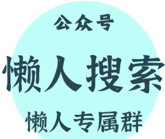

# AI 让你更确信，世间只有一个你

260205

整理：公众号懒人搜索，懒人专属群精选

懒人微信:lazyhelper1

AI 时代，创作者要如何生存？

你看，现在 AI 可以写文章、画画、作曲，什么都能干，很多人就担心，创作者这个职业会不会被技术淘汰？陈楸帆老师认为，AI 不会让创作者消失，但会让我们重新定义创作的意义。为什么这么说？

咱们用一个历史事件作为参照系。

15 世纪中期，古登堡发明了印刷机，当时他也印出了第一本机械印刷的《圣经》。要知道，过去《圣经》主要靠手抄，抄一本得好几个月，但机器几天就可以印几百本。果不其然，后来没多久，欧洲就出现了一千多家印刷作坊，而在大约一百年后，抄写员这个职业就彻底衰落了。

但值得注意的是，衰落的只是抄写员这个职业，手写文字，这个行为本身并没有消失。在今天，私人信件、日记、诗歌手稿依然是手写的。没错，当手写不再是一种功能性劳动，它反而获得了新的意义，它成了亲密性、独特性、个人痕迹的载体。这些价值都是不可量化的。

换句话说，当机器接管了可量化的劳动，人类必将会去发现其中不可量化的价值。

这个规律，其实在历史上反复出现过。

比如工业革命时期，当机器织布开始普及，英国的手工编织工人一度陷入恐慌。但你看后来发生了什么？那些手工制品非但没有消失，反而成了贵族阶层的收藏品。人们更加追捧那些手工制品，因为每一针每一线都是独一无二的。手工编织没有消失，它只是从“保暖工具”变成了“意义载体”。

再比如数字时代，当电子邮件、即时通讯普及后，手写信大幅减少。但恰恰是在这个时候，手写信获得了新的意义。现在人与人之间交流，手写信几乎成了最高级别的情感象征。

再比如互联网时代，数码相机、手机摄影普及后，胶片摄影并没有被淘汰。徕卡相机的价格反而越来越高，胶片冲洗店在一些城市重新开张。胶片摄影成了一种近似于“轻奢”的体验。

那么，当 AI 可以快速生成大量的内容，创作行业会迎来哪些变化呢？陈楸帆老师推测，未来 1000 天，可能会有三个关键变化。

# 首先，创作者内部会出现分化。

这就像摄影技术对肖像画的影响。

1839 年，摄影术发明后，肖像画市场受到严重打击。你看，过去画一幅肖像画得好几个月，只有贵族才负担得起，但摄影术出现后，拍一张照片只需要几分钟，而且价格便宜多了。

那么，原来的肖像画家们怎么办呢？当时，肖像画家这个职业开始往两个方向分化：一部分人成为纯粹的艺术家，他们去追求那些摄影无法捕捉的东西，比如印象派、现代艺术等；还有一部分人成为摄影修图师，在新的技术中找到了自己的位置。

而 AI 出现后，内容创作者或许也会面临同样的情况。一些创作者转向更纯粹的艺术领域，或者情感领域，毕竟，一个专业的内容创作者，他能够沉淀出比普通人更好的审美感知力，以及情绪感受力，这能够帮助他们在新领域找到位置。而另外一些创作者，可能会在与 AI 的协作中，找到新的方向。比如，打磨 AI 的写作风格，修订 AI 的初稿，等等。

# 其次，版权体系可能会重构。

你看，假如 AI 是根据千百万人的作品训练而成，那么它生成内容中的每一种风格、每一个想法，其实都有前人创作的痕迹，这个智慧的源头都是来自于其他人的，那么版权如何计算？也许未来，人们可能会建立一个全新的版权体系，核心不再是保护“作品”，而是保护“风格”！

简单说，就是诞生了一种新的版权概念，“风格版权”。假如你的作品被用于训练 AI 模型，你对模型学习到的那些东西，比如“风格向量”“叙事结构”“情感滤镜”等也拥有可分成的权益。这个逻辑就像音乐版权一样，你的歌被播放，你就能拿到分成。这么一来，假设你的作品被用来训练 AI，就不再是威胁了，而是机会，创作者可以从这个机会中获得新的收益。

## 第三个变化是，内容验证也许会成为新的基础设施。

也就是说，未来会发展出新的验证系统，用来验证这个作品到底是不是来自真人。

比如，AI 水印。每个 AI 模型生成内容时，都会嵌入不可见的数字水印。就像钞票上的防伪标记，肉眼看不见，但专门的设备能识别。

再比如，内容溯源。每张图片、每段视频发布时，都会被附上加密的来源信息，这就像快递的物流追踪，让内容的“前世今生”都清晰可见。

还有，区块链存证。比如，咱们国家在这方面已经有实践了。去年 4 月，国内首家专注于 AIGC 的平台"AI 创意·中国”正式上线。据说这个平台通过区块链技术，给内容办理一个出生证明，能够固定创作时间、内容等关键数据。

基于这套验证体系，内容市场也许就会发生分层。最底层，是免费层。就像现在网上随处可见的 AI 生成图片，无限丰富，但没有稀缺性，因此也没有价值。中间层，是认证层。也就是，虽然由 AI 输出，但是经过人工审核过。

而最顶层，是手工层，就像手工制作的工艺品，贵的不是东西本身，而是那份“人的痕迹”。也就是，完全由人类创作的内容，也许会成为内容领域的稀缺品。注意，不是说它们一定比 AI 生成得更好，而是人类所投入的时间和精力本身是有分量的，是具备 AI 所没有的真实性的。

说白了，当技术可以无限地复制内容时，价值会转移到那些不可复制的东西上。

那什么是不可复制的？

比如，创作过程本身。你看，村上春树每天凌晨 4 点起床写作，这个习惯坚持了几十年。当你读他的小说时，你知道这些文字是他在黎明时分，一个人面对空白稿纸，一个字一个字敲出来的。这个过程本身，就是作品价值的一部分。

再比如，创作者和受众之间的关系。这个可能更重要。你想想，当你关注的一个博主更新了，你知道这是他熬夜写的，而且你在评论区留言，他可能会回复你。这些是 AI 暂时给不了的。

再比如，体验。这也是目前比较主流的观点之一。过去，你可能会卖一本书，叫做《如何提升沟通能力》。而现在，你可以做一个 AI 聊天机器人，让读者通过跟机器人聊天，来提升并且内化沟通技巧。

在这个过程中，AI 的崛起并不是让人类知识贬值，反而让它更有价值。当 AI 让每个人都能轻易创作出平庸的内容时，那些拥有深度、独特经验和卓越品位的人，其价值反而被前所未有地放大了。

换句话说，在 AI 时代，我们的终极优势不是“做 AI 做不到的事”，我们的方向也许是“用 AI 做只有你才会想到的事”。说得直白一点，就是 AI 擅长什么你很清楚了，所以咱们就别做了，这是一场注定失败的赛跑。那做什么呢？做那些只有你才能做的，独一无二的事儿。没错，特别本身就是个优势。

就像著名舞蹈家玛莎·格雷厄姆说的，世间只有一个你，你的表达独一无二。

最后，安利小懒的付费群：

懒人专属群（介绍）

微信:lazyhelper1

🎋这里是你对抗信息过载的护城河。

已稳定运行 7 年，累计拆解、研读 3000+ 个互联网商业实战案例与行业前沿内参和时政/宏观文章。

我们不搬运垃圾，只做高价值信息的筛选器与放大镜。

懒人专属群更新记录：

https://hk57gvIx7u.feishu.cn/docx/H0kRdZbSbolBROxkaXtcuVE0nTg

【免责声明】本资料归档于社群内部知识库，仅供成员课题研究与学术交流，请在查阅后 24 小时内删除。