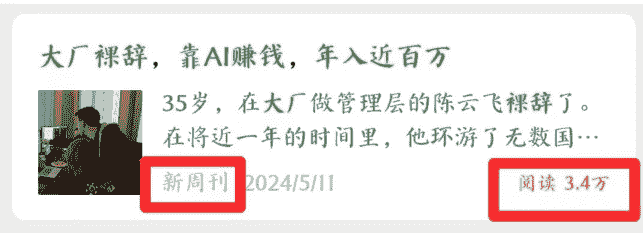
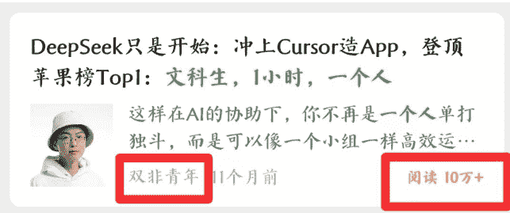
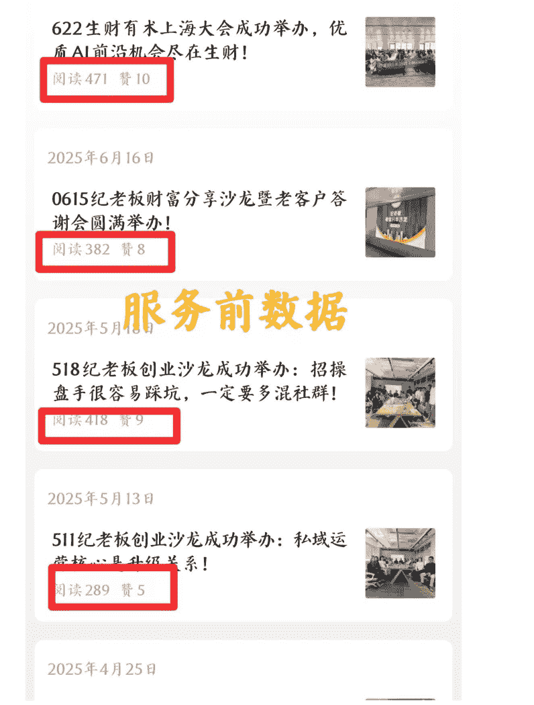
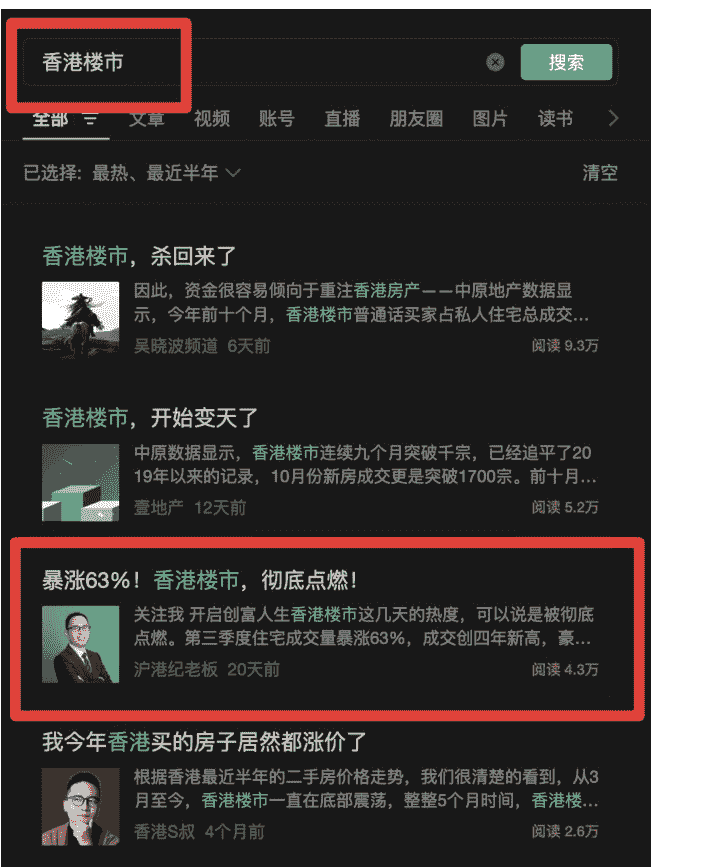
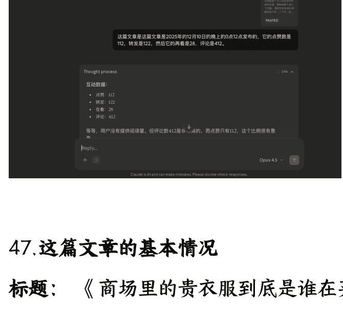
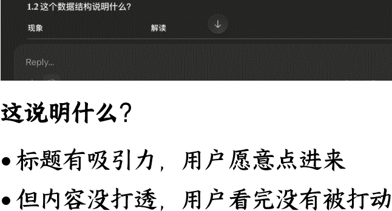
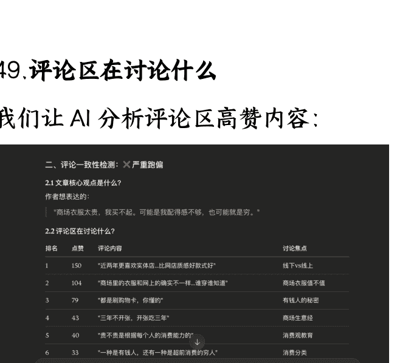
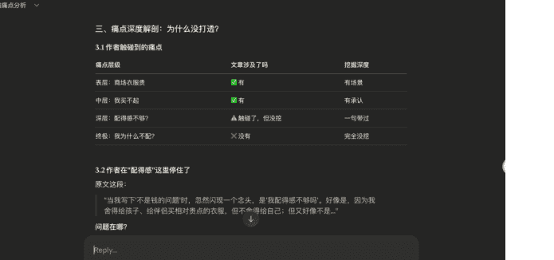
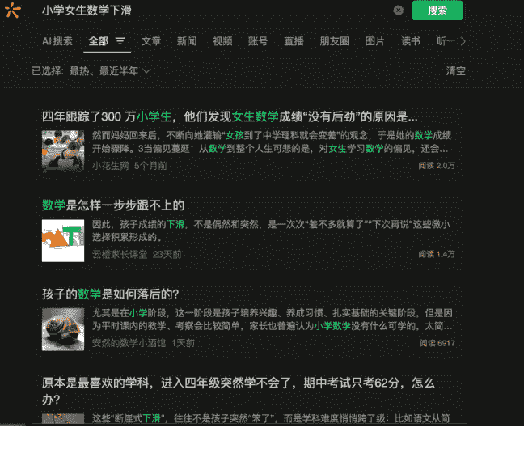

# 公众号 75% 爆款率，23 倍单季度流量增长，三年实战方法论全拆解 | 垂直小号深耕

## 260205 副业 SC 精华

公众号懒人搜索，懒人专属群独享

懒人微信：lazyhelper1

# 前言

做公众号最好的时机，为什么是现在？

前段时间亦仁发了一条关于“垂直小号”的超级话题，判断公众号流量正在重新洗牌。

其中引用了去年微信公开课的一段话：

> “哪怕粉丝量少，只要价值密度高，就会获得推荐。”

亦仁给出的公式是：细分领域 + 专家 IP + 专业相关分享=小号大流量。

我们在实操中也感受到了这个趋势，而且最近公众号产品层面的一些变化，让我们更加坚信这条路。

具体有几个变化值得关注：

- 评论区可以直接跳转到你的公众号主页——你去别的号下面留个高质量评论，别人点你头像就能直接看到你的内容
- 投流功能逐步开放——以前只有大号能玩，现在小号也可以精准投放
- 页面跳转越来越像小红书——用户发现新号的路径更短
- 灰度测试中的新功能——朋友圈发表一键同步到公众号、划线分享到公众号等

你会发现，公众号正在变成一个升级版的微信朋友圈。

它不再是"写了文章等人来看"的地方，而是微信生态里个人影响力和获客的核心场域。只要你想在微信端获客，公众号就是绕不过去的一环。

# 我们验证了什么

22 年末我开始做公众号的时候，所有人都说公众号已经死了。

说实话，我自己也是这么认为的。

但我们新注册的账号，没有留言功能，没有推荐流，发出去的第二篇就 10 万+了。

后来我们帮多个垂类行业的客户做代运营，反复验证了一件事：

公众号没有死，死的是“什么都写”的通用号。垂直、专业、有用的内容，流量比以前更好拿。

我们公司从来不赚流量主的钱。我们更在意的是：有价值的用户能不能加到私域，在后端完成成交。

流量高不代表能变现，我们要的是精准的流量。

# 这篇文章讲什么

接下来我会拆解我们怎么做到的：底层逻辑是什么，以及怎么用 AI 提效。

每个环节都有具体的方法和案例。

# 一、先晒一下部分战绩

### 1.1 自己账号：75% 爆款率，三篇里爆两篇

我们做的是访谈 IP 类的内容。

22 年底注册的订阅号，没做企业认证，没有留言功能——整整一年都没有。没有推荐流加持，所有阅读全靠用户主动打开。

就在这种 hard 模式下，第二篇就 10 万+了。此后 10 万+成了常态。

公众号懒人搜索，懒人专属群分享

- **二本到北大博士，“上岸”大学教师 | 第一学历，真能“洗白”吗？**
  阅读 10 万+ 赞 557 1 个朋友分享
  

- **9 个月营收破千万，全女创业团队杀疯了！｜98 年沪漂 MCN 女老板王 YY**
  阅读 10 万+ 赞 243 3 个朋友分享
  

- **DeepSeek 只是开始：冲上 Cursor 造 App，登顶苹果榜 Top1:文科生，1 小时，一个人**
  阅读 10 万+ 赞 1164 1 个朋友分享
  

- **离职新东方，我赚了 5000 万!| 能力高到顶，工作鬼才愁**
  阅读 10 万+ 赞 439 2 个朋友分享
  

- **双非 00 后震撼面试官，字节 offer 竟靠微信“拍一拍”拿下!?**
  阅读 10 万+ 赞 1188
  

- **大三追星女，7 年狂赚一千万!| 追星的真谛？当然是卷自己!**
  阅读 10 万+ 赞 376
  

- **双非到年入百万，千亿校园市场|1000 个校园墙，背后的男人都是我**
  阅读 10 万+ 赞 451
  

- **1000 个校园墙，背后的男人都是我|年入 200 万的校园私域项目，究竟有多香？**
  阅读 10 万+ 赞 241
  

- **毕业不考研不打工｜这么香的第三条路，你竟然不知道！**
  阅读 10 万+ 赞 206
  

- **年少遇贵人｜双非到吸贵人体质**
  阅读 10 万+ 赞 548 2 个朋友读过
  

- **野心已竟，即是雄心｜双非到牛津大学**
  阅读 10 万+ 赞 1383
  

- **一年周游 20 国，美美挣了五套房！｜打工上班？给姐闪开！**
  阅读 9.7 万 赞 436 1 个朋友分享
  

- **从高考三次失利，到全网 200 万粉丝｜学历，失败，根本毁不掉人生啊！**
  阅读 9.5 万 赞 774 2 个朋友分享
  

- **谁说初中毕业不能身价千万？｜小镇女生 0 成本创业，信用卡倒腾起家！**
  阅读 9.2 万 赞 285
  

- **从双非英专到世界第一咨询公司麦肯锡｜弃保研的专业第一、弃全奖 gap 去实习、SSE...**
  阅读 8.7 万 赞 185
  

- **普本在读手握两家公司，创业拿千万融资，获世界前十名校 Offer，勇战躁郁症与网暴...**
  阅读 8.2 万 赞 135
  

> 在生财的风向标也多次刷到我们的账号～

#风向标# 发现一个账号，采访类型，这个账号纯视频的采访内容在抖音 b 站小红书数据都非常差，但通过把视频转成文字放到公众号，篇篇都是爆款，这种思路可以参考，最后再通过引流到私域进行卖课

#公众号#

最后编辑：2025/2/26 11:58

### 分享赚 ¥673.00

👍 dddd，白茶清欢，希阳，雨轩，忌廉，流尘，ljy.s，执笔，一生何求，晓添 等 12 人觉得很赞

最近一次是花生那篇。

花生是生财的航海家，我们和新周刊同时采访了他。

新周刊的标题：“大厂裸辞靠 AI 赚钱，年入近百万”——3.4 万阅读。

我们的标题：“DeepSeek 只是开始，冲上 Cursor 造 App，登顶苹果榜 Top1：文科生，1 小时，一个人”——10 万+。

同一个人，同一个故事，阅读量差了 3 倍。

评论 (4)

黄小鱼：啊哈哈，“双非青年”是咱们圈友@贝拉的账号

LIN/林林/小林 回复 黄小鱼：笑死

贝拉 回复 黄小鱼：😂😂😂一刷风向标看见自己啦!

贝拉：💗💗💗哈哈是我的号，一个极其专业的个人 IP 推文写手！大家想知道如何写出爆款，可以移步生财航海手册，我是微信公众号 IP 向的航海教练，在手册里详细写明了如何写出爆款✨

发出去第二天，后台加了 1200 人微信。两个客服号直接加废了，都显示“操作过于频繁”。

(后面会拆解这个标题为什么有效)

## 1.2 客户案例①：出海 IP“鱼总聊 AI"，从 56 到 2.3 万

这个客户做出海+AI 方向。

合作之前我去翻了他的历史文章。说实话，内容很专业——太专业了。

你们看他之前的标题：

- 《微软王牌不断！让我们来快速了解 Microsoft Ignite 2023 王牌内容！》——56 阅读
- 《全球震撼！超强 AI 芯片 H200 发布，性能飙升》——54 阅读
- 《让 GPTs 带你快速破局！为 2024 开辟财富之路！》——110 阅读

2023 年 12 月 5 日

ChatGPT：一年风云再起，移动应用全球市场收益突破过 1.1 亿!

阅读 73 赞 1

2023 年 11 月 20 日

微软王牌不断！让我们来快速了解 Microsoft Ignite 2023 王牌内容!

阅读 56

### 服务前数据

2023 年 11 月 19 日

全球震撼！超强 AI 芯片 H200 发布，性能飙升，Llama 2 速度翻倍，超...

阅读 54

2023 年 11 月 15 日

让 GPTs 带你快速破局！为 2024 开辟财富之路!

阅读 110 赞 1

典型的行业资讯号写法。同行能看懂，但普通人看第一眼就划走了。

合作之后，我们把定位从"AI 资讯”改成“出海赚美金的真人故事”。

### 标题变成了:

- 《靠 688 块启动，我赚到第一笔美元》——1.9 万阅读
- 《从搞 IT 到赚美金 | 我只是顺手把产品经理干明白了而已》——2.3 万阅读
- 《月薪 7800，但我把公司当跳板，顺路赚美金》——2.3 万阅读

公众号懒人搜索，懒人专属群分享

- **出海小工具掘金：两年半赚了 11 万美金，从“捡漏”外包开始**
  阅读 2.2 万 赞 106
  

2025 年 5 月 2 日

从 0 到出海赚美金：我如何靠“找对人”，打赢第一场创业仗

阅读 3055 赞 36

2025 年 4 月 30 日

靠 688 块启动，我赚到第一笔美元

阅读 1.9 万 赞 92

### 服务后数据 23 倍拉高

2025 年 4 月 26 日

从搞 UI 到赚美金｜我只是顺手把产品经理干明白了而已

阅读 2.8 万 赞 355

2025 年 4 月 24 日

月薪 7800，但我把公司当跳板，顺路赚美金

阅读 2.4 万 赞 51

均阅从 56 到 2.3 万。单季度整体流量拉高了 23 倍以上。

## 1.3 客户案例②：女性 IP“搞钱学姐说”，停更两年，首月 10 万+

这个账号做女性商业访谈，停更了整整两年。

合作之前的数据：

- 《谢无敌：女孩子要果断，不要武断》——770 阅读
- 《小狼女：我在上海当团长，谈谈非授权的领导力》——640 阅读

### 《楠哥：认识世界的真相，并且仍然热爱它》——512 阅读

标题的问题很明显：太端着。

“女孩子要果断不要武断”——像人生导师在说教，普通人看了没有点进去的欲望。

我们接手后，不讲道理，讲故事。讲真实的人、真实的数字、真实的挣扎。

标题变成了:

- 《9 个月营收破千万，全女创业团队杀疯了！|98 年沪漂 MCN 女老板王 YY》——10 万+
- 《宝妈从 0 到 1 勇闯跨境电商，年销量 300 万+》——1.6 万阅读
- 《边带娃边做自媒体，素面朝天也能年入百万》——3885 阅读

合作第一个月，就出了一篇 10 万+。从 512 到 10 万+，涨了 200 倍。

## 1.4 客户案例③：香港房产 IP 纪老板，从 300 到 7000+，搜一搜前三

这个客户做香港地产。

合作之前的标题：

- 《0615 纪老板财富分享沙龙暨老客户答谢会圆满举办！》——382 阅读
- 《518 纪老板创业沙龙成功举办：招操盘手很容易踩坑》——418 阅读
- 《511 纪老板创业沙龙成功举办：私域运营核心是升级关系！》——289 阅读

全是活动通稿。“沙龙成功举办”、“圆满举办”——这种标题只有自己人会点，路人看了直接划走。

我们接手后，砍掉活动通稿，把账号从官方号改成 IP 号。

单季度流量涨了 23 倍，平均阅读从 300 多拉到 7000+。

3 个月打造了 9 篇万级阅读爆款，最高一篇 4 万+。

首个季度合作结束，“香港房产”搜一搜全网第二，“香港楼市”全网第三，超过了财经大 V 香港 S 叔。

以上是结果。下面讲怎么做到的——核心是内容的底层逻辑。

# 二、内容的底层逻辑

在讲具体方法之前，我想先说一个观点：方法论先于 AI。

现在很多人上来就想用 AI 写内容，但问题是，如果你自己都不知道什么是对的，AI 只会帮你更快地生产平庸的东西。

后面我会讲怎么用 AI 提效，但这部分是根基。根基不牢，工具再好也没用。

## 2.1 先搞清楚你的用户是谁

现在出爆款比以前容易多了，平台在扶持中小号，推荐流给得越来越多。

但转化反而比以前难了。

很多人跟我说：阅读量上去了，但加到私域的人不买单。

问题出在哪？你吸引来的人，和你想成交的人，根本不是同一批人。

### 2.1.1 兴趣画像 vs 生存画像

大多数人做用户画像，做的是“兴趣画像”——她喜欢什么话题、关注什么账号、对什么内容感兴趣。

这个没有错，但不够。

我说的“生存画像”，是指她在现实生活中的具体处境：

- 她多大年纪？
- 收入多少？
- 什么家庭状态？
- 这个人生阶段，她最焦虑的问题是什么？

为什么要先做生存画像？因为兴趣不等于需求。

举个例子。

之前有个做情感咨询的博主来找我，说转化很差。我去看了她的内容，发现她写的都是明星离婚、出轨八卦、渣男故事。数据很好，篇篇几千阅读。

但问题是：看八卦的人，不等于需要情感咨询的人。

谁都爱看八卦。但我不会因为看了一篇"某明星离婚"的文章，就去找情感咨询师付费。

她吸引来的是“对八卦感兴趣的人”，不是“正在经历婚姻问题、需要帮助的人”。

前者是兴趣，后者是需求。

### 2.1.2 痛点分级：不是所有痛点都值得写

知道了要做生存画像，下一个问题是：用户有很多痛点，我应该写哪个？

答案是：写痛点级别高的。

痛点是有大小的。我把它分成四级：

举个例子：

“女性搞钱”这个大话题，可以切出不同级别的痛点：

同样是“女性搞钱”，切入点不同，打的痛点级别就不同。

怎么判断你的内容打的是哪一级？问自己三个问题：

1. 这个痛点，用户会不会主动去搜？
2. 这个痛点，用户会不会跟闺蜜吐槽？
3. 这个痛点，不解决的话用户会不会睡不着觉？

三个都是“会”→生存级

前两个是“会”→关系级

只有第一个是“会”→ 改善级

都不是 → 娱乐级

发布后怎么验证打中了没有？看评论区：

### 2.1.3 怎么把一个话题切成生存级痛点

很多话题本身是大众话题，看起来是“娱乐级”或“改善级”。

但你可以通过切入点，把它变成“生存级”的内容。

核心方法：不要写话题，要写需求。

举个例子：

“考公”是话题。用户不会因为看了“考公竞争激烈”就付费。

“省考还剩两个月，申论怎么从 50 分提到 70 分”是需求。用户会为这个付费。

话题是泛的，需求是具体的。

我再用“商场买衣服”这个话题来示范：

第一种写法，吸引的是“想省钱”的人——客单价低。

第三种写法，吸引的是“内心深处觉得自己不值得被好好对待”的人——这批人如果你能帮她解决问题，客单价可以很高。

同一个话题，切入点决定了你吸引来的是谁。

### 怎么找到生存级的切入点？

4. 去评论区看：用户在抱怨什么？在问什么？
5. 去搜索框看：用户在搜什么具体问题？
6. 去访谈：用户当时是什么情况让她想解决这个问题？

### 2.1.4 怎么做生存画像

最有效的方式：访谈你的已购客户。

不是发问卷，是一对一深聊。10 个高 LTV 客户就够，每个人聊 20 分钟以上。

#### 必问的问题：

第三个问题是关键，一定要追问到具体事件。

后面这些具体事件，才是你应该写进内容里的东西。

#### 访谈完整理成表格：

整理完你会发现：虽然她们都买了你的产品，但触发她们的事件和核心焦虑是不同的。

这就是你要拆分的用户类型，也是你内容的切入点来源。

顺序是：生存画像→核心焦虑→痛点分级→切入点。

反过来做，就会变成“有流量没转化”。

## 2.2 内容怎么配比:60-30-10 法则

用户画像清楚了，下一步是内容怎么排布。

我们用的是 60-30-10 的配比。这个比例不是随便定的，是我们做了几年内容摸出来的。

### 2.2.1“60-30-10”是什么

先看一个总览表：

三种内容的配合逻辑：

### 2.2.2 60% 怎么写：不能变成纯八卦号

60% 的内容，选题可以很宽：情感、职场、婚恋、热点，都可以写。

但有一个关键点：落脚点必须回到你的目标用户身上。

什么意思？我用一个对比来说明。

7. 案例：同样蹭“明星离婚”热点，两种写法

#### 8. 纯八卦号的写法:

标题：《XX 和 XX 官宣离婚，男方净身出户，女方发文意味深长》

正文：讲离婚细节、讲财产分割、讲两个人的恋爱史、讲网友评论

结尾：所以啊，娱乐圈的爱情真的不能信。

这种写法的问题：读者吃完瓜就走了，不会记得你是谁，更不会关注你。因为你没有观点，用户没法用你来“表态”。

#### 9. 正确的 60% 写法 (假设你做女性副业 IP):

标题：《XX 离婚拿了 2 亿：女人有钱，底气就是不一样》

正文：热点只讲 20%，然后转到自己的观点——

> “你发现没有，有钱的女人离婚，叫‘重新开始’；没钱的女人离婚，叫‘晚景凄凉’。不是说一定要离婚，而是说，不管感情怎么样，女生一定要有自己的收入来源。能不伸手，就不伸手。”

结尾：引导关注，或者埋一个“我是怎么做到的”的钩子。

这种写法的好处：读者看完，不只是吃了瓜，还记住了你的观点——“女生要有自己的收入来源”。如果她认同这个观点，她就会关注你。后面她看到你的产品，逻辑是通的。

### 10. 纯八卦号 vs 正确的 60% 的对比

### 11. 怎么验证你的 60% 写对了？

看评论区和转发：

2.2.3 30% 怎么写：不能变成硬广

30% 的内容，目的是让用户知道你是做什么的、你能帮她解决什么问题。

很多人不敢写这部分，怕太硬、怕把用户吓跑。

其实问题不在于“写不写产品”，而在于怎么写。

### 12. 硬广 vs 好的 30%

核心区别：好的 30% 也是在提供价值，只是落脚点指向了产品。

### 13. 案例：高中英语提分服务

### 14. 硬广写法：

#### 标题：《XX 英语提分课，帮你孩子高考多拿 30 分》

### 正文：我们的课程有什么特点、老师多厉害、已经帮了多少学生

### 结尾：现在报名有优惠

用户反应：“又是广告，划走。”

### 15. 好的 30% 写法：

#### 标题：《高二下学期，英语还能冲刺吗？》

### 正文：

- 先讲痛点：“很多家长这个时候都慌了，觉得来不及了”
- 再讲洞察：“其实高二下是最后的黄金期，这个阶段提分效率是最高的”
- 再讲方法：“这个阶段应该重点抓什么、怎么分配时间”

### 结尾：“如果你需要更系统的方案，可以了解一下我们的提分课程”

用户反应：“这个分析有道理，他们的课程可以了解一下。”

### 16. 60% 和 30% 的配合案例

拿前面讲过的鱼总聊 AI 来举例：

家长/用户看到 60% 的内容会关注，看到 30% 的内容会想“这个人好像能帮我”，看到 10% 的内容会想“别人做成了，我也可以试试”。

### 17. 怎么判断一篇内容属于 60% 还是 30%?

快速判断法：看标题和结尾

### 2.2.4 发文频率和节奏

没有标准答案，看你的产能和行业。

但有一个原则：宁可少发，也不要为了凑数发质量差的内容。

#### 一周 3 到 5 篇是比较健康的节奏：

#### 不同阶段的配比调整：

## 2.3 标题怎么取：痛点恒定，但表达方式一直在变

很多人问我，爆款标题有没有什么公式？

有，但公式不是最重要的。

最重要的是一个洞察：用户关心的问题其实从来没变过，变的是你怎么表达这个问题。

### 2.3.1 为什么去年有效的标题，今年就不灵了？

你看这几年公众号上火过的词：杠杆、一人公司、合伙人、轻创业、被动收入...

这些词背后指向的痛点是一样的：怎么用更少的时间精力赚更多的钱。

但这些词现在还能用吗？

不能了。用户已经麻痹了。他看到“杠杆”两个字就划走，因为太多人用过了，他不觉得你能给他新东西。

痛点是恒定的，但痛点的表达方式会过期。

去年有效的表达，今年可能就失效了。

所以取标题的核心不是背公式，而是：

- 找到用户真正的痛点
- 找到一个“没被用烂”的表达方式

### 2.3.2 怎么判断一个词/表达还有没有效

#### 18. 一个常见误区

很多人判断一个词能不能用，看的是有没有人在用。

这是错的。

烂掉的词，用的人照样很多。

为什么？因为大家都看到之前这个词有爆款，所以都跟风用。但正因为用的人太多，用户麻痹了，数据就不行了。

> “很多人还在用”≠“这个词还有效”

#### 19. 正确的判断方法

不是看有没有人用，而是看近期用这个词的内容，数据还好不好。

#### 具体怎么判断：

#### 操作步骤：

- 搜索这个词/表达
- 找到 3 个月前用这个词的爆款内容
- 再找最近 1 个月用这个词的内容
- 对比数据：如果近 1 个月的数据明显比 3 个月前差，说明在衰退
- 看评论区：近期是否有大量真实用户的有效留言。

#### 20. 一个词从“火”到“烂”的生命周期

一般经历三个阶段：

**越火的词，烂得越快：**

- 现象级热点 (如 DeepSeek)：可能 1-2 个月就烂
- 概念词 (如一人公司)：可能 3-6 个月
- 泛词 (如搞钱)：很难烂，因为太泛了

### 2.3.3 烂掉的词怎么换

知道一个词烂了，下一步是怎么换。

**核心原则：**意思不变，换一种用户没见过的说法。

**三种换词方法：**

**举个例子：**

花生那篇文章，我们想表达的是“一个人、高效率、低成本做成事”。

如果用老词，就是“一人公司”、“杠杆”、“轻创业”——这些都烂了。

**我们换成：“文科生，1 小时，一个人”。**

意思一样，但表达是新的。用户没见过，就不会有“又是这套”的感觉。

### 2.3.4 什么时候蹭热点、什么时候设门槛

取标题的时候，有两个常用技巧：蹭热点、设认知门槛。

但不是每篇都要用，要看情况。

#### 什么时候蹭热点？

蹭热点的关键：用户看完正文，不会觉得标题党。

#### 什么时候设认知门槛？

认知门槛的作用：不是所有流量都要，门槛是用来挡掉不精准的人的。

### 2.3.5 案例拆解：我们的标题 VS 新周刊的标题

花生是生财的航海家，我们和新周刊同时采访了他。

同一个人，同一个故事，标题不同，阅读量差了 3 倍。

#### 新周刊的标题 (3.4 万阅读)

> “大厂裸辞，靠 AI 赚钱，年入近百万”

拆解一下为什么效果不好：

整个标题都是“正确但无聊”的表达，没有让人非点不可的点。

#### 我们的标题（10 万 + 阅读）

“DeepSeek 只是开始：冲上 Cursor 造 App，登顶苹果榜 Top1：文科生，1 小时，一个人”

拆解一下为什么效果好：

#### 对比表格

| 项目 | 新周刊的标题 | 我们的标题 |
| :--- | :--- | :--- |
| **阅读量** | 3.4 万 | 10 万 + |
| **标题内容** | 大厂裸辞，靠 AI 赚钱，年入近百万 | DeepSeek 只是开始：冲上 Cursor 造 App，登顶苹果榜 Top1：文科生，1 小时，一个人 |
| **评价** | 正确但无聊，没有让人非点不可的点 | 效果好，包含具体热点和反差 |

同一个人，同一个故事，差距就在标题。

### 2.3.6 标题自检清单

写完标题之后，用这个清单自检：

### 2.3.7 这个标题花了多长时间？

花生那个标题，我们花了一周。

和 AI 反复讨论，反复筛选。

AI 会给你很多选项，比如一开始让它给三个方向，每个方向出 10 个，然后从 30 个里筛到 15 个，再筛到 6 个，最后定 1 个。

但每一轮筛选，都需要你自己判断：

- 这个词用烂了吗？
- 这个表达用户见过吗？
- 这个门槛会不会挡掉太多人？

最后选哪个，靠的是你对用户的判断力。AI 给不了最终判断。

## 2.4 文章结构决定转化

前面 2.2 讲了“60% 的内容怎么写不变成八卦号”，解决的是引流问题——怎么吸引来对的人。

这一节讲的是：人来了之后，怎么通过文章结构让她记住你、关注你、最终转化。

很多人说标题占 70%，这话没错，但要看你的目标是什么。

如果你只想要阅读量，标题确实是最重要的。

但如果你想要转化，文章结构比标题更重要。

因为标题只能把人引进来，真正让用户掏钱的，是你的内容。

### 2.4.1 核心原则：落脚点决定转化

同样一个素材，不同博主用，转化率绝对不一样。

差异在哪？在落脚点。

什么叫落脚点？就是你这篇文章写到最后，想让用户记住什么、感受到什么、产生什么行动。

不用担心某个选题或者标题被人用过。爆款标题很多人都在用，但真正的差异不在标题，在你的内容结构。

#### 怎么判断你的落脚点对不对？

问自己一个问题：用户看完这篇文章，会记住热点还是记住“你”？

### 2.4.2 转化型文章的四步结构

#### 结构逻辑图：

- 热点/痛点（把人吸引进来）
  ↓
- 嫁接到自己身上（建立关联）
  ↓
- 输出你的观点/价值观（建立信任 + 触发转发）
  ↓
- 引导行动（关注/加微信/小店）

每一步都有它的作用，缺一步效果就会打折扣。

#### 21. 案例：新闻女王

《新闻女王》火的时候，佘诗曼的角色刷屏了。

如果你是做女性副业 IP 的，应该怎么写？

##### 第一步：借热点引流

标题带上“新闻女王”或“佘诗曼”，开头讲这个角色为什么火。

##### 第二步：嫁接到自己身上

“我为什么喜欢这个角色？因为我觉得我跟她是同一类人。”

然后引出自己的故事、自己的经历。

##### 第三步：输出观点

“女人有底气，靠的不是男人，是自己的能力和收入。”

这个观点能让用户“表态”——她转发这篇文章，就是在表达她认同这个价值观。

##### 第四步：引导行动

引导关注，或者引导去小店。

用户一开始是因为对佘诗曼感兴趣才点进来的，但看完之后，她的注意力已经从明星转移到你身上了。

### 2.4.3 第三步怎么写：什么样的观点用户才会转发

四步结构里，第三步“输出观点”是最关键的。

观点写得好，用户会转发，会记住你。

观点写得不好，用户看完就走，不会有任何动作。

什么样的观点用户才会转发？

咪蒙说过我极认同的一句话：“如果没有观点，文章是不可能传播的，因为用户没办法用你来表态。”

用户转发一篇文章，本质上是在说：“我也是这么想的。”

所以你的观点要能让她“表态”。

#### 怎么判断你的观点能不能触发转发？

问自己：用户如果转发这篇文章，她在表达什么？

- 如果答不上来，说明你的观点不够明确
- 如果能答上来，比如“她在表达女性要经济独立”，说明观点对了

### 2.4.4 评论区怎么设计

很多人只关注正文，不关注评论区。

其实对于转化来说，评论区的设计和正文一样重要。

为什么？

- 很多用户是先翻评论区，再决定要不要认真看正文
- 评论区的互动质量，会影响用户对你的信任感
- 评论区是你的第二次表达机会

#### 评论区的三个作用

#### 怎么从评论区找内容方向

很多人找不到选题，其实选题就在你的评论区里。

### 2.4.5 数据意识：怎么判断有没有效

很多人写完文章就发，发完就等着看阅读量。

阅读量高就开心，阅读量低就沮丧。

但这个维度太粗了。

### 2.4.6 你应该关注哪些数据？

#### 22. 这篇文章吸引来的人是不是你要的人？

公众号后台有用户画像数据。每篇文章的读者年龄分布、性别分布、城市分布都能看到。

你要定期检查：爆款文章带来的新关注，跟你的目标用户画像是不是匹配的？

有些文章阅读量很高，但来的全是吃瓜群众，不是你的目标用户，这种爆款没有意义。

#### 23. 数据有没有异常值？

#### 24. 运营能不能随时说清楚账号的数据？

我每次跟团队开会，都会问每个客户的负责人：这个账号最近一周的数据怎么样？

负责人必须在三秒内迅速不看后台直接回复我。

具体问的是：

- 整体的年龄、性别、城市分布是什么？
- 这周发的几篇文章，阅读量分别是多少？
- 哪篇是爆款？爆款文章的用户画像有没有偏？
- 引流率是多少？比上周是高了还是低了？

**如果答不上来，说明做东西是乱的。**

真正专业的内容运营，账号的核心数据是刻在脑子里的。

### 2.4.7 数据意识检查清单

这些数据你不看，就不知道下一篇文章应该怎么调整。

很多老板说内容做不好，其实不是内容的问题，是根本没有在看数据。

核心就两句话：

- 标题决定谁进来，结构决定能不能转化。
- 两个都要抓，但如果你是想赚转化的钱，结构比标题更重要。

## 三、AI 实操篇

前面讲的这些方法，手动做很累。AI 可以帮你提效。

但 AI 不是万能的。

很多人用 AI 写公众号：把一堆资料丢给 AI，让它自己学，然后让它写。

写出来的东西，看起来还行，但没人看，更别说转化。

**问题出在哪？**

不是 AI 不行，是你喂给它的东西不对。

AI 是放大器，不是创造器。你喂给它平庸的素材，它就帮你更快地生产平庸的内容。你喂给它精准的判断，它才能帮你做出有效的内容。

我们用 AI 的方式：不是让 AI 自己学，而是手动搭建专属知识库，把我们的判断喂给它。

## 3.1 为什么必须手动搭建专属知识库

### 3.1.1 通用知识库的问题：AI 学到的是信息，不是判断

很多人搭知识库的方式是：把所有资料丢进去，产品介绍、用户反馈、过往文章，让 AI 自己学。

这样做的问题是：AI 学到的是信息，不是判断。

AI 不知道哪些信息是有效的、哪些是无效的。

不知道哪篇文章真的打动了用户、哪篇只是数据好看但没转化。

不知道用户嘴上说的和心里想的是不是一回事。

你把 100 篇文章丢给 AI，AI 学到的是“这 100 篇文章长什么样”。

但你需要 AI 学的是“这 100 篇里哪 10 篇是真正有效的，为什么有效”。

这个判断，AI 做不了，只有你能做。

### 3.1.2 为什么必须手动整理：整理的过程就是做判断

手动整理知识库，不是在做体力活，是在做判断。

你在整理的时候，会问自己：

- 这篇文章效果好，到底好在哪？是标题好、还是切入点好、还是落脚点对？
- 这篇文章没人看，问题出在哪？是选题不对、还是写法不对？
- 用户说的这句话，是真需求还是表面需求？

这些问题的答案，就是你要喂给 AI 的东西。

不是原始素材，是你对原始素材的判断。AI 学的是你的判断，不是你的资料。

### 3.1.3 为什么必须是内容能力强的人来做搭知识库这件事

必须是内容能力比 AI 强的人来做。

为什么？

因为知识库的核心是“判断”——什么是好内容、什么是差内容。

如果搭知识库的人自己都分不清好坏，他整理出来的东西就是一堆素材，不是判断。

AI 学了这些素材，产出的内容也是平庸的。

你的 AI 产出的内容上限，取决于搭知识库的人的内容能力。

所以我们的建议是：

- 如果你是老板，最好自己先把知识库搭一遍
- 如果你要让团队来做，这个人的内容能力一定要强
- AI 能力也要有，但内容能力是根本

### 3.1.4 公众号获客的知识库有什么不一样

做内容的知识库，和做公众号获客的知识库，重点不一样。

普通内容知识库的目标：阅读量、传播量、涨粉

公众号获客知识库的目标：转化——来的人是不是对的人、能不能变成客户

这个区别决定了你整理知识库的时候，关注点不一样：

举个例子：

一篇文章阅读量 10 万，但来的全是吃瓜群众，转化率为 0。

另一篇文章阅读量 5000，但来的都是精准用户，转化了 50 个客户。

哪篇是好内容？

如果你的目标是获客，第二篇才是好内容。

你的知识库里，要收录的是第二种文章，不是第一种。

### 3.1.5 四个核心模块

针对公众号获客，知识库需要四个核心模块：产品、用户、内容、风格。

### 25. 产品模块：用户视角的产品理解

### 26. 常见误区：把产品说明书丢进去

### 27. 产品说明书是你的视角的，不是用户视角的。

### 28. 正确做法：整理用户视角的产品理解

这些信息从哪来？

- 销售和客户的聊天记录
- 客户的评价和反馈
- 老板自己做过的客户访谈

### 29. 用户模块：处境和触发事件

### 30. 常见误区：放一堆人口统计数据（年龄、职业、收入）

### 31、“25-35 岁、女性、中等收入”——这种画像对写内容没有任何帮助。

### 32. 正确做法：整理用户的处境和触发事件

### 33. 前面 2.1 讲了“生存画像”，那些信息就是要放在这里的。

这些信息从哪来？

- 客户访谈（前面 2.1 讲的方法）
- 评论区的高赞内容
- 销售反馈的“客户为什么来咨询”

### 34. 内容模块：有效和无效的判断

### 35. 常见误区：收集一堆爆款文章

### 36. 收集 100 篇爆款文章，AI 学到的是“爆款文章长什么样”。

### 37. 但爆款不等于有效。阅读量高但转化率为 0 的文章，对你没有意义。

### 38. 正确做法：整理“为什么这篇有效、那篇无效”的判断

“效果好”怎么定义？

不只是看阅读量。要看：

- 引流率（阅读量 VS 新增关注）
- 客资质量（来咨询的人是不是目标用户）
- 转化率（咨询的人有多少成交了）

### 39. 风格模块：人设的具体表达

### 40. 常见误区：写几个形容词（专业、亲切、有温度）

### 41、“专业、亲切、有温度”——这种描述对 AI 没有任何帮助。

### 42. 正确做法：整理人设的具体表达方式

举个例子：

“专业”可以有很多种表达方式：

- 用数据说话：“根据我们 3 年跟踪的 500 个案例……”
- 用案例说话：“上周有个学员，她的情况是……”
- 用方法说话：“我总结了一个三步法，第一步……”

你要告诉 AI 的是具体的表达方式，不是“专业”这个抽象的词。

### 3.1.6 案例：一个小升初数学老师的转变

我们之前帮一个客户做公众号代运营，他是做小升初数学辅导的。

#### 原来的情况：

他是一线教学十几年的数学老师，专业能力很强。

公众号内容以前都是他自己写的，风格是“权威老师分享干货”：

- 《小升初数学必考知识点汇总》
- 《六年级数学常见错题分析》
- 《如何培养孩子的数学思维》

这些内容专业吗？专业。

有用吗？有用。

但数据很差。阅读量低，转化更低。

#### 问题出在哪？

我们帮他搭知识库的时候，做了一轮用户访谈。

问已报名的家长：“当时是什么情况让你决定报名？”

答案其实本来就在他的意料之中，但客户之前没有想过这些素材做人设调整：

“我女儿六年级，数学突然从 90 分掉到 70 分，我急死了。”

“老师打电话说孩子数学课上的随堂小测也跟不上，但问题上个学期还是好好的。”

“现在小学毕业的假期应该预习初一的数学知识，还是打好什么网上说的数学学科思维？”

家长关心的不“知识点汇总”，是动态聚集的场景式痛点问题。

而且有一个细分痛点特别集中：六年级女生数学急速下滑。

很多家长反映，女儿五年级还好好的，六年级突然就跟不上了。

#### 我们帮他做了几个调整：

- 第一，调整人设。

原来的人设：权威数学老师

#### 新的人设：“家有二宝、也经历过小升初的数学老师”

不仅是老师，更是和你一样前行的家长。

你的焦虑我都经历过。

- 第二，调整内容方向。

原来的内容：知识点干货

新的内容：

- 60%：家长关心的问题——《为什么很多女生到了六年级数学突然下滑？》《六年级数学掉到 70 分，还来得及吗？》《为什么一上初中，孩子的数学就断崖式下跌？》
- 30%：和产品相关的——《针对 XX 初中的入学要求，六年级必须提前掌握的 3 个知识点》《小升初暑假数学预习清单，开学不掉队》
- 10%：直接转化——课程介绍、学员案例

- 第三，调整说话方式。

原来的开头：“今天给大家讲讲六年级数学的重点知识。”

新的开头：“上周有个家长问我，她女儿五年级数学还能考 90 分，六年级突然掉到 70 分，是不是没救了？我特别理解她的焦虑，因为我自己的大女儿当年也经历过这个阶段。”

#### 结果：

- 阅读量翻了 4 倍。
- 每月客资进线提升 30%。
- 而且来的家长质量明显提高——都是真正有需求会询课的，不是单纯收藏文章。

#### 这个案例说明什么？

知识库不是把资料堆进去，是把判断整理进去。

- 用户真正关心的是什么（不是知识点，是“我孩子成绩下滑了怎么办”）
- 什么人设能打动用户（不是高高在上的老师，是“和你一样的家长”）
- 什么内容方向有效（不是干货，是解答焦虑）

这些判断，是人做的，不是 AI 做的。

AI 做的是：学习这些判断，然后帮你批量生产符合这些判断的内容。

知识库不是资料库，是判断库。

AI 学的是你的判断，不是你的资料。

## 3.2 用 AI 做痛点分析

### 3.2.1 为什么痛点分析特别适合用 AI

前面 2.1 讲了怎么做用户画像，其中一个重要方法是：看评论区。

评论区是用户真实反馈的金矿。

但手动看评论区，有几个问题：

### 第一，耗时间。

一篇爆款文章的评论区可能有几百条甚至上千条评论，全部看完要花几个小时。

### 第二，容易有偏见。

人在看评论的时候，会不自觉地关注自己想看到的内容，忽略不符合预期的内容。

你觉得用户痛点是 A，你就会更容易注意到说 A 的评论，而忽略说 B 的评论。

### 第三，归纳很难。

看完几百条评论，要归纳出“用户真正关心的是什么”，这个过程很吃内容能力。

很多人看完之后只能说“好像用户关心这个、也关心那个”，说不出核心是什么。

### AI 做痛点分析的优势：

### 但 AI 也有问题：

如果你只给 AI 一篇文章，它的分析是通用的。

它会告诉你“用户关心什么”，但它不知道这个痛点和你的产品有没有关系、能不能帮你转化。

所以痛点分析不能用通用 prompt，要结合你的知识库。

### 3.2.2 只给 AI 文章 vs 给 AI 文章 + 知识库

这是很多人忽略的点。

同样一篇文章，给 AI 的东西不一样，分析结果完全不一样。

#### 43. 场景一：只给 AI 文章

你把一篇文章（标题 + 正文 + 评论区）丢给 AI，让它分析。

AI 会输出什么？

> “这篇文章的用户主要关心 xxx，评论区高赞内容反映了 xxx 痛点，建议可以从 xxx 角度切入。”

看起来有道理，但是——这是通用分析，不是针对你的分析。

AI 不知道你是卖的是什么，不知道你想吸引什么样的用户。

它给的建议，可能对别人有用，对你没用。

#### 44. 场景二：给 AI 文章 + 知识库

你把文章丢给 AI 的同时，也告诉它：

- 我卖的是什么产品
- 我的目标用户是谁
- 我希望吸引什么样的人

AI 的分析就会不一样：

> “这篇文章评论区有三类用户：A 类是 xxx，B 类是 xxx，C 类是 xxx。其中 B 类用户和你的目标用户最匹配，他们关心的核心痛点是 xxx。如果你要写这个话题，建议从 xxx 角度切入，落脚点可以是 xxx。”

##### 区别在哪？

- 第一种分析告诉你“用户关心什么”
- 第二种分析告诉你“你的目标用户关心什么，以及怎么落到你的产品上”

第二种才是对你有用的。

## 3.2.3 输入什么

要让 AI 做出有效的痛点分析，你需要给它这些东西：

### 45. 关于文章本身

关于发文时间的说明：

如果一篇文章是一个月前发的，现在还有新评论，说明这篇文章的长尾流量很好。

长尾好的文章，要么是选题踩中了长期痛点，要么是结构特别利于传播。

这种文章值得深挖。

### 46. 关于你的业务

这些信息从哪来？

就是 3.1 搭建的知识库。

如果你已经搭好了知识库，直接把相关部分喂给 AI 就行。

如果还没搭，至少把“产品是什么、目标用户是谁”写一段话给 AI。

## 3.2.4 让 AI 输出什么

不要让 AI 自由发挥，要明确告诉它输出什么。

我们让 AI 输出这几样东西：

### 第一：判断这篇文章属于哪种情况

为什么要先做这个判断？

因为不同情况，你要学的东西不一样。

成功的文章，学它的方法。

失败但有价值的文章，学评论区反映的真实痛点。

平庸的文章，不要浪费时间。

### 第二：提取评论区高赞内容，分析反映了什么痛点

让 AI 把高赞评论列出来，然后归纳：这些评论背后反映的用户痛点是什么？

要让 AI 区分两类内容：

### 第三：对比作者观点和用户反馈，判断有没有写跑

让 AI 对比：

- 作者想表达的是什么（从正文里提取）
- 用户在讨论的是什么（从评论区里提取）

如果两者一致，说明作者打中了。

如果两者不一致，说明作者写跑了——他以为用户关心 A，但用户真正关心的是 B。

### 写跑的文章反而更有价值。

因为评论区告诉你正确答案是什么。

### 第四：基于你的产品，给出内容方向建议

这是最关键的输出。

因为你一开始就告诉了 AI 你的产品是什么、目标用户是谁，所以 AI 可以给出针对性的建议：

- 如果你要写这个话题，应该从什么角度切入
- 落脚点应该是什么，才能衔接到你产品
- 哪些痛点是你应该打的，哪些是你应该避开的

## 3.2.5 案例：商场贵衣服

光讲流程太抽象，我拿一个真实案例来展示。

### 47. 这篇文章的基本情况

标题：《商场里的贵衣服到底是谁在买》

数据：阅读量 4.9 万，点赞 58，评论 288

初步判断：这个数据组合很有意思——阅读量不错，但点赞极低（点赞率 0.12%），评论数却很高。

### 这说明什么？

- 标题有吸引力，用户愿意点进来
- 但内容没打透，用户看完没有被打动，所以不点赞
- 话题本身有讨论性，所以评论多

结论：这是一篇“失败但有价值”的文章。

### 48. 作者写了什么

我们让 AI 提取作者的核心观点：

作者的观点是“商场衣服贵，我买不起”。

全文都在讲：商场衣服好贵啊，我小时候就买不起，长大了还是买不起，现在依然买不起。

结尾是一个提问：那么，商场里动辄上千的衣服到底是谁在买呀？

### 问题已经很明显了：

- 只有现象，没有观点
- 用问题开头，用问题结尾，中间全是描述
- 读者看完的感受是“是啊，贵，然后呢？”然后没有然后了

### 49. 评论区在讨论什么

我们让 AI 分析评论区高赞内容：

评论区最高赞（90 赞）在讨论什么？

网购 vs 实体店的购物体验。用户在说：现在网购多方便，谁还去商场？商场的衣服又贵质量还不一定好。

### 这和作者的观点一致吗？

不一致。

作者以为用户的痛点是“买不起贵衣服”。

但评论区高赞讨论的是“网购 vs 实体店”。

### 继续往下看，有没有其他方向的高赞？

有。

> “我舍得给孩子、给伴侣买相对贵点的衣服，但舍不得给自己。”（高赞）

> “成年人长期对自己亏欠，心里是会不自觉产生怨言的。”（高赞）

> “二十岁出头不舍得买的衣服，到了三十岁还是舍不得，或许不是钱的问题。”（高赞）

### 这些评论反映的痛点是什么？

不是“买不起”，而是：

- 我赚的钱都不是花在自己身上
- 我为什么总是把自己排在最后
- 我对自己没有配得感

### 50. 没有知识库的通用分析

如果你只把这篇文章丢给 AI，不给任何业务信息，AI 会输出什么？

> “这篇文章评论区反映了几个痛点：1) 网购 vs 实体店的消费习惯变化; 2) 女性在家庭中把自己排在最后; 3) ‘配得感’缺失的心理问题。建议可以从这几个角度切入。”

这个分析对吗？对。

但对你有用吗？不一定。

因为 AI 不知道你卖的是什么。如果你卖的是服装，角度 1 可能有用。如果你卖的是女性成长课程，角度 2 和 3 更有用。

### 51. 有知识库的针对性分析

现在我们告诉 AI：我们的产品是女性副业培训，目标用户是 25-35 岁想要经济独立的女性。

AI 的分析就不一样了：

> “基于你的产品和目标用户，评论区最值得关注的是第二类痛点：‘我赚的钱都不是花在自己身上’、‘我对自己没有配得感’。”

这些用户的核心焦虑是：我没有属于自己的钱，所以没有底气对自己好。

如果你要写这个话题，建议的落脚点是：

- 女性要有给自己花钱的底气
- 底气来自‘有属于自己的钱’
- 想有自己的钱，要有自己的事业/副业
- 衔接你的产品”

你看出区别了吗？

第一种分析告诉你“评论区有什么”。

第二种分析告诉你“对你有用的是什么，以及怎么用”。

### 52. 可以直接用的素材

最后，让 AI 把评论区的高价值内容整理出来：

### 53. 可以直接当金句用的：

> “我舍得给孩子、给伴侣买相对贵点的衣服，但不舍得给自己。”

> “成年人长期对自己亏欠，心里是会不自觉产生怨言的。”

> “二十岁出头不舍得买的衣服，到了三十岁还是舍不得，或许不是钱的问题。”

### 54. 可以化用的观点：

- 女性总是把家人排在自己前面
- 对自己没有“配得感”
- 消费习惯受原生家庭影响

这些素材的价值在于：这是用户自己说的话，用的是用户的语言，天然就有共鸣。写内容的时候直接用，比你自己编的效果好。

## 3.2.6 怎么判断 AI 的分析对不对

AI 给的是可能性，不是答案。

最终判断还是要你来做。

### 55. 三个判断标准

第一，这个痛点是不是你的目标用户关心的？

AI 从评论区提取出了几个痛点，但不是每个都和你相关。

你要判断：这个痛点的用户，和我的目标用户是不是同一群人？

第二，这个方向做了能转化吗？

有些痛点是真实的，但和你的产品没有关系。

比如“网购 VS 实体店”这个痛点是真实的，但如果你卖的是女性成长课程，这个方向对你没用。

### 第三，有没有你知道但 AI 不知道的背景信息？

AI 只能分析你给它的内容，它不知道行业背景、不知道你的竞品在做什么、不知道你之前试过什么方向失败了。

这些信息只有你知道。

### 56. 一个简单的验证方法

AI 给你的内容方向建议，问自己一个问题：

> “如果我按这个方向写，来的人会是什么样的人？这些人是我想要的吗？”

如果答案是“是”，这个方向可以用。

如果答案是“不确定”或“不是”，要么调整方向，要么放弃这个话题。

痛点分析不能用通用 prompt。

给 AI 的信息越具体，AI 的输出越有用。

### 3.3 用 AI 做内容

### 3.3.1 核心原则：AI 出选项，人做判断

很多人用 AI 写内容的方式是：

“帮我写一篇关于 xxx 的文章。”

然后 AI 给一篇，觉得还行就发了。

这样做的问题是：你把判断权交给了 AI。

AI 不知道什么对你是“最好的”。

它可以给你一篇看起来不错的文章，但这篇文章能不能打中你的目标用户、能不能带来转化，AI 判断不了。

正确的协作方式是：

AI 出 10 个标题，你判断哪个好。

AI 出 3 个角度，你判断哪个对。

AI 扩写一段内容，你判断要不要改。

判断权始终在你手里，AI 是工具。

### 3.3.2 用 AI 做标题

#### 57. 不是让 AI 随便起，是给 AI 约束条件

#### 58. 常见误区：“帮我起 10 个标题”

#### 59. 这样起出来的标题是通用的，因为 AI 不知道你要打动谁、要切什么痛点。

#### 60. 正确做法：给 AI 约束条件

约束条件越具体，AI 给的标题越有针对性。

#### 61. 让 AI 出多个选项

#### 62. 给完约束条件后，让 AI 一次出 5-10 个标题选项。

#### 63. 不要让它只给一个最好的——因为 AI 判断不了什么对你是最好的。

你要的是选项，不是答案。

#### 64. 怎么判断哪个标题好

2.3 讲了标题的判断标准，在这里直接用。

快速判断三问：

三个问题都是“是”，这个标题可以用。

如果有一个“不是”，要么让 AI 改，要么换一个选项。

#### 65. 迭代优化

选中一个方向后，可以让 AI 在这个方向上继续优化。

比如：

> “第 3 个标题方向不错，但‘急速下滑’这个词太书面了，换成家长会说的话。再给我 5 个这个方向的变体。”

迭代 2-3 轮，标题基本就能定了。

### 3.3.3 用 AI 做正文

不是让 AI 从头写到尾，是你定结构、AI 扩写

常见误区：让 AI 直接写一篇完整文章

这样写出来的文章有几个问题：

- 结构可能不对
- 落脚点可能跑偏
- 没有真实感

### 正确做法：你定结构，AI 扩写

### 第一步：你定好结构

2.4 讲了四步结构：借热点/痛点引流→嫁接到自己→输出观点→引导行动

在让 AI 写之前，你要先想清楚：

这些 AI 定不了，必须你来定。

因为落脚点决定了吸引来的是什么人、能不能转化。

### 第二步：把结构给 AI，让它扩写

结构定好后，告诉 AI：

> “按这个结构写：
> - 开头 (200 字左右)：用这个场景引入——XXX
> - 中间 (500 字左右)：输出这个观点——XXX，用这个角度展开——XXX
> - 结尾 (200 字左右)：落脚点是 XXX
> 风格参考：xxx（可以贴一段你之前写的内容）”

给 AI 的指令越具体，产出越接近你要的。

### 第三步：检查落脚点对不对

AI 扩写完之后，第一件事是检查落脚点。

问自己：用户看完这篇文章，会记住什么？会想做什么？

如果落脚点跑偏了（比如落到了一个和你产品无关的点上），要让 AI 改。

### 第四步：加入“只有你知道的东西”

AI 写的内容有一个致命问题：缺少真实感。

因为 AI 没有：

- 你的真实经历
- 你客户的真实案例
- 你和客户的真实对话
- 你独特的观点和判断

这些东西必须你来加。

加入这些之后，内容才是你的，不是 AI 通用的。

### 第五步：最后整体调整

检查几个点：

## 3.3.4 必须你来做的三件事

用 AI 写内容，有三件事 AI 做不了，必须你来做：

### 第一：定落脚点

落脚点决定了：

- 这篇文章吸引来的是什么人
- 这篇文章能不能转化

同样一个选题，落脚点不同，效果完全不同。

比如“六年级女生数学下滑”这个选题：

落脚点必须你来定，因为只有你知道你要什么人。

### 第二：加真实素材

AI 可以写出看起来不错的内容，但它编不出真实的案例和故事。

真实素材从哪来？

这些素材积累多了，写内容的时候随时能用。

### 第三：最终把关

AI 的产出可能有问题：

- 逻辑不通
- 表达不清
- 风格不像你
- 有事实错误

发之前必须自己通读一遍。

不要觉得 AI 写的就是对的。AI 是助手，不是作者，最终署名是你的，责任也是你的。

## 3.3.5 案例：一篇文章的完整协作流程

还是用小升初数学老师的例子，展示一篇文章从 0 到 1 的完整流程。

### 背景

客户是做小升初数学辅导的，目标用户是六年级孩子的家长。

通过 3.2 的痛点分析，我们发现一个高频痛点：六年级女生数学急速下滑。

很多家长反映，女儿五年级还能考 90 分，六年级突然掉到 70 分，不知道怎么办。

### 第一步：确定选题和落脚点

选题：六年级女生数学急速下滑

（需要在公众号搜一搜体系验证，这个痛点是有具体流量的，确定是有目标客户在看的，经验证过后再去找更多发散的落脚点）

落脚点：

- 不是孩子不努力，是六年级数学有一个坎
- 这个坎是什么，怎么跨过去
- 最终引导到：如果自己搞不定，可以找专业的人帮忙

### 第二步：给 AI 约束条件，让它出标题

- 给 AI 的约束条件：

目标用户：小学六年级女孩的家长

痛点：女儿数学成绩突然下滑，从 90 分掉到 70 分，家长很焦虑

标题风格参考：《五年级数学突然下滑，家长应该怎么办？》《为什么很多孩子到了六年级就“开窍”了？》

禁忌：不要标题党，不要用“震惊”、“必看”这种词

请给我 10 个标题选项。

- AI 给的标题（部分）：

- 《六年级女生数学下滑，真的是因为女生“学不好理科”吗？》

- 《女儿数学从 90 分掉到 70 分，我才发现六年级有个“隐形的坎”》

- 《为什么很多女孩五年级数学还不错，六年级就突然跟不上了？》

- 《六年级数学急速下滑？先别急着报班，搞清楚这个问题》

- ……

### 第三步：判断选哪个标题

用“快速判断三问”来筛选：

选择第 2 个。因为场景最具体，“90 分掉到 70 分”是很多家长的真实经历。

### 第四步：定正文结构

结构：

- 开头 (200 字)：用一个真实场景引入——“上周有个家长问我，她女儿五年级数学还能考 90 分，六年级突然掉到 70 分……”

- 中间 (600 字)：

- 先回应家长的焦虑（我理解你的心情）
- 解释为什么会下滑（六年级数学有个坎）
- 这个“坎”具体是什么（抽象思维要求变高了）
- 落脚点 (200 字)：

- 现在补救来得及
- 关键是找对方法
- 引导关注/咨询

### 第五步：让 AI 按结构扩写

把上面的结构给 AI，让它扩写。

### 第六步：加入真实素材

AI 扩写完之后，我们加入了这些真实素材：

- 客户的真实对话：

> “她跟我说的原话是：‘老师，我女儿五年级期末还考了 92 分，六年级第一次月考就掉到 71 分，我都懵了。我问她是不是上课没认真听，她说听了啊，就是做题的时候不会。’"

- 老师的真实观察：

> “我教了十几年数学，这种情况见得太多了。六年级数学不是难，是‘变了’。五年级主要考计算和套公式，会做就能对。六年级开始考应用题、考逻辑，光会算不够，得会‘想’。很多孩子卡在这个‘想’上。”

- 老师自己的经历：

> “我自己的大女儿当年也经历过这个阶段，所以我特别理解家长的心情。”

### 第七步：最终检查

检查几个点：

- 开头能不能让家长觉得“说的是我”——能，场景很真实
- 中间有没有给家长解答——有，解释了为什么会下滑
- 落脚点有没有落对——有，引导到“找专业的人帮忙”
- 风格像不像这个老师——像，有专业度，也有温度

### 最后的客资线索

这篇文章发出去之后：

- 阅读量是之前同类文章的 3 倍
- 评论区很多家长说“说的就是我家孩子的情况”
- 当天就有 5 个家长来咨询

### 3.3.6 常见误区

#### 误区一：让 AI 直接写完整文章

- 问题：结构可能不对、落脚点可能跑偏、没有真实感
- 正确做法：你定结构，AI 扩写

#### 误区二：不给约束条件，让 AI 自由发挥

- 问题：AI 给的内容是通用的，不是针对你的
- 正确做法：给 AI 知识库信息、目标用户、痛点、参考风格

#### 误区三：AI 写完就发，不加自己的东西

- 问题：内容缺少真实感，和别人用 AI 写的没区别
- 正确做法：加入你的故事、客户案例、真实对话、独特判断

#### 误区四：把 AI 当作者，而不是当助手

- 问题：完全依赖 AI，失去自己的判断力
- 正确做法：AI 出选项，你做判断；AI 扩写，你把关

AI 是工具，而我们才是核心作者。

# 四、最后

做公众号这几年，我最大的感受是：方法论不是最难的，效率才是。

我从一开始就是纯原创路线，不太喜欢抄别人的东西。选题自己想，标题自己磨，正文一个字一个字写。

慢慢地，方法论有了——用户画像怎么做、痛点怎么挖、标题怎么起、结构怎么写，这些我都能讲出一套东西来。

但问题是：太慢了。

一篇文章，从选题到成稿，我能磨一整天。一周发三篇，基本就没时间干别的了。

团队扩大之后，这个问题更明显。我脑子里有方法，但没办法快速复制给别人。每篇文章都要我盯着，效率根本起不来。

后来开始研究怎么提效。

AI 是其中很重要的一块。

一开始也走过弯路——觉得 AI 能替我写，丢给它让它自己搞。结果出来的东西，看着还行，但没有那个味道。

后来才想明白：AI 不是替代我，是放大我。

今天分享的这些，就是我们这几年摸出来的方法。

不敢说是最好的，但至少是我们自己验证过的，确实有效。

我知道很多人和当年的我一样——不是不知道怎么做，是卡在效率上。

脑子里有想法，但执行太慢。

方法论有一套，但落不了地。

如果这篇文章里有哪怕一个点，能对你有所帮助，那就太棒啦！

## 最后：

做内容是一件需要耐心的事，但不应该是一件苦哈哈的事，找到对的方法、用对的工具，这件事是可以越做越顺的。

如果你在实操中遇到什么问题，或者想交流，随时可以找我，希望你也能找到属于自己的节奏，拿到你想要的结果。

一起加油，一起生财有术！

## 最后：安利小懒的付费群：

## 懒人专属群 (介绍)

微信：lazyhelper1

这里是你对抗信息过载的护城河。

已稳定运行 7 年，累计拆解、研读 3000+ 个互联网商业实战案例与行业前沿内参和时政/宏观文章。

我们不搬运垃圾，只做高价值信息的筛选器与放大镜。

## 懒人专属群更新记录：

https://hk57gvlx7u.feishu.cn/docx/H0kRdZbSbolBR0xkaXtcuVEOnTg

【免责声明】本资料归档于社群内部知识库，仅供成员课题研究与学术交流，请在查阅后 24 小时内删除。