# 牛市走到哪一步了？

20260201 安民深度分析

整理：公众号懒人搜索，懒人专属群精选

懒人微信：lazyhelper1

1 月 23 日我们讲：

> “这个行情，后市的主要策略是，随着手中题材股的上涨，越涨，那些越是没有业绩支撑的题材股，则要慢慢退出来。因为这一波题材股涨完了，多数题材股的牛市最高点，极有可能就出现了。”

为什么会出现这么个情况？非久经牛市战阵的人，是不理解的。经历过几轮牛熊的老股民，若是不会总结经验教训，一样不知道为什么。至于具体的原因，大家可以看我们前面关于牛市题材股、绩差股高点出现周期的总结。

我们只讲自己的牛市经验，在这里谈的是这波指数的高点，极有可能有不少垃圾股、题材股，股价在后面不会再创新高。这个结论我是在 1997 年吃过大亏后才知道的，大家后面可以验证。而 2 年前，我们还有更大胆的结论。

2024 年 2 月 1 日，我们团队有《从深成指 5 看两市砸锅卖铁买股票的点位》，随后大盘在 2 月 5 日见底 2635 点，深成指见底 7683 点。现在牛市已经走满两年整，当初听信了该文章观点的 400 多个读者（现在是 900 多个），这其中肯定有人能改变命运，就是那些抓住光模块、PCB、AI 芯片和存储芯片、机器人、有色大牛的；多数人即使没有改变命运，也应该收获不少。

当大盘涨了两年后，我们需要对整个行情做个全面的观照，做出理性的分析判断。

下面这个月 K 线图，是 2024 年 2 月 1 日文章中的原图。那天的文章《这里重点观察国家队态度和行为》，公众号阅读 2654 人次，微博阅读 12.3 万人次，但那个月看了《从深成指看两市砸锅卖铁买股票的点位》文章的，只有 400 多人。换句话讲，大约只有千分之三点九的人对牛市的大底有心理准备，超过 99.6% 的人在大底面前是没有认知缺乏判断的，最后会后悔的。他们看了当天的文章，一样水浇鸭背。也即多数人即使您告诉他是底部，他也不会相信，换句话是，多数人都会错过大底。看看当初的形态吧，原图：

公众号懒人搜索，懒人专属群分享

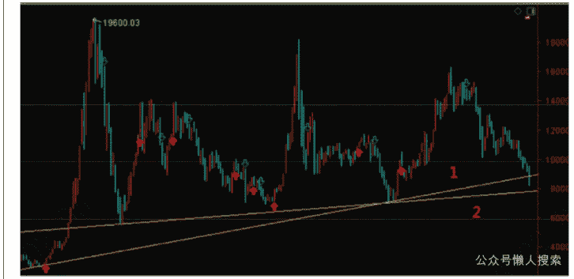

## 再看看目前的情况：

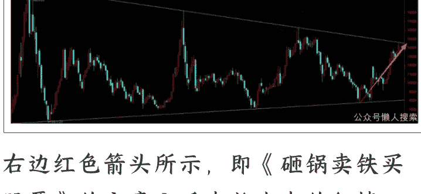

右边红色箭头所示，即《砸锅卖铁买股票》的文章之后生长出来的行情。2026 年元月份，深成指的高点是 14532.90 点，底部是 7683.63 点，涨了 89.14%。国家队采纳我们的建议接货，底部大胆出手，然后 1 月 13 日开始减仓，他们是真的完整地吃下了相当一部分利润。

还有 2024 年八九月份我们多篇文章讲二次抄底，讲错过了会后悔一辈子，当时讲时间指向 9 月 13 和 18 日。相信的人，比例只有 1.72%。

说实话，目前的这个行情分析，相当复杂，结论很难下。主要是指数多，还有主力成分也复杂，而且行情毕竟涨了两年。

(免责声明：本文只为开拓视野、引导思路，并非择时，亦非荐股，股市有风险，入市需谨慎。本文为多指数的大势和周期研究，仅为对大势如何划分的客观分析和研判，不构成任何投资建议和意见，不为用户依据本文做出的任何投资与决策承担责任。请大家注意投资风险。)

## 一、大牛市是否结束？

我们当初对这个牛市的判断是大牛市。2024 年 1 月初，我们在市场绝望时写下《投资大时代，不要放过那种改变您一生命运的大机会》，后来确定 2 月 2 日那周是正日子，前后一周都有效。那时高盛、摩根士丹利都看空 A 股。再后来我们有牛市三段论，然后还对是否有可能走成一波流的走势有过犹豫和徘徊。这都反映了大势判断的复杂性。

主要还在于上头需要慢牛，但历史上，A 股很难走慢牛。

总体结论是，大牛市没有结束。

至于是不是牛市三段论的第一段结束，是不是做高位震荡平台，我们后面仔细分析。

### 1. 历史上的慢牛走势

上证指数历史上有过慢牛。1994 年 7 月到 2001 年 6 月，慢牛走了 7 年。那 7 年中有多次救市。为了让大家都看得更清楚，图中我们故意把箭头画偏。

那 7 年是怎么走过来的呢？

1994 年 7 月 29 日，证监会等部门推出了“三大救市政策”，包括停发新股、允许券商融资、成立中外合资基金，由此拉开了指数翻两倍多的行情。第二天，上证指数跳空高开，高开高走，只用了 32 个交易日，就涨到 1052.94 点，涨了 223.10%。够疯狂。

而在此前，则是 17 个月的熊市，上证指数从 1558.95 点，一路跌到 325.89 点，跌了 75 周。一样是跌得很急，跌了 79.10%。而此波反弹，是牛市的第一浪，时间是 32 个交易日，7 周。疯狂的原因，在于那时没有涨跌停板。您看现在的创业板股票和北交所股票，经常几天就翻倍甚至翻几倍，对吧？涨跌幅大，机构向上炒还是向下打压，都搞到极致，所以行情就快。也就是，越没有涨跌幅限制，行情一来，那就涨得越快，越便于收割，越没有慢牛。

就是您如果要慢牛，那么最好都只能涨 10%。要不大家去看看同花顺，看看每波上涨，它涨了多少天？多数时间其实只是在高位震荡盘整而已。下跌或盘整的时间比上涨的时间长得多。真正大涨的时候，没有多久。

第二浪，低位震荡筑底了 70 周（一浪和二浪加上底部起来的，共 76 周）。内部是个 abc。细的浪型，我们就不划了。

第三浪是 1996 年 1 月到 1997 年 5 月的牛市，从 512.83 点到 1510.17 点，涨了 194.48%。时间是 65 周，这个周期到 2015 年还出现过 3 次。

那波行情能起来，一是新股跌破发行价，二是利率下行，取消存款保值补贴，再降息。因为 1995 年，一年期存款利率为 9.18%，而且三年和五年定期存款还有保值补贴，高的年利率加保值补贴超过 24%，最高快到 27% 了。现在的人很难想象当时的情况。我当年能再次进场，就是用计算器手算 9.18% 的复利，无师自通地弄明白了复利原理。为什么要弄清楚这个，是因为有孩子了，得为家庭为孩子做长远打算。

而现在，我的孩子也在做投资研究，革命自有后来人的感觉。

那波行情深成指涨得惊人，从 924.33 点到 6103.52 点。

第四浪是从 1997 年 5 月 12 日到 1999 年 5 月 17 日，著名的五一九救市前。四浪里面一样是 abc，共 101 周。头尾都算的话，是 102 周。内部节奏是 65+37。

第五浪是从 1999 年 5 月 17 日的 1047.83 点到 2001 年 6 月 14 日的 2245.43 点。里面是楔形的 5 浪上涨，时间两年，102 周。头尾都算的话 103 周。内部节奏是 65+38。

这个慢牛行情，二浪调整 70 周，三浪上涨 65 周。四浪调整 101 周，五浪上涨 102 周。而且四浪和五浪里面都有 65 周期。五浪是个衰竭的楔形升浪。而且里面救市救了几次，1995 年中间还救过，只涨了 3 天。五一九也救过。

但深成指的走势，跟上证指数差别很大。上证指数是五浪上涨，且三浪和五浪都创新高，但深成指并没有。它只有一波上涨。上证指数的二浪，深成指创了新低。上证指数的五浪，深成指只是一个周线级别的反弹浪，是 ABCDE 三角形中的 B。以前的文章中，我们完整呈现过那个三角形，这里不细讲。看图：

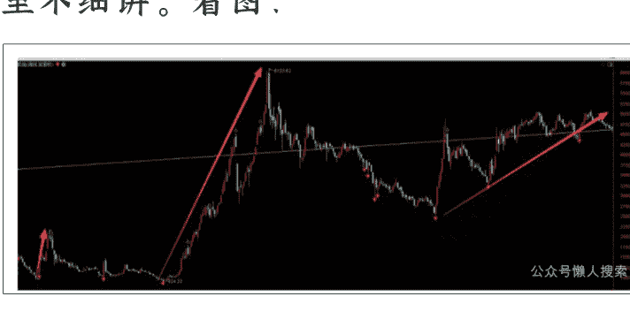

深成指在 1996 年到 1997 年的牛市中涨了 6.05 倍，并不是慢牛。那次是上证指数负责慢，深成指负责牛。2013 年到 2015 年则是上证指数负责慢，创业板和中小板负责牛。

而本波 2635 点以来，上证指数涨了 61+40=101 周，深成指是 61+42=103 周。跟 1999 年 5 月 17 日到 2001 年 6 月 14 日的周线周期非常近似，也跟那波慢牛的四浪周期近似。类似的，还有 2013 年到 2015 年牛市的 37+65=102 周，头尾都算 103 周。以及 2016 年 2638 点到 2018 年 1 月 29 日的 3587 点，是 4+61+37=102 周，头尾都算是 103 周。

从最高点出现的时间来看，上证指数是 101 周，深成指是 103 周。

就是，如果讲有相同的地方，这一点是有周期历史重复的。前面出现过 4 次，这里是第 5 次。但这里是否最终有效，我们暂不下结论。

### 2. 深成指的形态

下图是深成指的周 K 线大形态，大三角形。

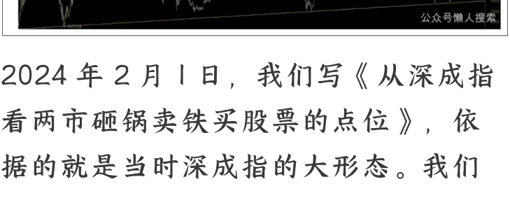

2024 年 2 月 1 日，我们写《从深成指看两市砸锅卖铁买股票的点位》，依据的就是当时深成指的大形态。我们当时给出了深成指从 2 月 1 日开始每天的支撑位，然后刚好在 2 月 5 日到达。那天就是大底，是砸锅卖铁买股票的地方。可惜超过 99.6% 的人终是错过了。真的是错过了这样的大底，就错过了财富。

我们再给出深成指上面两根黄色压力线在后面各周的点位。上周它的最高点为 14532.90 点，离 14612.60 点是很近的，相差只有 0.55%。

以此判断，近期国家队减持大指数基金，他们还是参考了深成指的位置的。这个位置，他们基本拿足了三角形下轨到上轨的利润。

| 时间 | 下面压力位 | 上面压力位 |
| :--- | :--- | :--- |
| 2 月 8 日 | 14612.60 | 16294.96 |
| 2 月 15 日 | 14605.98 | 16291.44 |
| 2 月 22 日 | 14599.37 | 16287.91 |
| 3 月 1 日 | 14592.75 | 16284.39 |
| 3 月 8 日 | 14586.14 | 16280.87 |
| 3 月 15 日 | 14579.52 | 16277.34 |
| 3 月 22 日 | 14572.90 | 16273.82 |
| 3 月 29 日 | 14566.29 | 16270.30 |
| 4 月 5 日 | 14559.67 | 16266.77 |
| 4 月 12 日 | 14553.05 | 16263.25 |
| 4 月 19 日 | 14546.44 | 16259.73 |
| 4 月 26 日 | 14539.82 | 16256.20 |
| 5 月 3 日 | 14533.21 | 16252.68 |
| 5 月 10 日 | 14526.59 | 16249.15 |
| 5 月 17 日 | 14519.97 | 16245.63 |
| 5 月 24 日 | 14513.36 | 16242.11 |
| 5 月 31 日 | 14506.74 | 16238.58 |
| 6 月 7 日 | 14500.13 | 16235.06 |
| 6 月 14 日 | 14493.51 | 16231.54 |
| 6 月 21 日 | 14486.89 | 16228.01 |
| 6 月 28 日 | 14480.28 | 16224.49 |
| 7 月 5 日 | 14473.66 | 16220.97 |
| 7 月 12 日 | 14467.05 | 16217.44 |
| 7 月 19 日 | 14460.43 | 16213.92 |
| 7 月 26 日 | 14453.81 | 16210.40 |
| 8 月 2 日 | 14447.20 | 16206.87 |
| 8 月 9 日 | 14440.58 | 16203.35 |
| 8 月 16 日 | 14433.96 | 16199.83 |
| 8 月 23 日 | 14427.35 | 16196.30 |
| 8 月 30 日 | 14420.73 | 16192.78 |
| 9 月 6 日 | 14414.12 | 16189.25 |
| 9 月 13 日 | 14407.50 | 16185.73 |

表中是深成指的两条压力线。深成指只要突破这两条压力线了，那就会走大牛市行情。而大牛市行情，最终一定创历史新高。如果大家对大牛市还没有概念，可以读读我们 2024 年 1 月 1 日的文章。

因此，我们讲大牛市没有结束。

但复杂的，还是三角形走势。历史上，三角形走势都比较复杂。还有就是那个 103 周期。

## 三、其他各指数的走势，以便相互印证

### 1. 上证 50 指数

下图是上证 50 指数周 K 线图。从图上看，它还没有达到三角形上轨的压力线。表中是后面各周的压力位。上周五它收盘 3066.5 点，离本周的压力位还有 26.00%。也就是它的空间还没有走完。考虑到国家队控制着它的走势，因此判断国家队是真的想走慢牛。

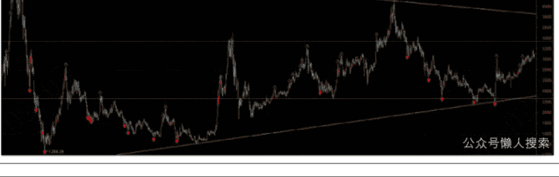

| 时间 | 上面压力位 |
| :--- | :--- |
| 2 月 8 日 | 3863.71 |
| 2 月 15 日 | 3862.74 |
| 2 月 22 日 | 3861.77 |
| 3 月 1 日 | 3860.80 |
| 3 月 8 日 | 3859.83 |
| 3 月 15 日 | 3858.86 |
| 3 月 22 日 | 3857.89 |
| 3 月 29 日 | 3856.92 |
| 4 月 5 日 | 3855.95 |
| 4 月 12 日 | 3854.98 |
| 4 月 19 日 | 3854.01 |
| 4 月 26 日 | 3853.04 |
| 5 月 3 日 | 3852.07 |
| 5 月 10 日 | 3851.10 |
| 5 月 17 日 | 3850.13 |
| 5 月 24 日 | 3849.10 |
| 5 月 31 日 | 3848.19 |
| 6 月 7 日 | 3847.21 |
| 6 月 14 日 | 3846.24 |
| 6 月 21 日 | 3845.27 |
| 6 月 28 日 | 3844.30 |
| 7 月 5 日 | 3843.33 |
| 7 月 12 日 | 3842.36 |
| 7 月 19 日 | 3841.39 |
| 7 月 26 日 | 3840.42 |
| 8 月 2 日 | 3839.45 |
| 8 月 9 日 | 3838.48 |
| 8 月 16 日 | 3837.51 |
| 8 月 23 日 | 3836.54 |
| 8 月 30 日 | 3835.57 |
| 9 月 6 日 | 3834.60 |
| 9 月 13 日 | 3833.63 |

### 2. 沪深 300

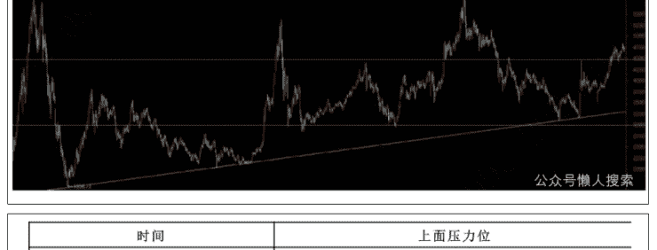

| 时间 | 上面压力位 |
| :--- | :--- |
| 2 月 8 日 | 5945.48 |
| 2 月 15 日 | 5945.54 |
| 2 月 22 日 | 5945.60 |
| 3 月 1 日 | 5945.66 |
| 3 月 8 日 | 5945.71 |
| 3 月 15 日 | 5945.77 |
| 3 月 22 日 | 5945.83 |
| 3 月 29 日 | 5945.89 |
| 4 月 5 日 | 5945.94 |
| 4 月 12 日 | 5946.00 |
| 4 月 19 日 | 5946.06 |
| 4 月 26 日 | 5946.12 |
| 5 月 3 日 | 5946.17 |
| 5 月 10 日 | 5946.23 |
| 5 月 17 日 | 5946.29 |
| 5 月 24 日 | 5946.35 |
| 5 月 31 日 | 5946.40 |
| 6 月 7 日 | 5946.46 |
| 6 月 14 日 | 5946.52 |
| 6 月 21 日 | 5946.57 |
| 6 月 28 日 | 5946.63 |
| 7 月 5 日 | 5946.69 |
| 7 月 12 日 | 5946.75 |
| 7 月 19 日 | 5946.80 |
| 7 月 26 日 | 5946.86 |
| 8 月 2 日 | 5946.92 |
| 8 月 9 日 | 5946.98 |
| 8 月 16 日 | 5947.03 |
| 8 月 23 日 | 5947.09 |
| 8 月 30 日 | 5947.15 |
| 9 月 6 日 | 5947.21 |
| 9 月 13 日 | 5947.26 |

沪深 300 也被国家队控制着，因为影响大。上周五，它收于 4706.34 点，离上面的压力位有 26.33%。

就是两个大指数离三角形上轨的空间还比较大，它们都没有走完。

### 3. 中小 100

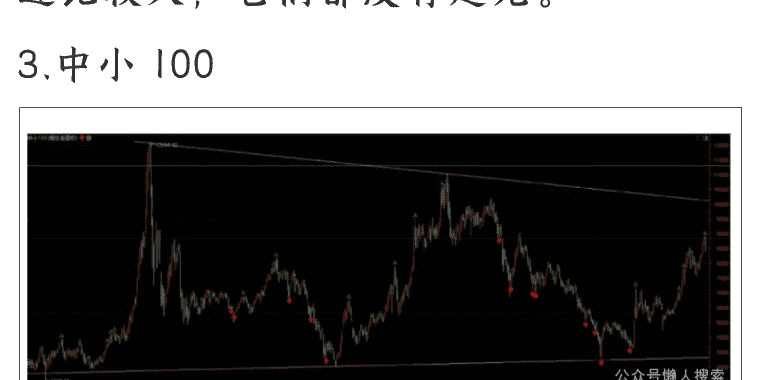

| 时间 | 上面压力位 |
| :--- | :--- |
| 2 月 8 日 | 10152.98 |
| 2 月 15 日 | 10149.43 |
| 2 月 22 日 | 10145.89 |
| 3 月 1 日 | 10142.35 |
| 3 月 8 日 | 10138.80 |
| 3 月 15 日 | 10135.26 |
| 3 月 22 日 | 10131.72 |
| 3 月 29 日 | 10128.17 |
| 4 月 5 日 | 10124.63 |
| 4 月 12 日 | 10121.08 |
| 4 月 19 日 | 10117.54 |
| 4 月 26 日 | 10114.00 |
| 5 月 3 日 | 10110.45 |
| 5 月 10 日 | 10106.91 |
| 5 月 17 日 | 10103.37 |
| 5 月 24 日 | 10099.82 |
| 5 月 31 日 | 10096.28 |
| 6 月 7 日 | 10092.73 |
| 6 月 14 日 | 10089.19 |
| 6 月 21 日 | 10085.65 |
| 6 月 28 日 | 10082.10 |
| 7 月 5 日 | 10078.56 |
| 7 月 12 日 | 10075.02 |
| 7 月 19 日 | 10071.47 |
| 7 月 26 日 | 10067.93 |
| 8 月 2 日 | 10064.38 |
| 8 月 9 日 | 10060.84 |
| 8 月 16 日 | 10057.30 |
| 8 月 23 日 | 10053.75 |
| 8 月 30 日 | 10050.21 |
| 9 月 6 日 | 10046.67 |
| 9 月 13 日 | 10043.12 |

上周它收盘 8547.18 点，离压力位大致还有 18.79%。它是深成指中涨幅落后的指数。

### 4. 创业板指

| 时间 | 上面压力位 |
| :--- | :--- |
| 2 月 8 日 | 3234.89 |
| 2 月 15 日 | 3233.42 |
| 2 月 22 日 | 3231.95 |
| 3 月 1 日 | 3230.48 |
| 3 月 8 日 | 3229.00 |
| 3 月 15 日 | 3227.53 |
| 3 月 22 日 | 3226.06 |
| 3 月 29 日 | 3224.59 |
| 4 月 5 日 | 3223.12 |
| 4 月 12 日 | 3221.65 |
| 4 月 19 日 | 3220.18 |
| 4 月 26 日 | 3218.71 |
| 5 月 3 日 | 3217.24 |
| 5 月 10 日 | 3215.77 |
| 5 月 17 日 | 3214.30 |
| 5 月 24 日 | 3212.83 |
| 5 月 31 日 | 3211.35 |
| 6 月 7 日 | 3209.88 |
| 6 月 14 日 | 3208.41 |
| 6 月 21 日 | 3206.94 |
| 6 月 28 日 | 3205.47 |
| 7 月 5 日 | 3204.00 |
| 7 月 12 日 | 3202.53 |
| 7 月 19 日 | 3201.06 |
| 7 月 26 日 | 3199.59 |
| 8 月 2 日 | 3198.12 |
| 8 月 9 日 | 3196.65 |
| 8 月 16 日 | 3195.18 |
| 8 月 23 日 | 3193.70 |
| 8 月 30 日 | 3192.23 |
| 9 月 6 日 | 3190.76 |
| 9 月 13 日 | 3189.29 |

创业板指的形态跟中小 100 比较类似，是三角形。但它走得更强一些。1 月 9 日和 16 日那两周，它就突破上面的压力线了。目前回踩站在线上方，后面会否有更深的回踩，且边走边看。

### 5. 上证指数

上证指数的三角形，已经突破了。一般地，突破后就会成为支撑。它比创业板指稍强点。

| 时间 | 上方支撑位 |
| :--- | :--- |
| 2 月 8 日 | 3863.17 |
| 2 月 15 日 | 3860.76 |
| 2 月 22 日 | 3858.34 |
| 3 月 1 日 | 3855.93 |
| 3 月 8 日 | 3853.52 |
| 3 月 15 日 | 3851.10 |
| 3 月 22 日 | 3848.69 |
| 3 月 29 日 | 3846.28 |
| 4 月 5 日 | 3843.87 |
| 4 月 12 日 | 3841.45 |
| 4 月 19 日 | 3839.04 |
| 4 月 26 日 | 3836.63 |
| 5 月 3 日 | 3834.21 |
| 5 月 10 日 | 3831.80 |
| 5 月 17 日 | 3829.39 |
| 5 月 24 日 | 3826.98 |
| 5 月 31 日 | 3824.56 |
| 6 月 7 日 | 3822.15 |
| 6 月 14 日 | 3819.74 |
| 6 月 21 日 | 3817.32 |
| 6 月 28 日 | 3814.91 |
| 7 月 5 日 | 3812.50 |
| 7 月 12 日 | 3810.09 |
| 7 月 19 日 | 3807.67 |
| 7 月 26 日 | 3805.26 |
| 8 月 2 日 | 3802.85 |
| 8 月 9 日 | 3800.43 |
| 8 月 16 日 | 3798.02 |
| 8 月 23 日 | 3795.61 |
| 8 月 30 日 | 3793.20 |
| 9 月 6 日 | 3790.78 |
| 9 月 13 日 | 3788.87 |

类似的，有中证 500、中证 1000、国证 A 指和国证 1000，也已突破。从形态来看，上证指数和中证 1000 非常相似，跟国证 1000 却有不同。上证指数既是压力线的突破，同时形态是大双底，W 底。是既突破三角形上轨，且突破双底颈线。这点一定要清楚。

中证 1000 是突破大双底颈线，但比上证指数要弱一些，且不存在三角形压力线。跟它一样的是中证 500 指数。

国证 A 指双底，突破颈线且强于上证指数，也不存在三角形上轨压力。国证 1000 目前并没有走出双底形态，但突破三角形压力线。强弱顺序是，国证 A 指强于国证 2000，强于上证，强于中证 500，强于中证 1000，强于国证 1000。

- (1) 国证 A 指颈线突破，且离 2015 年高点不远。它最强。月 K 线图。

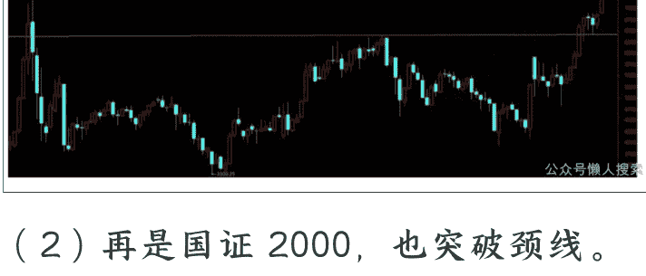

- (2) 再是国证 2000，也突破颈线。它次强。周 K 线图。

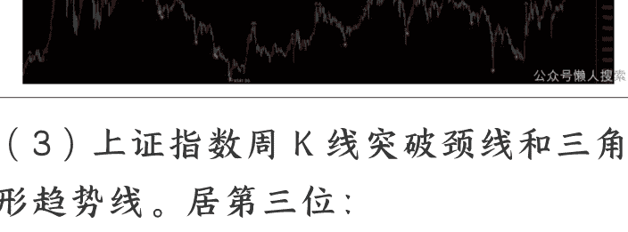

- (3) 上证指数周 K 线突破颈线和三角形趋势线。居第三位：

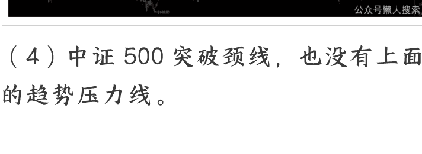

- (4) 中证 500 突破颈线，也没有上面的趋势压力线。

- (5) 中证 1000，突破颈线。它没有上面的三角形趋势压力线。

- (6) 国证 1000，也突破下降趋势线，但没有突破双底颈线。

接下去是创业板指、中小 100、上证 50 和沪深 300 等。

## 6.国证 2000 和巨潮小盘、巨潮中盘。

- (1) 这个指数以前讲过突破大双底颈线的情况。大家可以回去复习一下去年 9 月中旬的文章。当时刚突破双底颈线和下面的压力线，讲压力线突破后会变支撑线，然后将要回踩。我们还讲到过，估计在 11000 点到 11500 点附近，它有可能再震荡一次，结果上周最高点为 11230.61 点。图中的横线是以前文章中用到过的。

- (2) 巨潮小盘的双底颈线，突破了。

- (3) 巨潮中盘，双底，上周有一天刚突破颈线，又回来了。

以上这些是主要指数的形态。巨潮大盘弱于中盘，巨潮中盘弱于小盘，巨潮小盘弱于国证 2000。

前面这些指数总体分三类：第一类，大双底形态，一般突破颈线。第二类，三角形形态，以深成指为代表。有突破和没有突破上轨压力的，还有刚刚到上轨压力的。第三类，上证 50 和沪深 300 以及巨潮大盘，不存在双底，前二者还远没到三角形上轨。

## 四、周期

### 1.周线周期

我们先看上证指数的周期。其中最右边的那个周期数，并没有最终确定。我们以前讲到过 33 和 34 周期，还讲过 37 周期，实际走出来是 36。表明 37 还有一定的效果。但是，从形态来看，37 周期并不完美。为啥？因为它并不是一个大形态的周期，呈现的是一个小形态，形态的级别不够。

如果我们看历史上的周期，可以发现结束点都是转折点或转折点的次低点（或次高点）。以低点到低点，低点到高点，高点到次低点，高点到低点，以这 4 种形态为主，且形态的级别比较大。本次 36 周期不太明显的是，它并不是一个明显的低点到低点的周期。就是 4034 点到 3815 点的调整级别小了，导致 3040 点到 3815 点并不构成一个明显的大周期数字。换句话讲，后面有可能还有更大的周期，比如 47 或 48，52，或 61，或 65。一般地，前 12 年中，没有出现过连续两次的 61 周期重复，因此可以淘汰 61，剩下的就是 47 或 48 周期，52 周期，或 65 周期。

还有，前面 4 次出现了 102 或 103 周期，本次牛市到上周，就是 103 周期，61+42=103。它会是以以前 103 周期的重复吗？我们采取间接证明的办法来论证。

因为 36 不是明显的大级别的低点，按过去 12 年的规律，下一个要看的是 47 或 48。它们若是高点，那就是 47 或 48 周期最终有效，且是低点到高点的周期。它们若是低点，那就是 47 或 48 周期有效，且是低点到低点的周期。而 48 周指向春分，所以它更重要（上一波牛市的周期是 61+48 周期。这次会是重复吗）。

注意，这一点是我们后面立论的基础。否定了 36 周期是大周期，那么按过去 12 年的周期数字，下一个大周期正常情况是三选一，48，52 或 65。特殊情况则还要论证一个 42，它是 103 的从属，61+42，以前没有出现过。

### 2.深成指时空的逻辑推论

基于周期的因素，我们有下面的逻辑推论。

- (1) 元月 16 日那周的 4190.87 点，是第 40 周；深成指上周是第 42 周，高点 14532.90 点。在上证指数前 12 年中，40 周或 42 周没有成为明显的有效大周期，即以历史走势推论，4190.87 点大概率不是明显的高点周期，这个 42 周期以前没有过，应该无效。尽管 103 有过，但从纯技术分析的角度讲，如果 42 周期和 103 周期最终都有效，深成指按形态有理由走出 ABCDE 的深度下蹲的技术走势，这跟国家利益不相符。

为啥？我们深入讲透。

- 第一点，42 周期如果有效，且是大级别的高点的话，那么它刚好位于深成指压力线附近。则深成指从 2015 年 6 月的高点以来，刚好构成一个 ABCDE 五浪，三角形；这个五浪若最终成立，深成指理论上可以再次回到 10000 点以下，最低可以到 8500 点左右，极端情况下甚至可以更低。这自然跟 2023 年夏到 2024 年救市意图不符，不符合国家的目标和利益。一旦走出这种走势，调整时间可达两年或以上。

前面讲过几次 103 周期，这里只谈它的上涨。历史上，第一次 103 周上涨，是 1999 年 5 月 17 日到 2001 年 6 月的五浪上涨；接下去是 2001 年 6 月到 2005 年 6 月 3 日的 4 年调整，时间是 198 周。这个周期太长了。第二次 103 周上涨是 2013 年 6 月到 2015 年 6 月，接下去的调整有 182 到 183 周，也太长。第三次上涨是 2016 年 1 月 27 日的 2638 点到 2018 年 1 月 29 日的 3587 点，反弹 103 周，后面的调整 47 周。

前两次牛市 103 周上涨对应的两次调整都超长，很恐怖，且不符合国家利益。所以深成指这里经 61+42 周的上涨，见 D 浪高点，然后调整 103 周、183 周或 198 周的推论，都可以否定。这里若出现 103 周后的 47 周调整，类似 2018 年 3587 到 2440 点的调整周期，时间也太长。能否做高位振荡，后面再讲。

- 第二点，本次的 103，是 61+42。61 经常出现，但 42 是第一次。正因为 42 少见，还考虑到后面的调整周期，结合深成指的形态，我们认为大盘大概率会破掉深成指的 ABCDE 五浪形态。而且从国际上来看，ABCDE 五浪并不符合美国走衰中国走强东升西落的国家定性。资本市场的走势，走到这里了，应该与国运高度相关。

就是如果 103 最终被确认有效，后面的调整无论是 47 周、103 周、182 周或 198 周，都是深度回踩，那时会是什么情况？中国房地产现在还在承压，已经走熊 4 年多了，股市再走熊，那么 2024 年 2 月 5 日以来我们国家的努力就会成为泡影。此时就会出现房地产继续稳不住，股市再跌，那么大家的资产负债表就全面走坏。

这个结果并不符合国家利益。国家队如果走成这种情况，国家队的操盘就是不合格的。所以我们认为不会走这种走势。在中美博弈的背景下，这是美国最希望的走势，也是对中国国家战略利益损害最大的走势。

- 第三点，这种走势，从顺周期的角度来看，有问题。顺周期，先是有色，上游大涨，到上周出现周 K 线高位跳空长上影倒锤头，后面自然就会调整。从周期传导顺序来看，正常会向上游和下游传导。就是上游资源材料和能源涨价，会一直向中游和下游传导，形成成本推动式的上涨，进口推动式的上涨，会一直涨到农产品价格上涨，并最终导致工业品价格上涨。这是内在的逻辑。现在我们看到，有色涨了，能源和化工有涨，但中游和下游并没有被传导。也即从顺周期来看，这里就形成大级别的高点，时间并不到，跟顺周期明显相悖。

所以，上周能不能构成大级别的高点？42 若构成大级别的高点，周期上是有问题的。就是我们对 42 构成高点持怀疑态度，因为历史上没有过，也与中国国家利益和国运相悖，与顺周期相悖。

也即如果 103 周成为高点的大周期，且最终有效，就证明 42 有效。但 42 在前 12 年的历史上没有出现过且从深成指的技术形态来看，跟国家利益不相符，所以我们否定 42 有效。保守点说，是小概率事件。

- 第四点，技术形态。如果将周期结合形态来看，从上证指数、国证 2000 和中证 500、国证 A 指、巨潮小盘大双底颈线突破的形态来看，它们的上升并没有走完。它们的形态最多是突破颈线后的回踩。既然它们没有走完，那么深成指也没有走完。

- 第五点，主力和成交量因素，如果极端情况发生，就是国家队强行利用手中的筹码，把 4190 点做成一个大级别的高点周期，违反历史周期出现的数字规律，但是，从成交量来看，它还是不对的。因为历史上的牛市，牛市的最高点一般都不是量能的最高点，所谓的量在价先。而 4190 点那天，则是天量。天量天价与量在价先矛盾，所以后市还会有高点。

- (2) 回到逻辑推演。如果后面 48 周期是有效周期，且 48 周是低点，那么 48 周之后，还会出现新的上升周期，那也就否定了 40 和 42 周期。

- (3) 如果后面的 48 周期是有效周期，且 48 周是高点，那么就否定了 40 周和 42 周，且 48 周之后，还会有新的调整周期。那时会怎么走，到时再看。

- (4) 如果后面 48 周期是低点但不是有效周期，比如 52 或 65 周是大级别的低点，那时 52 或 65 周就有效。可 40 到 52 有 12 周，到 65 有 25 周，那就证明了 40 周是大级别的高点周期，103 有效，但 42 与历史数据不符，比较勉强。那这里就出现了 103 有效，42 有效，52 或 65 有效，三个同时有效，逻辑自洽有问题，自相矛盾。此时一个解决办法就是做高位振荡的平台。后面再讲。

- (5) 如果后面 48 周期是高点但不是有效周期，比如 52 或 65 周是大级别的高点，那么因为 40 到 52 有 12 周，到 65 有 25 周，那就证明了 40 周不是大级别的高点周期，与前面的结论相符，这也反过来证明 52 和 65 如果成为高点周期，都没有逻辑问题。

所以，结论是，48 周期要么是个大级别的低点周期，那时牛市就没有结束。要么是个较大级别的高点周期，如此，牛市现在也还没有结束。要么不是大级别的高点周期，那时大级别的高点周期就是 52 周或 65 周。

这个结论，是我们判断后面深成指空间的逻辑基础。我们所有的分析和推理，都是讲逻辑的。但前面三四五点的推理，有些绕，可那没有办法，逻辑就是如此，我们也只能这样讲逻辑。大家如果想不明白，自己试着用逻辑推一推。

- (6) 极端情况，小概率事件出现，走出最坏的结果，40 周或 42 周走成历史上没有过的大级别的高点周期，再次出现 103 周期，这需要个前题，上证 50 和沪深 300 向下突破支撑线，沪深 300 日 K 线：

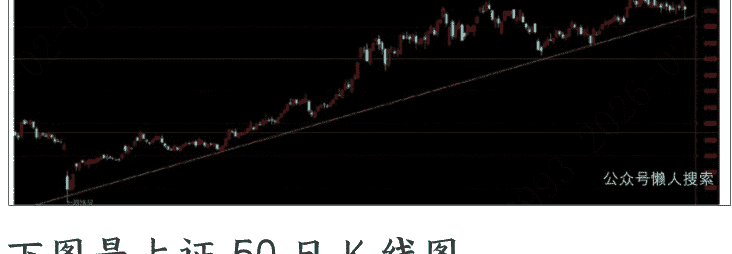

下图是上证 50 日 K 线图。

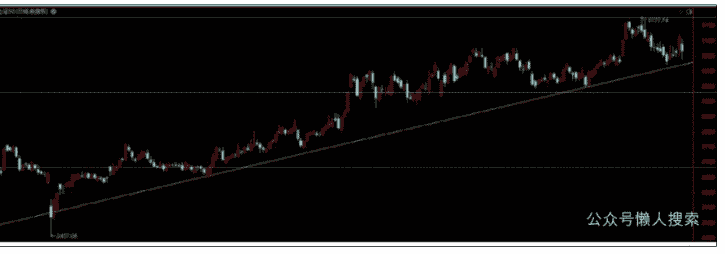

此时，我们要做的一件事情就是盯上证 50 指数和沪深 300，看它破不破上升趋势线。用这两个图来做防守。不破，就继续向上。破了，表明大指数调整的浪型级别比较大，中小指数必然受影响。因为破了就是去年 4 月 7 日以来的上升趋势结束。破了，就证明 48 周期有效，就要做相应的防守。因为有色近期要调整，有色影响又大，航天也在第二波调整，因此这里短线要盯紧上证 50 和沪深 300 的趋势线。大家自己在电脑上画一画就知道的。

- (7) 高位平台。这里如果上证 50 和沪深 300 都有效跌破日线上上升趋势，第一种回到三角形下轨的走法我们已经排除。第二种则是做高位平台，我们在 9 月中旬的多指数相互印证的文章中讲到过这种走势。走出这种走势的前提，则要求国家队有极高强度的控盘能力。

### 此时会出现什么情况？

因为前面走了 103 周，61+42，从前历史上还有 4 次 103 周，而 2018 年 1 月 29 日后走出来个 47 周的调整周期。那么这个平台振荡周期也不会短。过去历史上，37 周期成为过调整周期，47 周期也有，还有 61 周。所以，如果踩得浅一些，4190 点成为较大级别的高点的话，那么最短的周期也会到 48 周，到春分附近。还有 26 周，即 52 周的一半；其次是 37 周，其次是 47 周，最后是 61 周。

此外，还要关注美股的动荡。

一旦做高位平台，在此情况下，按深成指前期盘整带中轴的规律，它要打到 120 月均线附近很正常，目前的位置在 11036，且后面每个月会有变化。目前是 14205 点，离 11000 点附近相差 3200 点左右，幅度大致是 22.53%。那样的话，高位平台会振荡盘整很长一段时间。这是小概率事件。

当然，这种走势的最大问题在哪里呢？就是一旦下来了，到 11000 点附近了，国家队守未必就能收得住，一旦走出收不住的态势，对国家利益来讲，是极为不利的。但高位平台是可以作为一种走势预判保留的。

### 3.结论

后市较大概率是航天和有色先调整，带动大盘调整。调整结束后要么继续向上，要么做高位平台，分野就看上证 50 和沪深 300 的日 K 线上升趋势线破不破；但即使破掉上证 50 和沪深 300 的日 K 线上升趋势线，大牛市并没有结束。即使深成指做高位平台，一旦平台调整结束，仍就要完成向上突破。

(免责声明：本文只为开拓视野、引导思路，并非择时，亦非荐股，股市有风险，入市需谨慎。本文为多指数的大势和周期研究，仅为对大势如何划分的客观分析和研判，不构成任何投资建议和意见，不为用户依据本文做出的任何投资与决策承担责任。请大家注意投资风险。)

最后，安利小懒的付费群：

### 懒人专属群（介绍）

微信：lazyhelper1

🍴这里是你对抗信息过载的护城河。已稳定运行 7 年，累计拆解、研读 3000+ 个互联网商业实战案例与行业前沿内参和时政/宏观文章。

### 我们不搬运垃圾，只做高价值信息的筛选器与放大镜。

### 懒人专属群更新记录:

https://hk57gvlx7u.feishu.cn/docx/H0kRdZbSbolBR0xkaXtcuVE0nTg

【免责声明】本资料归档于社群内部知识库，仅供成员课题研究与学术交流，请在查阅后 24 小时内删除。