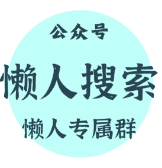
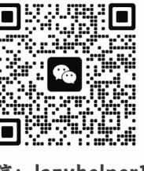

# 222 | 案例：零售行业的“听劝”式创新

260206

整理：公众号懒人搜索，懒人专属群精选

懒人微信:lazyhelper1

欢迎打开《蔡钰·商业参考 4》, 我是蔡钰。

消费者因为觉醒得比供给端更快，在过去一年，也成了中国消费创新的关键推动力，把“听劝”变成了当下中国消费市场的一种特有创新模式。这是一个相当有趣的变化。对应的例子我们已经讲过不少了，比如海尔的三筒洗衣机、内蒙零食“扎那家”等等。

巧了，这次跟黄碧云聊年货严选，我也从她那里听到了几个需求推动消费品创新的故事。

我得给你讲讲。

## “药食同源圣经”

第一个故事，是“药食同源圣经”的故事。

怎么个意思呢？过去一年，全国民众对健康空前重视，让休闲食品行业，不约而同捧出了一本“行业圣经”。什么行业圣经？

这本圣经，在今天的中国休闲食品行业叫作《药食同源目录 (2025 年版)》。但这其实不是 2025 年出版的一本书，而是国务院卫生行政部门，从 2002 年开始，分四次发布的一组中药材名单，承认它们既是食物，又有各自的药性。

截至 2024 年的最新一次发布，这份名单上的食材总共增加到了 106 种。

2024 年以来，全社会的消费者都越来越讲究养生和滋补。到了 2025 年，国家卫健委又提出了一个“体重管理年”三年行动。这两件事落到休闲食品行业里，就被自动简化成了“健康”两个字。

于是，有人翻出过往 20 多年，国家部门发布的 4 份药食同源食材名单，给它起了个《药食同源目录 (2025 年版)》的名字，用来指导自家产品的创新。

很快，这份目录就成了 2025 年的行业共识，几乎所有食品厂商和创业团队都在研究它。

怎么用这份目录来指导产品的创新呢？黄碧云说：“倒过来用。”

什么叫倒过来用？

以前厂商们的创新逻辑是，我有什么食材，我就做什么产品。但现在的逻辑是：消费者有什么需求，我就去这本目录里找匹配的食材，来开发对应的产品。

她跟我举了个例子，讲她怎么帮客户做产品开发。

她说：“我让客户建了一个飞书表格，去抓小红书和抖音上的高频需求关键词。像消炎、提神、缓解焦虑、改善睡眠等等。找到了呼声强的需求，再拿去跟《药食同源目录》里的 106 种食材做药性匹配。”

比方说，很多女生为长痘痘、咽喉不适、经期不适等痛点发愁，聊来聊去，经常会归结到“消炎”这个期待上。于是，厂商们就把消炎当需求，到《药食同源目录》里一翻，发现姜黄正好能领命。

这之后事情就简单了，姜黄拿铁、姜黄饮料、姜黄调味料，纷纷问世。

类似的，今天的人们又想吃甜食，又对糖分代表的热量有畏惧，那就把“甜而不热”当作需求，去翻《药食同源目录》，就能发现，罗汉果是天然的甜味剂，甜度是白砂糖的 300 倍，热量却几乎为零。

于是，2025 年，市场上也多了不少罗汉果气泡水、罗汉果酸奶、罗汉果烘焙。

但是，在小红书和抖音里，人们聊到的痛点那么多，又想消炎又想甜而不热，又想缓解焦虑又想提神，怎么知道哪个需求最火呢？

黄碧云自己的办法是，用微信指数。她把收集到的需求痛点，连同《药食同源目录》提到的 106 种食材，全部订阅到微信指数里，每天看这些关键词的热度变化。一旦发现哪个痛点、哪种食材的搜索量飙升，往往就说明市场需求起来了。

她指导几个客户用这个方法去开发产品，爆款率、复购率都很高。

你看，消费者把自己的关切发在各种网络社区里，间接指导了休闲食品行业的创新。

那反过来，沿着《药食同源目录》去置办养生年货，这个思路也推荐给你。我请 Manus 做了一个小文档，列出了这 106 种食材的药性和功效，你可以在文稿里自行取用。

## 柔湿巾

第二个故事，其实也是一种“小贵但是”的消费品。

你还记得，黄碧云老师寄给我的年货里，有一箱柔湿巾。纸巾品牌叫零尘，来自一家老牌的福建纸业公司。

这个纸巾好在哪里？就是好在名字里那两个字：柔和湿，像丝巾一样柔软，同时又有一定的温润度。

如果你身边有经常犯鼻炎的朋友，他肯定知道，在擤鼻涕擤得鼻周皮肤一碰就疼的时候，纸巾的柔软温润程度有多么重要。

柔湿巾，也是一个在今天的需求端，被母婴人群、美妆人群和鼻炎人群放大的市场。类似的产品，心相印、舒洁、洁柔等大厂品牌，乃至盒马、胖东来都有出品。

那么，零尘这家公司特别在哪里呢？特别在它的性价比，它的纸巾比普通纸巾贵一倍，却能比大厂们的同类竞品便宜一半。

那是便宜在偷工减料吗？还真不是。这家公司，本来就是名创优品和永辉的代工商，它 80% 以上的出货量，主要是服务于定制需求和母婴市场。重点发力这个产品，也是因为感知到了母婴市场、美妆护肤市场和鼻炎市场的强烈需求。

好，重点来了：这种纸巾为什么适合当年货呢？

因为它在育儿领域很受欢迎。婴幼儿皮肤娇嫩，家长们给孩子擦个脸、擦个屁股，都恨不得用最温柔的动作。所以，黄碧云觉得，这种纸巾很适合替代玩具、奶粉、纸尿裤，来送给家里有小宝宝的朋友。

黄老师自己还有一个用法：用来擦手机屏幕。她解释说，这个纸巾的含水量和厚度刚刚好，擦屏幕特别干净。

不像传统的手机湿巾，保湿剂会在手机屏幕上留一层雾。

这，是不是有点奢侈了？还没等我问出这个贫穷的问题。她的回答已经跟上了:

首先，家里有小孩用平板电脑的，还有女生脸上带妆接电话的，平板和手机是不是应该经常擦？

咦？有道理啊。

其次，一部手机，一万多都买了，每天用几张好纸给它做个保养，能延长它的寿命和崭新程度，是不是应该的？

咦？也是啊。

最后，黄碧云说，她已经跟工厂提建议，开条新的产品线，把这种纸巾从大包改成小包，大片裁成小片，再把纸巾里的乳霜成分去掉，并把价格降下来。让人随身携带，专门擦手机用。

咦？我还能说什么？大师姐说得对啊。

你看，黄碧云老师也在身体力行用自己的需求，推动柔湿巾产品的创新。

## 经销商品牌

零尘柔湿巾的故事讲完，黄碧云说，它的故事其实还体现了过去一年另一个需求趋势：今天的消费者们，在一些标准化日用品维度上，对渠道品牌的信任度已经高过产品品牌了。

### 什么意思？

同样买一套碗碟，一包纸巾，甚至一袋枸杞，消费者们更喜欢买山姆、胖东来、盒马、永辉的自有品牌产品。在他们心智中，这些产品的价格比大牌至少便宜一半，而质量却绝对不输大品牌。

价格便宜不便宜，确实可以手机上直接比对。但质量的信任是怎么来的呢？一方面，当然是今天的中国产能平权。零尘的主业就是给永辉、名创优品们做代工。

另一方面呢，消费者们意识到，在今天的社会环境里，客诉找商超渠道比找大品牌容易。

买了个商品有问题，想找大品牌投诉索赔，太难了。有时候，大厂用删帖和沉默很容易解决提出问题的人。

但如果找本地的商超渠道，把问题发在渠道的同城团购群、视频号留言区，很快就能影响周围人的购买决策。所以，渠道的客服反而更有动力去回应问题、解决问题。再往上追溯，它们对品质的要求，也会比传统品牌更严格。

这就导致，在 2026 年的日用品标品领域，消费者的首选信任对象变了，渠道品牌正在全面超过产品品牌。

产品品牌们怎么办？倒也有办法，今天的淘宝天猫、抖音、小红书、微信小店，都是产品品牌的自有渠道，仍然有机会吸引忠诚用户，把货卖出去。

但这又带来了一个新变化：夹在品牌和终端渠道之间的经销商们变得很难受。下游的商超渠道卖自有品牌商品，上游的产品品牌走电商自力更生，经销商们的生意消失了。

### 怎么办？

好玩的事情来了：经销商们，也被逼着开始做自己的“经销商品牌”。大的经销商们，借助自己对大量的终端渠道的理解，开始整合自己在国内上千家超市的销售数据，开始分析顾客需求、反推产品创新。

借助这种能力，经销商们跟上游工厂，又形成了新的同盟，在一些有品类无品牌的家居用品上，做差异化定制。

这两年你有没有发现，网上和超市卖的垃圾袋变结实、变漂亮了？升级的垃圾袋，就很典型是经销商创新的产品。

河南最大的批发市场百荣世贸，有一家做垃圾袋的经销商，意识到消费者的一个变化：希望垃圾袋也好看，拎着它在电梯里跟邻居相处 2 分钟，没那么尴尬。

垃圾袋要变好看，就得跳出固有的黑色限制；但要是不做黑色，又容易透明暴露隐私。怎么办？

这家经销商借助自己对各种百货的了解，提出要往垃圾袋的材料里掺入一种荧光粉，加进去之后，垃圾袋变得完全不透光，还增加了硬度。于是，不用做原来那么厚了，成本也比原来降了 40%。这种垃圾袋一上市，在百荣世贸里做到了垃圾袋品类的销量第一。

类似的，过去一年，你可能知道，家居市场流行起了一种滑凳，也就是给小圆凳装上五六个轮子，可以坐着滑来滑去。

干嘛用？我这样的外行，第一反应可能是给小孩子玩儿，但孩子往往都有童车，滑凳似乎也不是刚需。

但是商超的经销商们却知道，这样的凳子，对中老年消费者非常有吸引力：坐着擦柜子、摘菜、陪孩子，不用反复站起蹲下，又省膝盖又省腰。

这样的需求，一家超市听了无所谓；但几百家超市听到之后，传到经销商耳中，就成了 2025 年的爆款产品。你看，这也是一种中观意义上的“听劝”。

## 总结

好，以上是我们借着聊年货，延展开的几个有趣商业故事。它们再一次证明，创新的定义权，正在从实验室和会议室，腾挪到了消费者的碎碎念里。

以前的创新，是厂商拿着锤子找钉子，想方设法把梳子卖给和尚；现在的创新，是厂商拿着翻译器，把消费者的各种有意无意的表达，翻译成“听劝型产品方案”。这个动作，不但品牌在做，终端在做，经销商也在做。

“听劝”这两个字，正在成为今天最高效、成本最低的研发能力。未来能活好的企业，究竟是嗓门最大的，还是耳朵最灵的呢？

听听你的想法。

我是蔡钰，拜了个拜。

最后，安利小懒的付费群：

懒人专属群（介绍）

微信：lazyhelper1

## 🔖 这里是你对抗信息过载的护城河。

已稳定运行 7 年，累计拆解、研读 3000+ 个互联网商业实战案例与行业前沿内参和时政/宏观文章。

我们不搬运垃圾，只做高价值信息的筛选器与放大镜。

## 懒人专属群更新记录:

https://hk57gvIx7u.feishu.cn/docx/H0kRdZbSbolBR0xkaXtcuVE0nTg

## 【免责声明】

本资料归档于社群内部知识库，仅供成员课题研究与学术交流，请在查阅后 24 小时内删除。