## 回顾 2025,我如何实现在小红书电商上多次爆单的成功路径分享

## 260206 副业 SC 精华

公众号懒人搜索，懒人专属群独享
懒人微信:lazyhelper1

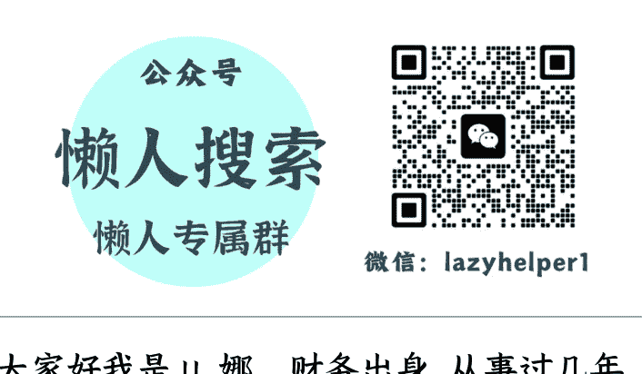

大家好，我是 U 娜，财务出身从事过几年互联网运营，2024 年裸辞后加入生财。很幸运的是刚加入生财报名的第一个航海项目——小红书电商 (百货)，在航海期间内就跑通了 0-1 赚回了生财的门票费。因为很快的就拿到了正反馈，我坚定了要深耕小红书电商这件事，于是我找了刀姐知识付费进行更为系统专业的学习。后面陆续爆单多次 (混剪到实拍),去年店铺整体利润 25 万。接下来我想要着重复盘一下 2025 年的实操经验。

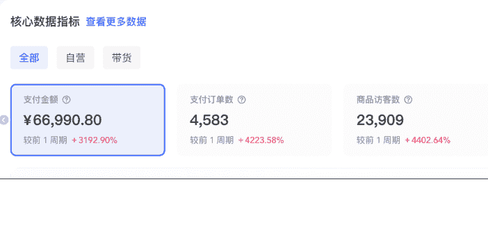

## 一、我的爆单路程

### 1、视频混剪篇：

爆的第一个品来自于 2025 年过年期间在抖音创意中心刷到的，出于对于品的敏锐度，马上就于小红书看下站内情况，发现有账号正在起量，马上选择跟品。当时站内所有对标账号的爆款脚本全都是真人出镜的一镜到底，这种情况是不能几秒换镜头混剪的，于是我只能对视频进行极限的去重（抽帧、添加画中画、滤镜、贴纸等）。但是效果不佳仍然同质化严重。

于是我换了一种做法（也是属于想偷懒！）我把当时所有抖音在卖这个品的博主全部关注了，他们发了视频我第一时间去搬运，这个方法让我每天有稳定的出单但是也没有爆单，直到我发了一条结合哪吒 + 所卖品的视频（那段时间正是哪吒热度最高的时候，也是蹭上了大热流量），那条视频差不多跑了 4 万浏览量但是只带来了几十单，因为吸引的都是泛粉，转化率不高但却拉高了我账号的权重。

后面我再发笔记明显能感觉小眼睛起始量都变高了。真正的爆单是我在抖音上看到了一个近期点赞量特别高的视频，搜了下小红书还没人搬运，这于是我马上进行二次去重发布，那条视频最终跑了 150 万的流量 2.6 万人的点赞。因为已经验证过这个爆款脚本的可行，后面再不停的 1:1 复刻，迭代优化，做好评论区的干预，最终卖了 5000 单。

对于这个品人工干预方法：把我的第一条爆款视频的热赞评论、以及同行的爆文热赞评论全部收集起来，只要出单就马上找人评论，很多人对此评论有共鸣就会继续评论，由此不停循环的给我笔记堆楼，笔记热度很快就能跑起来，这一招屡试不爽。

| 笔记阅读数 | 笔记支付金额 | 笔记支付订单数 |
|---|---|---|
| 1,583,952 | 19,385.40 | 1,396 |

混剪的教程大家可以去看一下圈友奇杰老师 23 年发的精华帖~很详细的教程，这里也给大家推荐一个混剪的 app——混剪蜂，如果你担心自己混剪的原创度还不够高，可以在这里面进行再度二创，生成视频需要花费相应的蜂蜜，大家可以直接做任务免费领，对于个人玩家来说每天的额度完全够用了，不够也可以多用手机号开通几个账号。

#### 混剪蜂

做任务，得蜂蜜 | 106
VIP 每月领 3000 蜂蜜 >>
##### 大师二创接入
DeepSeek
全新模型 一键智能生成
大师二创
AI 智创自动成片
原创魔法
一键提升视频原创度
智能混剪
支持多素材混剪
##### 创作必备工具
视频翻译
视频出海·一键翻译
网感剪辑
AI 识别·综艺感剪辑
智能分镜
智能分镜·多维度拆分
智能抽帧
独家算法·一键抽取
去字幕
多种方式·随心消除
文案提取
精准识别·快速高效
视频下载
智能检测·一键下载
扫码进群

公众号懒人搜索，懒人专属群分享

##### 蜂蜜中心

规则

我的蜂蜜

116

查看明细>

充值

升级 VIP 开通 VIP 月领 3000 蜂蜜

前往

##### 日常任务

+   看视频得蜂蜜

+   看 1 条视频得 20

+   去观看

+   签到得蜂蜜

+   第 7 天最高可领 25

+   明日再来

##### 限时福利

+   邀请好友得蜂蜜

+   每邀请 1 名新用户可获得 200

+   去邀请

5/26

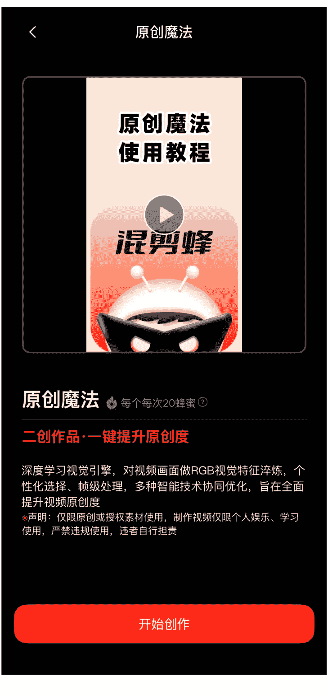

真正让我大爆的是第二个品，卖了 1.1 万单

+   1、如何选到的品？

这个品是我在千帆 - 市场 - 笔记排行里刷到的，我看到笔记排行里这个品爆了好几个账号 好几篇笔记，而且销量才只有几百，24 小时加购热度也还有，我再去抖音创意中心看到 24 小时这个品也有热度。1688 一查有货源，利润率还特别高。毫不犹豫，马上开干！

### 2、打造差异化

当时小红书所有卖的商家最低售价都是 19.9，而且观察这几个账号 24 小时加购有但是订单增幅不高，我判定这个价格用户或许是觉得太贵了会犹豫或者去其他平台比价，于是我上架直接最低价格单个价格 9.9。因为设置了阶梯规格价。买的越多优惠越大，所以 90% 的用户都会买多个，我的利润也会更高。

我是小红书第一个卖这么低价格的人，所以发了 1 条笔记就有用户下单了。

当时整个平台所有的爆文封面都是特别简陋的视频截图，真的是很粗糙！但是在这种情况下都还是有这么多账号陆续有爆款笔记出现。我自己也毫无头绪加之没有制作爆文封面的能力，也只有按照当时的对标继续用视频截图当封面，就这样也是陆陆续续的卖了几十单。

转折点来了！！！！后面我刷到了一个新的对标他自己制作了封面虽然没有出现 100+ 赞的笔记。但是也还是有几十个赞的笔记，我觉得也是可以尝试的。于是又进行了跟抄，最终在 6 月下旬开始我爆单了，一次性爆了好几篇笔记全都是跟抄这个对标封面爆起来的。没几天笔记相应违规，热度也就慢慢下来了。与此同时更多的同行也开始入场，竞争也变大了。我观测到同行们都没有做人工干预，他们全靠这笔记自带的热度让用户评论。我开始更认真的布局人工干预，引导用户评论 我每天也会真实的抽取用户免费送并留下当日抽取名额时间，让用户看到每天是有实打实的在抽人送，他们就更愿意评论了！加之我的产品存在一定争议，很多人在评论区开骂 我也不删这些评论，黑红也是红，骂得越多 笔记热度不也就更高吗....终于在 7 月中旬又迎来了新的爆单

### 3、好景不长 - 违规封号

没过两天因为违规账号被永久性限制商业权益跟流量。万幸的是店铺还在，问了平台客服也不影响我店铺的权益，子账号也没有被影响。经历了大起大落，心态不稳了，于是我给了自己半天的时间整理心情。好在我有多个小号。第二天直接再绑定新的子账号 继续发笔记。没过几天....平台又封了我一个子账号。这个时候我想到了一句话：账号只是工具，它已经完成了它的使命也赚到了钱。号没了就没了，继续新开就是。因为已经积累了对这个品的经验，每新开一个子账号发不了几篇笔记就能爆一篇出来。

我当时的违规原因是因为利 AI 技术虚构事件，平台不同阶段查处违规的力度跟方向不同，当时那段时间恰好遇到查 AI 技术比较严的阶段。其实封号之前平台是有给过我警告了很多篇笔记都有违规，但是我没有太在意！于是喜提封号。提醒大家如果同一时间段笔记违规较多，一定要及时修改申诉，如果申诉失败笔记需要删除掉！

### 2、实拍篇

因为刚开始转型做实拍，我很清楚按照我目前的能力还不足以去选择需要拍摄难度很大的品，正逢秋季入冬，我选择了换季需求品。

#### 1、如何选到的品？

+   1.1 此品是需求品，且此品类的其他不同类型产品已经在小红书平台上验证过能卖出强需求且有热度的。

+   1.2 符合我目前的实拍水平，即不需要很高的审美能力和拍摄技术，只需要展现手持产品图及作用就好。比如图下这个黑头毳毛夹，首图只需展现产品使用前后效果对比图，其他内页图只需展现镊子能夹出毳毛/我家产品与市面产品的对比图。这种品对于实拍新手来说就很容易上手。还留红印子！凑近镜子才看清，原来黑头里还裹着小毳毛！

换了精密去黑头镊子才把这难题解决！薄刃夹口精准咬住，对着镜子轻轻一夹，小毳毛黑头直接连根拔

##### 黑头夹镊子
专夹黑头粉刺

绒毛/硬毛轻松拔

##### 黑头夹正确使用

+   NO1.
每次使用夹子前建议先用酒精棉片消毒

+   NO2.
热敷 2～3 分钟，或洗完热水澡后，毛孔打

+   NO3.
找准目标：只处理可见「毳毛」和“冒
藏在皮肤下面的黑头无法拔出，需要手
黑头：夹住黑头顶端，垂直轻松拔出。
毳毛：夹住根部，顺着毛发生长方向轻轻
控制力度：动作轻柔稳定，避免过度刺激

+   NO4.
清理
建议一周操作 2～3 次，不要太频繁，做好

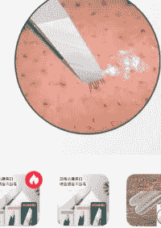

共 3 款 >

¥19.9

补贴价 ¥13.9

已售 1.6 万 +

平台券 立减 3 元

商家券 满 19 减 3

##### 友好市集 > 【前 2 万单特惠 16.9】黑头夹毳毛夹高精密夹子超薄无缝级拔毛夹黑

7 天无理由

店铺新品销量 TOP1

24 小时销量飙升

近 30 天

平均 24 小时发货 承诺 48 小时内发货，晚发必赔

广东佛山 包邮

7 天无理由退货 | 极速退款 | 晚发必赔

店铺

客服

购物车

加入购物车

领券购买

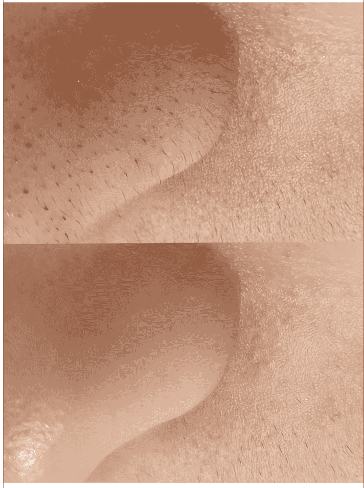

啊啊啊，这玩意才是毳毛黑头的终结者😎

有没有姐妹懂啊!鼻子上的黑头就像长在毛孔里一样!洗脸搓到泛红，泥膜敷到刺痛都没辙，手欠抠完还留红印子!凑近镜子才看清，原来黑头里还裹着小

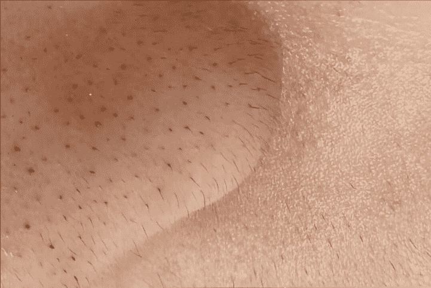

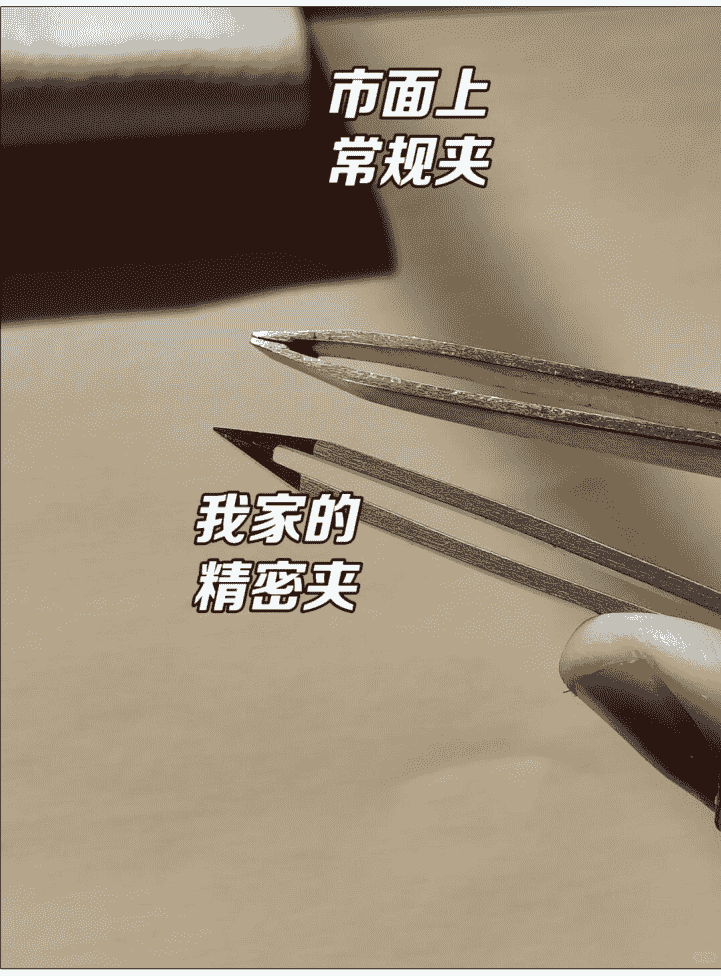

比这种尖嘴夹好用太多
安全性高夹口咬合更好

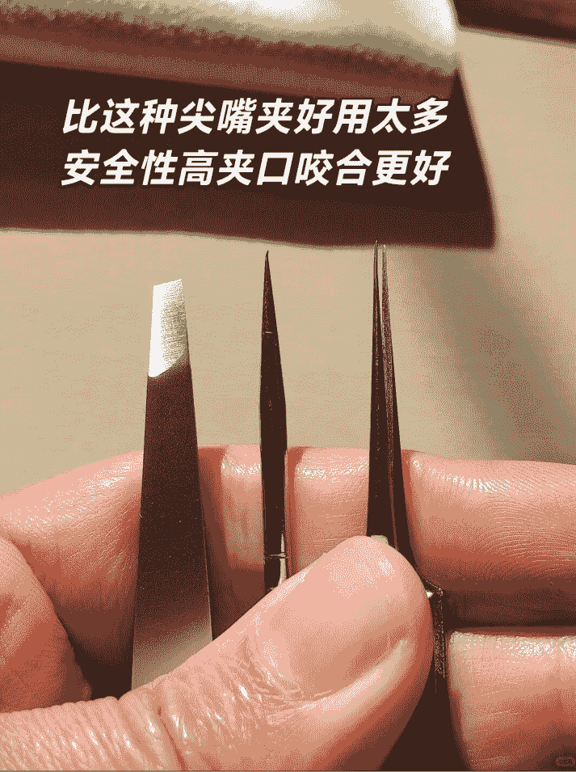

细毛、小毳毛一夹一个准

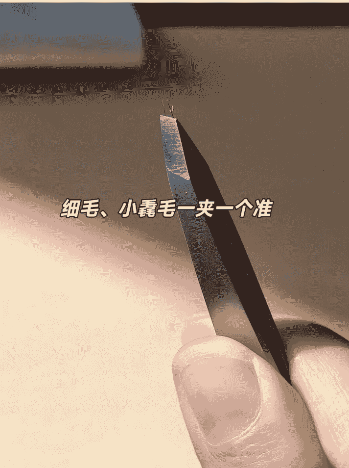

1.3 抖音上这个品已经开始大爆，但是小红书还没有出现卖同产品的人，我入局竞争小。

#### 2、没有对标怎么制作笔记？

2.1 由于我是平台第一个卖该产品的人，没有对标账号参考。但是我关注到去年有一个卖同需求品的账号，暂且把他当做对标，沿用了他当时的爆款标题文案，再结合我这个品自身的特点进行改良。

2.2 抖音都是视频卖货，而我是要制作图文笔记，于是我把抖音的爆款视频文案扒下来，投喂给 ai，让 ai 给我梳理这个产品的卖点、痛点。再给我提供建议我该如何去制作图片以及文案。

#### 3、如何卖爆的？

3.1 提前入局，抢占关键词。这个品我是 10 月份开始入局，真正开始起量是在 11 月份

3.2 由于一开始发笔记小眼睛都是个位数并不笃定这个品能否卖起来，所以我一开始只是发笔记并没有做商品的评论。直到后面我用小号给自己写了几条带图好评后当天就出单了。（商品的基础销量跟评论真的很重要）

3.3 人工干预，那段时间正是平台惊喜回归券热度最大的时候，评论区引导用户评论增加笔记权重

3.3 善于抓住人群的痛点，学会讲情绪！这一点我是这次参加上海的小红书大会听了富贵老师的演讲我才意识到原来我这个品卖爆的且笔记转化率高很大一部分因素就是标题跟正文带了情绪，抓住了人群的痛点。

## 二、经验分享

### 1、选品篇

选品定生死！！！所以在选品上我们花更多的精力是应该的

#### 1.1 抖音创意中心选品法

我每天都会花十几分钟去刷一遍创意中心，看看最近有没有什么品比较火再去小红书看看站内情况。不过需要注意的是小红书从 25 年下半年开始对于图文笔记尤其是 live 图的笔记模式流量有倾斜，且最近大爆的品全都是实拍 live 图跟 AI 图的图文笔记模式，而抖音都是视频卖货为主，靠抖音创意中心来选品卖货爆的概率没有以前大了，不过可以用来扩展选品思路。

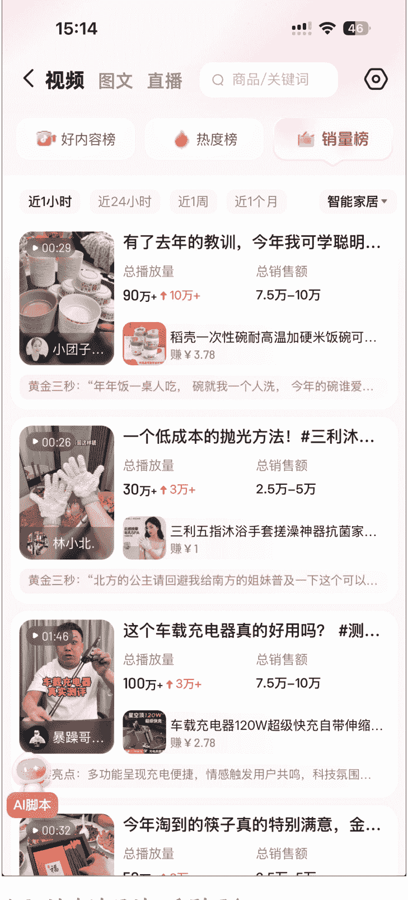

#### 1.2 站内选品法 手刷同行

拿一个小号专门用来刷品，当你刷的品足够多，多去点赞关注低粉爆文的同行后，平台就会更多的给你推送更多的低粉爆文账号，这就成为你的天然选品库！！！同行就是最好的老师～（这是我目前最常用的选品法）

#### 1.3 爬虫抓取近 24 小时站内爆款

能知道平台最近热销的品，只是目前我看到别人爬取的 24 小时加购数据表更多的已经是卖爆了的不属于低粉爆款账号，再去跟品能打爆的概率很低了，特别是对于新手来说不太合适，不过也可以用来拓宽自己的选品思路~

#### 1.4 千帆后台笔记排行榜单

查找路径 - 千帆后台 - 笔记中心 - 同行 - 笔记排行

当你开始发布商品笔记后，平台会根据你近期发布的商品自动将你归类到某一品类（比如美妆工具、年货等），推送的优秀内容、账号也都是你卖的相关品类。

##### 市场
##### 直播排行
##### 笔记排行
##### 话题排行

阅读榜

引流榜

热卖榜

成交榜

优秀内容

优秀账号

内容类型

每日 10 点更新近 7 日累计数据，上榜笔记为同行近 90 天新发

1 新年醒狮玻璃贴 | 贴上以后连房间都亮...
Xmoon Design
发布时间：2026-01-21
成交金额 (元) 阅读数 商品点击率
5 万 -10 万 7 万 -10 万 15%-25%

2 我的天爷呀，今年的玻璃贴每一张都好...
Xmoon Design
发布时间：2026-01-30
成交金额 (元) 阅读数 商品点击率
1 万 -5 万 3 万 -5 万 25%-50%

3 门神“下岗”再就业!我家冰箱成了新年...
潮玩派对
发布时间：2026-01-15
成交金额 (元) 阅读数 商品点击率
1 万 -5 万 3 万 -5 万 15%-25%

4 过年贴窗花别踩雷!
Xmoon Design
发布时间：2026-01-19

### 2、测品篇

#### 2.1 找到对标 1:1 模仿

选好品之后，把平台上所有的近期爆款笔记全部扒下来 (笔记热度 24 小时>7 天>15 天>30 天) 优先测热度最近的爆款笔记脚本，越近的爆款脚本你去 1:1 模仿复刻，品爆款的的概率越大。

视频笔记：把所有的爆款封面、脚本、标题，都全部 1:1 模仿且又全部交叉测完之后还是不出单，及时换品。

图文笔记：图文笔记小眼睛数量天生就比视频笔记要低，很多时候发布后 24 小时小眼睛都只有个位数，不要焦虑！不要怀疑是否被限流了！你要做就是同样把所有的爆款封面、标题、正文，都全部 1:1 模仿且又全部交叉测完，我自己给图文定的是如果发了 100 条笔记小眼睛都很低，不出单或者零星出几单就及时换品 (前提是笔记质量要过关) 或则同时加入新的品进行轮测，每个品在账号上的表现不一样，有的时候你就是跟对标模仿到几乎一样了，但小眼睛还是低卖不爆，我们要做的就是不停的选品测品，最终找到属于自己账号的爆品!

#### 2.2 人工干预

人工干预很重要 很重要 很重要!!!重要的事情说三遍

回看我的每次爆单历程，全部都是人工干预起到了重要决定因素

##### 2.2.1 商品详情干预

你作为一个消费者来说，买东西是不是都会去点开看商品有没有人买，商品的评论是怎么样的！那么反之我们身份转换为卖家的时候是不是就需要去给自己的商品做好基础销量跟带图好评呢！！！

我一般情况是给商品刷几十单的基础销量 +5 条带图好评。

现在平台是会直接把带图的好评挂在你的商品笔记评论区里，这样也能增加你的笔记转化率！！！

需要注意的是：以前大家刷销量都是直接刷退款单就好了，现在平台规则的改变！！刷退款单会直接清空刷单的销量！必须要是正常用户购买流程，我是直接找的帮忙刷单的团队，1688 找同样发货地的便宜小商品寄，对方收到后我再提供相应的图片 + 文字好评，这样更稳妥。

##### 2.2.2 笔记评论区的干预

###### 2.2.2.1 需要做干预的几种情况:

+   1、视频笔记出单或者小眼睛破 500
+   2、图文笔记出单或者小眼睛破 200
+   3、明显能看到该笔记小眼睛比其他笔记高且持续增长

###### 2.2.2.2 评论区干预的几种类型

+   1、直接参考同行的爆款笔记热门评论
+   2、评论区抽人免费送商品，引导用户评论，让用户觉得有“便宜”占就会主动评论，大家可以根据自己的商品价值来决定是否需要真实抽人还是找小号假扮。因为我卖的品客单价不算很高，所以我都是真实抽取用户送，还会直接截图每日真实抽取用户的记录置顶到评论区，这样用户看到我每天都有在真实抽奖，评论的人就会更多。
+   3、惊喜回归券，前几个月的惊喜回归券的方法是爆了一大批的账号，在评论区引导用户评论“惊喜回归券”就能获得大额优惠券，对于一些卖 9.9 的商品来说直接可以 0.1 拿下。引发用户不停评论堆楼，实际上这个券是平台给用户发放新客券和老客回归券，跟笔记下方评论没有任何关系。

##### 2.2.3 笔记掉量干预

爆款笔记持续下跌但还有出单/潜力笔记直接断流

这两种情况需要马上进行补评论跟补转化

2.2.3.1 补笔记评论:提高笔记 CES,增加互动。新笔记、潜力笔记效果更佳 (老笔记效果有限),最好是增加能让用户引发回复的评论，我一般做 5-10 条左右

2.2.3.2 补单 (转化):核心救流量手段。但前提是通过商品关键词、半标题搜索进入笔记下单！！！不要直接转发链接下单，这样没有效果！！！这一步很重要不能偷懒。

需要补多少单合适？

预估当天的自然成交量跟昨日笔记成交量的缺口。(比如该笔记昨日出 100 单，今天过半才只有 30 单，预估当天可能只成交 60 单。则需补 40 单才能达到昨日 100 单的目标)

ps:补单需找专业团队!!!千万不要自己补!操作不对很容易引发平台风控

2.2.3.3 笔记二次编辑 可以试着修改笔记标题、封面、部分文案、关键词进行二遍后重新发布，不保证绝对有用 但可以尝试。我一般配合二编 + 投流一起使用

#### 2.3 关键词的布局及优化

我一般是直接先搬运对标账号的关键词，后续再深挖其他关键词。

如何查找关键词？

+   1、首先你得开通乘风 - 点击推广 - 新建计划 - 搜索关键词 - 根据你要卖的品平台会自动推荐词包，你也可以自己根据关键词搜索。

| 关键词词包 | 关键词举例 | 关键词数量 | 词包来源 | 操作 |
|---|---|---|---|---|
| Final_... | 私密、私处... | 902 个 | 平台 | 下载 添加 删除 |
| Final_... | 卫生棉条、... | 561 个 | 平台 | 下载 添加 删除 |
| Final_... | 洗衣液双十二... | 803 个 | 平台 | 下载 添加 删除 |
| Final_... | 呋虫胺、内... | 975 个 | 平台 | 下载 添加 删除 |
| Final_... | 纸巾双十一... | 789 个 | 平台 | 下载 添加 删除 |
| Final_... | 洗脸巾推荐... | 458 个 | 平台 | 下载 添加 删除 |
| Final_... | 卫生巾双 11、... | 574 个 | 平台 | 下载 添加 删除 |

将关键词下载出来，我会根据月均搜索指数排行，只筛选出搜索指数超过 1 万的关键词，将这些关键词分成几组，发笔记的时候轮番发布。

## 2、千帆后台 - 数据中心 - 搜索

能看到引流搜索词以及你的出单笔记都是通过哪些关键词搜索到的

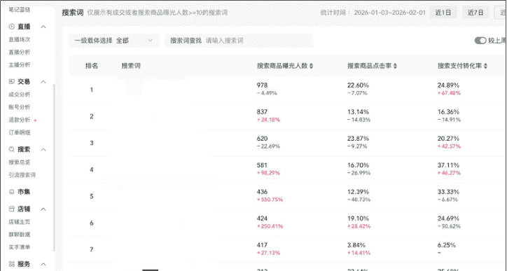

## 3、供应商发货篇

测的品一定要多选择几家供应商，可以先买回来对比商品质量，留下比较不错的 2-3 家。一定不要只选择一家供应商！学会给自己留“备胎”

对比于店管家、聚水潭这种专业的 ERP 系统，我更倾向于直接用 1688 自身的一件代发软件逸淘。现在 1688 上大部分供应商都开通了逸淘，操作很简单。（适合于产品成本不高的品，因为需要先付款后发货，不过平台可以申请先用后付。）

他对我来说有一个最大的好处就是，由于我一直是在平台付款，你的采购金额越高，相应的专业买家等级也越高，这样我在后续去找其他供应商的时候，他们也能看到我是专业买家，配合程度也会高很多，这里可以贴一套的操作教程，大家可以去看逸淘—新用户入门教程

## 4、总结反思篇

#### 4.1 心态很重要

我天生就是一个乐天派，可能正是因为一直以来心态比较好，在做小红书的时候我坚信只要动作做到位保持不变形，且定期复盘优化迭代，我一定可以爆单！于是在做小红书这一年半我也确实陆续爆了几个品，在小红书上你想要出单很容易，但难的是爆单且能持续性的打出多个爆品！所以说心态不好你很难坚持下去。

#### 4.2 能用钱解决的问题都不是问题

- 1、遇到商品质量问题，该补发补发，该退款退款，要是需要特别难缠的客户，直接退款不用纠缠，别因为一个顾客影响自己的心情得不偿失

- 2、遇到差评，不用找客户，直接退全款后台申诉基本都能通过

- 3、能提高自己工作效率的工具一定要舍得花钱，遇到问题卡点也要舍得付费找人请教，你要意识到你的时间很值钱！你节约出来的时间可以用来做更重要的事情让你赚更多的钱！！！

#### 4.3 不足之处

这次参加了个体到工作室的 mini 航海，我才意识到，去年一整年我做的几乎都是维持性的工作，不敢放大，怕项目不稳定害怕亏损。但是许老师的期望值决策让我醍醐灌顶（赢的概率*赢了赚多少 - 输的概率*输了亏多少，只要这个比值是正的就可以放手去做！）所以今年我的重心会放在减少自己维持性的工作，学会招人，利用好人力杠杆，把更多的精力放在优化性、突破性的工作上。

## 最后

> 借用一下条形码老师的话：如果你一直接牌、一直出牌，你总能攒起一把好牌！

最后，安利小懒的付费群：

懒人专属群（介绍）

这里是你对抗信息过载的护城河。

已稳定运行 7 年，累计拆解、研读 3000+ 个互联网商业实战案例与行业前沿内参和时政/宏观文章。

我们不搬运垃圾，只做高价值信息的筛选器与放大镜。

懒人专属群更新记录：

https://hk57gvlx7u.feishu.cn/docx/H0kRdZbSbolBR0xkaXtcuVE0nTg

【免责声明】本资料归档于社群内部知识库，仅供成员课题研究与学术交流，请在查阅后 24 小时内删除。