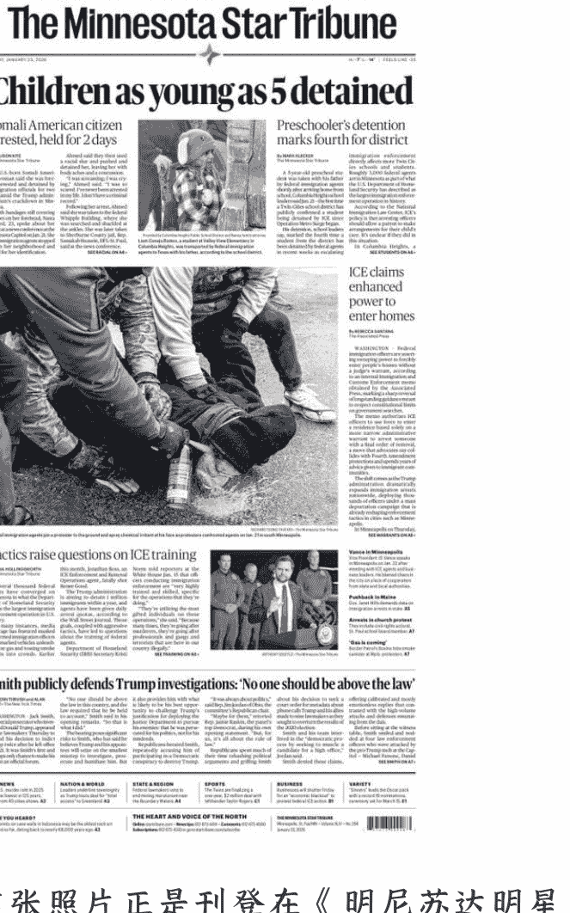

# 美国媒体如何报道 ICE 枪杀案

## 260206 新闻实验室

整理：公众号懒人搜索，懒人专属群精选
懒人微信：lazyhelper1


当全美国的媒体蜂拥而至明尼阿波利斯时，真正了解这座城市脉搏的是那些生活在这里的地方记者。

在过去的几周里，美国明尼苏达州城市明尼阿波利斯成为了舆论的风暴眼。

在川普政府的直接授意与部署下，ICE（移民和海关执法局）及边境巡逻队发起了一场史无前例的行动，数千名联邦特工涌入这座城市，将它推向了动荡的边缘。

原本旨在针对特定移民社区的执法行动，迅速演变为一场失控的暴力危机。随着两名 37 岁的美国公民接连在联邦特工的枪口下丧生，愤怒的情绪从街头蔓延至全国。

本期会员通讯，我们关注这次事件中的媒体报道和舆论争夺。

## 当官方叙事遭遇全民目击

1 月 7 日，三个孩子的母亲、诗人 Renee Good 在试图驾车离开与 ICE 探员的冲突现场时被射杀。国土安全部部长 Kristi Noem 立即声称，Good 试图“将她的车辆武器化”，并称这是“国内恐怖主义行为”。

然而，媒体分析的多角度视频显示，事实与官方说法大相径庭。

1 月 24 日，ICU 护士 Alex Pretti 在拍摄 ICE 探员执法时，遭遇了更加残酷的命运。至少四段来自不同角度视频记录了那个早晨发生的一切：Pretti 手持手机试图记录探员逮捕一名女性的过程，随后被多名探员包围、喷射辣椒喷雾、摔倒在地。一名探员从他身上取走了一把枪——在整个过程中，Pretti 从未手持这把枪。几秒钟后，探员向已经倒地的 Pretti 开枪，至少 10 发子弹在 5 秒内射出。

白宫副幕僚长 Stephen Miller 称 Pretti 是“试图杀害联邦执法人员的刺客”。边境巡逻队指挥官 Greg Bovino 声称 Pretti 想要“造成最大伤害，屠杀执法人员”。国土安全部部长 Noem 在新闻发布会上说，Pretti“携带武器和弹药来阻止执法行动”，“犯下了国内恐怖主义行为。这就是事实。”

但这些“事实”在多角度的现场视频面前不堪一击。调查新闻机构 Bellingcat 在 Pretti 枪击案发生当天，立即同步播放了三段视频，让观众从不同角度看到事件全貌。该机构还在推特上首先指出，Pretti 携带的枪支在第一枪响起前已被探员取走；两名探员在事件中开枪；至少有 5 发子弹射向已经倒地失去行动能力的 Pretti。

在这场信息战中，现场视频成为了最核心的武器。CNN 的分析指出，明尼阿波利斯的居民正在响应州长 Tim Walz 的号召，随时准备按下录制键。这种全民记录的行为，直接挑战了 ICE 精心制作的宣传视频。居民们用 TikTok 和 Instagram Reels 记录特工在居民区的行动，与官方试图展示的“维护法律与秩序”的形象形成了鲜明对比。

川普政府不仅在口头上将受害者妖魔化，甚至还利用 AI 技术制造虚假画面。例如，白宫官方账号曾发布一张经过 AI 修改的民权律师照片，试图丑化她的形象。面对质疑，白宫发言人竟回应称“表情包将会继续”。这种轻蔑的态度进一步激怒了公众。

## 地方新闻业的坚守

在社交媒体的喧嚣和官方信息的误导中，传统新闻机构正努力扮演专业角色。当全美国的媒体蜂拥而至明尼阿波利斯时，真正了解这座城市脉搏的是那些生活在这里的地方记者。

据 Semafor 报道，明尼苏达州最大的新闻机构《明尼苏达明星论坛报》(Minnesota Star Tribune) 投入了四分之一的采编力量——约 50 名记者——来报道这场危机。该报的高级副总裁 Kathleen Hennessey 表示，他们的目标不是复刻社交媒体上的爆款视频，而是提供那些视频缺失的关键信息：名字、日期、地点以及事件的前因后果。

《大西洋月刊》提到了一张由记者 Richard Tsong-Taatarii 拍摄的照片，照片中一名抗议者被两名特工压在身下，第三名特工近距离向其面部喷射胡椒喷雾。



这张照片正是刊登在《明尼苏达明星论坛报》的头版。它成为了联邦特工过度使用武力的有力铁证，让公众得以在官方的谎言之外拼凑出真相。

这种坚持并非易事。Poynter 采访了多位当地记者，他们描述了在“占领状态”下工作的艰难——记者们不仅要面对联邦特工的催泪瓦斯和橡胶子弹，还要应对铺天盖地的虚假信息。与 2020 年乔治·弗洛伊德事件后的抗议不同，这次人们的对手是联邦执法力量，且伴随着更复杂的信息战。为了应对这一挑战，媒体机构进一步加强事实核查和视觉取证能力。

Nieman Lab 报道了调查新闻机构 Bellingcat 如何与当地媒体合作，利用开源情报技术分析现场视频。

## 被逮捕的记者、被质疑的直播人潮

随着明尼阿波利斯的紧张局势升级，美国的新闻自由也正面临着严峻的威胁。

最令人震惊的案例莫过于前 CNN 主播 Don Lemon 和艾美奖得主、独立记者 Georgia Fort 的被捕。这两位黑人记者因报道一场发生在教堂内的抗议活动而被联邦政府起诉。当时，抗议者打断了一场礼拜，因为该教堂的一位牧师同时也是当地 ICE 办事处的负责人。Don Lemon 在现场直播中明确表示自己是记者，只是在拍摄照片，但这并没有让他免于牢狱之灾。

这起逮捕事件被广泛视为一种政治报复和恐吓。《哥伦比亚新闻评论》指出，在逮捕发生前，右翼媒体和网络大 V 如本 Benny Johnson 和 Tim Pool 曾在社交平台上大肆攻击 Lemon，呼吁将其逮捕。川普本人也在 Truth Social 上发帖，称抗议者为“捣乱分子”，应被扔进监狱。随后，司法部以涉嫌“合谋侵犯宪法权利”和违反《FACE Act》（该法禁止以暴力或威胁方式阻止信徒在宗教场所行使第一修正案所保障的权利）为由起诉了两位记者。舆论普遍认为，这起案件在法律上站不住脚，更像是一种宣传手段，旨在向其他记者发出警告。

对于像 Fort 这样的独立记者来说，这种打击有可能是毁灭性的。与拥有庞大法务团队支持的大型新闻机构记者不同，独立记者往往处于孤军奋战的状态。Fort 在接受《哥伦比亚新闻评论》采访时无奈地表示：“如果宪法不能保护美国公民，它也就无法保护媒体。”尽管两人后来获得保释，但这起事件已经在新闻界引发了寒蝉效应，特别是对于那些缺乏机构保护的自由撰稿人和 KOL 而言，报道真相的风险已陡然升高。

在这场危机中，公民记者和独立内容创作者扮演了至关重要的角色，但他们的涌入也带来了新的问题。正如《哥伦比亚新闻评论》的另一篇报道所指出的，虽然正是路人拍摄的视频揭穿了官方关于 Pretti 和 Good 的谎言，但大量外来的直播者的出现也引发了当地社区的反感。

这些直播者往往驾驶着写有“PRESS（媒体）”字样的车辆在城市中穿梭，通过 Signal 等加密通讯软件追踪 ICE 的动向。然而，他们的行为有时被视为鲁莽和缺乏职业道德。明尼阿波利斯当地的的活动家 Taylor Dahlin 在社交媒体上公开喊话：“回家吧，直播者。”她批评这些人把明尼阿波利斯当成了“战区”来体验，并在拍摄结束后便一走了之，留下当地居民收拾残局。

尽管存在摩擦，但不可否认的是，独立新闻力量填补了主流媒体留下的空白。像 Bellingcat 这样的调查机构正是依靠这些由普通人和独立记者拍摄的海量视频，才得以通过开源情报技术还原事件真相。

可以说 ICE“谋杀”了两位美国公民吗？在群情激愤之中，一些人对机构媒体的用词不满——最典型的是，为什么不直接说 ICE 谋杀了 Renee Good 和 Alex Pretti？面对如此明显的暴力事件，媒体应该如何定义？

《纽约时报》的标准编辑 Susan Wessling 在一篇文章中解释了该报为何谨慎使用“谋杀”(murder) 或“处决”(execution) 等词汇。她指出，尽管读者可能在社交媒体上看到这些词，但在法律定罪之前，新闻报道必须保持精准，避免充当法官的角色。这种坚持虽然在情绪激昂的时刻显得有些冷酷，却是维护新闻公信力的基石。

> “在政治两极分化的环境中，周围都是确定的宣言，我们必须捕捉情况的严重性，而不说超出我们所知道的，我们的目标是尽可能精确，特别小心地选择词汇，避免使用带有偏见或传达观点的语言。”

当然，这种选择在一些人的眼中是太过谨慎的。面对一个公然说谎的政府，一些人认为新闻媒体应该更激进一些。

在内部支持方面，新闻机构也在反思如何更负责任地报道创伤。Poynter 回访了多位曾报道过 2014 年弗格森骚乱的记者，他们建议明尼阿波利斯的同行们要格外注意心理健康，并制定详细的安全计划。更重要的是，他们强调不要把受访者仅仅当作“几句引语”来对待，而要尊重他们的故事和脆弱性。

如今危机已经进入第二个月，民意的压力也到了极高的程度。就连那些平时只关注猫猫狗狗的休闲娱乐账号，也开始公开发声。比如，在网络社区 Reddit 上，原本严禁政治话题的 r/catbongos 社区版主发布了一份措辞严厉的声明，宣称支持川普或 ICE 的人不再受欢迎。在 r/military 这样的军事社区，许多自称现役军人的用户表达了对联邦特工行为的失望。

面对舆论压力，白宫不得不进行战术调整。一直以强硬著称的边境巡逻队指挥官 Greg Bovino 被降职并调离明尼阿波利斯，川普也亲自致电明尼苏达州州长 Walz，试图缓和局势。然而，这种退让被部分极右翼媒体视为软弱。

目前，我们还不知道危机将如何收场。明尼阿波利斯的这几周，既有许多暴力冲突，也有激烈的舆论战。对于当地民众而言，手机镜头成为了最有力的武器，而新闻自由——尽管伤痕累累——依然是防止社会滑向极权深渊的最后一道防线。

最后，安利小懒的付费群：

懒人专属群（介绍）


🛠️ 这里是你对抗信息过载的护城河。

已稳定运行 7 年，累计拆解、研读 3000+ 个互联网商业实战案例与行业前沿内参和时政/宏观文章。

我们不搬运垃圾，只做高价值信息的筛选器与放大镜。

## 懒人专属群更新记录:

```
https://hk57gvlx7u.feishu.cn/docx/H0kRdZbSboIBROxkaXtcuVE0nTg
```

【免责声明】本资料归档于社群内部知识库，仅供成员课题研究与学术交流，请在查阅后 24 小时内删除。