公众号懒人搜索，懒人专属群分享

# 从模仿爆款到设计爆款：5 个月 8 亿 + 播放量 YouTube 视频复盘

260210 副业 SC 精华

公众号懒人搜索，懒人专属群独享

懒人微信：lazyhelper1


## 一、前言

大家好，我是明媚，曾经 UI 设计是我的主业，AI 视频是我的副业，现在 AI 视频变成了我的主业，主做 youtube AI 视频故事赛道。这篇帖子记录了我做 youtube 视频这几个月以来的一些经验和想法，以及改编脚本的一些思路。非常感谢各位教练的指导，我在这抛砖引玉分享一些拙见！

## 二、我的成绩

目前运营 4 个账号，2 个高级 YPP，从 9 月份开通收益至今，AI shorts、短带长，以及带货佣金、带货奖励共拿到 22000 刀收益。两枚银牌，48w 订阅，累计 8.7 亿播放量。

2025，你的视频获得了 535,051,335 次观看


2025，你的视频获得了 326,185,958 次观看


## 三、我的来时路

### 初始

与很多圈友不同，可能很多人遭受了工作的折磨之后，选择做副业，但我从 23 年开始就没工作了（捂脸）。。。

我从 2023 年 3 月加入生财，2023 年 9 月失业，进入生财后，我参加过 10 次航海，小红书电商、闲鱼高客单带货、公众号爆文写作、AI 视频制作、youtube 视频等，尝试过很多项目，也拿到过一些结果。

但是电商赛道太卷，对于单打独斗的个人来说，人力和资金成本都是非常高的，对于一个盖洛普和谐才干排第一的 i 人来说，要经常面对买家的各种问题和刁难，让自己的时间变得碎片化，这是一件非常痛苦的事。

> 15:43 知识星球
> **更多**
> **亦仁** 付费有效期至 2026/4/18
> **生财有术** 星球号：50394154
> **明媚** 成员编号：
> 2023 年 3 月 14 日加入星球
> 分享星球
> **明媚** 星球资料
> 认证 生财有术 星球成员
> 74000+
> 4/46

### 生财有术·航海实战

- ChatGPT 提效 2024 年 01 月 航行结束，点击按钮填写反馈 填写反馈
- 公众号爆文写作 (原创) 航行结束，点击按钮填写反馈 填写反馈
- 个人优势挖掘 2023 年 09 月 航行结束，点击按钮填写反馈 填写反馈
- AI 绘画 + 自媒体 2023 年 09 月 航行结束，点击按钮填写反馈 填写反馈
- 同城聚会 (组员版) 2023 年 06 月 航行结束，点击按钮填写反馈 填写反馈
- 小红书店铺 2023 年 06 月 航行结束，点击按钮填写反馈 填写反馈

### 往期参与

- AI 视频制作 2025 年 06 月 共 21 天 | 已打卡 12 天 查看活动
- YouTube 视频 2025 年 04 月 共 21 天 | 已打卡 13 天 查看活动
- ComfyUI 工作流--一键批量做图、图生视频 2024 年 12 月 航行结束，点击按钮填写反馈 填写反馈
- 闲鱼高客单带货 2024 年 07 月 航行结束，点击按钮填写反馈 填写反馈
- ChatGPT 提效 2024 年 01 月 航行结束，点击按钮填写反馈 填写反馈

公众号懒人搜索，懒人专属群分享

但是，对于一个不会代码、没有资源，不善交际的人来说，能做什么项目呢？

好像能尝试的项目都已经试过了。。。。

### 新机遇

24 年 11 月的时候，我在鱼丸的朋友圈看到了关于油管的陪伴群的内容，当时很好奇油管上怎么赚钱，去联系鱼丸的时候，才知道有个陪伴群，那时候没有对其他圈友开放，只说后续有可能作为航海项目。

12 月的时候，就看到了 youtube AI 视频的航海，当时很激动，觉得一定要试试这个项目。。。结果呢？毫无意外的错过了，那时候因为家人生病，自己要陪着跑医院，当我想起要参加航海的时候，报名人数已满，限额 900 名，定了闹钟的我，还是错过了（深深的懊悔）起了个大早，赶了个晚集。。。

然后，我就决定自己按照航海手册操作，先上手练练再说，从建账号，找对标开始，2 月 10 日，信心满满发了我第一个视频，结果数据都是几十几百，最好的数据是上千，那时候也不知道可以通过新建频道来解决 0 播的问题。

| 日期 | 观看次数 |
| :--- | :--- |
| 2025 年 2 月 14 日 上传 | 522 |
| 2025 年 2 月 13 日 上传 | 30 |
| 2025 年 2 月 13 日 上传 | 35 |
| 2025 年 2 月 12 日 上传 | 34 |
| 2025 年 2 月 12 日 上传 | 48 |
| 2025 年 2 月 11 日 上传 | 55 |
| 2025 年 2 月 11 日 上传 | 68 |
| 2025 年 2 月 10 日 上传 | 62 |
| 2025 年 3 月 12 日 上传 | 17 |
| 2025 年 3 月 11 日 上传 | 11 |
| 2025 年 3 月 11 日 上传 | 10 |
| 2025 年 3 月 10 日 上传 | 438 |
| 2025 年 3 月 10 日 上传 | 12 |
| 2025 年 3 月 9 日 上传 | 437 |
| 2025 年 3 月 9 日 上传 | 10 |
| 2025 年 3 月 9 日 上传 | 15 |

### 摸索

终于在 25 年 3 月份的时候，迎来了又一次的 youtube 视频航海，在参加航海的时候，那时候不懂什么叫微创新，不懂什么叫爆款元素，就是把猫换成狗，把苹果换成梨等等玩一些找不同的游戏，现在看来这种创新的程度简直为 0，千篇一律的东西怎么可能会爆呢？

后来看到深海圈的宣传海报，我翻看了曹教练和波妮教练的帖子，看到了亦仁的超级标，看到了两位教练帮很多圈友拿到了 ypp，跃跃欲试，但是一看到 5 千的报名费，还是有些犹豫，彼时的我，已经快大半年没有任何收入了，捉襟见肘的同时，又陷入对自己的怀疑，纠结到了深夜，还是放弃了。。。。。。


那时候决定再给自己一个月时间，如果做不出成绩，就去付费学习，毫无疑问，在这一个月的时间内，没有做出爆款，我知道这中间存在着巨大的信息差，我得尽快找人去学习，而不是自己一直闷头做。

### 转机

7 月份，我加入了深海圈，迫不及待地开始看手册，巨量的信息朝我砸来，直接给我砸懵了！

7 月 20 日我约了六只猫教练进行第一次咨询，一开始问的问题也都很基础，问的问题都是做什么赛道，有没有必要 4K 画质这种问题，教练也非常耐心地解答，事无巨细。

8 月 11 日，我约六只猫教练进行了第二次的咨询，这次的问题更加进阶，也更加具体，开始对故事进行分析，爆款的点在哪，应该选择哪些脚本去复刻。

在这里也非常感谢六只猫教练，非常耐心地解答我的问题，给了我很多非常实用的建议，甚至能够敏锐地察觉到我的焦虑，给足了我很多鼓励。

8 月 16 日和 23 日，我接连参加了深圳和广州的深海圈聚会，曹教练在点评作业时，我捕捉到了一个非常关键的信息：提炼脚本的内核，在这个内核之上加入一些爆款元素和冲突、反转情节，然后我开始改编脚本，做出了我的第一个千万爆款。

## 四、爆款脚本拆解

原视频：小女孩因为家境贫困偷烧鸡，被厨师一路追逐，巧妙躲开后顺利回家，厨师跟踪后发现小女孩家里的弟弟妹妹、处境可怜，遂拿来食物分分享给小孩，合家欢大结局。

视频的节奏比较舒缓，适合印度人观看，大部分的印度视频也都是这样的节奏。

原视频 改编后

### 分镜优化


#### 原视频分镜


#### 改编后分镜

内核：偷盗、追逐辱骂、被失主找到、暴怒、反转

原视频：21 个分镜，每个分镜的时长接近 2 秒，节奏有些拖沓，前期铺垫多，寻找的过程多，情绪曲线也比较平淡，结尾平淡。

改编后：15 个分镜，去掉前面展示困境的分镜，减少追逐的过程，改编结尾赠与的方式。

### 情感曲线

- **rumi**: 开心、得意、惊恐、愧疚祈求、感恩
- **jiniu**: 吃惊、生气、愤怒、暴怒、怜悯
- **开幕雷击**: 砸玻璃偷烧鸡开场，不展示 rumi 的困境，这样也能给观众留下悬念。
- **节奏递进**: 两次追逐戏，慢到快递进，把视频的节奏拉快。
- **悬念回收**: 等到 rumi 回到家的时候，展示她偷盗的原因---瘦骨嶙峋的 mira 开心地吃鸡腿
- **正面冲突**: jinu 破门而入，两姐妹惊恐，jinu 怒骂
- **情绪峰值**: rumi 痛哭跪求 (诉说两姐妹的艰辛)
- **情绪反转**: jinu 给钱，rumi 跪谢，冲突从对抗转向怜悯

一般我们看那些苦情剧的时候，不得已的理由导致主人公作恶，最后合家欢的结局，配上主角的跪求、跪谢。(灵感来源)

### 人物特点更加突出

在设计画面和人物冲突时，我把主角的困境表现得更加明显，瘦弱、脏、环境差，才导致了他们的偷盗，让剧情变得合理，同时能够引起观众的同情，视觉上也更加吸引人。

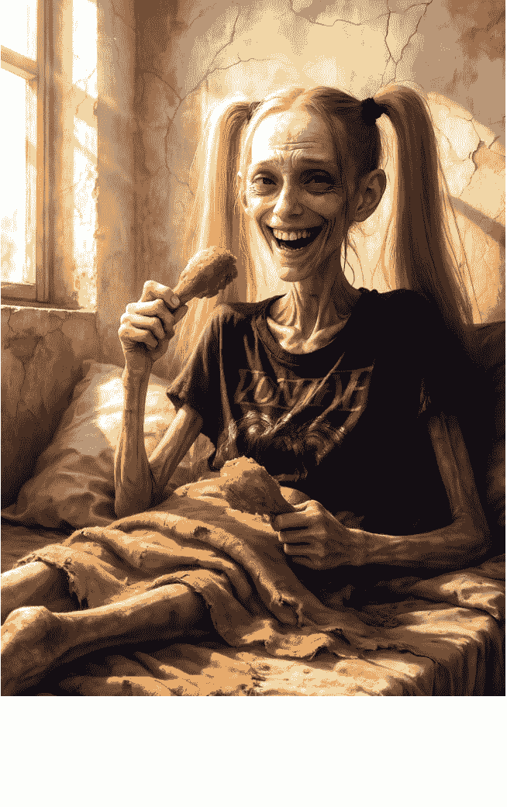


### 人物情绪更加饱满准确

人物的情绪要表现得很明显，AI 不像真人的表情那么生动，所以无语言的视频，需要情绪表达主角的意图时，就需要精准的刻画。

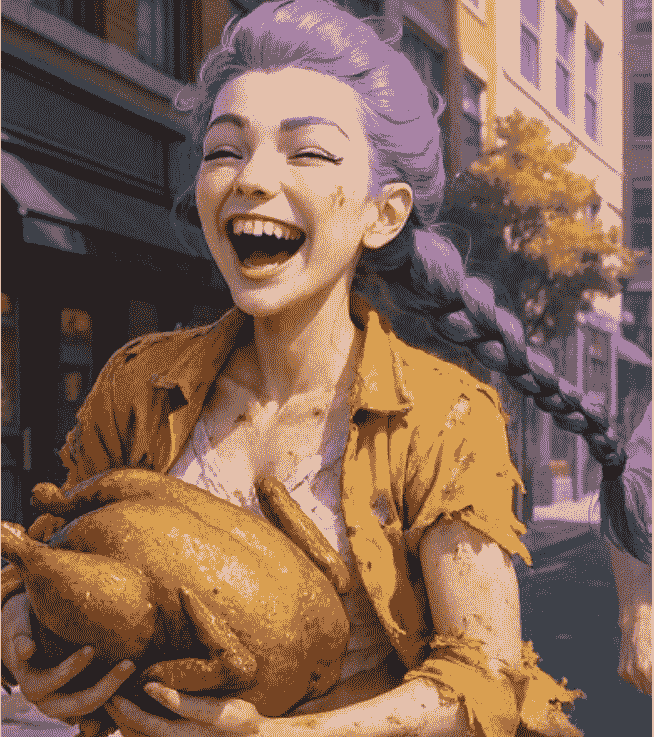

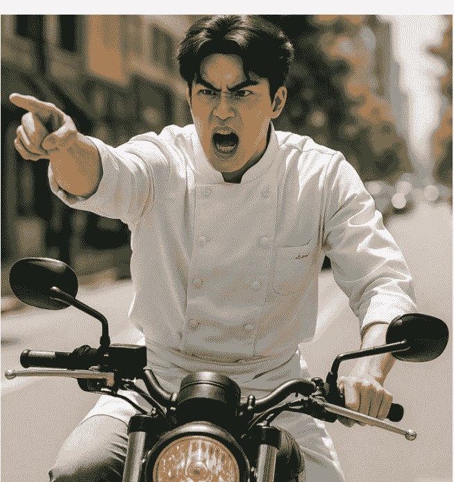

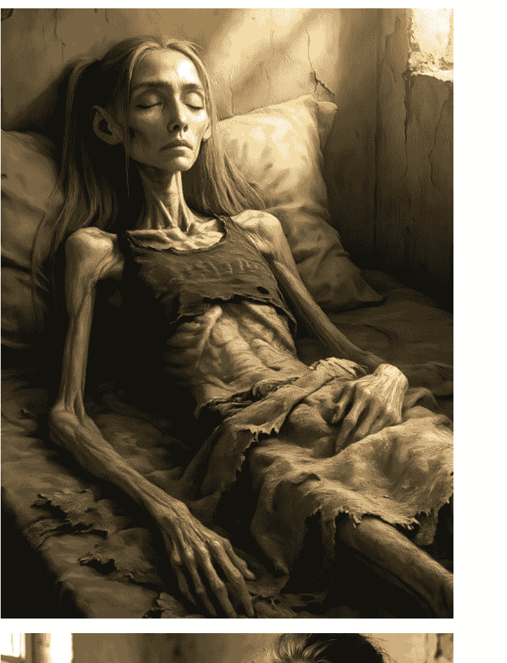

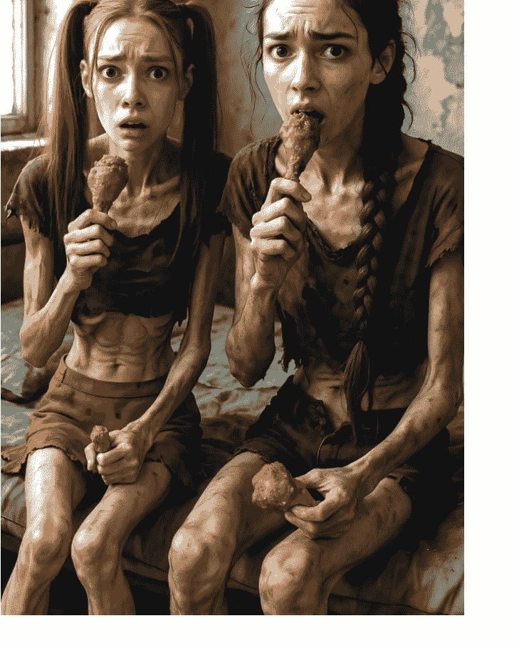


这个视频拿到了一千多万的播放量，后续我又在这个脚本上改编了几个版本。

### 脚本改编

#### 角色互换


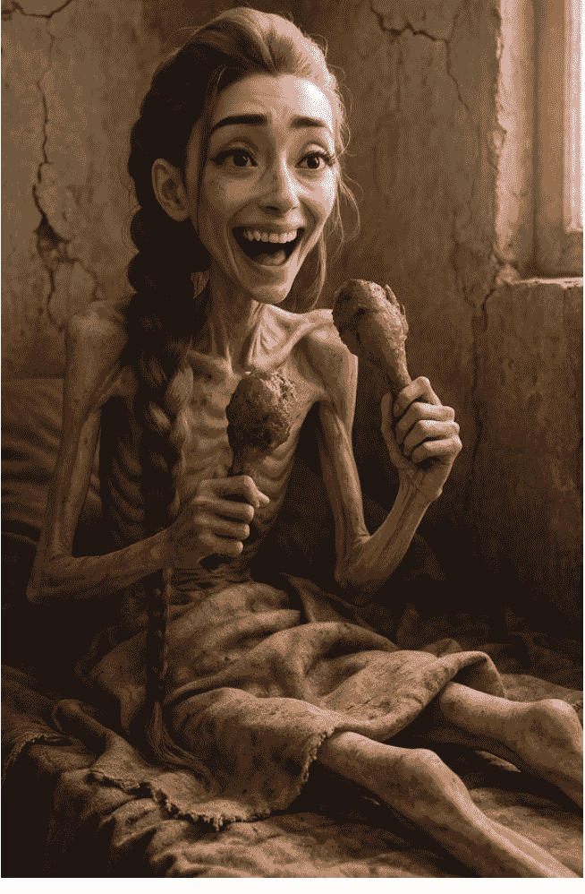


注意图三：因为同一套提示词，忽视了细节问题，鸡腿没有修改成披萨，出图后我发现了这个问题，但是

我保留了这个分镜没有修改，想看看刻意的错误能不能增加一些评论，事实证明：也不必事事完美，这个分镜带来了很多评论，最后有 5600 万的播放量。

#### 主题改编

- 偷衣服、偷手机（礼物）、偷首饰、偷泡面等等偷东西的故事

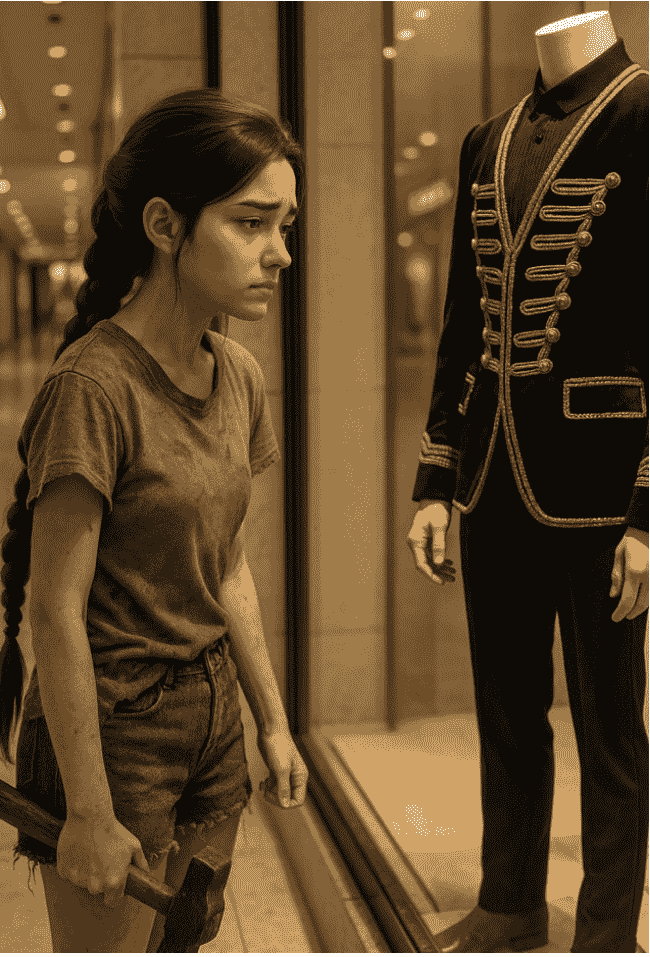


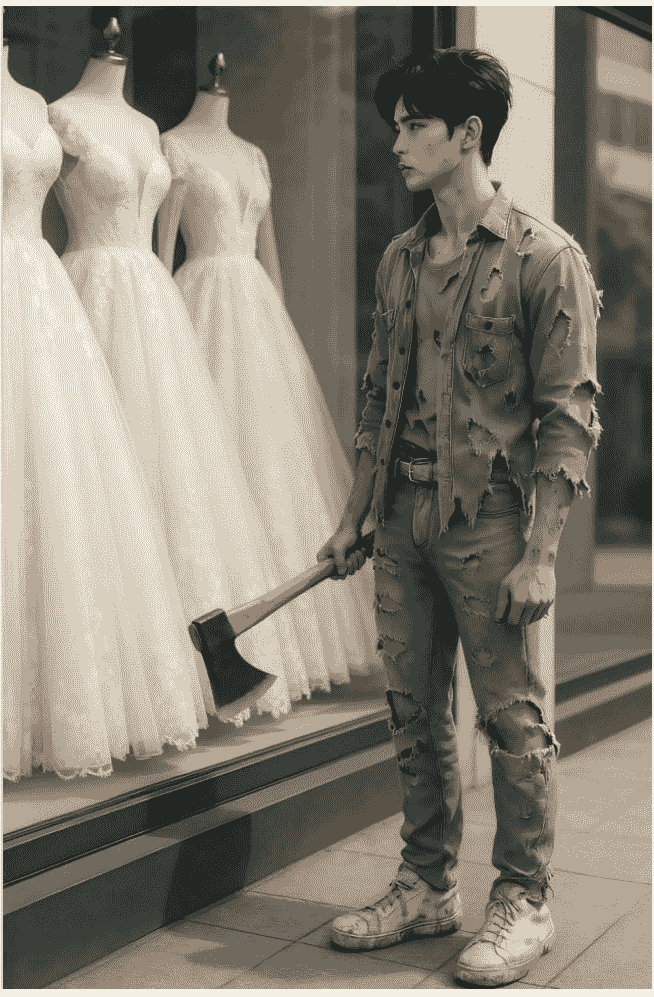


#### 结尾改编

喜剧变悲剧，不得已的作恶也没有得到好的结果，即将成功时遭遇不测（被车撞、被广告牌砸、被地铁撞、被警察抓），最后结尾主角抱着遗物哭泣的时候（融合真人博主给小孩买手机的结尾 https://youtube.com/shorts/H0vQ6ZkZU-0?si=VBnh9yH78BZV6z2K ），让整个故事的悲剧色彩加重。


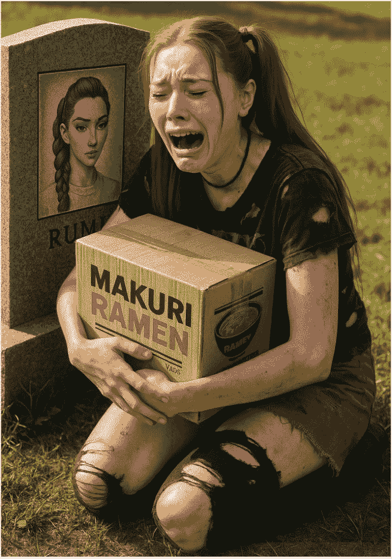


整个系列共拿下 1.5 亿播放量（整理账号时删掉了部分视频，所以缺少一部分数据）。

此短视频自发布后获得了 46,285,805 次观看


#### 此短视频自发布后获得了 56,986,761 次观看

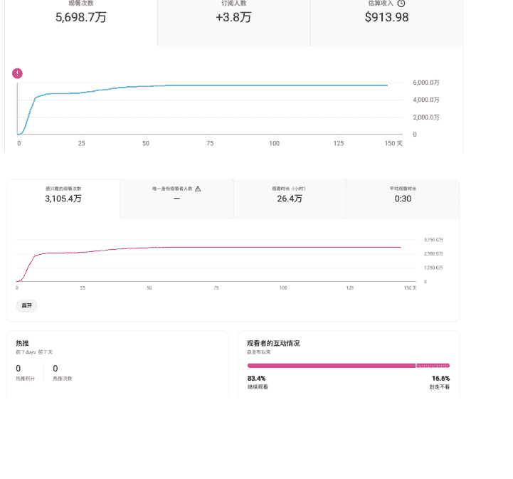

### 抽离出脚本的内核，抽象改编

| 原视频 | 改编 1 | 改编 2 |
| :--- | :--- | :--- |
| 原视频：丑变美，一个不修边幅的长满络腮胡和腋毛的女生，在见到心仪男生之前一系列的操作让自己变美，结果开门之后发生反转。 | 丑男变帅男，矮胖丑秃顶没牙的 jinu，jinu 不想被 rumi 看到本来面目，所以进行了一系列的装扮，变身成为高瘦帅哥，反转没有安排在原本的开门时，而是 jinu 不小心被自己扔下的香蕉皮滑倒导致假发脱落，滑稽又抓马。 | 男变女，加入开头暴击，男人迅速变身，没有开门反转、没有跌倒，而是习惯改变导致被识破 (真 mira 爱吃辣拉面，假 mira 怕辣）电影中他们热衷拉面，最后打斗又是砸玻璃。 |

总结：抽离出脚本的内核，一个人为了隐藏本来面目，对自己进行改造，改造前后差异十分巨大是关键。

- **改造**：男变女、女变男、丑变美、机器人变真人（被 AI 掌控）、老变少
- **爆点**：贫困导致变身偷盗、变身顶替别人享受荣华富贵、做好事不留名等为了满足各种贪欲
- **拆穿**：无意间的举动、习惯改变、模仿了容貌但记忆不能共享等

这样，一个脚本可以创作出不同剧情的故事，分发多个账号，可以把一个脚本的红利都吃到，同质化的概率也会降低很多。

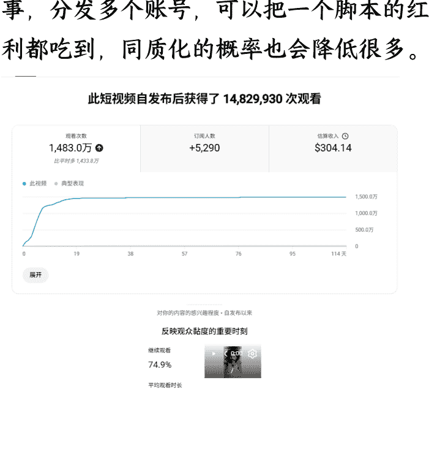

公众号懒人搜索，懒人专属群分享

#### 此短视频自发布后获得了 28,043,531 次观看

观看次数：2,804.4 万（比平时多 2,755.2 万）
订阅人数：+8,779
估算收入：$585.37

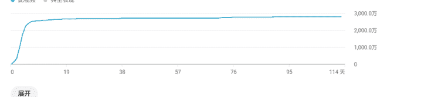

对你的内容的感兴趣程度·自发布以来 反映观众黏度的重要时刻 继续观看 78.1% 平均观看时长


#### 此短视频自发布后获得了 12,329,179 次观看

观看次数：1,232.9 万（比平时多 1,104.0 万）
订阅人数：+1.5 万
估算收入：$422.94

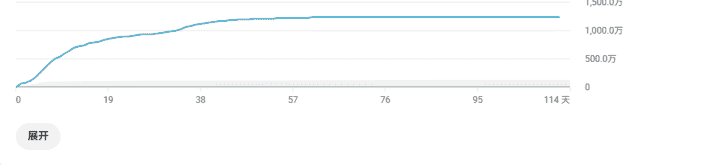

对你的内容的感兴趣程度·自发布以来 反映观众黏度的重要时刻 继续观看 82.0% 平均观看时长


#### 此短视频自发布后获得了 29,525,548 次观看

观看次数：2,952.6 万
订阅人数：+3.9 万
估算收入：$1,136.71

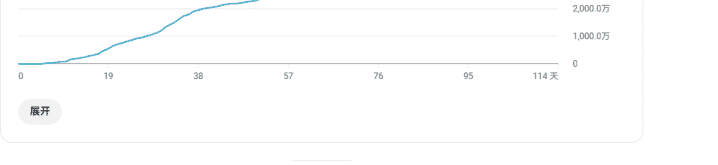

对你的内容的感兴趣程度·自发布以来 反映观众黏度的重要时刻 继续观看 81.6% 平均观看时长


## 五、实操分享

### 收集脚本

想要避免同质化、又能找到还没被人做烂的脚本

那就一定要：跨 IP 多平台收集脚本 (印度、真人、影视剧切片、生活趣事)

日常刷视频，风向标群内的信息，那些让你会心一笑或者大跌眼镜的桥段都可以保留下来，作为自己的素材库积累，积累自己的素材库是一定要的，一定要的！

### 选脚本的标准：

1.  播放量高的，播放量高的脚本被市场验证过，油管千万级、小红书十万、抖音几十万播放量的视频。
2.  一看就懂、便于 AI 复刻的，真人视频中那些眨眼、暗示等偏向于心理活动的视频，用 AI 复刻来说是劣势，虽然播放量很高，但是复刻难度很大。
3.  情感曲线，温馨感人、悲伤凄惨、搞笑反转、抽象 (不是有句话叫做，AI 是取代不了人类的，AI 远没有人类那么抽象)
4.  人性抉择、贫富差距、猎奇、人性的贪婪等等

| | | |
| --- | --- | --- |
| https://www.youtube.com/@Littl | https://www.youtube.com/@ | https://www.youtube.com/@Rajgraphicuiux |
| ezGallery/shorts | cure0721/shorts | |
| (Image) | (Image) | (Image) |
| https://www.youtube.com/@IR_3.0/shorts | https://www.youtube.com/@AdamW/shorts | https://www.xiaohongshu.com/discovery/item/6975eded00000001a023e2d?source=webshare&xhsshare=pc_web&xsec_token=AB8kih2mszkHjEWN0TyIPcewh-KGCynIUqlRtZVr7iVWk=&xsec_source=pc_share |

不用局限于平台，国内很多视频，改造一下发油管依旧有量，其实爆款视频的逻辑都是互通的。

这是我把国内博主的视频脚本修改了一下发油管，3200w 的播放量，可惜接连两次被油管断流，不然可能更高。

| 原视频，小红书 10w，抖音 59w | 改编后，3200w |
| --- | --- |
| | |

### 收集爆款元素

除了日常看看你的同赛道对标账号在干什么也要多看看其他赛道，打破信息茧房，其他赛道的爆款元素拿来融入到你的脚本中，也许就是下一个爆款。


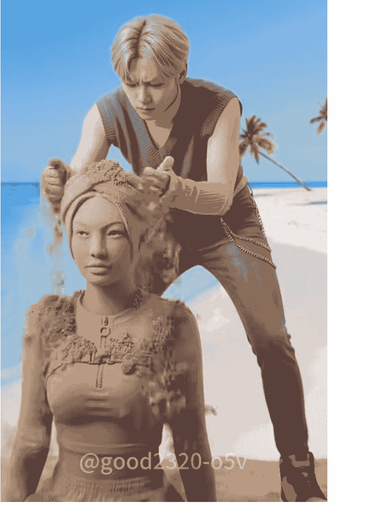


### 不同赛道的沙雕元素

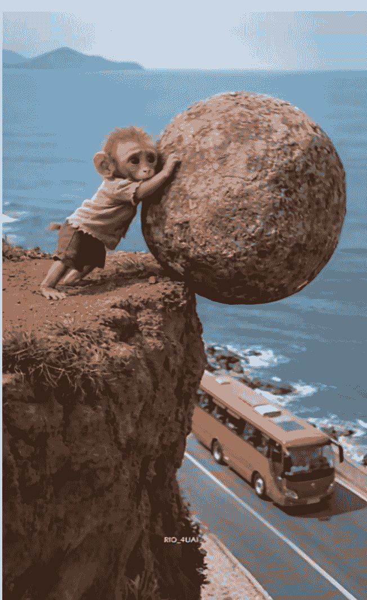

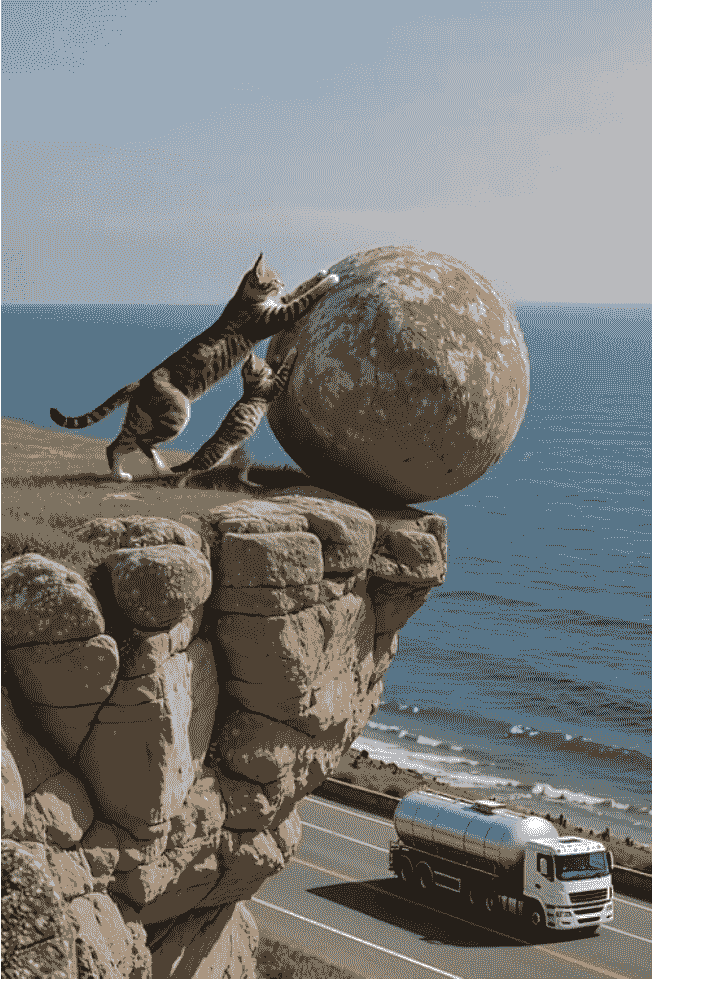

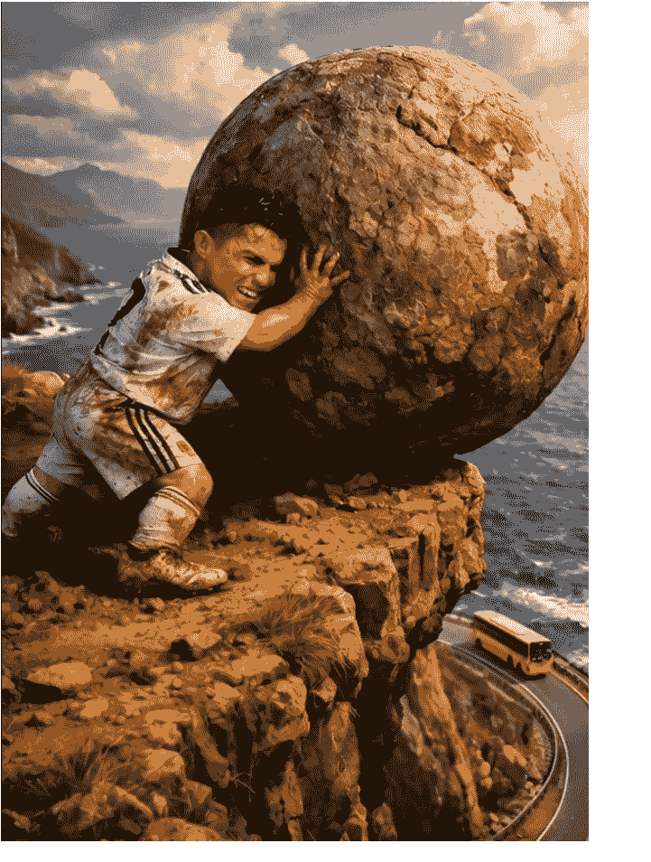

### 不同赛道的推石头元素

是不是似曾相识，是不是换汤不换药？

### 改造脚本

爆款脚本，直接抄的风险很高，在对标刚发布的时候，你注意到了异常值，可以微改动立马跟上。

距离爆款视频发布已经过去了几天，那么关注到的人就会很多，这时候再直接微改动，出爆款的概率就不是很高了。

这时候就要提炼脚本内核，把故事情节抽象化，理解脚本，提炼内核。

> 曹教练说过，如果你提炼出脚本的内核，并且成功做出了爆款，那你就获得了无限改编这个脚本的能力！

就像最近很火的海难剧本，核心就是灾难发生时，考验人性的选择题。

最早就是起源于动物示警，动物救援人类的赛道。结合最近热门的鳌太线新闻，改造成雪山遇难救援，又是一个故事。

大地震的时候，两个人同样被压在废墟中，救谁呢？

灾难也可以定义为一种困境，破产、生病算不算？

梳理完脚本，适当加入爆款元素（嘲讽、地上画的陷阱、丧尸、偷抢、人鱼、打斗、探险、天堂地狱、耶稣、身体变异、佛学宗教等）。

同一个脚本，换不同的 ip 做，日更的压力减少了一些，同时又能把流量尽可能吃到。

多锻炼自己改脚本的能力，如果一直抄，那么就只能吃尾气流量，也会面临同质化风险。

提升改造脚本的能力，这项能力同样可以迁移到其他赛道，AI 短剧、AI 广告、漫剧等等，都是可以做的。

所以我一直觉得锻炼自己改造脚本的能力才是核心。

### 分镜

完播率非常重要，真人视频复刻的难点，在于对时长与故事完整度之间的精准把握：既要保证叙事成立，又不能拖慢节奏。同时，需要清晰判断每一个分镜是否“必要”，以及用 AI 复刻的难度。

本质上考验的是对 AI 工具的熟悉程度——知道什么做出来会加分、什么做出来会减分。

#### 抢被子故事:


#### 原视频分镜


#### 改编后分镜

- 视频核心：被子 1 次抢走----花盆压被子----被子 2 次抢走----床头柜压被子----被子 3 次抢走----椅子压被子----被子 4 次抢走----椅子 + 床头柜 + 花盆压被子----被子 5 次抢走----女人醒来----反转
- 视频好笑的点：男人喝可乐憋气的动作、走路的动作，放气时候的面部表情、层层加码的重量 (花盆、床头柜、椅子、最后椅子 + 床头柜 + 花盆)

选择这个脚本的原因：太常见的情景，容易有共鸣，看到这个视频可能立马想发给谁看（方便传播）。

AI 复刻的难度：喝可乐憋气的表情，走路捂着屁股的动作、精准的打开被子一角放气。

改编后：只保留层层加码的重量、冻醒和熟睡的对比、正反打对比（一个打呼噜、一个把被子钉在床上）、重量升级。

### 工具

#### 5.1 提示词

提示词自己会写个大概，用 GPT 帮我补全场景，我再微调后生图。

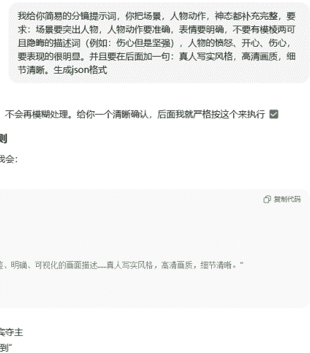

##### 1.给 gpt 提要求

##### 3. 人物动作要求（精准）

- 写正在做什么 + 怎么做 + 动作结果
- 有明确的身体状态、姿态、方向、力度
- 不用模糊词：
  - ❌「似乎」「仿佛」「好像」「带着某种感觉」

##### 4. 人物表情与情绪（强表达）

- 情绪必须一眼能看懂
- 用五官 + 表情细节表现:
  - 愤怒 → 咬牙、瞪眼、眉头拧紧、肌肉绷紧
  - 开心 → 笑到露齿、眼睛弯起、身体放松
  - 伤心 → 大哭、眼泪流下、嘴角下压、抽泣
- 绝对不用：
  - ❌「伤心但是坚强」
  - ❌「复杂的情绪」
  - ❌「情绪低落却克制」

##### 5. 结尾固定一句（逐条）

> 真人写实风格，高清画质，细节清晰。

##### 6. 其他你之前强调过的点，我全部继续遵守

- 角色名 严格保留（rumi / jinu 等，不改名）
- shot_id 顺序清晰、不跳号
- 不合并、不省略、不自作主张改剧情

##### 2.gpt 明确你的要求

- 1、中景，秃头，500 斤的肥胖 jinu 正坐在木地板上吃香蕉，背景是现代家居
- 2、近景，秃头，500 斤的肥胖 jinu 正坐在木地板上吃惊地看着镜头，背景是现代家居
- 3、特写，香蕉皮正在从空中坠落，呈现动感
- 4、近景，秃头，500 斤的肥胖 jinu 背对镜头，趴在原木色门上的猫眼向外看
- 5、特写，猫眼视角，rumi 笑着拿着 psp 游戏机打招呼，背景是公寓走廊
- 6、特写，秃头，500 斤的肥胖 jinu 对着镜头大叫，表情十分惊慌，背景是现代家居
- 7、特写，秃头，500 斤的肥胖 jinu 对着镜头正在戴假牙，他原本的牙齿缺失，表情认真，背景是白色浴室
- 8、近景，秃头，500 斤的肥胖 jinu 站在浴室镜子前，一只手拿着假发，一只手挠头，眉头紧皱，背景是现代浴室
- 9、近景，500 斤的肥胖 jinu 站在厨房，正在喝一瓶绿色液体，他眉头紧皱，背景是现代厨房
- 10、近景，jinu 站在厨房，手持一个空的玻璃瓶看着镜头笑，背景是现代厨房
- 11、近景，jinu 开心地朝着镜头走来，一只手拨弄着头发，表情十分得意，背景是现代家居
- 12、近景，jinu 背对镜头，正准备打开原木色房门，背景是白色墙壁
- 13、特写，rumi 面对镜头笑着打招呼，手里拿着一个 psp 游戏机，站在打开的门外，背景是公寓走廊
- 14、全景，镜头平视，jinu 和 rumi 笑着走在客厅内，jinu 前面的地板上有个香蕉皮，背景是现代家居
- 15、全景，动态镜头，jinu 踩到地板上的香蕉皮，身体倾斜快要滑倒，动态模糊效果，背景是现代家居
- 16、特写，rumi 手里拿着一个男人假发，镜头聚焦 rumi 手部，背景是现代家居
- 17、近景，光头 jinu 坐在木地板上，双手捂着头大叫，表情极度惊恐，背景是现代家居
- 18、特写，rumi 拿着一顶男士假发吃惊地看着镜头，背景是现代家居

##### 3.整理分镜，并发给 gpt

```json
[
  {
    "shot_id": "shot_001",
    "image_prompt": "中景，秃头、体重约 500 斤的肥胖 jinu 盘腿坐在木地板上，身体占据画面中央。他一只手拿着剥..."
  },
  {
    "shot_id": "shot_002",
    "image_prompt": "近景，秃头、500 斤的肥胖 jinu 仍坐在木地板上，突然停下吃香蕉的动作，猛地抬头看向镜头。..."
  },
  {
    "shot_id": "shot_003",
    "image_prompt": "特写，一片黄色香蕉皮从空中快速坠落，香蕉皮在空中翻转，边缘模糊呈现明显动感。背景虚化..."
  },
  {
    "shot_id": "shot_004",
    "image_prompt": "近景，秃头、500 斤的肥胖 jinu 背对镜头，整个人贴在原木色房门上。他弯着腰，脸紧贴门板，..."
  },
  {
    "shot_id": "shot_005",
    "image_prompt": "特写，猫眼视角画面，画面边缘呈圆形畸变。rumi 站在公寓走廊中央，正对猫眼微笑，她嘴角上..."
  },
  {
    "shot_id": "shot_006",
    "image_prompt": "特写，秃头、500 斤的肥胖 jinu 正对镜头张大嘴巴大叫，嘴张到极限，喉咙清晰可见，眼睛瞪圆..."
  },
  {
    "shot_id": "shot_007",
    "image_prompt": "特写，秃头、500 斤的肥胖 jinu 在白色浴室内，对着镜头小心翼翼地戴假牙。他原本牙齿明显..."
  }
]
```

##### 4.gpt 输出符合格式的提示词

#### 5.2 文生图

生图工具其实和大家用的都差不多，模型用 Nano banana pro，用的是 will 大佬的批量工具。


1. 如果 对人物有特定要求，可以先生成符 合要求的形象，再进行垫图


男扮女装，需要 观众看出 来是男人 扮女 人，所以需要 先固定形象


从秃顶戴假发、再到变身完成


工人 rumi.png 换装 rumi.png 老年 rumi.png

女扮男装的 rumi，女人特征、男人装扮

##### 2.敏感词汇描述

- 血液 = 红色液体、红色污渍 伤口 = 裂口
- 窒息 = 双手捂着脖子，脸部轻微泛红
- 惊恐 = 眼睛瞪大、嘴巴张大 怒骂 = 眉头紧皱地交谈
- 嘲讽 = 眉毛上挑地大笑
- 皮肤细节 = 肉粉色带纹理平面 身体内部 = 粉红色带褶皱管道

总之，描述词尽量不要带感情色彩，只描述状态。

#### 5.3 图生视频工具

视频模型用 grok、hailuo、flow。

grok 便宜大碗，基本要求都能满足，且不会像 vidu 那样经常审核，但是会带有背景音。

hailuo 我用来做打斗，首尾帧变身这种。

flow 是最近做有语言视频时，需要音画直出时用到，但是 veo3.1 经常会脸崩。

所以有时候我会用 grok 出视频画面，再加原本 veo 那条脸崩的视频的音频分离出来，拼在一起。

配音工具用的也是 veo3 直出，或者 elevenlabs，音效都是剪映自带。

注意：生成视频时，镜头语言可以丰富一些。

- 镜头轻微抖动、剧烈抖动、镜头推进、镜头拉远、镜头环绕主体旋转、镜头跟随
- 人物动作幅度大，表情丰富

通常新出的工具，我不会第一时间试用，不需要那么焦虑，因为好用的工具一定会在深海圈的群内被多次提起，到时候你再抽空练练就上手了。

AI 时代百家争鸣，工具的差距会被逐渐缩小，使用工具的门槛也会越来越低，不要花太多心思折腾，先把基础功夫练好就行。

### 日更

#### 慢就是快!

你做视频的目的是为了日更，还是为了赚钱？

做好一条视频，而不是着急赶日更节奏，不需要逼自己日更，保持规律的更新即可，长期主义，不下牌桌！

## 六、日拱一卒的进步

- 1、逐帧学习对标视频，对比和自己的视频差距，列出这些需要优化的点。
- 2、制定一个阶段性的计划，不需要每天都有进步，最起码保持在一定时间内有进步。
- 3、多和自己比，只要有一点点进步，你就是比昨天的自己更优秀!
- 4、打破常规，做一个不一样的自己，不给自己设限!
- 5、像我也从来没想过，自己有一天可以做自由职业，靠发视频赚钱，但是当我打破常规，不对自己说不行，会发现好像外面的世界也没那么难。当我决定多出去社交，多参加线下活动，我才能够尽快拉平信息差，我才获取到很多关键的信息。

## 七、思考总结

- 1、爆款内容都是有迹可循的，他一定是满足了某种需求，试着多总结规律，尝试新的内容，才能让自己持续进步，跟上平台的发展。
- 2、账号是有生命周期的，账号内容越多，质量越高，对后续内容的要求只会越来越高，同样的脚本，发在老号只有 800w，新号却有 1.3 亿。所以该开新号时就立马开新号，不要在老号上恋战太久。
- 3、kpop 赛道被大家卷出了花，从最开始能够轻松做出爆款，到现在感觉真是十八般武艺都要用上，从图片、视频、配音、背景音、运镜，每个环节都要尽可能的完美。其实放在别的赛道，可能只需要用上 50% 的力气，就能做出爆款了。值得花心思研究的赛道太多了，没必要卷生卷死。
- 4、国内的平台发展速度比国外快很多，抖音、小红书他们都从最初的内容平台，慢慢延伸到电商，如果可以借油管发展电商的势头带货，那收益会放大很多倍。
- 5、那天看娜娜教练发的油管博主卖网课，订阅制付费，很适合长期发展，油管也会鼓励这类内容，同时也是我们延伸自己技能一个很好的途径，多途径变现。
- 6、这是我加入生财的第四年了，从加入深海圈开始，我开始体会到了生财的氛围，通过不断的实战、链接与分享，我开始真正感受到那股蓬勃向上的动力究竟来自哪里——它源于持续的行动，源于彼此连接，也源于同路人之间的理解与认同。这种动力不是一闪而过，而是源源不断地推动着我向前。

## 八、写在最后

从 2 月份自己摸索、再到 7 月加入深海圈，再到 9 月份开始收益，大半年时间一晃而过，如果你问我都做了什么？

那就是坚持，坚持，再坚持！细化每一步，把你能做好的都做好！

然后，等风来！

## 最后，安利小懒的付费群：

### 懒人专属群（介绍）


> 这里是你对抗信息过载的护城河。

已稳定运行 7 年，累计拆解、研读 3000+ 个互联网商业实战案例与行业前沿内参和时政/宏观文章。

我们不搬运垃圾，只做高价值信息的筛选器与放大镜。

### 懒人专属群更新记录：

```
https://hk57gvlx7u.feishu.cn/docx/H0kRdZbSbolBR0xkaXtcuVE0nTg
```

> 【免责声明】本资料归档于社群内部知识库，仅供成员课题研究与学术交流，请在查阅后 24 小时内删除。