# 从焦虑的想去上班，到稳定月入 5w，我用 SOP 找到了创业的确定感 (附垂直小号 SOP

260210 副业 SC 精华

公众号懒人搜索，懒人专属群独享

懒人微信:lazyhelper1


圈友们好呀，见字如面。

我是枕棠，04 年，也是生财三年级生。

从 19 岁开始知识付费创业，过去的两年多里，我时常陷入创业的焦虑和不确定感中，天天数据焦虑，担心公域获客，担心转化收入，经常担心吃了没下顿，要回去痛苦的上班了。

直到最近，我通过深耕垂直小号，每天精准获客加微信 5~10 人，获得了流量上的确定感。

我的收入从 10w+到 20w+再到今年的 30w+，年均 75%增长，2026 年我知道一定能赚到人生第一个一百万。


( ps: 附部分图片，以保证我讲的都是真话哈哈 )

这篇就要和大家分享一下这背后的底层原理，以及垂直小号的 SOP。

全文共分为三大板块：

### 第一板块：

会讨论一下创业为什么容易如此不确定，和大家聊聊我是如何在知识付费的定位和产品上找到确定感，而后构建群发售转化 SOP，每月收入 3~5w 的，我是如何构建垂直小号 SOP，日均引流 5~10 人的。

并且会和大家拆解一下，SOP 到底是什么，项目稳定和放大的必经之路就是沉淀 SOP。

### 第二板块：

会和大家分享一下关于垂直小号的核心认知，从不重视公众号到意外跑通引流再到构建完整的认知稳定获客，以及很多 10w+赚不到钱，但是 500 的阅读量却能赚到很多钱，背后的原因是否精准引流。以及垂直小号垂直的从来不是赛道，而是人群。

### 第三板块：

就是垂直小号完整的 SOP。

从选题的寻找，到选题库的搭建，以及如何抉择能爆款的选题，再到正文的撰写方案，如何提高点击率做封面和标题，如何写好开头，完读率，每一个细节都会聊到。

大家可以挑选对自己有帮助的进行阅读，当然会更建议完整阅读，收获会更大哈哈。

## 一。如何获得创业的确定感。

### 1.为什么个人 ip 创业收入不稳定？

我们生财里总能看到很多厉害的片段：

- “我一周出了 1000 单。”
- “我创业第一年赚了多少万。”
- “某个品一上线就爆了。”

这些大概率都是真的，但也大概率都是片面的真话。

他们只告诉你一周出了 1000 单，但她不会说除了这一周外，每周只能出 100 单。

他们会告诉你创业第一年赚了多少万，但他不会说出道即是巅峰，后面收入稳步下跌。

再或者说，大家能够看到我发在生财的第一篇帖子是 19 岁就能够月入 5w。

但我没有告诉你的是，我那次月入 5w，前后的 3 个月收入都在 1w 以下。

事实上，当我聊了很多已经完成项目 0~1 的朋友之后，发现大家在创业的初期都会遇到一个尴尬的问题：

**收入都是不稳定的，要反复的 0~1 做很多项目。**

而这会是一个非常痛苦的现状，因为不稳定，我们不能去放大。

因为没有稳定的现金流，我们不能稳定创业，甚至要去上班。

于是过去的很长一段时间，我都在思考一个问题：

### **收入不稳定到底是为什么？**

经过长久的研究，其他领域不知道，但个人 ip 知识付费领域收入不稳定，那大概率是因为这四个原因：

- 1.定位不笃定。不知道自己要做什么样的人群的生意，不知道自己要满足那些核心需求，各个类型的产品都做，而且并不觉得自己做的事情有长期的价值，天天内耗焦虑。
- 2.产品不确定。无自己的产品体系，以分销别人的产品为生，哪怕自己有产品，但非常快速被淘汰，或者至少并不觉得自己的产品有长期价值。
- 3.流量不稳定。小红书，公众号，混圈每天都在做，但引流不稳定，有时候有，有时候没有，天天数据焦虑。
- 4.转化不固定。每天都在看感觉写朋友圈，直播，私聊。卖的手感好的时候能卖很多单，手感不好了，连续一个月空军。

说白了，如果做知识付费想要收入稳定，需要这四个东西：

命中天选的定位，持续卖座的产品，源源不断的获客，稳定转化的模式。

1、2 如果不确定的话，其实还好，凑合凑合还有钱赚。

但是 3、4 如果不确定的话，那将会是一场灾难，

因为你可能有的时候能赚好几万，有的时候却只能赚几千块。

每次收入下滑只能赚几千块的时候，都会特别痛苦，

你说我放弃创业去上班吧？我曾经也赚到过钱。

你说我全职创业吧，我又会担心我一直只赚几千块，最后不小心被饿死。

这种不上不下，恍恍惚惚的状态是最折磨人的，我曾经深受其害，为此疯狂而焦虑。

好在我后来找到了答案，找到了一定程度上，商业的确定性。

接下来和大家分享一下，我找到创业确定感的故事。

### 2.我找到确定性的故事

#### (1)关于定位：

在我做自媒体前两年的时间，时常会担心自己不再被粉丝喜欢和认可。

一个前辈和我说过的一段话，更是像梦魇一样绕在我心头：

> “你一定要尽可能考研保研，保持学生身份，你才能继续做现在这个盘子。
> 一旦你不是大学生了，现在的整个基本盘就会全面崩塌”

但因为自己职业发展的需求，实在不想读研，出来工作创业了。

奇怪的是，我的自媒体不仅没有退步，反而越做越好了。

我才发现，ip 身份与定位的关系似乎不大。

真正决定你能不能做这个群体生意的，不是你是谁，是什么身份。

而是你能否持续输出垂直内容，以及你是否清楚他们的核心需求，能给到解决方案。

就像我有很多做高考的朋友，他们有的是大学生，有的是从业十几年的名师，都可以做的很大，无非就是在人设的包装上打一些差异化而已，有的是老教师，有的是学长，有的是清北，有的是 211。

于是我明白了，

**陪年轻人成长搞钱这件事情，我可以一直做下去。**

因为我很清楚年轻人会遇到什么卡点什么问题，

我知道他们会焦虑职业发展，会在水课上感到无助，会担心毕业即被淘汰，

会想在大学做到自律无比，会想要做自媒体实现经济独立，而他们需要的问题我都有完整的解决方案。

所以哪怕我已经 30 岁了，只要我依旧在输出内容，我能够帮他们解决问题，那我就可以继续做下去。

于是我逐渐找到了定位上的的确定感，陪年轻人成长搞钱这件事情，我至少还可以再做 4 年。

#### (2)关于产品：

解决了定位上的确定性后，接下来是产品。

事实上，自开始做自媒体之后，我做很多种模式。

包括但不限于常见的年度社群，读书打卡营，自习监督营，商业主题训练营，AI 信息分享营。

最后我发现：

对超级个体来说，不断做不同训练营、做多个产品，本质是在浪费资源。

因为你要反复准备交付物料、反复投入运营成本、反复思考不同产品卖点。

这些东西都会消耗很多的精力，而且谁都无法保证下一个产品会卖的很好。

那些不断出新品的人，本质上是没有持续获取新流量的能力，只能对有限的私域进行无限的收割行为，等到信任完全耗尽，也就到了他们退圈的时间了。

于是到了此处，综合考量我的时间，

我的目标已经不是做一个畅销品了，而是做一个长销品，以保证只要我的流量和转化 OK，产品的收益和交付一定是稳定的。

最后思考下来，我觉得有两个产品是符合我的需求：

**轻运营录播课**：边际成本很低，而且不需要重复去做物料，只需要的单纯的去卖就好了，大约一年出一款王牌新课。

**年度私教**：客单价较高，而且能够让我深度的接触学员，了解需求保持对市场的敏锐，以及可以不断的带出超级案例，为我的 ip 赋能。

于是做了这两个产品后，的确实现了我理想中的构思，可以持续的去卖他们，依旧有一个不错的收入。

于是到了这里，我实现了产品的确定性。

当我做到这一点的时候，时间大约是在 2025 年 6 月，我本科毕业前夕。

但这个时候我陷入了一个更大的困境，定位和产品确定了，最多一年调整一次就好。

但是我的**流量和转化**依旧很不稳定。

而且这两个不像产品和定位一样，确定了可以吃一年。

他们需要一直做，获客和转化每个月都不能停。

于是我为此焦虑了很久，直到我接触到了一个东西：

SOP

#### ( 3 ) 关于转化

关于转化，本质上就是做内容，

也就是写文案，朋友圈，公众号，发售都是文案。

在我创业的前两年，我写文案，几乎全是靠灵感，想到哪写到哪，

如果遇到卡点了，就去翻翻同行的文案，然后就瞬间思如泉涌了。

看起来似乎挺美好的，一个年轻人靠自己的灵感和灵气来创作，对嘛？

但实际上挺折磨的，

因为读的是 985 工科，所以每年期末的时候，我都会有两个月非常之忙碌，忙碌到没有时间去干任何自媒体相关的事情。

于是乎，每次期末月结束后的时候，我都会陷入一种非常尴尬的状态：

> “我的网感似乎完全消失了，写文章没有手感了，感觉不知道怎么写，也不知道怎么卖了......"

以及当我在上班压制灵性，或者因为身体不舒服陷入脑雾的时候，我也就更加无法写内容了。

所以就造成了一个非常尴尬的局面：

我的产出非常看身体的状态，只要状态一差，内容就写不出来，转化就几乎归零。

而一旦没有灵感，不管是朋友圈，公众号，还是直播全都停了下来。

直到我打磨出了一个东西：公开课 SOP。

简单来说就是：用群聊直播的形式，集中所有卖点，短时间内批量成交。

(ps：其实生财的 3 天体验营也是类似的模式)

### 简单的 SOP 分为三个板块：

- 筹备期 (4~7 天)：确定此次公开课的主题，要发售的产品卖点内测，集中发文 or 联系 kol 解决流量问题。
- 拉群期 (4~7 天)：制作公开课海报，建立公开课群，写群公告，开始裂变，
- 发售期 (4~7 天)：进行直播课，进行嘉宾连麦和学员连麦，进行追单。

当我把“转化动作”集中化、流程化以后，我终于跑通一个相对稳定的模型：

每个月做一场直播 + 集中转化一周，就能完成月销 3~5w。

#### (4)关于流量

不瞒你说，其实自媒体的整个闭环，我最弱的就是流量。

之前很长一段时间，我做公域流量都是三天打鱼两天晒网，直到今年的 5 月，意识到自己必须要补足这个短板，才开始用心去做，

虽说也写出了多篇的爆款，但在这个过程中，我感知到公域是一个更大黑盒。

你可能会遇到下面的这几种情况。

- •你能模仿爆款，不一定能写出爆款。
- •你能写出爆款，不一定能持续出爆款。
- •你能持续出爆款，不一定能精准引流。
- •你能稳定精准引流，说不定犯错账号直接封掉。

为什么我能写出这么长的一段押韵的小句子呢，当然是因为上面的每一个我都经历过喽。

写过 10w+爆款但一毛钱没赚到；连续爆了几篇但引流来的一个都不转化；

好不容易稳定精准引流，一次失误账号直接降权，两个月没流量。

以及最重要的，哪怕能够成功引流，但是更新频率一直上不去。

直到最近做垂直小号的时候，我才清晰的意识到，这一切的问题其实都是因为我没有拆解出一个足够清晰的 SOP。

于是我就搭建了一个稳定的公众号 SOP，每天跟着做，就能稳定的更新。

而这个详情，也就是本文的第三板块。

公众号懒人搜索，懒人专属群分享

## 三。爆款垂直小号 SOP

- 1.搭建选题库
    - (1) 关键词锚定。
    - (2) 寻找爆款。
    - (3) 搭建选题库。
- 2.选题二次筛选
    - (1) 发布时间。
    - (2) 爆款数量。
    - (3) 与我有关。
- 3.正文撰写：结构高于一切
- 4.点击率为王：标题和封面
    - (1) 标题
    - (2) 封面
- 5.完读率：开头 100 字定生死
    - (1) 我说的就是你
    - (2) 我能解决这个问题
    - (3) 下面会很有料。
- 6.合规引流：我曾被限流三个月。
    - (1) 错误的引流方式
    - (2) 正确的引流方式。
- 7.数据复盘，持续迭代。

而后，

因为有了稳定的创作流程，所以我的更新频率上去了。

因为有了稳定的找选题的方法论，所以我的爆款率很高。

因为我的内容有了稳定的模板，所以引流到私域的效率不错。

于是，在我认真写文工作的时候，基本每天都有 5~10 人引流进来。

而后我会持续的写朋友圈和私聊，然后定期按照 SOP 做一次公开课发售。

卖的产品就是我的录播课和陪跑，流量固定，转化率固定，客单价产品固定。

以此就实现了我梦寐以求的商业上的确定性，做到了稳定月入 3~5w。

### 3. SOP：拆解成功的黑盒

所以到了这里，你会发现，我转化和流量的确定性，都是通过 SOP 获得的。

## SOP 到底是什么呢？

学术概念是：Standard Operating Procedure，标准化流程。

## SOP，全称 Standard Operating Procedure，也就是标准化流程。

说白了，就是把一个黑盒的成功过程，拆解为一个个清晰的步骤。

然后把本来要动脑子碰运气的结果，做成跟着做就能实现的傻瓜操作。

这么说可能有点抽象，举几个例子。

我之前经常失眠，总是躺在床上才开始难受和焦虑。于是我搭建了睡眠的 SOP，而后睡眠质量开始稳定。

- 睡眠 SOP：白天运动晒太阳 → 不喝咖啡因饮料 → 晚上准时停工 → 睡前足浴冥想放松 → 稳定时间上床入睡。

或者再比如说，这是我的销售 SOP。


而 SOP 除了拆解黑盒所带来的稳定性外，我确定最重要的一个点是。

**SOP 是可以复用的，因为他的本质是正确决策的沉淀。**

**以往需要反复的思考，现在照着做就能赚钱。**

他不只我们自己可以用，很省心，能够腾出宝贵心力去思考增长。

而且我们还可以把 SOP 给员工，实现增长。

以及还可以给 AI 用，

**AI 的产出具有不稳定性，但如果拆解到一个环节，AI 的产出效果就非常好，**

比如后文 SOP 里有，我用 AI 调研赛道关键词，以及一键公众号文章标题。

事实上，我最早接触到 SOP 是在我本科毕业入职的时候。

作为 AI 产品经理，我每天都要开很多的会，而最重要的一个会就是：

流程优化会，领导带着我们去拆解我们工作的 SOP，然后优化效率，责任到人。

我一开始只是觉得这个流程优化会是真的恶心，

单纯就是为了物化我们，可以压榨我们，让我们离开后，可以直接雇个人就直接来干。

但慢慢的，我和很多年入百万的前辈学习后，我发现，SOP 的意义远远不只于此。

只有当我们站在操盘手的角度去看问题的时候，SOP 的意义才能展现出来。

他会是一个公司最宝贵的资产，只要有了完善的 SOP，投入时间和人力，就能获得稳定的结果产出。

SOP 非常非常非常非常非常重要!

他才是拉开高手和普通人的护城河，是除了认知外最重要的东西。

收购小创业公司，其实就就是为了收购业务模式，就是为了收购他们独有的 SOP。


是突然的恍然大悟，在独角兽公司呆了两周，复盘了两个年入百万的对标账号，才发现了这一点。

Niña 美纳

🌹很好的分享哈哈哈一细品确实（摸下巴）

我才开始重视 SOP。

在 1 月报名了 Mini 航海，许老师又讲了一遍，我才明白。

个人的事业从 1~10，要招人扩增，沉淀 SOP 是不可或缺的一环，

开始用了半个月的时间沉淀了这篇文档，理清整个商业闭环的 SOP，并写下了公众号的 SOP。

ok，第一板块由此结束，接下来是关于垂直小号的部分，

是关于我从公域小白写出多篇爆款，并且稳定精准获客的所有底层认知和 SOP。

enjoy~

## 二.关于垂直小号的底层认知

### 1.为什么是公众号

决定做公众号之前，我们不妨先想清楚一个关键问题：

为什么是公众号，而不是小红书、抖音？

### 一。公众号放开了推荐流量，大多数人还不知道

这两年公众号的推荐流量明显变多了、

可很多人还停留在“只能靠朋友圈转发”的旧认知里，不知道公众号也能被推荐、被陌生人刷到。

这恰恰是机会所在当大多数人还没反应过来时，先跑一步的人，就更容易吃到第一波红利。

微信月活 13 亿，公众号每日阅读人数有 4 亿人，比小红书的月活 (3 亿) 还高。

所以微信公众号自然大有可为，就像 19 年的抖音，22 年的小红书一样。

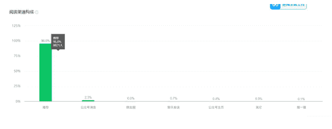

### 二。公众号能够精准引流

除了公域流量的突破，公众号的第二个优势是能实现丝滑引流，

因为公众号和微信是一家公司，天然风控更少。

以及公众号对于 18 岁以上的任何一个群体，都可以实现精准引流。

之前我主要做小红书原因就是，

大家和我说，年轻在小红书，公众号都是老年人。

但我做了公众号后，发现完全不是这样的。

我自己就能通过公众号稳定吸引 18~25 岁的年轻人，每篇文章的引流都很精准。

我身边各个赛道的学员和朋友，不管是高考，副业，还是做求职、情感赛道的，

从 18 岁~50 岁几乎都能在公众号上实现引流转化。

事实上，任何平台都有<u>精准引流和不精准引流</u>两种模式

你吸引到谁，从来不是平台决定的，是内容决定的。

平台只负责把你推给人，而内容，才决定把你推给哪类人。（内容写法后面会讲）


### 2.躬身入局：我与垂直小号的这半年

之前很长一段时间，我都不觉得公众号其实是能引流的，

我做她一直是在把他当做私域在发，我的引流一直是在小红书这种常见的公域平台。

直到 2025 年 4 月，发生了一件很神奇的事情，我的公众号突然有了 1000 多的阅读量。

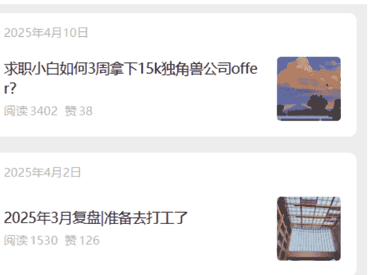

那一刻其实我很是诧异，怎么突然有这么阅读量了，明明我过去的阅读量只有 300 左右，转发最多的时候也只有 500。

然后我一看后台数据，这个推荐流量是什么鬼？奇奇怪怪的

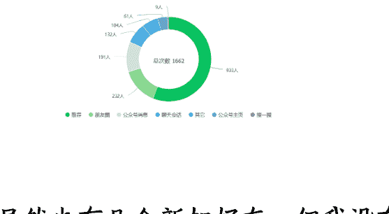

当时虽然也有几个新加好友，但我没有当一回事，就继续去做小红书了。

然后时间来到了 2025 年 6 月，我的本科论文答辩结束，我又写了一篇文章。

2025 年 6 月 12 日

### 我 21 岁毕业、赚了 40w，还是想对大学生说：别退学

阅读 1.3 万 赞 357 1 个朋友赞赏


那一刻的数据跑的有点吓到我了，因为不只是 1w 多的阅读量，引流来了几十个好友，

而且他们见面就买我的课程我的陪跑，一篇文章后端变现了 5000+。

我从来是不相信什么趋势的，直到我亲手验证它。

而经过测试我发现：

一篇公众号的创作时间和小红书图文差不多，但是引流效率却是他的 3 倍。

于是我就马上放弃了小红书，开始全力以赴投入公众号。

我花了上万买了很多公众号的课程，系统的研究了公众号的写法。

终于在 8 月的时候，我掌握了公众号选题和创作的方法论，开始稳定的写出爆款，## 写出了 5w+ 浏览量，实现了单篇引流变现

五位数的壮举。

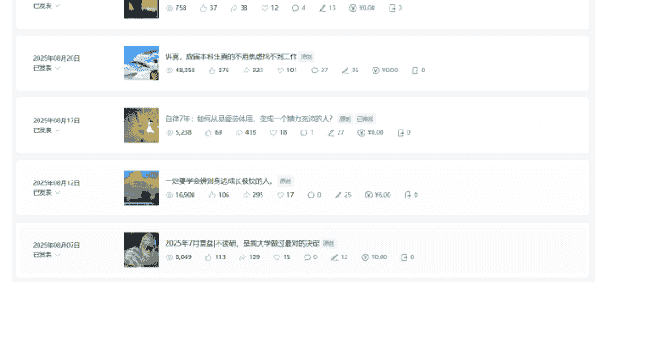

而高峰之后就是低谷，因为我的错误认知，多次违规引流，账号被降权。

于是从 9 月~11 月底，我经历了长达三个月的公众号限流，又一次转战小红书。

整个过程中，我也努力写了很多篇公众号，反复调整排版，标题和内容，但就是不爆，当时焦虑的我都想着回去上班了。

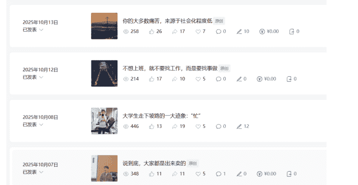

直到 11 月中旬，我总算意识到了限流的原因，而后调整了引流模式，养号到 12 月中旬，终于把账号救回来了。

(具体正确的引流模式在后面 SOP 会讲到)

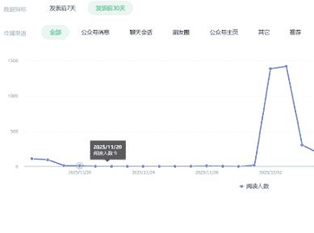

大家能够看到这篇文章是 11 月中旬发的，但直到 12 月初才开始推流。

而后来呢？

就是大家喜闻乐见的爽文结局了，从 12 月初到现在，我的公众号连续的爆款，引流引到我微信差点频繁，于是我稳定每个月做一场发售，就能稳定月入 3~5w。

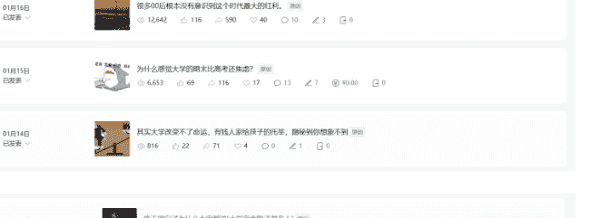


## 3.我想和你说"10w+其实不赚钱”

过去的很长一段时间里，我都会陷入对 10w+ 的狂热的追逐中。

或者说，我觉得任何一个自媒体小白都会有这样的错误想法，觉得赚钱=搞流量，赚大钱=10w+，但事实上不是这样的，流量是没用的，精准的流量才有用。

我曾经就经历过一些很惨痛的教训，2025 年 4 月我打算做公域的时候，我花了 5000 块，购买了一个老师的小红书私教。那位老师的模板和选题都很好，在她的教导下，我通过模仿的形式，写出了多篇 10w+ 爆款，引流了 100 多人到私域。

看起来很繁荣，对嘛？

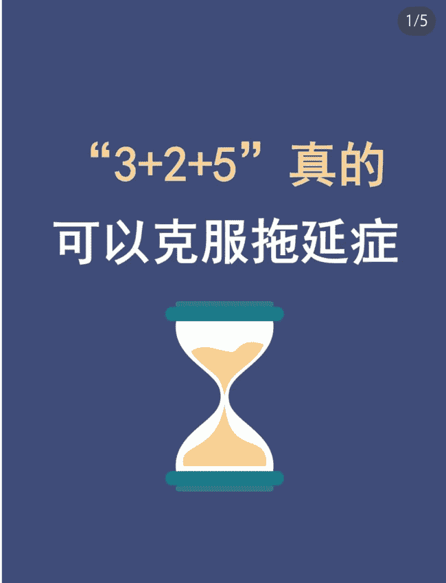

"3+2+5”真的可以克服拖延症

大家好啊，我是枕棠，是一名 985 工科大学生，也是一名时间管理教练，热衷研究与分享时间管理与目标管理


如何高效过好一天 | 24h=7h+8h+9h

大家好啊，我是枕棠，是一名 985 工科大学生，也是一名时间管理教练。

前几天经常有姐妹说，枕棠分享的方法和笔记都。但问题在于，100 多人里面只成交了 2 单，而且都是几百块的课程。

这个时间投产比非常之低，甚至都不如我去混圈。

直到后来，我才慢慢反应过来了，这个流量太泛了。

他们单纯是为了白嫖我的资料包来加我的，而不是为了想解决需求来找我的。

这个情况也存在于公众号平台，放开推荐流量后，我看到了很多“小白文”动不动 10w+。但后来他们有一些人成了我学员后，我才知道，他们那些 10w+ 完全不变现。

所以，如果我们单纯去抄袭那些爆款，写出来的爆款是毫无意义的。无法获得精准流量，也无法进行转化，约等于浪费时间。

于是我就去回头思考了一下，那些泛粉和我的学员区别是什么呢？我的学员为什么愿意相信我，为什么愿意向我付费呢？

其实是因为两个东西：

#### 独特的故事，人设。

比如大家都知道，我是枕棠，我 21 岁，我之前在北京，过完年要去杭州。比如大家都知道我的一些故事：高中回家自学考上 985 的故事；大学看到读研希望不大决定创业的故事；工作三个月决定裸辞的故事。

这些故事我讲过很多篇，我讲过每一个细节。而当他们通过公众号加到我好友的时候，能在我过去三年的朋友圈里看到无数相关的东西。他们能感受到一个活生生的人就站在他们面前，而且曾经和他们一样，现在活成他们理想的样子，所以他们愿意付费。

#### 独特的观点，方法论

在我的文章里面，大家能够反复看到我提到的一些价值观和观点。

比如“人生是一场盛大的体验”、比如“时间在哪里，结果就在哪里”。

比如“人生管理=时间管理+目标管理 + 心力管理”

比如“商业闭环=定位 + 流量 + 产品 + 转化”

相比一些小白文写的内容都是没有冲击力千篇一律的观点，我的很多观点和模型会让用户眼前一亮。这种“眼前一亮”，最后会变成信任，也会成为我产品的溢价的原因。

既然这些东西被我的学员看见就会付费，那我为什么不直接在公域去发这些东西呢？事实上，我曾经发过。2024 年我的公众号就是这么发的，里面都是我独特的故事观点人设。可是我发现，一旦开始在文章只写自己，完读率往往会下降，爆款也会变少。

因为大多数 10w+ 本质都是“小白文”：无害的、很短的、大白话的、读起来很舒服的。但 IP 文一定更长，一定要植入故事和观点它，甚至需要更坚定、更冒犯、更有棱角一点。说白了，就是自嗨，一旦就非常容易没有推流。

纯抄也不行，因为来的人都是泛流量。纯原创也不行，因为太自嗨的东西没人看。那怎么办呢？

经过漫长的思考，我找到了方法。那就是：以爆款为骨，以 IP 为魂。

以爆款为骨这句话意思是，在选题上，标题上，文章的结构上，我们尽可能的去参考其他爆款。

我们没必要去知道他们为什么会爆，因为爆款本身就是概率事件，是一定的黑盒。我们唯一的知道的是，爆过的内容会反复的爆，我们只需要去参考就好了。

以 IP 为魂这句话的意思是，具体的文章内容上，人设上，观点上，解决方案上，都要是 IP 的原创。人们会看到很多内容，很多爆款，那最后让他们选择付费的。一定是这个 IP 的故事很独特，这个人的观点和方法论全网独家。

于是也到了这里，我开始想通。

#### 流量主模式和个人 IP 的模式最大的区别是什么了。

他们有很多小的区别：

- 前者重阅读量，后者重引流量。
- 前者没后端，后者有后端产品。

但我觉得最核心的区别是，流量主可以疯狂借鉴和抄袭，非常碎片，读者看只是因为觉得这是一个工具号。但个人 IP 的内容全网独家，有独特的故事和观点，读者能够通过文章看到一个活生生的人，她的成长，她的喜怒哀乐，然后选择相信他，并为她买单。

### 4.垂直的是人群，而非赛道。

很多人一听到垂直小号的第一反应，是垂直一个赛道：我做情感所以只写情感，我做副业所以只写副业赚钱。但你如果这样做的话，你大概率会遇到一个非常尴尬的问题：

你的流量很难起来，因为这个赛道太窄了，以及吸引的人群很难精准固定。比如时间管理这个赛道，全网的爆款选题非常之有限，以及从 18~60 岁，都会关心时间管理这个大选题，引流很容易不精准。

我曾经就陷入长久的混沌之中，不知道该怎么写了。直到我在 11 月底参加 IP 大会，听见程弈人老师那句话，才一下子恍然大悟：

> “垂直小号，垂直的不是赛道，而是人群。”

于是后来我找到的方法论是：垂直于人群。

#### 垂直赛道

我现在的主要业务，是带 18~25 岁的年轻人搭建时间管理体系、搭建自媒体闭环，然后成为 AI 超级个体。

在这个基础上，我一开始做的引流，其实是“垂直赛道引流”：我要做时间管理的引流，我要做自媒体变现的引流，我就去写相关的选题。

但是你猜怎么着？

我的引流非常不精准，甚至引来了一些 50 多岁的老登，他们只会竖大拇哥，然后挑刺，或者发一句佛祖保佑。他们只白嫖，他们不愿意付费学习。他们根本不愿意向一个和他们儿子大小差不多的人付费学习，而且他们完全没有知识付费的意识。我当时就想：这不行啊。

#### 垂直人群

再后来，我做的引流，变成了“垂直人群引流”。

我接下来的文章，都是围绕 18~25 这个群体去写对应的选题：于是我写了很多爆款，包括但不限于“大学宿舍”“大学经济独立”“00 后时代红利”“大学规划”等等。然后几乎每一篇，当我把我的 IP 和独特方法论观点融进去之后，都能引流来非常精准的人群。

也是后知后觉我才意识到：

#### 为什么要垂直于人群，而非赛道。

如果你做过知识付费，或者个人 IP。你就会发现，我们能够吸引的人，其实就是我们的年龄上下 3~5 岁。以及更重要的一个点在于，

完全不用担心你写其他话题吸引来的人群会不精准，因为同一个年龄的群体，他们拥有的需求都是趋同的。

那些读我们文章的，从来都不是一个干巴巴的数据，每一个阅读量的背后，都是一个个活生生的人。既然是人他们就会有很多的需求，他们有赚钱的需求，他们有恋爱的需求，他们有成长的需求，他们有无数的需求。

如果说你用恋爱的话题吸引来了一群年轻人，那他们其实大概率也会有赚钱的需求。能不能激发出来，并让他们为你买单，这不是流量的范畴，而是转化的能力。

至此我们聊完了关于垂直小号的底层认知，下一板块，我将和大家分享做垂直小号具体的 SOP。

## 三。爆款垂直小号 SOP

在开始之前，我想先告诉大家一个很重要的认知：一篇文章能不能爆，80% 取决于选题，只有 20% 取决于正文。

所以 SOP 会有大量的笔墨放在怎么找选题，而非怎么写正文上。

### 1.搭建选题库

选题的本质其实就是一个话题的切入点，而标题是选题的外化，很多时候，我们聊标题其实就是在聊选题。

那么问题来了，要怎么找到选题，找到这个巧妙的切入点呢？

我们可以靠灵机一动，但终究无法长久，所以更好的方法是直接去参考已爆款的选题。大概流程呢就是，我们确定自己的赛道，然后找到赛道的关键词，然后再以关键词为导向去搜索爆款选题，然后搭建选题库。

#### (1) 关键词锚定。

首先你要确定你的这个赛道选题方向有什么关键词，可以用这个提示词。

你好，你是一名「用户需求调研 + 搜索意图分析」助手。

我是做【XX 赛道】的公众号博主，目标用户是【XX~XX 岁】，他们的常见痛点有【 XX 】

请你基于这个赛道，帮我输出这类用户最常见的：他们遇到问题时会在搜索框输入的词（关键词简单凝练，各不重复相同，20 个即可）

我们是副业赚钱这个赛道为例，首先我们能够有一些关键词。


然后我们选择“搞钱”这个关键词，去搜索爆款。

#### (2) 寻找爆款。


搜索框搜索关键词，然后选择“最热”，出来的就都是爆款了。每一个关键词都可以搜索出来很多爆款，如果没有搜出来，那就换一个关键词试试。

#### (3) 搭建选题库。

然后下一步我们就需要去搭建选题库了，我们可以挑选爆款中感觉还不错的内容。汇总成一个表格，需要记录的数据是：**标题，阅读量，对标发布日期和链接。**（这个很重要）

当我们拥有选题库后，下次写的时候直接在里面挑就好，不用再库库寻找了。

| 文章标题 | 阅读量 | 对标发布日期 | 链接 |
|---|---|---|---|
| ... | 38000 | 2026 年 1 月 1 日 | mp.weixin.qq.com/s/U... |
| ... | 190000 | 2025 年 12 月 26 日 | mp.weixin.qq.com/s/7... |
| ... | 100000 | 2025 年 12 月 23 日 | mp.weixin.qq.com/s/j... |
| ... | 29000 | 2025 年 12 月 20 日 | mp.weixin.qq.com/s/r... |
| ... | 100000 | 2025 年 12 月 17 日 | mp.weixin.qq.com/s/9... |
| ... | 23000 | 2025 年 12 月 16 日 | mp.weixin.qq.com/s/5... |
| ... | 100000 | 2025 年 12 月 12 日 | mp.weixin.qq.com/s/l... |
| ... | 3468 | 2025 年 12 月 11 日 | mp.weixin.qq.com/s/U... |
| ... | 7000 | 2025 年 12 月 9 日 | mp.weixin.qq.com/s/p... |
| ... | 100000 | 2025 年 12 月 7 日 | mp.weixin.qq.com/s/6... |

### 2.选题二次筛选

事实上，一旦我们决定写一个选题，就要在里面投入大量的时间和精力，这个时候起码要消耗 2~4 小时。要么这篇文章选题不够好的话，这个时间就被浪费了。所以不妨在写之前，先用 10 分钟对选题进行一个二次的筛选，以提高我们一篇选题的爆款率。

#### (1) 发布时间。

标题的背后是选题，选题的背后是需求和人性。所以我们能够发现有一些选题，不管什么时候写都能爆。因为人类有一些恒定不变的需求，就是需要钱，就是需要爱，就是需要尊重。虽然需求不会变化，但是选题和标题会变化。因为用户审美会随着互联网逐渐变化，同一个标题看多了用户就烦了。那我们要怎么识别出来，那些选题是用户最新的“心头好”呢？

很简单，看最新的爆款。我们搜一个关键词会出来很多爆款，而最新的哪个，大概率就是最符合用户审美的哪个。1 个 2 月 1 号发的爆款，1 个 1 月 1 号发的爆款，肯定是前者爆款的概率会更大一些，我们在写的时候就要优先考虑他。

#### (2) 爆款数量。

如果你去尝试搜索我们搭建的选题库里的选题，你会发现有的选题呢只有这一篇 10w+，但是有的选题却有多篇的 10w+，一定要选择后者。

为什么呢？我们以这里的两个选题为例。

- 《你的身材，就是你的阶层》
- 《就算让你 gap 一年，你也做不成自己想做的事情》


- **你的身材，就是你的阶层。** 与其他学习类相 比，身材是最突出的“可视化成果”，你对身材的态度，也反映了你对人生的态度。 “02-心理学说‘延迟满足’，是指为了长期收益，放弃即时快感的能 力。四月槐汐 14 天前
- **你的身材，就是你的阶层** 为什么说你的身材，就是你的阶层？因为它是一个筛选器，它反映了你是否拥有迈向更高阶层的核心品质：强大的精力和顶级的自律。这不是说每个人都 要练成健美冠军。吧猫说财 5 个月前
- **你的身材，暴露了你的阶层** 因为好身材是一个筛选器，它反映了你是否拥有迈向更高阶层的核心品质：旺盛的精力和顶级的自律。你的身材，其实体现了你的生活方式、自我要求和价值观念。每晚一卷书 1 个月前
- **你的身材，就是你的阶层** 你的身材，就是你的阶层——这句话听起来有些扎心，但无比实在。其实不是说根据胖瘦来定阶层的高低，而是身材背后的关键能力：自我管理能力。周的时光源 5 个月前
- **身材和阶层** 你的身材，就是你的阶层，判断一个人的阶层，最简单的办法，就是看他的身材。仔细观察，我们会发现，那些受过良好教育、有强烈进取心、事业有成的人，如普京、奥巴马... 读书以后 10 个月前
- **你的身材，就是你的阶层** 你的身材，就是你的阶层判断一个人的阶层，最简单的办法，就是看 TA 的身材。正如保罗·福塞尔在《格调》一书中所说：“你的体重就是你社会等级的宣言。富书 2018/1/29


- **就算让你 gap 一年，你也做不成自己想做的事** 就算让你 gap 一年，你也做不成自己想做的事，怎么得出来的这个结论呢？就是我一次次在寒暑假国庆假期躺了整整一个假期的时候，上班上学的时候，总觉得自己 的时间 和精... 阿毕抱抱你 3 个月前
- **裸辞 Gap 的年轻人，被职场抛弃了？** 也强调我不是无脑 Gap，而是做了严密的规划，让他们觉得你连裸辞都能当项目管理在做，还有什么活干不了？还提供了一些成果展示，比如 20 天的欧洲旅行、社交媒体更新... 三联生活周刊 2024/3/18
- **“我是 gap 了一年，不是坐牢一年”，中国职场，不欢迎 gap 过的年轻人** 但有很多人能在 gap 期学习了更多专业技能、找到了更适合自己的工作。在 25 岁裸辞之后，网友拿着积蓄出国 gap，在一年的时间里边读书边旅游，进修了英国某大学的人工... 新东方 7 个月前
- **为什么说国内 gap 半年如坐牢，gap 一年等于牢底坐穿，一生不被允许 gap 的中国人，真相到底是什么？** 但是在国外 gap 是一个很常见的场景，很多学生在上学的时候往往就会停下来花一年的时间 去旅行，去创业，去做自己想做的事情，他们通常称之为 gao year，言下之意就是这... ali 老蒋说 2024/2/18
- **为什么「中国职场」不允许有 gap year？** 很容易想到，如果你 gap 一年的话，面试的时候 hr 肯定会围绕这个问题来问你，甚至有的 hr 会很介意，相当介意。哪怕你是在利用时间提升自我、升学学习，他们的内心都会有... 阿琴琴的职场日常 7 个月前
- **我是没上班，不是坐牢！为什么大部分企业都接受不了 gap year？** gap year 指的间隔年，原指青年在毕业之后、工作之前，并不急于盲目踏入社会，而是停下来（通常是一年）去做自己想做的事情，体验不同的生活方式。... 6 个月前

我们会发现：

《你的身材，就是你的阶层》有多篇同标题 10w+。

而《就算让你 gap 一年，你也做不成自己想做的事情》只有一篇同标题 10w+。

这个时候我们选择前者，他爆款的概率一定会更大。因为一篇文章能爆，有（标题）选题，IP 本身影响力，运气，正文质量，等多个因素，但如果是同标题有了多篇爆款，根据控制变量法，我们能够得出结论。这篇文章爆款的原因是她的选题（标题）好，而非其他原因。这个时候去写这个选题，爆的概率就会更大一些。

#### (3) 与我有关。

筛选选题最核心的一个点就是：与我有关。展开来说就是：和我的客户有关，和我的故事有关，和我的观点方法论有关。

因为对于一个个人 IP 来说，最核心的点就在于你独特的观点和故事。如果一个选题你自己都不认同，没什么感知，硬去蹭爆款，大概会遇到这三个困境：

- 一是很难写下去，因为你没有话要说，要反复的拼凑，很容易卡壳。
- 二是大概率写不爆，用户是有审美的，你没有独特的观点和方法论，很难吸引到高质量的人群。
- 三是哪怕你写爆了，因为里面和你关系不大，吸引来的人也不怎么认可你，也就很难转化，沟通起来很费劲。

在前端流量上偷的懒，会在后端转化上加倍的还回来。

### 3.正文撰写：结构高于一切

系统的写文章之前，最核心的方法一定是先搭建一个结构骨架出来，然后再进行填充。

### **合规引流：通过秀肌肉 + 留钩子的行为，把读者带到微信私域转化。**

所谓我上面提到的“以爆款为骨，以 IP 为魂”，就是更多的在这里使用。

其中文章结构，封面标题，开头，是可以着重的去参考爆款的。

但是正文，结尾和引流，却要去按照我们自己的思考和观点去写。

一篇合格的个人 IP 爆文，一般是包括下面这五个板块的，他们的作用和主要内容如下。

- **封面标题**：决定点击率，吸引用户会不会点进来。
- **开头引入**：极大的影响完读率，让读者看下去。
- **正文展开**：负责建立信任，把一个板块讲清楚，并给出对应的方法论。
- **结尾升华**：负责情绪闭环，让读者点赞，收藏，转化。
- **合规引流**：通过秀肌肉 + 留钩子的行为，把读者带到微信私域转化。

首先我们聊一下正文板块要怎么去写。

坦白来说，**正文是没有一个特别明显的模板的**，

如果硬要去套模板，会非常僵硬，自己和读者都能看出来。

如果去看市面上的个人 IP 相关的爆款文章，

会发现有特别多的正文模式，千人千面。

- 有的文章会在这里写故事；
- 有的会在这里写方法论；
- 有的文章会拆解一个事情背后的原因；
- 有的文章则会针对一个课题去写自己的解决思路。

### 那要怎么找到适合自己的正文模式呢

前期写的时候可以直接去参考你的对标文章，然后尝试自己去写。

等大约能够写出来几十篇爆款了，你就能够总结出来属于自己的 SOP 了。

关于这个板块，除了水磨工夫的去探索自己的爆文风格，别无他法。

我自己也是写了半年之后，才总结出来自己适合的六种文章结构。

#### 选题 & 结构

- 事实列举式
- 观点解释式
- 目标解法式
- 经历认知式
- 结构灵感式

不过虽然正文和结尾的原创成分比较高。

但是封面标题，开头引入，合规引流

剩余的这三个板块，都有适合的 SOP 和详情，我下面来展开一下。

## 4. 点击率为王：标题和封面

我们前面提到决定一篇文章是否爆款 80% 的因素在于选题，而选题的核心体现就在于标题和封面上。

#### (1) 标题

当我们决定去写一篇文章，来到写标题这一步的时候。

最快的方法就是去照搬原来的爆款标题。

因为一个爆款标题他能爆的确是有黑盒存在的，

虽说原创能力也很重要，但前期对我们来说，直接就参考是 ROI 最高的方法。

重要的事情说三遍：前期不要原创，前期不要原创，前期不要原创。

而到了后期，

但如果说是你已经写出了十几篇的爆款，有了足够的网感和审美能力，

就可以考虑自己去原创标题了，可以自己去思考。

但我发现了一个更好的方法，那就是去投喂爆款选题的写法和逻辑，写一个提示词。

然后一次性让 AI 生成 20 个选题，我们再去选择。

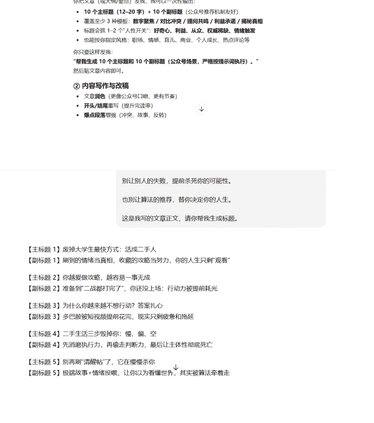

智能体免费送给大家，大家可以试试，直接发送你写好的文章，

就会自动生成 10 个标题和副标题，然后选择就好。

科学上网，然后点击链接即可使用：

```
https://chatgpt.com/g/g-68da659434488191bfacbf174f9c788e4-gong-zhong-hao-biao-ti-zhu-shou
```

#### (2) 封面

而关于封面，整体我测试下来，对于单篇文章的阅读量没有那么重要，

他的意义更多是在于，让读者去看的过程中，视觉统一，形成整齐的品牌感。

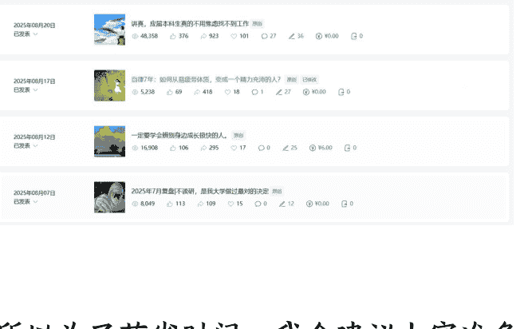

所以为了节省时间，我会建议大家准备一个封面库（常见的有风景，自己的照片，甄嬛传主题图片）

然后每次写作的时候都从里面选择其一即可，下面就是我的封面库。


### 5. 完读率：开头 100 字定生死

大家都说短视频有黄金 3 秒，那文章其实也有黄金 100 字。

也就是说，开始的前 100 字，如果没有抓住用户，用户直接跳出去了，那后面的文章写的再好都没有用了。

于是怎么样去写一个能够抓住人的开头呢？

我觉得应该包括这三个因素。

#### (1) 我说的就是你

人从来不关注与自己无关的课题，如果用户觉得与他无关，会一秒钟就划出去。

那怎么样让用户觉得和他相关呢？

有两个方法论：

#### 直接点名

就是开门见山的和用户说，我这篇文章就是为你写的。

比如我写过一篇文章：

《自律 7 年：如何从易疲劳体质，变成一个精力充沛的人？》

如果你总是觉得累，睡再多也没用。

那我们可能是一类人，所谓的易疲劳体质。

#### 侧面描述

就是侧面描述一个人群众的情况，他们遇到的问题。

然后这个群体的用户，自己就会带入进去。

比如这篇文章：

> **《大学的本质，是比高考更残酷且精致的筛选》**

我写的就是大学生这个群体，然后大学生一看到就会代入。

这几年接触了很多大学生，几乎每周都有人来找我倾诉：

> “我好像一直在努力，可大学这几年，越过越迷茫，什么都没落下，却又什么都没抓住。”

其实这种状态，很常见。

#### (2) 我能解决这个问题

在开头的一个板块，我们其实是在击中痛点，或者换句话说是在渲染焦虑。

然后读者被击中痛点后，下意识反应一定是。

你凭什么教我？你凭什么写这篇文章？

我们需要回答这个问题，给用户确定性，告诉他们我们能解决这个问题，后面会给他解决方案，他们才会愿意继续看下去。

这一板块的体现可以有三种方式：

#### 自我经历

《自律 7 年：如何从易疲劳体质，变成一个精力充沛的人？》

这里我直接讲了自己的故事，然后给了用户的一个方法论，告诉用户我懂这个方法论。

读高中时，我永远是宿舍床上最晚爬起来的那个，连跑操都在犯困。

大学时，只要有早八的课，下课后就像被抽干了电，脑子里唯一的念头就是赶紧回宿舍补觉。

直到后来我搭建了自己的人生管理系统，系统学习和实践了精力管理后，我才成为大家现在眼中精力爆棚的“超级赛亚人”。

能回家自学考上 985，大学一边拿奖学金一边靠自媒体赚到 40w+。

#### 学员 & 他人经历

《一定要学会辨别身边成长极快的人》

这里其实我并没有写自己成长速度快，而是写了自己身边保研减肥的案例，我的私教学员小 A 做的案例，说明了我对这个话题有发言权。

在过去几年广泛社交的过程中，我发现一个现象：

总有一类人，他们的成长速度远超常人。

他们看起来平平无奇，却总是隔一段时间就能放一个“大招”：

保研清华、成功减肥 30 斤，或者直接拿到别人想都不敢想的机会。

就像我的私教学员小 A，明明才大二，上个月就自媒体月入 2 万。

而他从去年 8 月开始跟我做自媒体，到现在，不过一年时间。

#### 我能说清问题的本质

《所有大学生完全可以用一年时间去变强》

这里我写的场景是大家的目标都没有实现，

然后我拆解问题的本质是：你们投入的时间不够多。

投入时间不够多的原因是我们的目标分散，注意力非常容易动摇。

读者会觉得我分析非常有道理，所以他们会想我懂问题的本质，因此我肯定能解决这个问题，所以愿意看下去。

转眼 2025 年就只剩下一个月了，你年初定下的目标，现在完成得怎么样了呢？

我猜，大概率不太理想：减肥没成功，绩点没上去，自媒体也没赚到钱。

但这些，其实是再正常不过的事情了。

失败的原因很简单：我们根本没有在这些目标上，投入足够的时间。

> 马尔科姆·格拉德威尔在《异类》中提到：一个人如果想成为某个领域的专家，至少需要 1 万小时的刻意练习。

很简单的道理就是，如果你想在一个领域拿到足够大的成绩，就要投入大量的时间。

但现实是，我们太容易动摇了。

今天想着好好干一件事，明天就被别的事情吸走注意力；

好不容易开始坚持，又因为一点困难暂停，然后一停就不想继续了。

到最后，一整年过去，发现自己还在原地打转。

#### (3) 下面会很有料

当我们戳了痛点，然后证明了自己的能力，接下来就是给解决方法了 (俗称画饼)。

这种的呈现形式其实也有两个。

#### 下面几点解决你的问题

模型就是再渲染一遍焦虑，

然后告诉大家你要解决问题，你需要做好下面这三点。

《所有大学生完全可以用一年时间去变强》

到最后，一整年过去，发现自己还在原地打转。

但也别太焦虑。

如果你能真正搞懂下面这三件事，

一年，真的足够你实现一场巨大的改变。

#### 《终于明白了为什么大家都说“大学宿舍毁了很多”》

因为大学里最可怕的从来不是“起点差”，

而是你在一个看似安全、舒适、自由的地方，慢慢失去了锋芒。

所以，为什么大家都说“大学宿舍毁了很多呢？”

我想大概是下面这三条原因。

#### 写清下面的纲要

简单来说，就是把正文的小标题挪过来，

并且做一下优化，让他们看起来更吸引人。

《一定要学会辨别身边成长极快的人。》

今天就以小 A 为例，聊聊那些成长极快的年轻人，到底有什么共通的特点。

### 我总结下来，大致有三点：

- 1. 所谓执行力，就是从梦想到现实的能力。
- 2. 所谓魄力，就是敢为自己的未来投资下注。
- 3. 成长最快的方式，就是站在巨人的肩膀上。

### 6. 合规引流：我曾被限流三个月。

如果你认真遵从我的 SOP，那么当他们看到结尾的时候，其实大概率已经愿意加我们微信了。

这个时候我们只需要合适的引导他们就可以了。

这个时候的做法就是：秀肌肉 + 留钩子 + 给路径

秀肌肉：很好理解，就是做个自我介绍，我是资深 XX。

留钩子：就是加我领资料，写一个很吸引人的资料。

这里可以是我们原创的资料包，也可以是你整理的电子书。

给路径：最主要注意的就是给路径，简单来说，就是给出读者加我们微信的方式。

#### (1) 错误的引流方式

留微信号和微信二维码

虽然说很多人都在说微信公众号最大的优势就是可以直接留微信号和二维码。

但经过我的测试，以及 11 月 IP 大会晚上夜话向程弈人老师的请教，

我可以很确定的和大家说：

不要在下面留任何二维码和微信号，会降低账号权重和推流。

上面 2.4 板块《躬身入局：我与垂直小号的这半年》就描述了我被限流的整个过程。

至于这个时候有的朋友可能会说，

我留二维码了呀？账号为什么依旧出爆款。

原因也很简单，公众号的二维码检测是人工检测，可能还没检查到你。

不过哪怕被限流了也没事，

只要去掉二维码然后正常更新一个月，就能救回来了。

#### (2) 正确的引流方式

正确的引流的方式，其实就是加入微信官方的组件。

第一种：关注弹二维码

简单来说就是在文章的尾部留下钩子

说：点击关注，即可领取资料。

然后我们可以设置一下微信公众号后台的自动回复和小菜单。

让用户关注后自动弹出二维码来，从而丝滑引流到私域。

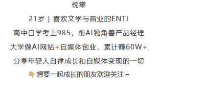


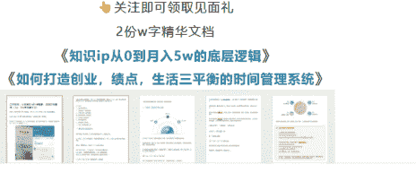

第二种：直接挂微信小店引流品的链接。

这个是程弈人老师公众号的尾部的引流方式，使用了微信官方的组件。

你都应该掌握这套开展个人事业的方法，因为**一个人真正地拥有人生底气的前提，就是能靠自己在市场上独立赚到钱。**

所以，我真心地推荐你，报名我们这个视频下方👇的“启动你的个人事业”2 天行动营。已经报名的伙伴，请注意留意你的手机短信，点击短信中的链接，扫码添加助教老师，就可以参与课程了。

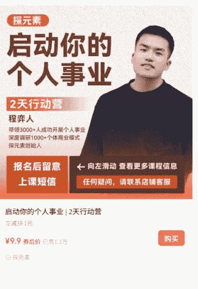

### 7. 数据复盘，持续迭代。

经过我自己的探索，以及和很多做公众号的老师朋友的讨论，

如果我们的目标是，爆款和提高阅读量的话，那么会有这三个指标比较重要。

最重要的是：点击率，它主要由标题和封面决定。

其次重要的是：完读率，它由开头和正文流畅度决定。

再次重要的是：互动率（点赞 转发等），它由结尾和正文的干货度决定。

自我有了这个认知后，每个月我都会专门去把自己所有的文章，来拉表复盘一下。

最后我发现基于我精准获客这个目标，其实完全可以去很好的调整。

如果一篇文章的阅读量不高，那就要去看是哪个数据出了问题？

是点击率的问题？那就去优化封面标题。

是完读率的问题？那就去优化开头和正文的排版流畅度。

是互动性的问题？那就去打磨文章的观点，或者结尾写的更好一些。

如果阅读量很好，但是引流的人很少。

是人群不精准了？那就去优化选题。

是钩子不够好？那就重新去设计资料包和秀肌肉的模式。

事实上，当我学到了足够的认知，并有了复盘的习惯后，我从来不担心我做不起来。

我只需要勇敢的去做就好了，

遇见反馈就调整，负反馈正反馈，哪怕没有反馈，其实都是反馈。

这样不断优化不断调整，我很自信今年可以写出多篇 10w+，并以此赚到百万。

## 四、结语

我是一个保守型的创业者，好的好听些就是长期主义。

2023 年 3 月，我刚加入生财的时候，就在一堆项目里面挑了知识付费。

因为我当时做了统计，生财里面发帖子的，能够穿越周期的，40% 都是做知识付费的，而非红利项目。

也许是创业本就艰辛，时隔三年之后，我才终于拥有了稳定的收入。

也才在这个时候明白，一次月入 5w，和稳定的月入 5w，是两个完全不同的世界。

至此，我赚到第一个百万的目标已前行多半，而且 2026 年一定能完全实现。

而且同时，我也对年入百万的目标有了稳定且长足的信心。

这一次的信心，并非来自少年热血，炫耀装酷。

而来自于我自己的计算，来自科学的系统理论，

我知道商业闭环上再做一些优化，流量和产品再做迭代，就能够实现。

写到这里，稍微有些惆怅，2025 年 7 月大学毕业来到北京，

短短半年，经历了从学生到打工人再到创业者的身份转变。

我会记得第一次线下参加创业聚会的讨论，思维碰撞，飞速成长，每一个卡点都有前辈解惑。

这是我曾经在长春读大学时候所梦寐以求的，高质量的信息交流也造就了飞速的成长。

我也会记得 10 月，分手，裸辞，家人车祸等事情堆积在一起的至暗时刻，

加上因为错误操作账号被降权，当时焦虑的已经开始看 boss 直聘了，真的想去上班了。

但祸兮福所倚，也正是这个过程，倒逼我跑出了这样的闭环。

于是到了现在，我觉得我才算是一个创业者，

因为我知道自己凭什么赚钱，也有了 SOP 和系统，不只是自己苦哈哈给自己打工，

也终于打算去杭州定居，然后开工作室了。

好了就说这么多，感谢你看到这里。

### 谨以此文致敬在北京的半年时光，致敬我 21 岁这段努力的岁月。

圈友们，我们下次再见，祝大家生财有术！

最后，安利小懒的付费群：

懒人专属群 (介绍)


微信：lazyhelper1

📌 这里是你对抗信息过载的护城河。

已稳定运行 7 年，累计拆解、研读 3000+ 个互联网商业实战案例与行业前沿内参和时政/宏观文章。

我们不搬运垃圾，只做高价值信息的筛选器与放大镜。

### 懒人专属群更新记录：

https://hk57gvlx7u.feishu.cn/docx/H0kRdZbSbolBR0xkaXtcuVE0nTg

**【免责声明】** 本资料归档于社群内部知识库，仅供成员课题研究与学术交流，请在查阅后 24 小时内删除。