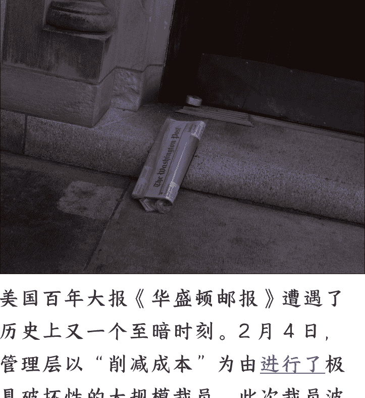

# 正在陨落的《华盛顿邮报》

20250210 新闻实验室

整理：公众号懒人搜索，懒人专属群精选

懒人微信：lazyhelper1

> “继承一把稀有的小提琴，再用锤子砸烂它。”

美国百年大报《华盛顿邮报》遭遇了历史上又一个至暗时刻。2 月 4 日，管理层以“削减成本”为由进行了极具破坏性的大规模裁员。此次裁员波及全公司约三分之一的员工，不仅体育部（Sports）和书评部（Books）被彻底关停，就连该报赖以成名的国际报道和都市新闻部门也遭到重大打击。

本文截稿前，《华盛顿邮报》CEO 兼出版人 Will Lewis 宣布辞职，由首席财务官 Terry D'Onofrio 临时接任。

这次裁员被内部员工形容为“大屠杀”(Bloodbath) 或者“血色星期三”(Bloody Wednesday)。其中的主要矛盾，不仅指向幕后的大老板、亚马逊创始人贝索斯，而且也折射了更残酷的生存危机。

《华盛顿邮报》为何会从提出“民主死于黑暗”的灯塔，沦为商业弃子？这一事件对全球新闻业的警示又有哪些？

## 「曾报道水门事件的部门也未能幸免」

2 月 4 日，执行主编 Matt Murray 在早上 8 点半的 Zoom 会议上宣布了这个噩耗。约 300 名员工——相当于全公司三分之一、新闻编辑室 800 人中的三分之一以上——收到了裁员通知。他们在社交媒体上发表的感想被迅速转载传播。

被彻底撤销或大幅削减的部门，许多都是《华盛顿邮报》曾经最引以为傲的领域。

- 首先，75 年历史的体育部被全线撤销，令业界震惊。这个拥有 40 多人的部门，曾是美国体育新闻的黄金标杆，定义了体育评论的标准。该部门曾经培养了写了 75 年专栏的作家 Shirley Povich、后来创立 ESPN 经典体育评论节目《PTI》的 Tony Kornheiser 和 Michael Wilbon，以及获普利策奖提名的 Sally Jenkins。

就在两周前，报社还曾宣布不派记者参加意大利冬奥会（后在压力下派出 4 人），而这 4 人中有些在前线工作时收到了解雇通知。

- 第二，曾经拥有约 40 人的华盛顿特区本地新闻团队（Metro Desk）被裁减至仅剩约 12 人。这意味着《华盛顿邮报》的地方根基元气大伤。

历史上，正是本地版记者 Bob Woodward 和 Carl Bernstein 从一起不起眼的入室盗窃案查起，最终揭发了震惊世界的水门事件，导致尼克松总统下台。

本次被裁的知名记者 Michael Brice-Saddler 负责华盛顿特区市政厅报道，他在社交媒体上写道：“我们被告知要用更少的资源做更多的事，然后用更少做更更多。写得更快，发布更多，不能犯错。但对我们的容错空间越来越小，而对九楼（报社高层办公室）的人来说，容错空间却越来越大。”

- 第三，中东、乌克兰、中国和南亚的分社受到重创，部分地区几乎全员被裁。

其中，Ishaan Tharoor 的离职被视为华邮国际分析深度的重大损失。他的《WorldView》newsletter 拥有近 50 万订阅者，以博学的历史视角和非西方中心主义的叙事，解释复杂的全球地缘政治。

乌克兰驻地记者 Lizzie Johnson 在 X 上发帖：“我刚刚在战区中被《华盛顿邮报》解雇。我无话可说。我很绝望。”开罗分社社长 Claire Parker 也表示，整个中东记者和编辑团队全部被裁。

- 第四，多位调查记者被裁。

其中，Marissa T. Lang 是《华盛顿邮报》获得 2022 年普利策公共服务奖团队的关键成员，她深入报道了 1 月 6 日国会山骚乱的现场细节（详见会员通讯 588 期）。裁掉一位刚获得普利策奖不久的功勋记者，被外界普遍认为是管理层不再重视投入巨大的调查报道的信号。

负责种族与族裔事务报道的 Emmanuel Felton 在被裁后写道：“这不是财务决定，这是意识形态决定。”讽刺的是，几个月前高层还告诉他，关于种族的报道是“订阅增长的驱动力”。

负责报道亚马逊的科技记者 Caroline O'Donovan 也在被裁之列。她此前曾合作撰写了关于亚马逊配送网络的调查报道，揭示了生产力压力如何导致危险甚至致命的事故。她的被裁令人联想：是否因为贝索斯不满她的调查？

- 第五，《Book World》书评增刊被彻底取消，这曾是美国仅存的几个独立报纸书评增刊之一，是美国文学评论的重要阵地。

此外，所有的摄影记者都被解雇，视觉部门的其他员工也有许多失去了工作。

《卫报》专栏作家 Margaret Sullivan 曾在《华盛顿邮报》工作过 6 年，她将这种做法比喻为“继承一把稀有的小提琴，再用锤子砸烂它；或者把钻石先放进蓝色天鹅绒盒子，再把它扔进河里”。

## 「《华盛顿邮报》何以至此」

在大裁员背后，是一系列看起来触目惊心的数字：亏损从 2023 年的 7700 万美元扩大到 2024 年的 1 亿美元；过去三年网站的自然搜索流量下降近 50%；订阅用户较 2020 年高峰期下降一半；包括本次在内，过去三年裁员约 400 人。

2013 年，贝索斯以 2.5 亿美元从格雷厄姆家族手中收购《华盛顿邮报》时，承诺保持新闻传统，不干预日常运营。他曾在 2016 年新总部大楼落成时自豪地说，这份报纸变得“更加冒险”、有了“更多自信”。2024 年 12 月，他还在《纽约时报》DealBook 峰会上表示：“我给邮报带来的优势是，当他们需要财务资源时，我随时都在。我就像溺爱的家长。”他甚至曾设想吸引 1 亿付费订阅用户。

但现实走向截然相反的方向。2016-2020 年，凭借对特朗普第一任期的不懈报道，《华盛顿邮报》订阅量激增。但 2021 年后，随着特朗普下台，这波“抗议性订阅”的红利迅速消失。

在特朗普第一任期的流量红利期间，报社激进扩张。员工数从 2013 年的不到 600 人膨胀到 2022 年的超 1000 人。由改造公司内部编辑系统而来，同时也对外销售的 Arc XP 出版平台，本可在疫情带来的居家办公趋势下逢高卖出，却一直拖到 2024 年，等业务下滑时才裁掉 54 人。

除了财务上的困难之外，理解大裁员的另一个重要背景是：美国政治不断极化，党同伐异。亚马逊和 Meta 等其它科技公司一样，都或早或晚经历了一个向特朗普不断靠近的过程，帮助他开启了第二任期。

2024 年初上任的 CEO Will Lewis 来自保守派媒体背景，长期在默多克的媒体帝国内工作，曾任《华尔街日报》母公司道琼斯 CEO 和英国《每日电讯报》高管。他同时带来了道琼斯集团前高管团队。有评论认为英国媒体人更倾向于实用主义和商业化，伦理底线相对灵活，所谓“英国人入侵”美国媒体高层的趋势，被视为可能导致意识形态右转的信号，向保守派倾斜的信号。

当年上半年，报纸的管理层剧烈震荡，6 月主编 Sally Buzbee 在与 Will Lewis 就窃听案报道发生冲突后突然离职，随后由《华尔街日报》前主编 Matt Murray 接任。就像 763 期会员通讯指出的，这一系列人事变动引发了广泛争议，也是《华盛顿邮报》近两年来不断动荡的开始。

2024 年 10 月，距离总统大选仅 11 天时，贝索斯阻止社论版发表已经起草好的支持卡马拉·哈里斯的社论。此事引发至少 25 万订阅用户取消订阅（约占总数的 10%）；编辑部成员 Robert Kagan 辞职，三名社论版编委辞去编委职务；20 多位专栏作家联名发表文章，称这是“可怕的错误”。报道水门事件的两名传奇记者发表声明：“这个决定无视《华盛顿邮报》自己大量的报道证据——关于唐纳德·特朗普对民主构成的威胁……在贝索斯的所有权下，华盛顿邮报的新闻运营已经用其丰富的资源严格调查了特朗普第二任期可能对美国民主的未来造成的危险和损害，这使得这个决定更加令人惊讶和失望。”

这并不是贝索斯“献媚”的终点。

2025 年 2 月，贝索斯宣布社论版将转向，重点关注“个人自由和自由市场”——这被普遍解读为向保守派倾斜的信号，随后又有数万用户取消订阅。

前执行主编 Marty Baron 指出：

> “《华盛顿邮报》面临的挑战被顶层做出的轻率决定无限放大——从在大选前 11 天懦弱地取消总统候选人背书，到对社论版的改造，现在这个版面只以道德软弱而著称。贝索斯向特朗普总统献媚的恶心努力，留下了特别丑陋的污点。这是一个近乎即时的、自我毁灭的品牌案例研究。”

当然还有一个重大的催化剂是 AI 冲击。Matt Murray 在给员工的备忘录中强调，该报的自然搜索流量在过去三年中下降了近一半。根据行业分析，谷歌的 AI 概览（AI Overviews）将新闻网站的点击率降低了 30-55%，某些媒体来自谷歌的推荐流量下降了 64%；AI 聊天机器人几乎不提供对媒体的推荐流量，它们的点击率比传统搜索低 96%。

另一方面，就在大裁员前不到两个月，华邮还在激进地推进 AI 项目。2024 年 12 月 11 日，华邮推出了“你的个人播客”（Your Personal Podcast）功能，允许用户定制话题、主持人和时长。但这个 AI 生成的播客在上线不到 48 小时就引发了灾难。

根据 Semafor 的报道，这个 AI 播客犯下了一系列“新闻业的重罪”：虚构引语，将虚假陈述归于真实人物；误导性评论，将消息源的观点误读为报纸的立场；发音错误，连华邮自己记者的名字都念错。应用内还有一条注释提醒用户“验证信息”，这本身就是对产品质量的不信任票。这档 AI 播客还模拟了播客主持人的“嗯”、“啊”和长时间停顿等说话习惯，让整个体验显得格外怪异。

有报纸编辑在内部 Slack 愤怒地写道：“真令人震惊，这种东西竟然被允许推出。我从未想过《华盛顿邮报》会故意扭曲自己的新闻，然后大规模地将这些错误推送给受众……如果我们是认真的，应该立即撤下这个工具。”

而在此轮裁员中，由人类记者制作的优质播客《Post Reports》被裁掉——这档播客运行了 7 年，深受听众喜爱。

## 「报社及记者的未来」

2023 年，《华盛顿邮报》约 240 人接受自愿离职，2025 年 1 月还有约 100 个商业岗位消失。不同于之前多轮的自愿买断（Buyouts），这次是强制裁员（Layoffs）。消息传出后，多方表态支持这些记者。

华邮记者 Rachel Siegel 和邮报工会迅速发起了 GoFundMe 筹款活动，目标是 35 万美元。科技记者、华邮前员工卡拉·斯威舍 Kara Swisher 率先捐赠 1 万美元，成为最大单笔捐款人。

她在社交媒体上写道：“我有能力为这些勤奋的员工捐一大笔钱，我敦促其他人也这样做。”她还讽刺贝索斯：“我对杰夫·贝索斯的评价——自 1990 年代在西雅图他那个苦苦挣扎的创业公司见到他以来：肌肉翻倍，人格减半。”

截至 2 月 6 日中午，这个 GoFundMe 已经筹集超过 36 万美元，来自 2800 多位捐赠者，远超最初目标。

大多数知名记者退出机构时，都已经开始自己的渠道，比如做 newsletter 或 podcast。这可能是他们最终的归宿：转向个人品牌，独立经营。

但这带来一个更深刻的忧虑：调查新闻的未来，会不会因为调查记者的分散而削弱？

历史上，报社和电视台的新闻编辑室，可以使多个记者集中力量共同挖掘，从而做出难以一己之力完成的深度报道。例如水门事件调查，以及多家媒体对 1 月 6 日国会山骚乱的全景、持续的跟进报道。在中国，近期也有《新京报》团队完成的工业油罐车装食用油事件和湖北精神病院调查。

很难想象各种调查记者在离开报社强有力的支持后，还能做出同等影响力的报道。

《华盛顿邮报》工会呼吁贝索斯撤销裁员决定，或将报纸出售给愿意投资的人。但回到报纸经营侧，目前面对的困境可能找不到破解之道。

《大西洋月刊》的长篇文章提到：贝索斯其实并不是人们寄望的足以拯救报纸的商业天才。他并不关注报纸运营，在宣布裁员的会议上缺席，Will Lewis 也是经常迟到甚至缺勤。他俩缺乏明确愿景，无法提出成功的商业模式，用"Fix it, build it, scale it"等企业术语空谈，但未能推出任何有效举措。

这次，通过砍掉体育、本地和图书板块，《华盛顿邮报》实际上放弃了通过生活、文化和社区连接读者的纽带，转而试图变成一份单纯聚焦国内政治与商业的精英读物。所以有人把《华盛顿邮报》的裁员也看做是整个“通用型大报”（General Interest Newspaper）时代的终结。领导层似乎是试图将报纸转型为 Politico 的复制品，放弃现有受众去寻找可能不存在的新受众，专注政治和国安报道却同时裁掉优秀的政治和国际记者，大概率又是一记昏招。

此外，《华盛顿邮报》没有像《纽约时报》那样通过多元化来盈利，也未像专业出版物那样深耕核心受众。《纽约时报》的音频、游戏、烹饪等副刊内容，在商业化上面做得有声有色。不过，这一点上它很可能是“不能也，非不为也”。

《纽约时报》的数字订阅业绩风光，2024 年增加 140 万数字订阅用户，总订阅达 1280 万，数字收入首次突破 20 亿美元，调整后营业利润增长超 20%。

以前我们常以《纽约时报》的逆势增长作为传统媒体转型的成功案例。但现在越来越多人意识到，它可能并不是一个可复制的例子，而是不具备可复制性的唯一一个样本。由于每个人可能订阅的媒体数量非常有限，新闻付费订阅制可能只能养活一家超大型国际媒体。因此，纸媒时代《纽约时报》和《华盛顿邮报》可以相提并论，但数字时代则只容得下一家了（更不用说被甩在后面的《洛杉矶时报》等）。

总体来看，说《华盛顿邮报》正在陨落恐怕并不为过。糟糕的是，只要贝索斯不愿出手，这份报纸的命运就只能掌握在他手上——这也是新闻界很多人反对富人拥有重要报纸的原因。

《华盛顿邮报》历史上最传奇的出版人是凯瑟琳·格雷厄姆。2013 年，当格雷厄姆家族将《华盛顿邮报》卖给贝索斯时，凯瑟琳·格雷厄姆的儿子唐纳德·格雷厄姆是公司的主席。此次裁员发生后，唐纳德·格雷厄姆在 Facebook 上说，希望大家继续支持《华盛顿邮报》。

在评论区，有人问：凯瑟琳会做什么？

最高赞的回答是：她根本就不会把《华盛顿邮报》卖掉。

最后，安利小懒的付费群：

懒人专属群（介绍）

这里是你对抗信息过载的护城河。

已稳定运行 7 年，累计拆解、研读 3000+ 个互联网商业实战案例与行业前沿内参和时政/宏观文章。

我们不搬运垃圾，只做高价值信息的筛选器与放大镜。

懒人专属群更新记录：

https://hk57gvlx7u.feishu.cn/docx/H0kRdZbSboIBR0xkaXtcuVE0nTg

【免责声明】本资料归档于社群内部知识库，仅供成员课题研究与学术交流，请在查阅后 24 小时内删除。