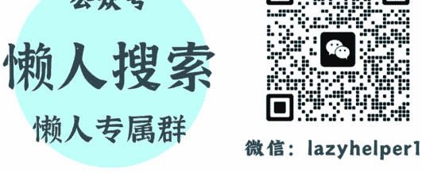

# 越南高层的爆炸性泄密

260210 猫哥

整理：公众号懒人搜索，懒人专属群精选

懒人微信：lazyhelper1

近期，美国一个流亡越人组成的 NGO“88 项目”，搞到了一份越南军方高层的文件。该文件的许多内容，堪称爆炸性。那么，这份文件究竟讲了什么？

2024 年 8 月，越南海军内部，起草了一份名为《美国第二入侵计划》的文件。文件起草者，是越南海军第一军区司令武文南少将。

单从这份文件的名称，便足以看出内容的敏感性。

文件围绕两个关键议题展开，首要内容，是研判美国可能对越南发动第二次入侵。

越南战争结束后，“美国已放弃入侵越南”成为国际社会的主流共识。

但这份军方文件提出了一个截然不同的判断：美国为了强迫越南选边站队，联手对抗中国，不排除再次对越南发动入侵的可能。

其依据是，美国推行“重返亚太”战略以来，已在南海周边部署了大量军事力量。在我们的认知中，美国在南海周边的兵力部署，是针对中国。

但越南军方给出了完全不同的解读：部署在南海周边的美军兵力，也可用于对付越南。

文件进一步研判，美军若发动入侵，将以两栖登陆为主要作战方式，由美国海军和海军陆战队作为先导力量，以 2 至 3 个航母战斗群为核心作战单元。

在文件起草者看来，这些兵力对抗中国远远不够，但用来入侵越南，则绰绰有余。最有可能的入侵方向，便是越南金兰湾一带。

美军将先在金兰湾站稳脚跟，再逐步向北推进，实现对越南的逐步控制。这是一个我们未曾设想的视角。

第二点，是越南军方对美国和中国的区别看待。

文件明确写道：美国是越南的“生存威胁”，而中国并非生存威胁，仅仅是越南的“竞争对手”。

意思就是，中国充其量要钱，因为中越双方，在许多产业上存在竞争，而美国可能要命，美国和越南不存在经济上的竞争关系。

但美国没有放弃对越南颜色革命的企图。

哪怕是美越关系持续升温的这些年，美国想要推翻越共的野心也是毫不掩饰。

比如，“美国国家民主基金会”（NED）从 2021 年到 2025 年合计在越南投入了 1 亿美元，这只是 NED 一家，“国际开发署”等其他机构也有大量投入。

在美国看来，越南再怎么和美国关系升温，终究达不到控制越南的目的。因此，美国不断推动越南政权更迭，文件说得很明确，美国可能煽动越南民众支持美国的入侵，进而实现越南政权的更迭，这也是将美国视为生存威胁的关键。

值得注意的是，《美国第二入侵计划》并不仅仅是第一军区司令武文南少将的看法，还得到了陆军、国防情报总局等多个部门的赞同。

越南海军司令陈清严中将，批准了这份文件。

随后，文件递交国防部、公安部、越共中央内政部，三大部门都没有意见。显然，《美国第二次入侵计划》反映了许多军政高层的看法。

这份文件的“出炉”，终于揭开了一个大谜团。

这些年，中越关系里一直藏着个大谜团：越南高层，尤其是苏林本人，到底是怎么看待中国的？

有人说，苏林是妥妥的亲华派，理由是其军警出身，意识形态天然和西方冲突。

也有人说，他要转头倒向美国，理由是在贸易战中，苏林的对美姿态很低。

但不管哪一种说法，都缺乏实打实的证据支撑，只是外人的猜测。加之苏林是老江湖，对中美表面上都客客气气，没法判断他心里的想法。

而《美国第二次入侵计划》这份文件，就是我们等待的实锤性证据。文件是 2024 年 8 月起草的，那时候，苏林已经成为越南的二号人物。

这么重要的文件，苏林没理由不看。虽说他没在文件上留下任何批示，但他的亲信、公安部部长梁三光，是明确同意了这份文件的。

这份文件还有个附件，是一份报告，名叫《2020 年 4 月至今“预防和阻止越南颜色革命”项目实施成果》。

内容大致是：越南从 2020 年 4 月开始，就已经意识到“颜色革命”的可能性，于是开展了打击颜色革命的专项行动，这事全程由公安部负责。

巧的是，2020 年 4 月那会儿的公安部部长，正是苏林本人。

附件提到，专项行动成果颇丰，包括但不限于：

- 对 75 人提起刑事诉讼；
- 对 809 人进行清除；
- 处理了 3272 个流亡反动分子的国内据点，并在 1235 人的居住地对其进行了抓捕；
- 取缔了 19 个非法社团和团体；
- 努力迫使梵蒂冈让阮泰合主教退休（此人是亲西方派，在越南基督徒群体里，影响力颇大）；
- 处理“苗族国家”领导人，严格管理 670 名 FULRO 成员（越南少数民族联盟，和美国关系密切）。

“预防和阻止越南颜色革命”项目是苏林亲自抓的，他的真实想法可想而知。

值得一提的是，“预防和阻止越南颜色革命”这个项目不是越南公安部一家在做的事。

附件里写得很清楚，项目由越南高层一起商定，总理阮春福签署了相关决定，传达给了 18 个部委和 63 个省份。也就是说，防范颜色革命是越南大部分高层的共识。

苏林个人的想法，是越南高层共识的一个缩影。

有意思的是，南方派出身的阮春福，一度被认为是激进亲美派阮晋勇的接班人，现在看来，阮春福的亲美态度，远没有阮晋勇那么激进。

越南实施“竹子外交”，看似为了两头捞好处，其实是越共骨子里害怕美国。

还是那句话：中国只是越南的竞争对手，无非和越南存在产业竞争罢了，美国才是生存威胁。一个要钱，一个要命，傻子都知道该怎么办。越南在中美之间的中立，是假中立，越方更担心美国，所以自贸易战以来，更偏向中国。

此前网上频频传出越南要倒向西方、疏远中国的传言，一直让人难以安心。如今这份越南军方绝密文件的曝光，终于解开了所有疑虑。

苏林亲自打击颜色革命的立场、越南高层的普遍共识、对美国入侵的深刻防范意识等等，都使得苏林时代的越南，绝无倒向西方的可能。

中国周边，多了一道坚实的保险。

最后，安利小懒的付费群：

懒人专属群 (介绍)

🗞 这里是你对抗信息过载的护城河。

已稳定运行 7 年，累计拆解、研读 3000+ 个互联网商业实战案例与行业前沿内参和时政/宏观文章。

我们不搬运垃圾，只做高价值信息的筛选器与放大镜。

## 懒人专属群更新记录:

https://hk57gvIx7u.feishu.cn/docx/HOkRdZbSbolBR0xkaXtcuVEOnTg

【免责声明】本资料归档于社群内部知识库，仅供成员课题研究与学术交流，请在查阅后 24 小时内删除。