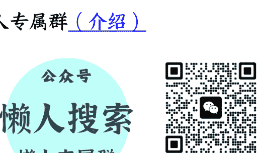

# 223 | 马斯克：SpaceX 凭什么支撑万亿美元 IPO

260211

整理：公众号懒人搜索，懒人专属群精选

懒人微信：lazyhelper1

欢迎打开《蔡钰商业参考 4》，我是蔡钰。

进入 2026 年，工业界有个消息特别扎眼：2 月 4 日、5 日两天，马斯克旗下两个团队，专门来中国考察了一圈光伏产业链。SpaceX 团队考察太空场景产业链，特斯拉团队考察地面产业链，各种技术路线都去看了。

这消息，让中国资本市场发酵出了“马链”概念。马斯克团队去过的一众光伏龙头企业，比如协鑫集团、晶科能源、TCL 中环等等，股价都被推起了一轮上涨。

而就在马斯克团队考察中国光伏产业链的前几天，北美市场还传出了另一个消息：马斯克的火箭公司 SpaceX，吸并了他的人工智能公司 xAI，合成了一家估值高达 1.25 万亿美元的巨型企业，来迎战 SpaceX 计划中的 IPO。

这是怎么个谋划？

正好最近马斯克上了个播客，把他对 AI、对能源、对 SpaceX 的整体构想都讲了一遍，四舍五入可以理解成“C 端路演”了。

我想给你划划重点。借他的视角，理解 SpaceX 这场市场最大规模的 IPO，也理解美国的 AI 和能源产业版图。

我们开始。

## 地面没电了

主持人问马斯克：数据中心成本里，只有 10% 到 15% 是能源成本，其余都是 GPU 成本。而在太空维护 GPU 更困难。所以，为什么要为了太阳能，把 AI 数据中心放到太空中去？

马斯克说，现在除了中国，世界其他地区的电力产出基本是停滞的。美国尤其如此。芯片产能在指数级增长，而电力产能却停滞不前。

他还预测说，到 2026 年年底，AI 芯片就会堆积如山，但因为缺电而无法启动。

而同时，太空有充足的太阳能。所以，只好芯片也上太空，去迁就能源。

主持人说，即便很缺电，也不是非上天不可吧？只要把美国国土的 1% 用来铺满光伏板，每年就能实现 1 太瓦的电力产能了啊？

我们解释一下：

太瓦是什么概念呢？相当于 12 座三峡水电站满负荷运行的电力产能。这样的产能一年产生的电能，大概相当于 0.9 个中国或 2 个美国的全年发电量。

这个问题，问到了马斯克的痛处。他是这么回答的：

要在美国国土的 1% 上铺满光伏板，比上天难多了。一方面，各州的许可证就能整死你；另一方面，公用事业行业行动非常迟缓，你想让他们扩充产能，光是研究报告就能写一年。

## 算力上天吧

即便不考虑这些行政难度，光伏板在太空中的发电功率也是地面的 5 倍，还不需要另配储能电池。因为太阳同步轨道上没有大气层遮挡，还可以 24 小时不间断发电，不需要电池来应对夜间供电。

所以，说起来，要大规模部署高耗电的 AI 数据中心，太空是最有经济性的地方。马斯克预言，36 个月，甚至 30 个月以内，太空就会成为所有科技巨头的首选。

你看，30 到 36 个月，也就是 2028 年，1000 天后的世界，太空算力成为首选。这个时间点你不妨留个印象。

基于这个判断，马斯克说，SpaceX 和特斯拉都计划，实现每年 100 吉瓦的太阳能产量，要把太阳能发电的全链条都掌控在自己手里。

你看，说到这里，就跟 SpaceX 和特斯拉在中国分别考察太空场景产业链和地面产业链，给联系上了。

马斯克说，现在地面太阳能发电已经很便宜，中国光伏板已经把每瓦成本压到了 0.25 到 0.3 美元。而放到太空的话，还能再便宜 10 倍。

所以，目前唯一的成本障碍，就剩太空运输成本了。一旦这个成本也降下来，在太空规模化发电的难度，就会比其它方式低一个数量级。

## SpaceX 成“太空阿里云”

前面说了，SpaceX 和特斯拉都想实现每年 100 吉瓦的太阳能产量，而 SpaceX 的发电舞台显然安排在了太空，那意味着什么呢？

主持人说，这不就等于要发射 1 万次星舰？如果要一年内完成，也就是，每小时就要发射一艘星舰，这么夸张吗？

马斯克觉得，一点也不夸张。在他看来，这比航空公司的飞机起降频率要低，用 20 到 30 艘星舰就够周转了。SpaceX 还希望发射能力达到每年 2 万到 3 万次呢。

如果，重要的故事来了：如果 SpaceX 有了这种规模的运力，同时在太空中又有 100 吉瓦的太空算力，SpaceX 不就从航天公司变成了一个超大规模云服务商了吗？这就是“太空阿里云”了。

马斯克还真这么想的。他说，如果自己的许多预测成真，SpaceX 发射的人工智能算力将超过地球上其他所有事物的算力总和。

你可能记得，SpaceX 计划 2026 年独立上市，估值上万亿美元，要募集超过 300 亿美元。如果成行，将会刷新史上最大规模的 IPO 记录。凭什么把融资规模拉到这么高？你看，前面这个超大规模的太空云服务商的故事，也是能帮 SpaceX 撑估值的。

## 万亿估值 IPO

好，接下来，就进入到 SpaceX 的资本叙事了。

主持人跟着问，这么宏大的叙事，感觉每年都需要大几百亿美元的资金才够用。这远远不是私募市场能给的。私募市场也许可以支持 SpaceX 几百亿美元的融资，但也就一次两次。所以，SpaceX 考虑上市，是因为每年都需要融大百亿美元吗？

主持人这么问，是有背景的。因为 SpaceX 成立这么些年了，马斯克有很多次明确表态，说不会让 SpaceX 上市。

原因是，SpaceX 的终极目标是火星殖民，这个工程极其艰巨、耗时数十年，而且前期投入巨大、风险极高。而一旦上市，就会面临着季度财报和短期股东回报的压力，很可能迫使公司转向追求短期盈利，放弃长期梦想。

马斯克推诿了一番，还是承认说，公开市场的可用资本，确实比私募市场多得多，可能要多出 10 倍，甚至 100 倍。这能帮 SpaceX 快速拿到钱，抢时间发展。

比起讨论为什么改变主意让 SpaceX 上市，马斯克还是更热衷于讨论太空算力的未来。

他说，从第一性原理考虑能源的规模化问题，如果能采集到太阳能量的百万分之一，也会是目前地球上所有人类文明发电量的 10 万倍。

当然，这是理论值。具体能实现多少呢？马斯克说，至少五年后，太空人工智能的年发电量将达到数百吉瓦，并且还在增长。在火箭燃料供应出现问题之前，太空人工智能的年发电量可以达到 1 太瓦左右。

## 万亿工厂

好，新问题来了：如果布局顺利，SpaceX 自己的太空电力 36 个月内就能达到 100 吉瓦，那芯片产能是不是又跟不上电力产能了？水多了可以加面，面多了又怎么加水呢？

主持人的问法是，目前全球的计算能力可能只有 20-25 吉瓦。到 2030 年，如果太空电能到了 1 太瓦，人类又如何才能获得太瓦级的逻辑运算能力呢？

马斯克说，他的再下一个计划，就是推动超大规模的芯片生产。他说，自己公开提过一个类似"TeraFab"的项目。

这个名字，有典故。Fab，就是“工厂”的缩写。Tera，中文翻译成“太拉”，在公制单位中代表 1 万亿。TeraFab，也就是万亿工厂，是一个超级制造综合体，不但生产芯片，也生产内存，还管封装。单个工厂集群的年产值目标要拉到千亿美元规模。

马斯克什么时候提过这事呢？

一次是在 2025 年 11 月的特斯拉年度股东大会上，一次是在 2026 年 1 月底的特斯拉业绩会上。马斯克明确表示，特斯拉必须自建 TeraFab，因为全球现有的芯片供应能力，满足不了特斯拉希望每年生产几百万台机器人和无人驾驶出租车的目标。

特斯拉怎么自建 TeraFab 这种超级工厂集群呢？

马斯克的想法仍然是，先去找阿斯麦、东京电子这样的厂商采购光刻机，研究清楚光刻机的工艺原理，然后再用第一性原理倒推，设计出产能拉高几个数量级的设备。

朋友们，请注意，马斯克也是想把光刻机重做一遍的。

主持人马上追问：中国到现在也还是没能复制出台积电，说明光刻机就是很难造。你不担心其中的难度吗？

马斯克马上说，我认为，三四年后，中国将会生产出极具竞争力的芯片。

啥意思？光刻机困不住中国。你看，在今天的世界工业领域，中国，真的是马斯克最尊敬的“友敌”了。

## 中国的胜率

既然说到了中国，我们一起来看看马斯克在这次访谈里对中国的预判。

他认为，如果美国没有突破性创新，中国将不战而胜，彻底占据主导地位。

## 为什么这么说？

马斯克的逻辑很简单：他认为，今年中国的电力产量将超过美国的三倍，而电力代表着实体经济，这意味着它的工业能力将是美国的三倍。

这是他奋起直追、拓展太空电力的原因。

另外，在大多数领域，中国的制造业也已经是更高层次的存在。比如稀土问题，中国真的能卡美国脖子，不是因为垄断矿藏，而是因为精炼能力别家没有。

这种高一级的制造能力怎么来的？因为拥有大量熟练劳动力。中国人口，本身就是美国的四倍，平均职业道德也比美国高，人们投入的工作量也更大。

这么比起来，美国靠拉动生育是不太可能赶超了。所以，马斯克要力推机器人 Optimus 的量产，让机器人上生产线。

## 总结

好，以上，我们借着马斯克的视角，其实理解了美国 AI 产业界对未来三五年的畅想，关键里程碑包括：

- 太空 AI，将在未来 36 个月内成为主流。太空电力解决之后，人类将会推进超大规模的“万亿工厂”集群，来生产芯片。
- 万亿工厂集群的劳动力会是机器人。
- 中国电力、中国制造对美国来说是高维存在。如果美国没有突破性创新，将完全失去未来主导权。

我个人觉得，这个故事确实够宏大，够支撑 SpaceX 的万亿美元估值的 IPO 了。但马斯克没说出来的另外两句话可能更重要：

- 第一，在特斯拉的电动车业绩增长放缓后，SpaceX 成了他产业版图里更好的叙事重心。你回头想想，SpaceX 对 xAI 的合并，其实是把 SpaceX 从一家重资产、长周期的航天公司，强行转型成了一家轻资产、高毛利的 AI 基础设施公司。
- 第二，SpaceX 所代表的太空新故事，其实也是在帮美国的 AI 泡沫续命。如果新的电力产能和工业产能赶在 AI 泡沫破灭前兑现，美国也就有机会躲过一场巨大的清盘。

能来得及吗？我们走走看吧。

再见。

最后，安利小懒的付费群：

## 懒人专属群（介绍）

微信：lazyhelper1

这里是你对抗信息过载的护城河。

已稳定运行 7 年，累计拆解、研读 3000+ 个互联网商业实战案例与行业前沿内参和时政/宏观文章。

## 懒人专属群更新记录：

https://hk57gvlx7u.feishu.cn/docx/H0kRdZbSbolBR0xkaXtcuVE0nTg

## 免责声明

本资料归档于社群内部知识库，仅供成员课题研究与学术交流，请在查阅后 24 小时内删除。

我们不搬运垃圾，只做高价值信息的筛选器与放大镜。