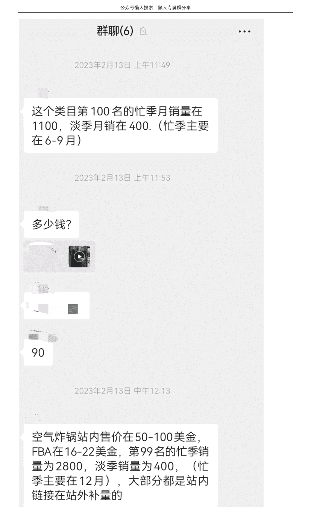
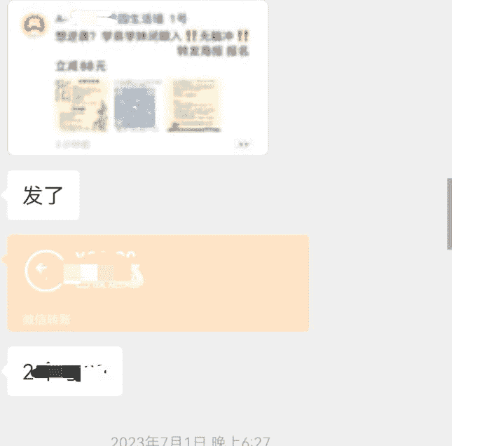
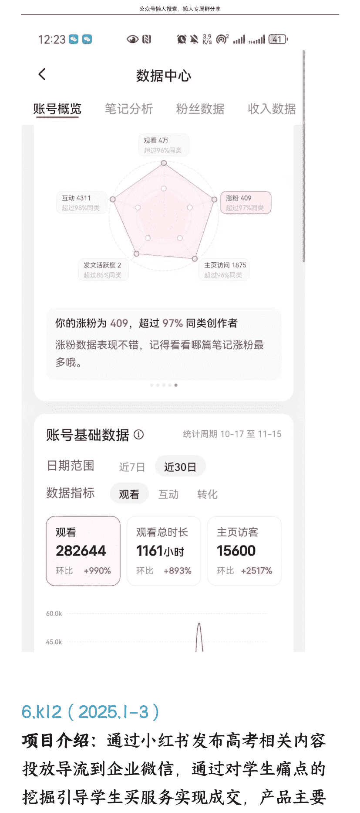
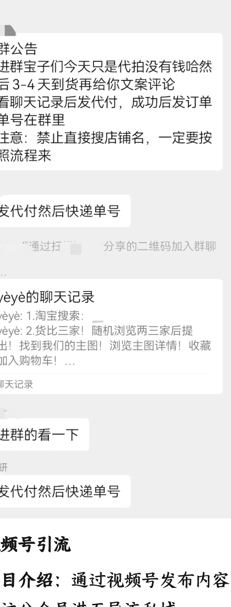
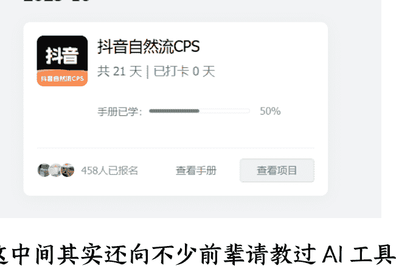

# 3 年跑通 10 个项目，我是如何找到好项目的？如何判断到底要不要换项目？

大家好，我叫耶耶，一枚生财二年级学生。这个话题是最近小灯塔被大家投票选出来的 top 话题，感谢生财鱼丸邀请~

请允许我先自我介绍一下:

广州 211 大四在读，也快毕业了。2023-2025 年自己下场实操过 12 个项目，跑通 10 个项目，主要是电商、获客、私域，目前主营盘是情感私域以及流量服务，综合月利润在 5-8w。也和很多做项目的圈友线下线上聊过（飞书会议，微信通话，公司办公室等等）

2025 年生财的阅读量 282w 字，日常信息输入量比较大。曾经也有同样的困惑，感觉生财的项目琳琅满目，总怀疑自己的项目是不是不够好，不知道是不是应该换项目？但又怕自己没有耐心，频繁更换项目拿不到结果。

## 2025 知识星球年度总结

wx.zsxq.com

你于 2024 年 4 月 10 日加入的星球

「生财有术」

荣获 2025 年度星球实力榜 TOP1

你在这个星球度过了 651 个日夜

已经是一个 2 年级生啦~

2025 年，你为星球贡献了自己的力量

表达过 145 次态度

发布过 63 篇内容/评论，累计 1.6 万字

有 679 人与你互动过

阅读过 3438 篇内容，累计 282.3 万字

相当于 3.4 本《悲惨世界》

<<上一页

下一页>>

看到这个问题后感觉和我过去心路历程很相似，正好快半年没写文章了，争取多多表达，希望能帮助圈友们少走些弯路，越分享越幸运！

网上都说看完一本书就相当于走过一个人的一生，那看完这篇文章也相当于走过我的三年。也算是我在生财两年的总结！2 年前的我根本不敢想象今天的我，也算是一种 10 倍增长了

废话不多说，本文我分为四个板块，全文 1w 字，预计阅读 10-15min

-   1. 我当时选择 xx 项目理由？结果？总结和反思？
-   2. 同一时间还在坚持做这个项目的人目前拿到什么样的结果？
-   3. 做这么多项目后，我会怎么找好项目，怎么做项目？
-   4. 如何判断到底要不要换项目？怎么勇敢做决策？不后悔不内耗？

## 一、项目理由/结果/总结/反思

如下图所示，2023 年到 2025 年我做过的 12 个项目，人也从青涩的大一新生到即将毕业的大四...

-   2023 年 2 月 抖音、小红书有货源 化妆品类、汽车用品
-   2023 年 5 月 抖音无货源 百货类
-   2023 年 6 月 测试线下教培
-   2024 年 2 月 情感私域和兼职/创业粉引流
-   2024 年 10 月 adhd 督学 小红书获客
-   2025 年 1 月 K12 主要负责销售板块
-   2025 年 4 月----至今 情感私域
-   2025 年 6 月 测试淘宝饰品
-   2025 年 9-至今 视频号导流 reddit toB 服务 抖音 cps

#### 以下是具体的细节:

### 1. 抖音、小红书有货源电商 (2023.3)

项目介绍:

先做抖音平台售卖防晒霜，洗发水等日化品 (抖音),后面才做小红书、小红书平台售卖百货类目

这两个品类不是同一时间做，为了防止篇幅过长，直接写在一起。

#### 选择理由：

-   1. 当时口罩刚结束，和亲戚一起去义乌找货源（亲戚做美区亚马逊，类目电子产品：电动牙刷，体重秤，手电筒等户外用品）打开了新世界的大门，一个成本 6 块钱的电动牙刷，在亚马逊卖 9.9 美金！并且在路上告诉我身边有人做抖音做抖音精选联盟很赚钱。

-   2. 我想既然有了产品（因为是潮汕人，周围人做电商，自有货源）我直接开始卖不就行了，我们有这个供应链优势。
-   3. 既然其他平台能做，那么这个平台也能做。并且这还算新渠道，相比于淘宝，拼多多更适合新人进入

#### 结果：

抖音两个类目都跑通了（收益：一个月赚 2000+，但是放不大）小红书没跑通（小红书当时基本没流量，怎么发都是小眼睛两位数）

#### 总结和反思：

-   1. 个人能力不足：对生意是茫茫然的状态，这一阶段纯靠自己的闭门造车，对搜索词的优化，货物实拍。不知道要怎么优化，该做的事情都做了（优化详情图主图，补单，拍视频）防晒霜如果走精选联盟，利润率会非常低，基本上利润一瓶只能赚 3 块钱（原先利润 45r）加上自己没有 PR 能力，不太懂怎么谈合作
-   2. 平台政策：类目本身不违规，现在回看单纯是因为小红书的商城流量不行，官方分配流量较少。

如果当时在生财，应该能意识到小红书的导流微信价格异常便宜！！！那会导流微信很爽啊！

公众号懒人搜索，懒人专属群分享

2023 年 4 月 4 日 晚上 11:17

你做精选联盟的话，打算自己做短视频或者直播吗

那没事，不急

: 我晚点再跟你说

如果不的话，就是找主播或者团长推

短视频可以 直播感觉难

利润基本都给他们吃了

自己做短视频卖的话，利润空间就大

精选联盟很多人做利润都是几毛钱的

一单

只能多销

利润基本都给他们吃了

然后一天几千上万单

这么少 那这种更适合饰品

精选联盟很多人做利润都是几毛钱的

毛钱的

客单价高的我没了解过

### 2. 线下教培测试闭环 (2023,6)

# 项目介绍:

通过地推传单、高中校园墙投放广告的方式获取学生/家长微信，进而引导线下实现成交。

#### 选择理由:

因为高中学校算市前列，我能解决师资的问题，有场地和设备可以使用，并且以前有校友做教培机构赚到钱了

#### 结果：

投放效果不佳，只拿到少数客资，但是 0 转化，没赚钱

#### 总结和反思：

-   3. 投放渠道不对从而否决了这个项目。加上学生已经放假没有时间去测试更多的渠道（当时对抖音，小红书获客并不了解，只知道做博主带货或者卖课能赚钱）
-   4. 我当时投放的是学校教育质量一般，很少人有学习的意识，用户本身意向度天然低
-   5. 从流量渠道直接低成本验证（500 块钱左右）从我能能不能获客，销售能否复制，去思考要不要做项目要比我有什么更加落地和具体

### 3. 抖音无货源电商 (2023.8)

# 项目介绍:

用第三方工具 (鲸吞代发) 获取搜索量大的“蓝海”产品，通过参数设置筛选出拼多多有的产品，进而一键批量上架，一天铺几百个，在拼多多对接商家发货，进而赚取差价

#### 选择理由:

因为抖音做精选联盟，会有大量 mcn 和达人找上门，其中夹杂做知识付费教你怎么运营无货源的。当时自己也不是很会运营，又看到对方朋友圈晒销售额刺激了我的欲望，遂交了笔学费

#### 结果：

项目是跑通的，但是利润实在太低，日均销售额在 5000-10000r，利润却只有 100-300r，且回款周期在 14-21 天，并且每日消息客服信息非常多，而且自己对类目不熟悉，品真的太泛了，有时候会出现我需要去拼多多问商家，进而再去回答抖音客户。拼多多商家发货不及时进而导致店铺信誉分下降，进而流量减少，爆品也是一种苦恼啊！

#### 总结和反思:

-   6. 开始有了回款周期的概念 (如果想要长期做我最少都要垫资 7w 元，最低利润可能就 1400r) 我当时本身没什么钱，又目标远大，后续就觉得不能做这种回款周期太长，且不那么赚钱的项目，我会被账期拖死
-   7. 在早期，有流量真的比有货源更重要更重要更重要
-   8. 有些事情不能自己解决要找人解决

### 4. 情感、兼职私域 (2024.3)

# 项目介绍:

通过抖音，小红书发布内容和私信用户，添加到有意向用户的微信，进而在微信上实现成交。用户的需求是情感问题，和兼职需求。

#### 选择理由:

-   1. 偶然在抖音评论区留言，有人来向我加微信，并且实现闭环，发现我能解决对方的困惑，对方也愿意为我付费。（就很巧）
-   2. 兼职粉，这个其实也是朋友圈看到有人说 xxx 地区需要线下兼职，就了解到原来有这样的需求。

2024 年 4 月才加入生财，加了太多赚钱项目根本看不完，也不知道从哪看，不知道“私域”“mvp”"ltv"这个概念，只知道用户加我微信，愿意为我的服务给我钱。对流量也没有便宜和贵的概念，没有实名的需求，平台封号限流也不算太严

#### 结果:

当时小红书抖音引流了 2w 广州兼职粉，情感项目倒没有跑很大，但我现在的助理就是这个时候招聘的 (主要是到处旅居了大半年....世界很大，我想去看看)

#### 总结和反思:

因为现在这成了自营盘，不过当时还不知道到底怎么才能放大，没有去多请教人，多接受信息。同行调研不够细致，不知道怎么调研同行 (后文会讲更高效的方法)

### 5. adhd 督学 (2024.10-12)

项目介绍：通过小红书发布内容，引流注意力不集中的人群到我们的微信，通过朋友圈营销和一对一销售，成交，服务是通过监督师监督用户每天的学习和生活习惯

#### 选择原因:

其实这个项目也是偶然，一开始是线下组局有个圈友提到 adhd 这类人群 (adhd 是个疾病，表现就是注意力不集中，作息颠倒，拖延，启动困难。其实现代人多少都有，但严重的 adhd 是很影响日常生活的) 小红书情感类目经常被限流，本质上都是内心有困惑，我也能做这个生意。但是具体实操后，发现这类人群的更需要的是日常的监督，加上发现当时圈友在做，

且把这个非标准化服务标准化，就觉得能模仿。

**结果：**旺季能够达到月入 3-4w，但当时不会投放（有意识但是确实不会，其实还是自我设限了）不懂怎么优化服务，复购率较低

#### **总结和反思：**

这个项目说实话挺满意的，能快速跑通（主要是自己对这类人群有体感，**这是核心**，和我的日常比较符合）也招聘过几个线上助理和交付人员放大，也感受到在小的项目都能赚到钱（我之前看到这个客单价以及交付时长，觉得这赛道也太垃圾了吧，但打脸了）**核心**是看自己怎么标准化/差异化运营。

#### adhd 土豆老师

小红书号：yyy888yye000

找到自己喜欢的生活方式
不断精进，形成自洽
做有温度的监督 有温度的教育
做有求必应的博主
adhd 结构化监督/咨询@抹茶老师

情感博主 首都师范大学

341 关注 4101 粉丝 4.9 万 获赞与收藏

互相关注 私信

群聊 查看详情

#### 笔记

ADHD 督学 or 咨询 号 去掉 000

### 6.k12 ( 2025.1-3 )

项目介绍：通过小红书发布高考相关内容投放导流到企业微信，通过对学生痛点的挖掘引导学生买服务实现成交，产品主要是线上私教，服务通过微信群辅导进行交付

选择理由：参加生财的线下组局，圈友在做高考教育，adhd 督学项目已经过去旺季了，也想学习怎么规模化，并且自己也比较了解高考生这类人群 (在做销售的过程中，看学科分数就能判断这个学生在哪个板块有不足) 圈友付一给我抛了橄榄枝 (这里特别感谢付一，确实学习到很多思维方式和项目放大的方法，具体大家可以看我第一篇精华帖，感谢生财这个平台)

结果：项目亏钱 (实话实说，当时还蛮崩溃的，因为流程和逻辑是通的，但是做的特别费力)

#### 总结和反思:

-   9. 赛道已经卷到需要真人出镜做短视频了，需要公域的信任度，流量成本提高。
-   10. 我们的转化链路过长 (好不容易将学生说中，学生需要说服家长付费，又有一个信任的重塑) 出错的频率太大
-   11. 赛道好，不代表自己能道
-   12. 我们当时的打法是资料引流，但是资料粉往往意味着人群不精准，需要朋友圈种草长期营销积攒信任，但我们选择的是一对一销售，本身赛道不缺少供应，也没有做出差异化或者信任积累，转化困难。并且后端服务成本过高也断续出现了问题。哪怕项目能放大，也容易出现给员工打工的情况 (ROI 太低)

-   13. 一定要定期参加生财线下聚会，不单能学到好多可复用的技能和决策，更更更重要的是能链接到具体的人和项目。也是在这个项目中我才知道到原来规模化是这样做：sop，百问百答，完善的案例库，数据统计等等

### 7. 私域情感（2025.4-至今）

项目介绍：通过在抖音，小红书发布内容，吸引有意向（情感困扰的女性为主）的用户评论并且导流到微信进行成交，以陪跑的形式。（很多人以为是走个人 IP，其实不是，我们模仿的是机构的打法，无非是我们微信朋友圈会运营的更加生活化，前端流量是没有 IP 的）销售我们是通过低转高的方式去做（先付低客单做微咨询再转高）

#### 选择理由：

-   1. 通过海量面试调研了情感同行（内容形式，内容模板，销售流程）需求是一直存在的，我能解决流量，能让用户买单即可。
-   2. 情感项目属于账期短，先付费再服务的类目，没有账期，且用户是刚需，不需要朋友圈长期营销，只要能搞到流量就能赚钱。
-   3. 看到优秀的同行做的内容和销售 sop 不够细致，甚至有些团队连 sop 都没有，但是还能赚不少钱。我能复制
-   4. k12 有非常多学科我们可以标准化，那该赛道用户同样也能根据年龄，性别，问题，进行标准化。做适合不同人群画像的销售漏斗。

结果：目前是 招 了 一个 助理 还有 一个 后端 主要 做 交付，月 利润 在 5-8w，等 今年 315 后 再 决定 是否 要 扩大 规模 了（每年 315 平台 封控 会 严重 很多，现在 会 刻意 避开 这些 时间 点）

### 8. 小尝试（2025.6-今）

#### 淘宝某饰品电商

选择原因：这个品类当时挺火的，有品牌在私域规模做的很大，但不清楚具体在公域平台的具体量，有朋友刚好长期做饰品类目，也想扩展类目，遂一起测试。

结果：刚开始赚钱，投放后亏钱，类目利润率虽然高（20 元成本品类，卖 120 左右）但是淘宝这个品类退货太高了，品类也很泛，没有主打品，量也很小，就导致了战略上的失焦。

#### 反思和总结：

-   14. 有猜想，最重要的是快速测试闭环，及时验证/止损
-   15. 要善于和他人合作，如果我自己再去学淘宝的运营，很耗费时间。
-   16. 在私域能做的品未必能在公域做，和运营有很大关系，公域运营的空间太小（8 月份后就发誓不碰国内实物电商了，个人认为复制的难度比较大）

#### 视频号引流

项目介绍：通过视频号发布内容引导用户关注公众号进而导流私域

选择理由：几百年没联系的朋友在跑的项目，因为一些资质问题来问我怎么放大，怎么解决，因为数据真的很夸张，算是超级异常值。风口来了，遂参与到这个项目当中。

结果：日引流 5k-2w 兼职副业人群到企业微信

反思和总结：要多发声多表达，很多时候迷茫是因为当下信息的闭塞，一个信息，一句话，往往就能带来指数 10 倍增长。

> 然后最后是这个问题，如果是我会怎么办？。这样子讲，如果本身已经有自己的后端搭建出来了，那我会全部把这些流量吃掉；如果我这时候还没有转化的路径和后端，那我会尽量找到好的服务商，全部卖掉，并且再去扩大一下前端的流量，把这波流量都打出来，如果评估这是一个以后还会长期存在的生意，以后还会有流量，只是没有这么大，也会自己留 20%-30% 去借机把自己的后端搭出来

#### reddit tob 素人种草

项目介绍：帮助甲方在海外平台 reddit 完成大量的素人种草，当兼职流量够多且可靠时，就会有甲方转介绍。

选择理由：在国内流量价格如此贵的情况下，本身就想了解海外流量，来都来了，接了再说，哪怕自己不懂

结果：签订了一些长期合同，如下图

1.3 在执行项目完毕后，完成当月具体执行工作量及内容的前提下，以达到甲方要求的相应工作目标，其中包括 Reddit Thread 发布... 部分，乙方每月提供 25 篇 Reddit Thread。

2.3 项目方案报价以人民币计价，甲方支付币种为人民币。

2.4 本项目按照项目实际工作内容与工作... 拟定项目执行费用报价，单月实际支付费用人民币... 共计 12 个执行月。

| 工作细节 (每月) | 单月价格 (含税) |
| :--- | :--- |
| 50 个...的稳定 VPN | 人民币 25000 |
| 25 篇 Reddit Thread 发布 | |
| 20 条 Reddit Comment | |
| 3 条 平台点赞/评论 | |
| 汇报 (提交发帖和评价图，通过线上文档汇总数量); | |

#### 反思和总结:

-   17. 世界就是个草台班子，优质甲方这些钱就是有花光的预算，怪不得都叫甲方爸爸...海外的信息差很大，海外流量大有可为，如果迁移到国内小红书，这个项目顶多就是 2000 块钱了。
-   18. 很多时候当时觉得没有用的信息，知识，后面能带来巨大的收益 (一年半前引流的人现在居然能用上) 要好好做好私域

#### 抖音 cps

项目介绍：抖音发布内容通过给用户传递、使用密令的方式，引导用户下单进而赚取佣金

选择理由：之前 7 月份航海家私域大会后有去怡然老师公司咨询过一些内容团队的问题，当时受益很大，想进一步学习怡然老师的思考方式和内容理解，并且测试下抖音视频形式的流量分配。

结果：变现 500r 左右

#### 反思和总结:

-   19. 出现了基建问题，一定要做好基建的维护，不管做什么赛道，事先要检查流量如何。
-   20. 在一场直播中学习到的控制变量的能力 (后文细讲)

这中间其实还向不少前辈请教过 AI 工具站，海外 tik/Facebook 获客，因为没有自己去实操，就不展开

大概三年就做了这些项目，总共是 12 个，大部分都是低成本启动的项目，个人认为属于普通人能模仿的路径。一开始的测试项目更源于好奇心，实现商业的闭环和了解各个行业，后续测试更偏向测试流量渠道。

算是真正把手弄脏！不过我后续发现大部分项目从开始就很难放大，后文会从我现在的视角谈谈如何现在如何找好项目，避免走弯路。在回答这个问题之前，我想再给大家一组数据，那些现在还在做项目的人怎么样了？

## 二、还在做那些项目的人现在结果怎么样了？

- 1. 小红书百货实物电商（和我做的品类一致）23 年也没跑通，现在单店铺利润稳定 3 万+/月

- 2. 抖音短视频挂链接，持续做了 2 年没太大起色，2025 年下半年爆了视频，单店现在能做到月入 10 万利润

ps:

2024 年 9 月该团队有 6 个抖音直播间，并且计划做更多直播间放大项目，但 2025 年 10 月直播间只剩下一个。

2025 年下半年身边有人从职场走向创业，在广州 1000 平的工作室来做抖音带货直播（品类是尾货女装）

抖音精选联盟的团队做起了自己的电商品牌，同时也有签约主播带货，年营收 10 位数，应该是目前接触下来做的最大的

- 3. 抖音无货源电商

0 人在做，抖音后续对无货源管控非常严格，不再能通过第三方平台拍单（给你快递单号）但是淘宝、拼多多、咸鱼依旧有人做。

ps：无货源这种生意是一直能做的，无货源的本质是分销，无非是看平台政策

- 4. adhd 督学

圈友找到 10 倍增长的项目做出取舍放弃了这个项目，这个项目月利润 10 万+ 是没有问题的（但必须走付费流，自然流效率太低了，25 年小红书管控太严了，也很考验团队的组织能力）本身交付较重 + 非标（当然也是一套 sop 的事情）

ps:1 月份有了解过有公司深耕 adhd 这类人群，并且和高校实验室合作，做的 adhd 家长生意，教家长如何教育 adhd 小孩，客单价上万，年利润 200 万左右。

- 5. k12 高考教育

找到 IP 合作，视频号 200 多万粉丝

- 6. 美区亚马逊电商

合伙不顺利，并且合伙人分开后成为竞对，互相价格战，规模和利润不及以前，心力交瘁，当然也有自己选品的原因，关税影响并不大。

- 7. 情感项目

今年有团队在山东单月利润 100 万，也有团队放弃这个项目进而去海外平台 Facebook、tiktok 获客至 WhatsApp 成交 (海外私域)

看完总感觉世事无常，市场的变化太快，能够穿越周期太难了。说真的如果大一我知道做个生意带团队要这么难，可能考公去了哈哈哈哈

那么，为什么同样的项目，有些人能放大，有些人退场，这中间的差异到底是什么？平台政策？项目上限不够高？个人能力？运气？概率？合伙？擅长？兴趣？商业模式？时代红利？市场的不确定性？到底如何找到好项目？

## 三、跑通这么多项目后，我会怎么找好项目，怎么做项目？

### 1. 怎么找“好”项目？

有人说好项目就是有门槛，越做越轻松，是基于长期主义的。有人说好项目是高客单高利润，有人说好项目是超级个体，不需要堆人力，通过影响力放大，通过搭建一套系统，能够自行运行。好项目是流量渠道多元，好项目是快速跑通闭环.....

每个人对”好“的定义和标准不一样，连标准都不一致，怎么寻找？因此我要提第一个反常识，不用好坏去定义项目。

我过去总是以为自己有什么独特的优势进而再去选项目，但其实这个标准大部分时候是不客观的，我们认为的优势往往不是优势，只是我们想做某个赛道进而强行找的理由。

现在看到一个项目我只会用三个标准去思考并判断是否做，只要满足了以上三点，往往意味着我们有赚到百万至千万的可能

- 21. 有没有真大哥/圈友手把手带：别管七七八八的，有大哥大于一切！

- 22. 我能不能复制/模仿：内容形式，商业模式，现金流，流量渠道（如果学习成本不大的话可以边做边学）

- 23. 能不能把非标标准化、流程清晰化（这是规模化前提）：标准化的产品没有普通人的机会，非标才有大额利润，但是大部分非标很难做大，没法做大就意味着没法扩大规模和利润。如果能非标标准化往往就是我们普通人取胜的时机（比如把咨询服务变成 SOP 或者边际成本较低的产品）

以上是大方向的选择，落实到具体的人身上还可以有下面的参考：

#### 标准一：当下目标/状态

- a. 急需现金流：负债在身，急需生存上岸

- b. 改善生活：寻求第二曲线（有可能最后走向创业）同时赚点零花钱，享受成长

- c. 深耕事业：欲望和野心比较强，想要创业，也享受创业

#### 标准二：项目经验

- 没有跑通项目。

- 跑通过多次 0-1, 没有 1-10。

- 跑通过多次 0-1, 以及项目 1-10。

不同阶段就有不同的选项目标准，核心区别是愿意接受正反馈的时间和收入预期。

- 关于 a 阶段

那你肯定不能做工具站这种长时间反馈的事情，seo 找词铺词本身就不快，做产品自传播也需要你对用户需求深度的洞察，这不是能短时间速成的事情。要么赌一把拉满执行力，给自己划个 2-3 年时间去试错，要么就是找大哥带，那我们就优先做正反馈相对较快的项目，什么是离钱最近的事情？——卖别人的产品，去做流量找客户，而不是学习，先学习再赚钱离赚钱特别远。

- 关于 b 阶段

有些圈友是在主业做扩展，互联网就相当于一个个人能力放大器，那很可能就是做做垂直细分的公众号 (不要小看公众号，有生财圈友是做细分赛道 + 私域赚到 1000 万) 有些圈友只是想简单做做副业享受正反馈，那生财航海的大部分项目都是没有问题的，一般来说公开的项目规模化难度会大 (否则不符合逻辑)

- 关于 c 阶段

核心是打开自己的大脑，接受新事物，培养 2 个踏实愿意干活的助理/左右手，搭建标准化手册招基层员工，当然也有些人能做到差异化/精细化运营或者模式创新。同时不同的业务对人的要求也不一样，有些业务很容易放大，有些业务很难。这和我们所在城市也很多关系，如果你在深圳，那你就不适合做哪些低毛利需要堆人的业务，这种业务更适合在广州、长沙、郑州、沈阳等城市。

但有时候项目确实符合标准，但是为什么我们跑不通？很牛逼的人也会经常项目失败，大厂很牛，但是也有砍掉业务线的时候。

我想引用一下之前请教怡然老师一个问题来解答

Q：内容创作是一个非标准化的事情，你们是如何培训新员工的？

A：爆款本身是无数爆点的排列组合，一个 30s 视频爆了，分为 10 个画面，那就有 10 个变量，很可能是其中某个分镜，我们通过迭代其中一个/某几个画面，或者优化一些画面进而能更快速产生爆款。具体做法：会给新员工一个已经爆量的视频，让员工去模仿/迭代视频，而不是直接原创，可能员工觉得是 A 画面好，但我们觉得是 B，那我们就去通过保 ROI 的方式去看员工素材投放消耗量，进而推断。（大概是这个意思）

因此我的答案——

项目跑通/放大

=A*B*C+D*E*F+G*H*J+...+n

通往成功的答案有 n 个，你找到其中任意一组即可。可能小明成功是因为 A*B*C，小李成功是因为 D*E*F，你是 G*H*J...但在做之前，我们永远不知道什么时候会找到属于我们自己的答案。

因此我想说第二个反常识——项目不是选出来的，选只是初步的判断，项目可行，但结果如何是测出来的！比起一时间选择，更重要的是提出猜想，快速验证，数据驱动，进而做迭代，再做出选择。

### 2. 怎么高效测项目？

每个项目都有各自具体的方法论，大家移步生财官网搜索即可，本文不展开。

但是从长期来看，比起打法，更重要是测项目的思维和习惯。

个人分享三个比较高效的习惯/思维：

#### 找到优秀的具体的同行/圈友请教/借鉴

我过去特别喜欢一招，直接去 boss 直聘，通过简历适当美化，海量面试和 hr/老板们交换信息，这样一天面试 10 家公司我就能用 A 公司的信息换 B，B 公司的信息换 C……基本上 hr/老板都会把一些信息给我。

最明显的好处就是你线下看过具体的人，具体的公司在你面前的时候，你在做项目过程中会更加笃定。

但现在回想这样效率太低了，初期可以用，毕竟金钱成本低。

效率更高的方法:

- 付费找猎头

- 开 boss 直聘公司账号批量面试应聘者获取信息

- 适度包装去面试更高阶的岗位，比如流量合伙人，销售管理。

- 具体方法论如下（建议大家多跑跑线下，线下和线上的体感很不一样，确实有很多很厉害的圈友不愿意在线上发声，此处感谢善良美丽的前大厂高管圈友解答我的问题）

很简单，因为无论是对方公司还是猎头都只会愿意跟高阶的候选人聊得更多，所以把你们的身份包装上去是更有利于你。你去跟猎头沟通的时候，拿到更多竞对公司的信息，以及你在竞对公司这儿去面试的时候，你可以拿到的信息会更多一些。因为招小朋友和招稍微高阶一点的候选人，那他们其实愿意透出来的信息度是不一样的。

我之前尝试过这个借口，但是还听不到真话，很多后端都会包装，数据失真比较严重

> 耶耶：说是流量服务商吗

你就把你自己的简历，比如说我随便举例啊，以公司来讲的话，就是你看，你是 0~3 年的工作经验，然后你的求职薪资只有比如说十几万、二十万。那你把自己包装成为我已经工作 5~7 年了，然后我的薪资可能要求是 50 万到 60 万以上。然后，把你的简历投放到这个 boss，然后脉脉这些求职软件和平台上面。然后，如果你有心仪的岗位，你就去投。那这样子的话，人家搭理你的这个乐意程度会高一些。首先是这样子的，猎头会出手去搜的岗位就一定不是第一阶岗。那不是第一阶岗，就意味着如果你包装成为一个小朋友，你就不知，你就都已经接触不到猎头这个渠道。而猎头这个渠道的优势是可以给到你们的信息

#### ps:

- 24. 有些开放的同行会愿意交流，但这只是少数（一般小圈子才会分享）极少人愿意把自己赚钱的流量渠道/账号分享，除非对方笃定你复制不了

- 25. 我之前尝试过流量服务商的理由，但后端往往会数据失真，夸大转化率，且大部分甲方都想压低乙方的价格，但不为失是一个方式

##### 做日报/周报

项目放大的本质就是发现一个事情能赚钱，提炼方法论，通过各种途径去重复这个有效动作。

做好周报，日报，方便后续测项目控制变量 ab 测试，回溯分析（到底哪里做对了，哪里做错了，关键的变量是什么）不管是个人还是团队，都有很大的意义。

举个例子：

如果你是做获客导流微信，一天发 5 条小红书/公众号/视频号，就会有不同平台，不同的内容策略，不同的浏览量，客资数量，线索质量，转化率等等数据。会有很多变量，变量一多，不做统计，我们是找不到共性的，找不到策略和数据之间的关联，就很难规模化标准化。

有人会认为是流水账，写下来并没有什么用，不会去看，但大人时代变了。很多观念我们都要重塑了，通过 AI 分析我们日常，能够发现很多微小的思维习惯和行为模式，很多事情都是由无数微小的念头决定了我们的人生。

很多人有讨厌做日报的习惯，这和上班打卡有什么区别！我也一样，所以大家可以做个轻量化的迭代，推荐给大家两个方法

- 1. 直接面对面建立微信群，语音输入微信聊天框即可，后续直接转文字丢给 AI 即可，长久以来有巨大的价值。

- 2. 每晚和 AI 语音通话（最近我很喜欢这个功能，聊着聊着就睡着了...）

### 罗列不为清单 ( Not to do )

什么是好战略？做对的事情，把事情做对。但是往往我们不知道什么是对的，只能不断的摸索，通过犯错以后续避开错误来找到正确的道路。

在测项目的过程中，个人的一些不为清单 (实时迭代):

- 多余的信息输入，频繁看其他人的项目

- 为了学习而学习

- 不做数据统计，不做日报

- 完美主义，想太多做太少

- 做国内实物电商 (狗都不做哈哈哈哈)

很多人在测项目的过程中依旧会有 fomo 情绪，害怕错过 AI

但大部分项目要想放大都离不开招个助理，就算是超级个体也是如此，与其焦虑，不如专注到我怎么做才能让我的产出更高，时刻想我现在做的能不能用一个助理替代 (这个思维我认为一种十倍增长，是对自己时薪的重视的最明显的感知)

这里不写 AI 是因为目前依然有一些社交媒体是不接受 AI 工具的批量化操作的，如果未来解决了，那就是交给 AI 和助理

## 四、如何判断到底要不要换项目？怎么勇敢做决策？不后悔不内耗？

### 1. 如何判断要不要换项目？

其实答案就四个字——量化思维。很多人测项目都没有量化思维，不单单导致效率的低下，同时也陷入情绪上的内耗、纠结。当有量化标准之后，决策就会理性很多

#### 时间投入

具体到每天花多少小时（以及你优秀的同行每天花多少小时）愿意花几个月或者年测试项目（一般我是给自己 2-3 个月跑通 0-1）

#### 金钱投入（预算往往比我们想象的多）

具体到设备，账号，AI 工具，学费（付费请教）等必要开支

#### 心力支出（这个非常非常非常重要，很多人就是在这个点异常纠结）

可以想象一个血条（具体怎么玩，可以问 AI）

每次获取数据上的正反馈，就多加一滴血，每次获取负反馈就减一滴血，一个项目能够接受 100 滴血。

一旦时间到达期限，金钱，血量耗尽，不恋战换一个项目，否则容易看不到头。

### 2. 如何勇敢做决策，不后悔不内耗不焦虑？

#### 1. 理性来讲：

遇到问题我们要先质疑问题，再去拆解问题。到底什么是焦虑？想到焦虑，大部分人想到的场景就是神经紧绷，失眠，心悸的症状，望闻问切，光知道症状不知道病根并不能解决问题。

焦虑是一个很泛的词，你怎么定义焦虑，怎么定义不焦虑，这中间的界限在哪？每个人都有自己的定义，很模糊，模糊意味着解决很难找到发力点，连问题都是模糊的就算是万能的 AI 都解决不了。

往下深挖，找到自己病根，是因为项目测试想要大结果，还是因为恐慌 AI，是因为不知道不会创作内容，还是因为....进而去针对性对病根进行解答，多多寻求具体的人给你具体的帮助。

#### 2. 感性的讲：

我现在偶尔会焦虑（因为有所求，这很正常）但我很少内耗，几乎没有后悔过自己的决策，（从小很多事情都是我自己决策的，包括自己去哪里读初高中，上大学）

### 个人分享一个亲测好用的 tips:

每次做决策，不管结果怎么样，在做决策后的那一刻，都告诉自己：老子真牛逼，真**牛逼。

不管是赚钱，还是亲密关系都很有用，变成习惯后，就会更加笃定，勇敢相信自己的直觉。人就活一辈子连自己都不相信自己，说实话我觉得好可惜。

顺便附上拥有一猫一狗，已经 30 岁退休的怡然教练的答案。

### 关于如何处理焦虑情绪，如何提高心力？

这个情况就是一个心态问题，之前第二次创业的时候，当时因为遇到疫情，所以没有办法拿到下一笔融资，然后同龄的创业朋友，他们有比较幸运拿到了下一笔融资的，但是过了半年之后随着双减和一些别的政策和情况下来的时候 其实我是很好就容易掉头了，他反而陷入了更大的困境，他因为拿了更多的融资不想停止，然后投资款用完没法继续融下一笔借了贷款去坚持又运营了两个月，最后剩下一堆负债。后来就意识到很多事情，要用更长的时间去看待的，就当时你可能觉得不如意，有可能事后来 看，反而是幸运的，所以我觉得就没有必要纠结于当下的困境

另外一个你可以用一个 vlog 博主的视角去看待生活，就当我们就遇到不如意的事情，你把它记录下来，其实他是一个很棒的素材，就正常平平无奇的事情其实是没有什么观看的，但是博主是很愿意看到生活中发生比如说有黑店坑他呀，或者是被人骗了呀，等等这些事情，对他们来讲反而是有意思的点，那你就用这样的方式去记录生活

精神自由是很难的，所以把它放在了财富自由和时间自由后面，因为精神自由的人，不会因为现金流紧张焦虑，不会因为涨跌而感到焦虑的。因为那个状态其实都把这些当做游戏了

## 写在最后

通往成功的道路千千万万，有时候会发现同样的项目，不同的人倡导方法论截然相反，逻辑也完全不同，但世界就是一个巨大的矛盾体，没有人规定怎么样就一定能成功。

本文很大的篇幅都在写我的个人经历，方法论写的很少，当时看到这个问题，其实第一反应是这一句话就能讲清楚，写长文反而给圈友们带来噪音了。

转折点是在某一天，我发现人往往通过故事/他人的经历来了解这个世界，大道至简，往往大家都是绕了一圈之后，才发现没有比大道理更简单的道理了。

而在这之前，我们往往是看了许许多多数体的人，具体的事情，直到未来某一刻，蓦然回首，他人却在灯火阑珊处。

希望我的经历能够给大家补充心力，也希望大家能够听进简单的道理，坚决的执行，快速迭代，毕竟，这是唯一确定的事情。

祝大家过个好年，找到属于自己的窄门，一起生财有术，马上有钱！

## 最后，安利小懒的付费群:

### 懒人专属群 (介绍)

微信:lazyhelper1

> 这里是你对抗信息过载的护城河。

已稳定运行 7 年，累计拆解、研读 3000+ 个互联网商业实战案例与行业前沿内参和时政/宏观文章。

我们不搬运垃圾，只做高价值信息的筛选器与放大镜。

### 懒人专属群更新记录:

https://hk57gvlx7u.feishu.cn/docx/H0kRdZbSbolBR0xkaXtcuVE0nTg

【免责声明】本资料归档于社群内部知识库，仅供成员课题研究与学术交流，请在查阅后 24 小时内删除。