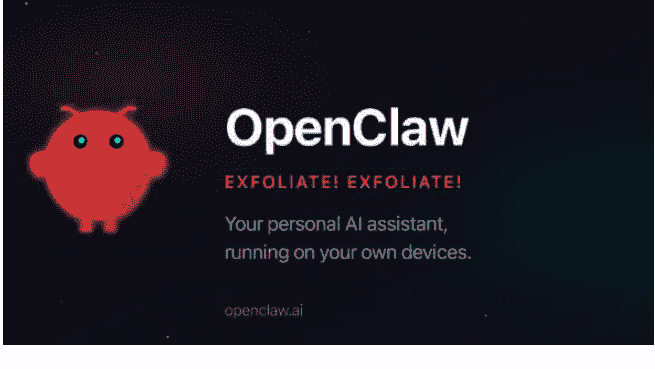
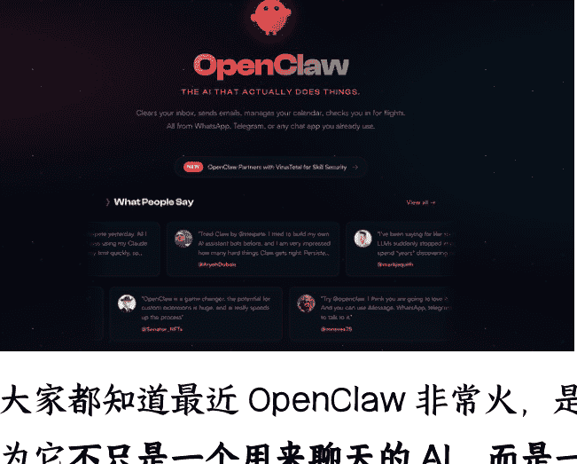
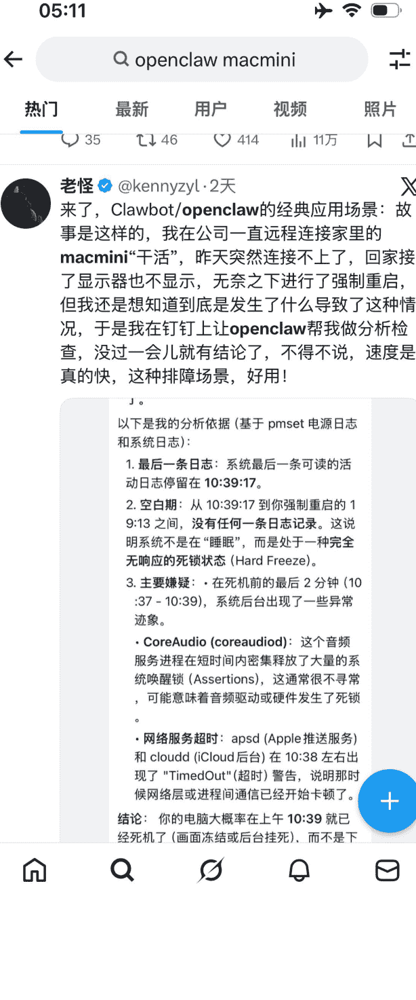
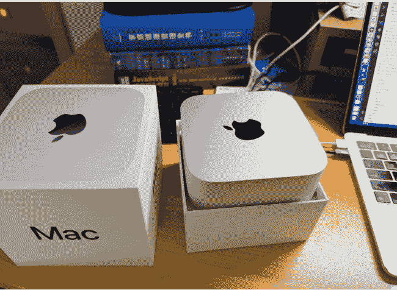
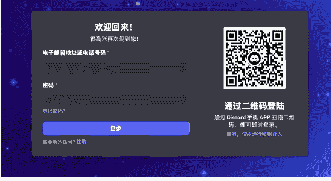

公众号懒人搜索，懒人专属群分享

# 从 0 到 1 手把手教你搭建 OpenClaw 私人助理 (超详细)

260213 副业 SC 精华

公众号懒人搜索，懒人专属群独享

懒人微信：lazyhelper1


| 文档版本 | 更新描述 | 作者 | 更新日期 |
|---|---|---|---|
| V1.0.0 | 新建文档 | 科学羊 | 2026-02-09 |



大家好，我是科学羊。

- (10W+) 爆文公众号专栏日更作者;
- 时间管理工具，「时迹-TimeFriend」的作者;
- 知名报社签约编辑;
- 海外内容创业实践者;
- YT 海外游戏视频创作者;
- 生财垂直公众号航海教练 + 传术师;
- 生财 ClaudeCode 航海教练;
- AI 产品开发变现实践者;

本期，我想给大家分享一期关于最近非常火的 OpenClaw 的搭建方法和我自己踩过的一些坑。话不多说，直接开始！

# 一、为什么 OpenClaw 这么火？



大家都知道最近 OpenClaw 非常火，是因为它不只是一个用来聊天的 AI，而是一个能“帮你做事情”的系统。简单理解就是，以前你用 AI，需要自己一步一步操作，比如先让 AI 写内容，再自己去别的工具做图、整理资料，而 OpenClaw 的思路是把这些流程交给 AI，它可以接收一个任务，然后自己调用不同工具，把步骤自动完成。很多人觉得它厉害，是因为现在 AI 的发展方向已经从“回答问题”转向“执行任务”，也就是所谓的 AI 代理（Agent）。再加上它可以直接在 Discord、或者 WhatsApp、以及企业微信、飞书等地方使用。

比如 Discord 本身就像一个可扩展的工作空间，适合接入机器人和自动化，所以组合起来就变成了一个可以随时下指令、自动执行的 AI 工作台，这也是它突然受到关注的主要原因。

我最近在 X 里也浏览了很多大家对 openclaw 的观点和评论。



公众号懒人搜索，懒人专属群分享

openclaw macmini

热门 最新 用户 视频 照片

49

> **TuTu 生活志** @tutulifestyle · 4 天
> OpenClaw 真正恐怖的能力在于——它不只改代码，还能改硬件。对我这种纯小白来说，有了想法就能落地，门槛直接归零，设备接到 Mac Mini 上面，仅用聊天就能搞定全部。给大家看看最新整活：《户子机器人 1.0》🤖
> 
> 84 112 843 18 万

> **Do Xuan Hien** · 2 天

徽言 @iamcheyan · 2/1/26

> 用了 OpenClaw 之后，第一次真切感觉到电脑活了。
>
> 昨天在 NAS 上跑了一个，先是让他给我分析了一下我的文件构成，并给了我一些清理文件的优化建议。当时人在电车里边，觉得这东西还挺有用的。
>
> 想晚上要给他装一个新的虚拟机。就让他自己去下载 ubuntu 的系统镜像。几分钟后就下好了，告诉我说，等我回家后直接就能装了。于是就用他下好的镜像，给他配了一台单独的机器。
>
> 装好之后给了他最高的权限，让他自己再去装需要的软件。他就配置好了 SSH 和 RDP，又自己下了一个 chrome 浏览器。我让他尝试发一条推特，也发出去了。
>
> 于是给他设了几个长期指令：
>
> 每天定时抓新闻，翻成日语，用符合我当前水平的词汇，通过 Telegram 推送给我。这样早上醒来的时候能看看新闻。
>
> 把我所有的开发代码放在他控制的机器上。出于好奇，我是真的想试试。真的不是为了炫耀或者跟风，就是单纯热爱和好奇心，哪怕这个玩意真的对很多人来说可能只是一个泡沫....，其实那也无所谓。
>
> > 就像数字生命卡兹克所说：好奇心这个东西，可能比聪明更重要

## 一、好奇心这个东西，可能比聪明更重要

我一直觉得，好奇心这个东西，是很难被后天培养的。有的人天生就对世界充满问号，看到什么东西都想上手摸摸，哪怕摸完发现没啥用，也觉得值了。有的人则不是这样，他们更喜欢确定性，喜欢按部就班，喜欢把每一步都想清楚再动手。

这两种人其实都挺好，但在 AI 时代，好奇心强的人真的会被放大得非常厉害。

这几年我见过太多这样的例子了。有个小伙伴刚来的时候，专业能力说实话不算特别突出，但他有个特点，就是什么新工具都想试试。Deepresearch 刚出来他就用上了，Claude Code 啥的也比很多人 6，后来比如 Clawbot 这些东西一出，他第一时间就扑上去研究。

现在他一个人能干的活，说实话，放在两年前可能需要三四个人。

我私下跟一个行业里的大佬聊过这个事，他说了句话让我印象特别深。他说，AI 时代，会用 AI 的人和不会用的人，差距真的就像人和猴子。这话听着有点刺耳，但我有时候觉得，他说的确实就是事实。不是说不用 AI 的人就不行，而是说，AI 把很多原本需要大量时间精力的事情，变得轻而易举了。

你如果会用，那些时间精力就能省下去做更重要的事。你如果不会用，你还在那儿一点一点磨，人家早就跑出去十万八千里了。

那么，其实怎么满足自己呢？

首先，我看了很多帖子，现在 OpenClaw 有很多支持你部署的方式，比如 Mac Mini、树莓派（其本质就是 Linux 环境）、云端服务器、Windows 虚拟机、甚至 ESP32 和华强北改装的设备（本质我猜测就是个 ESP32 微处理器）等等。

但是，综合来讲，我研究了其生态和本质，最优的选择就是——Mac Mini！所以，二话不说，先买一台回来，管他多少钱，需要就要投资直接买。

你可能会说，我不是有 MacBook 吗，为什么还要单独买。

因为我就是拿来开权限给他做测试，随便搞。我笔记本有重要资产，玩不起啊。



# 二、如何搭建和安装 OpenClaw?

我们重点讲解 Mac 的安装，其实端基本的方法都一样!

另外，本次讲解，主要是 Discord 和 OpenClaw 来结合，其他的第三方工具其实原理类似。

注意注意：前提条件，科学上网是必须的，大家自行解决。我这台 Mac 我是直接搭建了家庭住宅静态 IP，如果大家需要学习如何搭建请翻看以往精华帖 (TK 那篇) 即可。(机场也没问题)

## 2.1 Discord 环境搭建

### 第一步：注册 Discord

网址：https://discord.com/




注册之后新建一个属于自己服务器，然后就可以直接进入自己的主页（这方面有很多类似的教程，大家都可以搜）。

### 第二步：配置开发环境

### 2.1.1 新建一个应用

### 2.1.2 配置 Bot

### 2.1.3 配置 OAuth2

### 2.1.4 安装这个应用

复制上图红色标记的链接，然后新开一窗口打开，长下面这样：


默认选择权限即可，就可以安装成功。


这个时候你就可以打开你的应用，如下图：


当你随便输入某个指令后，你会发现它不回复，或者给你回复一串代码「上图所示」这个很重要！先放着，我们后面用！

以上 Discord 基本 OK，接下来我们安装 OpenClaw。

## 2.2 OpenClaw 环境搭建

### 第一步：打开终端输入官方给的链接

https://openclaw.ai/


输入：

```bash
curl -fsSL https://openclaw.ai/install.sh | bash
```

注意，如果输入这句指令报错可能是你没有管理员权限，可以增加 sudo：

```bash
sudo curl -fsSL https://openclaw.ai/install.sh | bash
```

接下来，你不需要做任何事，等待即可，可以喝杯茶悠闲等待。

### 第二步：基础配置

安装完成之后，会显示下图的图片就算是安装好了。

```text
/Users/yang/.openclaw/completions/openclaw.zsh:3570: command not found: compdef
yang@madeMac-mini ~ % clawbot config
zsh: command not found: clawbot
yang@madeMac-mini ~ % clawbot config
zsh: command not found: clawbot
yang@madeMac-mini ~ % clawbot
zsh: command not found: clawbot
yang@madeMac-mini ~ % openclaw config

🦀 OpenClaw 2026.2.6-3 (85ed6c7) — I read logs so you can keep pretending you don't have to.

▓▓▓▓▓▓▓▓▓▓▓▓▓▓▓▓▓▓▓▓▓▓▓▓▓▓▓▓
        OPENCLAW 🦀

OpenClaw configure
Existing config detected

workspace: ~/.openclaw/workspace
model: moonshot/kimi-k2.5
gateway.mode: local
gateway.port: 18789
gateway.bind: loopback
skills.nodeManager: npm
```

然后你按照我图片配置即可：


这是一个警告提示，yes 即可。


### 选择 QuickStart


我用的是 Kimi K2，这里大家按照自己的情况来选即可，但是一定要提前准备好 Key。比如 Kimi 的 key 需要在：

https://platform.moonshot.cn/console/api-keys


### 为什么要选择 Kimi? 有人给了答案，


选择 Kimi，然后输入你的 key。

继续：


选择 Keep..., 然后继续。接下来，您会看到选择聊天工具的选项。您可以先选择 [Skip for now]（注意注意，这里有坑，一定先选择 Skip，我们后面再配置，我就当是卡在这里了，先跳过，选了也还是白选）。


其他配置，如 Gateway Port 设置，可以保持默认值 18789。对于 Skills 和包管理器，选择 npm 或其他选项，其余所有选项都可以选择 Yes。


对于 Skills，您可以跳过此步骤，或使用空格键选择您需要的技能，其它别选，直接跳过!

参考我这个：

### 然后就是界面选择

然后会自动弹出一个 Web-UI，如下图：


你只需要在 Chat 里面测试，能否聊天，只要有回复，说明 OpenClaw 已经安装成功了！

注意：我在安装的时候这个地方失败了好多次，基本估计是配置问题。我重复了几次，甚至重新新建一个 Kimi 的 Key 就 OK 了，大家在过程中如果失败不要气馁，可能就是一一些细节没注意到才导致的呢。

## 2.3 Discord 和 OpenClaw 建立关系

你可以重新开一个终端，输入：

```bash
openclaw config
```

这时候就会进入配置页面：


### 注意接下来的选择：


### 选择平台：


选择之后需要粘贴 token。

那么，这个 token 从哪里来？

这个时候你需要回到：

https://discord.com/developers/applications


在这里复制 Token，然后输入到终端。


然后最后几步按照上图配置即可，以上完成就 OK。

最最最后，把你刚才和 Bot 对话他给你发的指令复制下来发给终端。


如图，你需要发送：`openclaw pairing approve discord` 你的 pairing code（比如：`openclaw pairing approve discord TCWXRTTQ`）。


以上配置全部完成～～～

## 2.4 交互测试

第一种方式我们说过了，其实你不用配置 Discord 和 WhatsApp 都可以用，但是网页端没意思，是吧。


第二种方式就是 Discord 来交互，如下图：搞定！


# 三、其他扩展

## 3.1 企业微信 + 云服务器

其实你也可以尝试搭建在云端服务器，然后绑定你的企业微信来测试，比如，我测试过：

https://cloud.tencent.com/act/pro/double12-2025（注意需要买海外的服务器，轻量级就可以）


搭建方法和我们 Mac 的方式一样。

假如你需要对接企业微信，就需要成为企业开发者然后用企业微信来实现远程操作你的 Agent，如下图所示。具体关于企业微信的配置我就先不写了，大家如果感兴趣，我在后续补充。


## 3.2 常用指令

### 启动 OpenClaw 的 TUI

```bash
openclaw tui
```

### 重启网关

```bash
openclaw gateway restart
```

### 开启新对话

```bash
/new
```

### 添加备用模型

```bash
openclaw models fallbacks add [模型公司代号/模型名称]
```

例如：`openai-codex/gpt-5.2-codex`

### 设置默认模型

```bash
openclaw models set [模型公司代号/模型名称]
```

例如：`kimi-code/kimi-for-coding`

### 网关命令

```bash
openclaw gateway start    # 启动
openclaw gateway restart  # 重启
openclaw gateway stop     # 停止
```

### 其他命令

```bash
openclaw tui        # 命令行对话
openclaw config     # 配置 (修改模型，通道，网关，等。。。)
npm update -g openclaw    # 更新 OpenClaw 主程序
npm uninstall -g openclaw # 卸载 OpenClaw
```

### 模型管理命令

添加备用模型 (主模型不可用时自动切换)。

```bash
openclaw models fallbacks add [提供商代号/模型名称]
```

示例：添加 OpenAI Codex 作为备用。

```bash
openclaw models fallbacks add openai-codex/gpt-5.2-codex
```

设置默认模型。

```bash
openclaw models set [提供商代号/模型名称]
```

示例：将 Kimi 设为默认编程模型。

```bash
openclaw models set kimi-code/kimi-for-coding
```

## 3.3 如何新增每日推送新闻订阅

你只需要在终端运行一行命令：

```bash
openclaw configure --section web
```

然后它会提示你输入 API Key，你粘贴进去就行。


如果你还没有 Brave API Key：

- 1. 去 https://brave.com/search/api/
- 2. 注册免费账户 (每月 2000 次搜索)
- 3. 创建 API Key，复制下来
- 4. 回来运行上面的命令，粘贴进去

具体执行截图：


## 四、discord 突发中断怎么办？

先启动 OpenClaw 的 TUI 看对话是否正常。

```
openclaw tui
```

## 可能的原因

- 1. Gateway 连接断了 — Discord 连接可能掉了，需要重启
- 2. Token 过期 — Discord bot token 可能过期了
- 3. 频道权限 — bot 可能被禁言或没权限读消息

## 检查/修复步骤

- 1. 检查 Gateway 状态

在终端运行

```
openclaw gateway status
```

- 2. 如果状态异常，重启 Gateway

```
### 先启用重启权限
openclaw config set commands.restart true
```

```
### 然后重启
openclaw gateway restart
```

- 3. 检查 Discord Bot Token

去 Discord Developer Portal (https://discord.com/developers/applications):

- 你的应用 → Bot → 看 Token 是否有效
- 如果显示 "Invalid" 或 regenerate 过，需要更新 token

- 4. 检查频道权限

- bot 是否还在频道里？
- 是否有 "Read Messages" 和 "Send Messages" 权限？

### 手动启动 (每次开机后)

打开终端，运行：

```
openclaw gateway start
```

好了，以上就是今天的分享，但是文章并不止步，关于 OpenClaw 的详细用法和技巧，我会学到新的内容后第一时间来更新文章，欢迎大家的关注与支持。

## 最后，安利小懒的付费群：

### 懒人专属群（介绍）


微信：lazyhelper1


📌 这里是你对抗信息过载的护城河。

已稳定运行 7 年，累计拆解、研读 3000+ 个互联网商业实战案例与行业前沿内参和时政/宏观文章。

我们不搬运垃圾，只做高价值信息的筛选器与放大镜。

### 懒人专属群更新记录：

```
https://hk57gvlx7u.feishu.cn/docx/H0kRdZbSbolBR0xkaXtcuVEOnTg
```

【免责声明】本资料归档于社群内部知识库，仅供成员课题研究与学术交流，请在查阅后 24 小时内删除。