公众号懒人搜索，懒人专属群分享

## 如何用 AI 打造可持续变现的自媒体生意？

## 260213 副业 SC 精华

公众号懒人搜索，懒人专属群独享

懒人微信：lazyhelper1

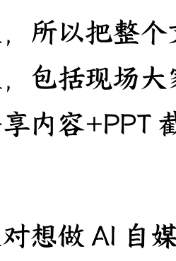

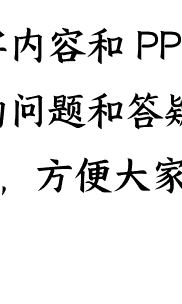

微信：lazyhelper1

哈喽大家好，我是竹子，生财 AI 传术师。

1 月 23 号的时候收到七天老师的邀请，说要不要在长沙组局分享一下 AI 自媒体经验，于是我们就敲定下来 2 月 8 号的组局。

感谢生财的雅月老师，帮忙过内容和 PPT，感谢子安和@大魔帮忙组局，感谢@辰风老师帮忙号召了很多小伙伴来参与，以及感谢每一位来参与的小伙伴～还收到了圈友手写的春联，非常开心～

这次分享局线下小伙伴很多人和我说收获很大，所以把整个文字内容和 PPT 都分享出来，包括现场大家的问题和答疑。以下是分享内容+PPT 截图，方便大家查看。

如果对想做 AI 自媒体的小伙伴有帮助，就太开心啦！

### 自我介绍

我是竹子，今天的分享人。我是一个自由职业者，主要做 AI 自媒体和 AI 板块的知识付费，目前是一个万粉博主，也有自己的知识付费产品，主要在 AI 生图和 AI 视频这两个板块，累计学员超千人。

我是 2023 年 4 月加入的生财，5 月在生财的风向标里实践了一个 AI 还原四维彩超的项目赚了第一桶金，后来尝试过咸鱼，视频号，YouTube，都跑通了变现，从 2024 年开始做小红书 AI 自媒体，但是因为带娃时间不够，更新不多，2024 年大概只更新了 30 几篇内容，涨了 1000 多粉丝，广告零星接了几个。

正儿八经更新是从 2025 年开始，2025 年更新了 160 多篇笔记，一年内单篇广告费报价从 200 涨价到 2000，最高的单篇笔记收入有 5k+，目前连续半年每月广告收入过万。

### 分享嘉宾：竹子

AI 自媒体万粉博主 | 生财有术 AI 传术师 | AI 知识付费千人学员教练

- 在生财的经历：
    - 2023 年 5 月，在生财风向标里“捡”到一个用 AI 把四维彩超还原成宝宝长相的项目，赚到 7w 左右
    - 做过闲鱼二手书、视频号带货、Youtube AI 视频，都跑通了但是都没坚持下来
    - 做过 7 次航海志愿者，1 次领队，1 次 YouTube 航海教练
    - 写过 4 篇帖子，3 篇精华帖
    - 2025 年主要精力在小红书 AI 自媒体和 AI 赛道知识付费

### 今天给大家分享的内容是：

## 如何用 AI 打造可持续变现的自媒体生意？

从流量获取到商业闭环的完整实操指南

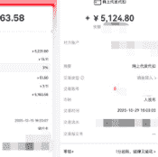

分享人：竹子

## 以下是这个项目的介绍，以及我在这个项目上的一些成果：

## 项目介绍

- 项目介绍：AI 自媒体变现
- 项目成果：变现 6 位数，连续半年单月广告收益过万，最高单篇笔记收入 5K+
- 项目现状：AI 工具、教程内容博主增多，内容同质化，但是 AI+ 垂直赛道解决方案是稀缺的
- 项目机会点：AI+ 垂直行业解决方案

## 部分收益截图

## 本次分享能给大家带来的收获：

## 分享目录：

## Part1: 2026 年，AI 自媒体还有没有红利？

其实很多人对这个 AI 自媒体还挺感兴趣的，特别是亦仁老板之前在 2024 年底的时候还发过这个超级标。

AI 浪潮下，本文旨在连接几千个中国最聪明的 AI 自媒体人，将自然所有的理工男创业者、超级懒人，定义为超级搞钱，带你去变现好项目。此篇是超级 AI 自媒体，从模型到练手，产品、工具、平台分门别类、广告市场案例。保证案例真实且准确到广告渠道。种草很好。AI 自媒体平台：

### AI 自媒体到底是什么？

它是一个桥梁，基本算是连接行业资源的桥梁。AI 自媒体一个项目是不是值得干？它有足够大的空间，能容得几百甚至上千位朋友进入。能做的时候，有几十位甚至更多朋友实现一年多赚几十万甚至上百万的目标。有变现路子出现，上千万元有可能。

这几个观察和发现：

- 1) AI 领域有很多新的领域，这时候头部的赛道有很大一部分会进入和用户需求上：
- 2) 有很多新的 AI 产品、已经在各个新媒体平台（公众号、小红书、抖音、视频号、B 站等）迅速被 AI 博主投放广告。这让我感受到了流量火的时候，多公众号都“和钱过不去的惨痛记忆”。
- 3) 我最近的一个小动作，用小红书写几个月，找几十万粉丝，就接了百位的广告单，价格是 8000/月。我在一个平台看看有哪一个平台能做到几万粉丝和好的广告。我出的一个机会。目前是我在 AI 平台的招商。每天都有涨粉，我时刻关注每天广告掉粉前的很多是 AI 产品，出现变化将一瞬间，完成一个不可捉摸的大转折。
- 4) 现在 AI 产品的种草效果很好，我已经在各种自媒体号的号下面或者买了不少 AI 产品了。
- 5) AI 创业者的每个平台都跟互动好的。需要注重结构，结合各个平台的话题和定位。
- 6) 最重要的是定位。做 AI 自媒体时切入点非常多，可选平台也非常多，因为 AI 商业化几乎所有数据都带来变化。我们看到数字里面可以为你好的东西，而出去都是巨大的信息差。具体定位道理，可以等待!!🔨🛠🔨🔧🔨🔨🔨🔨
- 7) 我们平台 11 月刚上线 AI 新媒体选题，等着听下场。你吃这信息差就开始动起来。不需要你重新干，说不定这时候，你就可以成为我这样😂

综上，如果你还没有找到赛道和抓手干起，要不要试试这个？!

# AI 自媒体，其实就是 AI 博主作为 AI 工具/资讯/技能与用户之间的桥梁，分享 AI 在各个场景的应用

这一年，我也是眼见着很多的自媒体博主涌入 AI 这个赛道。内容眼见着越来越同质化，一个选题爆了，就有几百上千个博主来模仿这个选题。比如第一个 AI 透视海报这个，单独再去搜，至少能看到上百篇类似的笔记。（当然，其他赛道应该也差不多是这样）

然后就会发现，做 AI 自媒体，关注你的那些粉丝都是同行，都是 xx AIGC，但凡你有一篇笔记爆了，就会有很多 AI 博主模仿你~

那么现在，入局 AI 自媒体，还有没有红利呢？

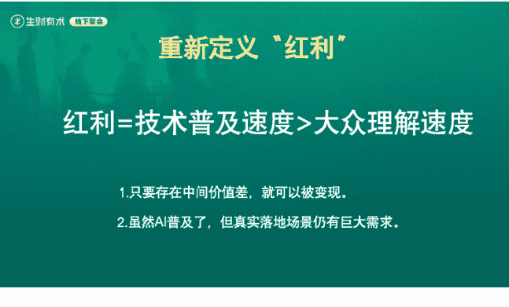

### 1.1 先定义什么叫“红利”

我理解的红利：

红利 = 技术普及速度 > 大众理解速度

大家在生财这个圈子里，可能觉得大家都会用 AI，所以觉得没什么红利了。

但实际上，还有大把的人，连 AI 工具的网址都找不到。我更新视频就经常在评论区遇到，明明我在视频里说了工具是什么，但是还是有人问，这个是什么工具，怎么用？

在朋友圈里，我甚至看到豆包都能开课卖到 199。

所以，大家不要高估用户，只要“会用的人”比“想用的人”少 → 就存在中间价值差 → 可以被变现。

#### 2025～2026 年现状：

- AI 工具渗透率虽然较之前高，但是覆盖面还是有限的
- AI 真实落地场景仍有很大的需求
- 中间断层依然存在

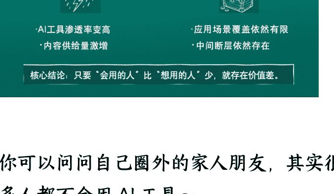

你可以问问自己圈外的家人朋友，其实很多人都不会用 AI 工具~

#### 结论：

所以，只要满足：

- 企业/个体有内容需求
- 不会系统用 AI
- 不想自己研究
- 想知道更多的 AI 应用场景

→ AI 自媒体仍存在红利

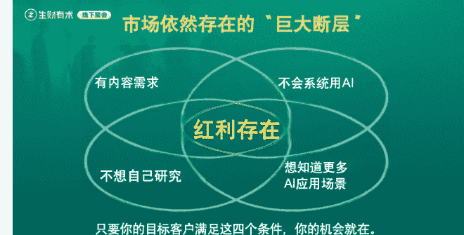

### 1.2 现在入场晚了吗？

很多人会纠结，现在内容这么卷，我入场还来得及吗？

那么，换个问法：

如果今天不入场，半年后你会不会更被动？

目前 AI 自媒体赛道的现状是：

- AI 工具迭代速度快
- 内容生产门槛降低
- 内容供给量增大
- 但会“教别人怎么用 AI 在特定领域中落地应用”的人仍稀缺

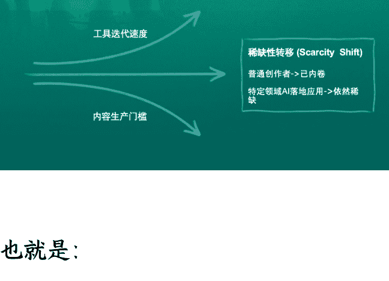

也就是：

普通 AI 内容创作者 → 内卷
AI+ 垂直行业解决方案 → 稀缺

#### 那么，AI 自媒体的机会点是正在转移的：

从“展示 AI 有多厉害”转向“AI 帮某一类人解决具体问题”，这个问题是这类人愿意付费的。

即，结果导向 > 技术炫技

如果我们上面分享的，AI 做新年透视视频的那个案例，其实对于大部分人来说，那个没有实用场景，大家也就看个热闹，除了设计师和 AI 博主，其他的人根本用不上。

什么叫做教别人用 AI 在特定领域中落地应用呢？后面在 AI 自媒体定位中，我们会详细讲~

## Part2: AI 自媒体如何变现？

那么 AI 自媒体如何变现呢？可以分为前端流量和后端产品两个部分。

### 2.1 整体模型

流量入口 → 信任建立 → 解决方案交付 → 长期复购（口碑又可以反哺信任建立）

### 2.2 前端流量变现

前端主要是做流量和涨粉，通过 AI 工具的甲方，投放广告变现。现在 AI 工具很多，很多都需要投放推广，很多大家熟知的 AI 工具，都和 AI 博主有长期合作，比如即梦、稿定 AI、豆包、lib、Lovart 之类的，都会长期投放。如果能成为他们的长期合作创作者，一个月的收入是很可观的。

#### AI 工具 + 品牌广告

逻辑：

- AI 工具公司需要用户教育
- 品牌需要内容曝光
- 你负责把“复杂功能”翻译成“普通人听得懂用得上的使用场景”

#### 常见内容形式：

- 工具测评视频，比如秋芝 2046 做的大部分都是工具测评类，视频比较长，工具测评类可能需要自己花些成本去购置软件会员

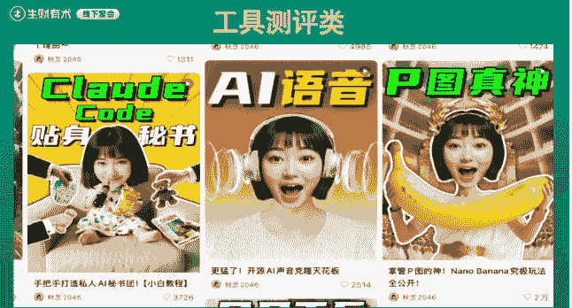

- 场景式应用展示或者教程，大部分 AI 博主，包括我自己，做的都是这种场景式应用展示或者教程，就是用某个 AI 工具，演示某个场景的应用，比如做设计、做图文、做 AI 赋能教学的案例等等。

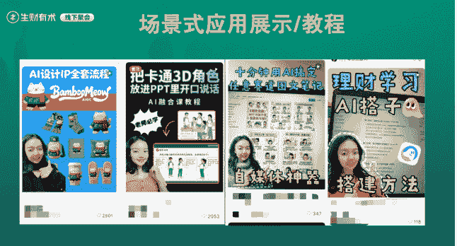

- 平替方案对比，比如国外的工具用不了，用国内的如何代替，别看这种视频拍起来很简单，但其实很下沉，数据都很好。

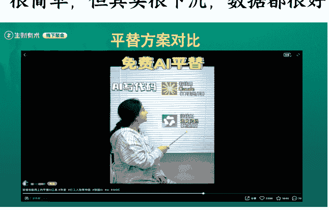

#### 变现方式：

- 品牌合作费
- CPS 拉新分佣
- 工具付费分成

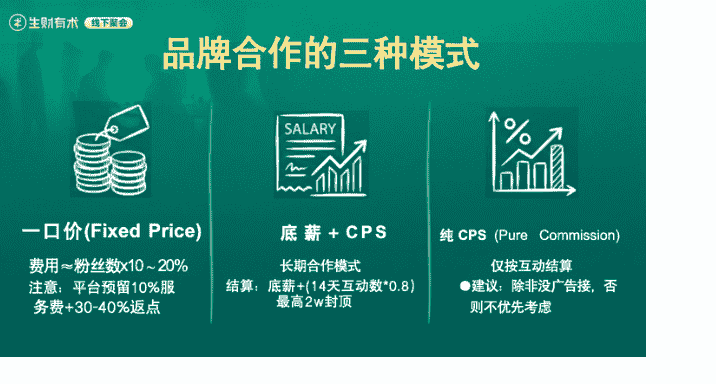

#### 合作方式：

1. 一口价合作：费用一般是粉丝数量 x10%~20% 上下，如果账号数据很好，可以谈更高的广告费。走蒲公英和线下，报价不一样，走平台要预留出 10% 的平台服务费和 30~40% 的返点费用。
2. 底薪+cps 合作：部分 AI 工具和博主有长期合作，比如有些平台是发一篇这个工具提供的选题的笔记，给底薪 + 按照 14 天互动 (点赞收藏评论) *0.8 结算，最高 2w 封顶。
3. 纯 cps 合作：有的工具是纯按照互动 (点赞收藏评论)*cps 结算，有更好的选择的话，这个基本不考虑。如果没有广告可接的话，这个活还是可以干的，至少发了有数据就有钱，还能给你账号多一个内容产出。

#### 接广告避坑点：

1. 能走平台尽量走平台，虽然服务费要 10%，但是对账号比较安全。目前平台对宣传比较狠，走线下的 AI 工具，是有点限流的。其次就是，能更快收到广告费，因为是需要甲方提前付款下单的，笔记合作完成后，7 天就能自动结算。
2. 耳熟能详的 AI 工具广告可以放心接，一些小作坊的 AI 工具，自己体验之后看情况接。如果功能很拉垮就算了，功能做的不行，公司多半也不太行了，搞不好结款要等很久。如果确实还不错，可以提前问好结算周期和结算方式，最好是能签合同，避免结款权益问题。

### 2.3 后端变现

很多 AI 自媒体博主，目前还是局限于广告变现，后端能做自己的产品和交付的，相对来说不算很多。

而且广告费用大多时候和你的数据和粉丝量挂钩，如果你要一篇广告能赚到 1000 以上，得要接近万粉才行了，这个路径，相对来说还是需要一些时间的。

那么我们其实，在做账号的时候，就可以考虑好后端你想做一个什么样的产品，以让用户购买你的产品为目的，去输出内容。

#### 打造自己的产品与服务闭环

- 靠品牌吃饭是一部分收入
- 自己有产品才有更稳定的现金流

#### 闭环结构：

内容吸引 → 店铺转化到私域 → 产品成交 → 社群留存 → 案例反哺内容

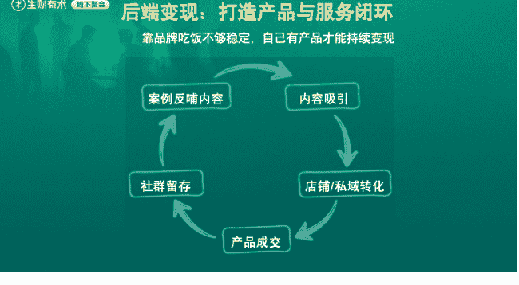

常见的三种后端产品形态：

##### ① 知识型产品

- 针对不同人群和需求的 AI 课程，比如 AI 生图、AI 视频、AI 编程、AI 做 ppt、AI 知识库、AI 工具流等
- 资料包/知识库/提示词库

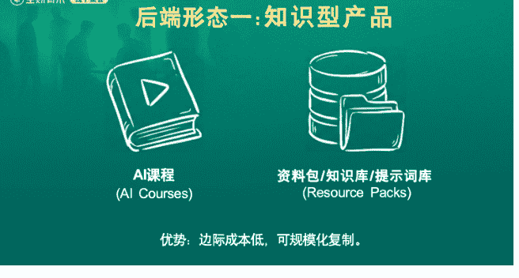

##### ② 服务型产品

- 私教/陪跑，长期型重交付服务，一般按季度/半年/年度收费，拥有最高权益
- 1 对 1 咨询：在一次性的时间内，帮用户解决问题，作用不止于咨询，还可以升单
- 企业 AI 培训：这个可能需要一些资源
- 内容代运营

##### ③ 社群型产品

- AI 实操相关问题答疑
- AI 工具分享
- AI 搞钱案例拆解

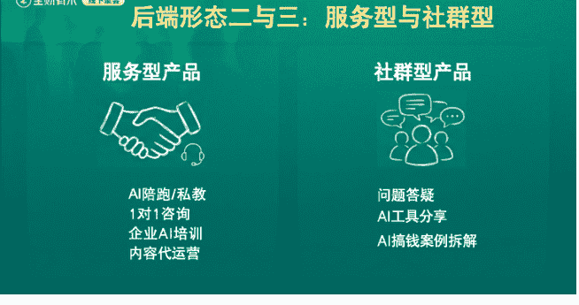

## Part3: 从 0 找到你的 AI 自媒体定位

### 3.1 如何选择适合自己的内容方向？

定位公式：

定位 = 你愿意长期讲的主题 + 市场愿意为其付费 + AI 能显著提效的环节

比如现场有小伙伴说，对飞书多维表格感兴趣，那就可以考虑，飞书多维表格在哪些方面能显著提效？

比如，帮助自媒体博主在小红书上批量提取某个关键词下的爆款选题，批量提取对标账号的笔记文案，批量二创文案内容。

那么，可以问问自己，如果这个操作自己手动处理做可能要好几天，如果这个问题可以用飞书多维表格快速能解决，节省一大笔时间，作为一个自媒体人，你愿不愿意为此付费呢？

如果你也愿意付费，那么这个定位就成立，你就可以以这个为目标去做内容。

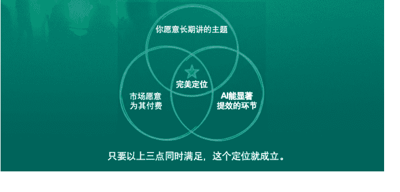

你也可以把这个定位方式拆解成三个问题：

1. 我最熟悉哪个行业或人群？
2. 这个人群目前最卡在哪一步？
3. AI 能不能把这一步变得更简单？

即：{[具体身份/人群]}+{[特定高频场景]}+{[极致痛点解决方案]}

一些不错的内容方向 + 对应可以做的产品举例，大家可以做为参考，找找灵感：

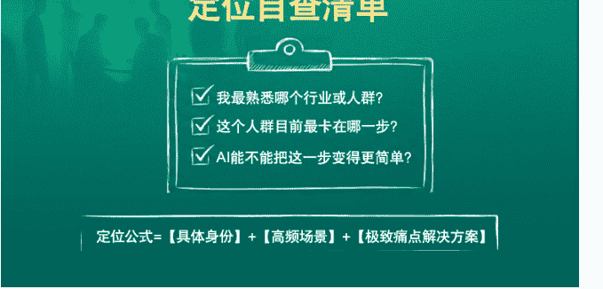

#### 成功的 AI 自媒体定位举例

- AI+ 教育：家庭亲子教育、学科辅导
- AI+ 设计：电商主图、建筑设计、效果图、平面设计
- AI+ 职场提效：数据分析、PPT 输出、行业报告
- AI+ 自由职业：各种 AI 变现搞钱路子

- AI + 教育博主：家庭亲子教育、学科教育

比如这个博主北大星星妈咪，输出的内容就是 AI 在孩子教育上的一些应用，前几天发布了一个 2026 年度 AI 育儿课堂，10 节课，99，卖了 80 多份了。后续还可以更新更多 AI+ 育儿相关的课程

- AI + 设计：电商、展示、建筑设计等各种场景设计

比如这个海苔设计的账号，本身是设计师，用手绘+AI 做海报提效，也有 AIGC 设计课程，帮助设计师学习用 AI 提效

公众号懒人搜索、懒人专属群分享

- AI + 职场提效：数据分析、输出 ppt、报告、行业分析

- 职场可以做职场提效的技巧分享，也可以在某一个垂直领域去输出内容，比如 AI 做职场 PPT，AI 职场公文写作，AI 做数据分析等

- AI 视频广告片方向，分享 AI 视频广告片分镜和成品，店铺卖工作流程、教程、课程

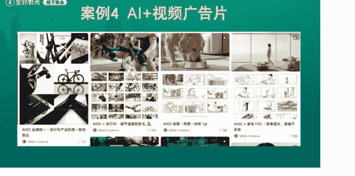

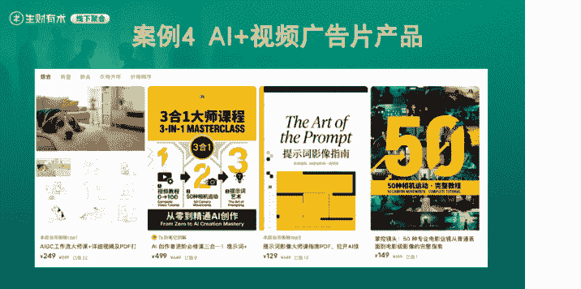

- AI + PPT 制作，分享 NotebookLM 做的 PPT，店铺卖 PPT 提示词合集和教程

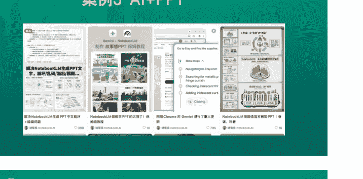

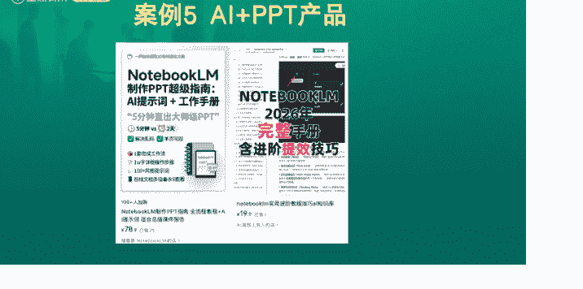

- AI + 自由职业探索：各种 AI 搞钱路子

- 可以分享各种 AI+ 赚钱的项目，后端可以做 AI 副业社群、星球，可以卖项目课程

- AI + 课堂教学赋能

- 可以分享老师可以用 AI 做什么样的内容赋能课堂，这个是我自己做过的一些选题，非常垂直，转化的都是老师粉，还有很多在评论区问怎么做，我在商店挂了定制视频、教程文档、成片出售，都有出单，而且老师的需求很简单，基本就是做做课文转视频或者数字人说话，做起来也简单，一个视频可以收到 100~300，可以自己看难度和要求收费。

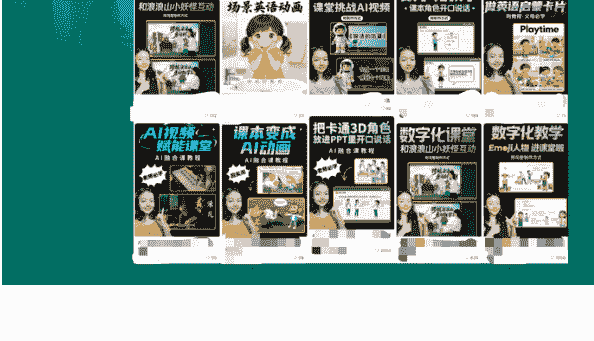

### 3.2 AI 自媒体爆款内容结构

我常用的视频公式，大部分 AI 博主用的也是类似的结构，大家可以多去刷刷看看：

超预期结果展示 → 观众产生疑问 → 快速解释关键步骤 → 展示可复制性 → 引导继续关注

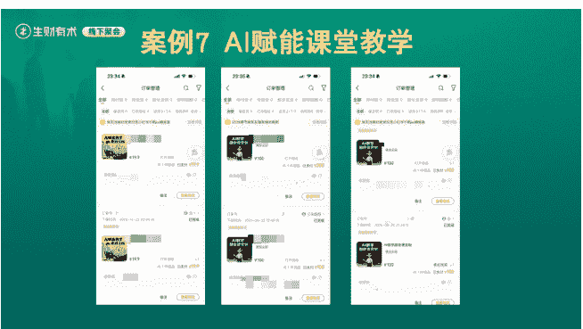

#### Part 1: 前 3~10 秒 Wow Moment(结果先行)

直接展示：

- 一套 AI 生成的高质量海报/产品白底图变成海报
- 一段高质量的 AI 视频
- 一套 AI 生成的完整 PPT
- 一个账号数据前后对比截图

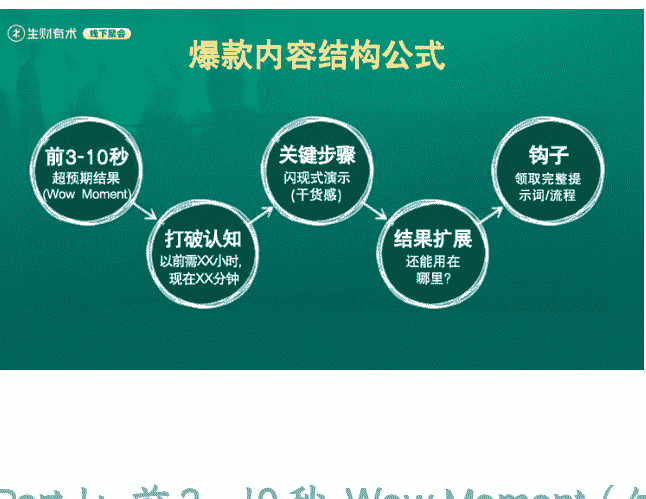

让观众感受到，哇，这个 AI 技能有点意思/我想学，于是触发收藏、停留、点赞。

这个内容难度的把控，看大家想要吸引什么样的人。比较简单，看起来有点高级的内容，吸引大量的 0 基础用户。

难度看起来较高的，会吸引同行和喜欢研究、学习技术的人。所以，看你的目的是什么，是想赚流量？还是转化产品？

比如我这个视频，一天就上千互动了，转化了近 170 多粉丝，把产品（365 的课程）挂在评论区，有 200 多个产品浏览，几十个加购。

#### 笔记分析详情

数据概览 流量分析 内容分析 观众分析

#### 笔记诊断

数据更新至 02-10 00:00

| 指标 | 数值 | 对比 |
| :--- | :--- | :--- |
| 封面点击率 | 8.0% | 超过 51% 同类 |
| 互动数 | 1047 | 超过 93% 同类 |
| 涨粉数 | 171 | 超过 96% 同类 |
| 完播率 | 3.5% | 超过 17% 同类 |
| 视频画质 | 较好 | 超过 56% 同类 |

你的互动数为 1047，超过 93% 同类创作者。

互动数据表现还不错，你的笔记帮到了不少人哦，快去总结一下大家点赞、评论、收藏这篇笔记的原因吧。

#### 基础数据

数据更新至 02-10 00:00

| 指标 | 数值 | 粉丝占比 |
| :--- | :--- | :--- |
| 曝光数 | 18179 | 6.7% |
| 观看数 | 9179 | 5.2% |
| 封面点击率 | 8% | 12.2% |
| 平均观看时长 | 12.4 秒 | 12.9 秒 |
| 完播率 | 3.5% | 10.7% |
| 2 秒退出率 | | |
| 涨粉数 | | |

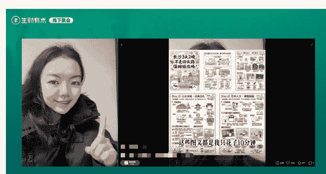

再比如这个，其实也就几个镜头，过程看起来也简单，但是有上万互动，而且很多人来问成品能不能卖或者能不能定制产品，广告之类的。这篇就属于覆盖了很多 0 基础用户了～

#### (可选)Part2:一句话打破旧认知

作用：让观众意识到“我原来的方式过时了”

结构：

“以前做这个需要××，现在只要××”

以前做图文排版需要几小时，现在用这个工具生成一整套图文只要 10 分钟。

突出时间/成本/难度差。

#### Part3:关键步骤闪现式演示

看起来是教学，但实际上只演示关键节点，一种看起来很干货的感觉。

镜头节奏：

- 输入一句指令
- 点击生成
- 成品出现

#### (可选)Part4:结果扩展

一句话说明：

“这个方法还能用在××××××”

让观众自动代入：

> “那是不是也能解决我的问题？”

#### Part 5: 留下悬念或钩子

结构：

> “完整提示词 / 完整流程
> 我已经整理好，想要的话…”，

### 3.3 AI 工具如何辅助内容生产

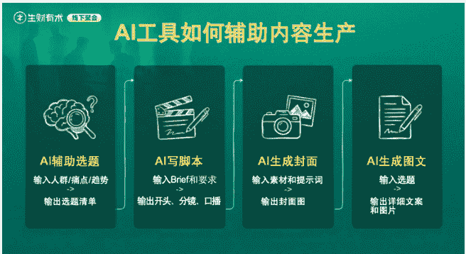

#### ① AI 辅助选题

输入：

- 自己的目的或者方向
- 目标人群
- 行业痛点

输出：

- 选题方向/痛点清单

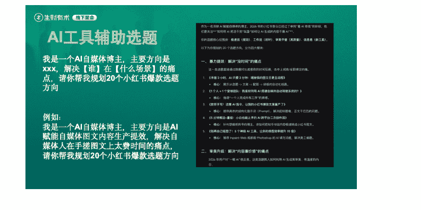

#### AI 工具辅助选题

我是一个 AI 自媒体博主，主要方向是 xxx，解决【谁】在【什么场景】的痛点，请你帮我规划 20 个小红书爆款选题方向。

例如：
我是一个 AI 自媒体博主，主要方向是 AI 赋能自媒体图文内容生产提效，解决自媒体人在手搓图文上太费时间的痛点，请你帮我规划 20 个小红书爆款选题方向。

#### ② AI 写脚本

输入：

- 品牌 brief 文档
- 脚本结构
- 目标结果
- 目标观众
- 语气风格等

输出：

- 开头钩子
- 分镜结构
- 口播脚本

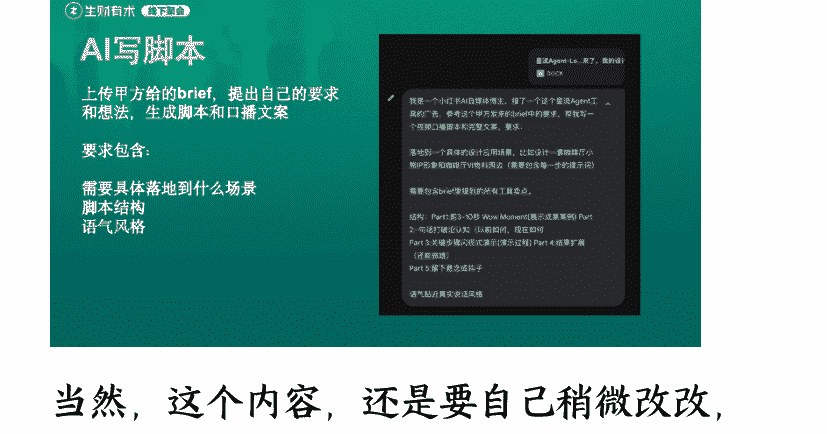

#### AI 写脚本

上传甲方给的 brief，提出自己的要求和想法，生成脚本和口播文案。

要求包含：
需要具体落地到什么场景
脚本结构
语气风格

当然，这个内容，还是要自己稍微改改，换成自己的说话习惯，你也可以上传自己的语料风格让 ai 参考修改。

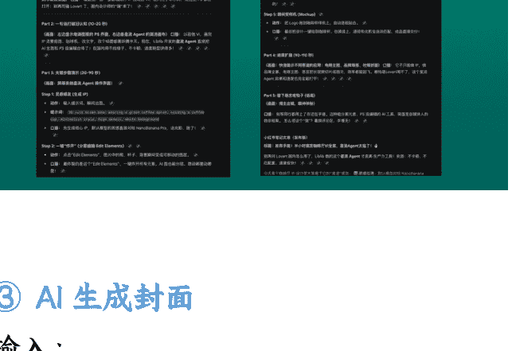

#### ③ AI 生成封面

输入：

- 素材图片
- 关键词、标题、排版要求、视觉风格

输出：

- 可直接使用的封面

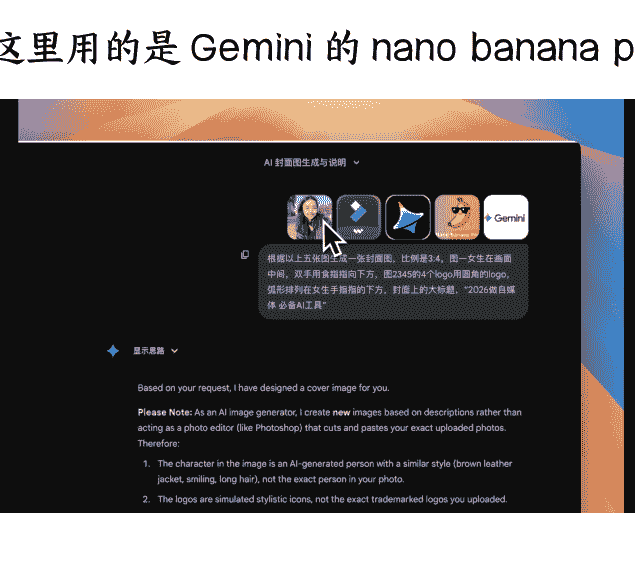

这里用的是 Gemini 的 nano banana pro：

用即梦也行，但是效果不如 nano banana pro 好：

包括这种吸睛的特效封面也能做，自己排版我是排不出来的，但是 ai 做只要几分钟。

提示词如下，只要你有想象力，上传素材 + 提示词，ai 都能给你搞出来。这篇视频也爆了。

图 1 的女生放在画面中间用两只手的食指指向下方，图 2343 在画面中间下方立体弧形环绕排版，有荧光淡蓝色边框，图片顶部夸张的手写大标题“影视级特效”，图片底部夸张的手写大标题“AI 一键搞定”，比例 3:4。

#### 笔记分析详情

数据概览 流量分析 内容分析 观众分析

#### 笔记诊断①

最多更新至笔记发布后 14 天

本篇笔记数据 同类笔记数据

| 指标 | 数值 | 对比 |
| :--- | :--- | :--- |
| 封面点击率 | 9.3% | 超过 62% 同类 |
| 互动数 | 1620 | 超过 95% 同类 |
| 涨粉数 | 260 | 超过 97% 同类 |
| 完播率 | 17.7% | 超过 86% 同类 |
| 视频画质 | 较好 | 超过 48% 同类 |

你的视频画质为较好，超过 48% 同类创作者。

该视频画质较好，请继续保持哦～

#### 基础数据①

数据更新至 02-10 00:00

| 指标 | 数值 | 对比/备注 |
| :--- | :--- | :--- |
| 曝光数 | 73740 | 粉丝占 2.6% |
| 观看数 | 实时 7926 | 粉丝占 8% |
| 封面点击率 | 9.5% | 粉丝 28.5% |
| 平均观看时长 | 32.1 秒 | 粉丝 30.3 秒 |
| 完播率 | 17.8% | 粉丝 26.5% |
| 2 秒退出率 | 30.6% | 粉丝 32.8% |
| 涨粉数 | 306 | |

#### ④ AI 生成图文内容

Nano banana pro 出来之后，做 AI 图文也很方便了，任何赛道都可以用 ai 做图文起号。

输入：

- 选题

ai 就可以帮你输出：

- 详细文案
- 整套图文

视频教程：

其他赛道也能做，比如旅游、育儿、实体产品种草等等，反正只要你要用到图文做内容，这个方法都可以做。

#### 不同赛道图文案例

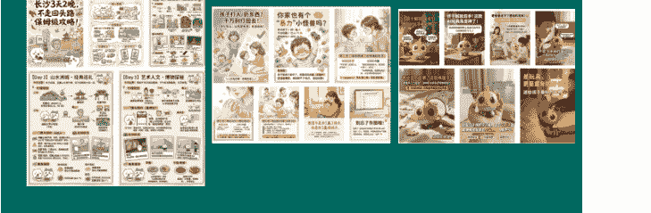

#### 不同赛道图文案例

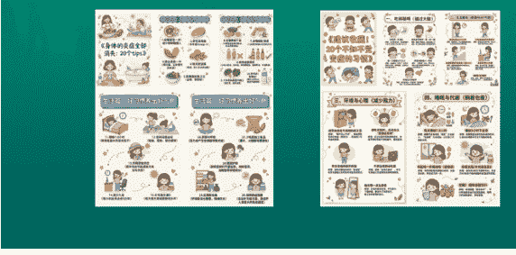

总结：现在 AI 自媒体你说卷吧，也确实卷，内容同质化很严重，所以大家如果要做的话，建议是找到一个人群痛点，用 ai 去解决，构建自己的流量 + 产品闭环，可持续发展。

## 总结：打造可持续生意的关键

- 1. 不追逐短期热点，而是构建解决方案。
- 2. 不只做流量，而是打造产品闭环。

行动建议：找到一个痛点，用 AI 解决它，今天就开始。

## 答疑：包括提前收集的问题和现场的答疑

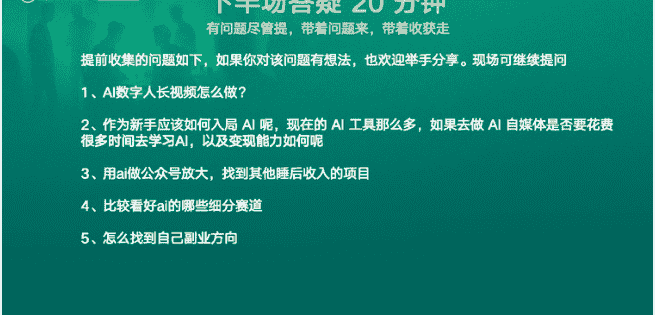

### 数字人长视频怎么做？

数字人就是确定好人物形象，然后找一个数字人平台对口型就好，目前效果比较好的应该还是海外的 heygen，国内也有很多数字人厂商，可以多去问问，目前成本大约每分钟几块钱，随着技术成熟成本可能会降低。

### 新手如何有效地学习使用 AI 工具？

学习使用 AI 工具的时间投入因人而异，肯定是需要花费时间的，但建议采取边学习边输出的方式，即学会一个技能就立即转化为图文或视频内容，利用“Learning in Public, Building in Public”的理念进行实践。

### 如何谨慎对待与 MCN 机构签约以及接商单？

签约 MCN 机构需谨慎，虽然 MCN 能保证一定的订单量，但结算过程相对被动。相比之下，个人直接与甲方对接可能更具灵活性和较高的变现能力，初期变现可能有限，随着粉丝增长和影响力提升，变现能力也会逐渐增强。

### 在教育领域和 AI 视频方面，您有什么看法和建议吗？

教育领域有很大的发展空间，因为现在教育局都要求老师要 ai 融合数字课堂。对于 AI 视频，虽然烧钱是一个问题，但如果资金充足，也可以尝试。要做好 AI 视频，需要多练习，包括镜头语言，审美都有要求。

### AI 如何应用于公众号内容创作中？如何利用 AI 进行公众号内容创作并保持内容质量？（这个邀请了现场的辰风老师回答）

AI 可以作为我们思考的辅助工具，帮助我们拓宽选题角度、生成话题观点、构建故事场景内容以及完成文本初稿框架。它能够实现选题、初稿撰写、内容框架设计等功能。但是大规模生产的可能是垃圾内容。

对于优质原创内容，AI 不能完全替代人工创作，因为它目前还无法达到理想的文本效果。利用 AI 进行内容创作时，应明确自身的目标和标准，不能完全依赖 AI 判断内容好坏。AI 可能会通过节省算力的方式提供不尽人意的内容，因此需要用户具备一定的主观判断能力，及时发现并纠正 AI 的错误，以保证内容质量和原创度。

要实现全流程的内容生产，不仅需要强大的 AI 对话提问能力，还需要对目标平台（如公众号、小红书）的内容趋势和爆款特征有深入理解和判断。

### 比较看好的 AI 细分赛道？

各个垂直领域的 AI 知识库，AI 虚拟资料，AI+ 教育都还挺看好的。

### 对于寻找副业方向和利用 AI 创业，有何建议？

首先要根据自身时间选择，比如你一天可以有 1 小时还是 1 整天的时间投入，然后选择离钱近、自己能上手的项目，快速探索并找到适合自己的领域。在创业过程中，可以选择风口大、需求量大的项目，如 AI 原创虚拟资料。

同时，要在实践中不断学习和调整，通过实际操作来明确自己的擅长点和兴趣所在，从而找到并确认副业方向。还是得先赚到钱，哪怕一笔很小的钱，才有方向，没赚到钱之前，大家都是没有什么方向的。

### AI 在电商素材制作方面的表现如何？

AI 在图片制作方面表现不错，基本能达到可用状态；但在视频制作上，对于幅度较小的工作可以胜任，但如果动作幅度较大，产品上的文字会变形，AI 可能无法完全满足要求。

以上就是这次线下分享的内容啦，谢谢大家耐心看完，如果大家在 ai 自媒体这块需要交流，也可以找鱼丸链接我～

最后，安利小懒的付费群：

懒人专属群 (介绍)

微信：lazyhelper1

这里是你对抗信息过载的护城河。

已稳定运行 7 年，累计拆解、研读 3000+ 个互联网商业实战案例与行业前沿内参和时政/宏观文章。

我们不搬运垃圾，只做高价值信息的筛选器与放大镜。

## 懒人专属群更新记录：

https://hk57gvlx7u.feishu.cn/docx/H0kRdZbSbolBR0xkaXtcuVE0nTg

【免责声明】本资料归档于社群内部知识库，仅供成员课题研究与学术交流，请在查阅后 24 小时内删除。