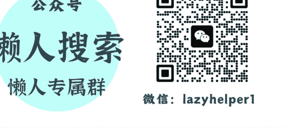
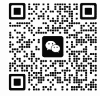

# 最好的“礼物”，是创造一段共同的回忆

260214

整理：公众号懒人搜索，懒人专属群精选

懒人微信：lazyhelper1



今天我们要说一个元旦春节前后，都很常见的场景，送礼。但是，今天的角度有点特别，叫“大数据送礼”。没错，大数据。我们要讲的关于送礼的所有技巧、所有趋势，都不是主观推演，而是来自扎扎实实的大数据调研。最近，我们查阅了这几年的很多与“送礼”有关的调研报告，有的来自高校，也有的来自《福布斯》这样的媒体。

但总归，这些结论都有据可依。毕竟，送礼这个事，最怕弄巧成拙。要是没根据，我也不敢瞎支招。

咱们先从送礼的趋势变化说起。2025 年，《福布斯》做了一个针对“送礼”的全球调查，发现了这么几个趋势。

首先，全世界的人，送礼的预算普遍在“下降”。没错，从高净值人群到普通人，在送礼这件事上花的钱，都变少了。

《福布斯》的数据显示，在高净值人群里，即兴送礼的比例，比去年下降了 15%。即兴送礼，也就是没有计划的送礼，比如，路过商店看到个限量款的包，觉得不错就买来送给朋友。这种事明显变少了。

而根据贝恩咨询的报告，2025 年，全球奢侈品礼赠需求，同比下降了 8%，其中高净值人群贡献的礼赠消费占比，从 2024 年的 45% 降到了 38%。

而在“非高净值人群”里，这个趋势也存在。《福布斯》的调查显示，过去一年，普通消费者的礼品开支同比下降 11%，其中 78% 的人会“主动寻找更便宜的替代品”，65% 的人会等待礼品打折的时候再去购买。这就是咱们刚才说的，全世界的人送礼的预算普遍在下降。

其次，现代人送礼，比起观赏性，更注重“实用性”与“能力提升”。简单说，人们更喜欢送那些，能“让他人变好”的东西。

比如，美国西雅图的科技企业家群体，更偏爱“功能性礼赠”，比如为合作伙伴赠送高端办公设备，或者为亲友提供技能培训课程。

再比如，中国香港，2025 年香港高净值人士的送礼场合中，高端健康体检套餐、子女教育咨询服务等，这些礼品的数量明显变多了，占比从 2024 年的 35% 提升到了 50%，而“奢侈品礼赠”的占比从 40% 下降到了 25%。

前面说的是大致趋势，那么，落实到行动，可以怎样送礼呢？注意，我们要说的只是参考方案。毕竟，送礼这个出发点是好的，即使没有任何方法，别人也能够感受到这份心意。而我们的重点是，既然都已经有了这份好心了，何不把事情做得更漂亮一点呢？

## 关于怎么送礼，有这么三个思路可以参考。

### 第一，共同拥有，比独一无二更重要。

美国威斯康星大学和加拿大多伦多大学做了一个联合研究，他们发现了一个现象，叫“伴随效应”。

什么意思？研究人员让送礼者在送礼的时候，加上一句话：“我很喜欢这个礼物，我给自己也买了一份。”结果发现，收礼者对这份礼物的好感度，显著提升了。而且，假如这两份礼物是同时购买的，好感度会升到最高点。

注意，这里的关键词是“我也买了一份”。你看，这是不是挺反常识的？我们平时送礼，总觉得要“独一无二”才显得用心，恨不得满世界找那种“只有你有”的东西。但研究说，“共同拥有”反而更受欢迎。

为什么会这样？研究人员的解释是：当你说“我也买了一份”的时候，是在传递一个信号，“我们有共同的品味”，“我们是同一类人”。这种“共同拥有”的感觉，会在送礼者和收礼者之间建立一种特殊的纽带。

换句话说，礼物不只是一个物品，它也是“我们之间的连接”。

《福布斯》数据显示，2025 年“双人旅行套餐”的销量占比从 2024 年的 40% 升至 60%。简单说，很多人在送礼的时候，已经不是送一份东西了，而是买一份旅行套餐，然后两个人一起去。

这背后就是类似的道理，人们更倾向于赠送那些“共同拥有的体验”，而不是孤立的物品。全球高端旅行平台 Vistajet 的 CEO 说：“将旅行作为礼物，既传递了心意，又能创造共同回忆，这种价值是奢侈品难以替代的。”

从这个角度看，假如你想给朋友送一本书，不如索性买两本，一本给他，一本给自己。送的时候说：“这本书我也在看，咱们可以一起讨论。”

再比如，你想给家人送一个健身课程，与其只给他买，不如一起报名。这种“共同拥有”的礼物，不仅传递了心意，还创造了“一起做某件事”的机会。

这是第一个思路，共同拥有，比独一无二更重要。

### 第二个思路是，长期快乐，比瞬间惊喜更重要。

新加坡国立大学有个教授，叫阿黛尔·杨，她提出了一个概念，叫“寻求微笑”陷阱。什么意思呢？简单说，就是送礼的人其实最期待的，就是看到收礼者的笑容，看到他惊喜的样子。但其实，对方的兴奋不代表真实的获得感。

她做了一个实验：让送礼者在两种礼物之间选择，一种是“一束盛开的鲜花”，另一种是“一盆可以长期养护的绿植”。结果发现，送礼者更喜欢买鲜花，因为鲜花在交付的那一刻特别夺目，能制造最大的惊喜。但收礼者呢？他们更喜欢绿植，因为可以长期照料，带来持久的快乐。当然，现在很多鲜花的“保质期”都变长了，因此销量也明显提升了。

你看，这又是一个反差。我们送礼的时候，总想着“打开礼物那一刻的惊喜”，恨不得看到对方“哇”的一声。但大数据告诉你，收礼的人更在意“长期的快乐”。

更进一步，美国心理学会做过一个追踪研究，他们发现，体验类礼物，比如旅行、音乐会门票，带来的积极情绪，平均能持续 14 周。而实物类礼物呢？情绪峰值通常在 3 到 5 天内就回落了。

换句话说，瞬间的惊喜很短暂，长期的快乐才更值钱。

从这个角度看，与其送家人一件昂贵的衣服，可能穿几次就压箱底了，不如送一张健身房年卡或者博物馆年票，让他们在一整年里都能享受。

再比如，与其送同事一盒巧克力，吃完就没了，不如送一个订阅制的咖啡礼盒，每个月都能收到新鲜烘焙的咖啡豆。

当然，假如你一定要追求惊喜，就尽量要确保，这份惊喜的分量足够大，大到对方能够记很久很久。比如，硅谷的“Z 世代富豪”们，他们大多是科技公司创始人或高管。他们比较爱送的礼物之一，是“太空旅行体验券”，一张大概 10 万美元。毕竟，太空旅行的体验太稀缺了，去一次就能记一辈子。

但对于多数人来说，不需要买那些特别贵的东西，关键是，这份礼物能带来“长期的快乐”，让对方在很长一段时间里，都能感受到你的心意。

这是第二个思路，长期快乐，比短期惊喜更重要。

### 第三个思路是，精准需求，比创意惊喜更重要。

哈佛商学院曾经做过一个调查：让收礼者评价两类礼物，一类是“自己心愿单上的礼物”，另一类是“送礼者精心挑选的惊喜礼物”。

结果发现，收礼者对“心愿单礼物”的感激程度，明显更高。但有意思的是，送礼者却觉得，假如送对方清单上的礼物，会显得自己不够细心。

你看，过去我们总担心直接问对方想要什么，显得自己不用心。但很多时候，收礼者恰恰最感激收到“心愿单”上的礼物，而且他们会认为这是更细心的表现。

换句话说，好礼物的标准之一，也许不是“创意惊喜”，而是“精准需求”。做这个研究的人还说过一句话，叫，“下次不知道送什么的时候，与其硬着头皮瞎选，不如厚着脸皮问对方想要什么。”

但这里还有一个注意事项，就是同一个人，在不同场合里的需求是不同的。

清华大学社科学院的李虹教授，做过一个实验。让收礼者在两种场景下评价礼物。一种场景是有其他人在场，另一种是两个人私下。

结果发现，当有其他人在场时，收礼者更喜欢那些“华而不实”的礼物，比如钻石耳环这种看起来很贵、很有面子的东西。但假如是两个人私下送礼，收礼者反而对实用的礼物评价更高，比如按摩仪、保温杯。当然了，钻石耳环和保温杯之间的可比性不太强，我们主要是说这个意思。

就是，当着众人的时候，收礼的人更在意的是面子，而私下里，更注重的是实用性。为什么会这样呢？李虹教授的解释是：当有其他人在场时，收礼者会更注重礼物的社交展示价值。说白了，就是发朋友圈的价值。但私下送礼时，收礼者更关注“这个礼物对我有没有用”？

从这个角度看，假设你要在公司年会上给同事送礼，那就选一束漂亮的鲜花。但假如是私下感谢同事帮忙，那就送一个实用的东西，对方会觉得你更有诚意。

换句话说，所谓“精准需求”，不是我觉得什么好，而是在这个场合下，对方最需要什么。

最后做个总结，我们今天说送礼的三个思路，分别是，共同拥有比独一无二更重要、长期快乐比瞬间惊喜更重要，以及精准需求比创意惊喜更重要。

马克·吐温说过一个关于送礼的调侃，他说：“送礼的艺术在于，送一个你自己想要的东西，这样假如对方不喜欢，至少你还能拿回来用。”当然，我们今天说的这些原则，就是为了避免这种情况。

## 最后，安利小懒的付费群：

懒人专属群 (介绍)




微信：lazyhelper1

- 这里是你对抗信息过载的护城河。
- 已稳定运行 7 年，累计拆解、研读 3000+ 个互联网商业实战案例与行业前沿内参和时政/宏观文章。
- 我们不搬运垃圾，只做高价值信息的筛选器与放大镜。

## 懒人专属群更新记录：

```
https://hk57gvlx7u.feishu.cn/docx/H0kRdZbSbolBR0xkaXtcuVE0nTg
```

【免责声明】本资料归档于社群内部知识库，仅供成员课题研究与学术交流，请在查阅后 24 小时内删除。