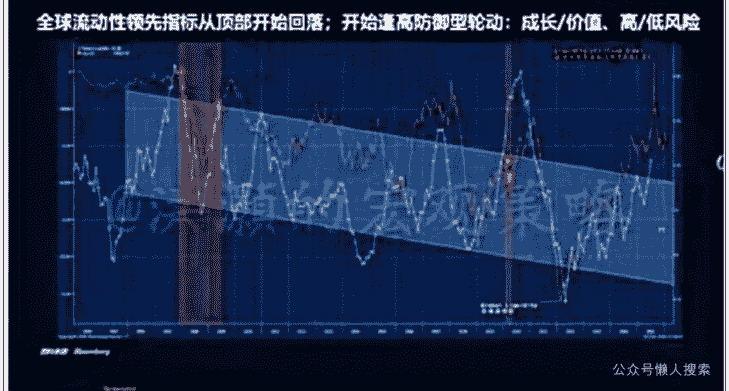
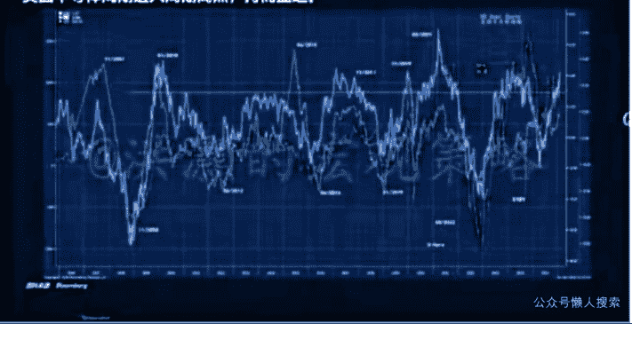

# AI 血洗、金银崩塌、沃什上任：这场洗牌，你看懂了吗？

2026 年 2 月 24 日 洪灝

整理：公众号懒人搜索，懒人专属群精选

懒人微信：lazyhelper1

市场历史，是一部价值认知和流动性之间角力的编年史。昨晚，在毫无征兆的情况下，全球资产价格又开始了一场暴动。终于，美国市场隐含波动率跳升到了 20 以上。在过去 8 个交易日里，标普成分股中有超过 100 个经历了单天超过 7% 的暴跌，而软件行业在 Anthropic 的最新 AI 编程工具前投降式下跌，毫无抵抗之力。

巨头微软从最高点已经跌去了约 30%，其估值在经历了这次调整之后，已经与 2018 年时的第一次贸易战期间、2020 年的疫情期间和 2022 年的鲍威尔鹰派加息相当了。这种美股市场普遍性的暴跌，一般只有在泡沫破灭或者市场危机的时候才能有幸一睹。比如 2000 年美国互联网泡沫的破灭时期，而市场一般在这种个股普遍下跌情况下往往已经下跌了 1/3。然而，尽管最近市场巨幅震荡，但主要美股指数离历史高点也仅仅回调了不到 2%。

标普指数在过去一个月走势持平，但标普成分股的平均股价却下跌了 11%。在有数据的 30 年历史里，这种情况位于 99 百分位——也就是发生的概率只有 1%。期间，市场开始大规模地从成长板块到价值板块的轮动。在 2 月 6-8 日的三地读者见面会上，我们着重预警了即将到来的“去风险”交易（risk-off trade）和防御性板块轮动。

美股自营盘开始在市场波动性上扬的时候纷纷地把总杠杆降下来，盛极一时的末日期权交易和杠杆型 ETF 形成的"negative gamma 反向伽玛碾压”效应开始浮出水面。

早在一月十一日发表的、今年第一篇研究报告《洪灏：2025 年启示录》里，我已经讨论了这种交易产生的市场微观结构将要带来的风险。在那篇报告里，我如是写道：

> “换言之，这些投行提供了一种方便市场散户投资者做空市场波动性的工具。本质上，做多市场就是做空波动性，下注市场不断上涨就等于看跌市场波动性。顺便说一下，近年来非常流行的一种投行雪球产品，让投资者在一组股票的股价在区间波动的时候可以保本并获得较高的收益率，其实就是让投资者在不自觉之间卖了一种市场下跌的保险，投资者获得保险费也就是期权权利金，但在市场暴跌跌破区间下沿的时候就要接盘，并放弃市场上涨的空间。然而，请思考一下：如果所有人都在卖市场暴跌的保险，下注市场波动率下降，那么交易的对手盘是谁？这种交易的双方，各自承担了什么样的风险？曾记否，2018 年一月的那一场‘波动率的末日审判’(Volmageddon)?"

2025 年间，我们身处指数波动率与个股波动率剧烈分化的“相关性离散”格局。纵使标普 500 指数表面静若止水之下，个股实则暗流涌动。巨型权重股常呈现剧烈独立震荡，宽基指数的波动性却稳若泰山。这种现象源于个股走势彼此脱钩、相关性离散：当一个人工智能宠儿飙升时，另一科技巨头却若即若离、漂移不振，阻止了 VIX 的同步波动。这种市场个股相关性离散的环境给了被动投资者一种虚幻安全感，使其误将指数层面的平静等同于系统风险被牢牢地锚定。

然而，这种市场相关性离散的格局源于市场交易结构本身，而非经济基本面的健康。上述投行雪球产品和末日期权的一时风靡、持续扩张，已将市场转化为“波动率抛售机器”。压低波动率的产品和交易已经成为了一种机械的输出。量产期权供给固然能让投资者轻易地获得权利金，但也营造了市场安全的海市蜃楼，并塑造出脆弱的市场生态体系。一旦冲击降临，为回补波动率空头头寸的仓皇踩踏，很可能将引发市场价格“断层式下跌”，其速之疾将远逾任何历史模型所预测。其实，2025 年 4 月美股波动率在“解放日”史诗级的飙升，就是一个活生生的例子。

末日期权的兴起，更将此种脆弱性推向极致，并从根本上重塑了日内市场价格的行为。市场已非基本面价值的映照，反而成为了由期权对冲交易而驱动的机器。做市商为平衡当日到期期权的巨量持仓，须持续调整对冲头寸，因此也往往导致收盘前出现股价日内“均值回归”，给投资者以“美股不可战胜”、“美股永远涨”的幻象。市场面临着极端的集中度风险：标普指数实质上已蜕变为追逐价格动量势能的基金 momentum fund。2025 年的经验表明，指数内个股相关性的“离散化”其实只如镜花水月。这种市场状态看似一往直前，实则不堪一击。

## 图一：在 2 月 6-8 日的北京、上海、深圳三地读者见面会上，我们预警了防御性轮动的开始（会议原图）

日前，凯文·沃什获特朗普提名美联储主席，标志着以“伯南克 - 耶伦 - 鲍威尔”这些以“货币实验主义”领导的美联储时代彻底终结。近二十年来，美联储一直扮演着市场指挥家和守护神的角色，以所谓的“前瞻性指引”压制了市场波动、推高了资产价格。沃什代表回归更古典、以规则为圭臬的“货币实用主义”的路径——将美元的健康与缩减美联储臃肿资产负债表置于股票投资者一时安逸之上。

“沃什主义”意味着更高的美国国债“期限溢价”。尽管市场曾为近期国债收益率下跌短暂欢呼，但这不过是我们之前在读者见面会上讨论过的“防御性轮动”，而非对未来沃什摇身一变成为鸽派投下的信任票。沃什明确偏好以量化紧缩，也就是缩表，为首要工具，这意味着市场当下尚未收紧的流动性将开始相对于之前而开始变得稀缺。“美联储看跌期权”——即危急时刻央行出手救市、阻止标普指数出现大幅暴跌的隐性担保——正被逐一拆卸。

如是，这将意味着持续了几十年的“逢低买入”的时代已死。在一个美联储不再向市场私语意图的沃什治权下，市场定价过程将变得异常动荡。我们应该预期 10 年期美债收益率在与 850 日均线缠斗中持续波动——这是美债收益率长期趋势发生逆转的指标之一。

科技软件板块的剧烈波动——即所谓"SaaS 末日”——或许是过去几周最被误解的市场动态。传统上，美国国债收益率下行有利于成长股。然而，昨夜美债收益率下跌为去年十月以来单天之最，但是纳斯达克却同时暴跌 2%。这很可能是因为市场终于迎来人工智能的“明斯基时刻”。

多年来，软件业估值基于一个假设：人工智能是一层“叠加”，帮助 Salesforce 等既有软件服务业巨头向客户出售服务赚取客户溢价的工具。市场如今开始醒悟过来，代理式人工智能并非仅仅是对于现有工作的一种改良；它是现有软件业工作模式的颠覆者。若一个智能体可顶五十位软件工程师或客服人员的工作，维系硅谷生态的按员工人头工作的收费模式便轰然崩塌了。以前码农越多，软件公司越值钱。然而现在，人头众多反而成为了一个软件公司存在的累赘。

我们很可能正在见证美国软件业“terminal value 终值”的根本性重估。

我们这些天所见证的市场剧烈波动是一个信号：权重科技股云集的纳斯达克很可能已经在经历了长期牛市之后开始逐步进入阻力位置。投资者必须从这些“拥挤”的成长交易轮动出来，转向那些看似落后但是提供传统价值的美国上市企业。比如，传统美国零售业巨头沃尔玛股价的相对表现强势已经达到了近年来最高。我们在 2 月 6-8 日的三地线下见面会上已经为读者预警了美国科技板块运行到了周期性高点的情况。

## 图二：美国科技板块运行到了周期高点（见面会原图）

隔夜，黄金白银继续过去几周的巨震，在市场中又再次引发一波“事后”分析。许多市场人士纷纷称，“黄金牛市已尽”，云云。不得不说，这是对市场机理的深刻误解。金价失守每盎司 5000 美元关口，是一起“机械式去杠杆”事件，与基本面叙事逻辑毫无关系。当这个在全球市场中最受万众瞩目的交易跌破了那个所谓你的 5000 美元的整数关口，止损单的自动触发与交易所追加保证金导致了黄金大幅下跌。

然而，我们还审视这些贵金属平仓背后的“因由”。投资者被迫卖出这次上涨的“赢家”(黄金白银) 以弥补“输家”(科技软件与加密货币)。这是一次市场微观流动性的挤兑，而绝非基本面摒弃。简单地说，全球央行不会因为这次下跌而停止甚至逆转其购买黄金作为代替美债的储备资产的决心。黄金白银贵金属的长期投资配置逻辑——美元信用式微与美国乃至全球央行财政赤字膨胀——比以往任何时候都更突出。这些，我们在 2 月 6-8 日的三地读者见面会上已经与读者提前预警。

如我曾指出，美元指数已打破 2008 年建立的长期上升趋势，进入了美元的周期性贬值阶段。尽管“战争溢价”或已因近期中东的头条而蒸发，“美国财政危机溢价”却正在上涨。我维持黄金长期目标价每盎司 6500 美元甚至更高的判断。

图三：黄金价格下跌反而会导致央行购买更多的黄金 (会议原图)

在上周的见面会上，我们也用了地震余震的比喻来形容黄金白银的杠杆出清的过程，并建议读者务必不要在波动性高的环境里盲目加杠杆。近期波动是必要的“市场交易清理”，是大宗商品超级周期下一阶段开启前洗掉市场弱手（weak hand）的必经之路。

当美国市场与“更高更久”现实及人工智能颠覆缠斗时，中国市场呈现迥异机遇。我们正目睹“反内卷”运动生根。经年累月的过度竞争与通缩压力后，重心已转向资产负债表修复与价值创造。

当美联储的沃什意欲收缩资产负债表之际，中国正在扩表。这一两大央行的流动性政策选择的分化，是此次美股下跌中 A 股表现相较纳斯达克展现相对韧性的主因。中国市场的估值仍处历史折价。对全球投资者而言，最合逻辑的交易是从曾经“超配”的美国成长板块移向以前曾经“低配”的中国价值板块。短期里，我们继续倡导防御性轮动和价值轮动，以自身资产的波动率而非整体的市场波动率作为甄别风险的标尺，并在巨幅的市场波动里降低杠杆和仓位风险。

在去年十一月发表的对于 2026 年的展望报告《洪灏：展望 2026——持而盈之》以及 2 月 6-8 日的见面会里，我们反复强调了风险、仓位和杠杆的管理。

美股市场“盈满”已历长久，廉价信贷与无限增长幻象曾为之续命。开年以来美股跑输亚洲非美市场的程度，已经达到了几十年之最。近日市场巨幅的波动提醒了我们：

> 牛熊之道，总有轮回。持而盈之，不如其已；揣而锐之，不可长保。金玉满堂，莫之能守；富贵而骄，自遗其咎。功成身退，天之道也。

并祝大家马年进步，马到功成！

最后，安利小懒的付费群：

## 懒人专属群 (介绍)

📖 这里是你对抗信息过载的护城河。已稳定运行 7 年，累计拆解、研读 3000+ 个互联网商业实战案例与行业前沿内参和时政/宏观文章。

我们不搬运垃圾，只做高价值信息的筛选器与放大镜。

## 懒人专属群更新记录:

https://hk57gvlx7u.feishu.cn/docx/H0kRdZbSboIBR0xkaXtcuVE0nTg

【免责声明】本资料归档于社群内部知识库，仅供成员课题研究与学术交流，请在查阅后 24 小时内删除。