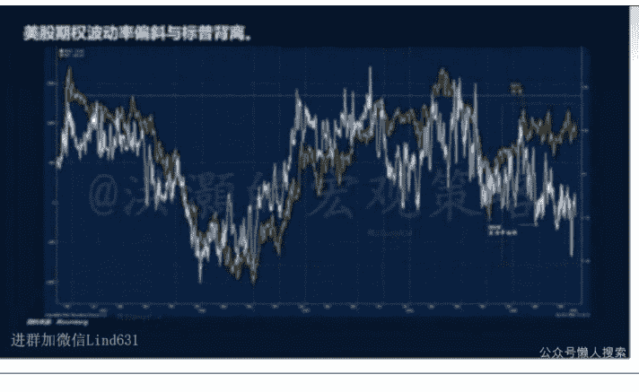
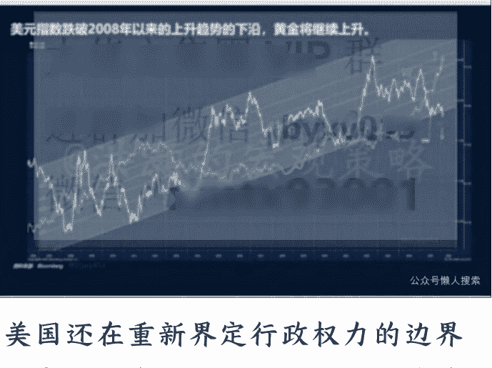
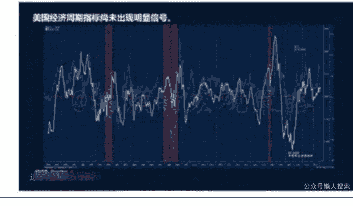

# 有型的丙午，有形的轮动

260224 洪灏

整理：公众号懒人搜索，懒人专属群精选

懒人微信:lazyhelper1


当我们还站在农历新年假期的尾声回望之时，丙午烈马已然如火如荼、脱缰狂奔。全球宏观格局继续其剧烈的变化。然而这次以，驱动这次格局改变的不是工厂的生产线，也不是美联储的决策，而是美国最高法院对于特朗普关税的一纸裁决，以及人工智能那股对于传统软件行业势不可挡的颠覆性力量。在去年十一月展望今年的时候，我们认为丙午之火将熊熊燃烧，周期之巅将重写历史。这丙午火马，果然不负众望。

2 月 20 日，美国最高法院以 6 比 3 的投票结果，对特朗普关税案作出裁决。这不仅仅推翻了之前特朗普援引 IEEPA 条例而实施的一系列全球关税措施，更实质性地动摇了贸易政策领域的总统绝对行政权的力量。过去一年多来，市场始终笼罩在 IEEPA 国际紧急经济权力法所支撑的、所谓“紧急关税”阴影之下。特朗普单方面宣布之前美国的贸易赤字构成了国家紧急状况，因此在这个条件下用总统行政权的渠道向美国的全球贸易伙伴发起了贸易战。就此，特朗普越过了美国国会向全球征税，但是美国宪法则认为税收是属于国会立法内的范畴，因此特朗普无权超越美国宪法。

如果关税需要偿还，那么特朗普政府可能需要面对 1750-2000 亿美元的或有债务。然而，美国最高法院也没有明确对于特朗普关税的补偿是对于任何一个明确的主体，而是把这个案件打回到美国国际贸易法庭，由这个法庭来决定对于关税补偿的时间限制和适用主体。换言之，即便美国最高院现在人为关税不合法，受损方也不一定能够获得补偿，尤其是关税上缴已经超过了 314 天或者是那些已经卖掉了的进口商品。于此同时，特朗普反手援引 1974 年贸易法案第 122 条，宣布对于全球征收 15% 的全球贸易税，同时 IEEPA 关税对于钢铁和铝进口则继续生效。

简言之，这次美国最高院对于关税的裁决反而增加了国际贸易的不确定性。这是因为，一些国家如英国、日本、澳大利亚等早已经和美国达成了贸易协议，并准备按照特朗普的关税计划乖乖交税，以换来与美国的特殊照顾。还有一些国家为了避免特朗普高昂的关税而宣布对于美国在未来几年进行大规模的资本投资。那么，这些协定很可能要推倒重来，或至少很难在原来的条件下存在。同时，特朗普可以援引其它的法律条款，比如现在的 122 条例、以后的 232、301 等条例。当然，这些条例的更符合美国法律，因此法律程序上面也会更复杂。无论如何，由于之前市场价格已经计入了特朗普关税的如期实施，而现在美国最高院的裁决却平生变数，因此，美国市场的不确定性反而上升了，而非下降（图一，二月初见面会原图）。



美国最高院的这一判决相当于从美国财政版图上抹去了约 1.4 万亿美元的预期税收收入。最直接的担忧是那个“财政缺口”: 财政部现在面临着向进口商退还约 1750 亿至 2000 亿美元的潜在负债。如果实施关税补偿，那么这不仅是个法律难题，更是一次对于美国市场的流动性冲击。为了筹措退款资金，同时又要应对潜在每年关税收入的流失，美国财政部将不得不增加美国国债发行。

市场对此的反应也是不难理解的：裁决之后，美国国债收益率略微攀升，十年期收益率触及 4.10%。市场逐渐意识到，“特朗普 2.0"时代的贸易政策如今很可能不得不在第 122 条和第 301 条款的“法律常规轨道”上运行——这些程序更缓慢、更容易引发诉讼，且有 150 天的期限。而整个 2025 年曾经还勉强支撑过美元的“单边关税溢价”正消散于无形，很可能将只留下一堆新发债券，推高美债收益率，并亟待一个对美国债务可持续性日益警惕的全球市场来消化。果然，美国市场又重现了美元走弱、美债和美股同时下跌的奇观，尽管现在看来，这次的下跌相对于 2025 年四月解放日的那次所有美元资产普跌的程度还是相差甚远。我们在二月初的线下读者见面会上已经讨论了这种情景（图二：美元跌破上升趋势的下沿。二月初线下见面会原图）。



当美国还在重新界定行政权力的边界时，市场也在重新定义什么是“价值”。

过去十年，无形资产的密集程度——也就是对软件、知识产权和数字护城河的依赖——曾是股票市场赢家的标志。今天，这种无形资产的属性越大，反而就越成为市场空头的靶子。人工智能不再仅仅是生产力工具，它正在颠覆“数字护城河”这个概念本身。如果人工智能能够像人一样、甚至更好地编写代码、设计药物、管理财富，那么传统的西方生物科技或美国软件公司的所谓“科学护城河”和“数字护城河”，就不再是坚不可摧的壁垒。这些曾经的护城河正在变成大众化、普及性的大众商品。

相比之下，那些有形资产和拥有有形资产的公司，比如金属、能源、基础设施、矿业公司等构成的“真实世界”，却依然固若金汤。几个电脑指令、程序无法凭空变出一座铜矿，也无法靠算法“幻觉”出一个电网。近日，美国制造业数据中显现的美国制造业周期似乎再加速，其实是市场在用行动表达：想要拥有那些能让人工智能得以运行的东西，而不是那些将要被人工智能取代的东西。这种轮动，正是我们目睹“K 型分化”的原因：美国的传统软件公司、生物科技、互联网服务正面临估值重置，而全球大宗、矿业、能源板块正在步入一个超级周期。连工业板块也很可能进入了一个上升阶段。这也是为什么，我们在二月初见面会上强调，这次很可能是板块轮动，而非传统的去风险 de-risk 轮动（图三二月初线下见面会原图）。



明天，中国内地市场将重新开市。这个开市的时点来得恰到好处。美国最高法院的裁决对中国股票而言，无疑是一个利好。特朗普基于 IEEPA 国际紧急经济权力法的“芬太尼”的额外关税，曾经把中国出口商品的有效税率推高到 30% 多甚至更高。这些无理无端的关税被取消后，即使考虑到美国政府转向 15% 的第 122 条基准关税，中国出口商的关税负担也实实在在地被削去了许多。

但中国市场的看点远不止贸易层面的舒缓，关键在于去年初那个“深度求索时刻 DeepSeek Moment”的延续。中国在高性价比、开源代码的人工智能领域的快速进展表明，中美曾经的技术差距缩小的速度远超市场的预期。正当美国科技巨头被巨大的估值压力和颠覆性威胁拖入无形资产的陷阱之时，中国科技企业正在围绕“反内卷”重塑形象——这是一场由政府引导的转型，从无利润的价格战转向注重质量、分红和“硬科技”，也就是有形的机器人和半导体等新兴的高端产业。

今天，港股已经节后开盘。恒指飙升了近 700 点，而恒科则一度暴涨了 4%。在港股的这种盘面的带动下，预计 A 股市场也应该会有不错的开局。我们反复强调，相对于中国庞大的贸易顺差，人民币汇率目前是被低估的。随着美元失去其“关税护盾”，人民币将持续升值，而目前早已突破了 7 的关口升值到了 6.88。对全球投资者而言，曾经的人民币套息交易买入美元资产的策略正在平仓：人民币兑换美元来买入美国无形资产的时代开始宣布结束。而我们自去年十一月以来反复推荐的 2026 年的主线则越来越清晰：做多中国，多做有形资产。如果美国财政部被迫增发国债来填补关税退款，而美元的信用又因最高法院对行政权力的限制而受到质疑，那么资本会流向哪里？

答案是黄金和白银。黄金不再仅仅是“恐惧指数”，它正在成为一种“去美元化”的储备资产。在美国债务逼近 40 万亿美元的当下，黄金是唯一不属于他人负债的中性价值储存手段。美股偏斜指数处在 145.52 的高位，说明机构对于市场尾部风险的警惕性很高，购买市场黑天鹅风险的保险合约已经变得昂贵不堪。而我们早已反复强调：黄金对冲的是尾部终极风险，就是对冲那“尾部风险”的保险。白银则是黄金的“放大贝塔版”，但它还有来自实体工业需求的额外支撑。随着全球经济转向能源转型和人工智能硬件——这两者都高度消耗白银。

“美元王者”和“美国无形资产”，曾是 2020 到 2025 年这轮周期的两根支柱。如今，两者的根本逻辑都受到了挑战。明天内地市场开盘，预计材料、能源和中国科技股会顺势而上。而丙午马年果然名副其实，带来了热度、波动，以及向新现实的快速切换。

是时候脱虚向实，以新的思维重新认识这个世界。

## 懒人专属群（介绍）


🧩 这里是你对抗信息过载的护城河。

已稳定运行 7 年，累计拆解、研读 3000+ 个互联网商业实战案例与行业前沿内参和时政/宏观文章。

我们不搬运垃圾，只做高价值信息的筛选器与放大镜。

懒人专属群更新记录：

```
https://hk57gvlx7u.feishu.cn/docx/H0kRdZbSbolBR0xkaXtcuVE0nTg
```

【免责声明】本资料归档于社群内部知识库，仅供成员课题研究与学术交流，请在查阅后 24 小时内删除。