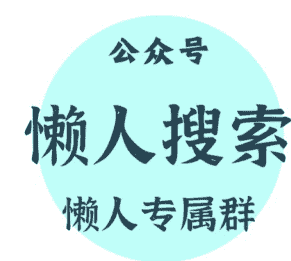

# 备忘：一些信息梳理，电力、资源、AI 领域的新事件、判断和分析

整理：公众号懒人搜索，懒人专属群精选

懒人微信：lazyhelper1

开工大吉。

以下内容仅供参考。投资有风险、入市需谨慎。涉及上市公司不代表投资建议。

- 一、信息梳理和点评
- 二、电力市场、电价机制、电网发展和投资机会
- 三、资源的观察和大周期机会
- 四、关于 AI: 确定的产业爆发初期

## 一、信息梳理和点评

- 1、美国最高法院判定 Trump（基于《国际紧急经济权利法》所推行的）关税违法。
    - (1) 黄金：大涨，反映对美国后续财政赤字恶化的担忧。（2025 财年关税的正向贡献不容忽视。）
    - (2) 美股、美债略微波动，变化不大，反映对所谓的退税以及后续降低税率无期待（Trump 也迅速签署行政令，在新的法律框架下征收关税，表明无意放弃关税工具）。

各大类资产对 Trump 关税脱敏，后续 Trump 团队还将利用各种法条加税以及推进谈判，①提高美国商品竞争力、②要求对手方到美国投资，最终目的是“重建美国制造业能力”。

- 2、美国 1 月 CPI 同比增速低于预期，季调后环比增速仅 0.17%，核心 CPI 季调后环比增 0.3%，整体显示出美国通胀无压力，仅有核心商品通胀明显反弹（但考虑到 Trump 的关税受挫，后续压力可能逐渐下降）。

P.S.美国 Zillow 房租指数 1 月同比加速下行，该指数通常领先房租 6-12 个月。

- 3、OpenAI 的首款硬件产品信息明确，它将于 2027 年推出一款带摄像头的音箱。它可以识别桌面上的物体、感知周围的对话、支持生物识别。定价预计在 200-300 美元。

关于 AI 的原生消费级硬件，我们讨论它内涵的“必然性”：进入物理世界，理解人类并且通过自然方式与人类互动，并且采集音视频等多模态数据、为 AI 更深入地融入人类群体做准备，最重要就是以摄像头和麦克风实现“环境智能”。

这里的摄像头，与手机摄像头要求不同，需要在高精度的基础上新增高帧率、宽视角；麦克风需要密集阵列（判断说话人的方位和锁定声音源）、超远拾音距离、主动降噪。

目前国内的声学和光学龙头，在这种新的技术要求下竞争优势将得到显著加强（尤其是光学）。

- 4、节前央行公布的 1 月金融数据。新增社融 7.22 万亿元，同比多增 1654 亿元，其中政府债为主要贡献，同比多增 2831 亿元。1 月政府债融资占社融规模的比例达到 13.5%，处于近年同期最高水平。

新增人民币贷款同比少增 4200 亿元，低于季节性，尤其是企业贷款同比少增明显。

M1 跳升至 4.9%，其中包含存款搬家（非银金融机构存款大幅增加 1.45 万亿元，近 10 年中仅次于 2018 年同期）、春节错位效应和 1 月政府债券发行靠前的三方面叠加。

2-3 月的金融数据更加重要，将验证政府债发行（很可能）放缓后社融和信贷力度。

## 二、电力市场、电价机制、电网发展和投资机会

- 1、大前提：
    - (1) 耗用电量还将持续增长；
    - (2) 供电侧，新能源接入的占比还将持续提升；
    - (3) 用电侧，数据中心占比例的提升对配电功率密度和质量、稳定性要求大增。

- 2、文件 1——1 月 30 日，《关于完善发电侧容量电价机制的通知》，首次在国家层面明确将电网侧独立新型储能纳入容量电价支持范围。

——相当于储能电站也能拥有“保底工资”，加上发电和辅助服务收入，提升了投资回报的确定性。目的：吸引社会资本加入，更多的长时储能接入电网，确保电力系统安全运行。

- 3、文件 2——2 月 11 日，《关于完善全国统一电力市场体系的实施意见》，首次在国家级政策中提出“电源全面市场化”（原先保障性电量较多的水电、核电也即将全面入市）。建立“现货 + 中长期 + 辅助服务 + 容量 + 绿电”全功能市场，合理反映储能、火电等调节资源的价值。

- 4、文件 3——2025 年 12 月 26 日，《关于促进电网高质量发展的指导意见》，其中明确提出：到 2030 年，..接纳分布式新能源能力达到 9 亿千瓦...。这一目标具有高度挑战性，将使我国成为全球配电网柔性化程度最高的国家。

实现这一目标的掣肘：当前配网侧灵活调节资源（储能、虚拟电厂等）占比不足 5%。另外还有配电网建设、技术标准等问题。

该文件的核心用意在于，让我国的电网升级为一个“超强公共基础设施平台”，对各类玩家开放，市场化参与买卖，调度千万分布式电源和负荷（电源与负荷间还能相互转换），对我国建设现代化产业体系形成支撑。

- 5、综合上述三份文件及大前提：
    - (1) 可以理解国网“十五五”期间投资年均增速 7%。其中还要考虑潜在的铜价上涨造成的产品价格提升。并且，提供五年长期指引非常罕见，相关公司的业绩波动性下降、确定性提升。
    - (2) 三份文件的关系：《电网》提出物理层面强化要求；《电力市场》提出市场交易层面驱动；《容量电价》鼓励储能这一关键环节发展。
    - (3) 未来电网投资的重点之一肯定是配电网自动化，提升感知、控制和互动能力。一些涉及智能配用电系统、综合能源管理的龙头，以及终端物联网模块的龙头，估值都较合理，确定性较高。
    - (4) 主干网一次设备迎来“周期向上”，但这些公司的业绩呈现强周期，不是我的菜。
    - (5) 关于储能。
        - ①产业链：上游（材料/零部件），中游（制造/集成）、下游（电站运营）。
        - ②其中格局最好的是电芯和 PCS（变流器）。且这两个环节也占据了储能系统成本的 70-80%、技术壁垒高。储能电芯和 PCS 都拥有较好的利润率。同时它们拥有广袤的海外市场。
        - ③优秀的独立储能运营商受益于储能纳入容量电价调整。
        - ④虚拟电厂的巨大发展空间。发电侧容量电价解决了储能的“生存”问题；而虚拟电厂可以提升储能的超额收益。虚拟电厂通过聚合海量的储能资源，参与复杂的电力调度。如果未来用电侧储能也引入容量电价，虚拟电厂将得到爆发性增长，相关公司值得提前布局。

## 三、资源的观察和大周期机会

- 1、资源民族主义的根源在于：
    - ①国际规则本身崩坏，中间仲裁机构边缘化，回到丛林法则，比较优势理论和自由贸易的成立前提基本都不存在；②“互卡脖子”成基操，中国稀土反制出现“示范效应”；③再工业化和“供应链安全关切”使资源国看到了获得分工优势的机会；④资源国利用窗口期扩大财政收入和实现自我发展的需要。

因此，资源民族主义很可能只会愈演愈烈。

过去两年中，在多个资源国发生“禁止原矿出口”、“推动资源国有”、“强制产业链本地化”等事件。

最典型的是 2026 年初印尼大幅削减镍矿开采配额。印尼镍资源占全球 50% 左右，开采成本低廉。它还有丰富的煤炭、锡、铝土矿、稀土资源 (产量占全球 22%，2026 年亦宣布全面禁止原矿出口)。2026 年 2 月，印尼宣布全国镍矿开采配额下调 30% 以上，全球最大镍矿韦达湾配额削减 70%。印尼通过资源互惠贸易协定和引入投资等，在中美两国之间“走钢丝”，试图同时提高产业附加值和战略地位。同时，印尼也同步削减煤炭出口配额 25%。

- 2、中美两国几乎同时开启自己的资源战略储备体系。
    - (1) 美国

2026 年 2 月 2 日，Trump 宣布启动 Project Vault（金库项目），即关键矿产战略储备计划。聚焦钴、锑、稀土、锂、镍、石墨等，特别强调军工供应链安全。构建矿产安全伙伴关系，成员包括欧盟、日本、澳大利亚、加拿大等。储备方式是由美国企业进行海外矿山收购，由美国进出口银行等机构提供低息贷款，以实物储备 + 产能预留为主，目标为“可快速动员”（..不好的联想）。

    - (2) 中国

我国构建战略资源储备已经持续多年。详细不展开。

2026 年 2 月 6 日（Trump 宣布金库项目之后几天），新华社内参《我国加快构建关键矿产安全屏障》发表，其中涉及战略判断包括：铜、锂、钴、镍等为“八大战略矿产”，并点名强调铜的战略地位被长期低估。

提出①扩容国家储备品类、②加大海外矿山投资、③激活商业储备、④建设国家级交易平台并争抢定价权。2026Q2 前要出台《关键矿产储备管理办法》（上位法：新《矿产资源法》，2025 年 7 月 1 日生效）。

- 3、矿产央企正在开干。
    - (1)2025 年底 2026 年年初，中国有色集团旗下中国有色矿业收购哈萨克斯坦 SMM Minerals 55% 股权，锁定相关铜资源；集团旗下中色股份的全资子公司收购秘鲁 Raura 锌矿。
    - (2)2026 年初，五矿发展公告拟置出贸易资产，注入五矿矿业、鲁中矿业 100% 股权，成为中国铁矿第一股。
    - (3)2026 年初，中国稀土集团通过无偿划转持有广晟有色 38.45% 股份，实现对其实际控制，标志着南方稀土整合完成。

以上是国家战略引导下的体系化重组，目的是提升矿产自主可控水平，并通过整合资源提升全球定价权。

同时，今年 2 月 1 日，《关于审理矿业权纠纷的解释》正式施行，这部司法规则施行的目的就是为央企整合降低法律风险。

可以想象，央企进一步并购集中、实施海外收购，将会在未来频繁发生。

- 4、综合上述信息，有以下想法：
    - (1) 很明显，资源正在被争夺，而资源国正在收紧矿权，窗口期不长。中美两国都在支持自己的企业出海找矿，并给予了金融支持和社会资本支持。
    - (2) 铜矿的确定性依旧明确。
    - (3) 关注国内央企，它们将被推动整合、注入优质资源、出海拿矿、抢夺定价权。
    - (4) 一些美国企业，在海外完成了产业链本地化，并获得了资源配额；另外几家全球大矿龙头，布局镍、铜等战略金属，虽然已经有较大涨幅，依然有配置价值，股息率亦不菲。
    - (5) 随着大宗商品尤其是金属价格上行，矿企资本开支即将上行；另外大国竞争性收购全球矿山（并如美国所言预留“可快速动员”的产能），必然带动矿山设备保有量激增。国产矿山机械电动化、无人化技术世界一流，出口增速维持高位。这是一个很有价值的衍生头寸，可以一定程度对冲矿企资本开支增加对矿价的压制。

## 四、关于 AI: 确定的产业爆发初期

假期看了很多文章，听了一些播客，意识到 AI 的能力已经出现跃升，具备了渗透各行各业的萌芽。下面是重要信息和个人理解。

- 1、Anthropic 内部 70-90% 的代码由 AI 生成，预计 AI 将于 1-2 年内实现全自动编程，“软件工程师”头衔将从人类群体中消失。

AI 由于已经拥有了高超的 coding(编程) 能力，可自我优化和自我纠错，可以自己获取新技能——像人一样。它可以帮助完全不会写代码的人仅通过自然语言构建能够交付可用结果的复杂系统（当然，还需要调试时间）。这些人对 AI 的使用，以及他们正在进行的各种大模型“套壳产品”发布（来牟利）的努力，会自动实现 AI 能力的快速分发。

AI 通过拥有外部记忆（外部数据库/向量库/文档库），进行分层规划，（向人）索取工具权限，并启动中断恢复机制，就可以实现"Long-horizon Agents"或"continual learning"（长周期智能体），通过长达数天的工作、不断自我反思、优化结果，最终交付高质量成果。

以上，意味着 AI 已经成为人类迄今为止所掌握的最强大的生产力工具。

### 2、“大分流”时代开启。

AI 导致失业已经是不可逆的趋势。未来，小部分人就业于超高人效企业，大部分人就业于服务业，小部分人享受大部分资源，大部分人享受小部分资源。政府需要做的是，保障小部分人即便只享受小部分资源，但他们享受的总量“依然增加”。即：饼由 AI 做大，虽然小部分人只享受更小的部分，但总量增加，其体感“不坏”甚至“变好”。

世界上的事情将被分为两类：①AI 可以做的事情，全部由 AI 做，人仅提供指导、检查和“对齐”，极少数人进行决策；②AI 不能做的事情，由人来做，比如与“烟火气”、具身体验、身心灵相关的工作。

P.S.很快，人的经济价值将由 TPD（日 Token 消耗量）来衡量。当然，人并不只有经济价值。

AI 暂时还未进入物理世界，但我们都知道，这也只是时间问题。

现在还有一些困难在阻止 AI 替代人类工作，且听分解——

### 3、矛盾点在哪里？投资机会在哪里？

- (1)AI 产业链：

Fab 厂——芯片（算卡、存储）——服务器 ODM——云厂商——模型厂商——应用层（软/硬）——消费者

The Question Is: 云厂商，模型厂商花了太多的钱采购芯片和服务器，但是消费者不为模型厂商买单。这就是资本市场担心的根本点，怕他们玩崩掉。

- (2)OK，那我们的问题就转化成了：为什么消费者不买单？
    - ①Tokens 没啥用；
    - ②Tokens 太贵了。

很显然时至今日，我们不会觉得 tokens 没啥用；但是！我们会觉得 tokens 太贵了。比如我们年前尝试使用 OpenClaw（就是前阵子爆火的小模型）帮忙做了一个海外公司的财报分析，它确实做对了，输出的结果是可用的，但 tokens 消耗不便宜。

现在已经出现了 token 经济学，它就是“整个商业模式能否跑通”、“资本开支会否爆掉”的核心。Token 的成本量化大模型的计算消耗、定价服务成本、激励用户使用，驱动商业闭环。它就是“智能”的定价。

- (3) 所以问题在于 tokens 性价比还不够。

——当智能的能力上升而成本下降，到了一定程度，它就能被广泛接受、从而大幅提升渗透率——而在那一时 刻之后，巨头所有的资本开支都会转化为源源不断的自由现金流！

现在用户还需要做很多努力（比如使用性价比模型、精准投喂信息、限制上下文、指定工具大佬文集圈微信 p 调用等）来压缩自己使用模型的成本，这本身就说明，AI 依然很贵。

OK，现在问题被转变成了：为什么 AI 依然那么贵？

Tokens 的成本分拆：GPU 60%、电力和散热 15%、模型研发 10%、数据和安全 10%、利润 5%。

- (4) 所以下一个问题——怎么降本？
    - ①自研芯片（谷歌 TPU 等），②便宜高效的电力系统，maybe 太空光伏，云端调度（减少计算资源闲置时间），③自有数据/有序的数据市场，④模型优化。

于是我们就发现了——当 AI 能够降本到 B 端可铺开使用、C 端亦可接受的程度之前，瓶颈就在算力和电力，另外，云 + 芯 + 模型一体化的公司从成本优势看会好很多。

所以，未来三年一定是一个芯片产能大爆发的时间段，这几乎是确定的。电的问题，上面已经专门说过了。

> P.S.马斯克：“即使按照台积电、三星等供应商的最佳产能预测，未来 3-4 年也无法满足 Tesla 的需求。芯片短缺将成为‘最大瓶颈’。”马斯克宣布了自建芯片工厂的计划，项目名称定为 TeraFab.

### 5、作为买方的想法。

一开始投资者的想法很简单——AI 降本增效，利好云厂商，利好使用 AI 的广告平台如 Meta，利好云厂商购买的算卡 Nvidia。

随后投资者发现：不对呀，为什么买个不停？资本开支增速还在加快？他们这是要干什么？只看到花钱，没看到收入，太吓人了！

这时候，投资者开始不愿为巨头的资本开支买单，权重股滞涨，甚至在公布 Capex 后下跌。投资者开始买入存储、半导体设备等“卖铲人的卖铲人”。

- ①即便是这样，眼下的多数投资者也很可能低估了半导体稀缺性的强度和持续性。一个非常简单的问题，2026 年 tokens 的消耗量会增长多少？答案不是翻番，不是翻三五倍，不是增长十几二十倍，而是增长几十甚至上百倍。限制不在于需求，而在于供给；智能的供给来自于半导体；有非常大的可能性，半导体的瓶颈到 2030 年都无法被解决、甚至可能“再加速”（暴论，仅供参考，不作为投资建议，诸位自行评估）。
- ②我们已经看到：
    - 由于旧型号内存产能被砍掉（存储厂商大规模转向 HBM），路由器和机顶盒所需内存涨价 600%（以后电信运营商可能不会送这些东西了）；
    - 由于内存涨价及缺货，索尼将下一代 PS 的发布推迟至 2028-2029，任天堂的 Switch 也即将涨价。
    - 我们很快就会看到，春节后手机和电脑的涨价潮。
    - 这种状态下，“谁有产能谁受益”，从高制程 Fab 厂到特色工艺 Fab 厂，从芯片制造到封测。
- ③数年前，光伏那波，炒到最后稀缺的就是多晶硅甚至石英矿；锂电池那波，炒到最后稀缺的也是上游材料和锂矿；原因是，矿是扩产最慢的。因此，半导体最上游的石英矿需要重视。
- ④相对应的，尽管 Claude code 抢尽风头，尽管 minimax 或智谱 IPO 后暴涨，但正如 Anthropic 的 CEO Dario 在访谈中说的：“每一代模型单独进行财务核算都是盈利的。但是，公司会把所有产生的收入再次投入下一代模型的训练之中。”即“所有利润（甚至更多）都会再次被拿上牌桌”，因此公司的亏损不断加剧。

然而，大模型之间的差距并没有显著拉大——对于模型厂商而言，这是一场艰难的军备竞赛，如 Dario 所言，公司距离倒闭其实也并不远。

因此，不会在这一阶段买入任何模型厂商。

- ⑤模型军备竞赛的受益者是谁？云厂商、芯片厂、电力能源、存储和材料。底层模型的格局目前看则毫无即将定型的苗头；当技术收敛后再考虑投模型商。
- ⑥大面积买应用的时间点也没有到。原因是模型本身还在快速迭代，尽管上一代模型的 token 定价快速下行，但应用总要购买新一代模型的 token。这就导致应用的成本无法收敛。同时大量套壳应用缺乏壁垒，很可能快速在竞争中死亡。

只有芯、云、模、应用（数据）一体的公司具备确定性和高价值。

----------END------

最后，安利小懒的付费群：

懒人专属群（介绍）

微信：lazyhelper1

### 这里是你对抗信息过载的护城河。

已稳定运行 7 年，累计拆解、研读 3000+ 个互联网商业实战案例与行业前沿内参和时政/宏观文章。

我们不搬运垃圾，只做高价值信息的筛选器与放大镜。

### 懒人专属群更新记录:

https://hk57gvIx7u.feishu.cn/docx/H0kRdZbSbolBR0xkaXtcuVE0nTg

#### 【免责声明】

本资料归档于社群内部知识库，仅供成员课题研究与学术交流，请在查阅后 24 小时内删除。