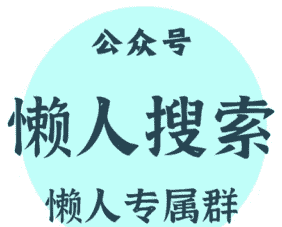

# 大类资产轮动信号明确：金银之后，谁将接棒？

260226 A 视野付费

整理：公众号懒人搜索，懒人专属群精选

懒人微信：lazyhelper1

## 风暴眼中的宁静

继暴力上涨后，近期，金银出现了史诗级的暴跌。

接踵而至的是，我们都看到，包括大 A 在内，很多亚洲的股市也被冲击。

市场此前认定的共识，比如，美联储即将暴力降息带来的美元信用下降、高通胀预期。

也有不少声音认定，下一个大幅拉升的资产，有可能会是石油。

很明显，经历了贵金属急涨急跌后，市场对于下一个暴力拉升的资产，产生了明显的分歧。而分歧，往往就意味着，看准方向的一方，不久会迎来超预期的回报。

正所谓，买在无人问津处，卖在人声鼎沸时。

那么，接棒金银，下一个走强的大类资产，到底会是谁？A 森在本文末给出自己的最新思考总结！

下面开始今天的正文，各位多多支持!

近期，白银暴涨暴跌的幅度，已经到了令人乍舌的程度。

相信，不少人有一种拍断大腿的感觉。

这里，我们首先要非常清楚。

在康波周期尾部，各类资产价格上下宽幅波动，是必然。

因为，人性怕痛，与经济下坡，两者之间的张力，是导致此类宽幅波动的根本原因。

此前，A 森特别提到一个知识点。

传统经济学认为，金银铜铝锡油农，是通胀传导的先后顺序。

所以，近期，已经有不少财经声音提出，是不是可以后续关注石油市场？

那么，真相到底是什么？

其实，站在美国人的角度，非常清楚上面的知识点。

试想，如果接下去石油拉升，进而带动农产品也拉升，本轮全球大滞胀的第二浪就是加速赶顶。

然而，现如今，川普急切希望新的美联储主席沃什，一旦上任就大规模放水。

假设沃什才刚上任，通胀就因为油和农的价格飙升而强势回归，还放个毛线的水？

进一步来说，中期选举，还如何选呢？

也因此，通过人为干预，强力阻止（哪怕是延迟）通胀压力马上传导给油和农，也是必须要做的事情。

这也意味着，无论川普如何看朗子不爽，可是，让华尔街一起配合将油价压制，避免出现油价暴涨，那就是配套措施。

一旦这个策略成功，美联储后续就可以大规模放水，接踵而至的，实则就是 AI 产业会进一步被追捧。

从新任美联储主席沃什的多次发言来看，他认定，AI 是对冲通胀压力、缓解美债压力、提高经济增长率的最重要的工具。

所以，不惜一切代价，也要把这件事办成！

如果继续放任金银铜铝锡油农这个通胀路径走下去，通胀预期下，美债收益率会加速飙升，美国融资成本大增，那么，美股、美债、美房、私募信托等一系列美元重要资产，也将面临严重的价格风险。

那么，这对于我们而言，意味着什么？

众所周知，中美都在争夺 AI 的未来制高点。

一方面，自然是对赌下一个技术革命的燃爆点。

一方面，AI 最大的想象力空间，是制造业和军工。

但是，这里面，还有一张暗牌：

只要中国在 AI 领域明显卡住美国前进的步伐，美国这些年举债所产生的债务泡沫，就会加速走向爆雷。

在 AI 产业暂时根本看不出任何迹象可以马上大幅提高劳动生产率的前提下，这张暗牌，才是最有含金量的。

在美国金融市场爆雷前，美国的精英们一直是把宝全部押在 AI。

与之对应，中国也会如此!

这不仅是因为华尔街炒 AI 会将我们这里的情绪也带起来，更重要的是，有形之手也会引导国内资金往这个赛道去冲。

况且，随着金银铜铝锡一轮踩踏后，相当于 AI 上游的大量有色金属的成本短期得到有效控制。

那么，AI 产业自身的发展，反而是重磅利好!

结合上面的分析，这也意味着，金银之后，AI 产业重新接盘，将贯穿后续行情，成为新的燃爆点。

这里我们需要就当前的全球金融市场的底部运作逻辑，做一个快速的剖析。

美联储大规模降息预期，已经让美元指数渐进式走贬。

可是，美国财政部疯狂举债，又让美国国债收益率高位运行，暂时难以快速下行。

这就是经典的“弱美元，强美债”格局。

需要看到，弱美元与中美利差收敛支撑汇率;外资可能流入估值相对合理的大 A。

另一边，强美债 (收益率),反映的对长期增长和财政的担忧，反而凸显高盈利、高 ROE 科技龙头的稀缺性，被视为一种“避险”选择。

因此，市场或将暂时忽视“去美元化”趋势，转而开始在中美两个市场 (篮子) 里面，去堆放鸡蛋 (资金)。

这也意味着，人民币资产体系内的 AI 核心赛道，实则是享受两份红利了。

不过，我们仍然需要指出，整个金银市场的长期牛市格局，并不会因为本次大跌而彻底结束。

只不过，现阶段，市场需要足够的时间，去消化前期过为夸张的涨幅。

未来一旦调整到位，整体金银牛市的长期趋势，依旧还在。

既然市场又要回归现阶段的科技主线 AI，那么，接下去，围绕半导体的博弈，依旧是绕不过去的。

现阶段，中国在这个领域有着极为强烈的国产替代诉求。

而美国那头，有着极为强烈的要阻断我们获得先进制程半导体的冲动。

伴随着中美在 AI 领域的博弈彻底白热化，那么，半导体这个真正卡脖子的细分领域，也就再一次会回到资本市场的聚光灯下。

这里我们仍然要记住，4 月份，中美要见面喝咖啡。

双方围绕稀土等关键领域博弈，也会再次回归大众视线。

近期，川普提出 120 亿“金库计划”，目标就是打造美国收割私营领域关键矿产储备计划。

本质上，就是让美国产业领域能够及时获得关键矿产。

而目前，围绕关键矿产的争夺，是非常激烈的。

除了是地缘，还因为军工、AI、金融等大量领域，都直接相关。

这也提示我们，虽然金银出现了明显的回调，可是，有色金属和稀土永磁后续还会再有属于自己的行情。

当前，大国的做法，都是非常绝的。

把库存锁仓，再努力从海外搞更多的新增库存。

这种近乎是备战备荒的做法，意味着，主要经济体的产业和军工竞赛，彻底白热化。

在相互卡脖子的同时，却也是要进一步提升产业的“安全”。

那么，这也就意味着，有色和稀土，会是长期赛道，且根本绕不开。

但是，节奏上，需要格外注意。

当前，可以考虑，先避开金银暴跌，对部分有色的情绪冲击。

等后续金银价格进入一个回调的稳定区间，有色部分，也就会更多的按照自己的逻辑去走。

这个节奏，非常重要。

是因为，买的好，将来才可以真正做到，卖得好。

其实，现阶段，金银的大跌，包括美国可能阶段性压制油价，未必是坏事。

股权市场的投资机会，反而出现了！

美元体系面临信用承压，人民币体系的信用重塑方兴未艾，如果这个市场全球流动性都去了金银市场，那么，结果是中美的资本市场被一锅端。

从这个维度，人民币资产体系，与美元体系，是一条船上的，绝不能误判。

这也提示我们，香港市场的投资机会，开始明显增多了！

金银暴跌后，美元体系的信用，暂时得到一个阶段性的修复。

与此同时，人民币汇率也是稳稳的，市场重新回到“中美打平手”的叙事中，而不再是所有“主权信用货币”都是垃圾。

那么，香港这个关键性的离岸市场，作为金融领域极少数可以打通中美两个市场的，其含金量将大幅增加。

除了大 A 中的核心资产，会重新被国际资本追捧。

另外，香港的楼市，也会在追求合理租售比的前提下，逐步被更多国际资金所青睐。

请注意，这个是前几年比较少见的，却又是后续更有确定性的。

国际资本所面临的困境，是肉眼可见的。

美元体系的信用含金量是逐年下降，却又不能完全抛弃。

人民币的信用，是缓慢积累。

贵金属经历这波价格调整，后续价格修复需要更长时间。

那么，追求相对低估、具有极强流动性、被国际资本市场长期认可的香港房股，就成了非常稀缺的投资赛道了。

我们不妨换个角度去思考，等于一部分的国际资本，从金银、从美元体系中流出，加速流入香港市场。

当然，这里，我们也要适度提及风险。

近期，金银回调，很难一步到位。这也意味着，每一次暴跌后，都会出现价格反抽。

对于这种反抽，我们要尽可能远离，切不可上头。

这是因为，国际大资金是在为空头仓位蓄势。

在跟不少 A 粉的沟通中，经常会遇到一种心态。

觉得自己前期错过了金银大行情，总想着要“重温”，这个要格外小心。

对于个人投资者而言，当前最好的策略，依旧是紧跟有形之手去走。

我们缺芯片，美国人缺电。

可是，我们的电力未来供给，并不是那么充裕。

不管是 AI，还是全制造业品类体系，都是严格依赖电力系统。

尤其是，村里还要按照未来跟老美有终极摊牌的剧本，电力系统的超前部署，已经是政策性的刚需，这一点毋庸置疑。

一说电力，不少人就会想到能源。

新能源确实是电力体系的一部分，但是，请大家注意，全球积极部署新能源的其它经济体，总体规模依旧有限。

更广阔的是，人家用石油和天然气为基础，运作自己的电力体系。

也因此，电力体系中的变压器，反而是更为宽广的应用场景。

一个方面，除了中国，几乎所有其它国家都有不同程度的短板。

一方面，电力体系上游重要的零部件、设备和原材料，我们家掌握的份额很恐怖。

一方面，中国自己还在超前部署电力体系。

这也意味着，围绕电力体系中完全绕不开的关键节点，比如变压器和逆变器，就是至关重要的赛道了!

在我们自己的市场调研中，不难发现。

国外市场对变压器和逆变器的需求激增，并非单一因素推动，而是“能源结构转型”、“基础设施升级”和“新兴高载能产业”三大历史性趋势的叠加共振。这导致需求在短期内集中爆发，而供给端受制于较长的产能建设周期，造成了全球性的供应紧张和旺盛需求。

与之对应，中国拥有全球唯一“从矿物到整机”的完整变压器产业链，规模化生产能力、更快的响应速度和显著的成本优势（较国际低 20%-30%）使其成为全球市场的关键供应方。

从中大家也可以看出，“卖铲人”的逻辑，才是投资的关键策略。

这背后，不仅是对大国产业链战争的认知，也是对全球基建投资超级周期的理解和把握。

当前，全球经济处于三个产业周期的交汇点：全球基建投资超级周期、全球军工投资超级周期、全球 AI 投资超级周期。

有意思的是，这三个产业周期交汇点，都指向电力体系的搭建，近乎是绕不过去的。

好了，接下去，需要总结一下了。

面对大类资产价格轮动，尤其是金银暴跌后，最有可能获益的赛道是：

- AI 核心赛道的再次回归
- 半导体卡脖子，又要回到市场主线
- 等金银回调渐趋平稳后，有色走独立行情
- 电力体系的关键节点，如变压器和逆变器

无论是哪个，很明显，真正指向的底层逻辑是：

市场从对赌美元体系加速崩溃，重新回归中美产业链战争主线所产生的机会。

PS：本文完全是个人思考的分享，不构成直接投资建议，还请知晓。

## 最后，安利小懒的付费群：

### 懒人专属群（介绍）

微信：lazyhelper1

🔖 这里是你对抗信息过载的护城河。
已稳定运行 7 年，累计拆解、研读 3000+
个互联网商业实战案例与行业前沿内参和
时政/宏观文章。

我们不搬运垃圾，只做高价值信息的筛选器
与放大镜。

## 懒人专属群更新记录:

https://hk57gvIx7u.feishu.cn/docx/H0kRdZbSbolBR0xkaXtcuVE0nTg

【免责声明】本资料归档于社群内部知识库，仅供成员课题研究与学术交流，请在查阅后 24 小时内删除。