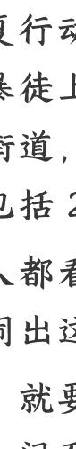

# 毒贩暴动，墨西哥全国瘫痪，背后藏着美国的阳谋？

2026 年 2 月 27 日 文/卢克文工作室嘉宾 概略北方 整理：公众号懒人搜索，懒人专属群精选 懒人微信:lazyhelper1




2 月 22 日，绰号“埃尔·门乔”的墨西哥毒枭，在哈利斯科州被墨西哥军方击毙。

可万万没想到的是，墨西哥算是捅了马蜂窝了。

从 23 日开始，门乔的手下开展了一系列报复行动，在墨西哥的 20 多个州，无数暴徒上街打砸抢烧，熊熊烈火吞噬了街道，现在已经有 70 多人死亡，其中包括 25 名国民警卫队士兵。

很多人都看不明白了，怎么打死个毒枭，闹出这么大动静？

而这，就要从这个故事的导火索——埃尔·门乔说起了。

## 一、埃尔·门乔

埃尔·门乔，原名内梅西奥·奥塞格拉·塞万提斯，正儿八经的草根出身。

1966 年，门乔出生在墨西哥米却肯州的一个极度贫困的农民家庭。米却肯州这个地方大家可能不熟悉，但大家早些年吃的牛油果，大都来自这里。和罂粟一样，虽然牛油果很贵，但种它赚不到什么钱，所以门乔是个穷光蛋，和他的很多老墨老乡一样偷渡到美国，开始卖海洛因和可卡因，这一卖，就是十几年。

三十岁那年，门乔被抓，蹲了几年大牢，出来之后被遣返回了墨西哥。

不过在监狱里这段时间，门乔也没有白白浪费，他学到了一系列受用一生的东西——更先进的犯罪知识，以及美国风格的帮派组织架构和企业管理能力。

带着这身海归本领，门乔回到墨西哥后，干出了一件魔幻的事情——他跑去当警察了。

当然，当警察不是目的，目的是给“锡那罗亚”贩毒集团充当线人，可以理解为无间道。

在体制内，他摸清了墨西哥国家机器的虚弱与腐败，学会了特种战术；在体制外，他利用自己的资源，疯狂扩张自己的势力。

最终，机会来临了，2010 年，随着墨西哥大毒枭伊格纳西奥·科罗内尔被击毙，锡那罗亚集团内部出现分裂。门乔抓住机会，离开警察队伍，拉着自己的手下自立门户，成立了“哈利斯科州新生代贩毒集团”（CTNG），并在短短十几年间里，崛起成为墨西哥第二大犯罪组织。

为什么 CTNG 能崛起得这么快？还要感谢他在美国监狱进修时学到的管理之道。

- 首先，就是差异化。

在墨西哥的贩毒江湖中，一个新势力的崛起是很难的，想崛起就必须分别人的蛋糕，也就必然迎来打压。

所以，门乔并没有从贩毒入手，而是从武力入手。

CTNG 之中，门乔是“以武立帮”，他们疯狂采购美制 M2 重机枪、巴雷特反器材狙击步枪，组建了一支全副武装的特种战术部队，甚至装备有装甲车、直升机，以及可以投掷炸药的无人机。

这种武力，是远远超过那些普通毒贩的。

有了武力，还要练兵，门乔开始了偷油的买卖，从炼油厂管道里偷油。相比贩毒，这种活儿不仅利润低，而且很容易和当地基层军警发生摩擦，导致人员伤亡。

但门乔不在乎，他需要用这种低端业务来筛选敢打敢拼的底层混混，从这里活下来且表现优异的，就是能打敢冲的骨干力量。

就这样，短短几年时间，CTNG 从一个小团伙，蜕变成了墨西哥第一地下武力，CTNG 强到什么地步呢？这么说吧，就连前东家锡那罗亚，都要雇佣 CTNG 当打手。

不过到了 2016 年，情况又变了，锡那罗亚的头目——“矮子”古兹曼被抓了，锡那罗亚的王子们和外姓王打架，最后两败俱伤，反而是 CTNG 这个节度使反客为主，吃下了锡那罗亚大部分的生意渠道。

- 其次，就是产业转型。

传统的大麻、可卡因、海洛因，需要种植，费劲费时间还有风险，墨西哥军方派几架直升机喷洒落叶剂，一年的收成就全毁了。运输非常麻烦，沿途要打点无数的军阀、海关和中间商，利润被层层盘剥。而且成吨的植物毒品体积庞大，极容易被美国海关查获。

而门乔呢？他是在美国混过的，知道美国人吸毒的趋势，所以很早就转型合成毒品（冰毒和芬太尼）了，合成毒品不需要几万亩的土地，也不需要看老天爷的脸色，只需要在深山老林里搭一个几十平米的隐蔽木屋，雇几个懂化学配方的绝命毒师，就能源源不断地把毒品生产出来，成本太低了，风险太小了。

而且，芬太尼的利润和走私便利度是极其恐怖的。它的药效是海洛因的 50 倍，只需要几毫克就能放倒一个成年人。以前走私可卡因是一卡车一卡车地拉，现在走私芬太尼，只需要一个普通的双肩包，装上几公斤，混在正常的包裹里，就能溜过美墨边境，到美国一稀释就能卖。

正是因为这波产业升级，门乔摆脱了对南美毒枭的货源依赖，控制了从原料进口到生产制造再到北美终端销售的完整产业链。

随着门乔成为墨西哥第一大毒枭，他上了美国的黑名单，被悬赏 1500 万美元，相当于拉登的一半。

为了保命，门乔异常低调，不像古兹曼那样四处接受采访，还拍自己的网飞剧集，而是隐居在哈利斯科州和马德雷山脉的小木屋里，依赖由亲信和当地农民组成的预警网络。多年来，墨西哥军方曾多次险些抓住他，但每次都是功败垂成。

不过好运气最终在 2026 年 2 月耗尽了。

门乔再隐居，他到底还是个男人，他也有生理需求。美国人根本不用找门乔，只需要盯住门乔的情妇们就行了，偏偏其中一个情妇又特别喜欢网上晒图，一来二去就被锁定了。

正好，这成了今年 1 月新成立的美国“联合跨部门反贩毒任务部队”(TIATF-CC) 最好的亮相机会，TIATF-CC 由特朗普授意，赫格塞思主导，唯一的使命就是在美墨边境打击墨西哥的贩毒网络，能跨部门调动资源，权力极大。

TIATF-CC 没有接触这个情妇 (怕打草惊蛇), 而是找机会在情妇的保镖手机里安装了间谍软件，2 月中旬，美国人发现这个保镖频繁购买深山生活物资和肾病药物 (门乔患有肾病)，于是判断：情妇准备上山了。

TIATF-CC 调用卫星和无人机，跟着这个保镖和情妇，一路找到了门乔的藏身之处——哈利斯科州塔帕尔帕镇郊外深山里的一座木屋。

TIATF-CC 把情报递交给了墨西哥，墨西哥海军特种部队和陆军精锐组成突击队，乘坐直升机突袭了门乔的木屋。

门乔在付出了 7 名保镖和下属阵亡的代价之后，逃到了树林深处，但仍然被直升机火力命中，重伤被俘，最后死在了直升机上。

一代传奇毒枭，就此落幕。

门乔死了，但这事不算完。

## 二、墨西哥政府的平衡术

《外交政策》杂志报道，墨西哥总统克劳迪娅·辛鲍姆本来不同意这一次行动。但特朗普在古巴问题上，向辛鲍姆施加了巨大的压力。

古巴的能源供应，长期有两大支柱，一是委内瑞拉，二是墨西哥，两国提供的石油，占古巴石油总进口量的八成，其中墨西哥约占 45%，委内瑞拉约占 35%。

特朗普成功绑架马杜罗，意味着委内瑞拉的石油，已是囊中之物，古巴无法再从委内瑞拉进口石油，墨西哥是古巴最后的能源进口支柱。

特朗普要求墨西哥和古巴断绝往来，不仅仅是断绝石油贸易往来，是断绝一切往来，否则就派军队入境，“帮助”墨西哥禁毒。

辛鲍姆非常为难，她不能完全抛弃古巴。

墨西哥被美国侵占大片土地的历史，导致墨西哥政坛许多人非常反美，同情被美国欺压的国家，希望帮助它们，古巴就是其中之一。

冷战期间，墨西哥执政的中右翼政党“革命制度党”，给古巴提供了大批援助，比如以优惠价格提供石油，无偿捐赠各种民生物资、在联合国大会上为古巴发声等等。

冷战后，美国如日中天，“革命制度党”对原有的反美路线感到绝望，逐渐和古巴切割，但“支援古巴”的路线很快被墨西哥左派政党接过。

比如在 2018 年 -2024 年担任墨西哥总统的洛佩斯·奥夫拉多尔，他被称为“最亲古巴的墨西哥总统”。

他无视美国警告，和古巴签订了长期石油供应协议，且价格比前任更优惠，古巴可以拿到四折优惠，假设石油价格是 100 美元/桶，古巴给 40 美元就可以了。

不过，古巴的状况实在太差，有时候哪怕四折优惠价，都拿不出钱，咋办？

没事，可以赊账，墨西哥有时候还会向古巴捐赠，比如 2023 年 6 月，墨西哥一次性向古巴捐赠了 105 万桶原油，就连那些赊账的款，洛佩斯也不催。

2024 年末，也就是洛佩斯总统任期的末尾，他还给古巴免除了 10 亿美元的石油欠款。

外交上，2018 年，洛佩斯的总统就职典礼，邀请了古巴领导人迪亚斯·卡斯尔，前来参加。

这是一个极具对抗性的举动。

由于美国的压力，拉美国家领导人的就职典礼，通常不敢邀请古巴领导人参加，拉美右翼亲美，主观上不想邀请，左翼就算反美，也顶多邀请古巴大使、特使。

敢邀请古巴领导人参加的，还真不多。

因此，洛佩斯任内，墨西哥和美国的关系不佳，尤其是特朗普在位时间，三天两头吵架。

2024 年末，洛佩斯任期结束，按照墨西哥宪法，总统不能连任，于是他扶持了自己的得意弟子、墨西哥首都墨西哥城市长辛鲍姆。

因政绩不错，加上反美坚决，洛佩斯的支持率，常年稳定在 60% 以上，卸任时甚至超过 65%，洛佩斯支持谁，谁就是下一任墨西哥总统。

在古巴这种重大问题上，辛鲍姆不敢违背导师的意志。但特朗普施加的压力又很大，马杜罗覆辙在前，自己又要避免成为下一个马杜罗，怎么办？《外交政策》杂志报道，辛鲍姆的选择是走钢丝。

特朗普要求和古巴切断往来，辛鲍姆只暂停了对古巴输送石油，其他往来照旧，这样对特朗普、对自己的导师，都能有个交代。

特朗普不满意，要求美军入境，“帮助”墨西哥禁毒，辛鲍姆就说，美墨可以就打击毒贩，采取联合行动，不过墨西哥必须是主导方，美国提供情报支援。

于是我们看到，这一次击毙门乔的行动，主要执行者就是墨西哥军警，美国为行动提供情报。

通过这样的行动，部分满足特朗普的胃口，避免自身成为下一个马杜罗；同时，美军没有入境，也没有主导行动，辛鲍姆对国内有个交代。

辛鲍姆用一场极致操作，在特朗普的高压与国内的反美民意之间踩出了一条脆弱的平衡线，可这场走钢丝的博弈，大概率难以长久。

击毙门乔的行动，看似暂时满足了特朗普，却也让墨西哥暴露在“唐罗主义”（特朗普政府对拉美政策被美媒称作“唐罗主义”）的霸权逻辑之下，特朗普的诉求不是单纯的禁毒，而是以各种借口掌控拉美。

美军入境这种事，只会有一次和无数次。

“唐罗主义”的胃口没有边界，从控制委内瑞拉石油，到逼迫墨西哥切断与古巴的联系，要求只会层层加码。

辛鲍姆能靠一次精准的行动暂时脱身，却无法阻挡美方持续施压的脚步，当“禁毒”的幌子无法满足霸权野心，美军直接介入墨西哥事务的风险便会步步攀升。

而墨西哥国内的贩毒集团报复与反美民意的反弹，更会让这份平衡随时面临崩塌。夹在国内乱局与美国霸权之间，辛鲍姆的每一步都如履薄冰。

一百多年前，墨西哥总统波菲里奥·迪亚斯曾哀叹：可怜的墨西哥，离上帝太远，离美国太近。

一百多年后的今天，墨西哥的命运，依旧无法改变。

## 懒人专属群（介绍）


🛠 这里是你对抗信息过载的护城河。
已稳定运行 7 年，累计拆解、研读 3000+ 个互联网商业实战案例与行业前沿内参和时政/宏观文章。

我们不搬运垃圾，只做高价值信息的筛选器与放大镜。

### 懒人专属群更新记录:

```
https://hk57gvlx7u.feishu.cn/docx/H0kRdZbSbolBR0xkaXtcuVE0nTg
```

【免责声明】本资料归档于社群内部知识库，仅供成员课题研究与学术交流，请在查阅后 24 小时内删除。