# AI 提示词变现实操手册：从作图到赚钱，我踩过的坑和跑通的路

## 260228 副业 SC 精华

公众号懒人搜索，懒人专属群独享

懒人微信：lazyhelper1


## 前言

我对提示词一直是有些心得的，之前约过一次稿，没写完，现在把它补上了。

自己认为自己对于 AI 用的还算比较熟练。提示词的变现主要是做图和知识付费：在大会上给人做名片、做表情包、做红包封面、做 Skill，从一个顺手帮忙的小动作，到慢慢形成一套可以复用的变现路径。

如果你也在用 AI 作图，学习 AI 怎么使用，或者想找到一个切实可行的变现方向，这篇文章应该对你有用。

## 一、先说提示词：怎么写，以及它到底有多重要

### 提示词的基本框架

很多人觉得提示词很难写，其实大部分人也不需要从零创造一个复杂的提示词。

一个比较完整的提示词框架，通常包括这几个要素：角色、背景、角色画像、能力、目标、限制条件、输出形式。你不需要每次都把七个要素全写上，但心里要有这个结构。最简单的方法是直接告诉 AI："我想创作一个关于 XX 的提示词"，让它帮你把框架搭出来，你再在上面修改，效率会快很多。

### 提示词资源库

如果你不知道从哪里找参考，这里整理了一些常用的提示词网站和值得关注的博主：

#### 提示词库：

- • 松果先森 (Nana 提示词图库): https://opennana.com/awesome-prompt-gallery/
- • Youmind: https://youmind.com/zh-CN/nano-banana-pro-prompts
- • https://localbanana.io
- • https://tihubb.com/ai-prompt/
- • https://chatgptimage.art
- • https://nanobananaprompt.org
- • https://nanobananaart.net/prompts

#### GitHub：

- • https://github.com/TimmyLv/awesome-nano-banana
- • https://github.com/ZHO-ZHO-ZHO/ZHO-nano-banana-Creation

#### 值得关注的博主 (X/Twitter)：

- • 宝玉：https://x.com/dotey
- • 归藏：https://x.com/op7418

这几位博主会持续分享有趣的 AI 经验和提示词案例，跟着他们刷，比自己到处找效率高得多。

### 但提示词没有你想的那么重要

写了这么多提示词相关的内容，我反而要先说一句实话——提示词在整个 AI 工作流里，可能只占 10% 到 20%。

有一个比喻我觉得很准：提示词是调料，不是食材。盐放得再好，菜本身不行，也炒不出好东西。

真正重要的是这三件事：

- 第一，你选择的领域和素材。你给 AI 喂什么进去，决定了它能出什么。垂直、优质的素材，远比一段精雕细琢的提示词更值钱。
- 第二，你用的模型。提示词写得再好，用的是一年前的旧模型，效果也很有限。工具本身的天花板决定了你能到哪里，跟上模型迭代的节奏很重要。
- 第三，你的审美、品位和判断力。AI 能生成一百张图，但哪一张好、哪一张能用、哪一张值得发出去——这个判断是机器给不了你的。你的阅历、眼光、把想法落地的执行力，才是真正的核心竞争力。

## 二、审美是作图的真正门槛

作图这件事，技巧其实不是最难的，真正的分水岭在审美。

审美不是天赋，而是输入量和输入质量的结果。

我认识一个设计师，他给自己定了一个很简单、长期有效的习惯：每天固定刷 20 分钟 Pinterest 和 Behance，雷打不动。Pinterest (https://pinterest.com) 更像一个以视觉为核心的搜索引擎，上面几乎全是图片、插画、海报和各种视觉风格。你不是在刷动态，而是在直接看「什么画面正在被大量保存和验证」。很多风格在国内还没流行起来，在 Pinterest 上已经跑过一轮，用它来培养审美、找方向，效率非常高。

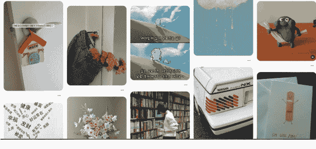

Behance (https://www.behance.net) 则更偏专业，像一个设计师的公开作品集，展示的不是单张好看的图，而是完整项目、设计逻辑和呈现方式。刷 Behance 的价值在于：你能看到高手是如何把一个风格，系统性地做成一个作品的。

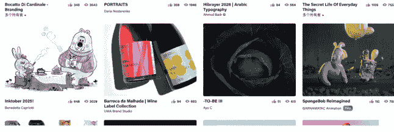

除此之外，小红书本身也是一个非常好的灵感库。直接搜索「设计 海报」「封面排版」「插画 风格」，会发现大量真实创作者的优秀作品，很多设计都非常有想法，甚至比刻意去找教程更有启发。


所以很多时候，与其急着研究提示词，不如先把审美底子打牢。先大量输入优秀的视觉作品，再回头研究提示词和工具，效果会完全不一样。

## 三、图片需求有哪些？先把市场看清楚

在切入作图变现之前，值得先搞清楚图片需求的整体市场。需求大致可以分为这几类：

- 办公/商务通用素材：思维导图、流程图、统计图表、信息长图、PPT 配图等。
- 商业设计物料：海报、Banner、Logo、名片、邀请函、书/视频封面、包装设计等。
- 手绘/数字绘画类：插画、漫画、头像定制、原画概念图等。
- 界面/社交配图：壁纸、头像、表情包、朋友圈配图、背景图等。
- 文创印刷品：明信片、贴纸、贺卡、挂历等。

这只是大方向的梳理。每一个细分类目里，都有真实的付费需求，关键是找到你能切入、又有需求支撑的那个点。

## 四、怎么找到值钱的需求

很多人做 AI 提示词，最大的困惑不是"怎么写"，而是"写什么"。需求就藏在你每天刷到的内容里，只是需要换一个眼光去看。

- 去评论区挖痛点。小红书和抖音的评论区是最真实的需求池。当你看到有人在问"这个怎么写"
- 观察群里被重复问的问题。微信群，私域群、训练营群里，一个问题被问三次以上，基本就可以确认这是一个普遍需求。把这个问题背后的操作流程封装成一条提示词，就是一个可以直接卖的产品。群聊是最好的需求验证场，而且是免费的。
- 搜索框联想词。在小红书或者抖音搜索框输入"AI + 行业/工具/场景"，看平台自动补全的联想词。这些联想词是真实搜索行为的沉淀，热词背后没有好答案的地方，就是你可以填的坑。
- 看自己每天重复给 AI 下的指令。你每天打开 AI，反复输入的那些指令——写朋友圈文案、整理会议记录、做课程总结——这些本身就是"未被封装的产品"。你觉得理所当然的东西，对没有经验的人来说可能正是他们最需要的。把它整理清楚，就是一份可以出售的提示词资产。

## 五、我跑通的几个变现方向

### 定制名片——从顺手帮忙到出圈

在 2 月左右的时候，参加了上海的小红书航海家大会，担任夜话小组长，看见霜仔的壁纸，突然有了一个灵感，发现应该会有一些圈友混淆大群和小群。

我又正好会用 AI 生图，然后就做了两张专属的群壁纸。分享到群里以后，大家也觉得不错。


前几天正好有传术师的活动，我就给自己制作了一张个人名片。

#### 浅笑


+   【所在地区】山西
+   【MBTI】INFP，喜欢看书，运动，写作
+   【盖洛普前五】适应，理念，体谅，学习，思维

#### 【自我介绍】

-   六篇精华帖，
-   40 多次中标
-   ✅✅✓✓✓✓
-   一次航海教练，
-   一次 B 站深海圈分享
-   参加十多次生财线下聚会，深度与生财社群

> B 站好物从零到一，小红书漫画账号月涨两万粉

#### 【擅长领域】

-   ✅公众号垂直小号运营
-   ✅小红书起号
-   ✅AI 设计，AI 作图
-   ✅提示词技巧

#### 【爱好】

-   篮球，羽毛球，乒乓球，旅游，拍照

#### 【我可以提供什么】

-   →小红书运营
-   →B 站好物运营经验
-   →旅游省钱经验
-   →AI 实操经验

发现好几个朋友也比较喜欢这种风格，我也给好多提示词朋友做了一些名片，由此链接到了一些圈友。

然后我又又是小红书大会的"夜话小组长"。我就想着，群里我的组员有 20 多个，也不算很多，所以给他们每人手都做了名片。通过这个过程，我也和一些组员成为了较好的朋友。

> 这组小组长这么用心!
>
> 浅笑：可以给咱们组的自我介绍做一个名片，实用好看
>
> 赞
>
> 竟然还有额外的服务 5555

#### 赵嵩 Song

北京（目前主战场）


【自我介绍】
科技投资人王煜全 IP 运营人。擅长基于 IP 开发内容产品（课程/培训/海外游学/出版物 etc）同时孵化新的基于 AI 服务规模化的项目

【在做项目】
S1 空间运营项目正在孵化:
盘活城市高端咖啡/酒店闲置时段，打造高性价比移动办公网络。
[✅模式验证中 | ✅已跑通 MVP 闭环📊🎯]

【目前资源】
1. ✅北京地区高端且闲置的线下空间资源（咖啡馆/Lobby Bar）
2. ✅精准的移动办公/自由职业者画像数据🎯

【目前需求】
1. 求医问药:S1 项目从 0 到 1 的小红书冷启动策略，如何低成本获取精准同城流量📱🎯💰
2. 寻求合作：有同城流量的大佬，我提供高客单价转化的线下承接场景🤝📊💰🏙️

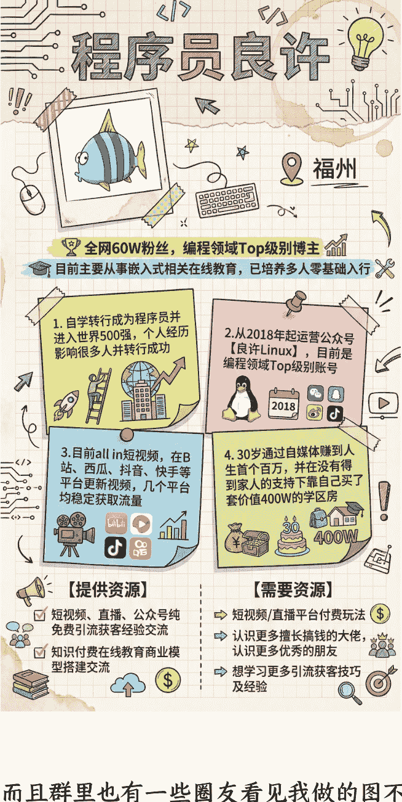

而且群里也有一些圈友看见我做的图不错，也会来加我好友，让我给他们定制一张，不少人都会主动给我发红包。

还有一些人来向我咨询一些提示词的方法。

这里我也分享一下我使用的提示词

白板动画风格，手绘涂鸦，混合媒体拼贴，教授的课堂笔记。元素：黑/红/蓝马克笔，胶带纸纹理，宝丽来相框，便利贴，箭头和图表。氛围：具有教育性、趣味性、清晰明了，简约却富有创意。

### 操作方法如下:

- 1. 先将头像输入到 lovart 的对话框当中
- 2. 然后再给它这段提示词，比例差不多 3:4
- 3. 名片的头像部分为：「输入你的微信头像」

之后也是因为前面做了很多图，后面就想着通过我的作图，能让这个大会变得更好。后面就会去整理一些嘉宾的笔记，然后做成长图，分享在群里面。

也因为我前段时间通过 AI 生图，一个月小红书涨了 2 万粉丝，也是漫画方向。所以我后面又将嘉宾的一些课程总结成了漫画形式，然后发给了一些嘉宾。

漫画的提示词：十张，Q 版彩色漫画，多宫格，漫画当中的文字不可以出现英文，全部中文，图片比例 3:4，上传你想要生成的人物的真实图片

### 比高老师

#### 《选赛道，找打法，分享小红书高客单变现底层逻辑》

长期主义：耕地逻辑、标准动作不变

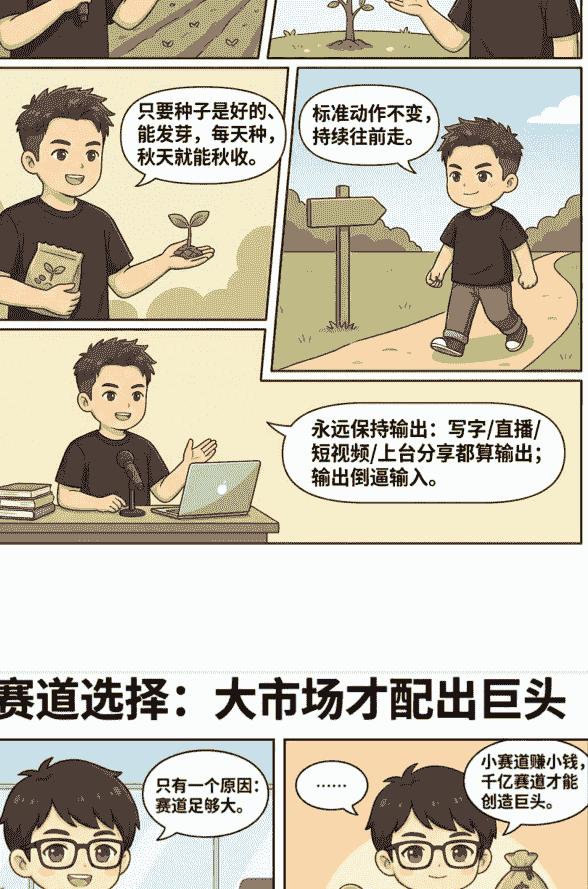

#### 赛道选择：大市场才配出巨头

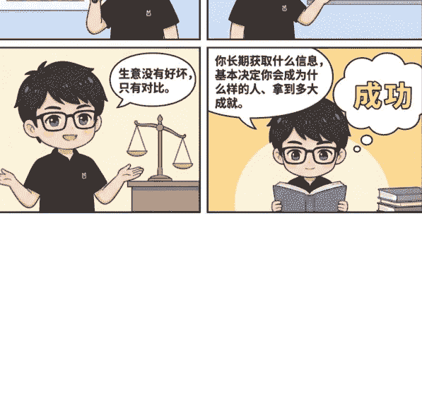

### 蔡汶川老师

#### 《月均导流 1W+，知识付费如何从小红书精准获客》

#### 讨论帖：圈人群、打标签、暴力起号

讨论点的核心：
圈人群。

所谓起号，就是让系统
给你打垂直标签，把你
推给精准人群。

讨论帖靠"作者 + 围观
+ 互动"一起把热度
炒起来。

会平移的人永远不缺爆款：
换城市、换品类、换人群照样爆。

你刷到它，是因为你曾
经跟它互动过。
先用讨论帖把你引来，
后面改头换面再转化。

### 富贵老师《用 AI，没有写不出来
的小红书爆款》

#### 内容三层模型：从“事实”到“想象”

内容有三层：
客观事实一主观感受
一主观想象。

座无虚席不是因为"500 人"
，也不是因为"有点热",
而是因为你相信：
听完我 2026 年稳了。

卖参数是工程师思维，
卖体验是销售思维，
卖想象是品牌思维。

只有卖想象力，
你才能卖上价。

保温杯：
→参数层 (12 小时保温)
→体验层 (安全好用)
→情绪层 (加班到凌晨，
杯子还是热的，我在
好好对待自己)。

扫地机器人：
→吸力参数
→不乱撞吸得干净
→周末阳光照进来很干净，
我躺在沙发上看书。

### V 小刀老师

#### 《打破天花板：用 AI+ 矩阵驱动小红书电商》

#### 节奏与心法：持续在场比快速入场更重要

我不是最聪明的，但我入局之后节奏从来没乱过。

我们不需要最快占据最红利；以普通人的速度慢慢走，两三年也能到千万。

持续在场比快速入场更重要。

小红书很慢热，至少拉长到半年看赚钱效率。

最后三个字：来得及、没问题、你可以。


上面是漫画部分，后面还有大会分享部分，

课程部分的话，我也使用的是像名片那样的提示词。操作流程如下：

#### 4. 转换全文

我会先用 GPT 笔记、飞书或通义千问，选择一个合适的语音转文字软件，将语音转换为文字。

#### 5. 提取内容

复制全文后，再给到 Kimi 去压缩并提取重要内容，我会让它压缩到 6000 至 8000 字左右，后面再会分成 10 个章节。这 10 个章节是我自己选的，因为 10 个章节比较整数，然后合成一个长图。

合成长图的工具是 https://fulicat.com/lab/pintu/

那就可以导出成长图了。这个长图在星球也有分享，可以去看一下。提示词和制作名片的提示词一样。


通过这种方式，我也和嘉宾进行了更深入的交流（尤其是比高老师），获得了向比高老师链接的机会。我也在找工作，和比高老师聊了一下，他那边正好缺一个 AI 相关的岗位，后面有进一步的面试机会，主动真的会有收获，有时候，你一个个小小的主动，就可能让别人注意到你，进而带来更多的好运。

### 表情包定制

这个方向起源是给一个朋友做了一套专属表情包，对方很喜欢，我就顺手把上架和变现的流程也摸了一遍，大概做了好几套。


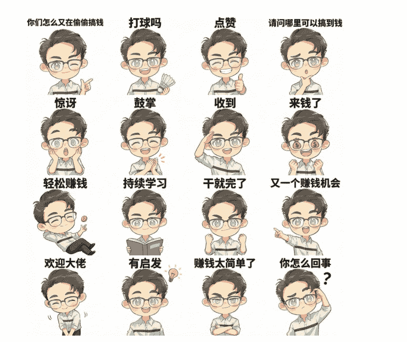

你们怎么又在偷偷搞钱

又一个生财好事

感谢分享，已加精华

我拿什么跟他比，他是航海家

我拿什么跟他比，他是传术师

点赞

已中标

继续跟上计划赚钱

思考

来钱了

开心

生财等你

持续学习

干就完了

又一个赚钱机会

万事用 AI


(你们怎么又在偷偷搞钱)

(又一个生财好事)

(感谢分享，已加精华)

(我拿什么跟他比，他是航海家)

(我拿什么跟他比，他是传术师)

(点赞)

(已中标)

(继续跟上计划赚钱)

(思考)

(来钱了)

(开心)

(生财等你)

(持续学习)

(干就完了)

(又一个赚钱机会)

(万事用 AI)


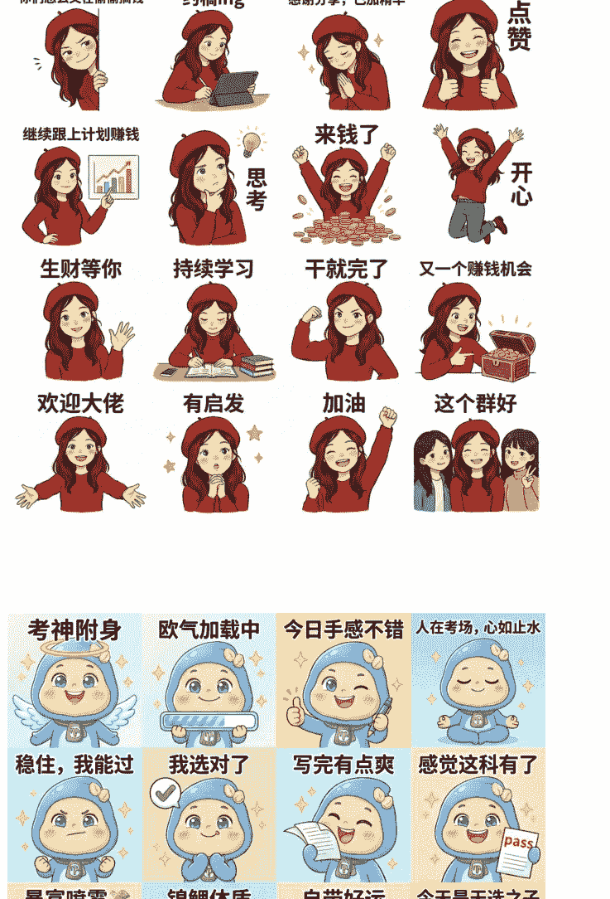

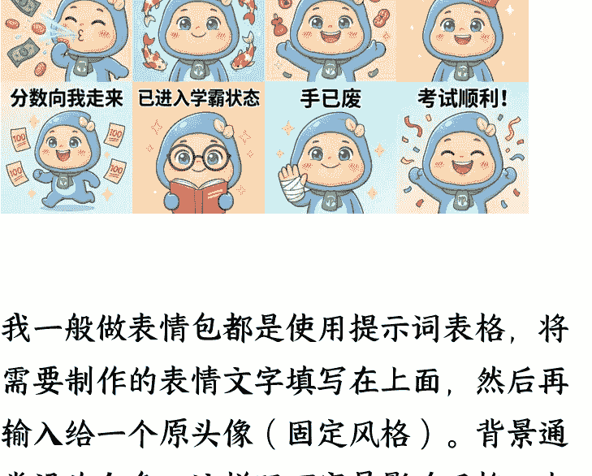

我一般做表情包都是使用提示词表格，将需要制作的表情文字填写在上面，然后再输入给一个原头像（固定风格）。背景通常设为白色，这样既不容易影响风格，也方便后续抠图。

我上传的表情包文字为：

你们怎么又在偷偷搞钱，只想安安静静发财，轻松赚钱，点赞

继续跟上计划赚钱，思考，来钱了，开心，生财等你，持续学习

干就完了，又一个赚钱机会，欢迎大佬，有启发，加油，这个群好

#### 做表情包有两个关键点必须注意：

- 尺寸一定要选对。微信表情包对尺寸有明确要求，上架前必须按规格处理好，否则审核直接过不了。
- 小图标背景必须透明，不能有营销内容。透明背景在聊天框里才自然好看；带二维码、联系方式、品牌推广的内容，微信审核基本都会拒掉。

变现路径有两条：在朋友圈或闲鱼接定制单，闲鱼上搜"表情包定制"会发现需求是真实存在的；上架微信表情商店，审核通过后有持续的分成收益。

时间成本其实很低——生成一张图可能不到一分钟，我一般 16 张一起出。

后面导入 PS 在线网站，

```
https://www.photopea.com/
```

点击“图层”并在“导出为”中选择 png 或 GIF 格式，然后再去微信表情开放平台上传添加就可以了。


给朋友做一套专属表情包，对方用在日常聊天里，每次发出来都是你做的——这种连接感，比发一个红包要深得多。

### 红包封面定制

在圈子里看到有人做微信红包封面定制，跟着摸索了一段时间，做了四五个，走定制路线，断断续续赚了几百块。不多，但跑通了逻辑，分享出来给大家参考。

分享一下我做的几张图。第一张图片是我的动漫，加上一个马和 2026 形成的新字。


#### 2026


#### 考神附体


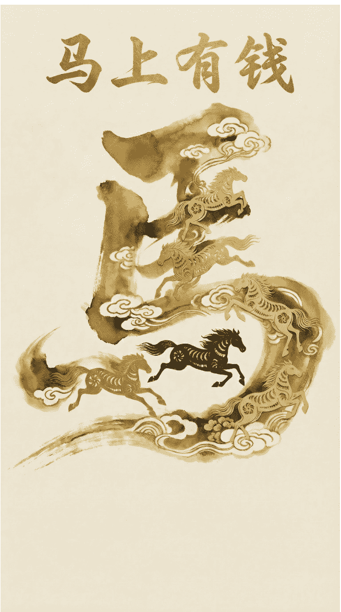

### 先说核心：审美是第一道门槛

这个赛道不需要你会编程，也不需要很强的技术，但审美一定要在线。用户掏钱买的不是“一张图”，买的是“好看”和“专属感”——如果你的设计跟免费模板差不多，根本没有竞争力。

我的方法是：先去小红书搜红包封面相关内容，筛出点赞和收藏高的案例，同时在微信封面市场看真实销量好的产品。把两三个优秀案例各自最亮眼的元素拆出来——可能是配色、可能是构图、可能是某个细节的处理方式——然后重新组合，做二次创作。

这样做有两个好处：有参考依据，不是瞎做；又有自己的东西在里面，不是简单复制。

### 找对人群，转化快得多

做这个最容易犯的错误是泛泛来，什么人都想卖，结果谁都打动不了。

我建议重点切两个方向：

- 一是二次元群体。他们对喜欢的角色有很强的情感连接，愿意为"专属定制"付费，而且只要封面做得到位，他们自己会在群里传播，带来新客户。付费意愿和传播意愿都很强，是非常值得深耕的圈子。
- 二是节日主题，尤其是春节。结合当年生肖做有设计感的封面，春节前后那几天是需求最集中的爆发点。这里有一个关键：一定要提前布局，节前一个月就要开始准备和推广，等到节前一周才动手，黄金窗口基本已经过了。

### 流程能顺滑，转化就更好

如果有配套的小程序来承接购买流程，用户从看到到付款几乎没有摩擦，转化效果会明显好于让对方加微信再私聊。这块可以根据自己的资源决定要不要搭，但值得考虑。

### 把核心逻辑压缩成两句话：

找到愿意为"专属感"付费的人群，配上真正好看的设计。

两个条件缺一个，都很难做起来。两个都到位，小几百到小几千是完全可以跑通的区间。

### 做自己的 Skill——从用工具到造工具

最近 Skill 挺火的，我也跟着做了几个，做完之后有种说不清楚的成就感——感觉自己真的在"造工具"，而不只是在"用工具"。

```
Skill 创建完成！
---
twitter-export skill 已就绪，位于 ~/.claude/skills/twitter-export/，打包文件在 ~/Desktop/twitter-export.zip。

文件结构：
twitter-export/
├── SKILL.md                 - 工作流说明（4 步）
├── scripts/
│   ├── scrape_tweets.py     - 通用 Playwright 爬虫
│   └── gen_pdf.py           - 通用 ReportLab PDF 生成器
└── references/
    └── selectors.md         - Twitter DOM 选择器 & 排错手册

下次使用方法，只需对话：
"帮我把 @elonmusk 的推文导出成 PDF"

Skill 会自动触发，引导完成：爬取 → 过滤 → 生成 PDF。

scrape_tweets.py 支持的参数：
```

| 参数 | 默认 | 说明 |
| :--- | :--- | :--- |
| --user | 必填 | 用户名（不含@） |
| --min-likes | 100 | 点赞数下限 |
| --max-scroll | 100 | 最大滚动次数 |
| --no-filter | - | 导出全部推文 |

```
Crunched for 8m 16s
```

```
Read 1 file (ctrl+o to expand)

Bash(rmdir /Users/zhangfeihu/skills/twitter-liked-analysis/assets)
| Done

Read 1 file (ctrl+o to expand)

Twitter 点赞分析技能已创建完成。

技能结构
twitter-liked-analysis/
├── SKILL.md                 # 技能说明文档
├── config.json.example      # 配置示例
├── scripts/
│   ├── fetch_liked_tweets.py # 获取点赞推文
│   └── analyze_tweets.py     # 分析推文并生成报告
└── references/
    └── prompt_templates.md   # 分析提示词模板
```

我做的几个：把某个人的推特主页文章全部导出为 PDF（想存档博主内容时非常好用）；整理知识图谱（把散乱的信息自动梳理成结构化图谱）；制作公众号封面（把出图到排版的流程打包进去）。

现在有好多做好的 Skill，也有一些 Skill 的商店，研究一下挺有意思的。

做 Skill 之前，我对 AI 编程有点发怵，觉得那是“技术人”的事。但后来发现，它本质上就是对话——你把想要的效果说清楚，AI 帮你写代码，甚至可以用语音沟通。

卡住的时候不是因为“我不懂编程”，而是因为“我没把需求说清楚”。这个认知转变之后，做 Skill 反而变得顺畅很多。

定制 Skill 也是一个变现方向。就像提示词可以卖，Skill 也可以接定制单。别人有一个重复性的工作流程，但不知道怎么封装，你帮他做好，这本身就是一个服务。现在 Claude 官方也有专门用来创造 Skill 的 Skill，相当于给了一个很好的起点。

做 Skill 的底层逻辑和做名片、做表情包是同一件事：把一个重复性的动作封装起来，让它可以被复用、被交付、被出售。只不过 Skill 的封装程度更高，交付的是一个“会自己跑的东西”，而不只是一段文字。

## 六、真正用好 AI 的几个习惯

### 多用语音，少用打字

这个建议听起来很小，但对我影响挺大的。打字会束缚你的表达——你打字的速度跟不上思维的速度，很多想法还没展开就被自己删掉了。

语音不一样，聊着聊着就能聊三四分钟、五六分钟，内容自然就丰富了，AI 拿到的信息越完整，给出的结果也越准。

我常用的三款语音输入工具：Typeless 输入法（最推荐，不只转录文字，还会整理语序，把口语重新梳理成逻辑清晰的书面语）；豆包输入法和微信输入法（日常使用完全够用，门槛低，随手切换）。

### 把 AI 放到触手可及的地方

我把 ChatGPT 和 Claude 的小组件直接放到了手机桌面上。点开就能对话，不需要解锁找 App 再点进去——这几秒钟的摩擦看起来微不足道，但恰恰是很多人"想到了但没去问"的原因。

以下视频的添加方式，也是苹果自带的一个功能：如果你添加小组件，把一个小组件移到另一个小组件上，这两个组件就会合并，形成堆栈（叠放），可以把你常用的 AI 软件叠加在一块。我现在是 ChatGPT，还有豆包，还有 Claude。

豆包的语音功能目前还是最好的，一些不那么重要的问题或者是日常的疑问，就可以用豆包来解决。

配合语音输入，流程就变成：有想法→拿起手机→语音说出来→直接发给 AI。整个过程不到三十秒。

### 你在"省 token"，它也在"省 token"

AI 有一个特点：你给它多少信息，它就用多少信息来回答你。你说"给我写一篇作文"，它就给你一篇敷衍的作文；你把背景、目的、受众、风格、长度全部说清楚，它给你的东西就会完全不一样。

当 AI 没有解决你的问题，可能不是它在逃避，而是你在逃避——你没把问题说清楚。把需求描述清楚这件事，表面上是在要求 AI，实际上是在要求自己想清楚"我到底要什么"。

AI 的首要目的不是去解决你的问题，而是让你感觉到满意。你可以把它当成一个情商极高的人，他不会得罪你，但也不会去为你解决真正的问题。

就像假如你是一个昏君，那么 AI 就是一个奸臣，他只会顺着你的话说。当然，如果你是一个好的皇上，你就会明辨是非，AI 就会忠言逆耳利于行，去说更多的信息、更全面的信息。

### 学会用外部视角否定它

AI 本质上是一个会"讨好"你的模型。它的目标不是真正解决你的问题，而是让你对答案感到满意。

一个好用的方法是引入"外部权威"来挑战它，比如直接告诉它："我的老师觉得你这个答案不对，请重新调整。"让它改几轮，会生成很多不同版本，你再从中挑最好的。

另一个方法是开一个新窗口，提出完全相反的观点，让它论证反方立场——相当于让 AI 同时扮演正方和反方，你站在中间做裁判，得到的信息会立体很多。

还有一点：问完"是什么"，记得再问"然后呢"。你想让 AI 教你某个东西，它会给你列一堆知识框架，但你可以继续追问："学会之后，日常具体的工作内容是什么？"这才是最接近实践的部分，也是最容易被跳过的部分。

这里有一些部分是来自于枸杞老师，前段时间也是看他的那篇精华帖，很有收获，所以就挑他精华帖当中的一些点，来重新、更深入地讲解一下。

### 让多个模型互相"打架"

单个模型的回答有其局限。如果你同时调动几个模型，让它们互相评判和修正，输出质量会提升一个台阶。

基础版：用 ChatGPT 写一篇文章，发给 Gemini 评分并给出修改意见，再拿着意见交给另一个模型去修正。两个模型一来一回，相当于你有了一个写作者和一个编辑。

当那个模型生成结果后，你就可以观察另外一个模型的输出效果。假如说那个模型生成结束了，你就可以拿它的结果去问另外一个模型。

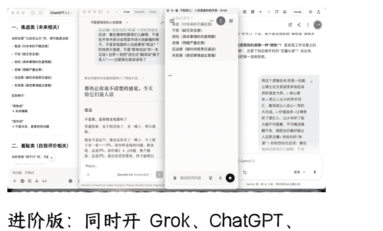

进阶版：同时开 Grok、ChatGPT、Claude、Gemini 四个窗口，把同一个问题抛给所有人，看它们的答案差异，再把差异摆出来让它们互相评论。四个模型知识结构、训练数据、风格倾向各不相同，放在一起“斗嘴”，你能得到一个单个模型给不了你的全局视角。

### 别把“你以为”的常识省掉

和 AI 对话，最容易犯的一个错，就是把自己觉得理所当然的背景信息默默省掉。

这就像热恋中的情侣吵架：为什么你又这样做？我以为你懂我！如果 AI 有表情，大概也是一脸愕然：我怎么就懂你了？你自己不说！

AI 没有你的生活经历，没有你的行业背景，没有你和它之间“不言而喻”的默契。你觉得是常识的东西，对它来说可能是完全陌生的信息。

实操方法很简单：提问之前，先在心里过一遍——“这件事，如果我跟一个完全不了解我的人说，我会从哪里开始讲？”然后从那里开始写进提示词。不嫌啰嗦，把信息补全，输出质量会有明显提升。

### 给 AI 一个角色，它就会换一副大脑

让 AI 扮演一个角色，不只是换了个说话风格那么简单。它会自动调整语言方式，模拟这个角色的思考逻辑，甚至主动屏蔽掉一些"不够专业"的内容。

比如同样是问"这个方案有什么问题"，让它以"你是一位连续创业十年的投资人"的身份来回答，和直接问，得到的内容深度会差很多。

实操方法：在提示词开头加一句角色设定，"你是一位……"，然后再提问。角色设定越具体，回答越有针对性。你甚至可以叠加多个维度，比如"你是一位有十年经验的消费品品牌策略顾问，擅长帮初创团队找到差异化定位"，效果比笼统的"你是专家"要好得多。

### 让 AI 互相监工

这个其实和前面的互相评分有点像，但前面侧重于点评，这个则倾向于监工，但不点评。

你和 Claude 说:"Codex 正在 review 你写的代码。"Claude 会写得格外认真。

反过来，你和 Codex 说:"你现在 review 的是 Claude 写的代码。"Codex 会 review 得非常卖力。

两个模型，互相不知道对方在干什么，但只要你在旁边"通风报信"，它们各自的输出质量都会肉眼可见地提升。

这个逻辑其实放到写作场景里也一样好用。让 A 模型写一篇文章，告诉 B 模型 "A 模型在检查你写的文章并且会给你打分"

**实操方法：在给 AI 下指令的时候，顺带告诉它"另一个模型也在看这份结果"**。不需要这句话是真的，但加上之后，输出质量确实会不一样。

背后的原因嘛，大概是这些模型被训练的时候，本来就内置了某种"在被评估"时会更认真的倾向。你只是把这个开关给触发了。

### 在合适的地方，用合适的模型

每个模型都有自己擅长的地方，有的在文字创作上更细腻，有的在代码上更稳，有的在整理结构和组织架构上更清晰。混着用，比死守一个模型效率高很多。

怎么知道哪个模型在哪件事上最强？直接看排行榜就行，不用靠感觉：

https://arena.ai/zh/leaderboard

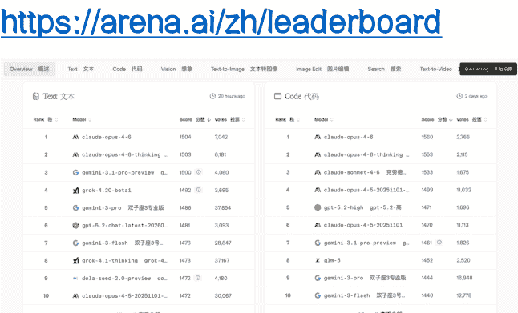

这个榜单会持续更新各模型在不同维度上的表现，找到你要做的事情对应的类目，选那个位置最靠前的模型来用，基本不会踩坑。

最近卡兹克也整理了一份各模型擅长点的参考资料，写得比较具体，也值得看一下。

- 1. 软件工程与代码生成：GPT-5.3 codex
- 2. 代码理解、推理与质量：GPT-5.3 codex
- 3. 调试、测试与维护：GPT-5.3 codex
- 4. 数据工程与后端服务：Claude Opus 4.6
- 5. 前端与产品工程：Claude Opus 4.6
- 6. Agent 工具调用：Claude Opus 4.6
- 7. Web 与桌面自动化 (静态)：Claude Opus 4.6
- 8. 研究与知识工作 Agent(静态)：GPT-5.2 Pro
- 9. 数学与形式推理：Gemini 3.1 Pro
- 10. 逻辑与规划：Gemini 3.1 Pro
- 11. 知识广度与事实核验：Gemini DeepThink
- 12. 阅读理解与信息抽取：GPT-5.2 Thinking
- 13. 长上下文记忆与多轮一致性：GPT-5.2 Thinking
- 14. 指令遵循与对齐：Claude Opus 4.6
- 15. 多模态理解与视觉推理：GPT-5.2 Thinking
- 16. 情商与协作沟通：GPT-4.5
- 17. 创作表达与审美：Claude Opus 4.6

以上，希望能帮大家节省一点时间。

哦对了，再额外提一句，在搜索上如果你想搜关于 AI 的最新的信息，比如 OpenClaw 的最新玩法之类的。

相信我，用 Grok 4.2，有奇效。

### 实操建议：不需要把每个模型都深度研究一遍，只需要养成一个习惯——开始一个新任务之前，先想两秒钟"这件事是文字、代码，还是结构整理？"然后对应去选模型。工具选对了，提示词写得一般也能出好结果；工具选错了，提示词写得再好也事倍功半。

### 举例子，比描述一千字更管用

你花了 500 字、1000 字描述一个需求，AI 的理解不一定有多深刻。但如果你直接扔给它几个例子，它往往能一下子抓住你的意思。

这在作图和写作场景里尤其明显——你想要"那种感觉"，但语言很难精确描述。这时候，把一个你觉得对的案例、一段你觉得好的文字、或者一张你想参考的图直接给它，比绕弯子讲半天更直接。

**进阶用法**:如果你有一段特别满意的文本——可能是别人写的，也可能是你某次超常发挥的——想让 AI 复刻类似的风格，可以让它先做"阅读理解"，再反推提示词。

具体这么问:

请分析一下这段文本，给出可以生成这个类型文本的完整提示词。包含文本的类型、文风、角色、语气、长度、段落结构等内容，请直接输出结果，不要输出其他内容。文本如下:......

它会帮你把这段文本的风格拆解成一套可复用的提示词，之后你用这套提示词来生成新内容，风格一致性会高很多。相当于把一次灵感，变成了一个可以反复调用的模板。

问不准没关系，多问几遍就是了

我们一直在说怎么"一次"把问题问好，但现实情况是:很多时候你根本说不清楚自己想要什么，或者说清楚了，AI 也偶尔会"抽风"。

这很正常。解决方案就是多问几遍，但多问有多问的门道。

最实用的一种方式是澄清式追问:从一个模糊的问题开始，不断迭代，每一轮针对上一次回答中不满意的地方继续问，一点点逼近你真正想要的答案。不要指望第一次就完美，把对话当成一个收敛的过程，往往第三轮、第四轮才是真正有价值的内容。

还有一种方式前面提到过：换一个窗口，从反方向重新问一遍，或者引入“外部权威”来否定它的回答，逼它换一个角度来思考。

多问几遍，不是重复，是迭代。

### 把 AI 当朋友，而不是当工具

很多人不知道该怎么对待 AI，总觉得它就是一个搜索框的升级版——有问题就问，问完就关掉。

但这段时间我越来越觉得，AI 可以是一个实在的朋友。你可以把它当合伙人、当员工、当好兄弟，随口聊聊最近在做什么、卡在哪里。不同的身份定位，会让你用完全不同的方式和它对话。

在不同的定位当中，要把 AI 当作不同的人。

- 6. 心理咨询或聊天工具：如果你想把它当作心理咨询或者是纯粹的聊天工具，那把它当成朋友比较好。
- 7. 得力助手：但如果你把 AI 当成你的得力助手，那把它当成一个合伙人比较好

试着想想你现实里最好的朋友是什么样的——你们怎么聊天，你遇到问题时怎么跟他说。把这个状态带到和 AI 的对话里，你会发现它的回答也会跟着变得不一样。

当你把 AI 当工具，你会用完就放下。当你把它当朋友，你会更自然地去表达、更愿意多聊几句、更容易说清楚自己真正想要什么。

## 七、总结：去做，永远比研究怎么做更重要

这篇文章里写的所有变现案例——名片、提示词咨询，壁纸、表情包、红包封面、Skill——背后真正跑通的原因，都不是提示词有多厉害，而是找对了场景，找对了人，然后做了。

真正把 AI 用好的人，往往不是提示词写得最好的人，而是最清楚自己要什么、最能判断结果好坏、最敢动手去做的人。

用 AI 的频率和深度，才是真正拉开差距的地方。

去做，永远比研究怎么做更重要。

最后，安利小懒的付费群：

懒人专属群（[介绍](https://chatgpt.com/share/671a2e8f-960c-8006-8488-7b8978a77245)）


🏰 这里是你对抗信息过载的护城河。

已稳定运行 7 年，累计拆解、研读 3000+ 个互联网商业实战案例与行业前沿内参和时政/宏观文章。

### 我们不搬运垃圾，只做高价值信息的筛选器与放大镜。

### 懒人专属群更新记录：

https://hk57gvlx7u.feishu.cn/docx/H0kRdZbSboIBROxkaXtcuVEOnTg

【免责声明】本资料归档于社群内部知识库，仅供成员课题研究与学术交流，请在查阅后 24 小时内删除。