# 出海做 AI 产品半年后，对 AI 视频站的一些思考和分享

## 260228 副业 SC 精华

公众号懒人搜索，懒人专属群独享

懒人微信：lazyhelper1

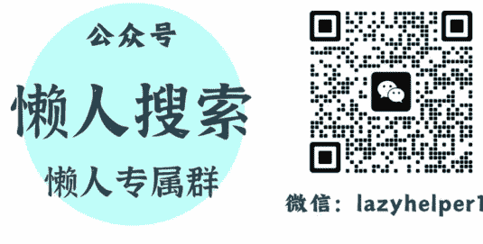

大家好，我是 A 梦。

今年 1 月 17 日，我在杭州生财有术总部做了一场关于“AI 视频套壳站”的线下分享。同时在 1 月到 2 月期间，带领了一场 Mini 航海《AI 视频 SaaS 网站》。

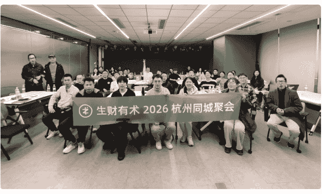

航海在年前顺利结束，抽时间好好整理一下线下分享的内容，也方便参加航海的圈友们阅读。

这篇文章整理了线下分享的核心内容，涵盖基础概念、实现路径、流量策略、转化优化和风险规避。

对了，刚好过年期间大家都看到的 Seedance 2.0 视频模型的强大能力，也有很多朋友靠着这个关键词拿到流量和盈利。

## 01、背景：从设计师到 AI 产品

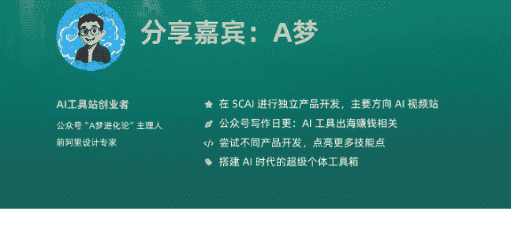

我是前阿里交互设计师，2025 年开始学习 AI 编程，10 月份转向视频套壳站方向。这个转型的核心原因是：早期做的小工具虽然有趣，但离商业变现太远，必须先获得正反馈。

作为零基础转型者，我在互联网公司 10 年的产品全流程经验（设计、产品、运营、技术协作）帮助我快速理解了套壳站的商业逻辑。目前在 SCAI 办公，同时运营公众号“A 梦进化论”，日更国外独立开发者的出海案例。

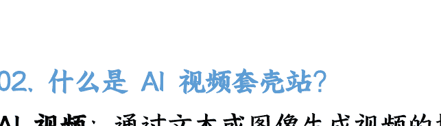

## 02、什么是 AI 视频套壳站？

**AI 视频**：通过文本或图像生成视频的技术，如 Sora 2、Veo 3 等模型。

**套壳站**：基于开源或闭源模型 API，搭建前端网站，为用户提供更友好的交互体验。本质是“前端界面 + 产品功能+API 调用”的组合。

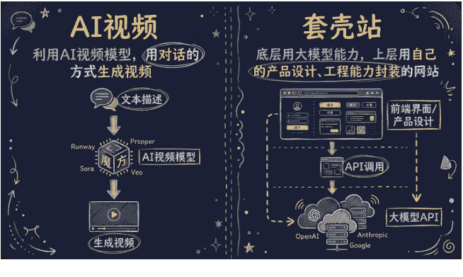

AI 视频我们知道可以去官方服务网站使用 (例如即梦等), 那么，套壳站为什么还有存在价值？我们可以从用户价值和商业逻辑两个角度来理解。

### 对用户的价值：

套壳站解决的是“技术可用性”与“普通用户使用门槛”之间的鸿沟。具体体现在四个方面：

- 免配置/免部署：部分开源模型如果要自部署，是需要 GPU、配置环境的，门槛高。套壳站打开即用。
- 本地化服务：提供多语言界面、本地支付渠道（如 Sora 官网只有英文、俄罗斯等地区需要特殊支付渠道等）。
- 垂直化功能：针对特定场景（如电商、短剧创作）提供定制化模板和工作流。
- 模型聚合：一站式使用多个视频模型，无需频繁切换平台和分别付费。

### 商业逻辑：

这里引用一个小排老师的观点，小排老师说过“科技=科学 + 技术”，我们可以尝试类比为模型研发团队专注“科学”层面的突破，而套壳站的角色是“技术”层面的转化——将研究成果包装成普通人可用的产品服务，降低使用门槛，提升用户体验。这种分工让技术价值得以真正触达终端用户。

## 03、盈利模式：订阅制+LTV

### 核心模式：订阅付费

用户按月付费获得积分数度，积分用于消耗 API 生成视频。由于底层需要持续消耗 API token，订阅制是最适合的商业模式。

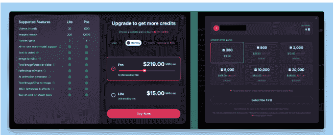

### 关键指标：LTV（客户终身价值）

订阅制的优势在于持续收入，而非一次性交易。比如下图是某个用户在短期内付费多次截图，LTV 远超单次交易价值。

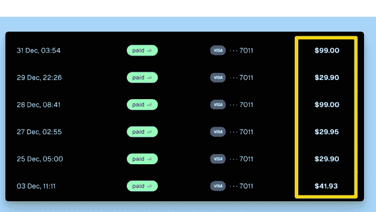

### 竞争维度：

- 传统产品拼单次交易额
- 订阅产品拼 LTV（留存×复购×客单价）

## 04、三种主流形态

根据定位策略和流量获取方式的不同，目前 AI 视频套壳站主要分为三种形态。每种形态都有各自的优势和风险，适合不同阶段和资源背景的创业者：

### 1) 蹭词站

**定义：** 域名和品牌形象接近官方模型名称，利用用户搜索行为获取流量。

**案例：** tryveo3.ai —— Veo 3 是 Google 发布的视频模型，该域名容易被误认为官方站点。目标用户是那些不知道在哪里使用 Veo 3 的用户（不知道 Google AI Studio）。

**机会窗口：**

新模型发布时，互联网上相关内容为零，所有网站起点相同。此时快速上线包含新词的网站，可以在短期内获得高排名。传统关键词竞争激烈，新词则是空白市场。

**蹭词站的核心打法：**

这种形态的特点可以总结为以下几点：

- 取流快、见效快
- 严重依赖 SEO 排名
- 适合短期红利收割
- 风险：合规与信任成本高（后面会详细讲风险）

### 2) 品牌站

代表案例：Pollo AI (pollo.ai)

生财圈友阿彪老师的项目，获真格基金 1400 万美金融资。核心策略是多模型聚合平台，集成 Google、Sora、Runway 等所有主流视频模型。

用户价值：一站式解决方案，无需因新模型发布而切换平台，降低学习成本和使用门槛。

**核心优势：**

- 自有品牌域名，无商标风险
- 持续迭代的产品体验
- 全模型覆盖（几乎全量）
- 私域社群运营
- 长期品牌复利效应
- 强扩展性和抗风险能力

**挑战：**

- 初期冷启动困难
- 多模型维护成本高
- 需要较强的团队运营能力

### 3) 功能站（垂直场景站）

代表案例：StoryShort AI (storyshort.ai)

创始人背景：法国验光师转型独立开发者，自学编程数年。

产品定位：专注 YouTube Shorts 短剧无脸视频生成，提供一站式解决方案（内容→配音→字幕→成品视频），目标用户是短视频创作者。

技术本质：将 ComfyUI 工作流产品化，降低普通用户使用门槛。相比闲鱼购买工作流，产品化网站更易用。

**收入数据：**

- MRR（月度经常性收入）：3 万 + 美金
- 累计收入：35 万美金
- 当前估值：120 万美金（已有 4 人报价）

**核心优势：**

- 垂直场景，精准需求，高转化率
- 功能差异化明显
- 产品溢价空间大
- 解决用户核心痛点

**门槛：** 需要较强的工作流开发能力或产品化能力。

## 05、实现门槛：基于模板快速搭建

知道了这些网站类型，那么作为新手小白，如何做一个自己的 AI 视频网站呢？目前来说最简单的办法，就是从一套建站模板开始。

下面是一套模板大概集成的服务，有了这些基础，可以帮我们省下很多时间精力。

AI 编程工具的成熟大幅降低了技术门槛，基于模板搭建相当于获得“样板间”，只需配置而非从零开发。

### 成本结构：

上面的模板是使用成熟的商业模板的价格，例如我自己在用且推荐的 Mksaas 模板 https://mksaas.com/zh（如果要购买可以使用折扣码减 20 刀：AMENG）。

不过在这次 Mini 航海中为了让大家快速上手，我自己制作了一套视频站模板免费提供给圈友使用，可在手册中获取。

这里面的技术细节，我们就不在本文中详述了，感兴趣的，可以去看看 Mini 航海的手册 https://scys.com/activity/landing/9522?tabIndex=0

## 06、API 供给：从官方到聚合

另一个角度来讲，我们生成视频依赖的是其视频模型提供的能力，这种能力我们需要通过 API 来使用；而在 API 的供应来源，现在也有不少更加经济的选项。

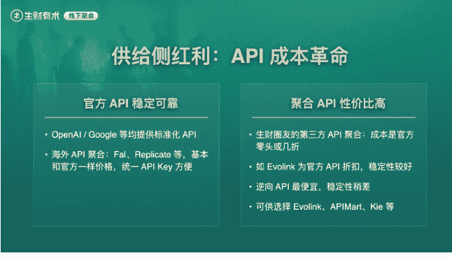

**官方 API：**
OpenAI、Google 等提供标准化 API，价格透明，稳定性最高。

**海外聚合平台：**
Fal、Replicate 等，价格接近官方，优势是统一 API Key 管理多个模型。

**国内第三方聚合：**
成本优势明显（官方价格的几折），适合预算有限的项目：

- Evolink: 官方折扣，稳定性较好；生财圈友的产品
- Kie: 模型丰富，价格竞争力强
- APIMart: 多模型支持；生财圈友的产品

**逆向 API：**
成本最低，但稳定性相对较差，适合测试阶段。

**选择建议：** 初期可用第三方聚合降低成本，规模化后考虑官方 API 确保稳定性。

## 07、竞争策略：从流量到转化

技术门槛降低意味着竞争加剧，当人人都能做产品的时候，我们的竞争策略也需要重新思考，下图是我自己的看法：门槛降低，竞争加剧，流量获取和产品体验是最终的护城河

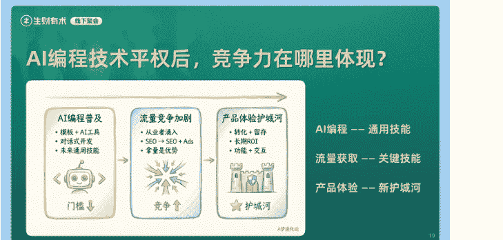

所以对我们而言，学做视频站，重要的不是模板配置（这个第一次学习后面就是体力劳动），而是流量获取，在流量获取的同时要抓住产品体验。

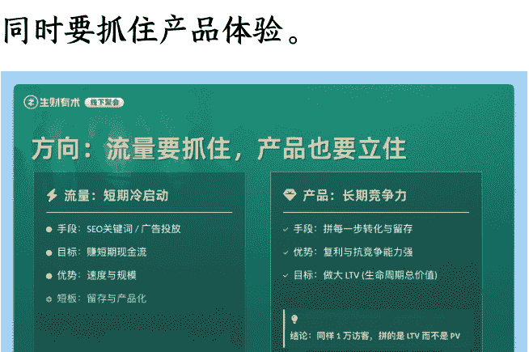

### 1) 流量竞争

**挑战：**

- SEO 成本上升，排名周期延长
- 广告出价上涨，获客成本增加
- 流量入口集中（Google 搜索、广告位）

### 2) 产品竞争

**转化率差异的影响：**

**核心逻辑：**

- 流量是基础（没有访客就没有转化机会）
- 产品体验决定转化率（体验差=流量浪费）
- 长期优化提升 LTV（功能迭代 + 交互优化）

**关键指标：**

- PV（页面访问量）：流量规模
- LTV（客户终身价值）：单用户总收益
- ROI（投资回报率）：收入/成本

竞争公式：同样 1 万访客，拼的是 LTV 而非 PV。广告预算有限时，必须通过提升转化率来对抗流量劣势。

## 08、流量策略：SEO vs 广告投放

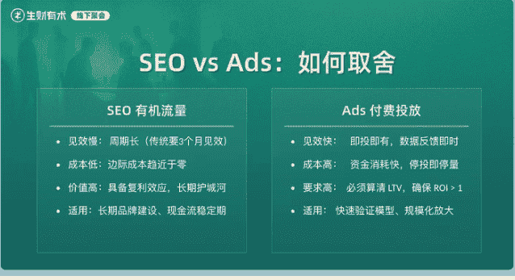

### 8.1 SEO：长期复利

**特征对比：**

**三层体系：**

SEO 是一门复杂的学科，这里就简单说一些基础概念认识，如果需要详细学习，推荐大家看看二哥的帖子：

https://scys.com/personal/881885484552?number=2766

**基础 SEO**

- 关键词布局（Keywords）
- 元标签优化（Meta Tags）
- 结构化数据（Schema）
- 页面加载速度

**外链建设**

- 免费外链：耗时，不稳定
- 付费外链：稳定，成本高
- 目标：提升域名权重
- 方法：友情链接、目录收录

**内容 SEO**

- Blog 捕获长尾流量
- 工具页/模板页覆盖
- How-to 问题型内容
- 满足真实搜索意图

### 8.2 广告投放：快速验证

**特征对比：**

广告这一块我跟大家一样 也还在学习探索
实践中，目前来说有几个小 tips：

1. 尊重学习期：算法需要数据积累，避免频繁调整
2. 文案对齐：广告文案与落地页保持一致，降低跳出率
3. 转化追踪：部署转化代码，追踪注册→付费全链路
4. 预期管理：转化率按 0.1%-0.2% 预估，避免过高期待
5. 成本核算：CPA = CPC ÷ 转化率，根据客单价设置预算

### 6. 优先优化产品：转化率低时，先优化产品体验，而非加大投放

## 09、数据驱动优化而非主观感觉

接下来部分，是我的核心思考，很多人做产品，喜欢切入过多的个人主观观点，有时候这是我们的核心竞争优势，而有时候这些观点容易把我们带入误区甚至浪费时间在不是要的内容上。

所以我建议大家从数据入手，观察用户进入产品后的整个使用节点，看看每一步的数据情况，这些都是真实用户给我们的“客观反馈”，最是能够说明产品问题所在。

### 9.1 转化漏斗：优化每一步

首先一点，我们要清楚视频网站的用户路径和漏斗：

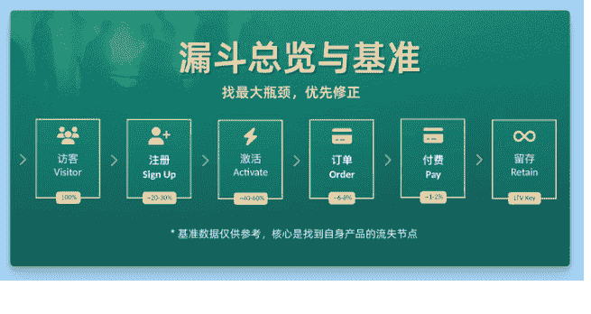

最左侧的箭头是流量入口，是前面部分 SEO 和广告带来的结果；而用户进入了产品后就是产品关键链路起到决定性的作用。

我们的目标就是优化每一步的转化数据，让用户真正为我们付费，并持续付费。

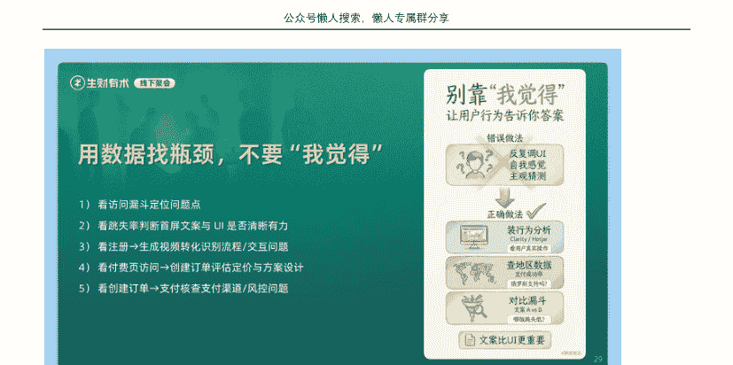

### 9.2 三种优化策略

#### Onboarding（新手引导）

- 提供高质量示例模板，如 Pollo.ai 的示例参考，点击一键即可复用
- 即时操作反馈，如让所有按钮可点击，点击后即时反馈（未登录、积分不足、内容为空）
- 视频生成完成通知召回，让用户允许浏览器通知，因视频生成一般需几分钟甚至更长，用户不会等待，成功后再用通知召回用户

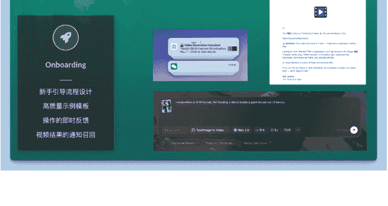

#### 付费转化（促销设计）

即便老外的付费能力再强，也会有价格敏感和被促销转化的情况，所以要善于结合国外节庆使用促销。

- 限时倒计时折扣
- 首单新人优惠
- 清晰的套餐对比
- 优化付费墙弹出时机

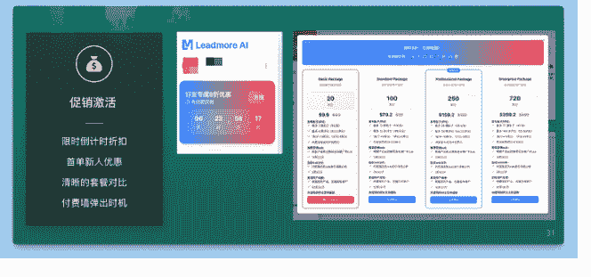

#### 留存激活（自动化运营）

老外基本都会看邮件，所有邮件通知是一个很好用的激活手段。

- 行为触发式邮件，如创建订单未付款的邮件催付等
- 积分/余额提醒
- 功能更新推送
- 流失用户召回

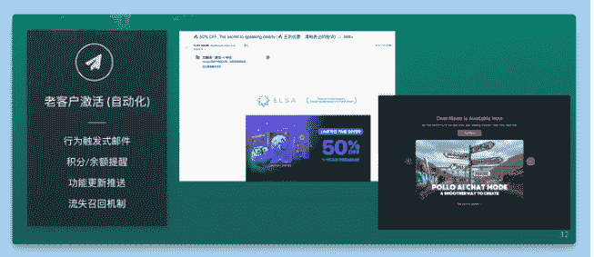

核心思路：优化每一步转化率，最大化 LTV。

在这些产品流程的设计思路里，一定要尝试去理解用户，能够感知到每一个步骤带给用户的是惊喜还是气愤，可以尝试用户旅程图来理解。

在理解的基础上，我们才能去想办法优化，并且通过数据反馈来迭代产品。

## 10、风险管理与应对

不得不说，虽然最推荐新人从“蹭词站”开始做起，因为这样最容易跟着模型的风口获取流量，但是这样的网站也是有一定的风险存在，而这些风险大概率我们都会遇到。所以这里也提供给大家一些我的观察和方案。

### 10.1 核心风险：商标版权

风险等级：最高（在对方已注册商标的前提下）

**表现形式：**

- 收到律师函，要求免费转让域名
- 服务器提供商要求删除网站

**应对策略：**

- 整改站点：添加"Unofficial"等免责声明，避免被认定为钓鱼网站
- 域名迁移：提前注册品牌域名，通过 301 重定向引流

#### 不要硬抗：收到通知后及时响应，避免法律纠纷

如下图就是我一个网站收到的对方律师函，当时网站是部署在我自己云服务器上，所幸服务器提供商只是转发对方邮件给我，让我有时间可以整改后邮件回复，后续也没有继续要求下架。

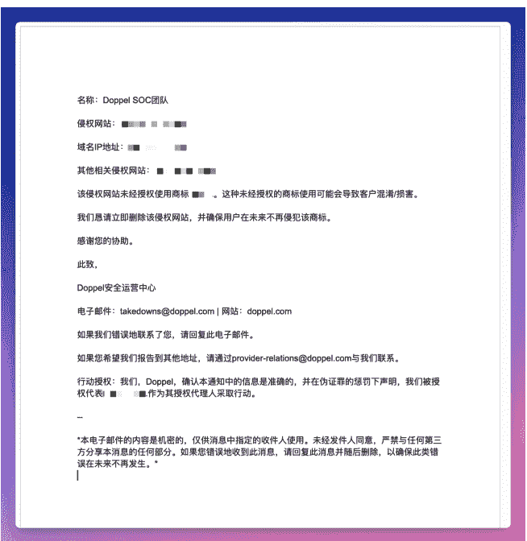

**域名风险评估：**

还有就是域名要被对方收回时，我们可以做“断尾求生”，利用一个新网站来转移当前流量。这里有一个案例，下图网站左侧是它曾经的域名，获得高额的流量也带来风险，最终在流量过让对方前，给网址做了 301 重定向，所有老用户被引流到新网站。

**案例：veo3 套壳站的转型之路**

时间窗口：例如 Sora 2 发布初期，中国开发者注册速度快于官方维权，但这个窗口期通常只有几周到几个月；当然也可能会有一些域名躲过了对方的三方法务团队，能够获得长久的发展，这种案例在 veo 3、sora 2 上都有存在，但对我们来说，重要的是了解风险，以便能随时应对。

#### 10.2 其他风险

**API 稳定性：**

- 选择有信誉的 API 供应商
- 准备备用 API 方案
- 监控 API 可用性

例如最近 sora 2 的逆向 API（最便宜），被 OpenAI 严格审核封号，导致全网的便宜 API 都无法使用，现在 sora 2 的成本也都上涨。这个就需要关注网站情况，也关注 API 方的升级更新通知。

**支付审核：**

- Creem 等支付平台要求域名不含模型商标
- 提前准备合规域名
- 了解各支付平台的审核标准

## 11、核心结论与行动建议

### 11.1 总结 5 个关键结论

- 本质定位：产品化与服务化，而非模型研发
- 竞争核心：优化每一步转化，最大化 LTV
- 流量组合：SEO 长期积累 + 广告快速验证
- 决策依据：数据驱动，而非直觉判断
- 首要风险：商标版权是第一红线

### 11.2 分享 3 个行动建议

- 降低门槛：AI 编程工具已将技术门槛降至历史最低
- 快速验证：最大的风险是永不开始，先做 MVP 验证
- 持续迭代：基于数据反馈优化产品，而非凭感觉调整

## 12、常见问题答疑

后面是我们提前收集和现场圈友们的答疑内容，也整理出来给大家参考。

### Q1: 模板在哪里买？大概多少钱？

A：网上有很多卖的，大概 1000 出头的样子。我自己最推荐的是 MKSaaS，是一个在职开发做的，更新频率很高；如果对这个模板有需求，可以使用 AMENG 折扣码减 20 美元。

国内还有比较推荐的 Shipany，最近推出第二版，也是比较简单傻瓜化的。

你也可以搜索“SaaS starter”，能够搜到一些国外的模板。

### Q2：支付怎么接？钱怎么收回来？

A：支付需要你自己接，要申请自己的账号。

支付是比较麻烦的，因为你收的是美元，如果要转回国内，可能要办一张香港的银行卡，然后通过一些转汇的方式到国内，会有限制。

推荐搜一个教程叫“全球收款手册”，是付费的，但讲得非常细，各种收款方式都有。

### Q3：品牌站和功能站的区别是什么？

A：其实界限很模糊，我们只是为了方便介绍才区分的。

你刚开始可能是个蹭词站，做了一个模型，随着流量高了，为了留住用户，新模型出来了，你肯定要加新的模型，不然用户就流失了。所以你就慢慢把模型加起来了，它中间有个演进的路线。

**核心区别：**

- 品牌站：多模型聚合，品牌化运营

- 功能站：垂直场景，解决特定人群的特定问题

### Q4：蹭词站风险这么大，还值得做吗？

A：蹭词站风险确实很高，域名大概率会被收走或收到律师函。

但它的价值在于：

- 20. 快速验证你的产品能力
- 21. 在新模型发布时抓住短期红利
- 22. 积累第一批用户和数据

### 建议策略：

- 一开始就准备好品牌域名
- 在蹭词站上加上“Unofficial”说明
- 把流量逐步引导到品牌站
- 不要把蹭词站当做长期策略

### Q5：没有技术基础，真的能做出来吗？

A：可以的。我自己就是设计师转型过来的，零编程基础。

现在的 AI 编程工具 (Claude Code、Cursor 等) 已经把门槛降得很低了。基于模板来做，你需要的主要是：

- 23. 基本的配置能力 (跟着教程走)
- 24. 产品思维 (理解用户需求)
- 25. 执行力 (遇到问题能坚持解决)

技术反而不是最大的门槛，产品思维和执行力才是。

公众号懒人搜索，懒人专属群分享

### Q6：现在入场还来得及吗？

A：来得及，但要调整预期。

现在的竞争确实比半年前激烈了，但：

- 26. 视频模型还在快速迭代，每次新模型发布都是新机会
- 27. 很多人只会做站，不会做产品优化，转化率很低
- 28. 垂直场景还有很多机会没被挖掘

关键是：不要只想着蹭词，要想着怎么做好产品体验，怎么提升转化率。

### Q7：一个人能做吗？还是需要团队？

A：一个人可以做出来，但会比较累。

一个人可以做的：

- 基于模板快速建站
- 接入 API 和支付
- 基础的 SEO 配置
- 小规模广告投放

团队会更好的：

- 多个模型的同时维护
- 持续的功能迭代
- 内容 SEO 的持续产出
- 客服和用户运营

我的建议是：先一个人验证模型，跑通闭环，有收入了再考虑是否需要团队。

### Q8：投广告的 ROI 怎么算？

A：简单公式：

ROI = 收入 / 成本

其中：

- **成本** = 广告花费 + API 成本
- **收入** = 用户付费金额

要确保 ROI > 1，最好 ROI > 2。

#### 更细致的算法：

- **CPC（单次点击成本）**：广告花费 / 点击次数
- **转化率**：付费用户 / 访客数
- **CPA（获客成本）**：CPC / 转化率
- **LTV（客户终身价值）**：单个用户的累计付费

理想状态：LTV > 3 × CPA

### Q9：SEO 要多久才能见效？

A：传统 SEO 一般需要 3 个月才能见效。

但对于新模型的新词，可能 1-2 周就能看到效果，因为：

- 新词竞争少
- 搜索量暴增
- Google 会快速收录相关内容

#### 建议：

- 新模型发布时，立即上站（越快越好）
- 同时做 SEO 和广告，广告可以立即带来流量
- 用广告验证产品，用 SEO 做长期积累

### Q10：如何选择做哪个模型的套壳站？

A：几个判断标准：

- 32. 模型热度：搜索量是否在增长
- 33. 竞争程度：已经有多少类似网站
- 34. API 可用性：是否有稳定的 API 供应
- 35. 使用门槛：官方使用是否复杂 (越复杂，套壳站价值越大)
- 36. 付费意愿：用户是否愿意为此付费

#### 我的建议：

- 关注即将发布的新模型
- 提前准备好模板和流程
- 新模型发布后立即上站
- 同时维护 2-3 个站，分散风险

## 写在最后

这次杭州的线下分享，现场来了很多优秀的圈友，大家的交流也给了我很多启发。

做 AI 视频套壳站，技术门槛已经不是障碍了，但我们进入每一个行业，仍然需要思考对自己来说，为什么能进入这个市场赚钱？能赚多少钱？能赚多久钱呢？

我自己觉得后面真正的挑战，可能是在下面几个方面：

- 你能不能快速行动，抓住新模型发布的窗口期
- 你能不能持续优化产品，提升每一步的转化率
- 你能不能用数据驱动决策，而不是凭感觉

这个方向不是“躺赚”，需要持续的投入和优化。但如果你愿意学习、愿意行动、愿意坚持，它确实是一条普通人利用 AI 时代红利赚取美金的可行路径。

2026 年，视频模型还会继续爆发，每一次新模型的发布，都是一次新的机会。

希望这篇分享能给你带来一些启发，如果你有任何问题，欢迎在评论区交流。

关于 AI 视频 SaaS 站的航海，如果感兴趣也可以关注，预计后面还会有。☺

最后，安利小懒的付费群：

懒人专属群（介绍）

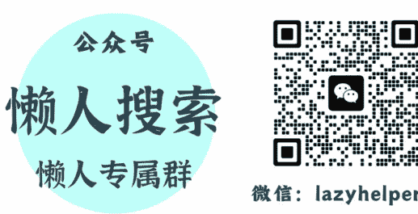

📖 这里是你对抗信息过载的护城河。

已稳定运行 7 年，累计拆解、研读 3000+ 个互联网商业实战案例与行业前沿内参和时政/宏观文章。

## 我们不搬运垃圾，只做高价值信息的筛选器与放大镜。

## 懒人专属群更新记录：

https://hk57gvlx7u.feishu.cn/docx/H0kRdZbSboIBR0xkaXtcuVE0nTg

【免责声明】本资料归档于社群内部知识库，仅供成员课题研究与学术交流，请在查阅后 24 小时内删除。