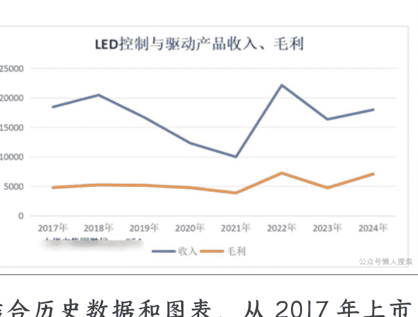
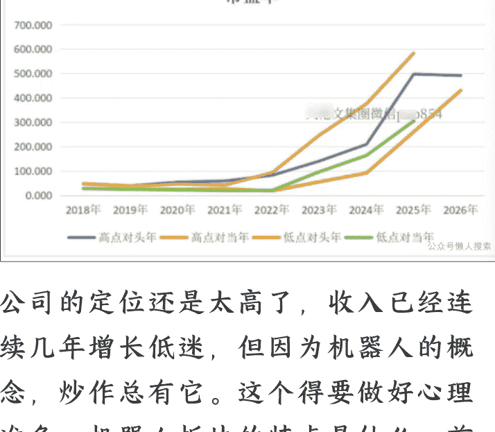
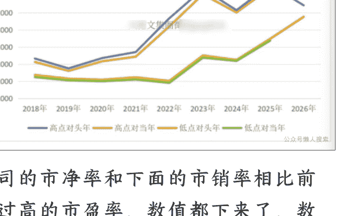
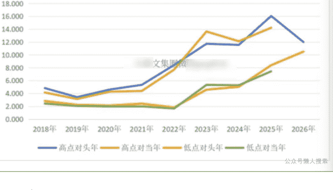

# 公司分析 23：卡位高手，静待风口

## 260302 安民深度分析

整理：公众号懒人搜索，懒人专属群精选

懒人微信：lazyhelper1

有了去年的春晚，我们对今年春晚就有期待，主要就是想看机器人表演。我们的判断跟很多人不一样，那就是硅基智能时代已经来临。网上评论呈两极分化。有些网友对今年春晚机器人节目的反应不如去年，主要是觉得机器人节目太多了。

外行看热闹，内行看门道。我们团队都感触颇深。尽管机器人技术还有很大的提升空间，可我们仍然判断这是一场具象的“认识世界，改变世界”的演出。它向我们揭示的就是未来已来，甚至未来有可能提前来到。这点您不用怀疑。

在今年春晚之前，2025 这一整年的时间里，各家机器人公司相继展现了了不起的运动控制能力。当厂商们狠抓运动控制时，有人看到的是花里胡哨的营销，并认为那些厂家在春晚上的表现就是倾尽全力搞营销，但我们更能看出厂家对机器人改变世界的热切渴望。因为只有超越人，才能解放人。

很多人只看到了台前的表演，却忽略了台后的一整套技术体系。机器人的每一次抬手、翻腾、奔跑、跳跃，背后都是对运动控制、执行精度、系统可靠性和 AI 算法的极高要求。也正因此，外行只关注谁做出了机器人，而有更高追求的人则会追问谁掌握了让机器人稳定运转的核心能力。

在这一过程中，一批并不耀眼，却极其关键的公司，开始反复出现在市场视野中。它们未必直接站在舞台中央，却深度参与了机器人的肌肉与骨骼，他们的产品早在机器人时代来临的前夜，便应用于其他高端场景，对运动控制精度和可靠性的要求，远高于普通消费级应用。

所以，与其纠结机器人是不是被营销过度，不如换一个角度思考：当机器人真正改变世界时，哪些公司已经提前站在了关键位置上。

也就是在这场机器人时代的来临前，哪些公司卡住了关键的位置，具有极大的卡位优势。

今天分析的这家主板公司，正是这样一家国际一流、国内领先的运动控制公司，在机器人浪潮之前，便在海外中高端市场站稳了脚跟，卡位卡得极其精准。近年来更是依靠成本、技术优势和长年的高度聚焦，获得了资本市场多年的青睐。

在过去几年里，机器人板块每一次热度升温，市场都会把目光投向它。因为市场很清楚，它坐拥人形机器人和普通机器人相比最大优势的部件环节，若把人形机器人理解为普通机器人通向未来的那条华山道，这家公司实际上就相当于卡住了鲫鱼背的那道关隘。如果机器人真的要从表演走向实用，从样机走向量产，这家公司几乎不可能被绕开。正因为如此，这家公司成为春晚明星机器人宇树科技的供应商，也成为特斯拉机器人的供应商。不仅如此，公司还介入了新能源汽车智能座舱和 AI 智能驾驶业务，未来还会在这个巨大的赛道上形成供应能力。

人形机器人行业仍处于黎明的前夜，在天亮前，不知道还有多少次炒作，我们可以一边关注这家公司本职业务的复苏，一边在位置合适时参与它的炒作。

文章分为六个部分，包括公司业务分析、各财务环节对公司利润的影响、影响公司业绩的因素和排序、串讲公司的核心业务、公司的高增长行业选择、公司的市场定位。

图表较多，建议您用电脑端阅读。

（免责声明：本文只为开拓视野、引导思路。本文是公司分析，并非择时，亦非荐股。股市有风险，入市需谨慎。本文不构成任何投资建议或意见，不对读者依据本文做出的任何投资与决策承担责任。请大家注意投资风险。）

## 一、公司业务分析

这家公司是鸣志电器，代码 603728，是全球运动控制领域的先进制造商，中国运动控制领域的领军企业。

我们先看它的业务：

### 1.控制电机及其驱动系统产品（单位：万元）

| 控制电机及其驱动系统产品 | 2023 年 | 2024 年 | 增速 | 增量 |
|---|---|---|---|---|
| 收入 | 207204.47 | 195919.62 | -5.45% | -11284.85 |
| 成本 | 125565.14 | 119935.88 | -4.48% | -5629.26 |
| 毛利 | 81639.33 | 75983.74 | -6.93% | -5655.59 |
| 毛利率 | 39.40% | 38.78% | | -0.62% |

收入个位数下滑，同比减少 1.13 亿元；毛利个位数下滑，同比减少 5655.59 万元。收入下滑速度快于成本下滑速度 0.97 个百分点，带动毛利率下滑 0.62 个百分点，负面影响毛利 1209.32 万元，占此项业务毛利下降量的 21.38%。

再来看 2025 上半年同比 2024 上半年的情况（单位：万元）：

| 控制电机及其驱动系统产品 | 2024 上半年 | 2025 上半年 | 增速 | 增量 |
|---|---|---|---|---|
| 收入 | 104088.8 | 109898.89 | 5.58% | 5810.09 |
| 成本 | 63479.68 | 70775.88 | 11.49% | 7296.2 |
| 毛利 | 40609.12 | 39123.01 | -3.66% | -1486.11 |
| 毛利率 | 39.01% | 35.60% | | -3.41% |

收入个位数增长，增量 5810.09 万元；毛利个位数下滑，同比减少 1486.11 万元。成本增速高于收入增速 5.91 个百分点，带动毛利率下滑 3.41 个百分点，负面影响毛利 3752.85 万元。

此项业务为公司的核心业务，贡献了绝大部分营收，历年占比如下：

| 控制电机及其驱动系统产品 | 占营收比例 |
|---|---|
| 2017 年 | 64.61% |
| 2018 年 | 69.74% |
| 2019 年 | 73.05% |
| 2020 年 | 74.22% |
| 2021 年 | 77.29% |
| 2022 年 | 78.43% |
| 2023 年 | 81.49% |
| 2024 年 | 81.10% |

上市以来，公司的控制电机及其驱动系统产品占比越来越高，后面我们会专门用一章内容，向大家展开分析此项业务。同时，未来若干年内，国内机器人通过降低成本而全面启动国内国际市场，一定是大势所趋。这个现象在光伏产品、锂电池和新能源汽车行业不久前的历史上已经体现得很明显，所以，未来国内机器人和本公司产品的价格会处于一个下降的趋势，行业整体上是以量补价。这一点一定要理解。

### 2.电源与照明系统控制类（单位：万元）

| 电源与照明系统控制类 | 2023 年 | 2024 年 | 增速 | 增量 |
|---|---|---|---|---|
| 收入 | 16333.55 | 17971.08 | 10.03% | 1637.53 |
| 成本 | 11625.84 | 10918.93 | -6.08% | -706.91 |
| 毛利 | 4707.71 | 7052.15 | 49.80% | 2344.44 |
| 毛利率 | 28.82% | 39.24% | | 10.42% |

收入两位数增长，增量 1637.53 万元；毛利超高速增长，增量 2344.44 万元。成本增速低于收入增速 16.11 个百分点，带动毛利率提高 10.42 个百分点，正面影响毛利 1872.47 万元，占毛利增量的 79.87%。

该业务曾经叫“LED 控制与驱动产品”，但业务为公司标准电源及电控装置业务的延伸，所以 2022 年起与电源业务整合。业务名称和所包含的产品范围相比过去有所变动，但本质上变化不大。

LED 智能照明控制与驱动系统，您可以理解为 LED 灯的大脑，它能精细地控制灯的亮度和工作方式，让灯更省电、更耐用、照起来不太过剩眼。

LED 照明驱动也分档次。公司避开市场规模最大但竞争激烈的基本型 LED 室内照明驱动市场，重点开发技术含量较高的 LED 智能驱动，比如功能复杂的高端商业照明、要求节能且稳定的智能楼宇照明和户外照明、要求大功率的体育场馆照明和防爆照明，等等。

而业务名称中的“电源”是用于其它设备的电源，比如金融设备、电力保护设备、大功率照明，以及锅炉设备控制器等。

下面是 2025 上半年同比 2024 上半年的情况（单位：万元）：

| 电源与照明系统控制类 | 2024 上半年 | 2025 上半年 | 增速 | 增量 |
|---|---|---|---|---|
| 收入 | 9024.16 | 9076.99 | 0.59% | 52.83 |
| 成本 | 5679.49 | 5941.66 | 4.62% | 262.17 |
| 毛利 | 3344.67 | 3135.33 | -6.26% | -209.34 |
| 毛利率 | 37.06% | 34.54% | | -2.52% |

收入小幅增长，增量 52.83 万元；毛利个位数下降，减少 209.34 万元。成本增速高于收入增速 5.21 个百分点，带动毛利率下降 2.52 个百分点，负面影响毛利 228.92 万元。

再结合公司 2024 上半年和 2025 年上半年的销量情况分析（单位：万台/万套）：

| 2024 上半年销量 | 2025 上半年销量 | 销量同比增长率 |
|---|---|---|
| 56.4 | 48.24 | -14.47% |

有了收入、成本、毛利、销量，我们可以算出此业务的产品单价从 2024 上半年的 160 元/台套涨到 2025 上半年的 188.16 元/台套，单价涨了 17.16%，但销量下滑了 14.47%。在销量减少且产品涨价的情况下，这类产品的成本还上涨了 4.62%，表明上游涨价还是比较厉害的，超过公司产品涨价的幅度。故而公司可以做到向下游转嫁部分成本，但是这个转嫁能力还比较有限，并不能完全转嫁上游的成本压力。

这一点，我们可以从过往的成本构成中找到依据。

比如 2024 年该业务的成本构成中，直接材料占比 73.62%，它是变动成本，直接人工占比 18.81%（它也是变动成本）。那逻辑就很清楚了。也就是说，2025 上半年的产品因为材料成本上涨，公司不得不上调售价，算是保持了基本一致的营收，就导致销量降低；但涨价并不能完全消化变动成本上涨的压力，再加上固定成本平摊到降低的销量中，进一步增加了成本压力，最终导致 2025 上半年此业务增收不增利的状况。

此业务历年表现如下（单位：万元）：

| 电源与照明系统控制类 | 收入 | 成本 | 毛利 | 毛利率 |
|---|---|---|---|---|
| 2017 年 | 18438.84 | 13675.07 | 4763.77 | 25.84% |
| 2018 年 | 20464.95 | 15245.53 | 5219.42 | 25.50% |
| 2019 年 | 16656.49 | 11530.38 | 5126.11 | 30.78% |
| 2020 年 | 12299.05 | 7561.41 | 4737.64 | 38.52% |
| 2021 年 | 9966.07 | 6127.07 | 3839 | 38.52% |
| 2022 年 | 22149.18 | 14936.47 | 7212.71 | 32.56% |
| 2023 年 | 16333.55 | 11625.84 | 4707.71 | 28.82% |
| 2024 年 | 17971.08 | 10918.93 | 7052.15 | 39.24% |
| 复合增长率 | -0.37% | -3.16% | 5.76% | |

结合历史数据和图表，从 2017 年上市到 2024 年，营收的复合增长率为 -0.37%，只在区间内波动，不具备高成长的表征，且易受宏观经济环境影响，比如疫情严重的 2020 和 2021 年下降明显。

毛利的复合增长率达到了 5.76%，但其增长并不是由营收增长带来，而是源于毛利率在 25% 到 40% 间的波动。这跟上游供货成本和下游需求关系密切。上游供货成本问题前文有分析，在 2025 上半年有所体现。而下游需求问题，比如 2023 年该业务受海外客户去库存影响，营收同比下降 26.26%，毛利下降 34.73%。

这个“去库存”是指下游客户优先用之前从公司进购的库存产品，减少新的采购量，此时鸣志就必然减产且销售额下滑，也优先出货自己的库存商品，销量下滑会导致产品降价，而相关设备厂房的折旧率固定，销售收入少则分摊量大，毛利率就这么降下来了。

综上所述，此业务基本定型，是一个下限不低，但上限也不高，并且暂时不具备高增长预期的业务板块。2024 年的 1.8 亿营收搭配历史最高的 39.24% 毛利率，毛利表现放在历年中能排第二，做得不错，但也不能指望该业务有多大的空间，只能作为一项可靠的营收和比较稳定的利润来源。在机器人业务没有进入长期高速增长的阶段，这项业务对公司而言是一项不错的补充。

### 3.设备状态管理系统产品（单位：万元）

| 设备状态管理系统产品 | 2023 年 | 2024 年 | 增速 | 增量 |
|---|---|---|---|---|
| 收入 | 4832.04 | 4043.07 | -16.33% | -788.97 |
| 成本 | 1300.92 | 1042.68 | -19.85% | -258.24 |
| 毛利 | 3531.12 | 3000.39 | -15.03% | -530.73 |
| 毛利率 | 73.08% | 74.21% | | 1.13% |

收入中速下滑，同比减少 788.97 万元；毛利中速下滑，同比减少 530.73 万元。成本下滑速度快于收入下滑速度 3.52 个百分点，带动毛利率提高 1.13 个百分点，正面影响毛利 45.83 万元。

设备状态管理系统用于监控、分析和管理设备运行状态，帮助企业实时了解设备的性能、健康状况和运行情况。它的作用是提高设备的可靠性、减少停机时间、优化维护计划和降低运营成本。对重资产企业而言，停机维护就意味着损失，所以设备状态的监控很重要。这块业务产品不多，主要应用于电力、冶金、石化、煤炭、汽车、烟草、市政行业。

因为该业务涉及软件产品，所以毛利率不错，2024 年达 74.21%。但营收占总营收的比例确实不高，如下 (单位:万元):

| 设备状态管理系统产品 | 收入 | 营收占比 |
| :--- | :--- | :--- |
| 2017 年 | 5502.74 | 3.38% |
| 2018 年 | 3893.7 | 2.06% |
| 2019 年 | 5272.02 | 2.56% |
| 2020 年 | 4305.38 | 1.95% |
| 2021 年 | 6450.75 | 2.38% |
| 2022 年 | 6391.34 | 2.16% |
| 2023 年 | 4832.04 | 1.90% |
| 2024 年 | 4043.07 | 1.67% |

下面是 2025 年上半年同比 2024 年上半年的情况 (单位:万元):

| 设备状态管理系统产品 | 2024 上半年 | 2025 上半年 | 增速 | 增量 |
| :--- | :--- | :--- | :--- | :--- |
| 收入 | 1557.92 | 1410.84 | -9.44% | -147.08 |
| 成本 | 427.49 | 363.82 | -14.89% | -63.67 |
| 毛利 | 1130.43 | 1047.02 | -7.38% | -83.41 |
| 毛利率 | 72.56% | 74.21% | | 1.65% |

收入个位数下滑，减少 147.08 万元；毛利个位数下滑，减少 83.41 万元。成本下滑速度快于收入下滑速度 5.45 个百分点，带动毛利率提高 1.65 个百分点，正面影响毛利 23.31 万元。

可以认为，在人形机器人业务没有进入长期高增长之前，这项业务的主要作用亦是提供每年 4000 万到 6000 万的收入，三四千万的毛利。

### 4.贸易代理业务（单位：万元）

| 贸易代理业务 | 2023 年 | 2024 年 | 增速 | 增量 |
|---|---|---|---|---|
| 收入 | 25792.28 | 23547.81 | -8.70% | -2244.47 |
| 成本 | 21126.35 | 18560.35 | -12.15% | -2566 |
| 毛利 | 4665.93 | 4987.46 | 6.89% | 321.53 |
| 毛利率 | 18.09% | 21.18% | | 3.09% |

收入个位数下滑，同比减少 2244.47 万元；毛利个位数增长，增量 321.53 万元。成本下滑速度快于收入下滑速度 3.45 个百分点，带动毛利率提高 3.09 个百分点，正面影响毛利 727.56 万元。

这里的贸易代理，代理的是松下继电器，从 1998 年就开始了。代理业务对公司早期积累资本很重要。下面是这项业务的历年收入和占营收比例（单位：万元）：

| 贸易代理业务 | 收入 | 营收占比 |
|---|---|---|
| 2017 年 | 25464.58 | 15.64% |
| 2018 年 | 25535.58 | 13.48% |
| 2019 年 | 27746.98 | 13.48% |
| 2020 年 | 34351.74 | 15.52% |
| 2021 年 | 37469.79 | 13.80% |
| 2022 年 | 34979.13 | 11.82% |
| 2023 年 | 25792.28 | 10.14% |
| 2024 年 | 23547.81 | 9.75% |

再来看 2025 上半年同比 2024 上半年的情况（单位：万元）：

| 贸易代理业务 | 2024 上半年 | 2025 上半年 | 增速 | 增量 |
|---|---|---|---|---|
| 收入 | 11774.31 | 11025.41 | -6.36% | -748.9 |
| 成本 | 9470.11 | 8324.36 | -12.10% | -1145.75 |
| 毛利 | 2304.2 | 2701.05 | 17.22% | 396.85 |
| 毛利率 | 19.57% | 24.50% | | 4.93% |

收入个位数下滑，同比减少 748.9 万元；毛利中速增长，增量 396.85 万元。成本下滑速度快于收入下滑速度 5.74 个百分点，带动毛利率提高 4.93 个百分点，正面影响毛利 543.41 万元。

### 5.主营业务（单位：万元）

| 主营业务 | 2023 年 | 2024 年 | 增速 | 增量 |
|---|---|---|---|---|
| 收入 | 254162.34 | 241481.58 | -4.99% | -12680.76 |
| 成本 | 159618.25 | 150457.85 | -5.74% | -9160.4 |
| 毛利 | 94544.09 | 91023.73 | -3.72% | -3520.36 |
| 毛利率 | 37.20% | 37.69% | | 0.50% |

收入个位数下滑，同比减少 1.27 亿元；毛利个位数下滑，同比减少 3520.36 万元。成本下滑速度快于收入下滑速度 0.75 个百分点，带动毛利率提高 0.5 个百分点，正面影响毛利 1196.67 万元。

下面是 2025 上半年同比 2024 上半年的情况（单位：万元）：

| 主营业务 | 2024 上半年 | 2025 上半年 | 增速 | 增量 |
|---|---|---|---|---|
| 收入 | 126445.2 | 131412.13 | 3.93% | 4966.93 |
| 成本 | 79056.77 | 85405.72 | 8.03% | 6348.95 |
| 毛利 | 47388.43 | 46006.41 | -2.92% | -1382.02 |
| 毛利率 | 37.48% | 35.01% | | -2.47% |

收入个位数增长，增量 4966.93 万元；毛利个位数下滑，同比减少 1382.02 万元。成本增速快于收入增速 4.1 个百分点，带动毛利率下降 2.47个百分点，负面影响毛利 3243.5 万元。

### 6. 其他业务（单位：万元）

| 其他业务 | 2023 年 | 2024 年 | 增速 | 增量 |
| :--- | :--- | :--- | :--- | :--- |
| 收入 | 116.77 | 110.94 | -4.99% | -5.83 |
| 成本 | 98.48 | 99.65 | 1.19% | 1.17 |
| 毛利 | 18.29 | 11.29 | -38.27% | -7 |
| 毛利率 | 15.66% | 10.18% | | -5.49% |

收入个位数下滑，同比减少 5.83 万元；毛利超高速下滑，同比减少 7 万元。成本增速快于收入增速 6.18 个百分点，带动毛利率下滑 5.49 个百分点，负面影响毛利 6.09 万元。

下面是 2025 年上半年同比 2024 上半年的情况（单位：万元）：

| 其他业务 | 2024 上半年 | 2025 上半年 | 增速 | 增量 |
| :--- | :--- | :--- | :--- | :--- |
| 收入 | 51.35 | 45.38 | -11.63% | -5.97 |
| 成本 | 9.72 | 40.97 | 321.50% | 31.25 |
| 毛利 | 41.63 | 4.41 | -89.41% | -37.22 |
| 毛利率 | 81.07% | 9.72% | | -71.35% |

收入两位数下滑，同比减少 5.97 万元；毛利超高速下滑，同比减少 37.22 万元。成本增速快于收入增速 333.13 个百分点，带动毛利率下滑 71.35 个百分点，负面影响毛利 32.38 万元，占毛利下降量的 87%。

其他业务的占比很小，影响不重要。大家看看就好。

### 7. 全部业务（单位：万元）

| 全部业务 | 2023 年 | 2024 年 | 增速 | 增量 |
| :--- | :--- | :--- | :--- | :--- |
| 收入 | 254279.11 | 241592.52 | -4.99% | -12686.59 |
| 成本 | 159716.73 | 150557.49 | -5.73% | -9159.24 |
| 毛利 | 94562.38 | 91035.03 | -3.73% | -3527.35 |
| 毛利率 | 37.19% | 37.68% | | -0.49% |

收入个位数下滑，同比减少 1.27 亿元；毛利个位数下滑，同比减少 3527.35 万元。成本下滑速度快于收入下滑速度 0.74 个百分点，带动毛利率提高 0.49 个百分点，正面影响毛利 1190.59 万元。

再来看 2025 年上半年同比 2024 上半年的情况（单位：万元）：

| 全部业务 | 2024 上半年 | 2025 上半年 | 增速 | 增量 |
| :--- | :--- | :--- | :--- | :--- |
| 收入 | 126496.54 | 131457.51 | 3.92% | 4960.97 |
| 成本 | 79066.5 | 85446.7 | 8.07% | 6380.2 |
| 毛利 | 47430.04 | 46010.81 | -2.99% | -1419.23 |
| 毛利率 | 37.50% | 35.00% | | |

收入个位数增长，增量 4960.97 万元；毛利个位数下滑，同比减少 1419.23 万元。成本增速快于收入增速 4.15 个百分点，带动毛利率下滑 2.49 个百分点，负面影响毛利 3279.35 万元。

## 二、各财务环节对公司利润的影响

### 1. 费用环节的影响（单位：万元）

| | 2023 年 | 2024 年 | 增量 | 影响 |
| :--- | :--- | :--- | :--- | :--- |
| 税金及附加 | 1465.64 | 1572.89 | 107.25 | -107.25 |
| 销售费用 | 20318.67 | 22120.96 | 1802.29 | -1802.29 |
| 管理费用 | 34815.98 | 36303.4 | 1487.42 | -1487.42 |
| 研发费用 | 23824.16 | 24168.87 | 344.71 | -344.71 |
| 财务费用 | 280.48 | -955.67 | -1236.15 | 1236.15 |
| 合计 | | | | -2505.52 |

2024 年，费用环节一共减少营业利润 2505.52 万元。经过这 5 个环节，公司 2024 年的营业利润同比减少 6032.87 万元。

影响较大的是销售费用、管理费用和财务费用。

经过详细查看，可知销售费用的差别主要体现为 2023 年有一笔价值 2957.60 万元的产品质量保证金冲回。意思是之前公司准备为产品维修赔付一笔钱，提前在账上记了一笔“销售费用”，但到期后产品质量合格，不用赔了，于是把这笔钱在 2023 年冲回，这就减少了 2023 年的销售费用。2024 年产品质量保证金有 25.04 万，这一因素导致销售费用相对 2023 年就增加了 2982.64 万，这是特殊情况影响所致。剔除这个因素的影响，公司的销售费用比 2023 年还是下降了。

管理费用的增加源于人员工资及福利增加了 2087.41 万元。

财务费用的减少源于海外公司利息收入增加了 620.37 万元，汇兑收益增加了 389.96 万元。

公司 2025 年上半年同比 2024 上半年的情况如下（单位：万元）：

| | 2024 上半年 | 2025 上半年 | 增量 | 影响 |
| :--- | :--- | :--- | :--- | :--- |
| 税金及附加 | 681.9 | 865.85 | 183.95 | -183.95 |
| 销售费用 | 11079.42 | 12567.32 | 1487.9 | -1487.9 |
| 管理费用 | 17750.62 | 18800.73 | 1050.11 | -1050.11 |
| 研发费用 | 11892.98 | 12477.8 | 584.82 | -584.82 |
| 财务费用 | -817.83 | 99.13 | 916.96 | -916.96 |
| 合计 | | | | 4223.74 |

2025 年上半年，费用环节一共减少营业利润 4223.74 万元。经过这 5 个环节，公司 2025 年上半年的营业利润同比减少 5642.97 万元。

销售费用和管理费用的影响大头都在于工资及福利，财务费用的变动主要原因在于人民币汇率影响，汇兑净收益不及上年同期。

### 2. 利得和损失的影响（单位：万元）

| | 2023 年 | 2024 年 | 增量 | 影响 |
| :--- | :--- | :--- | :--- | :--- |
| 其他收益 | 2574.37 | 1635.07 | -939.30 | -939.30 |
| 投资收益 | -281.13 | 25.89 | 307.02 | 307.02 |
| 公允价值变动收益 | | -17.69 | -17.69 | -17.69 |
| 信用减值损失 | 382.15 | 9.12 | -373.03 | -373.03 |
| 资产减值损失 | -1460.40 | -1848.58 | -388.18 | -388.18 |
| 资产处置收益 | 12.46 | -1.82 | -14.28 | -14.28 |
| 合计 | | | | -1425.46 |

2024 年，这 6 个环节共计减少营业利润 1425.46 万元。其中负面影响大的是其他收益，为 939.3 万元。原因在于，与资产相关的政府补助和与收益相关的政府补助共计减少了 1211.72 万元。

至此，公司 2024 年营业利润减少 7458.33 万元。

公司 2025 年上半年同比 2024 上半年的情况如下（单位：万元）：

| | 2024 上半年 | 2025 上半年 | 增量 | 影响 |
| :--- | :--- | :--- | :--- | :--- |
| 其他收益 | 609.25 | 670.08 | 60.83 | 60.83 |
| 投资收益 | -19.53 | 21.86 | 41.39 | 41.39 |
| 公允价值变动收益 | -96.89 | 50.48 | 147.37 | 147.37 |
| 信用减值损失 | -211.33 | -377.09 | -165.76 | -165.76 |
| 资产减值损失 | -2881.88 | 645.02 | 3526.90 | 3526.90 |
| 资产处置收益 | | | | |
| 合计 | | | | 3610.73 |

2025 年上半年，这 6 个环节共计增加营业利润 3610.73 万元。经过这 6 个环节，公司 2025 年上半年的营业利润同比减少 2032.24 万元。其中影响最大的是资产减值损失，正面影响 3526.9 万元。

公司资产减值损失中，占大头的是存货跌价损失。细看 2024 年上半年由存货跌价损失计提的资产减值准备构成，如下表（单位：万元）：

| 类别 | 计提 | 转回或转销 | 实际减值 |
| :--- | :--- | :--- | :--- |
| 原材料 | 3831.02 | 1572.95 | 2258.07 |
| 在产品 | 55.19 | 20.12 | 35.07 |
| 库存商品 | 1972.31 | 1380.02 | 592.29 |
| 合计 | 5858.52 | 2973.09 | 2885.43 |

2024 年上半年，资产减值的最大原因在于库存原材料减值，原因在于之前全球原材料和关键零部件的供应紧张，且下游海外客户担忧公司供应不足，提前大量储备库存，当期要货减少，进一步导致公司库存消耗速度变慢，被动增加库存，产品销售价格下降，从而导致计提增加。此前，公司为了满足客户需求相应增加了紧缺物资的采购。但随着市场环境变化，客户需要去库存，实际订单需求开始取消或延期，销量下降，产成品卖不上价，原材料就面临减值。

这是一个典型的牛鞭效应，下游的需求信息在从终端客户向上游供应商传递的过程中，波动被逐级放大。

2024 年下半年，公司计提情况如下表（单位：万元）：

| 类别 | 计提 | 转回或转销 | 实际减值 |
| :--- | :--- | :--- | :--- |
| 原材料 | 670.93 | 563.73 | -2150.87 |
| 在产品 | 106.46 | 1.69 | 69.72 |
| 库存商品 | 1889.1 | 247.18 | 1049.64 |
| 小计 | 2666.49 | 812.59 | -1031.53 |

### 2025 年上半年，公司计提情况如下表（单位：万元）：

| 类别 | 计提 | 转回或转销 | 实际减值 |
| :--- | :--- | :--- | :--- |
| 原材料 | 1831.85 | 1591.79 | 240.06 |
| 在产品 | 53.86 | 25.13 | 28.71 |
| 库存商品 | 1341.38 | 2252.91 | -911.52 |
| 小计 | 3227.09 | 3869.83 | -642.73 |

公司每个会计季度，在按会计准则要求进行库存减值的计提和冲回等工作，这是上市公司正常的会计工作内容。公司的存货计价方式是基于平均成本法，进货价高，当销售价低时，存货跌价准备就提得多，进货价低，销售价格高时就计提得少，甚至冲回。这符合会计规则，但是，容易带来利润的波动，且容易出现利润的被动隐藏。

就是当你原材料进货价格高而当期售价低，到时提的存货跌价准备就多；但后来新进的原材物料价格降了很多，一旦产品销售价格上涨，此时就得冲回前期的计提。当我们知道这个规则后，一旦遇到了公司某年大幅度计提，后面一旦进货价格下降而销售价格大涨，就比较容易出现冲回存货跌价的情况，到时利润就增长。能明白吗？

### 3. 营业外收支、所得税费用和少数股东损益等（单位：万元）：

| | 2023 年 | 2024 年 | 增量 | 影响 |
| :--- | :--- | :--- | :--- | :--- |
| 营业外收入 | 55.51 | 40.78 | -14.73 | -14.73 |
| 营业外支出 | 287.4 | 120.22 | -167.18 | 167.18 |
| 所得税费用 | 659.21 | -393.63 | -1052.84 | 1052.84 |
| 少数股东损益 | 149.45 | 150.09 | 0.64 | -0.64 |
| 合计 | | | | 1204.65 |

4 个环节共增加了公司股东净利润 1204.65 万元。至此，2024 年公司的股东净利润减少 6253.68 万元。

影响大的是所得税费用，主要是由当期和递延所得税费用构成的。

公司 2025 年上半年同比 2024 上半年的情况如下（单位：万元）：

| | 2024 上半年 | 2025 上半年 | 增量 | 影响 |
| :--- | :--- | :--- | :--- | :--- |
| 营业外收入 | 25.43 | 16.03 | -9.4 | -9.4 |
| 营业外支出 | 114.16 | 67.07 | -47.09 | 47.09 |
| 所得税费用 | 117.21 | -569.69 | -686.9 | 686.9 |
| 少数股东损益 | 33.8 | 33.52 | -0.28 | 0.28 |
| 合计 | | | | 724.87 |

4 个环节共增加了公司股东净利润 724.87 万元。至此，2025 年上半年公司的股东净利润减少 1307.37 万元。影响最大的还是所得税费用。

## 三、影响公司 2024 业绩和 2025 上半年业绩的因素及排序

影响公司 2024 年业绩的因素一共 20 个，其中正面影响因素 6 个，负面影响因素 14 个（单位：万元）：

| 排序 | 正面影响 | 影响额 | 负面影响 | 影响额 | 合计 |
| :--- | :--- | :--- | :--- | :--- | :--- |
| 1 | 电源与照明系统控制类 | 2344.44 | 控制电机及其驱动系统产品 | -5655.59 | |
| 2 | 财务费用 | 1236.15 | 销售费用 | -1802.29 | |
| 3 | 所得税费用 | 1052.84 | 管理费用 | -1487.42 | |
| 4 | 贸易代理业务 | 321.53 | 其他收益 | -939.3 | |
| 5 | 投资收益 | 307.02 | 设备状态管理系统产品 | -530.73 | |
| 6 | 营业外支出 | 167.18 | 资产减值损失 | -388.18 | |
| 7 | | | 信用减值损失 | -373.03 | |
| 8 | | | 研发费用 | -344.71 | |
| 9 | | | 税金及附加 | -107.25 | |
| 10 | | | 公允价值变动收益 | -17.69 | |
| 11 | | | 营业外收入 | -14.73 | |
| 12 | | | 资产处置收益 | -14.28 | |
| 13 | | | 其他业务 | -7 | |
| 14 | | | 少数股东损益 | -0.64 | |
| 合计 | | 5429.16 | | -11682.84 | 6253.68 |

2024 年，全部业务减少毛利 3527.35 万，其中“控制电机及其驱动系统产品”减少毛利 5655.59 万元；“设备状态管理系统产品”减少毛利 530.73 万元；其他业务减少毛利 7 万元。这三项减少毛利 6193.32 万元。“电源与照明系统控制类”增加毛利 2344.44 万元；“贸易代理业务”增加毛利 321.53 万元；两项增加毛利 2665.97 万。

费用一块减少营业利润 2505.52 万；利得和损失减少营业利润 1425.46 万；营业外收支、所得税费用及少数股东损益增加股东净利润 1204.65 万，终至全年股东净利润减少了 6253.68 万。少量因四舍五入产生的偏差为正常现象。

影响公司 2025 年上半年业绩的因素一共 19 个，其中正面影响因素 8 个，负面影响因素 11 个（单位：万元）：

| 排序 | 正面影响 | 影响额 | 负面影响 | 影响额 | 合计 |
| :--- | :--- | :--- | :--- | :--- | :--- |
| 1 | 资产减值损失 | 3526.9 | 销售费用 | -1487.9 | |
| 2 | 所得税费用 | 686.9 | 控制电机及其驱动系统产品 | -1486.11 | |
| 3 | 贸易代理业务 | 396.85 | 管理费用 | -1050.11 | |
| 4 | 公允价值变动收益 | 147.37 | 财务费用 | -916.96 | |
| 5 | 其他收益 | 60.83 | 研发费用 | -584.82 | |
| 6 | 营业外支出 | 47.09 | 电源与照明系统控制类 | -209.34 | |
| 7 | 投资收益 | 41.39 | 税金及附加 | -183.95 | |
| 8 | 少数股东损益 | 0.28 | 信用减值损失 | -165.76 | |
| 9 | | | 设备状态管理系统产品 | -83.41 | |
| 10 | | | 其他业务 | -37.22 | |
| 11 | | | 营业外收入 | -9.4 | |
| 合计 | | 4907.61 | | -6214.98 | -1307.37 |

2025 年上半年，全部业务减少毛利 1419.23 万，其中“控制电机及其驱动系统产品”减少毛利 1486.11 万元；“电源与照明系统控制类”减少毛利 209.34 万元；“设备状态管理系统产品”减少毛利 83.41 万元；其他业务减少毛利 37.22 万元。这 4 项业务减少毛利 1816.08 万。“贸易代理业务”增加毛利 396.85 万元。

费用一块减少营业利润 4223.74 万；利得和损失增加营业利润 3610.73 万；营业外收支、所得税费用及少数股东损益增加股东净利润 724.87 万，终至 2025 年上半年股东净利润减少了 1307.37 万。

存在少量因四舍五入产生的偏差为正常现象。

## 四、串讲公司的核心业务

这一章我们重点串讲公司核心业务，概括性梳理其核心产品、发展路径、后续面对的一些问题以及逆袭的契机，帮助大家对公司的业务和发展脉络形成一个框架性的认知。

### 1. 核心业务中的核心产品

看了前文的业务分析，可知公司的主营业务中，LED 驱动和电源业务稳定但上限不高；设备状态管理系统业务多服务于窄范围的体制内企业，营收比较小；代理业务因为缺乏自主性，只能作为增收手段，不具备想象空间。所以公司的核心业务只有控制电机及其驱动系统类业务，过去是，现在是，将来更是。

那么公司这项核心业务中，最具核心技术竞争力的产品是什么呢？是步进电机。所谓步进电机，就是数着步子走的电机。

电机运动的原理，其实就是“通电导体在磁场中会受到电磁力的作用而运动”。大家要有一个概念，所有电动的转动的产品，都要用到电机，是电机电磁力驱动转子转动。普通电机的特点是一通电就疯转，比如电风扇，比如玩具赛车的马达，它们不知道停止，转的时候没有节制，停电后还要悠好一会儿才停。因为普通电机的内部磁场是一个不停旋转的磁场，只要有电，就一直推拽着电机的转子运动，且有运动惯性。这类电机的优点是构造简单、原理简单、成本低廉，缺点是不够精准，干不了细活儿。所以风扇、水泵、玩具那类比较粗糙的产品就常用到它。

### 2. 公司的收购进程

步进电机的运行特点是根据需要一步步地运行，不仅能转，还能立刻停下来。比如我们既可以让它以 5 秒钟一圈的速度旋转，也可以要求它转 72 度就停止。从这个方面来看，步进电机很像精细的齿轮。要达到这种效果，需要用脉冲电流实现稳定精确的反复启停、增加绕组构建更复杂的磁场、设计齿槽结构实现更精细的控制和锁止。

两相对比可以发现，步进电机远比普通电机精准，所以它的附加值高于普通电机，也会用在更需要精确控制的场合。比如打印机的喷头、3D 打印的喷头和平台、摄像头的云台、医疗器材和实验室设备、工业自动化中的进给机构等等。

而因为步进电机靠磁场切换运动，不仅不依靠顺滑惯性，还为了精准要不断地抵抗惯性，所以一旦脉冲电流频率太高，磁力不能完整发挥作用，就容易造成拉不动、刹不住转子的情况，自身的精准特性就没了，也就出现所谓的“丢步”，此时再用步进电机就不划算。所以步进电机不适合高转速工况，更适合中低转速搭配中高保持转矩的工作环境。

这里的“保持转矩”是指电机通电但是不转动时，可以承受多大的外力，就像压垮骆驼的最后一根稻草来临之前，骆驼的最大承重就是“保持转矩”。

当然，我们说步进电机精准，也是相对来说，真要论运行精准，还得数伺服电机（公司也有伺服电机产品），但通常步进电机的优势在于其价格远低于伺服电机，适合于 BOM 成本相对敏感，对精度要求没有那么高的产品。

### 3. 近年核心业务的困难

鸣志电器做步进电机很早，1994 年公司成立后，最早做前文提到过的设备状态管理系统起家，1998 年又代理了松下继电器，1998 年 2 月鸣志就建成了电机工厂，投产混合式步进电机。2007 年和美 AMP(Applied Motion Products Inc.) 合资，并于 2014 年收购 AMP，2015 年收购 Lin Engineering,2019 年收购了瑞士 T Motion Technosoft Motion AG。

注意这里的 AMP 和 Lin Engineering。AMP 是美国公司，它的步进电机驱动器、集成式智能步进伺服控制技术处于全球前列，客户分布于工业自动化、医疗与生命科学及实验室设备。

因为鸣志电器 2007 与 AMP 便成立有合资公司，并且 AMP 体量不大，收购成本不高，所以如果 AMP 被第三方公司收购，不仅平白多了个竞争对手，合资公司和母公司的专利纠纷也会很麻烦，所以鸣志电器的这波收购算是防御性并购。鸣志收购 AMP 后一方面拥有了先进技术，解决了潜在的专利纠纷，另一方面在北美拥有了工厂自动化产品线的桥头堡。

Lin Engineering 同样是美国公司，核心产品是 0.9 度高端步进电机，主要用于生物医疗仪器、高端安防监控、航空航天电子设备、极高分辨率专业扫描仪等，并且公司在北美拥有重要市场份额和市场资源。

其实 0.9 度步进电机，鸣志早期自己也能产，但只能在中低端商用，收购后鸣志电器拥有了步进电机顶级应用领域的控制电机制造技术与研发能力，以及优质的客户资源。

以下是公司收购 AMP 和 Lin Engineering 后的三年内 (2017 年上市前)，这两家公司在营收和净利润方面的贡献 (单位：万元)：

| | | 营业收入 | 净利润 |
|---|---|---|---|
| 2014 年 | 全公司 | 112219.47 | 9334.26 |
| | AMP | 3750.9 | -19.02 |
| 2015 年 | 全公司 | 117305.84 | 9807.52 |
| | AMP | 5792.08 | 489.69 |
| | Lin Engineering | 8969.93 | 877.03 |
| | 两家子公司占全公司比例 | 12.58% | 13.94% |
| 2016 年 | 全公司 | 147455 | 15688.75 |
| | AMP | 7053.21 | 756.14 |
| | Lin Engineering | 17335.63 | 2081.99 |
| | 两家子公司占全公司比例 | 16.54% | 18.09% |

可以看到，鸣志电器长期精于步进电机，通过连续两桩针对北美的收购，除了实打实的业绩支持，公司既拿下了相关领域的核心技术，又在步进电机的顶级应用领域登堂入室，还拥有了北美的工厂与销售渠道。这两桩收购案对公司上市起到了相当程度的助力作用。

2018 年，公司收购了国内企业运控电子。该企业擅长混合式步进电机的大批量制造。整合了运控电子后，公司混合式步进电机的全球销售额和市场份额已经跻身并稳居全球前三，打破日企垄断。到 2021 年，混合式步进电机占据全球市场份额 10% 以上，是 10 年内唯一改变混合式步进电机全球竞争格局的国内企业，此外还有多款其他类型产品居全球前列。

2019 年，公司收购了瑞士公司 T Motion Technosoft Motion AG)，这次不是针对步进电机，而是补强运动控制一块。公司在空心杯电机和运动控制方面的投入很重要，是后续能被反复炒作的重要原因。

T Motion 是国际空心杯和无齿槽电机驱动控制领域的领先企业，能帮助公司快速推进空心杯和无齿槽电机的批量化生产，并完善无齿槽和空心杯电机 + 驱动控制器的系统级平台。其业务范围集中在高端医疗、生命科学及实验室仪器、超细微加工、半导体设备、AGV 和机器人等应用领域。

这里的 AGV 是智能搬运机器人，能在大型生产工厂看到，就是一台无人驾驶的小车，通过磁条或预先铺设的轨道按既定路线运送物料和产品。比 AGV 更先进的运送设备叫 AMR，不用铺轨道，可以根据路况自己决策路线，一些大型的仓储式超市会用它搬运存货，酒店送餐的小机器人也是典型的 AMR，甚至因为 AMR 具有自主决策路线的能力，严格意义上讲，常见的家庭扫地拖地机器人也是 AMR 的一种。

公司的收购案不止这几桩。此外还有诸多成立合资公司、海外建厂的案例，目的无一例外都是在业绩、技术、产能、发展想象力、市场资源等方面补强公司，也开拓了中国内地以外的市场。比如上文对欧美公司的三桩收购案都提升了公司在欧美地区的客户与市场渠道，而对国内运控电子的收购还带来了大量分布在东南亚、日本和韩国的业务。这导致公司境外营收占比长年超过 40%，还有比国内市场更高的毛利率。如下表所示，境外数据为蓝色（单位：万元）：

| | | 营业收入 | 占营收比例 | 营业成本 | 毛利率 |
| :--- | :--- | :--- | :--- | :--- | :--- |
| 2017 年 | 境内 | 96840.54 | 59.47% | 65267.51 | 32.60% |
| | 境外 | 65998.59 | 40.53% | 35469.12 | 46.26% |
| 2018 年 | 境内 | 107991.74 | 57.02% | 76015.67 | 29.61% |
| | 境外 | 81413.07 | 42.98% | 47118.02 | 42.12% |
| 2019 年 | 境内 | 114172.82 | 55.48% | 77420.08 | 32.19% |
| | 境外 | 91624.65 | 44.52% | 50447.8 | 44.94% |
| 2020 年 | 境内 | 121473.92 | 54.90% | 76464.33 | 37.05% |
| | 境外 | 99809.63 | 45.10% | 55935.4 | 43.96% |
| 2021 年 | 境内 | 156117.35 | 57.52% | 100743.03 | 35.47% |
| | 境外 | 115304.87 | 42.48% | 68467.39 | 40.62% |
| 2022 年 | 境内 | 153544.98 | 51.87% | 101694.19 | 33.77% |
| | 境外 | 142451.26 | 48.13% | 81243.03 | 42.97% |
| 2023 年 | 境内 | 134910.68 | 53.06% | 95978.63 | 28.86% |
| | 境外 | 119368.43 | 46.94% | 63738.1 | 46.60% |
| 2024 年 | 境内 | 134630.46 | 55.73% | 97090.5 | 27.88% |
| | 境外 | 106962.06 | 44.27% | 53466.99 | 50.01% |

海外销售毛利率高于国内，这在很多行业都常见。不仅如此，公司的海外营收水准，是国内同行无法企及的。比较几个和鸣志电器业务有相似或交叉的国内商家，可比数据是很清楚的（单位：万元）:

| | 鸣志电器 | 伟创电气 | 雷赛智能 | 鼎智科技 | 禾川科技 |
| :--- | :--- | :--- | :--- | :--- | :--- |
| 2020 年 | 99809.63 | 4799.04 | 3339.91 | | |
| 2021 年 | 115304.87 | 7136.39 | 5345.78 | | |
| 2022 年 | 142451.26 | 20286.75 | 6487.83 | | |
| 2023 年 | 119368.43 | 31371.38 | 6917.84 | 9101.22 | 1740.52 |
| 2024 年 | 106962.06 | 45560.98 | 6157.97 | 10462.77 | 915.07 |

极高的海外营收体量，代表着优于绝大多数国内友商的海外销售渠道，所以即使有国内竞品技术赶上来了，想开拓海外市场，那么在产品技术水准相近的前提下，谁有渠道，谁就有销量。这是常识。

从发展轨迹来看，收购拥有先进研发技术或强大生产能力的外部主体已成为鸣志电器长期延续的发展惯性与核心扩张路径，这一发展模式在 2017 年上市前后表现尤为突出，数年内连续完成了对多家企业的收购布局。

客观来说，将国际前沿的研发能力与核心技术专利并入，直接增厚了技术储备；同时被收购企业的业务并表与整合协同也为公司带来了不错的业绩增量，并在海外渠道拓展与品牌影响力提升方面形成有力的补充。更重要的是，尖端技术为公司中长期发展注入了持续迭代的新鲜血液，它们的市场应用具有想象空间。

但福祸相依，合理且顺利的发展背后，公司有一个问题没有解决，就是行业选择的惯性。这也给公司后续的发展带来了小小的波折。

公司的核心业务“控制电机及其驱动系统产品”历年营收情况和占总营收比重如下（单位：万元）：

| 控制电机及其驱动系统产品 | 收入 | 占营收比例 |
|---|---|---|
| 2017 年 | 105215.71 | 64.61% |
| 2018 年 | 132092.72 | 69.74% |
| 2019 年 | 150336.24 | 73.05% |
| 2020 年 | 164231.85 | 74.22% |
| 2021 年 | 209784.9 | 77.29% |
| 2022 年 | 232147.8 | 78.43% |
| 2023 年 | 207204.47 | 81.49% |
| 2024 年 | 195919.62 | 81.10% |
| 复合增长率 | 9.29% | |

作为核心业务，7 年复合增长率 9.29% 尚可，但从 2022 年起该业务营收连续跌了两年，2024 年营收还不如 2021 年，为什么？这要从三个方面看:

#### (1) 产能扩张受阻

公司在 2023 年有两个事件影响很大，一是越南年产 400 万台混合式步进电机生产基地建设项目未能如期投产。二是太仓的无刷电机新增产能项目未能如期投产。

越南项目源于中美贸易战的影响。2018 年以来，公司从国内直接出口到美国的商品，在基础税率上累计增加 55% 的关税；而自 2025 年 8 月 1 日起，越南生产出口美国的商品适用加征 20% 的关税。相比之下，越南生产在关税方面较国内有 35% 的优势。

公司很早就在计划规避关税，提前定下了国外产、国外卖的策略。越南 400 万台混合式步进电机项目于 2021 年 4 月开始建设，计划 2023 年 12 月投产。但在疫情影响下，投产时间拖到了 2024 年 12 月，2025 年是投产第一年。

太仓无刷电机新增产能项目和越南项目遭遇相似，同样是因疫情延后一年到 2024 年 12 月，2025 年也是投产第一年。

也就是说，产能扩张的优势，2023 和 2024 年根本享受不到，制造成本仍承担分摊压力。

#### (2) 存量业务承压

2020 年爆发的新冠疫情是一场黑天鹅事件，几乎让所有行业的营业数据大跌，但也有例外，最典型的就是和生物医药搭边的企业。

当鸣志电器通过并购拥有了生产高端步进电机、空心杯电机及其控制器的能力后，这些产品的顶级应用场景，比如高端医疗、生命科学、实验室仪器、生物医疗仪器等，向公司彻底敞开了大门。

比如说临床诊疗，当时非常紧俏的呼吸机就有用到鸣志的空心杯电机和直流无刷电机；医疗成像和扫描设备需要低振动、小体积、响应快的空心杯电机；核酸提取仪需要步进电机的精确和成本优势；再如注射泵、输液泵，需要精准的药液注射，也需要鸣志电器的产品。

在加急的病毒研究、疫苗研发、药物研发方面，自动样品处理系统、实验用泵与阀驱动系统、自动化移液、样本处理系统等等，都离不开鸣志的产品。

所以说疫情让鸣志电器获益了，公司上市前后通过并购重点布局的生化分析、医疗器械等高端领域，在这个意外事件领域得到了回报。从 2020 年到 2022 年，控制电机及其驱动系统产品业务两年时间里营收涨幅达 41.35%，且助力公司整体营收达到历史最高的 29.6 亿元。

但好日子没两年就结束了。疫情放开管控后，防疫需求明显回落，医疗机构围绕疫情相关的研发投入与资本开支随之收缩，之前快速增长的检测、分析及配套设备需求骤降，全球防疫医疗设备需求同比锐减。

同时，全球工业机器人需求增速下滑。2021 年，全球工业机器人增速为 22%，2022 年降到 6%，2023 年为 0.6%，2024 年为 4.2%。这几年低速增长再加上进入者增加，导致市场竞争加剧。人形机器人处于市场导入期，下游为了打开市场，必然对上游有降价的压力。

所以，尽管 2025 年年报还没出来，但我们估算相比 2024 年 24.16 亿的营收，会有一定的增长，有可能达到 27 亿左右，但仍不及巅峰的 2022 年。

不过这一境况，将会因为下游的改变而改变。这一点我们后面会讲到。

以国内过往的经验来看，很多公司增长困难是因为始终走不出高端化这一步。但鸣志电器的困难在于，它十年前就已经凭借并购布局，早早拿下了自己核心产品的高端化门票，但如今业绩仍然徘徊。为什么？

要论证这个原因，什么竞争者入局、专利纷争、原材料自主性、寡头垄断等等，够单独开一篇文章，但我们认为，

什么都说等于什么都没说，那是“行活”，没意义。我们这里只说一点，根本性的一点，就是它所涉及领域的增长性不够。

#### (3) 缺乏高增长产业增量支撑

鸣志电器的战略决策有着明显的历史惯性，因为做步进电机起家，所以一直死磕步进电机的高端应用领域，并成功挤了进去；又因为步进电机的高端应用集中在高端医疗、高端实验设备、自动化生产、航空航天等等领域，所以它的后续新产品线开拓也在往这些领域挤。

可以说公司的产业选择和发展思路非常理性，不盲目跨界扩张，主要特点就是高度聚焦、深耕存量、客户复用。公司很愿意在同类型的高价值赛道里，把自己从单一零件供应商做成核心方案供应商，总体上效果也算不错。

因为鸣志电器今天依旧占据着部分电机的顶级应用领域，以前辛苦跻身的市场都在，但它们只是高端，不是高增长。这些领域的市场空间就那么大，多少年都没大动作了，也就是突发疫情让医疗和实验设备这一块往上窜了两年，时间一到需求就下滑。不是鸣志不努力，而是行业真的就这个特性，它可以慢慢增长，但很难突然爆一下。

而且公司的产品再高端，也只是控制电机和驱动系统，说到底还是物料清单里的功能部件，价值量不会太高，又存在友商竞争，所以议价能力偏低，不能指望高额单价，最终还是要靠走量。但这些高端领域的增长速度已经很稳定了，走量并不容易。

所以对鸣志电器而言，高端只能解决你能不能体面、稳定地活下去，这是生存问题，而高增长才能真正解决发展问题。这一状况，在 2025 年三季报中已经有所改善。

### 4. 核心业务的产能逆袭契机

高增长行业的分析我们放在后面，现在先看一下公司已投产和在建的项目：

我们在前文说过的太仓无刷电机新增产能项目计划已经完成并投产，2025 年是第一年，预计第 4 年达产。达产后预计实现营业收入 24970 万元，毛利率约 30.7%。

越南年产 400 万台混合式步进电机生产基地项目已经完成并投产，2025 年是第一年，预计投产第三年达产。达产后预计营收 3991 万美元，毛利率 32.7%。

此外，公司在 2024 年 2 月公告向越南子公司增资 6514 万美元用于建设“控制电机及驱动控制产品新增产能项目”，预计 2027 年下半年建成并投产，三年后达产。预计年产 1300 万台控制电机及其驱动系统产品，实现营业收入 11060 万美元，毛利率约 32.5%。也即公司在产能扩张方面正在做准备。

2025 年前三季度数据如下（单位：万元）：

| | 2025Q1 | 增速% | 2025Q2 | 增速% | 2025Q3 | 增速% |
| --- | --- | --- | --- | --- | --- | --- |
| 营收 | 59531.09 | -2.16 | 71926.42 | 9.56 | 72854.18 | 28.98 |
| 成本 | 37583.25 | -0.25 | 47863.45 | 15.64 | 45334.65 | 29.42 |
| 毛利 | 21947.84 | -5.27 | 24062.97 | -0.81 | 27519.53 | 28.27 |
| 毛利率% | 36.87 |  | 33.45 |  | 37.77 |  |
| 费用 | 21803.57 | 6.26 | 23007.26 | 14.65 | 25411.15 | 17.3 |
| 费用率% | 36.63 |  | 31.99 |  | 34.88 |  |
| 股东净利润 | 718.93 | 10.82 | 1976.52 | -41.07 | 2288.34 | 215.97 |
| 净利率% | 1.21 |  | 2.75 |  | 3.14 |  |
| 扣非净利润 | 556.26 | 42.87 | 1780.24 | -46.64 | 2071.92 | 260.1 |
| 扣非净利润% | 0.93 |  | 2.48 |  | 2.84 |  |

可以很清楚地看出，2025 年前三季度，每季业绩均有改善，均在增长，同比增速越来越快。特别是扣非净利润。当然，收入还只是两个季度的改善，扣非净利润只是一个季度的改善。这个还需要跟踪。

## 五、公司的高增长行业选择

产能逆袭是一方面，另一方面是新的高增长行业选择。

### 1. 新能源汽车

假设时间回到十年前，鸣志电器有没有选择高增长行业的机会呢？是有的。就是 2020 年前后的新能源汽车这一块。这是一个众所周知的高增长了多年的行业。

新能源汽车中，和电机相关的最大肥肉是什么？是汽车的驱动电机，但公司从没有觊觎驱动电机的野心。原因我们也大概明白，按照前文分析的公司发展思路，长期聚焦低负载场景电机的鸣志，确实不可能提前跨界布局处于高负载场景的驱动电机。

鸣志电器早年涉足了燃油车电装，比如 SCR 阀应用，现在涉足车身辅助电机。在现有新能源汽车电池问题基本解决的情况下，新能源车的车身辅助电机数量迎来了爆发式增长，比如电动助力转向、刹车助力电机、车窗、遮阳帘、后视镜、门把手、空调压缩机等等，都需要电机。

公司从 2021 年年报开始强调要力争在汽车电子领域赢得更多机会；2022 年控制电机及其驱动系统产品在智能汽车电子应用领域营业收入同比增长 20%，看起来亮眼，但主要工作还是配套整车厂客户实现定点待量产项目开发，也就是说此时汽车业务还只是刚要起步；2023 年下半年，公司开始逐渐交付智能汽车零部件批量订单，算是起步；2024 年公司以控制电机模组制造为核心的智能汽车及相关业务同比增长约 35%。

我们可以看看公司控制电机模组的主要应用方向：

#### (1) 智能座舱

如果给智能座舱一个定义，可以理解为依托于芯片、操作系统及各类传感器，通过多模态交互方式，实现人车之间的自然沟通与智能协同，及个性化服务的移动空间。

比如以前摇车窗只能靠手，现在可以通过语音；比如以前要手动按钮才能关闭遮阳帘，现在乘客用手指着天窗说“关闭这个”，摄像头和麦克风会识别乘客的动作和语音，自动关闭天窗。

也就是说，相比旧时代的汽车，新能源车的智能座舱功能更多更细，操作方式更为多样，体验更人性化。坐过新能源车的读者应该很能理解如今车辆的座舱体验和以前比有多大的领先。

但是座舱智能化的核心不在于电机，而是芯片、算法、操作系统。我们尽管很确定随着未来用户要求和厂商能力的提高，智能座舱会需要更多、更安静、更省电的电机，但电机在这里只是一个执行机构，而且很难有多高的技术护城河，所以是一定会被压成本的。公司在这一块的业绩增长主要应来自于量的增长，好在电机需求量的增长是确定的，而且智能座舱的市场空间比较大，会有持续多年的增长。而公司到底能在这一块抢下多大的市场，取决于公司自己的营销能力。

#### (2) 智能驾驶

2024 年公司为国内主流整车厂客户批量交付了雷达电机模组，能用到电机模组的雷达是激光雷达。

激光雷达的作用是高速周期性发射激光并接收反射信号，对车辆周围环境进行扫描，构建高精度三维点云模型，为障碍物检测、定位与路径规划提供感知基础。

量产车的智能驾驶，如果用到激光雷达，只有两类，半固态激光雷达和固态激光雷达。这两者的区别在于半固态激光雷达内部有振镜、棱镜或转镜这种不断运动的部件，把发射出的激光持续扩散到车辆四周，一遍遍地调整扫描。固态雷达则是完全没有运动部件。所以公司交付的雷达电机模组用于半固态激光雷达。

半固态的优点是探测距离远，技术成熟。固态激光雷达的优势是去除了运动部件，理论成本较低，体积小且更耐用，但目前探测功率和探测距离还不够。所以虽然固态激光雷达是未来的发展方向，但还无法取代半固态雷达。

这里再提两句，我们知道现在智能驾驶有激光雷达路线和纯视觉路线之争，这不是我们本文要讨论的，我们只聊公司当下和未来从智能驾驶产业中分得一杯羹的机会。

智能驾驶，无论如何都离不开摄像头，这是常识。就算是激光雷达路线，也安排了足够的摄像头，因为摄像头获取的信息最多。关键在于除了摄像头，是否还需要保留激光雷达。我们只能说在国内，纯视觉不会消失，但激光雷达路线会是被绝大多数用户和厂家认可的路线，这是一条被国人价值观、政策法规、消费观念、研发路线等等因素选定的路线，它非常牢靠。除非有革命性的新技术短时间内统一了所有技术纷争，否则激光雷达路线在国内的优势地位还会持续下去。

补充一下，上一个迅速统一智能驾驶研发路线的革命性技术是利用 AI 训练辅助驾驶，它迅速终结了人力敲代码写规则的旧研发方向。但下一个革命性技术何时出现、如何出现，还没有头绪，现在全球都还在技术的储备期。接下来，各个厂商们仍会以 AI 训练为基础，在自己坚持的技术路线上小修小补，直到下一个重大进化节点的到来。

除非那个节点确定了激光雷达被淘汰，否则不用担心。

智能驾驶就是 AI 应用的一个分支，这是未来 10 年 20 年内会高速发展的技术，因此不用担心这块没有市场。只是公司能在这块市场取得多大的份额，考验的还是公司的市场拓展能力。

### 2.人形机器人

人形机器人，是最能挑动市场情绪的真正爆点。它特殊在明明现在没什么东西落地，但所有人都坚信眼前就是黎明，只等一声鸡鸣，哪怕这声鸡鸣左等不来，右等不来，但总有人觉得就在下一刻。

我们曾在《两个领域做到全球领先，闯入人形机器人+AI 液冷 + 储能，进入全球巨头供应链》中，分析过一家初步涉足机器人行业的巨头型公司因一个市场谣言，短期内股价暴涨的乌龙事件。

鸣志电器也曾遇到过类似事件，还不止一次。

2022 年 7 月 26 日到 8 月 2 日之间，公司连续 6 个涨停，不得不连续发公告，预警业绩短期内不会有重大变化。走势如图（不复权）:

2023 年 6 月 12 日到 6 月 21 日之间，公司又大涨，8 个交易日内最大涨幅 68.54%，再发公告预警。走势如图 (不复权)

此外还有 2024 年 2 月到 3 月的大涨，24 个交易日股价翻了一倍还多，走势如图 (不复权):

2025 年还有两次不到 30 个交易日股价接近翻倍的急涨。其中 2025 年 1 月 8 日华泰证券发布的研究报告《华泰 | 机械:人形机器人年度回顾 - 技术的奇点》,讲鸣志电器凭借自主研发的无铁芯空心杯电机技术，成为同时进入特斯拉机器人和宇树科技这两家头部企业供应链的极少数国产厂商。1 月 8 日公司股价最低 48.38 元，2 月 26 日最高 92.5 元。

每次急涨，公司都不得不公告，声明机器人行业目前对公司业绩带来的影响有限，呼吁市场冷静。

为什么反复多次急涨？因为市场隔三差五就会炒一波人形机器人。为什么炒鸣志电器？因为它在机器人的灵巧手这一块是国内企业的标杆。

人类的手为了适应自然世界，逐渐进化出了 20 个以上的自由度（具体是多少个自由度，尚无定论），而统治了世界的人类，又把一切工具设计成了贴合人手操作的形状，所以灵巧手越贴近人手的形状和自由度，人形机器人帮人解决实际问题时会越方便。可以说未来人形机器人和以往所有机器人最大的不同点就在两个，一个是经 AI 赋能的大脑，一个是无限接近人手的灵巧手。

公司擅长的空心杯电机就是当前人形机器人灵巧手的重要解决方案之一。在传统有刷电机中，转子通常由铁芯及其上的绕组组成，铁芯用于导磁和增强磁通密度，但会增加转子的质量和转动惯量。同时，铁芯在交变磁场中会产生磁滞损耗和涡流损耗，从而带来额外的发热。

空心杯电机则取消了转子铁芯，转子由自支撑的绕组直接构成，绕组被编成杯状的空心结构，这就是“空心杯”的由来。这种杯状绕组本身即为转子，使转子惯量显著降低，并避免了转子铁芯带来的相关损耗。

总结一下空心杯电机，其优点是体积小、重量轻，启停响应快并且极其丝滑，几乎没有齿槽效应，运转时振动小，绵密又安静。这些特性和人手有诸多相似之处，所以也赋予了灵巧手以人手的诸多特性。其缺点则在于扭矩密度不够，放在灵巧手上会导致抓握力不足。

还要提到的是，现在除了电机直驱的技术路径，还有一条路线，就是用高分子材料模仿人体肌腱的腱绳驱动。其优势在于更轻，可使小臂上更高功率的电机通过高分子绳索将传动力量传至灵巧手，增强手部力量的同时不使灵巧手体积和重量过大。缺点则是基础材料耐久度不能满足腱绳长期使用，受热或受大力伸缩后易发生蠕变，使得腱绳可能成为不得不定期更换的耗材。

腱绳和空心杯电机路线尚未确定。可以确定的是，空心杯相对成熟的技术更适合需要快速拿出直观成果的当前厂商。

以后不排除综合了腱绳和空心杯电机的技术路线成为主流。

鸣志电器在早期涉足空心杯电机和后续通过并购得到先进技术后，虽然和国际先发巨头相比，产品指标仍有不足，但在国内空心杯电机企业中，鸣志电器居领头羊地位。以下数据来自广发证券发展研究中心:

| 公司名称 | Maxon | Faulhaber | Portescap | 鸣志电器 |
| :--- | :--- | :--- | :--- | :--- |
| 产品型号 | ECX SPEED13L | Series 1218 B | 12ECP48 8B 21 | ECU13026H06 |
| 尺寸 (mm) | 13 | 12 | 12 | 13 |
| 额定电压 (V) | 18 | 6 | 9 | 6 |
| 额定电流 (A) | 1.42 | / | 3.3 | 1.34 |
| 额定转矩 (mNm) | 5.16 | / | 8.1 | 2.77 |
| 空载转速 (rpm) | 41900 | 30500 | 36000 | 24600 |
| 电机效率 | 79% | 62% | / | 69% |
| 重量 (g) | 34 | 8.3 | 30 | 19 |
| 外壳 - 环境热阻 (℃/W) | 19.5 | 48.3 | 24.2 | 32 |
| 绕组 - 外壳热阻 (℃/W) | 2 | 10.6 | 2.5 | 3.69 |
| 最大绕组温度 (℃) | 155 | 125 | 125 | 155 |
| 机械时间 (ms) | 3.25 | 7.7 | 1.1 | 5.67 |
| 零售价格 (元) | 2,198 | / | 2,321 | 996 |

公司的空心杯产品很多，还有更高性能的，有兴趣可以上官网了解。

我们一直以来都认为，大批量民用产品的零部件，技术劣势只要不是太大，永远都不是决定性因素，核心永远都是成本。鸣志电器的价格体现了国产替代产品一如既往的优势。这也是市场隔三差五就会炒一波鸣志的原因：身处爆发前夜的行业，产品是关键部件，相比国外竞品有价格优势，相比国内竞品有技术优势。而且有多种信息显示，公司空心杯电机进入了宇树科技和特斯拉机器人供应链。它为宇树机器人提供高扭矩电机模块。

此外，公司的步进电机国内市场第一，列全球前三；也有伺服电机和无框电机、无刷无齿槽电机、驱动与控制系统、精密微型减速机及精密丝杠传动组件应用在机器人旋转关节、手指关节、手腕关节等关键模组方面，亦有无刷电机应用于骨科和手术机器人。这些方面我们不做深入分析。

最后强调一句，2026 年极有可能成为人形机器人启动的元年，这意味着整个行业的市场气氛将在今明年逆转，早在 2026 年，晚在 2027 年。

就是我们一定要有这种行业的敏感性，知道哪些行业都快到市场爆发的临界点了。我们只要想想京东平台在春节期间的订货量就知道。春晚一过，订货量增长 150%，所有产品几分钟抢光，这就是某种信号。

因此，对公司来讲，逐步修复的主营业务 + 爆点行业的关键部件领头羊，这两者是公司在资本市场上的立身之本。

## 六、公司的市场定位

### 1.市盈率（单位，倍）

| 市盈率 | 高点对头年 | 高点对当年 | 低点对头年 | 低点对当年 |
|---|---|---|---|---|
| 2018 年 | 47.387 | 47.040 | 27.694 | 27.450 |
| 2019 年 | 38.793 | 36.966 | 25.383 | 24.153 |
| 2020 年 | 54.171 | 47.030 | 24.963 | 21.626 |
| 2021 年 | 58.754 | 42.537 | 26.602 | 19.219 |
| 2022 年 | 81.738 | 92.255 | 17.700 | 19.844 |
| 2023 年 | 140.285 | 246.757 | 54.911 | 96.460 |
| 2024 年 | 209.041 | 375.563 | 91.046 | 163.452 |
| 2025 年 | 497.345 | 582.938 | 260.125 | 304.820 |
| 2026 年 | 491.056 | | 430.667 | |

我们选择每年的高点价格、低点价格、对头年的每股收益、对当年的每股收益计算市盈率，参考送红股与转增的情况。注意，2025 年的数据只有前三季度，我们把相关数据除以 3/4 或根据过往复合增长率计算，得出了 2025 年的估计值，和公司年报公布后的实际数据会有出入，用红字标注，可供参考。结果如表格所示。

公司的定位还是太高了，收入已经连续几年增长低迷，但因为机器人的概念，炒作总有它。这个得要做好心理准备。机器人板块的特点是什么，前景明确，但机器人的时代是否会马上到来，这个需要耐心。所以公司也好，机器人板块也好，在未来的长时间波动中，价格迟早会下来，届时大家可以考虑低吸。可以趁每次波动时短炒一波，然后等待较好的调整后的介入时机。而且看公司月 K 线图，每波大势较大幅度的调整，公司股价波幅都大。因此，定位高时不要长期持仓，这是原则。

### 2.市净率 (单位，倍)

| 市净率 | 高点对头年 | 高点对当年 | 低点对头年 | 低点对当年 |
|---|---|---|---|---|
| 2018 年 | 4.655 | 4.250 | 2.721 | 2.480 |
| 2019 年 | 3.505 | 3.213 | 2.293 | 2.100 |
| 2020 年 | 4.709 | 4.332 | 2.170 | 1.992 |
| 2021 年 | 5.411 | 4.872 | 2.450 | 2.201 |
| 2022 年 | 9.362 | 8.413 | 2.027 | 1.810 |
| 2023 年 | 12.793 | 12.168 | 5.008 | 4.757 |
| 2024 年 | 10.308 | 10.044 | 4.490 | 4.371 |
| 2025 年 | 13.301 | 12.905 | 6.957 | 6.748 |
| 2026 年 | 10.871 | | 9.534 | |

公司的市净率和下面的市销率相比前面过高的市盈率，数值都下来了，数据还不算过分。但和过往比，还是处于高位。

### 3.市销率 (单位，倍)

| 市销率 | 高点对头年 | 高点对当年 | 低点对头年 | 低点对当年 |
|---|---|---|---|---|
| 2018 年 | 4.830 | 4.144 | 2.823 | 2.418 |
| 2019 年 | 3.418 | 3.137 | 2.236 | 2.050 |
| 2020 年 | 4.597 | 4.267 | 2.118 | 1.962 |
| 2021 年 | 5.331 | 4.382 | 2.414 | 1.980 |
| 2022 年 | 8.421 | 7.706 | 1.824 | 1.658 |
| 2023 年 | 11.718 | 13.629 | 4.587 | 5.328 |
| 2024 年 | 11.546 | 12.111 | 5.029 | 5.271 |
| 2025 年 | 16.038 | 14.220 | 8.388 | 7.436 |
| 2026 年 | 11.978 | | 10.505 | |

(免责声明：本文只为开拓视野、引导思路。本文是公司分析，并非择时，亦非荐股。股市有风险，入市需谨慎。本文不构成任何投资建议或意见，不对读者依据本文做出的任何投资与决策承担责任。请大家注意投资风险。)

最后，安利小懒的付费群:
懒人专属群 (介绍)

## 公众号

## 懒人搜索

## 懒人专属群

## 微信:lazyhelper1

这里是你对抗信息过载的护城河。

已稳定运行 7 年，累计拆解、研读 3000+ 个互联网商业实战案例与行业前沿内参和时政/宏观文章。

我们不搬运垃圾，只做高价值信息的筛选器与放大镜。

## 懒人专属群更新记录:

https://hk57gvlx7u.feishu.cn/docx/H0kRdZbSbolBR0xkaXtcuVE0nTg

【免责声明】本资料归档于社群内部知识库，仅供成员课题研究与学术交流，请在查阅后 24 小时内删除。