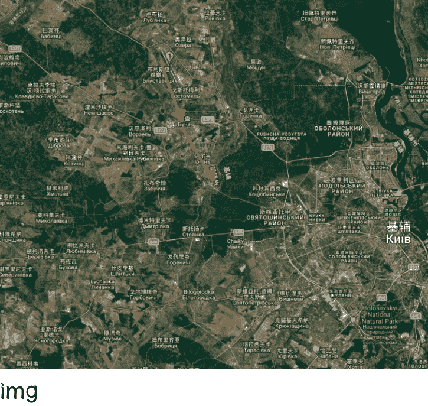

# 俄罗斯差点成了“开战团灭敌方最高层”的第一国

260306 九边
- 整理：公众号懒人搜索，懒人专属群精选精选
- 懒人微信：lazyhelper1

这篇文章是我前几天随手写完发头条的，没想到效果还不错，我就再做一版大修改，放这边来。多说一句，我现在只在今日头条和现在这个“六镇”发文，其他同步更新的，全是假的，微博上早就停了。现在有一大堆各种号，微信这边也有几十个号在冒充，我也没法一个个辟谣。大家注意甄别，尤其千万别被骗钱。

九边 Pro 前天 08:52

157 万展现 15 万阅读

分享 316 2421

前几天的事大家也都知道，美国和以色列一顿折腾，基本清除了伊朗的核心领导层，包括最高领袖哈梅内伊以及多名伊朗革命卫队高级指挥官和国防部长。

很多人说，为啥其他国家不这么搞？当然搞了，擒贼先擒王，谁都知道。其实 2022 年俄乌冲突的最初阶段，俄罗斯也曾非常接近实现类似目标，只是最后在执行细节上出现了问题，导致计划未能完成。咱们今天仔细说说这事。

这种一开战就直奔对方高层的操作，其实苏联用的就很娴熟，在阿富汗战争和匈牙利都使用过，效果非常好。如今又有导弹，俄罗斯上层非常有自信一开战就把乌克兰上层给送走。

开战第一天（2 月 24 日），俄军发射了上百枚“口径”巡航导弹和“伊斯坎德尔”弹道导弹，目标包括基辅附近的多个指挥所和重要人物住所。

导弹数量庞大，但实际效果有限。

因为之前拜登已经在电视上宣布了俄罗斯的进攻计划，所以效果不太好。

多说几句拜登那次透露信息，其实当时全世界相信美国的人并不多，包括乌克兰，也半信半疑。美国看乌克兰人不相信，急了，中情局局长拿着俄罗斯的进攻计划去基辅，泽连斯基才半信半疑做了一些部署。

但都不是大改变，怕被美国人给闪了，也担心过度反应把俄罗斯给激怒了，甚至战斗机都还在原来的位置，没做转移和隐蔽，开战差点被团灭。所以俄罗斯的第一轮导弹过来的时候，那些目标建筑里的人都转移了，泽连斯基自己也住到了地堡，战果并不大。

此外俄罗斯的导弹精度，真是一言难尽，很多没打中，甚至没爆炸。

导弹打击未能达成预期后，俄军也没着急，立即开始第二步：空中突袭安东诺夫机场。

这是整个“斩首”计划的核心环节，占住机场，然后大型运输机把大部队源源不断送来，机场离基辅很近，大家一起冲向基辅的总统府，在乌克兰人反应过来之前就结束战争。

与此同时，第三步也在同步操作，其他四路大军正在从不同方向越过边境，向基辅挺进。就算安东诺夫机场空降失误，只要固守待援，大军很快就能解救那些人。

这么看，俄军计划的还挺周密。

2022 年 2 月 24 日，可能是最近百年最重要的几个日子之一，俄罗斯开始行动了。

不过那天开始就干了一件无厘头的事，早上大约 5 点到 7 点之间，俄军向机场及其周边发射了 4 枚“口径”导弹，应该是想打掉机场弹药库或者附近的炮兵阵地。

但准头实在不咋样，啥也没打中，其中一枚落在国民卫队基地的阅兵场（操场），一枚击中基地外的居民区，另外两枚落地后未爆炸。

这些导弹都没击中关键目标，导致守军零伤亡。但爆炸声和弹坑立刻让机场的乌克兰国民卫队第四快速反应旅（按照北约标准训练的部队）警觉起来。他们迅速进入战备，去仓库里领了武器和弹药，又把毒刺导弹也组装好，全军进入了战斗位置，据美国媒体后来到处采访当事人，说是乌克兰人用了俩小时才部署完毕。

而且乌克兰守军的指挥官还站在操场的那个弹坑边开了个会，做了个关键预案，让炮兵调整目标，对准了机场跑道，准备如果实在抵挡不住，就准备破坏跑道。

随后的四五个小时，一直没别的动静，乌克兰人还在纳闷俄军是不是不来了，甚至考虑先去吃饭。

直到上午 11 点左右，俄军几十架直升机编队出现在了天际。

俄罗斯这些部队主要来自第 31 近卫独立空中突击旅、第 45 近卫特种旅，可能还包括第 11 近卫空中突击旅的部分人员，总计约 200 至 300 名精锐空降兵。

他们的任务是迅速占领机场跑道和周边建筑，为后续多架伊尔 -76 运输机创造条件。这些运输机携带重型装甲车辆和更多部队，每隔几分钟一架降落，把大部队卸下来之后，大家从机场直驱基辅市区，距离总统府仅十多公里。

如果这一步成功，乌克兰领导层的指挥中枢很可能在开战后 24 至 48 小时内失去运作能力。

但由于守军已提前准备，空降部队还没降落就掉了几架直升机，空降成功的部队也被早有准备的乌克兰人压着打，非常被动。

尽管承受了巨大伤亡，但是俄罗斯精锐空降部队战斗力惊人，硬是控制了附近几座建筑，并且向天上的运输机发信号，让飞机降落补充战力。

乌克兰守军发现有点危险，于是用炮火和空中打击炸毁了跑道，跑道上都是坑，阻止了后续 18 架伊尔 -76 运输机降落。俄罗斯空降部队尝试修复跑道，但枪林弹雨中实在没法操作。

大型运输机没法降落，就回白俄罗斯去了。

已降落的俄军空降兵只有轻武器和少量反坦克导弹，缺乏重火力支援，在平坦的机场上几乎没有掩护，附近的乌军也聚了过来，俄罗斯空降部队很快陷入乌军地面反击和炮火围攻。

这个时候俄罗斯空降部队也不是特别慌，因为他们知道其他四路大军正在路上，随时可以赶到。

第一路由白俄罗斯出发，离机场最近，装甲洪流穿过边境，几乎没有遇到什么抵抗就穿过了切尔诺贝利核污染区，快速接近机场。

到了 25 号，也就是机场突袭的第二天，俄罗斯的近卫第四坦克师已经到了机场，然后通过布查这个地方，向基辅前进。但是在布查遭到民兵的反击，耽误了不少时间。

基辅那边也整个城市动员起来，往路上放反坦克障碍，而且开始在所有附近大桥上装炸药。

俄军费了好大劲终于过了布查，然后到了伊尔平，基辅就在眼前了，就是上图那个箭头指着的地方，乌克兰人把伊尔平的桥给炸了。这下惨了，64 公里的装甲部队被堵住了，当时正好是乌克兰的春季泥泞期，装甲车一旦离开公路，立刻就会被陷入泥浆。这也是为啥很多人不明白那些坦克为啥呆在原路不去再找路。

后来坚持了十天左右，一直被乌军骚扰，俄军只好化整为零，硬着头皮把车队散开躲入森林和树荫。这段时间战斗非常激烈，附近的乌军也化整为零围了上来，接下来的事大家都知道，很多俄军装甲车被标枪给打了。东路的哈尔科夫方向的俄军碰上了乌克兰最精锐的 92 旅，硬是没能打过去。这个 92 旅前身是二战苏军的战功卓著的 48 步兵师，真正的老近卫军，苏联红军的中坚。整个冷战时期都部署在前苏联跟西欧的一线，随时准备推平欧洲。整个俄乌战争中，这支部队是最活跃的，可能没有之一，跟他过招的，很多也是前苏联的近卫军。红军打红军，让人痛心。

不过最南边的那一路，从克里米亚出来的那一 路，进展神速，抢了不少地盘。

那支 64 公里的钢铁洪流坚持了一个月左右，俄罗斯觉得再拖下去也没意思了，就宣布达成目的撤军了，绝大部分坦克和装甲车都丢在了原地，士兵们退回了白俄罗斯。三天后乌克兰也宣布基辅保卫战胜利完成。

战后分析认为，如果导弹更精准击中机场弹药库，或没提前“提醒”守军，俄罗斯可能在开战当天就建立起空中走廊，基辅的命运会大不一样。

最近俄罗斯高层有个解密，讲的是四年前他们到底怎么决策的。俄罗斯上层当时还相信了一个情报，说是乌克兰人 80% 准备喜迎王师。

所以他们其实对安东诺夫机场行动押注极大，以为空降部队一降落，乌克兰机场守军就会跑路，然后俄军大部队集结后冲向基辅，泽连斯基就会跑路，乌克兰政府就没了。前往乌克兰的军队甚至带好了阅兵礼服和镇压骚乱的警棍，而不是长期作战的弹药和口粮。这证明他们根本没打算打持久战，就是奔着“一天通关”去的。

因为 2014 年克里米亚事件中，乌克兰守军就是这个表现，俄军几乎一枪没放拿下了克里米亚。

事实上战争开始那天晚上，泽连斯基给能找到的西方领导人挨个打了遍电话，大家一致的态度都是让泽连斯基尽快放下执念，赶紧跑路，再不跑就来不及了。只有英国，英国小黄毛说你再坚持下，导弹马上就到。

后来大家也知道，泽连斯基没跑，还上街录了个视频，这客观上让整个基辅上层都稳定了军心。没多久基辅就把枪给市民发下去了，其实这很危险，对政权合法性的终极考验，当时很多人都担心民众拿到枪先去把泽连斯基给突突了。

而且那个之前一直跟泽连斯基做对的那个季莫申科（因为版权问题，不放图了），她也全家走上街头，拿着一个 AK 号召大家一起抵抗和基辅共存亡。其他几个政治领袖也做了表态，老百姓发现上层还没跑，也就不那么慌了。

她这个举动被解读为一个重要标志，乌克兰内部内斗了几十年，在那一刻放下成见一致对外了。不过私下的龃龉还是没停，最近她和泽连斯基又在相互指责对方腐败。

斩首行动不顺利，叠加乌克兰人并没有“喜迎王师”，结合在一起，就弄出来了这四年的烂仗。

而机场行动不利，很重要的一个原因就是配合太差，那四发导弹某种意义上影响了结局，打的毫无道理。

不知道为啥要提前四五个小时打，关键是啥也没打中。如果空降部队出现在天际的时候导弹也到了，这就完全不一样了，但这明显对俄罗斯的协调能力要求太高了。

相比之下，美国在 2026 年 2 月 28 日对伊朗的行动（“史诗狂怒（Epic Fury）”），显示出完全不同的执行路径。

以色列先用 AI 分析天量数据锁定了哈梅内伊的住所（以色列是这么说的，不过应该是线人和 AI 分析共同起作用），然后声东击西，整天瞄着核设施，谈判也是谈核设施，其实盯着的是伊朗上层，然后一个突袭，把整个管理层给带走了。

当然了，美国也不一定能随便脱身，战争这东西，开始容易结束难，而且变数太多，再精密的计划，可能在开战第二天就得作废 80%。

俄罗斯的那次尝试，本来有机会成为现代战争中“开战即控制对方最高层”的先例。但最后也没能成功，背后当然是一系列误判，加上俄军之间恶劣的配合，最后合力把事给搞砸了。

通过这事，也能看出来，现代战争发展方向还是挺明显，情报比火力更重要，科技的作用越来越大。但决定最后走向的，其实还是民心。

全文完，谢谢阅读。如果喜欢请三连。

## 最后，安利小懒的付费群:

### 懒人专属群 (介绍)

- 微信：lazyhelper1

这里是你对抗信息过载的护城河。

已稳定运行 7 年，累计拆解、研读 3000+ 个互联网商业实战案例与行业前沿内参和时政/宏观文章。

我们不搬运垃圾，只做高价值信息的筛选器与放大镜。

### 懒人专属群更新记录:

https://hk57gvIx7u.feishu.cn/docx/H0kRdZbSbolBR0xkaXtcuVEOnTg

- lazyso 官网：https://lazyso.com/

【免责声明】本资料归档于社群内部知识库，仅供成员课题研究与学术交流，请在查阅后 24 小时内删除。