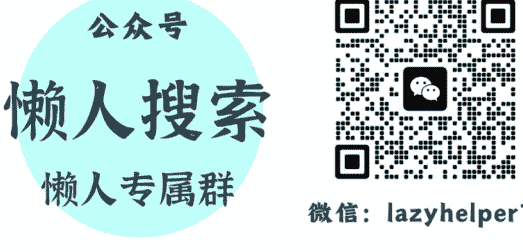
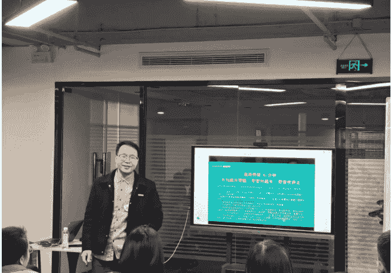
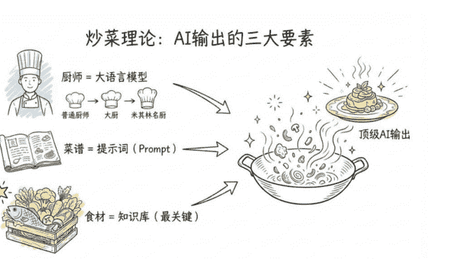
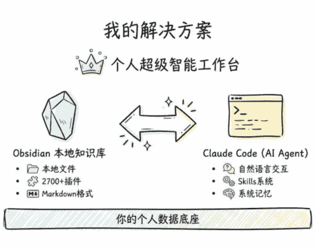
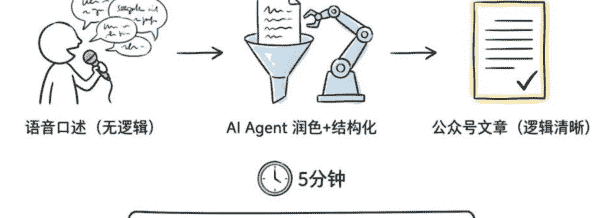
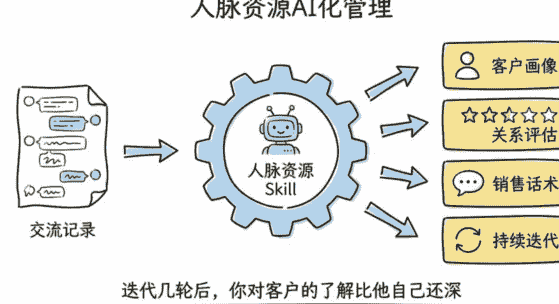
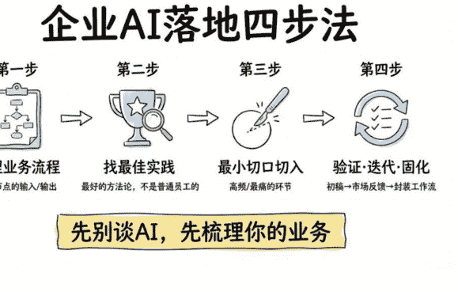
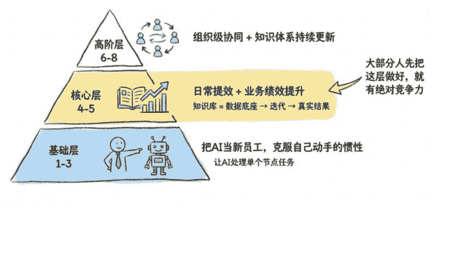
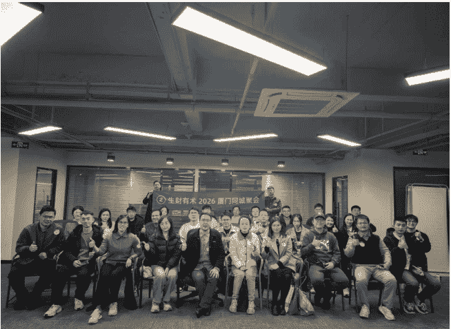

# 个人知识库：AI 时代的超级武器，用本地知识库+AI Agent 打造你的智能工作台，干货纯享版

## 公众号懒人搜索，懒人专属群独享

懒人微信：lazyhelper1

各位生财的圈友们好，我是焦波，「AI 先锋队」社群创始人，多家企业 AI 战略顾问。前游戏行业创业者，操盘过日活 400 万的项目，现在专注企业 AI 智能体落地。

这篇核心只讲一件事：如何用“本地知识库+AI Agent”打造个人超级智能工作台，并复用到企业服务中赚钱。

本篇用于解决以下 6 个问题：

- 1. 为什么你用 AI 效果不好？——“炒菜理论”
- 2. 用 AI 的六大致命问题
- 3. 我的解决方案：Obsidian+Claude Code + Skills
- 4. 个人怎么用：从口述到公众号文章、人脉资源管理、战略思考
- 5. 企业怎么用：睡眠企业 AI 客服知识库、海外众筹产品创新
- 6. 企业 AI 落地的正确姿势 + 每个人都应该成为自己的"知识架构师"

## 二、为什么你用 AI 效果不好？——"炒菜理论"

很多人跟我说："AI 没有我想象中那么好用。”

我跟一家企业交流过，他们买了一个 AI 客服工具，花了钱，用起来效果很差。深入了解才发现——他们背后没有自己的语料积累，没有行业知识沉淀，完全依赖大模型的通用能力。回答出来的东西，全是泛泛而谈。

没有自己的数据底座，AI 就没办法给你创造商业价值。因为你有的答案，大模型也有。

我把整个用 AI 的过程比喻成炒菜：

### 1、厨师 = 大语言模型

普通厨师、大厨、米其林名厨，水平不一样。我们请越好的厨师（用越强的模型），理论上出品质量越高。我自己用海外模型居多——Claude、GPT、Gemini、Grok，四家都用，主力用 Claude。

### 2、菜谱 = 提示词 (Prompt)

煎还是炸？调料下多少？煮多久？这就是我们引导 AI 工作的方式。我自己积累了几百个常用提示词，按场景分类存放。

### 3、食材 = 知识库 (最关键)

普通青菜 vs 鲍鱼海参，食材品质决定菜品上限。食材还有新鲜度——过期的信息“炒”出来也不好吃。

所谓“高知识密度”的食材，就是营养含量高、新鲜、与你的业务强相关的信息。

顶级厨师 + 好菜谱 + 独有的高品质食材 = 顶级 AI 输出。

很多人把全部注意力放在收集提示词上，觉得一个好 Prompt 就能改变一切。但提示词只是其中一小部分，知识库才是真正的壁垒。

## 三、用 AI 的六大致命问题

在高频使用 AI 两年多之后，我总结出普通人用 AI 时一定会遇到的六个坑：

1. 数据没有归属

今天用 DeepSeek，明天用豆包，后天用 Kimi，再用海外的。每个平台数据不互通，海外网站还可能封号——封，所有数据全没了。

2. 对话框的牢笼

大部分 AI 产品是 Chat Box 形式。你跟 AI 的每次对话，最后就是左侧一长串对话列表。高频使用的话，我一天就有几十个对话，一年下来几千个。想找之前聊过的某个东西？几乎不可能。搜索功能？不相关的结果一堆。

3. 记忆断裂

每次开新对话，AI 对你一无所知。你得重新介绍一遍自己的情况。AI 对你了解越深，输出越贴合你的实际——但大部分工具在记忆这块做得很粗糙。

4. 工具学习曲线陡峭

n8n 工作流权限配置能配死你，特别是对接 Google 套件。Coze 稍好一点，但也需要一定的逻辑基础。

5. 信息管理混乱

群太多，信息源太多。我置顶群有 80 个，知识星球有 100 个，每天还看极客、Twitter 上的 AI 信息。哪些信息对你有用？哪些值得提炼？如果不做梳理，所有信息都只是“流过去”的，对你毫无价值。

6. 知识跨平台碎片化

知识和数据散落在各个平台和工具里。你想找一个东西，可能要翻三四个平台。

## 四、我的解决方案：个人超级智能工作台

这套方案是我在实战中摸索出来的，在去年也就是 2025 年 6 月份服务企业客户的时候就已经用上了。我的方案其实很简单，就两个核心组件：

### 1、Obsidian——本地知识库载体

国内十几种知识库我全部用过，海外主流的也都试过，最后回归了 Obsidian。

#### 为什么选它？

- **本地文件结构**：每一条笔记都是本地文件，不依赖任何平台。除非硬盘丢了（备份一下就行），永远不会丢。不像线上平台，封号就完了。
- **2700+ 插件生态**：微信读书同步、网页内容抓取、导出 Word/PDF、各种格式转换……几乎你能想到的需求都有插件。
- **易于分享**：想分享投资板块的内容？直接把文件夹复制给别人就行。
- **对 AI 最友好**：默认的 Markdown 格式是 AI 最容易理解的——有标题层级、有加粗重点、结构清晰。

但我要强调：Obsidian 只是载体，它本身只是一个很好的阅读器和文件管理器。真正的核心武器是第二个。

### 2、Claude Code (AI Agent) ——真正的引擎

这才是我整套系统的灵魂。

Claude Code 是 Anthropic 推出的 AI 编程 Agent，目前已更新到很高的版本，迭代非常快。

你可能会问：我不会编程怎么办？

不需要。这里的“编程”不是指写代码，而是一种处理任何事物的方式。我可以把任何东西当成一个“编程对象”——方案是编程对象，人脉管理是编程对象，战略规划也是编程对象。

#### 核心优势：

- **完全自然语言交互**：我怎么跟人说话，就怎么跟它说话。“这文档太长了，帮我改一下”，“这段不要这么写”——就是这样。
- **整个本地知识库都是上下文**：这是最可怕的。它能访问你整个库的内容。我输入一个年度规划的 Prompt，它会自动到我的库里去找所有跟目标、任务相关的内容来回答。
- **Skills 系统**：这是最近 AI 圈刷屏的功能，但我在它出来第一天就在用了。Skills 本质上就是封装好的工作流，完全可以替代 Coze、n8n 那一套节点 + 输入输出的逻辑。有了这个，我不需要再学任何工作流工具。
- **系统记忆 (CLAUDE.md)**：你把个人信息、业务信息、重点记忆写在这个文件里，它每次对话都会自动调用。比 GPT 的记忆功能可控太多了——你知道它记了什么，可以随时改。

## 五、个人实战：这套系统能干什么？

### 场景一：从口述到公众号文章，5 分钟搞定

我写公众号的第一篇文章，原稿是完全口述的——对着电脑说话，想到什么讲什么，没有逻辑，没有条理。

然后我做了什么？

7. 把口述稿复制到 Obsidian
8. 告诉 Agent：“帮我把这篇改写成公众号文章，使用我的 AI 去味写作模板”
9. 指定输出到某个目录
10. 等几分钟，文章就出来了——逻辑清晰，结构完整

关键点：我们不需要有逻辑。你想把一个东西讲得很有逻辑性，要花很多时间。但 AI 最强的就是逻辑。我们只需要把真实的内容和情感讲出来，AI 负责润色和结构化。

语音输入效率比打字高太多。电脑上装个语音输入法（微信、豆包、讯飞都行），对着说就完了。

> 语音口述（无逻辑）
> AI Agent 润色 + 结构化
> 公众号文章（逻辑清晰）
> 5 分钟

> 我们不需要有逻辑，AI 最强的就是逻辑

### 场景二：人脉资源 AI 化管理

这是我在 Skills 功能出来后做的第一个 Skill。灵感来自生财航海家根源老师的销售方法论——六个抽屉体系、心谈七问体系。

我做了什么？

11. 把根源老师的方法论让 AI 梳理成一套人脉管理框架
12. 把框架封装成一个 Skill，包含：信息提取、客户识别、分类评估、画像构建
13. 每次跟客户聊完，我把交流记录丢给 Agent，说一句：“用人脉资源 Skill，帮我整理一下张三的信息”

它会自动提取：家庭背景、成长经历、获得荣誉、得意之事、失意之事、未来愿景、跟我的交集、有没有付费、沟通质量评估……

更强的是：我把自己的产品信息写在 Skill 里，它会自动给我生成销售话术建议——针对这个客户的具体情况，该怎么推我的服务。

每次再跟这个客户聊完，把新的交流记录丢进去，它自动更新。迭代几轮之后，你在这个人的了解可能比他对自已的了解还深。

### 场景三：战略思考和决策辅助

我用这套系统做了大量的战略思考：

- 听完生财嘉宾的分享，把总结导入系统，让它结合我的业务分析
- 用李克老板的七件框架分析我的业务方向
- 用纪老板的“好项目标准”评判我的项目可行性
- 做 2026 年规划，从年度到季度到月度执行拆解

本质是什么？我把茅台的顾问、华与华的方法论、麦肯锡的框架——这些我请不起的大脑，全部通过知识库+Agent 的方式“请”过来给我做分析。

不是盲目信它的答案，而是把它当成初稿，进市场验证，拿到真实反馈，再回来迭代。这个循环的速度，比以前快了十倍不止。

## 六、企业实战案例

### 案例一：睡眠企业——从 50 款产品到 1500 个 AI 问答

**背景**：一家睡眠产品公司，产品线 50 多款。没有任何一个员工能记清所有产品信息，新员工培训成本极高，扩张开线下门店更是难上加难。

他们原先的"AI 客服”为什么不好用？因为他们自己写的客服问题，跟产品信息没什么差别——全是产品参数，没有一个是客户真正会问的问题。

**我的做法**：

**第一步：采集真实用户之声**

从小红书、抖音上抓取睡眠相关的评论和讨论。“我睡不着怎么办”“什么枕头适合颈椎不好的人”——这些才是真实的问题。

**第二步：四象限分类**

用频率和价值两个维度做四象限分析。高频高价值的重点做，低频低价值的直接忽略。

**第三步：设计回答模板**

企业希望 AI 客服有“真人感”，不要冷冰冰。我给 AI 一个真人感回答的框架模板。

**第四步：批量生成**

把产品信息 + 问题库 + 回答模板交给 Agent，一个下午，1500 个高质量问答全部生成完毕。如果让人做？质量不高、数量也跟不上。

**第五步：多场景复用**

- 导入 AI 客服系统：直接拖 MD 文件进去
- 内部培训：导入到 IMA 或类似工具，新员工直接跟知识库交互学习
- 内容创作和营销：产品信息本身就是素材

交付的不只是问答，而是系统资产。有新产品进来，用同一套框架再生成一批。产品信息要修改，在框架上直接调整。这套东西能一直复用。

### 案例二：海外众筹——AI 驱动的产品创新

**背景**：一个做 Kickstarter 海外众筹的客户，想做户外背包品类。

原先的方法：找到市场上成功的产品，在上面“加功能”或“减功能”做微创新。选品阶段，一个人要花 2-3 周。

**我的做法**：

**1. 梳理他的完整业务流程**

跟他聊了一个下午，把从选品到产品设计到上线的整个流程梳理清楚。

**2. 先用 AI 跑一轮他原有的方法**

结果：比他自己做的还好。效率提升了，质量也提升了。

**3. 升级方法论框架**

他原来只有“加减法”，我引入了 SCAMPER 奔驰法——7 个维度做产品创新（替代、组合、调整、修改、另作他用、消除、重排）。角度多了，创新可能性就大了。

**4. AI 数据采集和用户调研**

直接在系统里调用浏览器工具采集 Kickstarter 上的评论、竞品数据、用户反馈。不用跳出系统。

**5. 关键洞察**

AI 分析后发现：户外背包爆品里，没有一款是专门为女性设计的。但用户评论中，有不少女性反映穿戴不舒适。而这个平台 36% 是女性用户。

**6. 验证这个洞察**

不急着做，先做三轮验证：市场规模验证、需求真实性验证、成功案例验证。“先在纸面上成功，推演顺利了再实际推。”

**最终效果：**

- 时间：从 3 周缩短到半天~1 天
- 质量：从只看 3 个竞品到全品类分析
- 决策：从拍脑袋到数据驱动
- 资产：整套流程可复用于下一个新品

## 七、企业 AI 落地的正确姿势

很多老板说“我要 AI 转型”，但他不知道从哪切入。

**第一步：先别谈 AI，先梳理业务流程。**

你让老板把业务流程梳理出来，很多老板从来没做过这件事。每个流程有几个节点？每个节点的输入输出是什么？哪些是人在处理的？人用什么方法处理的？

把这些搞清楚了，你就知道哪些环节能用 AI 提效。

**第二步：找到最佳实践，而不是普通员工的方法论。**

普通员工大概率没有像样的方法论积累，凭直觉和经验在处理。你要做的是找到公司里做得最好的那个人的方法——甚至是市场上这个方向最好的方法论——用 AI 去替代原先的低质量处理。

**第三步：从一个最小切口开始。**

不要想着一上去就解决所有问题。找一个高频或者最痛的环节，用 AI 跑一轮，看效果。

**第四步：验证、迭代、固化。**

所有东西都当成初稿。发到市场拿反馈，回来迭代系统。迭代成熟了，再封装成工作流给普通员工用。

> 先别谈 AI，先梳理你的业务

### AI 时代管理者的能力层级

我把企业用 AI 分成几个层次：

**基础层（1-3 层）**：把 AI 当成团队的一个新员工。克服自己动手的惯性——你现在是老板，AI 是你的员工。让它处理某个节点的任务，看能不能跑起来。

**核心层（4-5 层）**：日常工作大幅提效 + 实现业务绩效提升。这一层的关键是知识库——有了数据底座才能迭代，有了迭代才能拿到真实的业务结果。

**高阶层（6-8 层）**：组织级协同，每个人之间的协作优化，外部知识体系持续更新企业内部知识体系。

大部分人先把 4-5 层做好，就已经有绝对竞争力了。

## 八、几个关键认知

### 1. 每个人都是老板，AI 是你的员工

这是最大的角色转变。不要想着“我要亲手干活”，要想“我怎么给员工分配任务、怎么检查质量、怎么培训它”。

### 2. 积累你自己独有的数据

你的经历、你的想法、你的交流记录——这些是属于你的、别人没有的东西。每个人独有的数据是最宝贵的财富。

我现在所有的交流记录都做了数据化，可以回溯到任何一天跟任何一个人聊过的细节。这些数据经过 AI 总结后，就是我的内容素材库、是我的人脉信息库、是我的决策参考库。

不要等“准备好了”再开始。就从今天开始，把每天的交流记录下来就行。用记笔记也好，飞书妙计也好，通义听悟也好，任何一个录音转文字的工具都行。

### 3. AI 是放大器

你是 1，放大 10 倍是 10。你是 0.1，放大 10 倍是 1。

AI 放大的是你自己的基数。所以最关键的，是不断提升自己的认知和核心竞争力。

乔哈里视窗有四个象限，现在有一个象限会被无限放大：我们不知道，但 AI 知道。我们能做的就是尽量把自己的认知范围扩大，覆盖更多 AI 已知的领域，这样才能调用更多的 AI 能力。

### 4. 信任是 AI 时代最大的壁垒

AI 太容易生成内容和答案了。那用户信谁？信那个他见过、交流过、验证过的人。

所以我现在做的事情，就是多出来做分享、多链接、多提供价值。信任建立了，后面的合作就是顺理成章的事。

## 九、给圈友的行动建议

14. 马上开始记录你的交流数据。任何工具都行，先积累起来。

15. 给自己建一个本地知识库。Obsidian + Markdown，门槛不高，安装是最大的坎（搞不定就上闲鱼找人装）。

16. 用 Agent（Claude Code 或 CodeX 或者同类工具）连接你的知识库。安装上去之后，使用门槛真的不高，就是自然语言对话。

17. 从一个最小的场景开始用。比如把今天的交流记录做个总结，比如把一段口述变成一篇文章。

18. 把生财大会和各种优质分享的内容存进你的库。这些都是高质量食材——鲍鱼燕窝级别的。别听完就忘了。

19. 所有 AI 输出都当成初稿，拿到市场验证后再迭代。拿答案容易了，验证答案才是核心竞争力。

我自己日常只用三个工具：Obsidian + Claude Code + Notebook LM。基本够用，不需要再折腾其他的了。

我是焦波，「AI 先锋队」社群创始人。如果你对个人知识库搭建、企业 AI 智能体落地有兴趣，欢迎链接交流。

觉得有收获的话，帮我点个赞，投个币就更好了。

最后，安利小懒的付费群：

**懒人专属群（介绍）**

这里是你对抗信息过载的护城河。

已稳定运行 7 年，累计拆解、研读 3000+ 个互联网商业实战案例与行业前沿内参和时政/宏观文章。

我们不搬运垃圾，只做高价值信息的筛选器与放大镜。

**懒人专属群更新记录：**

https://hk57gvIx7u.feishu.cn/docx/H0kRdZbSbolBR0xkaXtcuVEOnTg

**【免责声明】** 本资料归档于社群内部知识库，仅供成员课题研究与学术交流，请在查阅后 24 小时内删除。