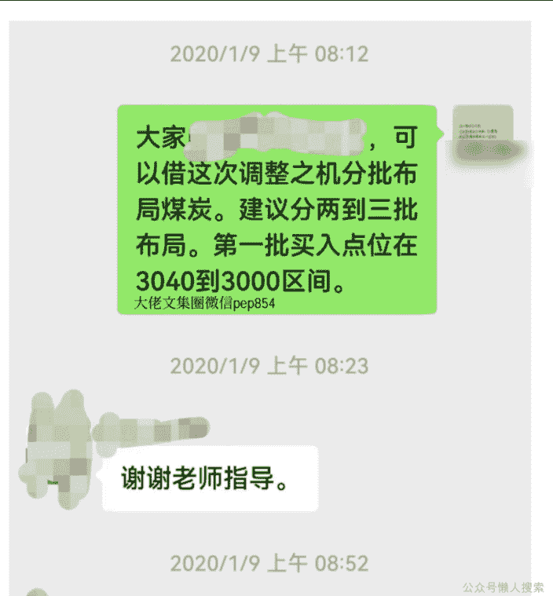
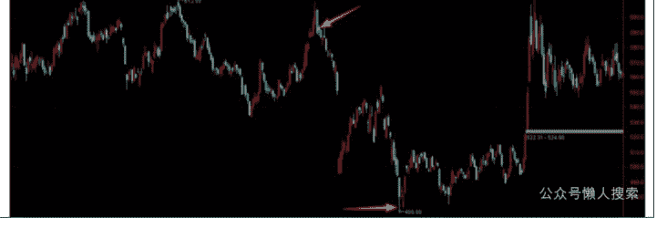
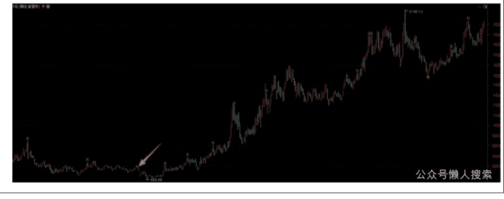
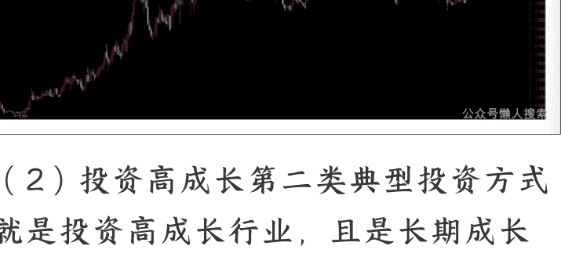
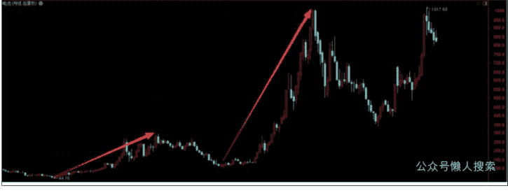

公众号懒人搜索，懒人专属群分享

# 12 年一遇的战略机会，改变命运

## 260304 安民分析付费

整理：公众号懒人搜索，懒人专属群精选

懒人微信：lazyhelper1


## 一、以 10 年计的投资

长期看我们文章的读者都知道，我们在博客和微博上，不时会思考一个问题，未来 10 年投资哪个行业可以挣大钱？然后也会分享自己的思考。像去年我们也分析了几个行业，今天我们继续沿着过去的思路，一路追踪下去，未来也会继续我们的行业分析与追踪。

下面根据三个财富榜及其他相关数据来看中国社会的财富趋势：

- 1.胡润百富榜和瑞银相关报告，有什么启示？

这些富豪离我们普通人太远，我们够不着，所以他们不是本文的重点。但他们取得成功的原因，我们也要了解一下。其中也许有一条两条，值得我们深入学习深入思考。毕竟他山之石，可以攻玉。

根据胡润百富榜，到 2025 年 9 月 1 日，中国有 1434 位个人财富 50 亿元以上的人上榜，比 2024 年增加 340 位，增长 31.08%；总财富接近 30 万亿元，增加了 9 万亿。其中前 10 名门槛提高到 2250 亿。《瑞银 2025 年亿万富豪报告》显示，2025 年中国内地新增 70 位身家 10 亿美元以上的富豪，目前共有 470 人，仅次于美国。

富豪们取得成功的原因，主要有以下几条：

- 第一，白手起家。就是敢于创业，敢搞。98% 的中国内地新增亿万富豪都是白手起家，自己创业。他们通过自己的努力，组织起团队打市场，在几年、十几或几十年内积累了大量的财富。

- 第二，选对长期赛道。就是投资的行业选对，从长期主义的角度选行业，赚行业扩张的钱而不是快钱。总体思路是锚定国家战略规划与产业升级方向，也契合全球技术变革趋势与市场扩张趋势，成为社会趋势和行业趋势的创建者、引领者或变革者，最少也是跟随者。这些行业我们后文总结为七个大方向。如果看小行业，自然不止那些。

- 第三，构建竞争生态和产业生态。通过持续领先构建行业竞争生态，通过产业链整合构建合作生态。把自己的业务或服务做到极致，比如技术领先、产品领先、成本领先、服务领先、效率领先，至少在某一方面或几方面做到竞争对手无法超越，然后通过技术创新、商业模式突破、产业组织升级来解决占位问题，以积累财富。

- 第四，懂业务，有全球眼光。很多都是搞技术出身，懂技术，懂产品，懂业务，懂研发，至少懂生产，懂市场需求，且能够将市场需求与产品升级结合起来进行迭代，靠解决消费者的问题来赚钱。另外，不少人都是全球化的视野，有自信心，敢在全球范围内进行全面的全方位的竞争。

- 第五，极致的效率。中国给创业者提供了很多投资机遇，尽管竞争激烈，但效率非常高。我国拥有全球最高效的供应链，零部件配套完整，要啥有啥；他们能够在全产业链上高效地配置资源，甚至进行垂直整合。我国有数量最多质量最优的工程师；而且产业政策极具优势。一旦国家规划选定了方向，各地方政府招商引资，提供廉价的土地、高效的基建，还有政策补贴，企业家就能放心大胆地甩开膀子往前闯。这种高效率杀出来的团队，一旦进入全球市场，别人很难打败他们。

这其中，有两个因素是我们投资人值得借鉴的。第一是创业，要敢于投资。第二是选对行业选对赛道。当然，其他因素也重要，比如全球化的视野，未来会越来越重要。但对我们做投资而言，选对行业选对赛道的启示更为重要。

( 声明：本文只为开拓视野、引导思路，并非择时，亦非荐股。股市有风险，入市需谨慎。本文为行业和指数的分析研究，不构成任何投资建议或意见，不为用户依据本文做出的任何投资与决策承担责任。请大家注意投资风险)

### 2.净资产超千万的家庭，有多少？

净资产超千万，是好些人一生可以够得着的人生目标。因此，我们仔细看看他们的操作，一定要认真学习，从中学到东西。

招商银行聚集了中国最大的金领和富人群，因此招商银行每年的相关报告，也值得高度重视，而且那些人更接近我们普通投资者。根据招商银行与胡润研究院等权威机构发布的 2025 年最新数据，中国拥有千万以上净资产的家庭数量是：

第一，净资产超千万元的家庭约 211 万户，占全国家庭总数的 0.43%，相当于每 470 个家庭中有 1 户达标。这是胡润的数据。

这一数据以“家庭净资产”为统计口径，即总资产包括房产、股票、企业股权等，在此基础上再扣除负债后的净值。

他们具有的特点之一是区位比较集中。广东、北京、上海三个地方，占全国的比例超过 42%。粤港澳大湾区更集中，主要原因在于香港和澳门。之二是财富来源。54% 为企业家，34% 为企业高管等金领阶层，5% 为房产投资者，还有一部分为职业投资人。

千万以上的职业投资人到底有多少，各方面评估数据的差别比较大。

第二，可投资资产超千万元的家庭标准不同，差异显著。

“可投资资产”指剔除自住房产和基本生活所需，再剔除企业现金流后，可用于金融投资的部分，至少是相当于自由现金流。采用金融机构常用的严苛标准，约 15.3 万户。

招商银行将“私人银行客户”门槛设定为金融资产超 1000 万元，且不包含自住房产。按此标准，全国达标家庭仅约 15.3 万户，不足家庭总数的 0.05%。我们估计实际数据将是这个数据的几倍，至少超过 50 万户。

这些客户虽然占比比较低，却掌握着银行系统内 31% 的资产，财富集中度比较高。

特别讲一句，有些私人企业虽然也有不少现金，但那并不是个人或家庭可用于金融投资的资产。那是企业的资产。因为企业的资产，运营过程中要交税，相当于国家含有干股。所以我们将它剔除掉。

采用胡润研究院的宽泛标准，则是约 211 万户。

胡润报告将“可投资资产超千万”与“净资产超千万”口径部分重合，2025 年数据显示，此类家庭约为 211 万户。而 2023 年的胡润报告显示，中国拥有可投资资产超千万的家庭数据是 110 万户。

根据 2015 年 7 月中国之声的统计数据，股灾后，当时 A 股个人投资者中，持股市值在 1 亿元以上的有 4359 户，持股市值在 1000 万~1 亿元的有 7 万户；持股市值在 500 万到 1000 万元的账户有 13 万户。当然，10 年过去了，当年的这个数据肯定是比较低的，经过两轮牛市，现在的数据应该高于 10 年前。

我们前期有文章讲大学老师的投资情况，结果根据读者反馈的信息，大学老师的投资呈两极分化。有少数很成功，也有不少很差的。

而我前些时在文章中讲到过，我们那栋大楼里，有十几个是投资做得很不错的，不显山不露水，都在千万以上，过亿的也有。而且从我们的粉丝中反馈回来的信息，有些人也做得很不错。因此，我们判断股票市场中，资产超千万的，不会低于 50 万，有可能达到 80 万甚至上百万人，不排除超过胡润 2023 年数据的 110 万，因为 2024 年和 2025 年是牛市。当然，这只是估计，不一定对。胡润报告、招行数据还有 2015 年的数据，可以作为我们判断的基础。

第三，净资产超千万的家庭，84% 为白手起家。这个希望大家记住。每 5 个人中，有 4 个人是白手起家做起来的。换句话说，如果您做不到白手起家，那这辈子您大概率只能靠投胎;如果投胎技术又不好，那就没啥指望了。再换句话说，普通人如果认知到位，抓住大行业的启动契机，有机会白手起家，做到净资产超千万。

## 二、净资产超千万的投资人，有什么特点？有什么启示？

我所了解的净资产千万以上的股票投资人，就是他们账上股票的净值在千万以上，而且不包括融资融券等借款。他们的特点比较明显。

第一，少有做超短线打板的。我生活中了解到的打板客只有两个，从普通散户做起来，资产做到数千万的只有一位，另一位未来有可能。其他所有账户净资产过千万的，都不是打板客。

我个人看的微信推荐文章中，有不少都是打板客的，但有两点不清楚，一是他们个人的净资产不清楚，长期盈亏也不清楚，当然，估计有些人实盘水平不错;二是也不太清楚他们的动机。因此，他们的文章我经常看，且是抱着短线了解、学习的态度，因为超短线一块，我相对弱，所以我为的是终身学习，不求一时有什么效果。我会仔细琢磨。

第二，我所了解的，账户净资产超过千万的投资人，他们一般都有三个特点：选对赛道，选对时机，长期主义。

### 1.长期主义

长期主义，简单说是 6 个字，好行业，好公司。也即若干年后，您投资的公司还在，那个行业也还在，而且您持有的标的，还是一家不错的公司。这方面，有两种投资方式。

#### (1) 高分红

前 20 年中，在香港和内地市场，高分红是一类典型的投资方式，很难亏损。就是买入股价定位远低于每股净资产，业绩稳健，但分红率很高，达到 7% 到 12% 的优质个股，长期投资很难亏损。大家可以看看我们 2020 年 1 月 9 日给粉丝讲的煤炭股，还有 2022 年和 2023 年讲的交行、工行、建行、招行，当时都是净资产以下很多，业绩很好，高分红率。

下图是 2020 年 1 月 9 日我们给粉丝讲的煤炭股。当时的中证系列煤炭指数（采掘指数）现在已经取消了，所以当时讲的点位您看不到；只能用还在的同类指数 880302 煤炭开采替代。后者那天收盘 590.9 点。两者当时数据的差别，只是因为指数属于不同系列。二者那时都在低位，您可以参考的是时间。类似地，前年的低点，880902 特斯拉概念是 2167.37 点，但 880951 新能源车是 859.59 点。



2020 年 1 月 9 日，880302 收盘 590.90 点，后来最低跌到 469.99 点。

下图中两个箭头，分别指向推荐的那天和指数最低点那天。



大家再看煤炭指数后来的走势，周 K 线图。上周收盘 2024.7 点。



再给大家看一个煤炭 ETF，515220 的走势，周 K 线图。这个行业指数基金，2020 年 3 月 2 日才有的，最低是 0.881 元，后复权，上周收盘 2.744 元。



#### (2) 投资高成长

第二类典型投资方式就是投资高成长行业，且是长期成长的行业。大行业，超大行业更好。

这方面的典型是新能源汽车，包括锂电池。2014 年 2 月 10 日，我在博客上讲了未来新能源汽车行业增长空间有 1200 倍，算出来是 1250 倍。证据以前多次讲到过，也给出过截图。

```
https://blog.sina.com.cn/s/blog4ab528460102ehcx.html
```

大家直接过去看原文。

根据中国汽车工业协会 2026 年 1 月 14 日发布的权威数据，2025 年中国新能源汽车，产量 1662.6 万辆；销量 1649 万辆。2013 年销量是 1.76 万辆，12 年增长了 936.93 倍。

新能源汽车概念有 1016 只股票，板块代码 880951，在股票软件上输入“新能源车”的首个字母 XNYC 就能出来。锂电池板块有 575 只股票，代码 880534，输入“锂电池”的首个字母也可以敲出来。大家应该去翻一下，看月 K 线图，后复权。看看有多少股票在这期间大涨。

可以说成批出现，剔除近几年上市的，比例估计不下于 50%。就是如果您在 2014 年到 2025 年期间炒新能源车和锂电池板块的强势股，只要进的位置不是很高，一般都能扭转自己的命运；如果您能根据大盘大势或板块指数大势，选对进出时机，您一定发财。

就是您先得去看那些个股的月 K 线图，然后设计出一套进出位置的办法，然后去实现您投资命运的改变。

而且，如果前 12 年中，行业涨了 937 倍的板块您都不能挣钱，那么我敢说，您投资所有的行业，估计都难以挣到什么钱。那您最好离开投资，别做股票，只管挣死工资去，而且也别指望您能靠投资改变命运。

所以，最有生命力的，还是行业，还是长期高增长，我们要靠这个来改变自己的命运。

### 2.选对赛道，就是选对行业

去年我们讲过几个行业，今年我们跟踪人形机器人，880703。今明年我们要进行的战略投资，将相当一部分资金配置的方向，就是人形机器人，而且这次战略投资，会占到资产的 40% 到 50%。就是在我的预期中，从这个行业挣的钱，是我后半生养老过好的关键。

我起步于 1999 年 2 月投资房地产，标的是深万科，2007 年 10 月到 11 月出局，改变命运。这次是重复历史上的投资模式。思路一样，方法一样，是模式复制。

这样的事情，我常干。前两年中，大家知道的是，前期以万科和茅台历史市盈率定位为榜样，投资光伏加工设备的标的。结果它最低 47.51 元，前些时最高 152.24 元，涨了 220.44%。光伏是基本面并不太好的行业，因为好些公司 2024 年巨亏，2025 年还有亏损，但仍然出了牛股。那个细分行业也有涨得比它好的，从 65.2 元涨到 374.1 元，迈为股份。这两只股票我们现在并不投资它们。涨多了，就跟咱们没有关系了。中线仓咱们考虑的是啥时出局。

关于人形机器人行业，这里给出我们团队最新的判断：

成长。保守估计，销量还有 5000 到 6000 倍的增长空间。

因为这两个行业有太多的相似点。

第一，数量极端相似。

2013 年，全国新能源汽车销量 1.76 万辆；2025 年，国际数据公司发布的数据显示，全球人形机器人出货量约为 1.86 万台，同比增长约 508%。

1.76 万和 1.86 万，这两个数据是多么惊人地相似！

这个数据太好了，12 年才遇到了一次。上一次是 2014 年 2 月，这次是 2026 年 3 月。而且两个行业空间也都超大。

第二，增长空间也相似，人形机器人更大。

高峰时，全球人形机器人的空间是多大？至少年产 1 亿台，中国有多大？至少 5000 万台。市场空间有多大？1 亿/1.86 万=5376 倍，国内企业扩张空间，4000 倍到 5000 倍是有的，高点的话，6000 倍也有可能。前期讲过，是三个方向，企业等各种社会组织、家庭、军事。

我们这个预测，并不要求精确，只要大方向对了就成，所谓模糊的正确远好过精确的错误。我们 12 年到 15 年后再来印证这个数据。就像 12 年后的 2026 年 3 月，我们印证 2014 年 2 月对新能源汽车下的判断一样。还有 1997 年判断房地产，1999 年 2 月投资房地产股票，用的思路和方法一样。

29 年后，我们再回头看房地产的增长空间，1998 年全国房地产销售收入为 2135 亿元，2021 年为 181700 亿元，增长了 85.11 倍。也即 80 多倍的增长，但因为是 10 万亿级别的超大行业，就产生了很多大牛股，让很多人改变命运。

第三，行业级别相似，都是十万亿级别的超级大行业

人形机器人是十万亿级别的行业，五六千倍的增长空间，所以对这个行业要高度重视，它一定能够改变很多投资者的命运。这个判断，我们最初一定要有，对这笔投资，要有信仰。

也即这个判断，只要大方向对，只要行业判断没有大的问题 (小问题可以有，也不用怕小问题)，那就是对的。然后从投资的角度，我们只要看准了这个行业，选准了标的，再就是选择介入时机。选对介入时机，重仓介入就对了。

### 3.介入时机不要有大的毛病，小毛病没事

就是不在顶部介入，更不在顶部重仓介入。要在大底附近分批介入。这是原则。

#### (1) 选要盯的指数

880703 是人形机器人概念板块指数。它出现的时间较晚，并不能反映全貌。2024 年 9 月 18 日，最低 764.18 点，2025 年 1 月 26 日，最高 2554.85 点，涨了 234.33%。下面是上升趋势线。破线就要走。


还有 4 个指数可供参考。
一个是电机制造 881261，2024 年 2 月 6 日，最低 466.64 点。2025 年 9 月 18 日，最高 1637.68 点，涨了 250.95%。
周 K 线图。


再一个指数是减速器 880675，2024 年 2 月 6 日，最低 679.20 点。2026 年 1 月 26 日，最高 2275.69 点，涨了 235.05%。


第三个指数是 881218，汽车零部件。
好些人形机器人概念公司同时是汽车零部件生产商。这个指数最低是 2024 年 2 月 6 日，647.52 点。第二个低点是 686.64 点，2024 年 8 月 28 日。今年 1 月 26 日它最高 1442.70 点。

第四是制冷空调设备 881300，这个指数与人形机器人相关，也与液冷高度相关，因此近期关联度不大。

我们可以盯人形机器人、电机制造和减速器三个指数。今明年，我们团队重点是研究这个板块的个股和指数 (当然，也会研究别的板块和个股)。这是我们团队近期一直在研究相关个股的原因。因为它可以做 10 到 15 年，两到三波牛市是没有问题的。

做好两波，就可以改变命运。

#### (2) 参考历史上相似的行业我们可以参看锂电池指数和新能源车指数。

我们选两个指数，399976，CS 新能车，还有 881263，锂电池指数。还有 881264 电池化学品指数可供参考，以及 880534 锂电池概念指数。

我们分析 399976 和 881263.用月 K 线图来看。这是回溯。


有两波大的参与机会，2012 年 12 月初到 2016 年 6 月中旬。指数从 795.42 点涨到 3446.44 点，涨了 333.29%，历时 131 周，不含最高点那周。

本轮行情，已经涨了 106 周，因此，目前这个位置，只适合跟随，或者择机做短线。不适合重仓介入。要介入，得要有个比较好的调整周期才成。

第二波，从 1261.76 点涨到 6695.39 点，涨了 430.64%，时间是 156 周。从 2018 年 10 月中旬到 2021 年 10 月下旬。

再看 881263 锂电池指数。我们也只看它前面两波大涨。



第一波，从 2012 年 12 月上旬的 44.76 点涨到 2016 年 7 月 294.90 点，涨幅 558.85%，时间是 186 周。当然，也可以做到 2015 年 6 月份股灾之前出来，因为后面空间并不大，从大势上来讲，2015 年 6 月中旬股灾前出来，技术上没有任何问题。

股灾后在低点可以适当参与，水平高者可以操作，低者可以不做。

第二波，2018 年 10 月中旬 99.16 点到 2021 年 12 月初，最高 1006.95 点，涨了 9.15 倍。时间是 163 周。这两波的上涨时间都很长，空间很大。指数这么涨，代表性股票涨幅就会惊人。

当然，2024 年以来，它有了第三波。但第三波和前面相差比较大，而且目前的人形机器人，和当前的锂电池板块，处于不同的成长阶段，故而不宜采用双方不同的发展阶段做比较。

以前相似的板块有参考价值，但人形机器人的走势，跟新能源车并不会雷同，不能刻舟求剑。它的走势一定符合当前的大势，这一波的大势。因此，我们研究这一波的大势，研究透了，就知道到时该怎么进行投资。

#### (3) 分批建仓法

这个建仓过程，一定要有耐心。耐心，耐心，耐心。我 1999 年 2 月一击必中，是因为准备建仓的资金在外面等了两年，最后一击就中。策略是盯趋势线；趋势线上，短线跟随；趋势线下，寻找大级别的底部建仓。

这一次，我们依照上面的策略等待。目前不清楚的，是大势，我们的建仓必须依据大势而动。3 月 20 日那周是 48，前后一周都是时间窗。47 或 48 若是高点，那个级别的高点会有点大。深成指本周压力在 14592.75 点，我们要看 3 月份的四周，它向上突破不突破，是真突破还是假突破。也即 3 月 20 日那周，以及它前后各一周，深成指的点位很重要，可以参看《走到哪一步了》。3 月中旬，我们还会有大势分析文章。

目前估计，3 月 20 日前后是高点，随后会有一个周期不算短的调整。我们在那个调整的末段，寻机开始。这是初步策略。

#### (4) 我的战略建仓预案

前期，我根据锂电池概念指数，880534，还有新能源车 880951 和特斯拉概念 880902，做过一个简单的分析，有简单的预案。纯粹个人的，也比较粗糙。供参考：

- 第一，锂电池概念指数。2016 年牛市结束点到 2018 年牛市起点，从 2196.59 点跌到 851.54 点，跌了 56.68%。2021 年牛市结束到 2024 年熊市最低点，从 3325.11 点跌到 1353.75 点，跌了 59.29%。
- 第二，新能源车板块。有两个指数，一个是新能源车 880951，还有特斯拉概念 880902；2016 年到 2018 年，特斯拉概念从 2940 点跌到最低 1097.06 点，跌幅 62.685%。2021 年到 2024 年，特斯拉概念从 4286.03 点跌到 2167.37 点，跌幅 49.43%；同期新能源车板块指数从 1898.53 点跌到 859.59 点，跌幅 54.72%。

因此，我个人后面的投资预案要考虑的是：如果 3 月中旬是较大级别的高点的话，那么后面的调整有多深？会是牛市第一段的结束点吗？如果是，后面调整时间多长？幅度多深？会是跟 2015 年 6 月到 2019 年 1 月同级别的调整吗？会跟 2021 年 2 月到 2024 年 2 月同级别的调整吗？因为国家队存在，估计不会。极可能级别要小一些。

再就是到 3 月 20 日左右那周，牛市结束了吗？到时再看吧。

我个人的投资预案是：

- 第一，今年及以后，轻仓做短线，一直跟到行业指数和大盘指数见大级别的高点。3 月 20 日前后会降低仓位。这个位置不太好重仓赌命，因为已经涨了那么多，早先介入的人利润太丰厚，一旦出现大级别调整，仓位太重的话，就容易容易被套。万一个股调整幅度过大，比如跌个六到八成，到时多数人会生不如死。

股市牛两年了，今年有可能出较大级别的高点，但应该不是牛市的大顶。

- 第二，如果后面出现调整，机器人板块和大盘都出现调整，或只是机器人板块出现较大级别的调整，板块指数至少跌 30%，正常情况下会跌 40% 到 60%。因此要做好板块指数跌 40% 到 60% 的准备。这是我们讲的轻仓做短线的原因。

- 第三，如果今年出现较大级别的高点，且后面出现 30% 以上的行业指数下跌幅度，那么，指数跌 40% 左右，可以根据当时的情况，比如大盘指数或行业指数的周期情况，考虑分批建仓。可以在指数跌 40% 或 45% 时建第一笔仓，而且是做好套牢的准备，主动买套，越往下越加仓，分批加仓。此时考虑的第一要素是周期，调整的周期是否到位。周期到位了，有可能跌幅不到那么大，也有可能跌幅会超过预期。

第二批可以在行业指数跌 50% 时或 55% 时买。第三批在指数跌 60% 或 65% 时买。即指数每跌 10% 买一批，按最高点算。可以设计第四批。后面如果出现右侧交易机会，则右侧满仓。

当然，这是预案，实际情况会根据大势而有所修正的。大体的精神在那里，买在底部区间就成。按拟投入资金的 15%、25%、35%、25% 买。

从最高点算是，人形机器人指数最高点 2554.85 点，那么 10% 就是 255.5 点。别看这 255.5 点好像并不是很多，但到时会很难受。

因为第一笔假设在 1500 点时买入，第二笔买点就在 1244.5 点，此时第一笔极有可能套了 255.5 点，持仓浮亏幅度会大于 17.03%。第三笔买入点在 989 点，此时第一笔买入，亏损 511 点，幅度为 34.07%。如果出现极端情况还不见底呢？到时会很难受，甚至会觉得暗无天日。持有人到时会不停地怀疑自己，也会不停地怀疑这个产业，怀疑前面对这个产业的判断的。别说不会，前面有很多粉丝都有过这样的日子，有的人恨不得要疯掉。那时我们的策略就一个字，熬。如果持有人熬不过这样的日子，就一定不要做这样的投资。

而且这次投资的钱，一定要至少 10 年不用，千万不要贷款，不要借钱。要做套牢的准备，坚决不割肉，坚决别选垃圾公司，最好选几只优秀的人形机器人头部公司做个投资组合。

这其中，最关键的是板块指数的周期和大盘的周期。下跌周期到了，就可以建仓。周期没到，只能短线。

最后强调一遍，这个行业还有五六千倍的增长空间。如果投资能增长五六千倍的行业还不能挣钱，不能让自己发财，那么，投资所有的行业，都不可能挣钱，都不可能改命自己的财富。

就相当于村里有两个长辈，咱先后跟着他们做事情，学技艺。两人一样负责任地教咱。头一个第一年挣 5 万，5 年后挣 100 万，咱跟着他还挣不到钱，不想跟他学，然后跟第二个人去当学徒。第二个人 5 年前挣 5 万，现在还是 5 万，那怎么能保证跟着他就一定能挣到钱呢？

## 三、春晚人形机器人的功能，验证了我去年所讲，会进入千家万户

这部分只讲逻辑。如果您不能坚信，未来您做不好这个板块，长期持有和坚守一定会成问题。如果您不明白，可以参看我 1997 年对房地产的判断，还有 2014 年对新能源汽车的判断。我们能改变自己的命运，正是基于对长期高成长且空间巨大的行业的坚信。逻辑是什么？很多人不相信人形机器人，因为他们不知道社会需求。

如果您不明白需求，可以去看看我们去年 2 月 12 日的文章。我们从中国人口结构人口高峰出现的规律，从 60 后到 90 后养老的社会需要出发，判断人形机器人会进入千家万户。

宇树王兴兴判断人形机器人进入家庭的时间，短则三五年，长则 8 到 10 年。我们前面也是这样判断的。因为巨大的社会需求一定会催生合格产品的诞生，这是铁律。

很多人在这一点上卡壳了，他们的思维就进入不到下一步。我们用逻辑的办法解决了这个问题，因为庞大的社会需求，加上技术积累到一定的程度，一定会生产出能满足人们需求的合格产品，让它成为现实，然后走进千家万户。去年我们老讲，未来五到十年，中国会有很多创新产品在全球流行，人形机器人到时就是。

所以，未来不仅工厂要大量的人形机器人，还有学校等各种社会机构；居家一样需要，家务工作需要巨量的人形机器人，跟手机一样。还有军队也需要。

很多人在这里一样会卡壳，过不去。因为人形机器人现在的功能还不行，干不了家务活儿。家务活儿很多，不是死的，是活的，看似差不多，但机器人做起来，可能很困难。比如切菜，比如扫地，将垃圾扫进某个指定的工具这个看似简单的动作，机器人执行起来也不容易。这些时有人在放人形机器人切菜的视频，切得不行，然后烦了，挥刀乱砍。估计这个视频是人工智能弄出来的图像，不是真的人形机器人操作。

总体上是，家务活并不是能够全部流程化的，因为不是一成不变的，因此 AI 是人形机器人承担家务活儿的底座。换句话说，人形机器人现在承担家务有问题，不意味着未来不成。这个我们只要看 2025 年春晚和 2026 年春晚的巨大差别就可以了。进步速度非常非常快。

人对人形机器人的想象与误解，看看过去的机械舞就知道。以那种思维去看人形机器人，就会觉得人形机器人进入千家万户会出问题，会觉得不可能。既然不可能，那么就没有那么大的社会需求，也就不会出现那么大的行业。

而从 2025 年春节到 2026 年春节这一年时间，春晚机器人的巨大变化，是有目共睹的，也是令世界震惊的。德国总理去宇树，表明整个德国都震惊了。这让我们团队判断，人形机器人必将进入千家万户。不要怀疑这个结论。只要用人工智能训练人形机器人，只要人把家务活反复干一段时间，然后把硬件做到位，让机器学习，未来它们就会进入家庭，走进千家万户。时间估计 5 年就可以，慢点的话七八年。

不仅如此，未来战场上一样会充斥诸多的人形机器人、机器狗、机器狼和机器虎。我们判断极可能不需要 10 年，它一定会走进千家万户。

这跟新能源汽车一样。2014 年初，大家能够想象到 2025 年中国新能源汽车销量达到 1649 万辆吗？肯定想不到的。同样的道理，您也想象不出未来 10 到 12 年，人形机器人产量和销量会超过 1500 万台，甚至超过 2000 万台。这个大势才是最关键的，是我们做投资所能依靠的。因为它的未来是十万亿级别的产业，会诞生诸多大牛股，不是一只两只，而会是几十甚至上百只，不排除更多。

而我们作为个人投资者，一定要在这样的赛道上干出成绩，改变自己的命运，一战定乾坤。

## 四、中国改革开放后第七轮大机会

这部分是回顾和总结，总结为什么有些人一定可以富裕。

总结为什么有些人能富裕，主要总结大行业。小行业发财的可能性有，但不具有普遍性，多数人进去了，可能会亏损出来。但大行业，特别是那些超大行业则不然，从大行业和超大行业里挣钱的人，会很多。

比如比亚迪，2024 年底，有 968872 人，全年工资总额约为 1170.68 亿元，全体员工人均年薪约为 14.55 万元。这高于多数制造业薪酬水准。所以，那些从大行业、超大行业里挣钱的人，会要多得多，挣钱也要容易得多。

回顾改革开放几十年来，从大行业中挣钱的大机会有 6 个，其中有中国独有的。现在是第七个：

- 第一，家电为代表的社会消费品。70 年代末 80 年代初结婚，三大件是缝纫机、自行车、手表。80 年代中期开始，就是家电，电视机、冰箱、洗衣机，后来加空调。这个看格力就知道。1996 年 11 月上市，最低价 17.50 元，后复权价，历史最高价 10530.11 元，涨了 601.72 倍。2024 年 10 月后复权最高价是 9659.12 元。

还有五粮液和老窖，汾酒。典型的如老窖，1994 年 5 月上市，7 月出最低价 5.7 元，后复权，历史最高价 8321.14 元，时间是 2021 年 2 月 18 日，涨了 1459.85 倍。2025 年 11 月 14 日最高 4403.53 元，上周收盘 3575.21 元，以此计算，涨了 627.23 倍。汾酒的后复权价，从 2.35 元到最高 2049.77 元，也有 872.24 倍。

像我们塆下一叔叔，1987 年到我们单位住过一晚。他从汉正街进货，到麻城客运站卖给各镇上进城打货的人。那前后他有 70 多万的存款，正是基于改革开放后农村强劲的消费增长。我们当时一月才几十块钱的收入。按那时的收入，要挣 70 万得一百多年。

- 第二，电脑为代表的 IT 行业。

我个人买电脑始于 1995 年，386。后来换到 586，换了好多次。这方面的典型代表是早年的深科技，后复权，历史最低价 2.40 元，时间是 1994 年 7 月，节后最高价后复权是 598.76 元，涨了 249.48 倍。此外还有立讯精密、紫光股份、中科曙光、TCL 科技。

立讯精密，2010 年 9 月上市，次月最低 32.24 元，后复权，最高是 2396.26 元，时间是 2025 年 9 月，涨了 74.33 倍。紫光股份，1999 年 11 月上市，股价最低是 2005 年 7 月，13.57 元，后复权，最高 336.51 元，时间是 2015 年 6 月，涨了 24.80 倍。这只股票早年是典型的计算机股票。TCL 科技，2004 年 1 月上市，股价最低在 2005 年 7 月，1.80 元，最高在 2021 年 3 月，27.8 元，后复权。涨了 15.44 倍。中科曙光，2014 年 11 月上市，股价最低 7.62 元，最高 507.56 元，时间是 2025 年 10 月，后复权，涨了 66.61 倍。

从周 K 线和月 K 线来看，仔细复盘，这些股票历史上都有机会。TCL 科技稍差些。建议去翻下它们的周 K 线和月 K 线，想想如果您当初炒它们，您能拿到多少收益？哪里进，为什么？那里出，道理何在？

- 第三，互联网和移动互联网。如网易、腾讯、阿里、京东等。中国互联网和移动互联网代表性企业都在港股和纳斯达克上市。腾讯控股最低 3.375 港元，最高 3900.62 港元，后复权，涨了 1155.74 倍，最典型。这其中，京东 2020 年 6 月才上市，目前是没有改变大家命运的一只。以后有没有大机会？从行业的角度来看，可能比较困难。行业空间好像不够。

- 第四，手机。代表性的好多没有上市。小米 2018 年 7 月上市，也过了高速成长期。最低价 8.28 元，最高 61.45 元，涨了 7.42 倍，离改变命运有距离。但做苹果手机的，如立讯精密就有机会改变命运。再如歌尔股份，从历史最低到最高，后复权从 16 元到 1279.87 元，涨了 79.99 倍。韦尔股份，从 10.11 到 315.61 元。

- 第五，房地产。这个就不用讲了，1999 年到 2018 年，改变了很多人的命运，包括投资房地产的、炒房的和做房地产生意、早年做房地产股票的。

- 第六，新能源和新能源汽车。比亚迪、宁德时代、亿纬锂能、天赐材料、赣锋锂业和天齐锂业、TCL 中环、隆基绿能，太多了。抓住其中任何一只，都可以改变命运。

- 第七轮，人形机器人，这是硬件和软件的结合，AI 应用。10 万亿级别的市场，2026 年 3 月判断是五六千倍销量的市场增长空间，是改变我们命运的大机会，而且，这个市场机会就在近几年会到来。从数量来看，2013 年中国新能源汽车的销量和 2025 年全球人形机器人的销量有得一拼，然后中间刚好隔了一轮，12 年。

因此，我仿佛听到了命运的呼唤。未来一轮 12 年，应该进入人形机器人的井喷周期。2025 年，宇树科技全年销售 5500 台，市场占有率 32%，智元 39%。这是行业信号。

因此，上周三我有如下一段话：

近期我们一直在做战略思考。以前我们不时会讲，未来 10 年，哪个行业将具有战略性的投资机会？现在我们一样在经常问自己这个问题。因此，去年以来，我们一直在考虑对自己的资金做战略性的配置。去年加大了短线资金的仓位，有一部分短线仓做了固态和储能产业链，今年仍然有部分短线资金在这一块，还有中线仓（当然，也有中线仓布局在人形机器人）。

但今年这一块的短线仓出来后，我可能要做个长线的战略布局了。当然，大的前提是指数要有调整，指数没有调整，不会进行战略布局的。为未来 10 年的投资考虑，必须做一次大的布局，且决定未来 10 年投资效果的，应该是今年开始的这次布局，那也能决定我退休后的生活过得如何。这是我自己的长远战略考虑。内在原因，还在于行业风口的因素和公司的因素。

全球机器人的竞争对手，美国只看特斯拉，中国看宇树。至少从目前来看，这两家公司决定着中美两国机器人发展的高度，也影响着市场的广度，影响着人类对机器人的接受度。这是内在的逻辑。考虑清楚了这个逻辑，就知道机器人行业能不能彻底打开市场，美国取决于特斯拉机器人，中国取决于宇树，当然还有其他机器人头部公司。所以，这个行业将对人类的未来形成重大的影响，对整个人类的社会生活，生产和消费形态构成极大的冲击和改变，对此我们要高度重视。未来一两年，我们的目标是一点点地将这个机会变成现实。

共勉。

(声明：本文只为开拓视野、引导思路，并非择时，亦非荐股。股市有风险，入市需谨慎。本文为行业和指数的分析研究，不构成任何投资建议或意见，不为用户依据本文做出的任何投资与决策承担责任。请大家注意投资风险)

## 最后，安利小懒的付费群：

懒人专属群（介绍）


微信:lazyhelper1

🔖这里是你对抗信息过载的护城河。

已稳定运行 7 年，累计拆解、研读 3000+ 个互联网商业实战案例与行业前沿内参和时政/宏观文章。

## 我们不搬运垃圾，只做高价值信息的筛选器与放大镜。

## 懒人专属群更新记录:

https://hk57gvlx7u.feishu.cn/docx/H0kRdZbSbolBR0xkaXtcuVE0nTg

【免责声明】本资料归档于社群内部知识库，仅供成员课题研究与学术交流，请在查阅后 24 小时内删除。