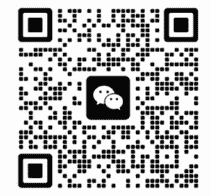

# 一人公司商业模式及 AI 工作流

## 260306 副业 SC 精华独享

懒人微信：lazyhelper1

微信：lazyhelper1

## 松月自我介绍

拥有 10 年打工经验，曾从事广告文案、电商策划、SaaS 产品经理等工作，最终在教育行业找到定位，专注增长/运营/产品经理方向。目前一人公司已运营 2 年半，利润达到上班时期的 4 倍。

## 业务版图

TOC 端业务包括：

- 野生运营社区公众号、知识星球付费会员过万人
- 出版《从流量到留量》和《超级流量》两本运营畅销书
- 小报童《小红书聚光投放红宝书》
- 播客《一把卷尺》主播
- 与 Luke 合作开展小红书虚拟产品训练营和 AI 自媒体训练营

TOB 端业务：

- 陪跑两家教育公司，聚焦小红书和用户体系，实现 ROI 11 倍

## 我的一人公司收入结构解析

我在每年 1 月和 7 月会进行财务测算，审视哪些业务赚钱、哪些亏损，哪些需要加强、哪些要停止。她的收入结构非常分散，涵盖 B 端、C 端、主动收入、被动收入、项目收入和产品收入等多个维度。

具体收入来源包括：

1.  房租收入：大学时期购房，现在出租获得稳定收益
2.  企业服务：B 端业务，采用固定薪酬 + 项目提成模式，目前服务两家公司
3.  知识星球：目前运营两个付费社群
4.  C 端业务：训练营收入，以及面向企业、出版社、线下分享的收入
5.  基金和股票：长期投资大盘指数基金，配置看好的行业 ETF，感受复利效应
6.  商单收入：主要来自播客商单 + 后端分成
7.  版税收入：两本书的固定时间结算
8.  企业投资：对陪跑企业进行投资，持股 5-6% 获得分红

如果你的收入来源只有两个以下且占比非常不均衡，就要警惕反脆弱性不足的问题。突然的风险可能让你难以承受。

## 一人公司的四个发展阶段（我走过的路进行复盘）

### 阶段一：起步与验证（年收入<30 万）

这是“高客单手艺人”阶段。不要一开始就做几十块钱的课程，因为那需要规模化的交付能力。

#### 建议做法

- 先做高客单价的产品和服务，比如咨询、陪跑或完整项目
- 我上班的十年，周末从未休息，一直在接各种行业的项目，目的是探索自己的能力边界和适合方向
- IVI 咨询和服务容易出结果，你投入，对方花了钱也投入，案例就容易产生

#### 阶段重点

- 跑通第一个商业小闭环
- 收集成功案例

### 阶段二：标准化与增长（年收入 30 万 - 100 万）

上一阶段是近距离探索用户需求 + 极致化交付，这一阶段的工作是将经验打包成标准化产品。

#### 工作内容

- 制作标品：课程、训练营、SOP 文档、知识库
- 选择平台：根据自己的长处和对各平台的理性判断，选择小红书、公众号、抖音、视频号或播客
- 或采用组合打法，比如我是“公众号 × 播客 × 私域”这样的组合

#### 业务重点

- 一手做流量（公域和私域）
- 一手做产品
- 跑通从流量到交付的全闭环
- 用标准化交付提升时薪

### 阶段三：自动化与规模化（年收入 100 万 - 300 万+）

#### 商业重点

- 流量和产品的多矩阵精准匹配
- 善用 AI，学会结盟
- 在关键渠道建立自动化销售漏斗
- 始终保持 IP 价值

这一阶段要顾及的事情最多，对很多一人公司来说是平台期，可能会停留很久，我目前就处在这个阶段。

### 阶段四：品牌与生态（年收入 300 万 - 500 万+）

到了这个收入规模，业务和流量的要求必然会扩展成公司形式，就不再是一人公司了，所以目前看来 500 万+，对于一人公司来说是个伪命题。

## 什么样的人适合做一人公司

### 硬技能要求

需要业务一条龙能力：

- 懂流量
- 懂运营
- 懂产品

### 软实力要求

性格特质：

- 高精力
- 有自驱力：知道自己什么时间该做什么事，出于好奇心和自主意愿而非焦虑
- 学习能力强：有足够的好奇心去学习
- 主动解决问题的能力：能够自主发现和解决问题

### 长期因素

心力和身体健康：

这两点是最重要的，就像电池一样。没有人天生高能量或低能量，很多都可以后天培养。

我很早就发现了自己性格不适合上班：很喜欢折腾，不服管，有自己的想法，执行力很快。可以说，我上班的目的就是为了不上班。

## 何时开始一人公司最合适

一定要给自己设置明确的时间期限，比如 30 岁或 33 岁。因为对于事业工作来说，运气和随机性很少，步步为营对大多数人来说更有把握。

### 建议的启动条件

最少持续 1 年到 1 年半，你的副业收入是主业收入的 3-5 倍。这样能跨越可能的淡旺季，心里会更有底。

我自己在做一人公司前，副业收入每个月都是主业收入的 3-5 倍，我刚开始做运营时工资 2 万，后来涨到 4 万，但副业收入一直是主业的数倍。这样持续维持了大概 5-6 年，我才离开公司，这和我的性格特质有关，“比较怂，极度厌恶风险”。

### 关键条件

这个副业必须是属于自己的业务，不是代运营，也不是纯陪跑，没有其他人你也能转起来的事。这样出来成功的可能性才比较大。

## 现在就要开始打磨的两个核心技能

如果你有做一人公司的想法但不知如何准备，我特别建议现在就去打磨这两个非常重要的技能：

### 1. 销售能力（转化能力）

这个不用说，是变现的基础。

### 2. 内容能力

即使销售能力不是很强，内容能力也可以帮你补足。因为：

- 内容即流量
- 内容即 IP
- 内容即产品
- 内容即转化
- 内容即交付

把内容做好，对于一人公司来说想象力是很大的。

## 一人公司的天坑业务（要避免的商业模式）

我认为与其听成功经验，不如听踩坑经验。因为成功是天时地利人和的产物，无法完全 copy 和还原，而且很多成功总结都是事后诸葛亮。但失败经验可以提前避免。

不要去做的三类业务：

- 博主：本质上是从 1 个爸爸变成 10 个甲方爸爸，更累，而且这个爸爸还不是每个月都有，你得每个月都自己“认贼作父”
- 代运营：我干过小半年，感受就是在不断低水平重复的流水线工作
- 纯陪跑/纯咨询：纯粹给他人做嫁衣，能收获一些案例和金钱，但不多

### 四种服务模式的核心差别

| 服务模式 | 定义与区别 |
| :--- | :--- |
| 咨询 | 对方知道重要，但所有人都不懂的事，你进去能和一把手/CEO 对上话 |
| 内训 | 对方知道重要，但底下的人不会干，你进去是老师，手把手教他们干 |
| 陪跑 | 对方知道怎么干，但干得不太熟练，你进去类似操盘手，边教边带 |
| 代运营 | 对方能干但放在内部是成本的事，别人不屑得干，你去给人当“黑工”的活儿 |

### 但，有例外情况

TOB 的部分陪跑/咨询是可以做的，但不能纯陪跑，除非：

- 能做出大案例来
- 有额外收益（比如企业分红）

因为这还是人肉投入，是农民生意，不是睡后收入。

一人公司的关键是：一定要有自己的产品和服务，且你能自己跑通从流量到交付的全流程。一人公司的本质是：拥有和市场的独立交易权。

## 虚拟产品：独立交易权的开始（对于职场人来说，是你的第一个商业闭环）

### 为什么要做虚拟产品

我在职场时做的第一个高客单产品就是野生运营知识星球，这本质就是一个虚拟产品。这个产品到今年已经运营 7 年了。我特别感谢当时的自己做了这个决定，因为现在很多东西都是从这里长出来的，包括后面做其他平台、接触到企业主，这里都是我的冷启动。

#### 建议还在职场的人

马上去做一个自己的虚拟产品，沉淀自己的经验。如果没有想法，可以把现在做的事情做成知识库（比如一个面向特殊人群的职场知识库，例如“字节跳动创作者运营岗位一本通”）。在你的岗位里最常被问及的问题，可以单独拆出来做一个引流品。

#### 我当时在职场的想法

既然我现在能给这个老板和公司打工，我的能力别的老板和公司也需要，那为什么不一鱼多吃？这 8 个小时不能只给老板打工，我在这里产生的一些模板、复盘、经验，可以去服务更多人。

包括写书也是这样的逻辑。书本本质也是一个知识库产品。当时已经在密谋要从职场出来单干，出书还是一个塑造 IP 感的有力武器。我当时每天通勤需要 4 个小时，就是在通勤时间把两本书写完了。

## AI 降低了虚拟产品的制作门槛

现在有了 AI，做虚拟产品的门槛降得太低了。只要你有初步想法，就能让 AI 帮你实现，包括大纲、内容展现方式、配图等。

### 举个案例：《2026 年小红书虚拟产品灵感手册》

这是我的 2026 年第一个虚拟产品，上架 4 天卖了 200 多份，客单价 89 元。这个虚拟产品共 5.9 万字，不到一个星期就全部做出来。

内容包括：

- 从选赛道到 2026 年哪个赛道值得做
- 每个赛道如何用 AI 制作
- 案例拆解，包括大热的店铺
- 一些垂直蓝海、闷声赚大钱的案例
- 产品、商业模式等分析

关键是里面的内容完全没有 AI 味，都是非常实用的东西，我和我的合伙人半周用好 AI，就完成了初稿。

## 松月的 AI 工具箱

其实没必要掌握很多工具，AI 是用来解决问题的，不是用来炫技的。

我常用的 AI 工具就这些：

- 大模型：Gemini 3、POE、豆包、元宝
- AI 产品：NotebookLM、Get 笔记、沉浸式翻译
- 做智能体：Gemini 3、POE
- 数据分析：Chatexcel×小浣熊、豆包
- 做 PPT：NotebookLM + Gemini 3
- 做图：Nanobanana pro

## 我的内容生产流程

### 整体流程

1.  从想法开始：通过瀑布流日记法记录待验证的想法
2.  测试验证：从中挑选不错的，在朋友圈、即刻、知识星球等平台发短内容测试
3.  写长文：当某条内容数据得到验证后，围绕它借助 AI 创作长文
4.  一鱼多吃：基于长文切割成不同内容形式，对应不同渠道

## 为什么先写长文？

因为要在起步时产出高质量的母版信息。只有母版的信息密度和质量够高（100 分），最后通过一鱼多吃才是可控的，基线足够高，后面再差也差不到哪去。

而且如果平时用 AI 足够多就会知道，AI 做“减法”比做“加法”聪明：

- 用 AI 把长文缩写成短文，逻辑是严密的
- 但用 AI 把短文扩写成长文，会出现很多幻觉和废话

## 内容一鱼多吃的四种形式

基于长文，我至少会切割 4 种不同内容形式去对应不同渠道：

### 1. 人物故事 + 方法论→播客

内容结构是通过拆解自己爆款播客提炼的：痛点→刺激→好奇→愿景→方案

我发现，收听量前 5 的播客都有这样的特点。证明有效的内容要反复发，证明有效的内容结构也要反复用尽，复制自己的成功。

### 2. 高信息密度体例→即刻/知识星球/朋友圈 (纯文字)

内容结构：行业内独特的见解，通常是“我发现..."

这来自对即刻平台和用户的了解，能突出个人视角的专业观察。

### 3. 反认知→小红书/公众号/知识星球

萃取一些反认知的内容，作为小红书的内容和公众号标题。

内容结构：挑战主流信念（“大家都在做 X，其实你应该做 Y"）

反认知是通用型的“流量密码”，国内国外都一样，大家都喜欢信息差。

### 4. 列表/清单/干货帖→小红书/知识星球

内容结构：工具、方法论、步骤的罗列。

小红书的用户最爱“抄作业”，这类笔记收藏率高，也能顺便涨粉且构建人设，一举多得。

## 松月的 AI 内容工作流

重要原则：先跑通 0-1，再做 1-10

我一个有意思的经历：前两天，我在北京交流时遇到两位朋友在用 SKILLS 封装自己发小红书的全流程，花了 5 天快要跑通了。但当我问他们跑通的爆文模版是什么时，他们说还没有已经验证过的笔记。

0-1 没有跑通，就开始 1-10，这是本末倒置。不要为了搭建工作流而做工作流，任何时候都要分清楚什么是手段、什么是目标。

### 1. 记录一手语料：瀑布流日记法

这个方法非常重要。

具体做法：

- 每一周统一在一个文档里写（来不及就用语音）
- 记录内容：走路时的灵感、洗澡时的顿悟、看书时的金句、评论区的神回复
- 关键是想到就立刻去记，粗糙地记，全量捕捉
- 不要追求任何排版和语言优美
- 仅用日期做简单分割
- 周日晚上统一做分类和处理

我从很早就开始这个习惯，之前用石墨，现在全用 Get 笔记，因为它有 AI 功能（基于豆包 1.6 模型）。

这样做的好处：

1.  把输入门槛降到最低，随时随地记录一手信息
2.  整理的过程脑子过滤了一道，避免冲动决策

### 为什么输入端要特别强调这个？

AI 不缺知识、不缺推理，但它缺少情境。这些就是你的一手信息。平时多记多思考，你才能够给 AI 喂带有你独特印记的长下文。个人独特的上下文内容，就是 AI 时代的胜负手。

### 2. 写长文：多个内容助手

当发现一个选题爆点时，我就开始写长文，大概 3K-5K 字左右。这个长文无论做小红书、公众号，甚至是私域写朋友圈都能用上。

涉及的工具：

- 智能体（选题、公众号和小红书仿写）
- 提示词
- 工作流

#### ① 选题助手

写文章最难的是不知道写什么。当没有选题时，在这里我会用上智能体。

选题来源：

当你有了一定的用户，就会收到私信和评论。最好的选题不是重新找，而是从用户的问题和需求倒推应该做什么内容。

#### ② 灵感碰撞

选题有了，接下来不是直接写，而是先构思、洞察，和 AI 灵感碰撞。

上来就让 AI 根据选题生成 5000 字文章是不可行的。

正确做法：

- 我会先从知识库找出和这个选题相关的素材
- 将收集到的素材导出来
- 投喂给大模型，使用提示词“我要写”
- 根据内容参考框架出一版大纲
- 大纲 OK 后，再写文章

#### ③ 风格转译

很多人的 AI 文章没人看，因为有"AI 味”。

我的“风格大师”智能体如何训练：

把音频和文字同时发给 AI。语音是很宝贵的，我把播客录到现在的所有逐字稿都导出来了，每一期大概 3 万字。

因为这里面有：

- 你的思路、逻辑、框架
- 你的口水词、停顿
- 这些很粗糙很宝贵的东西

有时候我根据这些语料跟 AI 聊一些有的没的，比如：

- 你觉得这个人有什么潜在特质
- 你觉得她是一个有魅力的人吗
- 你判断一下未来这个人会有什么样的命运和未来

有时候 AI 给的答案让她毛骨悚然。

使用流程：

有了大纲后，基于大纲写初稿，然后交给风格大师做润色。

#### ④ 人工润色

最后还需要人工润色。

#### ⑤ 其他工具

公众号标题生成助手：公众号日更时，标题会卡住很久，于是我做了个智能体。

这里的功能包括：

- 爆款标题样本学习：输入 1-3 个爆款标题，AI 深度分析其表达套路、情绪调动、关键词布局等特征
- 创作参数：关键词、目标人群、字数、风格、生成数量

小红书仿写智能体：能够大大降低写笔记的时间，关键能帮你拿到很精准的流量。

## 单口播客工作流及变现思路

### 我播客基本情况

- 播客名称：《一把卷尺》
- 形式：单口
- 数据：小宇宙订阅 15 万，全网收听量 500 万+
- 变现：商单 + 后端分成 + 转化自己产品，每月 2-3 万+

### 我的播客经历

2025 年我断更了半年，12 月复更发第一期《普通人如何用好 AI，提升 10 倍学习效率》，第二天登上最热榜。复更第三期接到了新的商单 YSL，和杨天真等 6 个节目一起上了开屏。

### 播客准备流程

我的播客是单口的，每期差不多一个多小时。我录播客没有逐字稿，但会准备大纲，有一个时间线，大概会有什么内容，然后就是打开话筒开录。

#### 准备时间

选题定了之后，不会超过一小时。就是一小时准备，一小时录制，然后交给外包剪辑。

#### 单口播客最难的是什么？

不知道说什么，信息密度和逻辑串联是问题。

#### 我的做法是什么

- 用豆包的打电话功能跟 AI 聊，一来一回，豆包会问很多完全没想到的问题，给很多灵感
- 聊一个半小时的语料，同时另一个手机开启录制
- 这份录音就是这期播客最宝贵的原始语料，是灵感收集和发散

这时有了初版大纲，然后很重要的是：必须手动填入“自己的故事”和“独特的观点”。

个人观点 + 故事 = 好的播客

最后是缝合，把和 AI 聊的大纲结合后面的人工注入去梳理。所以一般一期播客准备 1-2 个小时就能完成。

### 使用 AI 的核心经验总结 (3 条)

1.  **Human Input, AI Process，人在回路**

    不让 AI 自己凭空创造，所有的观点颗粒、案例细节必须来自“瀑布流日记”。AI 只负责“整理、润色、结构化”。

    是平庸的内容还是优质作品，取决于你。
    这也是对好作品的坚持。

2.  **学会拆解工作流，每个月优化一次**

    - 重复的，AI 提效
    - 卡点的，AI 突破
    - 随着大模型的发展应该随时调整

3.  **不断积累个人语料**

    两个方面：

    - 要有一个平台或文档去输出一手语料，完全不借助 AI（瀑布流笔记、豆包对话、即刻）
    - 不断积累你看到的好东西（书、电影、刷小红书），关键是用自己的话 + 思想写下来，存到知识库里

## 一个方法论：大搞 AI 时代的个人基建

包括四个部分：工作流、智能体、提示词和几份需要随时更新的文档。

### 1. 工作流

将那些最消耗时间、价值产出最高的工作，拆解成严密的 SOP(标准作业程序)，让 AI 接管其中的关键节点，且固定时间（比如按周）进行迭代一次。

### 2. 智能体

工作流解决的是线性流程，智能体解决的是“特定场景下的重复能力调用”。把那些需要反复做、逻辑固定的任务，封装成一个能被反复调用的智能体。

### 3. 提示词

很多人每次用 AI 都要重新想怎么问，这是巨大的效率浪费。建立一个“个人提示词库”。当你想做某件事时，复制、粘贴、微调变量，10 秒启动，而不是花 10 分钟去调教。

前提是：只有那些测试过、能让 AI 产出惊艳结果的提示词，才有资格进入库。

### 4. 几份随时更新的文档

包括：

- “你的个人说明书”
- “你的产品介绍”
- “你的个人原则和价值观”（让 AI 真正理解你）
- 你自己的顶级对标（转化库和点赞库）

我自己一直在积累两个库：转化库和点赞库，每次和 AI 沟通前可以先投喂，让 AI 更加了解你。

## 一人公司的产量和产能管理

### 多账号管理经验——我管理多个微信的方法：

1.  完全没有用工具（保证安全和活人感）
2.  做好标签管理：活动/身份/初识，三个维度
3.  每天固定时间回复信息和发圈
4.  重复性的拉群工作安排在交响乐时间

### 用好 AI 的杠杆能力

我想分享一个在我的 AI 训练营群里，看到的一个真实案例：一位同学之前交付的是支付能力弱的群体，交付重、利润薄，不敢接 B 端。B 端需求是“系统性方案”，且要求更稳定。

在上完 AI 训练营学习后，他把工作流重塑了，结果立竿见影：周末谈成两单，赚了 4 万，整个商业模式都改变了。

如果你以为学 AI 就是提效，这个思路就窄了。如果你只用它来省时间，你只是个更快的打工人；如果你用它来辅助设计产品和赋能业务，你整个人生自由度都会打开。

所以一定要打开思路，全面榨干 AI 的可能性。

---

最后，安利小懒的付费群：

## 懒人专属群 (介绍)

微信：lazyhelper1

这里是你对抗信息过载的护城河。

已稳定运行 7 年，累计拆解、研读 3000+ 个互联网商业实战案例与行业前沿内参和时政/宏观文章。

我们不搬运垃圾，只做高价值信息的筛选器与放大镜。

## 懒人专属群更新记录：

https://hk57gvlx7u.feishu.cn/docx/H0kRdZbSbolBR0xkaXtcuVE0nTg

lazyso 官网：https://lazyso.com/

**【免责声明】** 本资料归档于社群内部知识库，仅供成员课题研究与学术交流，请在查阅后 24 小时内删除。