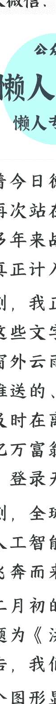

公众号懒人搜索，懒人专属群分享

### 伊朗战争开启《硬资产》时代

260306 洪灏

整理：公众号懒人搜索，懒人专属群精选

懒人微信：lazyhelper1

随着今日德黑兰的硝烟开始蔓延，我们再次站在一个历史性的节点上。这是多年来战略研究圈广泛议论、却鲜有真正计入地缘政治的转折时刻。

此刻，我正在驶向泉州的高铁上，写下这些文字。车窗边春风春雨飞纵，车窗外云雨缭绕。然而手机屏幕上不断推送的、关于战争的突发消息，令人及时在离战争遥远的地方，一个全国亿万富翁最密集的世界文化遗产城市，登录无法逃避地缘政治的警报。

此刻，全球市场骤然醒悟：原来在追逐人工智能的机会之时，却忘记了那只飞奔而来的灰犀牛。

在二月初的线下见面会和我们要篇题为《洪灏：有形的丙午》的专属报告，我们分享了一个交易图形。

这个图形显示美国市场的 SKEW 指数，也就是 OTM 看跌和看涨期权价格的比例，与标普指数的走势发生明显的背离。这显示了购买市场尾部风险的保险价格非常贵，而历史上这往往意味着美股应该处于的水平要远低于当前的实际水平，也凸显了市场尾部风险的积聚。

今天美国以色列联合打击伊朗其实由来已久。自 2025 年 10 月 JCPOA 伊核协议“终止日”以来，中东经济暗战与代理战争不断升级终于演变为热战的高潮。

这个协议是 2015 年签订的，允许伊朗在一定范围内进行民用铀提炼和民用核电项目。这个协议为期十年，正好在 2025 年 10 月结束。

随即十二月，伊朗爆发了全国性的示威游行，暴露了德黑兰的不确定性和弱点。今年一月，伊朗禁止了 IAEA 国际检查人员进入伊朗的核设施进行检查，而欧洲认为伊朗提炼铀的浓度已经达到了 80%，远超了民用水平并接近军事用途的 90%。

2025 年 6 月，美国对于伊朗的核设施进行了名为“铁锤行动”的军事打击，用“钻地弹”对于伊朗的三处核设施进行大规模的轰炸。

军事行动之后，特朗普政府宣称已经摧毁了伊朗绝大部分的核反应堆，但后来情报显示在三处核设施附近军事车辆活动依然络绎不绝，表明其实伊朗的核能力并未受到致命的打击。

过去整整一年，市场始终沉浸在一种幻觉中，笃信特朗普“以实力求和平”"Peace through Strength"的宣言仅仅是一种政治修辞，一如既往地只是特朗普的一场高风险 bluff。

但外交斡旋显然是无法化解 90% 铀浓缩门槛这种物理现实的，“看不见的手“终将被”铁拳“取代。其实，本周日内瓦谈判注定崩溃：伊朗试图以“石油与矿产准入”这种二十世纪的旧筹码，换取核地位这一二十一世纪的战略筹码。

在特朗普与内塔尼亚胡政府的眼中，这无疑是一笔无法保证未来地缘政治安全的交易。

对于特朗普来说，他的各种政策的有效性取决于他的筹码的可信度。

这次作战之前，美国在中东地区聚结的军力为海湾战争以来之最。

如果美国接受德黑兰的商业计划而允许德黑兰继续进行核工业军用化，那么特朗普以后的“咋呼 bluff”就不会再有效了。

同时虽然伊朗在去年的"12 月战争”中表现隐忍克制，但是那时 JCPOA 协议还未过期，伊朗还可以争取时间斡旋。

但是这次似乎是一次非常艰难的抉择：交出核能力，则意味着永久失去在地缘政治中的终极筹码；拒绝不交，则意味着一场恶战。

因此，特朗普为了保证自己政策的可信度，伊朗为了保护自己的政权，双方都在同一条车道上迎面行驶，最终的相撞无法避免。

这很可能也是为什么，在战争爆发之前，有一笔巨大的资金在赌市中押注伊朗战争将在二月二十八日爆发。

我们同时还观察到了跨资产类别的一些显著的异动。这些反常的价格波动，让我们在伊朗战争爆发前建议我们的读者保持审慎的态度，并反复推荐黄金白银贵金属等避险资产。

当然，我们早在去年六月的读者见面会上就预见了当前的这波强劲的大宗商品上行周期，并与读者们分享了各种大宗商品类别上涨的依次次序，并在之后的一系列报告和线下见面会上反复地推荐这些机会。现在，这些趋势正在如期展开。

市场真正漏算的，是 2024 年 12 月大马士革的陷落所带来的连锁反应。

数十年来，叙利亚始终是德黑兰精心构建的“缓冲地带“。当以色列猝然崩塌，伊朗通往地中海的”陆桥“彻底断裂，其地区影响力网络随之土崩瓦解。

至 2026 年初，伊朗在地缘政治上其实已然被“战略孤立“了——曾经连亘如墙的”抵抗之弧“不再完整，包括真主党和胡塞武装、伊拉克武装和伊斯兰革命军等，都是难以联动的几座孤岛。这为西方打开了一个“机会窗口“。

这种战略真空的直接后果，就是市场“风险溢价”的飙升。

过去数年间，全球资本市场都沉醉于"AI 超级周期”的迷梦，对传统商品周期视而不见，甚至对于一些重要的战略性大宗商品的价格人为地压低，直接导致对于大宗商品的资本开支长期压抑的情况。

在昨晚的美股交易中，我们观察到商品和美债同时上涨，黄金再次逼近 5300，离历史高点 5500 仅一箭之遥，而白银也很快地逼近 100 整数关口。黄金白银很可能将很快地再次创造出历史新高。

同时，尽管英伟达业绩继续亮眼并大幅超越了市场预期，英伟达的表现依然不尽人意，业绩后下跌了近十个百分点，同时拖累整体的美国科技板块向下运行。然而，在昨晚美股的 risk-off 抛售中，我们观察到商品和美债同涨的奇观。毕竟，商品涨则通胀预期将上调，形成推动美债的收益率上行的压力。

显然，在昨晚的去风险交易中，美债和商品都成为了避险工具。

美债作为一个传统的避险工具就不必多言了，但商品成为避险工具显然是和战争的终极尾部风险相关。

今日，周期的钟摆以复仇之势猛烈回摆。先看大宗商品领域，去年以来，我们正在见证“硬资产”的回归。黄金——我多次强调的典型的对冲尾部风险的资产——已从一月末历史性的暴跌之后再次快速地逼近 5300 美元大关。

这不仅是避险交易，更是去美元化的信用对冲。

随着美国再度卷入中东冲突，黄金的“货币中性”属性，也就是黄金相对于所有纸币皆升值的特性，正在为投资者派发最大红利。

而更值得警惕的是原油——当前全球最被错误定价的资产。当布伦特原油徘徊在 72.5 美元时，市场价格仅计入打击本身，却未反映争端可能扩散，地缘政治擦枪走火的风险。

比如，伊朗刚刚向除阿曼以外的中东国家发射了弹道导弹。同时，若霍尔木兹海峡遭遇任何程度的封锁——伊斯兰革命卫队已为此演练数月——全球能源将面临供给侧的剧烈冲击，这种冲击的烈度绝非任何“美丽法案”或退税政策所能对冲。

如是，美国经济面临的通胀压力将更甚，而这恰恰是美国选民在中期选举最关心的问题。

与此同时，权益市场的"AI 泡沫”正在被战争这根锋利的针所刺破。我始终认为，美国一些科技公司的叙事正触及估值天花板。当市场为完美定价，即便轻微的地缘震颤也足以引发崩塌。纳斯达克跌破 23000 点大关显示：投资者终将醒悟，如果没有硬资产如大宗商品，那么算力勿论再想如何庞大那都是无源之水、无本之木。

更微妙的是航运业，这个隐藏的杠杆正成为当前最有意思的交易。我们正在见证“稀缺性交易”的回归：若红海与霍尔木兹同时受阻，全球商船队将被迫“绕行”而实质“缩水”——每趟航程延长 14 天，有效运力骤降。

这具有顽固的通胀属性，与 AI 承诺的“生产率提升”导致成本下降背道而驰。

当然，如果伊朗封锁霍尔木兹这条全球 20% 的原油的通道，那么它也要承受财政上的压力。这是杀敌 1000、自损 800 的打法。

归根结底，我们正面临“终结战争”的悖论。特朗普政府笃信此刻“毕其功于一役”，以决定性打击避免未来的核浩劫。从经济视角看，这无异于“风险的提前”——以今日全球供应链的剧烈阵痛，博取明日或有的“和平红利”。然而作为历史的学生，我们深知战争起兮价难量。

我们正在步入一个“地缘滞胀”的新常态：安全成本持续攀升，全球贸易的增长回报却日益萎缩。在新周期中，原来的对于大宗商品系统性的低配在当下的地缘政治格局中已经是岌岌可危。

此刻，资产配置应该分散至“现实周期”的资产———黄金、白银、能源、运力等具备真正定价能力的防御性硬资产。曾经的“影子战争”既已曝于天光之下，那么全球市场终将在强光中睁开双眼。

最后，安利小懒的付费群：

## 懒人专属群 (介绍)

这里是你对抗信息过载的护城河。

已稳定运行 7 年，累计拆解、研读 3000+ 个互联网商业实战案例与行业前沿内参和时政/宏观文章。

我们不搬运垃圾，只做高价值信息的筛选器与放大镜。

### 懒人专属群更新记录:

https://hk57gvlx7u.feishu.cn/docx/H0kRdZbSbolBR0xkaXtcuVE0nTg

lazyso 官网：https://lazyso.com/

【免责声明】本资料归档于社群内部知识库，仅供成员课题研究与学术交流，请在查阅后 24 小时内删除。