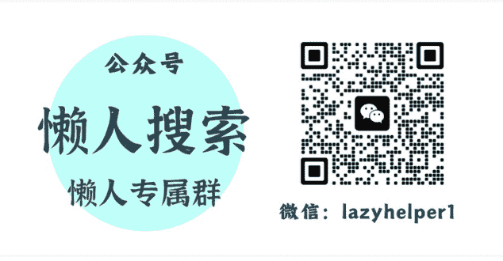

# 239 | 茅台改革：从金融品回归消费品 (上)

260309

整理：公众号懒人搜索，懒人专属群精选

懒人微信：lazyhelper1

欢迎打开《蔡钰·商业参考 4》，我是蔡钰。

不知道你在这次的春节期间，喝过几次茅台酒？茅台集团这两年过得有点纠结。为了争取和挽留你，2026 年以来，它启动了一场脱胎换骨级别的自我变革。

2026 年 1 月 13 日，茅台集团推出一份《2026 年贵州茅台酒市场化运营方案》。这份方案你看是不是挺有意思？中国的最强消费品，2026 年才讨论起了市场化运营。

## 改革方案落地

这份方案说了些什么呢？它给出了四个维度的变革规划，都挺狠的：

第一，在产品体系方面。

茅台要回归金字塔型的产品结构：

塔基，是最流行的 53 度飞天茅台，以及各种规格的其他贵州茅台酒。这一类酒要承担的使命是强化社交消费属性和收藏消费属性。

塔腰，是 2003 年上市的精品茅台，和 2014 年开始推出的生肖茅台。在定价上，这两种茅台酒比同容量的飞天茅台要贵大概 800 块和 400 块钱。这一层里的酒，任务是打造大单品，激发民间的收藏消费需求。

塔尖，是 1999 年开始推出的陈年茅台，也就是市场上说的“陈年酒”，和 2024 年开始推出的文化系列。在市场上，陈年茅台比飞天茅台要贵大概 2500 块，文化系列要贵大概 1000 块。这一层里的酒，是要用来维护和强化茅台的超高端产品价值的。

为了让塔腰像塔腰，塔尖像塔尖，塔腰和塔尖上的这些非标产品，要大幅缩减供应量。陈年酒和公斤装减少 30%，生肖酒减少 50%。以前生产的一种比精品茅台还贵的珍品茅台，则直接取消产品线，不让它跟最顶尖的陈年茅台抢戏。

第二个变革，是体现在运营模式方面。

茅台把原来的“自售 + 经销”模式，扩展成了自售 + 经销 + 代售 + 寄售。也就是，在传统的直营和经销商体系之外，新增了代售、寄售模式。

代售，就是茅台把货投放给商超、餐饮、私域等渠道，渠道商只负责卖，卖出后拿佣金。但不需要像传统经销商那样，自己掏钱进货囤货，货权还是茅台集团的。

寄售也类似，茅台把货放在高端烟酒行、私人会所等特定渠道售卖。这些渠道只需要提供自己的客流资源，也不用出钱囤货，货权也是茅台集团的。

你肯定知道，茅台过去在白酒行业里，之所以强势，经销商体系功不可没。而这两种新增的模式，就等于把以前的经销商从二房东变成了物业管家。一方面，确实减少了资金压力，但另一方面，也成了茅台这个大房东的打工人。

第三个变革，是在渠道布局方面。

其中的“私域”这个词你得留意一下。这两年，茅台亲自在运营一个名字叫"i 茅台”的小程序，是集团的直营电商平台，注册用户也有近千万了。这是这届茅台管理层非常看重的一个渠道。

第四个变革，价格机制方面。

我们习惯的飞天茅台 500 毫升装，一直都是理论零售价 1499 元，实际零售价则看自己的手气和经销商的善心。

但这次茅台集团说，要建立“随行就市、相对平稳”的动态调整机制。要以市场成交价为基础，以 1499 元为锚点，建立时间价值梯度。

时间价值梯度，什么意思？就是官方认可了市场的时间定价方式，越老的茅台越值钱。在"i 茅台”这个官方小程序里，

- 2026 年的 500 毫升飞天茅台，卖 1499；
- 2024 年的同款酒，就要卖 1909；
- 2019 年的更贵，2649 元。

这同时，对塔腰和塔尖里的酒，茅台集团也进行了不同程度的降价。

别忘了，我们前面说，茅台已经开始推代售和寄售制了。这也就意味着，2026 年起，茅台的经销商们也得按这套价格体系来卖货。

你看，茅台多年来在中国消费市场上，是兼具金融属性和消费属性的。它有相当成熟的二级市场，也有相当规模的藏家和炒家存在。

可以说，这个市场和这类人群的存在，很大程度上撑起了茅台的需求和价格。但这回，茅台集团把产品定义权、货权、自有渠道、定价权，都往自己的手里收。这场改革，动静挺大。

## 电商冲击的消费心智

茅台为什么要改呢？当然是为了应对越来越有压力的环境变化。

2025 年第三季度，茅台营收增速降到了 6.3%，创了近 10 年来新低。它前三季度营收 1284.54 亿元，同比虽然仍有 6.36% 的增长，却是近 11 年来的最低增速。

而在二级市场上，你可能有印象，2025 年以来，飞天茅台的批发价从 2300 元左右，一路跌到了年末的 1500 元左右。

## 怎么导致的？

有一些你已经很熟悉的原因，比如近几年，房地产行业的调整导致商务宴请需求收缩，反腐常态化也让政务消费需求不断萎缩。年轻人又都转向了低度酒、气泡酒、奶茶这类小甜水，白酒行业压力越来越大。这些背景，我就不跟你展开了。

但你可能没意识到的是，中国零售电商巨头们的流量大战，也在影响茅台的命运。

2019 年，美国超市 Costco 进入中国，它在上海开出第一家店的时候，曾经推出过 1499 元的飞天茅台作为引流品，一度因为吸引了太大客流而提前结束营业。这成了国内商超渠道售卖平价茅台的开山事件。

其他零售玩家见识到了茅台的号召力，也开始纷纷效仿。2020 年，山姆超市也在全国门店里卖起了原价茅台，也成功吸引了大批客流。

同样在 2020 年，拼多多也相中了茅台的引流能力。

你肯定记得，拼多多从 2016 年开始力推一个活动，叫百亿补贴，就是自掏腰包来补贴一些受欢迎的产品，从而建立自己的低价正品形象，来争取高净值新用户。这个活动最成功的一个战绩，就是在中国消费者心里树立了一个印象：拼多多上的 iPhone，卖得比苹果官网还便宜，而且是正品。

2020 年，拼多多也就把百亿补贴的活动，做到了飞天茅台这个大单品身上。你要知道，拼多多能覆盖的人群，可是全国的基本盘人群，比 Costco 和山姆会员店要广谱多了。

于是果然，它又成功地在中国消费者心中建立了一个新心智：市场上两三千元一瓶的飞天茅台，拼多多上竟然真能用 1499 元的原价抢到，而且也是正品！

这在当时，也让拼多多成功翻身，洗掉了不少“只卖白牌山寨”的固有印象。

不过，虽然都是卖正品茅台，拼多多的路子，和其他几家比要野得多。它当时和茅台没有官方的合作经销关系。那哪来的正品茅台呢？

它是直接找茅台经销商们拿的货。山姆们卖平价茅台最多不赚钱，但拼多多的百亿补贴是敢向经销商“高买低卖”的。不管是 2000 块还是 1800 块拿来的，都 1499 卖给消费者。

而且在当时，一个消费者在拼多多下单买了一瓶茅台，拼多多会委托经销商直接走顺丰发货，顾客确认收货后 48 小时内就给经销商结款。

拼多多的出货能力，不容小觑；及时结款这事儿，对当时的茅台经销商们来说，也是难以抗拒。当时的茅台经销商们还需要自己掏钱买酒、压货，来维持二级市场的价格，谁不愿意让自己的资金链松一松呢？

但也在那个阶段，消费者对茅台的认知，也被潜移默化地改变了。飞天茅台不再是那个一瓶难求的顶奢品牌，而是在拼多多的常态化供给里，总能抢到的流量单品。

到了 2025 年年底，拼多多甚至玩起了三人拼团活动，让标准装的飞天茅台价格跌到了 1399 元，比 1499 的官方指导价还要低 100 块钱。

这期间，越来越多的个人网红们也回过劲儿来了：你们大平台可以借茅台引流，那我也可以啊！

2025 年“双十一”刚启动，抖音就出现了一批低价售卖 53 度飞天茅台的主播，有说自己卖的是国内版的，有说自己是海外版的，还有自掏腰包补贴的，有的直播间价格甚至比茅台出厂价还低。

这之后，抖音出手，以整治虚假低价茅台、高风险假货的名义，封杀了不少商品和商家。

但这个过程中，飞天茅台的价格锚点确实在一步步下移，一路从值得疯抢的藏品，变成了随时可买的名牌。你肯定也有感知，过去这一年多，消费者们对一瓶标准的飞天茅台的价格心智，已经上不了 2000 元价格带了。

这样一个环境变化，当然会动摇茅台集团的商业根基。

怎么办？茅台集团的解题思路，为什么不是限制供给、重回正统，反而会是前面那份拥抱消费者的《市场化运营方案》呢？

我们下一讲继续聊。

- 1. 茅台的市场化运营方案给出了四个维度的变革规划，分别是：产品体系方面，运营模式方面，渠道布局方面和价格机制方面。

- 2. 通过这次改革，茅台集团把产品定义权、货权、自有渠道、定价权，都往自己的手里收。

---

绝大多数人只盯着眼前的工资，却不知道一次远在中东的冲突、一次降息的决议，就能在一夜之间洗牌普通人的财富。

看懂宏观，是为了在周期切换时，不被当作代价。

如果你认同这种“抬头看路”的长期主义，欢迎围观我的个人情报智库：【懒人专属群】。

圈子已稳定运行 7 年。我们每天过滤全网最顶级的政经内参、大 V 付费研报，剔除情绪噪音，只保留能指导资产配置和商业决策的真实信号。做你最冷酷的“外部大脑”。

## 查阅圈子最新宏观内参目录：

https://hk57gvIx7u.feishu.cn/docx/H0kRdZbSboIBR0xkaXtcuVE0nTg

拒绝伸手党，只渡有缘人。扫码加我微信，

备注：【破局上车】

微信：lazyhelper1