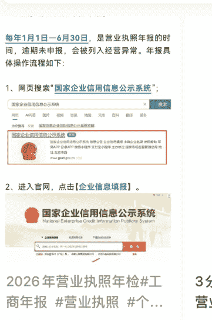
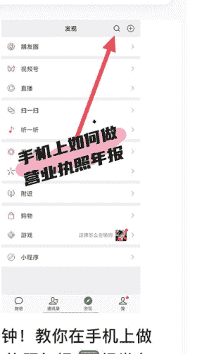
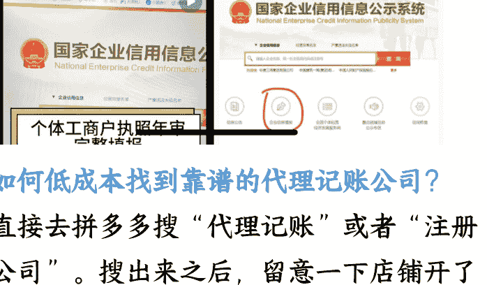
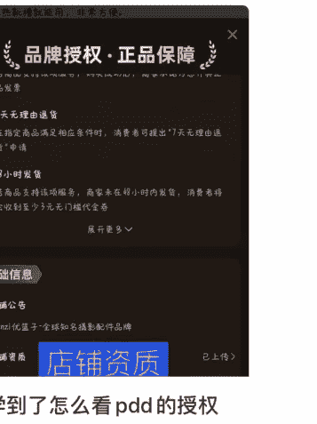
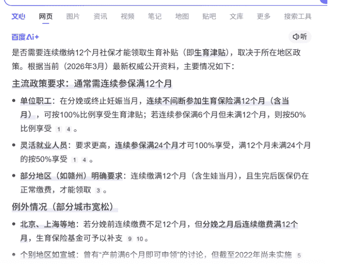

# 6 年「低成本创业」野路子实操拆解：如何做到“要么不创业，一创业就成功，且从不负债”？

260309 副业 SC 精华

公众号懒人搜索，懒人专属群独享

懒人微信：lazyhelper1

大家好，我是珍妮，有圈友看到我雇佣菲律宾人的帖子，觉得我把控成本的能力太强了，觉得自己当初因为不知道可以这样筛选供应链、导致少赚了很多钱，所以来找我联系。

今天我会分享：

我 6 年野路子、低成本创业、从不让自己负债的完整实操，我会把：

- 1) 我是通过哪些渠道做到低成本创业，
- 2) 以及我在管理团队的时候，用到了哪些合同和具体策略，挨个列举出来。

同时，我也会分享：

- 3) 我们卷王留学行业，都是如何应对同行的恶意竞争并且防止打官司的？
- 4) 我之所以能做到【要么不创业、一创业就成功、从不负债】的前提条件是什么？

> 注：留学行业的操盘手，出来做任何赛道的线上获客，全部都是降维打击。

我虽然是 2022 年创业成功，但我是 2020 年就有在无意中搭建团队创业，只是那时候我还不知道我其实已经是在创业。

6 年下来，我的创业成本一直是很低的，我们公司的现金流也非常健康。

今天和大家分享：怎样去做到低成本创业，从不让自己负债？

创业初期我连公司一般要有哪些核心部门我都不知道，因为我从没去过超级正规的互联网大厂工作过。

百度 AI+
一个公司的部门设置会根据其规模、行业和业务模式有所不同，但通常会围绕核心职能进行组织。以下是基于常见企业架构整理的主要部门及其职能:

## 核心职能部门

- 1. **人力资源部 (HR)**: 负责公司人才的“选、用、育、留”，包括招聘、培训、薪酬福利、绩效考核、员工关系和劳动法合规等。
- 2. **财务部**: 管理公司的“钱袋子”，负责会计核算、财务报表编制、预算编制与控制、资金管理、税务筹划和审计等，确保公司财务健康。
- 3. **市场部**: 负责市场研究、品牌建设、营销策划、广告推广和客户关系管理，旨在提升公司产品或服务的知名度和吸引力。
- 4. **销售部**: 直接创造收入，负责开发新客户、维护老客户、执行销售策略、完成销售目标并管理销售渠道。
- 5. **技术部/研发部 (R&D)**: 负责产品的设计、开发、技术创新和迭代升级。对于科技公司或制造企业，这是核心竞争力所在。“程序员”通常是技术部或研发部中的具体岗位角色，而非一个独立的部门名称。
- 6. **行政部**: 提供日常运营支持，负责办公环境管理、资产采购与维护、文件档案管理、会议组织、后勤保障和跨部门协调等。
- 7. **法务部**: 处理公司的法律事务，包括合同审查与管理、法律风险评估、知识产权保护、合规管理以及处理诉讼和仲裁等。

我创业之前就是个雅思写作老师而已，经常从早上 8 点给学生上课到 12 点，有时中午随便吃点就赶紧地铁换乘去另一个校区上课，从下午 2 点上课到下午 6 点，然后吃晚饭。

我打工攒留学学费那年，晚上 7 点半，我就到学生家里了，然后给她上课上到 9 点半，接着我再地铁回家处理白天机构学生给我发的写作作业。

有时因为机构给我安排去教托福课，所以我会凌晨 4 点半起来备托福课的教案，早上 6 点出门骑着共享单车 + 坐地铁去机构。

因为打两份工太困太累了，我在地铁上会算好【我距离换乘站还有多少分钟】，假如还有 15 分钟到换乘站，我就会把闹钟设置在 10 分钟，12 分钟，13 分钟后，通过 3 个连续闹钟把我闹醒，而前 10 分钟我都在地铁上赶紧补觉。

借助这个办法，我存住了 15 万，然后在深圳大学交换读半年、法国南特高商读半年，通过留学，我刷完了一年制商科硕士。

上次生财官方邀请我在深圳线下组局当分享嘉宾，大家说我【在台上分享的状态】和我【在台下/吃饭时候的状态】完全不一样。

实际上是因为我以前是教培机构老师，

我一旦上台，就会拿出做教培时候的状态，因为在教培机构上不好课的老师，是会被留学生投诉的。

但是下了讲台，我就会恢复成 1 人状态。

今天的分享目录很长，主要有：

- 1. 为什么我分享的这套方法，真的能做到【低成本创业，从不负债】。
- 2. 创业启动篇：低成本注册与办公
  - 2.1 什么时候注册公司？
  - 2.2 什么情况下注册个体工商户？
  - 2.3 个体工商户注册地怎么选（本地还是异地）？
  - 2.4 个体工商户注册完以后，每年还要年检吗？怎么弄最省钱？
  - 2.5 如何低成本找到靠谱的代理记账公司？
  - 2.6 办公场地决策
    - 2.6.1 要不要租办公室？初期怎么避免固定成本？
    - 2.6.2 生财有术的联合办公室适合你吗？
    - 2.6.3 客户要求实地考察公司怎么办？
- 3. 团队搭建与管理篇
  - 3.1 招聘与人才管理
    - 3.1.1 如何低成本招聘和管理人才？
    - 3.1.2 搭建线上获客团队时，手机/账号不够怎么办？
  - 3.2 工具与资源配置
    - 3.2.1 如何免费获得腾讯会议录制空间？
    - 3.2.2 AI 时代，需要给员工配置 GPT 和 Gemini 吗？
    - 3.2.3 低成本解决各类付费服务的方法
    - 3.2.4 飞书使用技巧与避坑
  - 3.3 薪资激励制度：如何设计合理的薪资激励方案，不养闲人？
  - 3.4 会议管理原则
    - 3.4.1 什么时候需要开会？什么时候不该开？
    - 3.4.2 领导如何减少无效会议？
  - 3.5 待分享专题 (后续单独成文)
- 3.6 产品与营销篇：产品宣传手册制作
- 4. 法律与风险防控篇
  - 4.1 常见合同与协议
    - 4.1.1 如何与员工签署账号归属协议？
    - 4.1.2 如何低成本使用法大大小程序远程签约？
    - 4.1.3 平时需要出合同时，如何低成本制作？
  - 4.2 应对恶意竞争与纠纷
    - 4.2.1 怎样防止被员工和客户打官司？
    - 4.2.2 如果被同行诽谤/举报账号，如何低成本处理？
    - 4.2.3 如何处理跑路的商家？
    - 4.2.4 如何应对给你带来很大负面影响的合作方？
- 5. 人脉与资源对接篇：寻找靠谱外援
  - 5.1 AI 时代，如何遇到靠谱的程序员？
  - 5.2 如何链接靠谱的、小红书官方部门的人？
  - 5.3 如何找到号商、手机租赁、软路由、蓝 V 认证等服务商？
- 6. 总结：我之所以能做到“要么不创业、一创业就成功、从不负债”，前提条件是什么？
- 7. 致谢
- 8. 附录：珍妮在生财有术发过的过往帖子

## 为什么我分享的这套方法，真的能做到【低成本创业，从不负债】

我是珍妮，靠 1500 元雇佣菲律宾人，在留学赛道自营盘和代运营盘起家，2 年做到 2700 万营收，其中自营盘做了 260 万+，后又通过接代运营转行房产，帮上海房地产老板卖了 1 个小目标的房子，在生财遇到超级多贵人。

因为留学赛道变卷，房产现金流回款速度不够好，我又在 25 年通过代运营和私教，接触了 20 多个老板的项目，深入观察了这些行业背后的真实利润、引流获客成本、个体操盘手进去的门槛大概是多少。

看完后，我回到了留学和房产行业，因为我发现【反正各行各业都是卷，再蓝海的赛道也会在 1 年内变卷，还是找个利润天花板更高的行业来卷吧】。

我创业以来，从未花过家里一分钱，也从未负债。

我给我家里带来的全是正向的现金流，从不拿家里的钱去补贴我的事业。

我一直靠信息差在雇佣人才帮我干活，且我本身是教培老师背景，很擅长把新手小白培训完后为我所用，所以我很能把控成本。

给我一个 20 分的人，我也能把他培训到 60 分甚至 70 分。

给我一个 40 分的人，我能把他培训成 80 分，再让这个 80 分的人去帮我培训 20 分的人。

在别人公司可能要花 1-2 万/月才能雇佣到的人才，我可以用 1000-2500 块/月，培养出来。

当人才帮我把业务跑起来后，我又靠：带着人才团队去给别人做业务，从而让甲方爸爸给我付费，于是我借此了解甲方所在的行业，判断我【进入这个行业的成本和我的利润空间】，还顺带把我的团队，通过做业务、从而培养、筛选出来了。

一旦这个行业真的不错，我就和甲方利益绑定，技术入股，从而实现“不花自己的钱，却创了自己的业。”

我很擅长从一些小细节里找出【可以省钱】的方式，

可能跟我创业之前一直都没什么钱有关，所以我干活特别有效率，也特别能知道：能去哪里省钱。

今天，我会把我这一套：

【高效干活、高效省钱、让别人为我付钱、助我创业一臂之力】的方法，拆解出来。

## 本套逻辑的底层心法：

想他人所想，无论处在什么岗位，都把自己当做老板看待，去想办法为公司节约成本，扩宽人脉，好好干活，创造利润。

就会遇到超级多的人，来给我们打钱，让我们低成本创业，从不需要负债。

## 创业启动篇：低成本注册与办公

### 什么时候注册公司？

- • 注：业绩跑顺 10 个回合之前，不要注册公司
- • 什么情况下需要注册公司？

一般来说，如果手里资金有限，只能招实习生，尤其是招大学生来干活，那就最好注册一家公司。因为有了公司，你才能给他们开实习证明。

你在实习证明上多夸夸他们，他们拿到了想要的背书，你也得到了想要的靠谱大学生——双赢。

我当时之所以决定注册公司，主要就是这个原因。不然的话，我注册个体工商户就完事了。

怎么开的？直接上拼多多搜“注册公司”。

现在经济下行，帮忙注册公司的服务都可便宜了。我在深圳注册一家公司，才 1700 块一年，包注册地址挂靠，还包代理记账，包帮忙开发票，管理我的社保，总之，注册公司的服务都一并含在里面。当然也有两三千一年的，丰俭由人，大家自由选择。

### 什么情况下注册个体工商户？

这个要看具体用途。

比如说，如果你只是为了拿小红书的蓝 V 资质，那直接注册一个个体工商户就行，而且可以注册到海南去。

海南的个体户注册特别便宜，我当年是拼多多 60 块办的，听说现在有的已经降到 45 块了——大家直接去拼多多比价就好。

为什么这么做？很简单：为了拿营业执照上传小红书，认证蓝 V。

留学行业里，很多账号都需要做小红书资质认证。

这种认证如果直接去淘宝买，别人会卖我们 600 块一次。

但如果我们自己在拼多多花四五十块注册一个个体户，

这个营业执照每年都可以继续用，不需要每年再花 600 块去买别人的资质。

做小红书的都知道，有了营业执照之后，每年还是要交给平台 600 块的“蓝 V 年费”，才能保证账号正常运营。

所以算一笔账：

- • 如果没有个体户：每年花 600 块找别人买资质 + 600 块交给平台 = 1200 块
- • 用我这个方法：45 块注册个体户 + 600 块交给平台 = 每年 645 块

### 个体工商户注册地怎么选（本地还是异地）？

也就是我刚刚提到的：看你注册的个体户是用来做什么的。

- 如果只是为了注册平台资质、走个过场，那注册在海南就行。

### 个体工商户注册完以后，每年还要年检吗？怎么弄最省钱？

注册完个体工商户之后，每年上半年会有一个年检。这事特别简单——你直接在小红书搜一下“个体户年检教程”，照着流程走一遍就行。

但如果你懒得自己弄，也有更省事的办法：去那种“助理群”里，雇一个大学生，让他帮你年检。

一张营业执照按 5 块钱结算，你手里要是有 8 张，40 块钱全搞定。

如果你不去这样操作，而是把这事外包给外面的代账公司或者中介，人家一张可能收你好几百。

当然，你也可以选择自己干——本来也没多复杂，几分钟就点完了。

### 年报时间：千万别错过！

年报时间是每年的 1 月 1 日到 6 月 30 日。逾期不报，你的执照会被列入“经营异常名录”，这会影响你以后贷款、参与招投标等业务，想恢复还要交罚款。

填报方式：手机或电脑，任你选

### 3 分钟！教你在手机上做营业执照年报✨经常有...

### 如何低成本找到靠谱的代理记账公司？

直接去拼多多搜“代理记账”或者“注册公司”。搜出来之后，留意一下店铺开了多少年——开得越久的老店，相对越靠谱。

### 怎样识别拼多多的店够不够靠谱

在拼多多上买东西，想买到靠谱的店铺，确实得练就一双“火眼金睛”。别担心，记住下面几个关键点，就能大大降低踩坑的几率。

直接认准官方“金字招牌”

最省心的办法就是直接找平台和品牌认证的店铺，这些基本可以闭眼入。

- • 百亿补贴（红标）：这是拼多多的王牌，商品经过严格审核，价格透明，通常都有“假一赔十”保障，买

一条视频让你学会避免拼夕夕上面的坑！ #知识...

学到了怎么看 pdd 的授权店 pdd 也太多无良商家...

对于刚起步的小公司来说，没必要在代理记账上挑太贵的。因为创业初期业务没跑顺的时候，大部分时候都是零申报，没什么太复杂的需求。

等你业务真正做起来了，再对代理记账公司严格要求也不迟。

那个时候，我一般会找熟悉的朋友帮忙推荐、用心挑一家好的。

代理记账公司除了做账报税，通常还能帮忙保管税务盘（就是用来开票的那个东西），也能帮你代缴社保。

我在长沙创业那会儿，开了公司之后第一件事就是给自己交社保。为什么？因为生孩子想要拿到生育补贴的话，必须在分娩前连续缴纳 12 个月的社保。所以我生娃都是提前算好的——比如计划一年后要小孩，我就提前半年到一年，在当地注册好公司、给自己交上社保。

后来我家搬到深圳，我马上就又在深圳注册了一家公司，把社保也转过来了。

## 办公场地决策

### 要不要租办公室？初期怎么避免固定成本？

这得看你做什么生意。但一般来说，我都不建议租办公室，也不建议花钱去装修。

如果你有引流获客的能力，你可以把客资往别人的门店送——临时借用一下场地，给人家一点费用就行，我觉得这样更省钱。

我创业这么多年，一直在家办公，从来没租过办公室。因为我很不喜欢打卡上班的日子，也不喜欢中午趴在办公桌或者躺椅上凑合睡，我就想躺在床上睡。

在家创业，初期唯一的成本就是水电燃气和网费。我未来大概率也不会变——我没打算去租线下场地办公。

### 生财有术的联合办公室适合你吗？

生财有术给圈友提供了一个福利：在杭州、深圳等地都有联合办公室，大家可以过去办公。而且那边经常有大佬出没，能学到不少创业实战经验。

我 2025 年能接触到很多最新信息，就是因为认识了在联合办公室办公的圈友，他们平时会跟我同步一些动态。如果你也想融入这样的圈子、提升信息密度，联合办公室确实是个不错的选择。

生财杭州联合办公室的信息枢纽：生财圈友：易芝、杨 l、陈 l、郭震林，推荐大家都去加他们微信。

### 客户要求实地考察公司怎么办？

也会有客户问能不能来我公司看看。

我一般直接告诉他：我没有实体的办公场地。如果他实在想看，我可以临时租个共享办公室，或者出来见个面、吃个饭。

我从来不包装自己有什么牛逼公司，我有什么说什么，没什么也不吹。

我觉得客户想来看公司，本质上是想看看我这个人 和团队靠不靠谱。

只要能从其他维度解决信任问题——比如案例、口碑、沟通中的专业度——就完全没必要非得有个线下实体。

我创业到现在一直没租过办公室。

当然，如果未来业务真的大到必须要有线下场地，我大概率也不会自己掏钱去租。

到那时候，我可以用技术入股的方式，进别人的公司、用别人的办公室，把事做起来就行。

## 团队搭建与管理篇

### 招聘与人才管理

### 如何低成本招聘和管理人才？

这个话题我在前面两篇发在生财的文章里都有详细写过，感兴趣的圈友可以看链接，此处不重复展开。

《创业初期，如何从 0 到 1 搭建线上合作团队（国内外通用版）》

https://scys.com/articleDetail/xq_topic/l4588482548482152

《6 年雇菲律宾人实操：如何在出海业务中线上低成本招聘（含转账公式和避坑清单）》

https://scys.com/articleDetail/xq_topic/l4588482882251222

### 搭建线上获客团队时，手机/账号不够怎么办？

先说手机。

我们公司的手机都是自己掏钱买的，而且只买一手，买 1000 元以上的手机。

如果是二手机，那一定是家里人淘汰下来的，我们拿来接着用——不会专门去采购二手机。

因为我个人用不惯运行不流畅的手机，有时候客资突然爆了，手机一卡，真的很耽误事。

我觉得二手机太卡，所以再也不买二手机。（我们公司曾经用 400 块买了台二手苹果，700 块买台一手红米，真是卡哭运营人员。）

再说账号。

账号这块，我早期是找我以前的学生买的。因为我当过雅思老师，也做过初中英语老师和班主任，有些学生很信任我，我就私下找他们买账号，签好合同。

后来慢慢就不再专门去收账号了。

后来创业业务跑顺了，赚到钱了，我们的做法是：把内部团队搭建好，让大家能在这挣到钱，平时再送礼物、发发红包，关系处好了，员工自己就会想办法去搞定账号。我们只需要最后签个账号归属协议就行，省心很多。

那如果员工身边亲朋好友的账号都收完了、用完了，实在搞不到怎么办？

这时候就需要找专门的号商了——就是那些做账号买卖、实名相关生意的人，也有圈友给我推荐过，具体信息可以在本文检索“号商”，或者跳转至 5.3 章节。

### 工具与资源配置

### 如何免费获得腾讯会议录制空间？

做生意免不了要给内部团队录一些培训视频，或者讲一些重要事项。

如果直接用飞书会议，额度用完后充飞书企业会员、我觉得不太划算。

所以我一般都建议用腾讯会议，录制成本更低。

那腾讯会议内存不够了怎么办？

很简单，你去闲鱼搜“腾讯会议录制扩容 20G”，会发现有人卖一个非常简单的技巧——教你创建一个团队版账号，然后你就突然有了 20G 的免费录制空间。以后开完会，不需要辛辛苦苦把录制文件下载下来存网盘，因为这 20G 就直接存在你的腾讯会议账号里，随用随取。

当然这种账号有个小 bug：貌似如果参会人数超过 2 人，会议就只能录制 40 分钟，超时会自动断掉。所以如果需要录长的，记得在 35 分钟左右下线重开一个。

## AI 时代，需要给员工配置 GPT 和 Gemini 吗？

腾讯会议扩容 20GB，永久有效，用 自己账号超简单正规操作！

现在 GPT 和 Gemini 确实很火，很多大公司都给员工配上。但我们公司不配。

为什么？

第一，这些都是国外的东西，你得教员工怎么用梯子；

第二，账号被封了还得帮他们处理——这些 都是管理成本，我不想在这上面耗精力。

更重要的是，以我们团队的线上获客经验 来看：

当内部的获客知识库搭得足够好的时候，用 GPT 还是 Gemini，或者 DeepSeek、豆 包，没什么本质区别。

我们内部现在用的就是 DeepSeek，获客 效果已经很好了。

前提条件是什么？就是我们内部的知识库 确实搭得够扎实——光博士留学这一个赛 道，我们知识库就有 2.4 万份文档。

而且我们把知识库搭在腾讯 IMA 上，所有人都能用，根本不需要教员工怎么爬梯子、怎么玩 Gemini。

### 为什么？

因为只有超级个体和公司高管、公司老板才更愿意花时间去琢磨这些工具的细节——人家一个人就是一个团队，折腾这些能直接转化成产出。

但你一个中大型公司，不可能给每个员工都配上 GPT/Gemini；员工也不是人人都想琢磨这些东西。

我们要允许这个世界就是二八定律：

- 有些人特别上进，给个工具能玩出花来
- 有些人中等上进，把分内事做好就行
- 还有一些人，属于等着喂饭型的——你给他喂到嘴边他才吃，不喂就饿着

不要给一个等着喂饭的人，硬塞一套高级装备。

因为你会发现，就算你把 GPT/Gemini 给他配齐了，他还是不想用、不会用、懒得用。

装备再好，架不住人不想动。

与其花那个冤枉钱，不如把精力花在【搭建知识库、优化流程】这些真正能帮到所有人的事上。

## 低成本解决各类付费服务的方法

这类服务，我的习惯是先去闲鱼和拼多多搜一轮——真的便宜。

比如说你要查蝉妈妈的数据、新红的数据，或者需要买某些账号，闲鱼和拼多多上基本都有。

十几块钱能搞定的事，我绝不花几百块。

西班牙磕 CP 的海豹 鱼小铺

交易成功

新红数据会员豪华版企业版

时长：日卡

描述不符全额退

更多

联系卖家

查看评价

再次购买

x***8 鱼小铺

交易成功

金山毒霸会员一天 1 小时 c 盘清理 vip...

时间：1 小时

10 分钟发货 描述不符全额退

更多

联系卖家

再次购买

去评价

客服宝独家 鱼小铺

交易成功

【自动发货】轻抖手机电脑个人终...

选项：日租 (电脑网页端会员一天)

10 分钟发货

更多

联系卖家

查看评价

mm 熏拟>

蝉妈妈企业版会员 VIP 时天月直播视频达人商品妈妈蝉数据分析

已 5 星好评

蝉妈妈企业版会员 (试用 1/小时) 电脑端

实付：¥5.8 (免运费)

世镶通讯专营店>

Canva 可画会员高级版国内国际 PRO 永久设计 VIP 海报主图 PPT...

交易成功

永久高级版

实付：¥14.76 (免运费)

卓盛数娱专营店>

【限时特惠】百度文库会员周卡百度文库 vip 会员/7 天/30 天专享下载

充值到账

VIP 会员，3 天

实付：¥6.88 (免运费)

## 飞书使用技巧与避坑

### 团队账号务必注册在公司名下

我们公司的内部信息，除了搭在腾讯 IMA 知识库，也同步搭在飞书上。这里想提醒大家一句：

最好每个老板都能创建一个飞书企业账号，把公司的重要信息放进去，让员工扫码加入（注意要扫码加入，千万不要让员工用个人飞书号。）

这样设置之后，万一哪天员工离职，你只需要在后台把他设置为“离职”，他之前写过的所有文档就会自动归属到公司账号下，全部留在你手里。

如果你没这么操作，而是让员工用自己的个人飞书账号进来写文档，那等他离职的时候，那些内容就直接被他带走了——因为文档的所有权不在你手上。到时候你想让他把文档传回来，还得额外给他付一笔钱，又麻烦又憋屈。

### 善用飞书 AI 问答功能，提升效率

为了解决低成本培训人才的问题，我在飞书上搭建了一个 AI 问答知识库。

具体怎么操作？直接访问这个链接就行：https://ask.feishu.cn/shared-space/center

进去之后，找到左边红圈，创建一个你自己的知识库，然后把平时沉淀的经验、话术、SOP 往里丢就可以了。

这里有一个小坑要提醒大家：当你们公司人数达到 10 人左右的时候，你可能会突然发现——自己创建的知识库，自己竟然看不到了。

这不是你操作失误。

因为这个功能本身还在飞书的内测阶段，有时候权限会莫名其妙被收回去。

解决办法很简单：去飞书里找到客服，反馈这个问题，然后你就会自然找到负责人的飞书账号，添加下好友，说明诉求，对方帮你开一下权限，就能继续用了。

我自己的这个 AI 问答知识库，内容是从“我自己手搓的高阶获客打法”社群里节选出来的——之所以当时设置为节选，是因为我认识很多老板和操盘手，他们给我付过费，他们培训自己的新人很费力，但我又不可能把我付费社群的内容免费开放给所有人，我又想能够让我认识的老板能够轻松一点培训自己的操盘手团队，所以我就做了一个节选版，供我认识的老板免费培训团队使用。

这样又保障了付费用户的权益，又使得他们能够快速培训自己内部的操盘手。

比如我们内部不知道怎么写稿子，直接去飞书问答里检索就行，如下:

公众号懒人搜索，懒人专属群分享

留学行业获客，想要写素人文，应该注意什么呢> 开启知识库新对话 >

> 留学行业获客，想要写素人文，应该注意什么？具体步骤是？

已完成深度思考

留学行业写素人文获客需注意的要点及具体步骤如下：

## 一、素人文写作需注意的核心要点

+   1.人设真实：避免机构感，强化“同行者”属性

素人号需模拟真实留学生的生活状态，通过真人露脸图片 (避免网图或挡脸照)、多元化主页内容 (分享学习、生活日常、工具推荐等，而非仅推广留学) 降低用户戒备心。例如:

- 主页应展示“多维度的你”:如分享读博技巧、近期看的书、参与的活动，而非只发留学内容 (参考资料 4);
- 用真人露脸图片：同一账号的图片需为同一人，避免网图 (参考资料 4 中的 (图 1)、(图 2))。

图 1

图 2

+   2.语言习惯：模仿留学生“黑话”，增强共鸣

接着，团队里的人，根据免费版的内容，去找到“对应的文档日期”，再去付费版里查看更多细节即可。

比如下方红圈部分，每个文档前面都标有日期，所以我们内部团队只要找到具体的文档，就能根据日期去检索了。

留学行业获客，想要写素人文，应该注意什么呢> 开启知识库新对话 >

提示词需包含“模拟留学生的说话习惯”“用 BG 代替院校背景”“分享真实的申博经历”(参考资料 1 中的表格对比);

可参考“的高端素人文提示词”(参考资料 3 中的内容)。

+   4.第四步：小范围测试——优化内容效果

将生成的文案在小范围平台发布，测试:

- 内容的获客率 (如评论区求联系方式的数量);
- 用户的共鸣度 (如评论内容是否符合预期);
- 根据测试结果调整提示词或内容方向 (参考资料 3 中的内容)。

+   5.第五步：迭代优化——批量生产“精准获客”内容

当小范围测试通过后，可通过自动洗稿、自动配图、自动发布实现半自动化生产 (参考资料 3 中的内容);同时，持续收集用户反馈，优化素材库和提示词 (参考资料 11 中的内容)。

以上步骤结合了留学行业的具体场景，通过“真实人设 + 真实语言 + 真实内容”,提升素人文的获客效率。

+   为你找到 13 篇参考资料

1. 回 25 年 12 月 10 日 - 素人文人设，要怎么确定素材和选题才能真的获客？【所有赛道老板】必看 -(以博士留学赛道为例) 2026-1-29
2. 回 深度拆解 23 个细节：为什么别人抄爆款能来客资，你抄爆款就来不了客资？以实操小红书 10 个行业为例 2026-3-2
3. 回 26 年 1 月 8 日&1 月 9 日：【所有赛道必看】AI 自动获客的 SOP 是怎么搭建的？内部团队的知识库又怎么分类？(以红海赛道 - 博士留学为例) 2026-1-29
4. 回 25 年 12 月 8 日 - 都 25 年了，哪种素人文是正确写法，哪种是错误写法？-含生成素人文封面副图的方法 2026-1-29

基于当前知识库提问

### 薪资激励制度：如何设计合理的薪资激励方案，不养闲人？

不管是销售端还是交付端，工资都相对好定——工作成果容易量化。但运营端是最难定的，因为它需要根据市场变化、客单价、引流效率等多个变量来综合判断，到底这个客资该怎么定价、怎么考核。

今天和大家拆解一下，我们内部关于薪资激励制度的底层逻辑。

这块我们走过不少弯路。

#### 我发现的一个悖论：没钱的时候，招到的人反而最好

复盘我创业以来用不同方式招来的人，发现一个很有意思的现象：

创业初期我什么钱都没有的时候，招过来的人质量反而是最高的。那时候我在招聘里直接说：做这件事只有 10 块、40 块——价格确实很低，但我们会提供内部培训和实习证明。

结果吸引来的人，本身并不贪钱，他们自身很有能力，只是想刷点经验、学点东西。这类人不仅干活靠谱，而且能帮公司创造很大收益。

后来我有钱了，总觉得愧对老员工，想改善大家待遇。招聘时开始强调：我们收入是多少，每天干什么活能拿多少钱，待遇多好，平时还送礼等等。

结果呢？招过来的人反而有大大小小的问题——他们一开始就知道这有好待遇，奔着“养老”来的。这种人做事需要你监督、催着走，管理成本反而变大了，还不如没钱时候招的那些人。

更离谱的是，我们拿老员工和新招的人对比，发现那些不图钱、不图待遇过来的员工，干得比后来的新员工还要好。

我们甚至发现：一个兼职能吊打三个全职。

为什么？因为一个本身有能力、主业做得好的人，副业一定也做得好。你给他一个兼职，他能干得比那些把你这里当主业的人还用心。

而且人都是贪心的，你给了他一个轻松的主业，他闲下来可能就做副业去了，反而没在你这里用心。

还不如一开始就招一个自己有主业、跑你这来做副业的人——这样的人反而更专注。

而且，以我打工多年又创业多年，中国人和外国人我都管理过的观察，我觉得：打工人分为以下几类：

1. 主业在你这里做，也对主业特别用心，想要升职加薪的人。

这样的人，如果公司管理层有坑位，他就升职加薪了。

如果公司管理层没有坑位，他就跳槽了。

如果公司管理层没有坑位，而且他还没跳槽呢？说明他自己也算出来了：跳槽到其他的地方也不会有更好的待遇。

这样的人要么会开始当咸鱼，要么会在主业用心做的情况下，开始做副业，甚至可能干副业干得比主业要更积极。

2. 主业在你这里做，他对升职加薪没有很强烈的渴望。主业太轻松了，没有把他每天的时间全部买走。

此时打工人会呈现出这样的状态：

A) 主业划水，但也不干副业，就是一个【能有个班上就好】的状态。

B) 主业划水，干副业干得风生水起。有的人干副业干到已经独立开了小公司了。

以上观察说明什么呢？

说明：

如果一家公司的管理层没有坑位，或者不能给到【积极工作】的员工特别好的待遇，那么这类【积极工作】的员工，心就会散，可能是跳槽，可能是去做副业。

如果一家公司的工作很轻松，那么那些【本就划水的人】就会在公司里养老，甚至有人会把公司当做【兜底】的平台，自己花时间去搞自己的事业。

所以，对于一家公司来说，究竟雇佣全职还是兼职并不是多么关键的事情，最关键的事情是：

A) 我们公司是否处在上升发展期？是否能预留出一些管理层岗位，给到【工作积极、出结果不错】的人？

B) 如果我们公司没有处在上升发展期，那我们给到员工的工作量饱和吗？是否工作量过于轻松，以至于员工都在公司养老？如果有大量员工都在公司养老，我们作为管理层有没有及时调整策略？

如果不能解决以上两个问题，很可能公司老板会发现：

A）你的全职员工，把你们公司的岗位当做副业在做，把他自己的副业当做主业在做。

所以，老板的职责就是：

A）不断让公司发展得更好，让大家知道：我努力就【能够有机会上升到管理层】。

#### 薪资激励的底层逻辑：只奖励“我们想长择的人”

什么叫“长择”？长择就是结婚，不是谈恋爱那么一闪而过的泡沫——可以理解为：这个男人愿意跟这个女人结婚，而不是只把她当女朋友发展。

我们内部对运营人员的要求也是一样：

要么不招，一旦招进来，我们就对他“长择”。

但如果他跳出了长择系统（干活不行、负能量缠身），那么我们会让他自动淘汰，公司不养闲人。

最好的待遇、最好的资源，全部给到那些我们想要长择的人。

公众号懒人搜索，懒人专属群分享

下方这个思路，是我和留学行业一位业绩做得特别好的管理层：生财圈友晚照聊出来的，这是他给我的建议。

#### 具体案例：

养号笔记怎么结算？

拿养号笔记举例——基本上各行各业都需要发布这类内容，来把自己的自媒体账号养得权重好一点。

以前我刚开始创业的时候，养号笔记按篇正常结算，比如 10 元一篇。

结果发现：有些人总是写养号笔记，写了也不出产出，就为了兑换那 10 块钱。

相当于我对别人长择了，但别人对我短择——他只是想把我当个“短期女朋友”处。

后来我们改了规定：写养号笔记不单独按篇数结钱，直接按“养号成功”算。

养号成功之后，账号归公司，签账号归属协议。

原因在于，想要长择我们的人，也不会去计较这个十几块钱一篇的养号费用，而是会想要帮我们去节省养号的成本。

再比如写稿：

- 素人人设类的铺垫笔记：XX 元/篇
- 专门用来转化引流客资的笔记：XX 元/篇

这些都是晚照给到我的建议。

#### 同时设置阶梯奖励：

当月发布数量达到 XX 篇时，单篇笔记费用全部上涨 XX 元。大家为了提升单价，自然会努力冲刺月发布量。

之所以敢这么干，是因为：

我们内部已经搭建了获客知识库，操作流程是：

先用 AI 产一轮稿，再手动修改一轮，产稿速度比以前那种纯培训方式快得多。

而且因为有人工改写环节，来的客资比那些纯粹用 AI 写稿的更精准。

#### 分阶段考核策略

- 新手阶段：不考核客资数量、签约数量、爆款数量，只考核笔记数量——先把量跑起来。（前提条件是我们内部已经做过行业调研，确定这个获客打法有效，才会安排大家跑量。）

- 上手之后：考核“笔记数量与总客资比例”或“笔记数量与精准客资比例”，由此判断对方有没有在努力提升笔记质量。

这里也涉及到一个【跟运营拓客】的老板息息相关的薪资制定策略，

比如有些公司：

他们线上运营拓客部门分为两拨人，

第一拨人：每天写笔记，回复客资。

第二拨人：每天专注截流别人的客资。

有时候第一拨人和第二拨人甚至会打起来，因为第二拨人抢了第一拨人的利益。

那么这时候，公司管理层要怎么定薪资策略？

答案是：截流的人，他的【单个客资的收入】，绝对不能比【每天写笔记】的人，所获得的【单个客资收入】要高。

因为：

截流的人，不生产内容，他们只负责截流。

但是互联网的流量是有限的，是越来越卷的，而截流是没有给公司建立护城河的。

所以这些只做截流的人，你可以理解为：你在夜店认识的女朋友。她很好，很美，很艳丽，你给她钱花，但你不会娶她回家。

而真正在【生产内容】的人呢？可能有时候他们的客资数量还没有做【只做截流】的人要多，但是你要奖励【真正在生产内容】的人。

因为这样的人，如果他们做素人种草人设的账号，他们积累起来的每一个账号，都是你的护城河，都是你们公司的壁垒。只有这样的人，他才是能在【越来越卷的红海厮杀年代】，和你一起走到最后的。

所以，【真正在生产内容】的人，就好比是【和你一起创业，白手起家的老婆】，你的资产都是留给她的。作为老板，我们要多奖励这些【为了公司长期利益，而在帮我们奋斗的人】。

#### 用 AI 辅助设计制度

当我们有了这套底层逻辑之后，一切就变得很简单了。

只需要把薪资制度的初级方案，以及上面提到的所有顾虑，一起投喂给 DeepSeek，让它帮我们生成一套完善的薪资制度。

然后我们还可以对 DeepSeek 说：“请你帮我分析——一个员工一个月在达到什么样的条件下，分别能挣到多少钱？选择这样的薪资激励制度，对员工的正面影响和负面影响是什么？”

这就相当于以员工视角帮员工算清楚账：这个制度是怎么保护他利益的，当没达到某些要求时，又会带来什么负面影响。这样，员工就可以一目了然地知道奖惩边界在哪。

关于薪资制度的制定，背后还有很多故事。

比如管理层的薪资和基层的薪资，到底是怎么定的？

不同的薪资定法会吸引到什么样的人群？

这里后续有机会，我会单独开一帖子来分享。

### 会议管理原则

什么时候需要开会？什么时候不该开？

我们内部基本上不开会，很少很少开。

除非遇到一些技术性问题，实在没法用飞书文档讲清楚，我们才会开个腾讯会议。除此之外，一律不开。

为什么？因为我们觉得，对于高认知的人才来说，开会是一种低效的沟通策略——这类人非常讨厌画饼，也不愿意把时间浪费在无效的会议里。

我观察下来，老板喜欢开会，无非两种情况：

1. 第一种，希望员工各抒己见，说说对公司对业务的看法。

但说实话，员工只是来打工的，真有什么独特见解的人，早就私下和上司聊过了——能被看见的人，不需要等到开会才被发现。

如果一个员工平时很少主动和上司交流，那也别指望他会在会议上掏出什么真东西。那种要求全员在会议上“畅所欲言”的公司，最后听到的基本都是彩虹屁。

我以前在教培机构上班的时候，有一回，领导让全公司 100 多号人轮流发表看法，结果从头听到尾，全是彩虹屁。从那以后我就明白了：真正有想法的人，不需要你在会上逼他开口。

2. 第二种，管理层想给员工洗脑。

这种往往是创业初期的小老板，手里没什么资源，就喜欢给员工打鸡血、灌鸡汤，尤其是对那些认知层次较低、容易被忽悠的人下手。

我们公司不干这种事。我们不洗脑，也不想操控谁的情感。我们希望吸引到的员工，是有独立思考能力的人——不是那种别人说什么就信什么、没有主观判断的人。

#### 领导如何减少无效会议？

我们公司之所以不怎么需要开会，还有一个更重要的原因：领导都在一线主动观察工作。

我始终相信一件事：所有东西都不是问出来的，而是观察出来的。

就像一个女人问男人“你到底爱不爱我”，男人回答“我很爱你”——然后呢？

### 口头上的爱能说明什么？

口头上的爱能说明什么？一个人到底爱不爱你，需要你用心去体验、去观察，而不是听几句海誓山盟。

放在管理上也一样。我不太在乎员工有没有主动来跟我汇报什么，因为很多东西我自己会去观察。不等他开口，我已经把情况摸清楚了。

比如说，有的员工特别会说话，嘴上讲得天花乱坠，但实际干活并不怎么样；有的员工不善于口头表达，甚至平时话很少，但活儿干得就是漂亮。

在我们公司，口头上很会表达的人，并不能因此吃到什么红利。因为无论他说得多好听，我都会去观察他的实际结果——活儿干得怎么样，才是唯一的衡量标准。

拿运营获客稿子来说吧。

虽然我创业这么久了，但稿子我到现在还是会定期看。

为什么是“定期”，而不是“每天”？因为每天看的时候，数量还没上来，看不出什么东西。

等样本积累到一定程度，问题自然就浮现出来了——这时候的观察才有效。

我从来不会等到员工主动来找我汇报。因为员工是看不到全局地图的，等到他来汇报，除非他本身就有极强的主动观察意识，否则发现问题并解决问题的时间早就晚了。

一旦错过汇报的最佳时机，业务可能已经开始下滑。

老板如果不管业务、不管市场，那公司迟早得倒闭。

所以我自己的方式是：

在一线主动观察——员工状态对不对？稿件获客质量好不好？稿子出了什么毛病？他可能在哪些方面需要我帮忙？

这些问题，都是我自己观察出来、然后主动去找他聊的。不需要他来找我。

这样一来，我们公司真的没什么会需要开会。有什么事当下微信就沟通完了。真需要开会的，都是那种技术型会议——必须大家同步信息并实操的那种。

### 待分享专题 (后续单独成文)

- 如何低成本搭建内部获客素材库？
- 如何低成本培训员工：拆解实操过程

这两条内容，这次实在是写不完了，我争取下次单独成文分享。

### 产品与营销篇：产品宣传手册制作

#### 用飞书文档代替 PPT，避免花里胡哨

很多公司刚创业的时候，特别喜欢整一个花里胡哨的宣传手册，在上面花不少功夫。

但是，客户不会因为你手册做得漂亮就格外信任你。

我们公司创业初期也走过这个阶段——很久以前在淘宝找人做过一张宣传海报。后来连那张海报都不发给客户看了，因为我们发现：光是发发朋友圈、在小红书上随手晒几个客户好评，本身就是最好的宣传。

我们公司公众号上还专门做了一面“客户万字好评墙”，把所有客户给我们的好评全部贴上去。客户下单前要是有点犹豫，我们就把这面好评墙转发给他看——比什么宣传册都管用。

至于产品宣传手册，后来我们基本上懒得发给客户。

因为那么长一串 PDF，发过去人家也没时间看。

我们的做法是：提前把客户可能会问的问题全部汇总好，客户来咨询的时候，直接用【设置好的微信快捷用语】回复，把提前准备好的答案发过去就行。

说到这我想起一个观察：有些老板之所以创业失败，是因为产品压根没在市场上验证过，或者只是自己一拍脑袋想做某个产品，就先花精力去做宣传手册、做海报。最后东西根本卖不出去，手册白做了。

我觉得这是本末倒置。

正确做法应该是：

先用纯文字或者飞书文档去推——发朋友圈、发小红书，看看能不能卖出去。

如果真能卖动，生意越做越好了，再考虑要不要做宣传手册。

否则，做这个东西纯属浪费钱。

小老板真不需要那么多宣传手册。

那些真正愿意看精美手册的客户，往往是冲着大公司去的，人家可能也看不上我们的服务。

而我们小公司服务的客户，他们压根也不在乎我们有没有精美的宣传手册。

涉及到如何给公司低成本做营销拉来客户，我能唠的实在太多了，够我每个月在生财发一篇文章出来了，咱们下次再聊。

### 法律与风险防控篇

#### 常见合同与协议

#### 如何与员工签署账号归属协议？

引流拓客就需要新媒体账号，需要微信号。

账号归属协议这块，我们也是慢慢摸索过来的。

刚创业那会儿，直接在百度下载类似模板，自己随便改改，就找员工——或者我以前的雅思、托福学生——签字买账号了。

后来公司稍微规范一点，我就把协议上传给豆包，让它结合我的需求改一版，我自己再修改一遍，然后去拼多多花 50 块钱找个律师帮忙审核。搞定。

我觉得很多人创业有个毛病：容易把事情想复杂了。

比如一说要找律师，就觉得得花几百上千块。

事实上，现在律师行业也卷，拼多多上很多老店，50 块就能审一份合同。

什么事多上拼多多搜一搜，找那种开了很多年的老店，能帮你省不少钱。

顺便说一句，我创业那会儿还招到一个浙大本科的小姐姐，法律专业毕业，英语专八优秀水平那一档（不仅仅是专八及格哦），她专业水平非常高，亲戚还是红圈所的，她也帮我不少朋友解决过法律麻烦。如果大家遇到拼多多律师搞不定的事，可以找我拿她微信付费咨询。她人很好，收费也合理。

#### 如何低成本使用法大大小程序远程签约？

再说说远程签约的事。

以前我不知道远程签约能这么简单。

我的老流程是：打印合同→盖章→用印象笔记扫描→发给员工→员工签字→发回→我保存。一套下来，繁琐得要命。

我一直以为用法大大这类小程序很复杂，或者很贵，所以一直没碰。后来才发现——巨便宜。

操作也简单：

把做好的合同上传到法大大小程序，你这边人脸识别一下，签署成功，然后转发给对方，对方签完就完事了。

不过刚开始玩可能会不熟悉，比如我第一次用的时候就浪费了 10 份签署名额。

那这个签署名额怎么低成本解决？去闲鱼买，很便宜，不用自己充会员。

#### 平时需要出合同时，如何低成本制作？

上面也提到了：我先把自己的诉求写出来，让 AI 帮我写一份初稿，然后我自己改一改，最后去拼多多找个律师审核一遍。成本低，效率高，该有的保障也都有。

### 应对恶意竞争与纠纷

#### 怎样防止被员工和客户打官司？

平时就要对员工好，不要坑蒙拐骗，不要给他们画饼后总是爽约，这样根本没有员工会想来打我们官司。

平时就把客户服务好，把所有的交付落地，客户遇到困难，我们积极帮忙解决，这样根本没有客户会来打我们官司。

我遇到的被员工打了官司的人，都是自己本身行为就多多少少有问题的。

我没被员工打过官司，但我差点被客户打官司。

那一年我们帮留学生润色并且查重作文，Turnitin 的查重系统收录了这个学生的文章，也不知道是这个系统出 bug 了，还是我们公司的中文客服在上传论文到 Turnitin 系统后没有及时删除，导致文章被收录了。

总之，那个留学生因为查重率 100%，被学校以抄袭名义，挂科了。

我们赶紧道歉，积极解决问题，留学生情绪还是很激动，他对我们说“如果我因为这门课被退学，我会让你赔偿我 30 万学费。我是法律专业的。”

那是 2023 年，我孩子不到半岁。

那天晚上我一夜无眠。我知道如果这名留学生被退学，我会给他带来多大的损失。

我做好了“假如他真的退学，我会拿出 30 万赔偿他的准备。然后，我会转行，我再也不碰润色这个行业。”

虽然第二天精神状态很不好，我也担心当时负责这个留学生的中文客服会心理状态不好。这个客服小姐姐是体制内的行政老师，是非常温柔靠谱的人，在我们这兼职很久了，她很难过，她那么难过的情况下，她还在一边向我道歉一边说自己会赔偿 x 万。她在我们这一个月都赚不到 x 万，我不可能让她去赔钱，也不能因为这件事把她送去法院。所以我让她不用出面，除了需要她配合的时候，她不用出来。这事我来解决。

我马上写了一份“润色翻译公司出具的道歉信”，然后马上付加急费，安排我们公司菲律宾老外帮我润色语言。我审核完毕后，马上加盖公章，做了扫描版，走我们公司官方邮箱，给留学生学校的班主任，还有校方邮箱，都发了邮件。

我上传了该留学生在我们公司做润色的完整经过和所有文档，从 Turnitin 的查重报告中，我圈出报告里的文档时间上传节点，向校方证明“该留学生没有抄袭”。

此外，也给留学生做了全额退款，补发大几百的红包。

后来，一切比较幸运。这个留学生有了补考的机会。他顺利考过了。我避开了“可能被人打 30 万官司”这件事。

### 如果被同行诽谤/举报账号，如何低成本处理？

#### 如果是诽谤，

比如同行在小红书诽谤你，你就把诽谤你的这些帖子截图下来，投喂 DeepSeek，说清楚你的目的，比如，让 DeepSeek 告诉你“怎样做能够下架/成功举报同行的抹黑帖子”。

如果同行大规模诽谤你，你就去 P 一张律师函，加上同行微信，告诉他“再诽谤就发律师函。上一个这么诽谤我们的人已经拿到法院传票了。”

如果对方还诽谤，马上拼多多花几百块找个律师，开真正的律师函，把对方告到法院，然后把“已经告到法院的截图”传给对方，告诉他“你等着收传票吧，败诉后记得把我今天的律师费付一下，谢谢。”

但也有一些留学行业同行，他们的老板早就移民到美国国籍了，这时候给他们发律师函没有用，所以要以暴制暴，摁着他们狠狠打。

上面三个路子珍妮都实操过。

#### 如果是被竞争对手举报账号，

2022-2023 年，留学界的同行，天天潜伏到我们朋友圈举报我们微信号，举报我们群聊。基本就是“今天这个销售的微信号刚被解封”——“刚和学生在群里聊天呢，又被举报到封号”——“刚解封，安排小助理们发发朋友圈广告，又被举报到封号”，与此同时，小红书经常有同行恶意举报我们的笔记。

这事怎么解决呢？

你都不知道是哪个竞争对手在搞你。

我就实操测试了一下“怎样反手举报同行可以举报成功”（那时候 ChatGPT 都没在国内火起来，还没法借助 AI 去做同行帖子分析，要靠自己去测试。)

我成功举报掉几个同行的帖子后，我写了一个完整版的教程。我雇大学生，以及教家里长辈：如何帮我举报同行。

当时家里长辈，每天闲下来就在帮我们公司举报同行。

可能有人问我，“珍妮，你都不知道是哪个同行搞你，你怎么举报？”，珍妮答“我不管。我无差别攻击，只要不是我们自己家的账号，我全部举报。同行想让我死，我就狠狠揍他，同行敢给我出 60 分的阴招，我就出 100 分的，我要揍到他们害怕。”

这样一轮下来，世界安静了。没有同行举报我们了。他们自己保命都来不及。

冤冤相报何时了。

我不主动打别人，

但如果别人给我来阴招，

我就发射原子弹。

> “真理，在大炮射程范围之内。”

同行主动恶心我，我就会让他都来不及跟我讲文明讲道德。

### 如何处理跑路的商家？

这里分享一个跟创业无关的故事。

我 19 岁那年，我家在网上定了一套茶几，放在刚装修好的房子里。那时候赶上双十一，我们家以为是双十一发货慢就情有可原，没有去催店家。等到去查的时候，发现一直没发货。商家说会补发，我们信了。结果又过了一个月还没收到货，但淘宝显示已经自动确认收货了，我一看，发现商家填了假的物流信息。因为当时已经自动收货了，没法找淘宝维权，商家也装死不回我消息。

那时候我去打 12315，打地方政府电视台，官方的人都让我去要厂家的地址和电话才能解决，可是我拿不到厂址。

于是我有个朋友弄了一个新的淘宝账号，假装自己是要来场地考察的合作方，结果厂家马上把厂址和电话发过来，于是我就把厂家告了。我家的茶几顺利收到了。

## 再分享一个插曲：

长沙有个商家，我们家在那充值了钱。后来我家搬到了深圳，我想要退款我家的充值费用，结果发现“我没有加商家微信，我没办法联系上对方，现在在百度地图上也搜不到那个商家了，我没法要回我家的欠款了。这个欠款有近 2000 块。”

于是我就打开百度地图和高德地图都搜了一遍，在其中一个地图的实景地图中，我发现了这家店没倒闭之前，写在玻璃门上的电话号码。

我假装老客户要进店购买服务，拨通了这个电话。我问老板“我今天想要来购买你们的服务，这会方便吗，需要预约吗？”老板说“当然可以啦，不过我们搬家啦”。

我说“哦哦，你们现在搬家到哪里了呀，我方便加下你微信吗？”

老板马上告诉了我地址和微信。

加上微信后，我又问“老板好呀，我过几天和我家人一块过来，当时我们家办了两张卡，我记不清楚余额了，你能帮我查查吗，我想看看我余额还够不够”

于是我变相确认了家里的卡上有多少余额总数。

过了两周，我和老板说“抱歉啊，我家搬到深圳了，我没法消费了，想要退款，能麻烦您退下吗，临时退款给您添麻烦了，我以前都找您走的会员价，如果需要扣手续费的话，您这边直接扣就行。”

老板一开始答应的好好的，但是她一直给我打“拖延战”，过去一个月了，就是不退款。

到这一步，我知道这个人赏罚不明。她只吃硬的，不吃软的。

所以我也开始出刀子了（创业没成功之前我没有锋芒。创业被人虐了几百个回合后，我出刀子时候的速度都快到起飞。但凡我还有一丝妇人之仁，我都没法创业活到现在。建议所有女性创业者都要戒掉自己身上的妇人之仁。)

我掏出另一张律师函和微信对话记录，告诉她“上一个不退给我钱的 XXX 商家已经收到法院传票了。”

老板马上跟我卖惨，说自己经商多么不容易，家里人生了重病，挣这个钱自己有多么辛苦，微信里真的没有余额了。

我说“不用卖惨，我以前经常被员工卖惨借钱，你这一套对我没用。你家的事是你家的事。照顾好你自己家是你的责任。我是你的客户，不是你的家人，我没有责任养你的家人。”（我真的经常被菲律宾人借钱，所以我对卖惨免疫了。）

最后她发现卖惨对我没用，还可能要收到律师函，就把我家的钱退给我了。

我一边收钱，一边回了一个笑嘻嘻的表情包给她，和她说“谢谢老板”。

当我们遇到麻烦，要学会切换角色。不要让自己一直在一个角色里去思考事情，要换。

以及，不要相信卖惨的人。

生活本就需要稳稳当当的经营，而不是出大事了才来后悔，也不是吞了客户钱又来卖惨。

这类行为，我通通称之为“没有责任感”。

没有责任感的人，做生意很容易翻车。

### 如何应对给你带来很大负面影响的合作方？

这个负面影响可以是很多种。

- 有人狂踩你的边界，捞你的钱，把你往坑里带
- 有人常年不好好干活，好吃懒做，多吃多占
- 有人拖欠你的佣金，还来搅乱你的资源
- 有的男人一边拿着你的资源，打着你的旗号，一边搅乱客户对你的信任度，试图把你的客户变成他的客户（此处不是故意男女对立。但是商业竞争中，女人往往不会这么干，但男人这么干的比例更多。）

等等，各种情况都可能发生。

此时记住：

有面子就没有里子。

有里子就没有面子。

如果你想拿到里子，你就要私下联系对方，无论你是动用法律措施还是其他。

如果你拿到了面子，一遇到事情就去公域曝光对方，那你就会失去潜在的路人缘。因为其他人会怕你一遇到事情就去曝光得全网皆知。

人微言轻，没有影响力，不要在公域上说某些话，因为没有人信任我们。

有了影响力，更要小心说话，因为公域是放大镜，说错话就会惹祸上身。

有什么要说的，私下说。

有什么要教训的人，私下教训。

私下把对方骂了一遍，就不能去公域再骂对方了。

我私下也是会骂人的。得罪我了，我也会反击。

不管是正面反击还是阴阳怪气，我都干。

我不是什么伟光正，我对待恶人，拔刀速度很快，绝不拖泥带水。

我信任别人的成本很低，我远离别人的成本也很低。

我会在一开始假设每个靠近我的人是善意的，给对方打到 90 分，满分 100 分。

然后在发现对方搞事情后，对我造成负面影响后，每次默默扣分，扣到 60 分，我就清理这个人，我退场。有时候别人被我疏远了，他可能都不知道我为什么疏远他。

### 人脉与资源对接篇：寻找靠谱外援

#### AI 时代，如何遇到靠谱的程序员？

能不能遇到靠谱的程序员，很大程度上取决于：你想不想对他“长择”——也就是说，你心里是不是想跟这个人建立长期合作关系。

举个例子。假如一个程序员做一件事情的市场价是 1000 块。如果我们愿意给他付 1200 甚至 1500，平时还积极给他介绍客户，那他自然就更愿意和我们深交。等我们公司遇到什么麻烦、困难的时候，他就会更主动地帮忙、更愿意花心思帮我们解决问题。

反过来，如果他报价 1000，我们就只给 1000，那大家就是公事公办。以后公司遇到什么问题，人家也是公事公办，不会多给一句建议，更不会主动帮你思考。

所以我找程序员的时候，一定会结交一个长期合作的伙伴。比如我一直和生财圈友一泽长期合作，很多开发都找他。因为关系处得比较好，有些别的程序员不太愿意花心思琢磨的问题，一泽会主动帮我们想、积极帮我们解决。我们公司在获客效率上的几次大提升，都离不开这种“超出公事公办”的协作。

如果我去拼多多找个外包程序员，价格可能很划算，但我也别指望建立什么情谊。等我遇到问题想找拼多多程序员帮忙，偏偏我又不太懂技术、又描述不清需求的时候——对方可能不会积极解决，甚至有可能坑我一把。

#### 如何链接靠谱的、小红书官方部门的人？

不管你做什么平台，一定要认识几个平台官方的人。而且要找那种处理问题积极、态度好的——这样你才会觉得钱花得值，而不是花了钱还被人惹生气。

我们公司早期做小红书的时候，联系过一个做聚光投放的人，态度特别嚣张，后来我们就换掉了。

现在一直合作的是芒果，是生财圈友易寒老板（211 大学在编老师辞职，在新西兰开旅行社混得风生水起）推荐给我们的。

如果大家还不认识芒果，建议一定要加上微信。很多生财圈友都在找她做聚光投放，或者处理账号被封、帖子被下架这类问题。芒果的服务态度真的特别好，不会因为你充了钱就觉得“钱到手了可以不管了”，她是真的会一直帮你跟进、积极解决问题。

需要芒果微信的，可以来找我，或者找易寒，或者问你身边的生财圈友——很多人都认识芒果的，芒果是生财小红书人的吉祥物。

#### 如何找到号商、手机租赁、软路由、蓝 V 认证等服务商？

号商、手机租赁、软路由这些资源，是生财旅游赛道的一位小姐姐——晓言介绍给我的。

她旅游业务做得特别好，又专门拉了一个群，把自己常用的号商、手机租赁、软路由这些人全部拉进群里，让大家自由对接。现在这个群已经有 100 多个生财圈友了。因为群里全是老板和操盘手，于是也会对商家起到震慑作用，所以商家解决问题时更积极一些。

蓝 V 认证这块，我们公司主要找的是当年做房产赛道时，生财圈友碧琳推荐给我们的人。碧琳现在也在旅游赛道，不管是碧琳还是我们内部，很多特殊的资质认证，都找的这个人。

相比我接触过的其他服务商，这个人确实价格更划算，解决问题也更积极。

不过也要实话实说：有圈友反映，自己给这个认证商推荐客户之后，认证商把客户骂了一顿，所以我不做明确推荐。如果你身边没有特别靠谱的资源，可以来找我要他联系方式；如果你身边有更靠谱的资源，就用你自己信得过的。

## 总结：我之所以能做到“要么不创业、一创业就成功、从不负债”，前提条件是什么？

总结下来就两句话：

第一，出手之前，先在这个行业攒够足够多的、不同岗位的从业经验。

第二，真正出手的时候，不要把事想得太复杂。高筑墙，广积粮，缓称王。

没有第一条，第二条就是空话。

没有足够的行业积累，所谓的“不把事情想复杂”只是盲目乐观。

## 如果想知道怎么稳稳当当创业，推荐两本书：

- 9. 《保富法》——作者：聂云台
- 10. 《财神文化》——作者：曾仕强

——这是关于“正确守住财富”的底层逻辑。

除此之外，永远要有变通思维：- 这条路不通 → 换条路
- 这个人不行 → 换个人
- 这个方法没用 → 换个法

永远未雨绸缪，永远走一步算五步，也永远坚信车到山前必有路。

但如果只信“未雨绸缪”，就可能把自己算死，天天空想；

如果只信“车到山前必有路”，又可能把自己等死——万一真是死胡同呢？

所以我的原则是：

- 战前：算、攒、推演
- 战中：冲、换、开路

算的时候不算死，冲的时候不蛮干。走一步算五步，但走的时候只走一步。

我从来不是保守派，但也从来不是冒险派。

我还看到一些创业者，会在创业初期学精力管理。

我个人觉得不需要，

因为如果需要在创业初期学精力管理，往往是因为内耗，

而如果内耗，代表业务没有跑通，没有跑通，就代表此时自己很多距离创业成功的基本素质还没具备，继续创业也是继续亏钱。想要避免亏钱，要赶紧去线下打工，在自己想要做的行业里去轮岗，去观察客户，观察公司运转体系，观察同行，观察产品，摸清楚到底是怎么回事。

真正忙起来的人，是被事情追着跑的，根本没空想“怎么管理精力”，事情会自动把【被业务追着跑的初始创业者】，毒打到“自动学会做精力管理”。

一个创业者什么时候需要学精力管理呢？是他业务跑顺了，有团队帮他运转了，他想要继续扩大业务的时候，才来做精力管理。

如果业务没跑顺，自己也没有团队，这时候去学精力管理，我觉得没有意义。因为初始创业者的内耗是没办法靠精力管理治好的，只有业务跑顺了才能治好内耗。

下方是我：要么不出手创业，一旦创业一定会在 3 个月内成功，且从不负债的具体经历：

## 创业前，先打工攒零件

先去你想做的行业打工，用“主业 + 副业”把该摸的都摸清楚。

我 2022 年在留学行业能马上创业成功，是因为从 2015 年开始，我就一直在“攒零件”：

- 2015 年：给翻译《经济学人》的团队免费打工——攒行业认知
- 2015-2016 年：考专八——攒专业门槛
- 2016-2017 年：学翻译、学雅思——攒技能
- 2016-2018 年：白天乡镇体制内工作，晚上写公众号、写知乎、做斗鱼直播——攒内容能力和副业手感
- 2018-2019 年：在教培机构当雅思助教 + 雅思写作老师，下班后打第二份工攒留学学费——攒客户痛点、行业利润、人脉
- 2019-2020 年：留学，读国际管理市场营销专业，同时搭建菲律宾团队——攒国际视野、供应链、管理能力

19-20 年上课时老师讲的每一个理论，我都会和教培行业的经验整合分析，存进印象笔记。我们班十几个不同国家的同学，某些科目作业我能拿到第三——前两名是老外。

2018-2020 年，我吃饭都和客户、同事一起吃。同事和客户遇到问题，我主动帮忙解决。虽然我刚跳槽到一家教培机构当雅思老师，就赶上全公司只剩市场部门的年会表演缺人演太监，所以我女扮男装顶上，回家把《燃烧我的卡路里》画成火柴人，自学完舞蹈——不能给市场部丢脸。

如图，穿蓝衣服的太监是我。

所以我能很快受到领导重视，公司内部一些很重要的会议会让我去参加，那时候我 23 岁，是内部会议里最年轻的打工人。

我知道老板都很忙，没人有空培养我，公司雇我是让我来解决问题的，不可能把我当管培生，那我就假装自己已经是高管。

当助教时，全公司的学生我都主动辅导。我没把自己当助教，我把自己当的是“这家公司的老板”“已经被提拔的高管”。

上班时，公司大群发的每一个文档，哪怕不是我部门的，我都保存下来细看——我没把自己当打工仔。

结果若干年后，我成了老板。

## 创业成功，只需要 1-3 个月

如果一个人“注定创业成功”，那一定是 1-3 个月内就能跑出来。

3 个月没成，说明很多潜在素质我们还不具备——只是自己没意识到。继续创，就是继续亏。

有人可能亏了两三年才成，何必呢？这两三年去打打工、轮轮岗，至少不亏钱。本金都没有、流程都没跑通，千万不要贷款创业了，这个路子已经不适合经济下行期了。

我是 2021 年 10 月注册了一家翻译公司，12 月创业成功——当月公司净利润 2 万。2022 年 1 月，当月公司净利润 6 万。

为什么能这么快？

因为创业前那几年，我把该攒的都攒齐了：

- 客户痛点 (从【当雅思老师、帮学生改雅思作文，给留学生代写机构做金牌写手】那里攒)
- 行情利润 (从【观察公司运营、销售、市场部情况】里攒)
- 人脉关系 (从【主动帮同事、帮客户、和客户同事吃饭、成为公司的一块砖、哪里需要我就往哪搬】里攒)
- 供应链 (从【留学时搭菲律宾团队】里攒)

我借着公司给我发工资的那几年，把这些零件一件一件装进了自己身上。

## 如果公司不让我轮岗，我就自己轮

我的跳槽原则很简单：一个岗位摸清楚了，就申请轮岗。公司不让，就换一家应聘下一个岗位。

分享我最快的一次跳槽史：

在一家公司干了 4 个半月雅思助教。其实只做了 1 个月助教，后面就在当雅思老师了。但公司一直按 60 块/小时给我发工资，还想把我提拔到“管理所有助教的管理岗”。

我觉得公司给我规划的岗位不符合我对自己的职业规划。

我想当正式的老师。

四个半月后，我提了涨薪，要求转写作老师岗。

然而，公司的涨薪条件不符合我的期待，结果，我在那家公司的留学生客户和同事们，马上把我介绍给了竞争对手公司。

我的留学生客户，骑着小电驴送我过去面试，还特意给那家竞争对手公司的校长打了招呼。

校长后来告诉我，那个学生在校长面前夸了我。

我就这么跳槽成功了。

(那个留学生客户和竞对公司创始人的孩子是同班同学。)

## 给自己造梦，把未来请进家里

我是那种会给自己造梦、然后假装自己已经造成的人。

2020 年，我敢拿着 3000 块的雅思老师兼职工资去相亲 + 做生意，是因为我给自己造了一个梦：

> “现在我每月收入稳定，我是女老板，我有稳定的家庭，我有老公，我有两个孩子。”

实际上，我 2020 年年初刚分完手呢，我觉得上一段感情扰乱了我的人生规划，

但也幸好在我 25 岁分手，才不至于把我拖到 30 岁才分手。

于是我 20 年夏天回国后就赶紧开始相亲，拒绝找同行结婚。

因为我怕整个行业不行，找同行结婚的话，家里就会一荣俱荣，一损俱损。

那时候我一个人住在长沙，还没遇到我老公。

我给自己买了 4 套碗筷，颜色特别好看——假装已经成家育儿、事业顺利。

相亲前，我用玉米夹夹好头发，戴好配饰——假装已经遇到了好的对象。男生请我吃饭，我就请对方喝奶茶，一定有来有回，不让对方单方面花钱。

没人能看出来，那时候的我：单身、月入 3000、存款不到 2 万。

相了不到 6 个人，我就遇到了我老公。

2021 年结婚，2023 年生娃。

想要什么样的生活，就先给自己造梦。哪怕月入 3000，也不能让自己有物质匮乏感。

后来，我真的成了女老板。我的第一个孩子，今年 3 岁了。

## 如果没成，我也有退路

我算过一笔账：

如果 2022 年 6 月之前，创业没拿到正反馈——那年我满 27 岁——我就马上准备考编回体制内。

最晚 30 岁之前，我一定要考回去。哪怕回去当乡镇老师，也一定回。

因为如果我从 2015 到 2021 年，铺垫了那么多年都无法创业成功，那就说明：

- 创业不适合我
- 私企打工也会要我的命
- 赶紧回去考个编制，旱涝保收，下班做做副业得了

留得青山在，好歹不负债。

如果没有马上成功，说明自己离必备素质还有距离。这时候该补什么就补什么——去不同岗位打工、多和客户打交道，别硬扛着亏钱。

我很喜欢的贵人姐姐说过一句话：

> “35 岁之后要把自己当男人用，
> 但如果 30 岁就可以这样，会得到更好的人生。
> 25 岁就这样，会得到极好的人生。
> 要把自己当男人用，不代表是【只懂干活赚钱】，还包括了【要懂得分享】。”

我是幸运的，我很早就把自己当男人用。
我今年 30 岁，孩子 3 岁，
我已经过上了我想要的人生。

我的人生往后走的每一步，都是我的增量。

我会为了这些增量而奋斗，让我的下一辈有更高的平台。

每个女老板，都应该早早意识到

> “我们本质上就是男人。”

> “不要试图利用性别优势去多吃多占。”

> “愿意向男人一样工作且付出，会让我们的人生越过越好。”

我创业以来从不花家里的钱，是因为：
我觉得我的梦想和我家里人无关。
我喜欢赚钱存钱、我喜欢我的工作。
同样的，我家人也有他们自己的爱好。

他们不应该为了我的梦想，而把他们存下来的钱让我去拿去创业、让我去搏【未知的钱】。

家里人赚来的钱就是家里的，我赚来的钱也是家里的。

但我给家里赚到存到的钱，就相当于存起来了，

我不会中途又把钱拿出去试图搏下一个机会。

我家人的生活都过得挺安稳的，

我的存在是为了让他们的生活水平和质量得到更高的壁垒，

而不是让他们跟我一块经历创业带来的过山车式变化。

而且，我对创业没有执念，

如果我四五十岁，创业创不下去了，创业开始亏损了，

我可以马上去街上当扫地阿姨。

我也可以马上去超市当售货员。

如果真的发生，我肯定会是扫地阿姨里的荣誉标兵，是超市售货员的销冠。

我不在乎有没有人叫我老板，

我只在乎有多少钱，实打实地到了我的兜里。

只要有钱赚，能存住钱，不是非得要创业的。

公众号懒人搜索，懒人专属群分享

## 致谢：

我的所有合作伙伴，

不管是我的甲方，还是我的管理层同事，

还是和我一块在一线拓客的操盘手，

全部，

全部是在生财认识的。

我就靠在生财发帖，吸引到了这些合作伙伴。

大家一定要多在生财发帖，因为你根本无法想象：是哪位潜水的大佬，刷到了你的帖子，给你抛来橄榄枝。

感谢生财，

感恩遇见生财，

生财是所有老板创业的根，

是人才的发源地。

感谢伙伴们，感谢生财的圈友们！

## ——分割线——

看完这篇 SOP，你觉得你懂了。但 90% 的人一到实操就会卡在第一步。

工具和教程只是最低级的壁垒，真正的壁垒是“立刻动手”和“圈层信息差”。

如果你想看全网最新的变现玩法，并且和一群执行力极强的极客一起下场拿结果，欢迎围观我的核心私域：【懒人专属群】。

我们不聊虚的，只做商业闭环的拆解与 AI 效率的压榨。系统内已沉淀 1000+ 跑通的套利实战局。

⚠️ 查阅圈子最新搞钱实操记录：
https://hk57gvlx7u.feishu.cn/docx/H0kRdZbSbolBR0xkaXtcuVE0nTg

认同价值、准备好下场干活的，扫码加我微信

备注：【实操上车】

公众号懒人搜索、懒人专属群分享