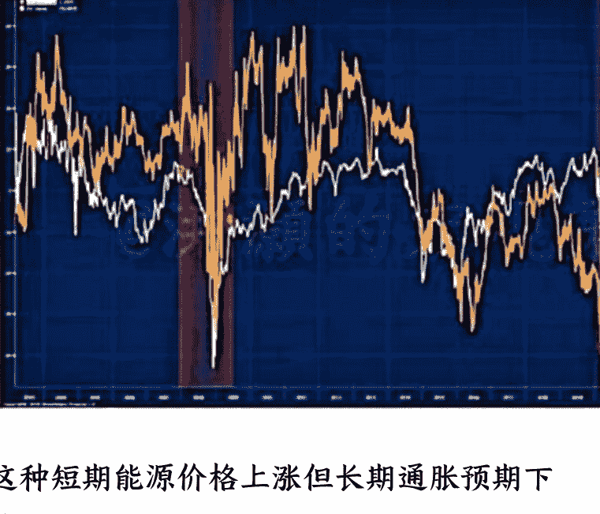
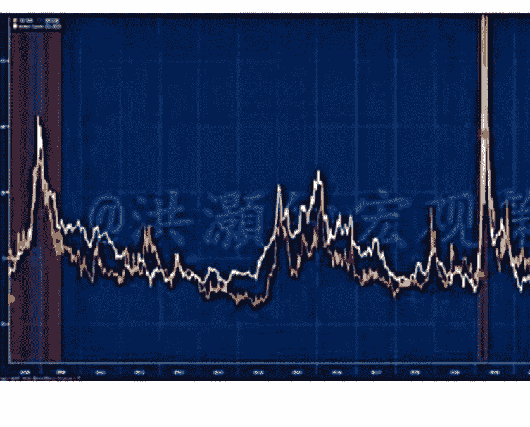
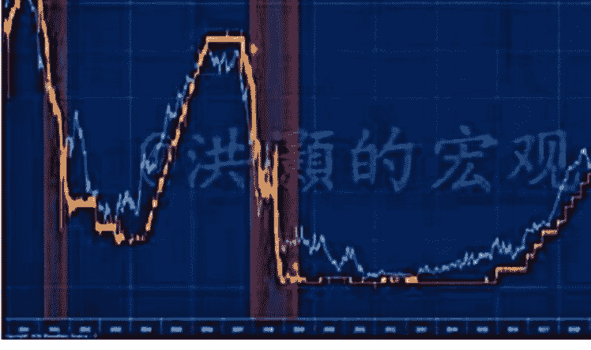

# 霍尔木兹金融战

260308 洪灏

整理：公众号懒人搜索，懒人专属群精选

懒人微信：lazyhelper1

全球金融市场正在经历着一场史诗级别的“压力测试”。这场剧变，正将美国军事上似乎正在获得的战术性胜利与全球经济上面临的挑战开始南辕北辙。截至这个周末，美国代号“怒火行动 Epic Fury"的伊朗战争开始扩散，进入了一个经济中深层矛盾开始集中爆发的阶段。尽管美以联军以较高精度执行了所谓的“斩首战略”，瘫痪了伊朗最高领导层，并宣称使伊朗的弹道导弹能力下降约 90%，但这场战争带来的经济影响，已深刻冲击全球资产定价的核心。我们讨论的早已不只是一个局部地缘事件，而是很可能正在见证一个周期的转折。在实物作为硬通货开始出现稀缺的时代，市场对风险、通胀和流动性的定价方式正在发生根本变化。

这场危机最直接、最明显的表现，是原油期货曲线的“超级现货溢价 Super Backwardation"。这不是投机交易驱动的常规价格上涨，而是市场对现货石油的争抢。赌市显示，布伦特原油很可能很快将逼近关口。如是，市场实际上在宣告原来以持仓成本定价的期货体系的失效——金融机构不再愿意为远期库存提供融资，而对原油实物短缺的担忧开始压倒金融交易。

当前，石油的现货价格远高于半年、一年后的期货价格，价差如此之大，说明市场认为如果今天能拿到的一桶油，远比未来交付一桶油的承诺更有价值。这种担忧无可厚非，毕竟，科威特等国已经开始因为原油储存产能开始不足而开始减少甚至停止生产原油，并开始援引战争不可抗力的条款而拒绝或延迟交货。沙特的原油开始重新绕道红海港口而避开霍尔木兹海峡的战争。然而，即便是如此或可冲破伊朗的“没有一滴原油可以走出霍尔木兹”的封锁，但是原油的价格将不可避免的飙升。

这种深度倒挂，正是霍尔木兹海峡“功能性停摆”的金融体现。尽管美国海军似乎拥有绝对优势，但国际战争险保险商的退出，却达成了伊朗海军难以实现的目标：一个让全球每日原油运输量 20% 受阻的海上瓶颈，一个由保险条款构成的封锁线。即便美军宣布将护送油轮在霍尔木兹海峡航行，但是对于伊朗封锁的担忧和胡塞武装的偷袭肯定会使各国的船舶望而却步。

这场霍尔木兹海峡的“保险封锁”表明，在现代环境下，金融市场的波动和军事武器一样具有杀伤力。除非未来出现一个“14 天零事故”的安全期，让海事保险商重新评估风险并重新签发标准战争险保单，否则当前的石油现货溢价就是这次战争的风险溢价最直接的代表，并将持续对全球经济增长产生压力。在最坏的情景下，经济的运行将不断地消耗商业库存，直到库存见底，最终迫使工业活动停止。

当然，美国将释放其战略石油储备以打压油价。但是，在原油现货溢价不断飙升的今天，美国依然畏手畏脚地不愿意释放石油储备而打压油价，或显示美军自己也不确定这次所谓的速战速决的斩首行动是否可以很快地达到目的。至少，目前看来美军想要达到的颠覆政权而导致政体改变、以及彻底消除伊朗的核武器能力的目标根本没有达到。特朗普喊话，要求伊朗无条件投降。然而，伊朗方面回应：你们可以把这个痴梦带到自己的坟墓里头去了。如果油价继续上涨导致美国民众开始担忧油价对于生活成本的影响，那么这个当下美国民众最关心的担忧将在很大程度上左右中期选举的结果。到时，美国的石油战略储备将不再是一种经济保险，而将升级为政治保险。

在周三，我作为万得 WIND 金融的 2025 年度人物，应邀做了一次公开的讲座。在这次讲座里，我们前瞻性地讨论了当下伊朗战争对于资本市场的影响，可以用来监测战争进程的指标，市场的风险和经济周期的拐点。当然，这些关于经济周期和市场波动的预判早在去年十一月我展望今年经济的时候已经与我的付费读者沟通。当时，我们的模型显示全球流动性将冲高回落，预示着在未来三个月左右全球市场将承受压力。我在二月初春节前的线下见面会时、和上一篇专属报告中再次讨论了这个预判。

然而，令人奇怪的是，尽管油价飙升、通胀担忧占据新闻头条，债券市场上的投资者却更多关注长期因素……战争还在升级，这一系列的市场异相将如何影响交易？

被视为通胀预期重要参考的 5 年期/5 年期远期通胀预期，实际上却已经开始下降，降至 2.14% 左右（图一）。

图一：原油的期货曲线出现超级现货溢价，但是长期通胀预期却没有出现变化。

这种短期能源价格上涨但长期通胀预期下降的组合，很可能是一种典型的“经济增长将长期受损”信号。市场正在迅速地为一种情景定价：当前由供给冲击引发的现货油价上涨，但油价的飙升最终将会抑制需求，导致经济衰退和通胀回落。换言之，高油价相当于一项重税，最终会压垮全球消费者，而在需求下降后通胀自然会回落。从这个角度来看，市场认为这次油价的飙升是一次性的而且是暂时的，其影响更像是去年四月份特朗普企图对于全球征收关税。自从特朗普关税之后，其实通胀是在下降，而并没有像市场预期那样飙升。这也是因为关税对于通胀的影响如同这次的油价因为战争飙升一样，也是一种一次性的台阶式的上升。战争总是会过去的。当前，原油的现货溢价情况已经超越了 2022 年俄乌战争时期，而原油的隐含波动率已经飙升到远超俄乌时期的水平，油价很可能继续狂飙到 100 美元以上 (图二)。

图二：原油现货超级溢价，原油隐含波动率飙升到俄乌战争水平以上。

然而，尽管长期通胀预期平稳，美国 10 年期美债收益率却进一步升至 4.17%。这说明传统的避险债券买盘，正被另一种力量抵消：美债的期限溢价正在上升，即投资者因担心美国财政赤字扩大，部分源于新增军费开支而要求更高的收益率。当最安全的资产——10 年期美债——被市场赋予更多风险定价时，股票等资产的估值基础就会变得不稳，股市即使盈利数据尚可，也更容易出现调整。

这引出当前美联储面临的“滞胀困境”。3 月 6 日的就业报告显示，美国就业岗位减少了 9.2 万个，而市场共识的预期是增加 6.8 万个工作岗位。这一数据很可能将改变市场对于美国经济“软着陆”的预期。此时，美联储的两大目标——充分就业和物价稳定——同时亮起警示信号：就业市场走弱，而伊朗冲突又推高油价。如果伊朗战争恶化，这种情景将演变成为—种滞胀的情景。

美联储主席鲍威尔目前正面临着一个两难的境地：如果选择降息以支持美国就业市场，那么在油价接近 100 美元的情况下，此刻降息的绝对很可能将会让通胀预期失控；然而，如果维持高利率以抑制通胀，那么很可能将加剧美国经济下行压力。目前，市场预计 3 月 18 日的美联储会议将维持基准利率不变，我在二月初见面会上已经讨论（图三）。

图三：美联储基准利率和两年美债收益率显示美联储很可能将按兵不动（二月见面会原图）

这时，美联储未来是否转向，已非主动选择，而是被迫应对形势。当前，VIX 恐慌指数飙升到 28 附近时，反映出市场波动加剧。如果 VIX 期货曲线走平或出现现货溢价，那么则意味着市场担忧已从能源领域扩散至整个金融体系。

综合来看，未来几周可能是美国、伊朗双方比拼承受力的阶段。一方面，伊朗政权面临领导层接续问题和军事能力受损，但拥有霍尔木兹海峡的地理优势，能以较低成本影响能源供应和石油价格。另一方面，西方需要应对霍尔木兹海峡保险瓶颈带来的能源供应风险，以及美联储在通胀和衰退之间平衡的难度。

历史性的转变在继续：全球从过去低利率、全球化、科技股主导的增长模式，转向能源成本、实物供应和供应链安全决定全球走向的新阶段。对西方而言，目标已不仅是军事上的成果，还包括恢复正常的收益率曲线、重启海上保险市场、稳定资本市场的信心。在这些金融层面的恢复之前，全球经济的复苏前景可谓皮之不存，毛将焉附。

当然，特朗普也可以再次 TACO，尤其是这个软肋早已是世人皆知，因此伊朗很可能将军事进攻集中在对于美国市场影响最大的标的：原油基础设施、霍尔木兹海峡、美元生态，等等。甚至，最近加密货币的异常升势也很可能是由于传统金融设施将受到打击的担忧而产生的需求，以及海湾中东国家作为加密大户开始继续买入加密货币而对冲美国系统的风险。但也正是因为这种 TACO 可能性，短期无论多空交易都非常困难，因此交易上 long-only 还是以风险控制为主。

特朗普的执政随心所欲，令市场无所适从，其可信度正在不断降低。市场调查显示，绝大部分人都是反对这场战争的。伊朗对于美国的所谓”迫在眉睫的威胁“，迄今实在是无从谈起。

War, what is it good for?

## —————分割线—————

绝大多数人只盯着眼前的工资，却不知道一次远在中东的冲突、一次降息的决议，就能在一夜之间洗牌普通人的财富。

看懂宏观，是为了在周期切换时，不被当作代价。

如果你认同这种“抬头看路”的长期主义，欢迎围观我的个人情报智库：【懒人专属群】。

圈子已稳定运行 7 年。我们每天过滤全网最顶级的政经内参、大 V 付费研报，剔除情绪噪音，只保留能指导资产配置和商业决策的真实信号。做你最冷酷的“外部大脑”。

⚠️ 查阅圈子最新宏观内参目录:

https://hk57gvlx7u.feishu.cn/docx/H0kRdZbSboIBR0xkaXtcuVE0nTg

拒绝伸手党，只渡有缘人。扫码加我微信，备注：【破局上车】

微信：lazyhelper1