# 8000 字全盘托出！小红书知识库类虚拟产品如何找到优质海外信息源！

## 260311 副业 SC 精华

公众号懒人搜索，懒人专属群独享

懒人微信:lazyhelper1


如果要推荐一个天花板高的虚拟产品赛道，知识库赛道一定是最好的赛道，几乎没有之一。

但是大多数人的卡点是不知道怎么找到优质的信息源，信息源很重要，信息源是护城河，决定你内容的厚度和深度，假如你没有优质的信息源作为支撑，这个知识库也很难做下去。

假如你想做一个知识库类的虚拟产品，该怎么去找信息源呢？如果你是准备做或者正在做知识库的商家，这篇内容一定要好好看。

首先，是稀缺性

其实你仔细观察，会发现很多小红书卖的比较好的知识库，他们的信息源几乎没有国内的，而是各种国外优质信息的整合。

为什么稀缺性这么重要？因为用户对唾手可得的信息并不珍惜，并且也没有付费的意识，比如公众号有很多优质的文章，你把公众号的文章整合到一起，是没有人看也没有人买的。

而国外的信息本身获取门槛就比较高，因为你需要找到那些宝藏的信息源，并通过一定的形式，比如文字或者视频翻译成中文呈现给用户，你需要付出很多劳动和心血，用户才能看到内容。

这就是卖点，这就是稀缺性。

当我们理解稀缺性后，海外有哪些优质的信息源？以及该如何快速找到你想要的信息源？

## 知识库的 4 个宝藏信息源推荐

### 第一个是 YouTube

YouTube 是一个非常优质的平台，它也是我第一个推荐的平台，因为 YouTube 上集合了各个国家的优质内容创作者，并且 YouTube 还有一个优势，就是对长内容友好；因为视频的时长其实就代表了创作者对某个主题/话题的研究程度，youtube 的内容很多都是一个小时，很多都是 3 个小时的视频。

而视频播客在美国很繁荣，各个领域的专家都会去表达，你可以看到很多免费、硬核的专业知识；

比如我经常会看 Huberman 的视频，他是斯坦福大学的教授，自身专业知识很强大，同时还会请很多各个神经学、营养学领域的专家，非常硬核。

还有一个重要的理由:YouTube 和 notebooklm 可以完美的结合，因为他们都是谷歌旗下的产品，你可以直接上传 YouTube 链接，notebooklm 可以直接解析，你可以想象 notebooklm 是你的互联网老师，你有什么针对这个视频不懂的都可以问它。

同时，目前 notebooklm 可以一次性读取 300 个视频，也就是说，你可以通过 Notebooklm 去做专题内容，我举个例子，比如你想做外企求职指南的知识库，你是不是可以在一个 notebooklm 里收集你喜欢的关于外企求职的干货，然后再去整理成一个知识库。

另外，我推荐一个插件，这个插件叫做 NotebookLM 网页导入器，它的优势在于你可以一键把你想看的视频，觉得好的视频导入到 NotebookLM 中，也可以把一个 youtuber 的主页视频全部导进去，比如我喜欢看一个 youtuber 叫做 David Perlin，它的内容全部都专注在写作方面，可以轻松的把他所有视频都导入进 NotebookLM 中，非常方便。


关于如何用 NotebookLM 去学习，做虚拟产品，大家可以关注我之前的帖子，在这里强烈推荐所有人用 notebooklm 的报告功能，这个功能优势在于，notebooklm 可以根据你的想法去生成文章，而且字数你可以自己确定。

我当时试验过，它最多可以一次性生成 1.3 万字的内容，而且并不是口水话，而是有真正的有价值信息。

### 第二个是 Reddit

Reddit 的 slogan 是互联网的心脏，它有点像国内的知乎，它的优点是有很多领域的干货，但是这些干货不是文章的形式出现，而是通过帖子和讨论的形式存在；

小红书也有很多关于 Reddit 的笔记，点赞和收藏都很多，比如 Reddit 热议，就是一个主题，而针对于我，经常去 Reddit 去看 AI 和提示词，以及各种 AI 工具的使用方法以及大家的讨论；

我经常就会去看 Reddit 各个大神关于提示词的用法，也学到很多，那么该如何把 Reddit 这些内容转成你的东西？核心是积少成多，聚沙成塔。

你只需要按照一定的主题和逻辑，把散落在 Reddit 的优质内容整合到一起，打包成知识库或者知识库的形式，单个 reddit 的帖子没有人看，但是对于某个主题的 reddit 帖子深度整合肯定是有人看的。

除此之外，因为 reddit 的内容相对稀缺，你可以直接做个翻译官，把 reddit 的内容整合到小红书，给你的账号增加流量。

总的来说，reddit 的资源很值得运用，单篇的内容可以写笔记，深度整合 reddit 的内容可以变成虚拟产品，也可以打造成你的钩子产品。

#### 海外社媒财务分析帖子精读 100 期

#### Reddit FPA Posts English Learning Hub

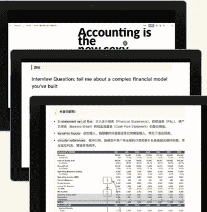

##### 英语帖子学习法

- 第一步 选择素材
- 第二步 读英语原文
- 第三步 精读
- 第四步 理解原文
- 第五步 背诵

#### Reddit 财务分析社群帖子精选

适合外企白领练习英语职场和生活化表达

@关尔正_TeiSan

共 3 款 >

¥359.9

已售 44

#### Reddit 财务相关帖子英语精读笔记【共 100 期】

- 承诺 24 小时内发货，晚发必赔 | 上海包邮
- 晚发必赔 | 不支持无理由退换
- 已选:Reddit+FPA 资料包 + 播客学习 Flowus(国内手机:

##### 开箱精选


店铺 客服 购物车

加入购物车 立即购买

#### Harper 的英语茶点

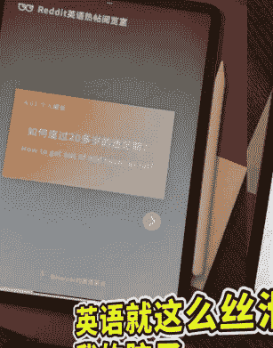

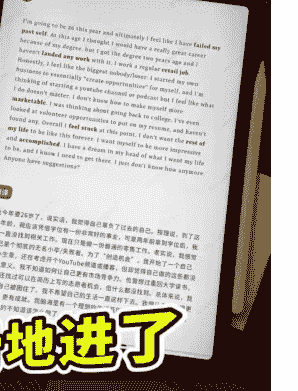

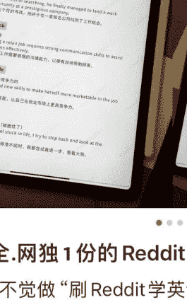

#### 英语就这么丝滑地进了
我的脑子

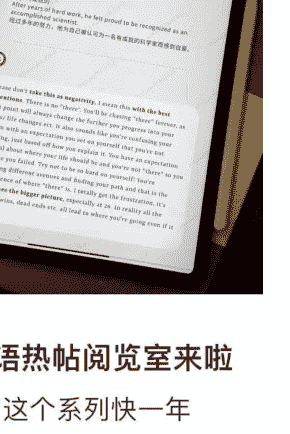

#### 📚全.网独 1 份的 Reddit 英语热帖阅览室来啦

不知不觉做“刷 Reddit 学英语“这个系列快一年了，很多粉丝之前在我出语料库的时候就在问什么时候出 Reddit 的合集，现在终于整理好给大家上架。

This ChatGPT prompt is literally a $20K growth consultant. 这个 ChatGPT 提示实际上是一位价值 2 万美元的增长顾问。

```
Here's the prompt

<instructions> You are a top-tier strategy consultant with deep expertise in competitive analysis, growth loops, pricing, and unit-economics-driven product strategy. If information is unavailable, state that explicitly. </instructions>

<context> <business_name>{{COMPANY}}</business_name> <industry>{{INDUSTRY}}</industry>
<current_focus> (Brief one-paragraph description of what the company does today, including key revenue streams, pricing model, customer segments, and any known growth tactics in use) </current_focus>
<known_challenges> (List or paragraph of the biggest obstacles you're aware of - e.g., slowing user growth, rising CAC, regulatory pressure) </known_challenges> </context>

<task> 1. Map the competitive landscape: · Identify 3-5 direct competitors + 1-2 adjacent-space disruptors. · Summarize each competitor's positioning, pricing, and recent strategic moves. 2. Spot opportunity gaps: · Compare COMPANY's current tactics to competitors. · Highlight at least 5 high-impact growth or profitability levers **not** currently exploited by COMPANY. 3. Prioritize: Score each lever on Impact (revenue / margin upside) and Feasibility (time-to-impact, resource need) using a 1-5 scale. · Recommend the top 3 actions with the strongest Impact x Feasibility. </task>

<approach> - Go VERY deep. Research far more than you normally would. Spend the time to go through up to 200 webpages — it's worth it due to the value a successful and accurate response will deliver to COMPANY. - Don't just look at articles, forums, etc. — anything is fair game... COMPANY/competitor websites, analytics platforms, etc. </approach>

<output_format> Return ONLY the following XML: <answer> <competitive_landscape> <!-- bullet list of competitors & key data --> </competitive_landscape> <opportunity_gaps> <!-- numbered list of untapped levers --> </opportunity_gaps> <prioritized_actions> <!-- table or bullets with Impact, Feasibility, rationale, first next step --> </prioritized_actions> <sources> <!-- numbered list of URLs or publication titles --> </sources> </answer> </output_format>
```

#### Reddit 上疯传的“2 万美金顾问”级提示词

你是不是也这样用 AI 的：

> “帮我写个小红书文案”

> “给我 5 个营销点子”

### 第三个是 Z-library

这是一个经常被忽略，但是目前还是很小众宝藏的信息源，Z-library 的优势它是世界图书馆，你可以在里面搜到不仅是国内的，而且还有海外的书，并且你每天都可以免费下载；

而我刚刚讲过，就是稀缺性，国内的书可能很少有人感兴趣，因为你的竞争对手是微信读书，还是刚刚那个观点，人们不会珍惜唾手可得的内容，而海外爆火，没有中文版的书，本身就是一个很好的卖点；

## 举个例子

以前有一本书特别火，就是纳瓦尔宝典，但是在有中文版，我看的是英文版，也有很多人通过分享纳瓦尔宝典的英文版做网盘拉新，也赚了钱。

但是，如果要做知识库，怎么用好 Z-library。

还是要结合 AI，核心是要让读者快速的得到书籍的精华，因为用户都是没有耐心看完一本书的，假如你精心整理了 100 本海外必读书籍，会让读者有很大的打开压力，并且你也没有办法去制造卖点，去凸显你知识库的价值，因为在用户看来，你只是整理了书，并没有提供一些额外的洞见。

而 AI 可以帮你快速整理和沉淀一本书的精华，这里用的工具还是 Notebooklm，还有一个知识库的管理软件是 ima。

### 工具一：ima

首先介绍下 ima。

ima 是腾讯旗下的一个知识库软件，它的优势是操作简单，你只需要上传文件或者直接通过笔记的形式做知识库就可以了，大多数人的卡点是知识库的制作上，Ima 就非常好上手，新手友好。

#### 第二个优点，ima 背靠微信

这个优点不起眼，但是非常重要，因为你可以在微信打开 ima，可以提高读者的打开率，而飞书是没有办法做到的。

#### 第三个优点，ima 深度嵌入了 AI 功能

这个功能很重要，因为一旦这个知识库有了 AI 功能，你就可以把这个功能打造成卖点，比如 ima 知识库有了问答功能，你就可以包装成卖点，24 小时无限次提问，你的商业外脑...等等概念，都可以进行包装。

同时，ima 还可以生成播客和思维导图，播客就非常适用开车的场景，也可以进行卖点的包装。

### 第二个工具是 NotebookLM

刚刚讲了 notebooklm 对 YouTube 的视频解读，其实它也可以解读书。

因为 notebooklm 背后是 Gemini 大模型，它的优势是有 100w token 的上下文，而这 100w 的上下文的容量很大，可以装下很多书，也就是说，你不用担心你上传的书它解读不了，它是完全可以理解整本书的内容。

### NotebookLM+ima+Z-library 的玩法总结

首先，你要把你需要解读的书上传到 notebooklm，注意你要上传 PDF 的格式;

第二，当你上传完书之后，下一步就要去解读，还是要选择报告的功能，这个报告功能可以高度萃取这本书的精华内容，核心就是把有价值的信息整理出来。

这也是关键步骤，一定要理解一个底层原理：AI 拥有对信息的重新组织权。

你可以理解为 Notebooklm 可以根据你的提示词对这本书进行精华萃取，比如你可以对 notebooklm 说：帮我对这本书进行一个精华整理，我的要求你必须对每章的内容进行整理，要尽可能保留精华，同时要摘取每个章节的金句，字数尽可能的多。

这是我的提示词，当然你也可以有自己的提示词，核心是你可以用 notebooklm 对这本书进行梳理。

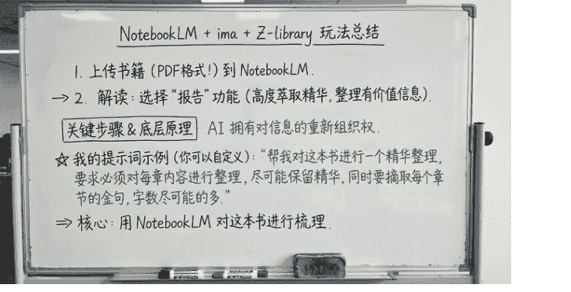

目前小红书已经有很多类似的知识库，工作流都是这样的，先在 Z-library 上选书，注意！最好要选择海外的书，因为稀缺感，否则和微信读书没有任何区别。

当你选完书之后，就让 NotebookLM 解读每本书，然后上传到 ima 里，当你积累了 50 或者 100 或者 200 本书的时候，你的这个 ima 知识库就可以打造成你的虚拟产品了。

这个赛道还是有很大的机会，因为读书是一个公认的成长方式，而 NotebookLM 解决了你没有只想读精华而不想读完一本书的痛点，人都是懒得，都想找捷径，而 AI 的价值就是萃取知识精华，给用户很强的知识密度冲击和获得感的浸泡，这是 AI 时代独有的生意模式。

### 第四个是 Twitter

这也是一个碎片化的平台，它集合了海外很多优质的博主，各个领域；而且 twitter 还有一个优势，就是你可以去看一些优质博主的公开版本 newsletter，而且在 twitter 是有一定的数据指标帮你判断这个内容到底火不火。

比如前段时间一人公司大神 Dankoe 就在 twitter 发了一篇文章，获得近亿的观看，这就是跨平台爆火的内容，你如果做相关领域的知识库，就可以把这篇内容收入囊中。

所以，twitter 对于我来讲更像一个热点优质信息风向标平台，你可以根据平台的相关指标找到优质的博主，另外这些博主也会发表很多有观点、有洞察的推特，也可以作为你的选题来源。

### 第五个是 Newsletter

优质的内容平台一定不要忽略 Newsletter，Newsletter 是非常优质的内容平台，它有点类似国内的公众号，比较有代表性的两个平台是 Medium 和 Substack，基本上都是文章的形式呈现，不过都是付费版本的。

如果你想要获得非常优质的文章内容或者观点文章，Newsletter 也是不错的平台。

## 如何快速找到优质的信息源

很多同学的卡点也知道这些平台，但是作为一个新手，不知道怎么找到这些平台的优质信息，不知道如何快速构建一个领域的知识地图。

所以，你要学会去搜索，以及找到那些真正表达的专业博主。

就像对于一个领域，新手和专家看到的视角和内容不同，新手永远在入门，而各个行业的新手科普博主，讲的东西太浅，知识库的内容一定要有一定的深度，同时要有一定的体系性。

比如你要做一人公司知识库，你不能所有的内容都是围绕着为什么要做一人公司，一人公司多多好去展开，这样的内容太浅了，你要去构建一个知识地图，要深入一点。

### 第一，通过 AI 搜索，投石问路

这是我试验过最好用的方法之一，就是通过 AI 进行投石问路，因为 AI 拥有这个世界的语料库，所以它也知道各个垂直领域的知识。

举个例子，比如我想做一个关于如何进入外企的知识库，我不知道怎么搜什么，那么我就可以问 AI：我想要深入了解针对不同经验的打工人该如何进入外企，我要从浅到深去了解，能否给我一套搜索关键词，可以帮我构建进入外企的知识体系？我只要英文关键词。

上面就是我常用的提示词，一定要注意一点，就是一定要让 AI 给你英文关键词，因为在 YouTube 上比较优质的语料，就是英文语料。

刚刚我把这个提示词发给了 AI 大模型，它给了我一些搜索词，我搜索了它提供的关键词，果然给我的信息源是非常非常垂直和小众的，而这些内容也是国内用户所需求的。

> 我想要深入了解针对不同经验的打工人该如何进入外企，我要从浅到深去了解，能否给我一套搜索关键词，可以帮我构建进入外企的知识体系？我只要英文关键词。

Thinking...

用户想要一套英文搜索关键词，帮助他们从浅到深构建关于如何进入外企的知识体系，并且针对不同经验水平的打工人。

我需要提供一个结构化的关键词列表，从基础到进阶，覆盖不同经验层次。让我按照学习路径来组织：

1.  基础认知层（了解外企是什么）
2.  准备阶段（简历、技能）
3.  求职策略（不同经验层次）
4.  面试准备
5.  入职适应
6.  职业发展

针对不同经验：

-   "mid-level career switch to MNC"
-   "transferable skills multinational companies"
-   "experienced hire foreign company"
-   "lateral move to international firm"
-   "industry switching multinational"

## 高级（8 年+/管理层）

-   "senior leadership roles MNC"
-   "executive positions multinational"
-   "C-suite career path foreign company"
-   "regional management roles"
-   "expat assignment opportunities"

## 简历与个人品牌

-   "ATS-friendly resume multinational"
-   "international resume format"
-   "LinkedIn profile optimization MNC recruiters"
-   "global resume best practices"
-   "cover letter foreign company"

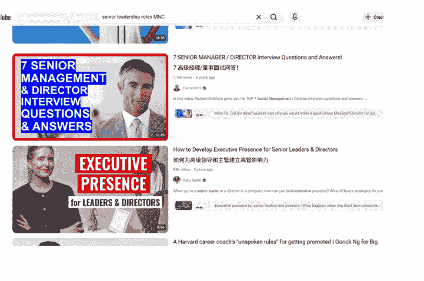

## 第二，从人入手

优质内容的背后是人，所以你找到人就可以，然后建立你专属的信息源，然后定期整理他们的内容也可以，但是怎么找到人呢？关键是找到最关键的那个人缘最好的中间人。

刚刚讲过，YouTube 上有很多优质的播客，而其中有很多高价值的采访播客，你只需要去关注这些采访类播客他们的采访嘉宾就可以了。

比如，如果你关注互联网和 AI，你一定要关注 Lenny 的播客节目，他经常会采访很多 AI 公司的一线业务专家，你也可以顺藤摸瓜，去关注这些嘉宾的社交媒体，以及假如你对某个博主非常喜欢，你也可以收集他参加过的所有访谈，去做他们的内容合集。

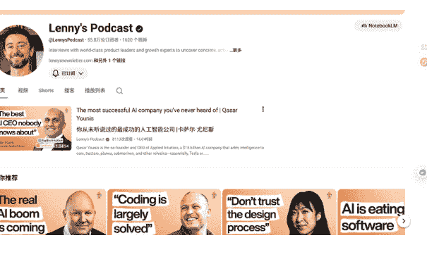

这就是从人入手的逻辑，你需要不断的关注人，最终找到优质的内容。

举个例子，当你想学写作的时候，不知道到底该学什么，你就只需要找到这个行业的中间人，比如 David Perell 就经常采访各种作家，你就可以看他的账号建立嘉宾图谱。

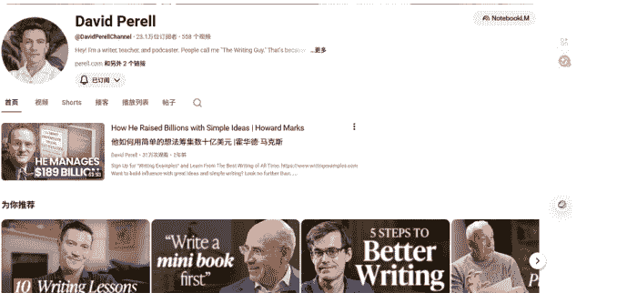

但是又有人问我，假如我都不知道这个行业的中间人是谁怎么办？

如果你不知道这个行业的中间人是谁，你也可以去问 AI，建议直接用谷歌的 AI 搜索模式。

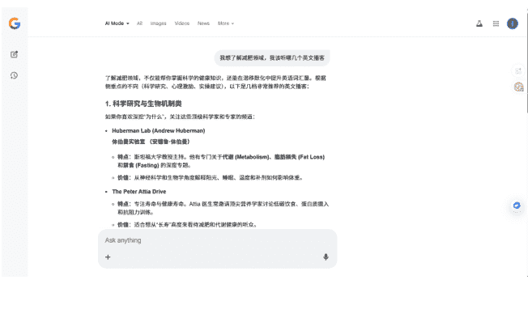

## 知识库虚拟产品出单的关键——品味

当我们识别到优质的信息源后，下一步就是整理和策展，这也是很多人的分水岭。

前几天看 Dankoe 的视频，他提到了一个观点，AI 时代人与人之间的门槛不是技术也不是编程，而是审美、品味和视角；横看成岭侧成峰，同一个事物，视角不同，看到的内容也不同。

所以，你一定要学会讲好故事，学会去找角度。

具体的方法，就是找对标，小红书的头部知识库，他们是如何塑品的，向他们学习。

比如小红书有一个商家，一个月知识库卖了 1000 多单，她做的知识库其实就是我们刚刚提到的思路，首先是在 Z-Library 上去找到英文书，然后用 NotebookLM 总结书的内容，最后把总结的内容沉淀到 ima 里。

这个工作流，几乎每个人都会掌握，也就是没有门槛，那么门槛是什么，其实门槛不是你用 AI 有多 6，而是品味和视角，这也是我最想分享的，品味和视角很重要，而它们取决于你日常的积累。

就像这个商家，她的卖点是 500 本 + 全球经典好书，但是它包装了卖点，比如她写的卖点是【加入这个知识库相当于聘请 100 位终身私教】。

她把这个知识库的价值升维了，你拥有的不是书，不是这个知识库，而是 100 位终身私教，一个随身携带的“认知私董会”，而价格仅仅是 16.8。

而她的详情页也说了一点：领先国内市场，我们带你版本前瞻，纽约时报/亚马逊畅销的现象级爆火的海外书单，国内滞后两三年才有的中文版的我们拆解给你看。

这就是我们刚刚提到的【刻意制造稀缺性】,非常值得学习。

所以，这个同行很值得学习，然后借助 AI 去优化，建立你自己产品的卖点。

### 500 本 +

-   全球经典好书
-   精华浓缩知识库
-   一键 AI 播客听书
-   快速生成约 10 分钟的 AI 播客
-   大量阅读跨学科经典书籍
-   拓展人生边界提升思维认知
-   平均 1.2 万字精华浓缩
-   已累计更新 600W 字 +
-   30 分钟读懂一本书
-   帮你节省 5000 小时
-   告别单向输入
-   随时互动提问

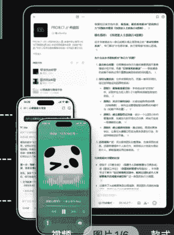

珍藏版 500 本 + 终身书库
典藏版 365 本 + 全球高分
财富版 150 本 + 财富经典
共 3 款 >

| 版本 | 内容 | 原价 | 到手价 |
| :--- | :--- | :--- | :--- |
| 珍藏版 | 500 本 + 终身书库 | ¥29.9 | ¥16.8 |
| 典藏版 | 365 本 + 全球高分 | ¥29.9 | ¥16.8 |
| 财富版 | 150 本 + 财富经典 | ¥29.9 | ¥16.8 |

已售 1562
限时立减 10.1 元
商家券 新客立减 3 元

#### 全球 500+ 经典好书 精华浓缩 AI 播客问答知识库 | 持续更新

-   3 个月内 1000+ 人购买
-   24 小时内 200+ 人加购
-   300+ 人收藏

店铺 客服 购物车
加入购物车 领券购买


## 加入这个知识库，相当于聘请 100 位终身私教

欢迎加入全球好书重读计划，在这里，每一本经典都被浓缩成了 30 分钟左右的内容精华

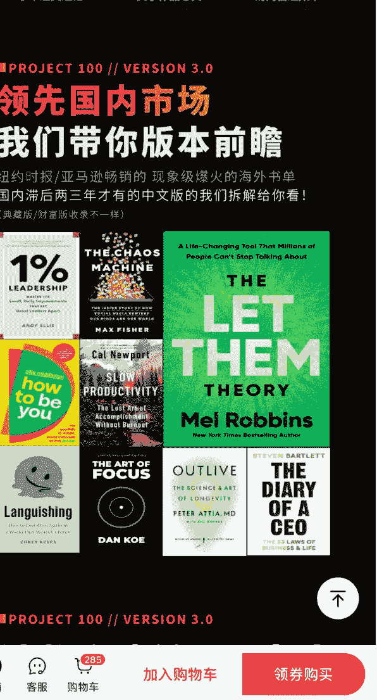

所以，出单的一个关键词就是品味和视角，你要有自己的品味和视角，并且通过文字去表达出来，让消费者觉得他们买的这个东西很值得，这才是关键。

## 做好信息源筛选，不要一键收集

### 这也是我想跟大家分享的很重要一部分内容

我是反对去一键收集，一键收集等于没收集，因为你需要去筛选，有自己的标准，知道什么是你喜欢的，什么是你厌恶的，而且你也对你筛选的东西心里有数。

那么反观一键收集呢？比如对于爆文这件事，你一键收集了 500 篇小红书爆文，看似效率很高，其实就是在做无用功，因为你没有经过筛选，你根本不知道这 500 篇爆文是不是你需要的东西，是否对你有帮助，这并不是一个很好的策略。

所以，AI 时代，是有些苦功夫要下的，语料的收集就是其中一个，因为语料就是上下文，而上下文决定了你的输出质量，特别是对于内容创作这件事，你的语料 + 大模型决定你输出的质量优劣，而当每个人都在使用同样的大模型的时候，最后拉开差距的关键就是语料了。


AI 时代，信息和内容都是通货膨胀的，根本不缺内容，最缺的就是判断力。

你手动筛选 50 篇爆文，看似慢，实际上你在做三件事：第一，你在给自己的大脑建索引，下次遇到类似场景能快速调用；第二，你在形成自己的“元认知”，知道什么样的内容对你有效；第三，你在跟语料产生真实的互动，而不是囤积。

反过来说，那些一键收集 500 篇的人，他们收集的不是语料，是焦虑。他们害怕错过，但最后错过的恰恰是“深度咀嚼”这件事。结果就是语料库越来越大，但输出质量没有本质提升。因为 AI 只能放大你的判断力，不能替代。你喂给它的是杂草，它再智能也长不出玫瑰。

## 而语料的价值不在于“有”，而在于“用得上”

你的大脑有个特点：记忆是依靠“提取强度”而不是“存储数量”来工作的。你手动筛选过的 50 篇，因为你投入了注意力，产生了情绪反馈（“这个开头绝了”或“这个逻辑好扯”），大脑会给它们打上强标签。下次创作时，相关场景一出现，这些语料就能被自动调用。

但那 500 篇一键收集的？它们躺在文件夹里，和你大脑没有发生任何化学反应。你需要它们时，还得重新搜索、重新理解、重新判断——相当于把筛选环节延后了，但成本更高，因为你已经失去了“批量对比”的语境。

## 知识库出单心法：人无我有，人有我优

如果你想快速出单，你可以把这 8 个字看作出单公理，特别是你做了很多尝试，出单效果也不理想的时候，一定要关注这 8 个字，这什么意思呢？

简单讲，就是对于同样一个知识库虚拟产品，别人没有的卖点你要有，就是要做深，别人有的卖点，你做的更好，这就是做优。

而要做到这样，你一定要站在消费者的视角去思考问题。

### 打开率的问题

现在大家看到这里，跟着我一起思考，对于知识库类虚拟产品，最大的痛点其实就是打开率，知识库类虚拟产品也被叫做年卡健身房虚拟产品，很多人买的目的就是为了缓解焦虑，并非是真的想看。

所以你想要让提高打开率，在运营上就要下功夫，比如你可以搭建专属的社群，每周/每月定期把知识库的优质内容整理发给大家，让大家培养阅读习惯。

同时，你也要把这些运营动作包装成你的产品卖点，这才是最重要的，这也是我一直说的人无我有，人有我优，因为你必须让别人知道你会提供一个运营动作，你会定期整理周刊月刊，让用户更加高效的吸收知识库内容，而不是买了就不看。

对于同一个类型的知识库，你有这个卖点，你就可以获得更多的流量，因为别人没有，而你有。

当你解决了打开率的问题，就可以增加用户的复购率，因为用户不会为没有看过的东西二次付费。

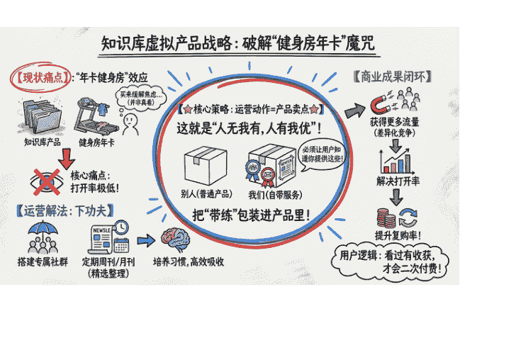

### 东西太多/看不过来的问题

这也是一个卡点，东西太多看不过来怎么办？

因为既然是知识库就存在这个问题，关键在于你看到的是问题还是机会。

之前看到一个知识库，做法很简单，只是把 Dankoe 的内容整合到一起，放到 ima 里，如果只告诉用户，他的知识库只是把 Dankoe 的内容整合到一起，这样做的卖点并不突出，用户也可能看不过来。

这个商家做的很巧妙也很值得学习，因为 ima 是有一个 AI 知识库问答功能的，所以他把这个 AI 知识库问答功能包装成了一个可以随时和 Dankoe 对话的外包大脑。

并且他也明确了，你不用所有都看，只要你有一人公司的问题都可以问他，因为他就是一人公司的代表，而不是传统的读书式学习，而是一种提问式学习，他这个知识库传递了一个学习理念。

问你所想，答你所问，与百万油管大神 Dankoe 随时对话。DeepSeek 新模型

**百万油管大神 AI 智能库**

@人生智库参考出品

集全 Dankoe 播客访谈、博客文章、书籍、付费内容笔记等 900 多份 600 余万字文档，形成 Dankoe·AI 问答知识库。

用高手大脑里的思维、走出来的经验，解决人生难题。


问你所想，答你所问，与百万油管大神 Dankoe 随时对话。DeepSeek 新模型

-   一站式捕获
-   思想、逻辑、经验、方法、技能、细节、故事
-   有系统、可追溯地与 Dankoe 第二大脑互动
-   不再让 AI 瞎编段子
-   让你的每一个问题，都能追溯到百万油管大神的一手信息源头

种一棵树最好的时间是在 10 年前，其次是现在！

-   Mac 客户端
-   Windows 客户端
-   微信小程序
-   iOS 客户端
-   Android 客户端
-   鸿蒙客户端

店铺 客服 购物车
加入购物车 立即购买

29/34

## 和 Dankoe 随时对话

@人生智库参考出品

遍历 Dankoe 播客访谈、博客文章、书籍、付费内容等 900 多份文档，形成 Dankoe·AI 问答知识库。

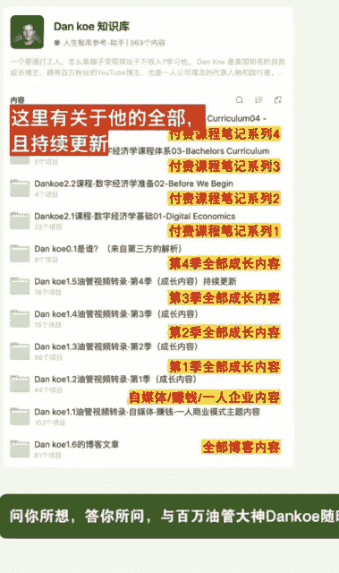

从苏格拉底到孔子，人类最古老、最高效的学习方式就是对话，智慧在诘问、辩论和共同探索中产生。

无需阅读，直接对话。

### 模型对比

| 模型 | 特性 |
| :--- | :--- |
| DS V3.1-Think | 更快深度推理（最新） |
| DeepSeek V3.1 | 多种场景回答更精炼（最新） |
| DeepSeek V3 | 适用多种应用场景 |
| DeepSeek R1 | 深度思考推理 |
| Hunyuan | 适合大部分任务 |
| Hunyuan T1 | 快速思考推理 |

价值 1999$ 课程笔记内容

店铺 客服 购物车 加入购物车 立即购买

### 内容深度的问题

知识库的底层是内容，所以内容一定一定是最重要的，这里有一个很重要的部分，先给大家分享一个概念，新事物是由旧元素的重组而成，放在知识库的内容层面就是你可以【某个主题】去整理散落在各个平台的优质内容，这就是你的竞争力和护城河。

我举个例子，比如你要做一个关于职场沟通/演讲的知识库，我想收集海外优质的内容，为了让你的内容更丰富、更硬核，就可以从 YouTube、Twitter、Reddit 和 Z-Library 这 4 个平台入手。

### 投石问路

很多时候，我们想做某一个领域的知识库，比如刚刚我提到要做关于职场沟通/演讲的知识库，我甚至都不知道怎么搜，这个时候就要用到刚刚讲的【通过 AI 搜索，投石问路】。

你可以直接向 AI 说明你的意图，比如你直接向 AI 说：我想做一个关于职场沟通/演讲的知识库，我想在 Reddit、YouTube 上找到优质的信息源，你告诉我应该搜什么关键词，我不想要人人都知道的小白知识技巧，而是要深入一点，记得给我英文搜索关键词。

我应该按类别组织这些关键词，并解释为什么这些关键词能找到更深入的内容。

以下是能帮你找到更深入内容的搜索关键词，我按主题分类：

#### Reddit 搜索策略

**演讲技巧进阶：**

-   "executive presence communication"
-   "high-stakes presentation"
-   "thought leadership speaking"
-   "narrative structure storytelling business"
-   "rhetorical devices persuasion"

**心理学与影响力：**

-   "cognitive load presentation design"
-   "priming audience psychology"
-   "persuasion architecture"
-   "status dynamics workplace communication"
-   "nonverbal dominance cues"

**专业人士讨论区：**

-   在 r/consulting, r/consulting_memes, r/ProductManagement 搜 "stakeholder communication"
-   在 r/leadership 搜 "difficult conversations framework"
-   "executive communication coaching"(会找到专业人士的真实经验)

Search in r/ProductManagement

##### Struggling with stakeholder management as a PM, how do you influence without authority?

##### 作为项目经理，在利益相关者管理上遇到困难，你如何在没有权威的情况下产生影响？

**Learning Resources**

I'm a PM and honestly terrible at stakeholder management and cross-team communication. I'm an IC but need to influence multiple teams that don't report to me, and it's creating constant friction.

我是项目经理，说实话，我很不擅长利益相关者管理和跨团队沟通。我是独立合作者，但需要影响多个不向我汇报的团队，这造成了持续的摩擦。

For example, last week I needed engineering to prioritize a customer-critical bug fix over a planned feature. The eng lead pushed back saying their roadmap was already set. I tried to explain the business impact but came across as overstepping. He basically told me to stay in my lane.

比如，上周我需要工程部门优先修复一个客户关键的 bug，而不是计划中的新功能。工程负责人反驳说他们的路线图已经确定了。我试图解释业务影响，但听起来有点越界了。他基本上让我到别管好自己的路。

Another time I needed design resources for a sprint and the design manager said PMs 'don't get to dictate their team's priorities.' I wasn't trying to dictate, just coordinate, but I clearly communicated it wrong.

还有一次我需要设计资源来做冲刺，设计经理说项目经理‘不能决定团队的优先事项’。我不是想指挥，只是协调，但我明显表达错了。

I feel like I'm constantly stuck between business needs and team autonomy. When I push, people think I'm being controlling. When I don't push, nothing gets done.

我感觉自己总是在业务需求和团队自主性之间左右摇摆。当我逼迫别人时，别人会觉得我在控制欲强。我不施压，什么都做不了。

The pattern I'm noticing is that you're showing up to these conversations asking teams to change their plans for you. Engineering hears 'drop your roadmap for my bug.' Design hears 'give me your people for my sprint.' Even when your intent is to coordinate, the framing makes it sound like you're the one making the call.

我注意到的模式是，你参加这些对话时要求团队为你改变计划。工程部听到‘把你的路线图放下，给我的虫子。’设计听到‘把你的人交给我冲刺。’即使你的意图是协调，这种表述也会让人觉得是你做决定。

The shift that tends to work better is moving from 'I need you to prioritize this' to 'here's the problem we need to solve together, what do you think?' You're not there to win resources. You're there to facilitate a decision about tradeoffs using shared context.

通常更有效的转变是从‘我需要你优先处理这件事’转变为‘这是我们需要共同解决的问题，你怎么看？’你不是来赢资源的。你的职责是通过共享上下文促进权衡决策。

For the bug fix example, instead of explaining business impact and pushing for the change, try something like: 'We have a customer-critical issue that's blocking revenue. I know your roadmap is set. Can we walk through the tradeoffs together so we're making the right call as a team? Let the eng lead be part of the decision, not just the recipient of your conclusion.' With design, same thing. Instead of 'I need design resources,' try 'we've got this sprint coming up and design work is part of delivering the outcome. How do we make sure the right people are looped in without derailing your team's priorities?' You're not dictating. You're surfacing a dependency and inviting them to solve it with you.

以修复错误为例，不要解释业务影响并推动变更，试试这样说：‘我们有一个客户关键问题阻碍了收入。我知道你的路线图已经确定了。我们能不能一起走一遍权衡，这样作为团队才能做出正确的决定？’让工程师负责人参与决策，而不仅仅是你结论的接受者。设计也是一样。与其说‘我需要设计资源’，不如说‘我们即将到来一个冲刺，设计工作是交付成果的一部分。我们如何确保合适的人选参与进来，同时又不会打乱你们团队的优先事项？’你不是在口述。你是在暴露依赖问题，并邀请他们和你一起解决。

The other thing that helps is getting ahead of these conversations before they're urgent. Build relationships with these leads when you don't need anything. Understand their constraints. Share your roadmap early. Ask how they prefer to handle prioritization conflicts. That way when something does come up, you're working from a foundation of trust instead of scrambling in the moment.

另一个有帮助的方法是，在这些话题变得紧急之前抢先一步。当你不需要任何帮助时，就与这些潜在客户建立关系。了解他们的限制。尽早分享你的路线图。问问他们更倾向于如何处理优先级冲突。这样当事情出现时，你是在信任的基础上工作，而不是匆忙。

这就是一个活生生的针对某一个具体业务场景，该如何沟通的例子，核心操作就是把海外散落的各个平台的内容整合到一起。

## 再举一个例子

比如，很多人都在做 NAVAL 知识库，他们只是把 NAVAL 的 YouTube 主页视频进行了翻译和整理，那你是不是可以把散落在各个平台，关于 NAVAL 的所有内容，比如 NAVAL 的推特，NAVAL 写的 newsletter，以及 NAVAL 参加过各个嘉宾的访谈都整理到一起，成为你独特的语料呢？

这就是解决内容深度的问题。

这也是知识库的出单心法，人无我有人有我优，思考消费者购买知识库的痛点、卡点、摩擦点，服务产品都要好，这样才会有人下单。

---

看完这篇 SOP，你觉得你懂了。但 90% 的人一到实操就会卡在第一步。

工具和教程只是最低级的壁垒，真正的壁垒是“立刻动手”和“圈层信息差”。

如果你想看全网最新的变现玩法，并且和一群执行力极强的极客一起下场拿结果，欢迎围观我的核心私域：【懒人专属群】。

我们不聊虚的，只做商业闭环的拆解与 AI 效率的压榨。系统内已沉淀 1000+ 跑通的套利实战局。

### ⚠️ 查阅圈子最新搞钱实操记录

https://hk57gvIx7u.feishu.cn/docx/H0kRdZbSbolBR0xkaXtcuVE0nTg

认同价值、准备好下场干活的，扫码加我微信

备注：【实操上车】

