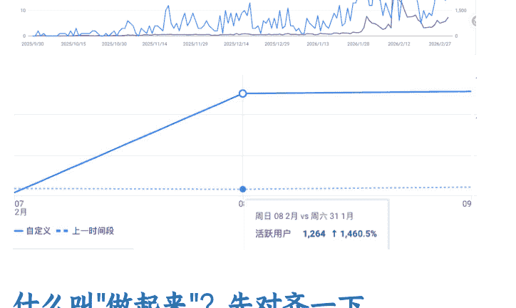
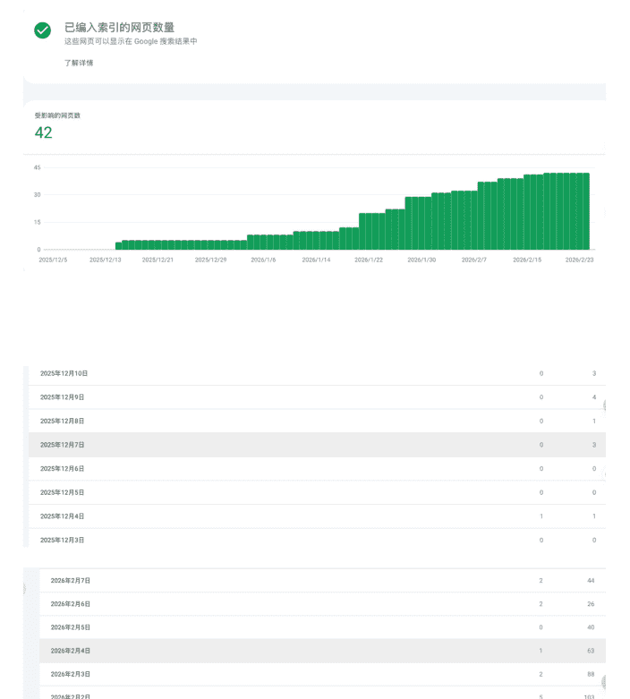
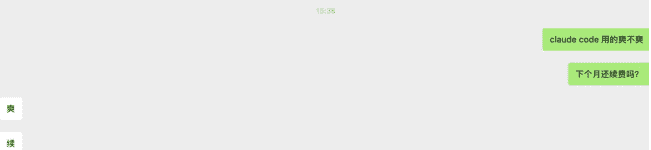
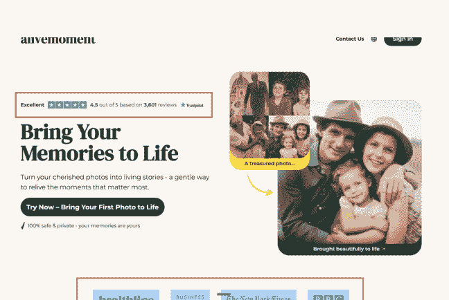

# 日活 1200+，一个笨人的出海做网站复盘

公众号懒人搜索，懒人专属群分享

## 260311 副业分享精华

公众号懒人搜索，懒人专属群独享

懒人微信：lazyhelper1

# 一个笨人的出海做站复盘

从去年 3 月到现在写这篇的时候 (12 月),10 个月做了 10 个站，2 个站跑出了稳定自然流量。最好的一个站做到日自然 UV 1264,月入大概 300 刀，付费转化率 1% 左右。

这 10 个月我最大的体感是：不是所有有搜索量的词都值得做。真正能让人掏钱的需求，往往是那种"我现在就要一个结果"的东西——高频、结果导向、现有方案又笨又慢。

## 先说说我是谁

我是大林子，现在做独立开发和做站。背景挺土的，小学放假就被我妈抓到厂里包夹子，初二开始洗盘子跑菜，毕业后当过律师，也待过大厂和国企。

我不是那种 4 个月就月入万刀的大佬。这篇讲的就是普通人怎么把一个站从 0 做到有点流量、有人注册、赚到第一笔美元。为什么敢写这篇呢，因为 300 刀 +，这个数字虽然不夸张，但它至少证明了一件事：不靠团队不靠预算，一个人也能把 SEO 站从 0 做到有收入。所以我不讲神话，就讲我自己反复踩坑之后确认有用的东西。

stripe

stripe

这 10 个月我越来越确定一件事：不是所有有搜索量的需求都能赚钱。真正容易让用户买单的网站需求，通常有几个特征：

- 第一，用户要的是结果，不是信息；
- 第二，这个需求高频重复，或者单次价值足够高；
- 第三，用户现在的替代方案很笨，比如手工做、找人外包；
- 第四，结果最好能立刻交付，比如生成、导出、修复、转换、分析。

越接近“我现在就要一个结果”,付费意愿通常越强。反过来，纯科普、纯围观、纯灵感型关键词，流量可能不小，但商业化往往很弱。

这篇文章我想讲清楚一个问题：一个新站从 0 到“做起来”，真正卡的不是技术，而是四件事：需求（方向）、功能交互（转化）、内页（覆盖与承接）、外链（权重与曝光）。

### 适合谁看：

- 刚开始做出海站，不知道从关键词到产品怎么落地的人
- 已经做了站但没流量/有流量不转化的人
- 想用 SEO 做长期增长，而不是只靠投放的人

我会尽量写得“笨人可执行”：每一部分都给具体检查清单和步骤。

### 什么叫“做起来”？先对齐一下

很多人说"站起来了"，其实说的不是一回事。我自己分三层：

**L1 能被看见：** 稳定收录，开始有关键词排名，自然曝光和点击连续 4 周在涨。

**L2 有人用：** 自然流量能带来明确的行为，比如注册、订阅、下载，转化路径跑通了。

**L3 能赚钱：** 自然流量能稳定带来付费，或者至少能看到付费的趋势在走。

这篇主要讲怎么从 0 做到 L2 和 L3。

### 四件事，是一条链，不是并列的

我后来想明白，做站就卡在四个环节，而且它们有因果关系：

需求决定你做什么、卖给谁——方向错了后面全白费。然后内页决定你能不能系统地吃到长尾流量。外链决定你的权重能不能撑得起竞争词。最后功能交互决定流量来了能不能变成钱。

说白了就是：方向、覆盖、权重、转化，一环扣一环。

公众号懒人搜索，懒人专属群分享

### 需求：最重要，但也最容易“自嗨”

这是四个月就月入万刀大佬原帖：

我这次做的词，估计绝大部分群友都发现了这个词，我是在 12 月 29 号下午发现的词，其实已经晚了一天，当时已经有几个站上线了，但是我搜索了一下 intitle，发现还是个位数，然后再用 Gemini 和 grok 帮我分析了一下词出现的源头是什么，为什么最近会火，找到源头之后，又用 CC 的浏览器插件分析用户发帖和评论内容，决定产品要做成什么样。再去 semrush 和 similarweb 的关键词搜索找了一下关键词和问题。然后我又观察了一下先上线的几个站，发现大家没有深入理解用户到底要什么，于是当天注册好域名，用 CC 快速手搓了一个纯前端的页面就上线了，当然还要做好 on-page-seo。

#### 用户搜这个词，到底想干嘛？

想不清楚这句，后面 80% 会跑偏。

#### 一个我自己踩过的坑（为什么跑偏、怎么发现、怎么调整）

我以前做过一个词（这里用“关键词 A"代替）：

一开始我以为用户想要一个“工具”，就闷头做功能。做到一半发现流量来了，但转化很差，我就开始补内容、写教程、加信息页……结果工具不像工具，内容不像内容，最后变成了“卖信息”，方向完全歪了。

#### 我为什么会跑偏？

- 我没认真拆 SERP（谷歌前 10）到底在交付什么
- 我把“有搜索量”当成“有付费意愿”
- 我没去看用户原声，靠自己脑补需求

#### 我怎么发现跑偏的？（三个症状）

1. 有点点击没注册：自然点击上来，但注册率/试用率很低
2. 用户停留在文章页，不进工具页/定价页
3. 用户问的问题集中在“他们真正想要的结果”，而不是我做的功能

#### 我最后怎么调整的？（三步）

1. 把首页从“介绍功能”改成“直接承诺结果 + 立刻使用”（首屏给入口）
2. 砍掉不服务转化的内容，把内容改成围绕工具的“场景页/对比页/教程页”
3. 收窄人群和场景：从泛人群→更具体的目标用户，功能和定价一起收敛

**教训**：不是做得不够多，而是一开始就没对准“这个词的意图”。

### 怎么把需求想清楚？（照做就行）

我现在用一套很笨但很稳的流程，拿到关键词先做 4 步。

#### one：先给关键词做“意图分类”（3 分钟）

你先判断它属于哪种意图：

- 学习型：how to / tutorial / meaning（想要教程解释）
- 对比型：best / vs / alternative（想要对比与选择）
- 工具型：tool / calculator / generator（想要立刻使用）
- 交易型：pricing / buy / coupon（准备付费）

第一步，判断意图类型。3 分钟的事。这个词是学习型的（how to、tutorial）、对比型的（best、vs、alternative）、工具型的（generator、calculator）、还是交易型的（pricing、buy）？意图不一样，你该做的东西完全不一样。学习型适合内容引流，工具型适合交互产品，对比型适合榜单测评，交易型直接做产品页转化。

意图不同，产品形态不同。

学习型更适合内容引流；工具型更适合工具交互；对比型适合榜单/测评；交易型更适合产品页直转化。

#### two：去谷歌搜一遍，拆 Top10“到底在交付什么”（20 分钟）

无痕搜这个词，把前 10 名分成三类：

1. 工具站占多数？（在线生成/计算/导出）
2. 教程内容占多数？（长文、步骤、截图）
3. 产品页占多数？（SaaS 着陆页、试用、定价）

**结论很简单：Top10 在交付什么，你大概率也要交付同一种结果。**

否则你会很痛苦：你做的是工具，用户要的是教程；你写了教程，用户要的是一键生成。

#### three：去“用户原声”里找痛点（30 分钟）

去 Reddit / Quora / X / 产品评论区搜这个词或相关问题，重点看三件事：

- 用户在抱怨什么？（太贵/太慢/不准/步骤复杂/不会用）
- 用户理想结果是什么？（省时间/更准确/一键导出/更便宜）
- 他们现在用什么替代？（Excel、ChatGPT、竞品、人工外包）

我有个笨规则：同样的抱怨出现 3 次以上，大概率是真需求。

#### four：做“能不能赢”的判断 (10 分钟)

最后用三个问题收口：

1. 我能不能比 Top10 更好地交付结果？（更快/更便宜/更专注）
2. 我有没有差异化切口？（细分人群、细分场景、细分数据源）
3. 如果只能做最小版本，用户愿不愿意注册/留邮箱/付费试试？

这三题答不上来，先别做——换词或换切口。

### 怎么找需求？（不想动脑也能用的办法）

如果你真的不想动脑，最简单的方法之一：看推特/X上的大 V 在讨论什么。

新模型发布、新工具出来，他们会讨论哪些原来很麻烦的事变简单了——这类“流程简化”通常更容易做成产品。

比如 AI 换头、AI 修图，以前复杂，现在一键搞定。你就做个站：上传→一键→出结果，这类产品推出去，赚钱概率更高。

1. 创建一张女性在协调花卉背景前的超逼真照片

提示词：一张年轻亚洲女性的超逼真照片，穿着粉色荷叶边夏装，站在充满活力的粉红九重葛墙前。场景应协调一致且阳光充足，无其他元素如分离的衣服块或背景可见。

5. 展示女性穿着特定服装以突出它

提示词：'展示女性穿着该服装'

7. 将女性舞台化以特定姿态握着手袋

提示词：让女性用一条手臂向前抬起来握住这个手袋。

### 什么样的需求付费率高？我自己的粗暴判断

我用一句非常主观但很管用的话判断：

越高频、越直接、越能让人爽的需求，付费率越高。

你看 Claude Code、Cursor，爽不爽？爽了就掏钱。

### 功能交互：别教育用户，抄成熟模式就行

大厂已经把用户教育好了。你要做的不是发明交互，而是把成熟模式拿来用，让用户进来就会用。

如果用户还要研究怎么用，大部分人直接走。

(除非你做的是给专业人士的专业工具)

#### 首屏要解决两件事：信任 + 下一步

你看别人的站，首屏常见这几种东西：

- Logo 墙 (合作客户)
- 评分 (4.9 星、1000+ reviews)
- 权威认证 (Product Hunt、G2 徽章等)
- 用户数 (Trusted by 10,000+ users)

它们不是装饰，是为了 减少转化阻力。

#### 功能交互检查清单 (你直接照着改)

- 首屏一句话说清楚：我帮谁在什么场景下得到什么结果
- 首屏一个主 CTA: 立刻使用 / 上传 / 生成 (不要给 3 个按钮)
- 能演示就演示：示例输入/示例输出 (比长文更能转化)
- 关键路径 ≤ 3 步：进来 → 操作 → 出结果
- 结果页一定要有：保存/导出/分享 (让用户有“带走感”)
- 付费点放在“价值最强的时刻”: 比如导出高清、批量处理、去水印、API
- 定价别绕：月付/年付/免费额度，写清楚限制与收益

### 内页：你吃不吃得到长尾，全看它

内页不是“随便发几篇博客”。它的核心是：

围绕同一个需求，把所有搜索意图系统性覆盖掉。

我常用三类内页：

- 工具页（直接交付结果）
- 场景页/落地页 (某人群某场景：更精准转化)
- 教程/对比页 (承接学习型、对比型搜索)

#### 一个笨人的内页节奏 (你不需要完美，你需要持续)

你可以给自己定一个周节奏，先跑起来：

关键不是这张表有多科学，而是你能不能坚持 8 周。

内页最容易忽视的是内部链接：

- 工具页 → 场景页 (让用户对号入座)
- 场景页 → 定价页（高意图直接转）
- 教程/对比页 → 工具页（把流量引回交付结果）

### 外链：让谷歌更快、更愿意相信你

外链本质上是“投票”。
竞争越高，越需要权重；很多老站的外链量确实能到几百甚至上千，但你别被数字吓到——新站更重要的是：相关性 + 质量 + 持续。

我以前说过“老站老词至少要很多高质量外链”，表达的是一个现实：
不是时间让站起来，是你在时间里完成了积累。

#### 笨人外链策略：先做“能拿到的”，别一上来就啃硬骨头

- 目录/资源站：行业目录、工具导航（相关性够就有用）
- Guest Post：找同赛道小站换稿/投稿（别找太大媒体，成本高）
- 可引用资产：做一张免费模板/数据页/对照表，让别人愿意引用
- Build in Public：持续在 X/社区发进展，容易自然带来链接
- 合作互链：你给别人流量/素材/折扣，换一个合理位置的链接

(外链怎么搭体系我可以另写一篇，这里先把方向讲清楚。)

### 最后说两句：做网站和做抖音，本质是同一个逻辑

你发内容/页面上去，平台给你流量；能不能变现，看产品和运营。

### 结尾总结：四件事的顺序别搞反

- 先需求：搞清楚关键词背后的意图和交付物
- 再内页：用内页体系覆盖长尾与场景
- 再外链：用持续积累把权重拉起来
- 最后交互：让流量进来之后“下一步”足够清晰，才能转化

### 给新手的最小行动清单（今天就能做）

- 选 1 个关键词 → 谷歌无痕搜一遍 → 记录 Top10 交付物类型
- 去 Reddit/Quora/X 找 10 条用户原声 → 提炼 3 个重复痛点
- 做 1 个最小落地页（承诺结果+主 CTA）+ 3 篇支持内页（场景/对比/教程）
- 上线后只盯 4 个数：收录、排名、点击、注册/付费转化

做站不是聪明人的游戏，是把“方向、覆盖、权重、转化”这条链一环环补齐的人的游戏。

最后也是要感谢 sunday、不晚、peter, penny、传哲，还有办公室其他小伙伴，让我出海路上也是“上道了”

祝你也在出海这条路上，走出自己的路来。

## 分割线

看完这篇 SOP，你觉得你懂了。但 90% 的人一到实操就会卡在第一步。

工具和教程只是最低级的壁垒，真正的壁垒是“立刻动手”和“圈层信息差”。

如果你想看全网最新的变现玩法，并且和一群执行力极强的极客一起下场拿结果，欢迎围观我的核心私域：【懒人专属群】。

我们不聊虚的，只做商业闭环的拆解与 AI 效率的压榨。系统内已沉淀 1000+ 跑通的套利实战局。

⚠️ 查阅圈子最新搞钱实操记录:

https://hk57gvlx7u.feishu.cn/docx/H0kRdZbSbolBR0xkaXtcuVE0nTg

认同价值、准备好下场干活的，扫码加我微信

备注：【实操上车】

