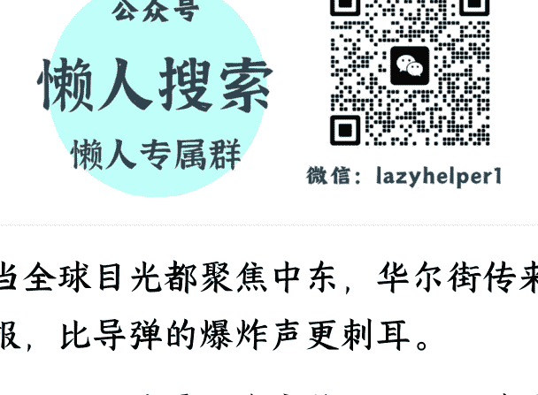

# 贝莱德限制赎回，金融危机的先兆？

2026 年 3 月 11 日 文/卢克文工作室嘉宾 壹壹壹

整理：公众号懒人搜索，懒人专属群精选

懒人微信：lazyhelper1

当全球目光都聚焦中东，华尔街传来的警报，比导弹的爆炸声更刺耳。

近期，全球最大资产管理公司贝莱德旗下一只私人信贷基金，遭遇赎回压力，已启动赎回额度限制。消息一出，市场立刻出现两种截然相反的声音：一派认为：贝莱德的资金出现问题，华尔街要爆雷了。另一派则称，这只是基金正常机制。

那么，真相究竟如何？

## 01

贝莱德是谁？全球最大的资产管理公司，管着 14 万亿美元，如果把资产数字比作 GDP，它能排到世界第三，仅次于美国和中国。

在金融市场中，贝莱德具有风向标意义。

此次触发市场担忧的，是贝莱德旗下的 HPS 企业贷款基金（HLEND）。

这是一只投资美国中型企业贷款的私人信贷基金，2025 年 7 月被贝莱德收购后成为其旗舰产品，目前管理资产规模约 260 亿美元，是同类产品中体量最大的基金之一。

3 月 7 日，贝莱德向投资者公告：这只基金遭遇了罕见的集中赎回。本季度申请赎回的基金份额达到总份额的 9.3%，对应金额约 12 亿美元。但贝莱德只批准了 5% 份额的赎回，兑付约 6.2 亿美元。相当于有近 6 亿美元资金被“锁”在基金里，投资者只能排队等到下个季度再来取钱。

需要强调一点：这可不是贝莱德玩不起了，临时“封门”，而是基金从一开始就写进规则里的正常操作。

HLEND 最初的基金招股书里，就明确规定：基金每季度开放一次赎回，且单次赎回比例上限为流通份额的 5%，该条款也已在美国证券交易委员会正式备案。

这类私募信贷基金的底层资产，主要是不能公开交易、期限长达数年的企业直接贷款，无法像股票、债券那样随时快速变现。如果不设置赎回上限，一旦大量投资者集中赎回，基金没有足够现金兑付，就只能在二级市场低价甩卖这些企业贷款。恐慌性抛售会进一步压低资产价格，不仅无法足额兑现，还会拉低基金净值，让所有继续持有的投资者蒙受损失。

因此，设置季度赎回上限，是为了防止挤兑式抛售，保护所有投资者利益的硬性风控机制。

既然是正常操作，为何这次会被媒体评价为华尔街“爆雷”，引发轩然大波？关键就在于：以前赎回基本都在 5% 以内，基金靠日常现金流就能稳稳接住。但这一次，赎回份额飙到 9.3%，直接突破警戒线。

私人信贷投的是不公开交易的企业贷款，价格不透明。一旦市场担心经济前景、企业还不上钱，资金就会想扎堆跑路。9.3% 不是数字，是信号：恐慌，已经从暗处冲到明面上。

## 02

好端端的，为什么会恐慌？大家到底在怕什么？答案，就藏在 HLEND 基金贷款的那些企业里。

私人信贷基金喜欢给软件科技类公司贷款，它最早也是靠着这个“捡漏”机会发展起来的。2008 年金融危机后，银行被管得特别严，不敢再轻易给中型企业放贷，这就留下了一个巨大的资金空当。

大量科创类企业嗷嗷待哺，嗅觉敏锐的私人资本，比如黑石、贝莱德这些公司，立刻带着养老金、保险金和高净值人群的钱杀了进去。它们不像银行受那么多监管束缚，可以更灵活地放贷。

一边给投资者高达 8% 到 10% 的利息，一边承诺每季度可以取走基金份额的 5%，让你感觉钱还是活的。如此一来，原本一锁就是十年八年的企业贷款，被包装成了专供富人的高息“理财产品”。在之后十几年的低利率时代，传统债券收益在 4% 以下（包括公司债），私人信贷的高回报就显得格外诱人，规模像吹气球一样膨胀起来，从 2000 年的 460 亿美元一路狂飙到现在的 2.3 万亿美元。

仅贝莱德一家，就构建起了一个管理着超过 2200 亿美元资产的私人信贷帝国。

然而，这套曾经战无不胜的模式，如今撞上了暗礁——那些被私人基金视为“现金牛”的软件科技公司，价值竟然可以一夜归零。

软件公司一直是私人信贷的宠儿。它们按月或按年收会员费，客户一签就长期续费，生意就像稳定收租；而且企业用惯了一套软件就很难替换，黏性极强。在高增长时期，基金甚至不看你现在赚不赚钱，只看你已经锁定了多少未来的会员费收入。这就意味着，那些还在亏损但增长很快的软件公司，也能轻松借到钱。

但现在，AI 把软件公司的“钱景”打没了。

以 HLEND 的贷款公司 Kyriba 为例，这是一家成立于 2000 年的云财资管理软件公司，帮企业管理现金流和支付，亚马逊、EA 游戏、达索都是它的客户。但 AI 时代来了，企业开始指望软件自动干活，而不是仅仅记录数据。

今年 2 月底，Anthropic 推出 Claude AI，能处理银行系统那些古老代码——过去只有少数专家看得懂，银行每年得给 IBM 这种软件服务公司送天价维护费。现在 AI 能自己干，企业就不需要再给软件公司交年费，还要雇员工点开页面亲自干活，Kyriba 的增长故事就讲不下去了。

更要命的是高杠杆下的脆弱，私募收购这类软件公司时钱是借来的，就像贷款买房，月供压得死死的，但房价跌到脚脖子，把房子卖了，都不够还贷款利息。

根据 HLEND 披露的最新持仓报告（截至 2026 年 1 月 31 日），Kyriba 贷款的公允价值被标记为 -16.1 亿美元。遥想 2021 年，Kyriba 估值高光时刻在 60 亿美元左右。

而这并非孤例。贝莱德旗下另一只基金的 2500 万美元贷款，投给了名为 Infinite Commerce Holdings 的“亚马逊聚合商”，一个在疫情期间专门收购第三方小店铺、试图做成品牌集团的企业。

亚马逊聚合商曾因疫情线上购物爆发而风光一时。但随着需求回落、关税推高成本，整个行业迅速崩盘。Infinite Commerce 正是死在了需求下滑和库存积压上。

今年 3 月初，贝莱德旗下基金正式公布将这笔贷款的价值全额减记为零。消息一经公布，贝莱德股价当天暴跌近 7%，随后又爆出赎回风波。这种巨无霸出事，华尔街要完？

出问题的真不是它一家。

黑石旗下的同类基金，赎回申请冲到 7.9%，被迫自己掏 4 亿美元填窟窿，蓝猫头鹰更狠，直接暂停赎回，转而给投资者打“欠条”（延迟支付凭证）。连锁反应迅速蔓延，KKR、凯雷、阿波罗等一票资管巨头股价一天内普遍下跌 5-6%。

金融市场里信心比黄金更贵。巨头们都接二连三出事，大家猛然醒悟，那看似随时能取的“活期存折”，真到用钱时可能就是一张白条。

越这么想，越要抢着取，挤兑的恶性循环就这么开始了。

## 03

尽管“影子银行”的风险让人们嗅到了金融危机的气息，但情况还没有失控。

原因在于，私人信贷行业超过 90% 的资金来自机构投资者，这些钱通常有长期锁定期，不存在随时赎回的压力。此外，整个市场还有超过 5000 亿美元的未动用资金，即便出现贷款抛售或资产调整，也有充足的资金可以接盘。

当然，风险的传导链仍不容忽视。

有人会说：AI 现在砸软件的饭碗，那把贷给软件公司的钱，转投 AI 公司不就行了？毕竟 AI 这么火，美国一年就砸了近 6000 亿美元，这么大一笔钱，够 SpaceX 发射 8100 多次猎鹰 9 号。要知道，2025 年一整年，SpaceX 总共才发射了 167 次，8100 次等于连续发射 48 年。

实际上，资管巨头下手比我们想象的更快。但 AI 进步太快，狠起来连自己的饭碗都砸。

上文提到的蓝猫头鹰（Blue Owl，资管规模超 3000 亿美元），一早就找到了 Meta，商量建 AI 数据中心，预算 270 亿美元。Meta 要搞数据中心，但 Meta 不想全掏现金，它想把钱省下来回购股票、发分红。于是去找机构借钱。

蓝猫头鹰牵头组局，钱从它管的那些基金里来，包括私人信贷基金。为了融到这笔巨款，Meta 签了个叫“剩余价值担保”（RVG）的东西。大白话解释：蓝猫头鹰害怕借钱给 Meta 盖楼，楼归我，你 Meta 租着用。但如果将来 AI 泡沫破了，这楼没人要了，怎么办？

Meta 签了这个协议，如果未来 AI 泡沫破了，数据中心不值钱了，剩下的窟窿由 Meta 自己掏现金补上。换句话说，风险根本没转移，只是被藏进了财报的附注里。表面上是 Blue Owl 在放贷，实际上兜底的还是 Meta。

几百亿建的数据中心，为什么会不值钱？我们以为金贵无比的数据中心，其实是个“高科技快消品”。

数据中心最值钱的是里面的芯片、服务器、液冷系统。英伟达的 GPU，2-3 年就换一代。你现在花几百亿建的楼，3 年后设备就落后了，5 年后可能没人愿意用。

AI 技术路线也在剧烈变动。OpenAI、Google 的模型训练需求，今年要 A 架构，明年要 B 架构。数据中心的硬件是固定的，跟不上。

更魔幻的是，楼建好了可能没电用。2026 年规划的 16GW 算力数据中心容量，30%-50% 可能延期，因为电网跟不上。美国甚至可能出新规：数据中心要承担 100% 的电网升级成本。楼建好了，没电，这楼还值钱吗？

所以针对这笔“影子债务”，审计机构安永虽然签了字，却给它贴上了 CAMs（关键审计事项）的标签。这在审计界等同于免责声明——这笔账做得很激进，以后暴雷了别怪我没提醒。

早在去年三季度，这 270 亿大单就引起华尔街恐慌，传统私募资金一般锁死 10 年，不怕流动性危机。但蓝猫头鹰这次用的钱，很多来自要求半流动性的投资人。现在恐慌的人要求赎回，单季赎回请求高达 17%，蓝猫头鹰已被迫停止赎回。

就在华尔街盯着 AI 泡沫会不会破的时候，中东那边炸了。

霍尔木兹海峡通行量暴跌，国际油价一举冲破 111 美元/桶，创下近四年新高。科威特、阿联酋被迫减产，400 多艘油轮堵在海湾里动弹不得。

通胀又回来了，美联储更难降息了。本来市场还盼着今年降息救市，现在油价一飞冲天，通胀压不下来，美联储只能硬扛着高利率不松手。

对私人信贷来说，高利率意味着企业融资成本更高，违约风险更大，基金手里的贷款只会越来越烫手。

> 高盛前掌门布兰克费恩前几天说了一句话：“还没感受到风暴，但马厩里的马已经开始嘶鸣。”

现在这马，一边被 AI 吓得尥蹶子，一边被油价烫得直跳。华尔街那 5000 亿的“弹药”够不够接住这盘棋，真不好说。

---

绝大多数人只盯着眼前的工资，却不知道一次远在中东的冲突、一次降息的决议，就能在一夜之间洗牌普通人的财富。

看懂宏观，是为了在周期切换时，不被当作代价。

如果你认同这种“抬头看路”的长期主义，欢迎围观我的个人情报智库：【懒人专属群】。

圈子已稳定运行 7 年。我们每天过滤全网最顶级的政经内参、大 V 付费研报，剔除情绪噪音，只保留能指导资产配置和商业决策的真实信号。做你最冷酷的“外部大脑”。

⚠️ 查阅圈子最新宏观内参目录：

https://hk57gvlx7u.feishu.cn/docx/H0kRdZbSbolBR0xkaXtcuVE0nTg

拒绝伸手党，只识有缘人。扫码加我微信，备注：【破局上车】

微信：lazyhelper1